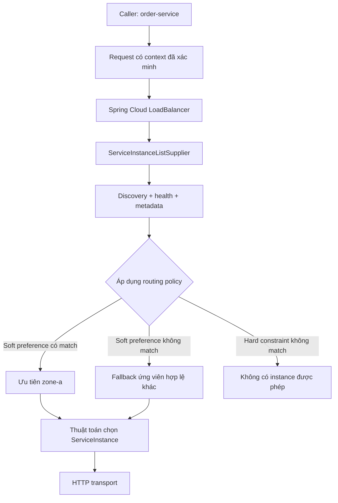
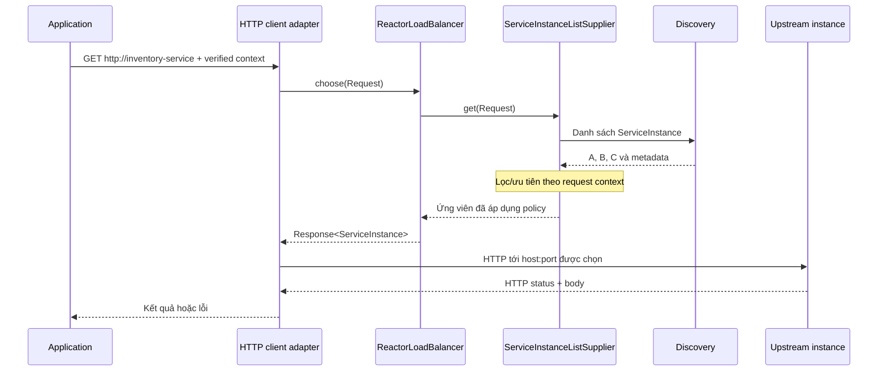
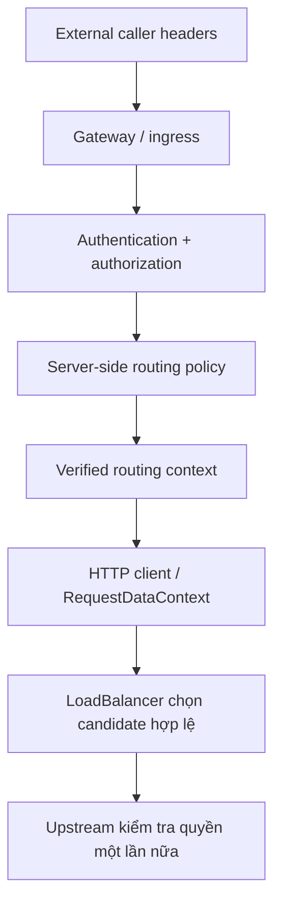
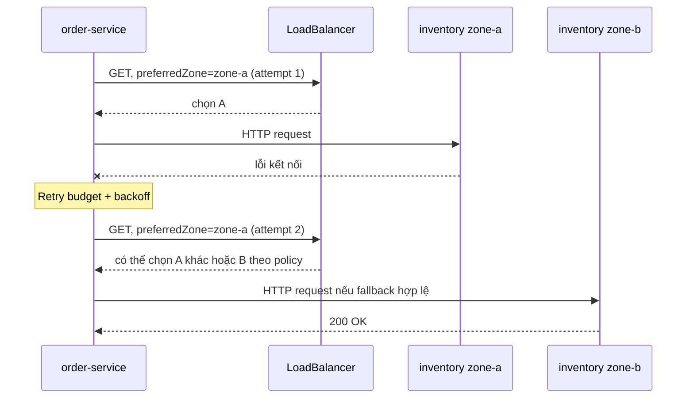

# Đọc ngữ cảnh yêu cầu để chọn bản sao phù hợp

Trong Spring Cloud LoadBalancer, hai lời gọi cùng sử dụng service ID `inventory-service` không nhất thiết phải được chuyển đến cùng một nhóm bản sao. Ví dụ, một request kiểm tra tồn kho đến từ vùng `zone-a` có thể ưu tiên các instance cùng vùng để giảm độ trễ; một request xuất báo cáo có thể được ưu tiên đến nhóm replica dành cho batch; còn một tenant chịu yêu cầu lưu trú dữ liệu bắt buộc chỉ được xử lý ở một khu vực nhất định.

Những quyết định này không thể dựa hoàn toàn vào danh sách instance tĩnh. LoadBalancer cần **đọc ngữ cảnh của từng request**, kết hợp ngữ cảnh đó với thông tin `ServiceInstance` từ discovery, health check và metadata, rồi chọn bản sao phù hợp. Tuy nhiên, một header do client bên ngoài tự khai không thể mặc nhiên trở thành chính sách định tuyến đáng tin cậy.

Bài học thuộc chương **Tùy biến LoadBalancer** của module `SPRING_CLOUD_SERVICE_COMMUNICATION_LOAD_BALANCING`. Mục tiêu là hiểu:

- Ngữ cảnh của lời gọi HTTP được đưa đến Spring Cloud LoadBalancer bằng cơ chế nào.
- Phân biệt service ID, `Request` của LoadBalancer, `RequestDataContext`, HTTP header, Reactor Context và `ServiceInstance` metadata.
- Tùy biến `ServiceInstanceListSupplier` để đọc request context và lọc/ưu tiên replica, thay vì nhúng thuật toán định tuyến vào từng HTTP client.
- Phân biệt **soft preference** (có thể fallback) và **hard constraint** (không được fallback sai chính sách).
- Giữ đúng hành vi trên `RestClient`, `WebClient`, OpenFeign khi có retry, timeout, health/discovery, security và observability.

## 1. Vấn đề thực tế: một service ID, nhiều replica có metadata khác nhau

Giả sử `order-service` cần gọi:

```http
GET http://inventory-service/api/items/42
```

Discovery cung cấp bốn `ServiceInstance`:

| Instance | Zone | Nhóm công việc | Health |
|---|---|---|---|
| `inventory-a1` | `zone-a` | `online` | Healthy |
| `inventory-a2` | `zone-a` | `online` | Healthy |
| `inventory-b1` | `zone-b` | `online` | Healthy |
| `inventory-b2` | `zone-b` | `batch` | Healthy |

Các thuộc tính `zone` và `workload` trong bảng là **metadata ví dụ** được registry/triển khai cung cấp, không phải các key luôn tồn tại mặc định trong mọi discovery provider. Nếu muốn dùng chúng để định tuyến, phải định nghĩa cách gắn nhãn và kiểm tra tính chính xác khi triển khai.

Hai yêu cầu độc lập đến `inventory-service`:

1. `GET` tương tác từ `order-service` ở `zone-a` nên **ưu tiên** `inventory-a1/a2`. Nếu zone A không còn bản sao khỏe, chính sách cho phép chuyển sang zone B.
2. Dữ liệu của tenant `tenant-eu` bắt buộc ở `region-eu`. Khi region EU không có bản sao khỏe, request phải **thất bại có kiểm soát**, không được tự chuyển sang region khác.

Điểm cốt lõi là chính sách của ví dụ 1 và 2 khác nhau: **ưu tiên** không giống **điều kiện bắt buộc**.



Không nên thay một luật hard constraint bằng câu “cứ chọn instance còn sống” bởi vậy có thể vi phạm giới hạn tenant, vùng dữ liệu hoặc bảo mật.

## 2. Ngữ cảnh request gồm những gì?

Từ “context” trong hệ sinh thái Spring dễ gây nhầm vì có nhiều cơ chế:

| Nguồn | Vị trí / vòng đời | Quan hệ với LoadBalancer |
|---|---|---|
| **HTTP headers** | Gửi trong HTTP request qua mạng, ví dụ `Accept`, `X-Preferred-Zone`. | Có thể được adapter chuyển thành `RequestData` để lựa chọn đích; bản thân header chưa chứng minh giá trị đáng tin. |
| **HTTP method, URI, attributes** | Dữ liệu cụ thể của lời gọi; một số attribute chỉ tồn tại phía caller. | Một số integration có thể đưa chúng vào request context của LoadBalancer. |
| **LoadBalancer `Request<T>`** | Đối tượng request logic được truyền vào `choose(Request)`/`get(Request)`. | Là đầu vào trực tiếp cho chính sách chọn instance khi integration cung cấp. |
| **`RequestDataContext`** | Context của Spring Cloud LoadBalancer chứa `RequestData` và thông tin bổ sung theo API. | Có thể truy cập request headers/method/URI ở những đường tích hợp cung cấp context này. |
| **Reactor Context** | Gắn với một subscription của Reactor. | **Không tự động đồng nhất** với `RequestDataContext`; phải dùng integration thích hợp nếu muốn chuyển metadata sang LB. |
| **Security Context** | Thông tin xác thực/ủy quyền được ứng dụng xử lý. | Là nguồn xác minh chính sách, không phải HTTP header tùy ý do người dùng điền. |
| **`ServiceInstance.getMetadata()`** | Thông tin mô tả instance lấy từ registry/provider. | Dùng để đối chiếu với yêu cầu định tuyến, ví dụ zone/role/region. |

**Ngữ cảnh bên gọi** trả lời *request cần gì*; **metadata của instance** trả lời *bản sao có thuộc tính gì*. LoadBalancer cần so sánh hai phía:

```text
verified request context: preferredZone = zone-a
ServiceInstance metadata: zone = zone-a
=> instance thỏa ưu tiên
```

Không nên mặc định Reactor Context được chuyển thành HTTP headers: đây là hai cơ chế khác nhau. Tương tự, `ClientRequest.attribute(...)` của WebClient không tự thành `RequestDataContext` trong mọi phiên bản/adapter.

## 3. Luồng dữ liệu qua Spring Cloud LoadBalancer

Ở mức khái niệm, một đường gọi HTTP sử dụng service ID đi qua:



Tùy phiên bản/tầng tích hợp, quá trình trên có thể gồm cache, health filter, zone preference, retry và nhiều `ServiceInstanceListSupplier` ghép chuỗi. Ý tưởng không đổi: **đối tượng `Request` phải đi tới nơi áp dụng policy** nếu muốn chọn replica theo dữ liệu từng lời gọi.

Các SPI thường gặp:

- `ReactorServiceInstanceLoadBalancer.choose(Request)`: điểm quyết định cuối để chọn một instance; nhiều triển khai dùng một supplier và thuật toán round robin/random/weighted.
- `ServiceInstanceListSupplier.get(Request)`: lấy danh sách candidate, có thể xét request context để **lọc** trước khi thuật toán chọn.
- `DelegatingServiceInstanceListSupplier`: giúp bọc một nguồn instance đã có thay vì tự viết discovery và cache từ đầu.
- `RequestDataContext`/`RequestData`: cách một số HTTP integration chuyển thông tin request vào LoadBalancer.
- `@LoadBalancerClient`: đăng ký cấu hình dành cho một service ID cụ thể, tránh làm ảnh hưởng tất cả downstream.

Tên class, hàm và cách cấu hình supplier thay đổi theo release của Spring Cloud. Các ví dụ sau minh họa cách xây chính sách với API thường gặp ở Spring Cloud LoadBalancer hiện đại; **cần đối chiếu với BOM cụ thể và chạy test integration trong project**, nhất là khi áp dụng cho cả blocking và reactive clients.

## 4. Đọc RequestDataContext thay vì dựa vào ThreadLocal

Khi một HTTP adapter cung cấp `RequestDataContext`, code tại LoadBalancer có thể đọc headers từ `RequestData`. Minh họa helper:

```java
import org.springframework.cloud.client.loadbalancer.Request;
import org.springframework.cloud.client.loadbalancer.RequestDataContext;

final class RoutingContextReader {

    private static final String HEADER =
        "X-Internal-Preferred-Zone";

    private RoutingContextReader() {}

    static String preferredZone(Request request) {
        if (request == null
                || !(request.getContext()
                     instanceof RequestDataContext dataContext)) {
            return null;
        }

        String raw = dataContext.getClientRequest()
            .getHeaders()
            .getFirst(HEADER);

        if (raw == null) {
            return null;
        }

        return switch (raw) {
            case "zone-a", "zone-b" -> raw;
            default -> null;
        };
    }
}
```

Trong đoạn mã trên:

1. `Request` là đối tượng ở **lớp LoadBalancer**, không phải `HttpServletRequest` của controller.
2. `getContext()` được kiểm tra kiểu trước khi truy cập; một adapter hoặc loại request khác có thể không dùng `RequestDataContext`.
3. Chỉ cho phép một tập giá trị đã biết, tránh dữ liệu dài hoặc định dạng bất thường làm thay đổi routing/logging.
4. **Header này chỉ được coi là “internal” nếu caller/gateway đã kiểm tra và tự gắn sau khi loại bỏ giá trị cùng tên từ người dùng bên ngoài.** Tên `X-Internal-*` không tự mang lại tính đáng tin.
5. Khi thiếu hoặc không nhận diện context, helper trả `null` để caller chính sách lựa chọn hành vi phù hợp.

Nếu cần zone theo vị trí của caller, tốt hơn là lấy từ metadata deployment đáng tin của `order-service` hoặc policy đã kiểm tra, không chấp nhận `X-Preferred-Zone` do người dùng tùy ý gửi để quyết định vùng xử lý. Nếu cần chọn tenant-specific region, hãy suy ra từ identity/claim đã xác thực và policy phía server.

### Vì sao không dùng MDC/ThreadLocal để chọn instance?

Trong `WebClient`, quá trình chọn instance có thể chạy trong reactive chain trên scheduler không cố định. Dữ liệu đặt trong `ThreadLocal` ở controller không chắc còn tồn tại ở bước `choose(Request)`. Với `RestClient` và OpenFeign blocking, ThreadLocal có thể hoạt động trong một số đoạn đồng bộ nhưng vẫn dễ bị rò qua thread pool/retry/async và không phải API mang context rõ ràng của LoadBalancer.

**Ưu tiên thông tin nằm trong request context được integration truyền tường minh**, và dùng Reactor Context/Spring Security context đúng chỗ để xây một **routing decision đã xác minh** trước khi đi vào LB.

## 5. Ví dụ: ServiceInstanceListSupplier lọc theo zone ưu tiên

Giả sử đây là một **soft preference**, không phải yêu cầu bảo mật: nếu có instance healthy cùng zone, dùng nhóm đó; nếu không thì có thể fallback sang các ứng viên khác đã qua các bộ lọc hợp lệ.

Ta có thể đặt một supplier tùy chỉnh bao quanh supplier discovery:

```java
import java.util.List;
import org.springframework.cloud.client.ServiceInstance;
import org.springframework.cloud.client.loadbalancer.Request;
import org.springframework.cloud.loadbalancer.core.DelegatingServiceInstanceListSupplier;
import org.springframework.cloud.loadbalancer.core.ServiceInstanceListSupplier;
import reactor.core.publisher.Flux;

public final class PreferredZoneServiceInstanceListSupplier
        extends DelegatingServiceInstanceListSupplier {

    public PreferredZoneServiceInstanceListSupplier(
            ServiceInstanceListSupplier delegate) {
        super(delegate);
    }

    @Override
    public Flux<List<ServiceInstance>> get() {
        return delegate.get();
    }

    @Override
    public Flux<List<ServiceInstance>> get(Request request) {
        String zone = RoutingContextReader.preferredZone(request);

        return delegate.get(request).map(instances -> {
            if (zone == null || instances.isEmpty()) {
                return instances;
            }

            List<ServiceInstance> preferred = instances.stream()
                .filter(instance -> zone.equals(
                    instance.getMetadata().get("zone")))
                .toList();

            // Chỉ đúng cho SOFT preference.
            // Khi không có match, vẫn dùng candidate hợp lệ ban đầu.
            return preferred.isEmpty() ? instances : preferred;
        });
    }
}
```

Code giả định Java 17+, metadata registry có key `zone` được chuẩn hóa và API supplier của Spring Cloud tương ứng. Nếu metadata key bị thiếu, instance đó không match zone; nhưng vẫn có thể tham gia fallback. Phân vùng theo zone không đồng nghĩa instance luôn khỏe — cần kết hợp health/discovery.

**Lý do dùng `delegate.get(request)` thay vì chỉ `delegate.get()`:** các supplier phía dưới có thể đã cần request context, ví dụ hint/affinity hoặc các bộ lọc khác. Nếu bỏ mất `Request` ở một mắt xích, chính sách request-aware có thể ngừng hoạt động mà không có exception rõ ràng.

### Phải xử lý thứ tự supplier

Một chuỗi supplier có thể có:

```text
Discovery -> cache -> health filtering -> request-aware zone filter -> choose()
```

Thứ tự cụ thể phải căn cứ vào cách Spring Cloud builder và các supplier hiện hữu được ghép trong phiên bản dùng. Nếu một supplier cache **danh sách đã cá nhân hóa theo request** bằng một key chỉ chứa service ID, request `zone-a` có thể vô tình tái sử dụng kết quả của `zone-b`. Vì vậy:

- Nên cache tập instance chung theo service ID/discovery trước, rồi áp dụng bộ lọc phụ thuộc **request** trên từng invocation.
- Không cache kết quả riêng theo tenant/zone bằng một cache toàn service ID không phân biệt key.
- Nếu hard constraint áp dụng ở nhiều tầng, đảm bảo filter không bị một supplier fallback phía sau “khôi phục” instance bị cấm.
- Các health checks phải giới hạn ở những instance thực sự eligible, không chỉ có metadata đúng.

Một cách suy nghĩ an toàn là coi mỗi bước chỉ thu hẹp **tập ứng viên đã qua các điều kiện bắt buộc**; fallback chỉ được phép trong phần tập đó.

## 6. Đăng ký cấu hình riêng cho service ID

Không phải mọi downstream đều có metadata `zone` hoặc cần routing policy giống `inventory-service`. Do đó, cấu hình custom supplier nên được áp dụng theo đúng service ID.

Ví dụ tại ứng dụng `order-service`:

```java
import org.springframework.boot.autoconfigure.SpringBootApplication;
import org.springframework.boot.SpringApplication;
import org.springframework.cloud.loadbalancer.annotation.LoadBalancerClient;

@SpringBootApplication
@LoadBalancerClient(
    name = "inventory-service",
    configuration = InventoryLoadBalancerConfiguration.class)
public class OrderApplication {

    public static void main(String[] args) {
        SpringApplication.run(OrderApplication.class, args);
    }
}
```

Lớp cấu hình của riêng LoadBalancer context:

```java
import org.springframework.cloud.loadbalancer.core.ServiceInstanceListSupplier;
import org.springframework.context.ConfigurableApplicationContext;
import org.springframework.context.annotation.Bean;

// Đặt lớp này ngoài phạm vi component scan của ứng dụng chính.
public class InventoryLoadBalancerConfiguration {

    @Bean
    ServiceInstanceListSupplier inventorySupplier(
            ConfigurableApplicationContext context) {

        ServiceInstanceListSupplier discovery =
            ServiceInstanceListSupplier.builder()
                .withDiscoveryClient()
                .build(context);

        return new PreferredZoneServiceInstanceListSupplier(
            discovery);
    }
}
```

Đây là cách tổ chức **minh họa** để thấy ranh giới trách nhiệm. Trong ứng dụng thật, có thể dùng thêm cache và health check supplier tương thích, và phải kiểm tra các bean khác do auto-configuration tạo để tránh có hai supplier cạnh tranh không rõ bean được chọn. Đừng đặt một `@Configuration` chỉ dành cho `inventory-service` trong package bị `@SpringBootApplication` scan như một cấu hình global rồi mặc nhiên nghĩ rằng `@LoadBalancerClient` sẽ cô lập nó. Hãy bố trí riêng package hoặc exclude khỏi component scan chính.

Nếu dự án có nhiều service IDs, mỗi service có thể dùng cấu hình khác nhau:

```text
inventory-service -> request-aware preferred zone
payment-service   -> hard region/authorization policy đã kiểm chứng
catalog-service   -> round robin/weighted policy thông thường
```

Không cần viết supplier cho mọi service nếu cơ chế tích hợp sẵn đã đáp ứng yêu cầu. Spring Cloud LoadBalancer có các supplier hỗ trợ hint/zone/sticky-session tùy phiên bản; nên ưu tiên giải pháp có sẵn trước khi tạo thuật toán custom.

## 7. Soft preference và hard constraint: khác biệt sống còn

Mẫu trên cố ý fallback sang toàn bộ candidate nếu không match zone. Điều này **chỉ hợp lệ khi zone là ưu tiên mềm**, ví dụ giảm độ trễ.

| Quy tắc | Có thể fallback sang zone khác? | Khi không có instance match |
|---|---|---|
| Ưu tiên cùng zone để giảm latency | Có, nếu policy cho phép. | Chọn từ tập healthy/eligible còn lại. |
| Ưu tiên bản sao cache-warm | Có thể, nếu đọc từ replica khác vẫn đúng hợp đồng. | Bỏ ưu tiên cache-warm. |
| Region bắt buộc theo data residency | **Không.** | Fail closed; trả lỗi có kiểm soát. |
| Tenant chỉ được tới nhóm instance đã cấp quyền | **Không.** | Không chọn instance trái quyền. |
| API batch chỉ được xử lý ở worker chuyên dụng | Tùy hợp đồng, thường không nếu worker khác không hỗ trợ API. | Trả lỗi capacity/no eligible candidate hoặc chuyển job vào queue riêng. |

Với hard constraint, logic phải khác:

```java
// Pseudocode minh họa hard constraint đã được xác minh.
List<ServiceInstance> allowed = candidates.stream()
    .filter(instance -> verifiedRegion.equals(
        instance.getMetadata().get("region")))
    .toList();

if (allowed.isEmpty()) {
    // Không tự lấy lại toàn bộ candidates!
    return List.of();
}
return allowed;
```

`verifiedRegion` **phải** đến từ policy server đã xác thực, không phải một header không rõ nguồn. Nếu mất ngữ cảnh bắt buộc, không nên coi đó là “không có ưu tiên” và cho phép toàn bộ instance. Phải quyết định fail closed tại đúng ranh giới — lý tưởng là kiểm tra quyền/vùng ở tầng application/security **trước khi** gọi LoadBalancer để có thông báo lỗi phù hợp; downstream vẫn phải kiểm tra authorization và data residency của chính nó.

**Quan trọng:** `ServiceInstanceListSupplier` trả danh sách rỗng không tự chứng minh lý do. Có thể do discovery rỗng, health filter loại hết, hoặc hard policy không có candidate. Hãy instrument lý do ở lớp policy để không đánh đồng “không còn server” với “tenant không được phép sang region khác”.

## 8. Đảm bảo dữ liệu routing thực sự đáng tin

Giả sử một client từ Internet gửi:

```http
GET /api/orders/123 HTTP/1.1
Host: order.example.test
X-Internal-Preferred-Zone: zone-b
X-Tenant-ID: another-tenant
```

Những header này là **dữ liệu do client kiểm soát**. Đặt tên `X-Internal-*` không làm chúng trở nên tin cậy. Nếu gateway chỉ copy header đến `order-service`, một thuật toán định tuyến sử dụng trực tiếp các giá trị này có thể vô tình cho caller tác động vào vị trí xử lý, loại instance hoặc tenant.

Quy trình an toàn hơn:



Thực hành:

1. **Bỏ hoặc ghi đè các header routing nhạy cảm từ request bên ngoài** tại trust boundary.
2. Xác định region/tenant từ identity đã xác thực và dữ liệu policy của server, có thể kết hợp metadata caller deployment đáng tin.
3. Nếu cần truyền dữ liệu qua HTTP nội bộ, dùng kết nối tin cậy, authentication của workload hoặc token/claim phù hợp; downstream không được tin một header tùy ý.
4. Giới hạn giá trị, độ dài, định dạng và tập metadata keys; không dùng raw user input làm log metric tags hoặc policy hard.
5. Giữ quy tắc authorization ở upstream. LoadBalancer là bộ chọn instance, **không phải hệ thống cấp quyền**.

Nếu `X-Internal-Preferred-Zone` được tạo ở caller, nó cũng sẽ có thể được gửi như HTTP header tới downstream nếu không có filter loại bỏ sau khi LoadBalancer đọc. Không dùng nó để chứa secret hoặc dữ liệu cá nhân. Nếu muốn metadata chỉ lưu nội bộ, cần dùng cơ chế context/adapter phù hợp thay vì gắn mọi thứ vào outbound headers và hy vọng nó không qua mạng.

## 9. Mang ngữ cảnh đến LoadBalancer từ WebClient

Với WebClient, dùng bean được tạo từ `@LoadBalanced WebClient.Builder`:

```java
import org.springframework.cloud.client.loadbalancer.LoadBalanced;
import org.springframework.context.annotation.Bean;
import org.springframework.context.annotation.Configuration;
import org.springframework.web.reactive.function.client.WebClient;

@Configuration
class WebClientConfiguration {

    @Bean
    @LoadBalanced
    WebClient.Builder loadBalancedWebClientBuilder() {
        return WebClient.builder();
    }

    @Bean
    WebClient inventoryWebClient(
            @LoadBalanced WebClient.Builder builder) {
        return builder.clone()
            .baseUrl("http://inventory-service")
            .build();
    }
}
```

Sau khi business/service layer tính được `preferredZone` từ policy hợp lệ:

```java
Mono<ItemDto> findItem(
        WebClient inventoryWebClient,
        String itemId,
        String verifiedPreferredZone) {

    return inventoryWebClient.get()
        .uri("/api/items/{id}", itemId)
        .headers(headers -> headers.set(
            "X-Internal-Preferred-Zone", verifiedPreferredZone))
        .retrieve()
        .bodyToMono(ItemDto.class);
}
```

Khi integration của `@LoadBalanced WebClient.Builder` tạo một LB `RequestDataContext` từ `ClientRequest`, custom supplier trong mục 5 có thể đọc header ở từng lời gọi. Cần kiểm chứng bằng integration test của phiên bản đang dùng: không giả định mọi filter thứ ba, codec hoặc bản tùy chỉnh HTTP connector đều truyền context giống nhau.

### Reactor Context không tự được Spring Cloud LoadBalancer đọc

Ví dụ reactive service lưu:

```java
return inventoryGateway.findItem(itemId)
    .contextWrite(context ->
        context.put("preferredZone", verifiedPreferredZone));
```

Điều này **chưa đủ** để `RoutingContextReader` thấy `preferredZone` trong `RequestDataContext`. `Reactor Context` là ngữ cảnh của subscription, khác LB `Request`. Nếu cần lấy từ Reactor Context, một WebClient filter cần đọc qua `Mono.deferContextual(...)`, tạo `ClientRequest` có dữ liệu phù hợp rồi để LoadBalancer integration xử lý. Vị trí filter trong chuỗi có ý nghĩa: filter thêm dữ liệu **phải chạy trước bước chọn instance**.

Ví dụ filter minh họa:

```java
import org.springframework.web.reactive.function.client.ClientRequest;
import org.springframework.web.reactive.function.client.ExchangeFilterFunction;
import reactor.core.publisher.Mono;

static ExchangeFilterFunction verifiedZoneFilter() {
    return (request, next) ->
        Mono.deferContextual(context -> {
            String zone = context.getOrDefault(
                "verifiedPreferredZone", "");

            if (!zone.equals("zone-a")
                    && !zone.equals("zone-b")) {
                return next.exchange(request);
            }

            ClientRequest enriched = ClientRequest.from(request)
                .headers(headers -> headers.set(
                    "X-Internal-Preferred-Zone", zone))
                .build();

            return next.exchange(enriched);
        });
}
```

Filter cần được gắn vào `inventoryWebClient` và kiểm thử thứ tự so với LoadBalancer filter. Không dùng `ThreadLocal` để lấy zone trong pipeline reactive; không giữ zone của người dùng này trong WebClient singleton/defaultHeader dùng chung, vì có thể rò sang request khác.

**Tùy chọn ít phức tạp hơn:** nếu zone đã biết ở service layer, gắn vào request cụ thể như ví dụ đầu mục này. Reactor Context hữu ích khi có nhiều tầng asynchronous cần truyền một giá trị đã được xác minh nhưng không muốn thêm tham số trên từng phương thức.

## 10. RestClient và OpenFeign: cùng nguyên tắc, adapter khác nhau

### RestClient

Trong hệ thống đồng bộ, `RestClient` được tạo từ builder đã tích hợp Spring Cloud LoadBalancer:

```java
@Bean
@LoadBalanced
RestClient.Builder loadBalancedRestClientBuilder() {
    return RestClient.builder();
}

@Bean
RestClient inventoryRestClient(
        @LoadBalanced RestClient.Builder builder) {
    return builder.clone()
        .baseUrl("http://inventory-service")
        .build();
}
```

Một lời gọi cụ thể:

```java
ItemDto getItem(
        RestClient inventoryRestClient,
        String itemId,
        String verifiedPreferredZone) {

    return inventoryRestClient.get()
        .uri("/api/items/{id}", itemId)
        .headers(headers -> headers.set(
            "X-Internal-Preferred-Zone", verifiedPreferredZone))
        .retrieve()
        .body(ItemDto.class);
}
```

`ItemDto` là DTO do ứng dụng định nghĩa. Cần xác nhận request metadata từ RestClient thực sự được chuyển vào LB `RequestDataContext` ở phiên bản Spring Cloud được sử dụng. Một interceptor chạy sau LoadBalancer selection có thể là **quá muộn** để thay đổi kết quả chọn instance.

### OpenFeign

Với OpenFeign, có thể truyền một header theo request qua method argument:

```java
@FeignClient(
    name = "inventory-service",
    contextId = "inventoryRead"
)
interface InventoryReadClient {

    @GetMapping("/api/items/{id}")
    ItemDto findItem(
        @PathVariable("id") String id,
        @RequestHeader("X-Internal-Preferred-Zone") String zone);
}
```

Và gọi `inventoryReadClient.findItem(itemId, verifiedPreferredZone)` với zone đã được tính từ policy. Hạn chế dùng `RequestInterceptor` đọc một biến `ThreadLocal` toàn cục không được quản lý vòng đời hoặc bean giữ zone thay đổi theo user, vì interceptor có thể chạy đồng thời trên nhiều request.

OpenFeign có thể sử dụng tích hợp LoadBalancer để chọn instance theo `name` nếu không đặt URL cố định. Nếu Feign client khai báo `url` trực tiếp, request có thể đi tới URL đó **mà không qua lựa chọn ServiceInstance theo service ID**. Muốn xác nhận custom supplier chạy, nên dùng test với service ID và inspect selected instance thực tế.

### Không giả định ba client có cùng pipeline

`RestClient` đồng bộ, `WebClient` reactive và OpenFeign có filter/interceptor/adapter khác nhau. API `ServiceInstanceListSupplier.get(Request)` là một điểm gom chung quan trọng, nhưng **không nên kết luận** một filter ở lớp HTTP luôn nhìn thấy context của mọi thư viện. Thử nghiệm riêng từng client loại bỏ các giả định sai về thứ tự và cách bọc `RequestDataContext`.

## 11. Retry, timeout và chọn lại ServiceInstance

Một logical request có thể có nhiều HTTP attempts. Với thuật toán request-aware, chính sách phải **ổn định và an toàn** qua từng attempt:



Ví dụ chỉ phù hợp với `preferredZone` là **soft preference**. Nếu `region-eu` là hard constraint, retry không được chuyển sang một instance ngoài EU, dù instance đó khỏe hoặc đã có connection pool sẵn.

Các điểm cần kiểm soát:

- Retry phải giữ **cùng logical request ID**, identity và policy đã được xác minh; không tính lại region từ một header mới chưa tin cậy.
- Nếu retry nằm **sau** bước chọn host/port, nó có thể thử lại cùng instance và không gọi `choose(Request)` lần nữa.
- Nếu retry bao quanh toàn bộ lựa chọn, supplier có thể chạy lại với request context cũ hoặc mới tùy integration. Hãy kiểm chứng.
- Với thao tác ghi `POST`, request có thể đã được server xử lý trước khi caller timeout: cần idempotency/dedup nếu retry.
- Deadline tổng, per-attempt timeout và retry budget phải giới hạn tải; không retry vô hạn khi hard filter không có instance hợp lệ.
- Không dùng retry để “thử instance khác” nhằm vượt qua `401`/`403` hoặc chính sách quyền truy cập.

### Không có instance và lỗi HTTP 503 là hai chuyện khác nhau

Nếu custom supplier trả danh sách rỗng vì hard policy, LoadBalancer có thể không chọn được instance. Tùy client integration, caller thấy exception hoặc một kết quả tương đương `503` do adapter tạo ra. Điều đó **không chứng minh** upstream thật sự trả HTTP 503. Cần đo `selection_failed`/`no_eligible_instance` khác với `upstream_http_503` để chọn đúng hành vi retry và thông báo lỗi.

## 12. Observability: biết request nào chọn replica nào và vì sao

Mục tiêu của log/tracing là phân biệt:

1. **Service ID:** `inventory-service` được gọi.
2. **Routing input đã kiểm chứng:** `preferredZone=zone-a`, hard vs soft policy.
3. **Danh sách ứng viên sau các bộ lọc:** tổng số healthy/eligible, không cần log toàn bộ metadata.
4. **Instance thực tế được chọn:** `instanceId` nếu có.
5. **Outcome:** HTTP status, transport error, decode error, no instance, retry outcome.

Một log schema minh họa:

```json
{
  "event": "loadbalancer_selection",
  "targetService": "inventory-service",
  "operation": "GET /api/items/{id}",
  "routingPolicy": "preferred-zone",
  "preferredZone": "zone-a",
  "eligibleCandidates": 2,
  "selectedInstanceId": "inventory-a1",
  "attempt": 1,
  "traceId": "4bf92f3577b34da6a3ce929d0e0e4736"
}
```

Trường `selectedInstanceId` phải vắng/null khi không có lựa chọn. Để log đúng lựa chọn, instrument ở LoadBalancer lifecycle hoặc điểm thuật toán đã nhận `ServiceInstance` thực tế; một WebClient/Feign header interceptor không mặc nhiên biết kết quả chọn. Khi log kết quả HTTP, tách `upstream_http_status` và lỗi trước HTTP response.

Không log token, cookie, raw routing claim, secret hay toàn bộ `ServiceInstance.metadata`. Không dùng `traceId`, tenant ID hoặc IP/port của hàng nghìn Pods làm metric label không giới hạn cardinality. Với mục tiêu sizing, đo phân bố lựa chọn theo zone/operation ở mức aggregate và dùng trace có sampling khi cần điều tra một request cụ thể.

## 13. Bài thực hành: viết routing theo request và kiểm tra fallback

Tạo ba replica `inventory-service` trong môi trường test với cùng service ID:

```text
inventory-a1: metadata zone=zone-a, workload=online, healthy
inventory-a2: metadata zone=zone-a, workload=online, healthy
inventory-b1: metadata zone=zone-b, workload=online, healthy
```

Mỗi replica trả về `instanceId` trong endpoint debug **chỉ dùng cho test**. Tại `order-service`, cấu hình `@LoadBalancerClient(name="inventory-service", configuration=...)` với `PreferredZoneServiceInstanceListSupplier`. Gọi qua `@LoadBalanced WebClient.Builder` và thêm header đã được kiểm chứng theo từng request.

| Bài thử | Context đầu vào | Kết quả cần xác minh |
|---|---|---|
| **Zone A có hai replica** | `preferredZone=zone-a` | Chỉ A1/A2 được chọn khi health filter cho phép. |
| **Zone B có một replica** | `preferredZone=zone-b` | Chọn B1 khi metadata/health đáp ứng. |
| **Không có preference** | Header vắng mặt | Sử dụng tập candidate hợp lệ mặc định. |
| **Preference sai định dạng** | `zone-unknown` hoặc chuỗi quá dài | Không đưa raw value vào policy; với soft preference quay về tập hợp lệ. |
| **Zone A bị lỗi health** | Soft preference A; A1/A2 bị loại | Có thể fallback B nếu policy cho phép. |
| **Hard region EU không còn instance** | Region được xác minh từ identity | Không fallback sang region bị cấm; fail closed. |
| **Hai request đồng thời** | Request 1 zone A, request 2 zone B | Không lẫn Context/MDC hoặc cache kết quả của request trước. |
| **Retry cùng request** | A lỗi tạm thời, B còn khỏe | Giữ policy, trace/logical ID; quan sát có chọn lại LB không. |
| **Discovery đổi danh sách** | Scale-in A2, scale-out A3 | Đọc danh sách mới theo cache/refresh policy; không dùng metadata stale vô hạn. |
| **Feign/RestClient tương đương** | Header theo request có kiểm chứng | Xác minh adapter gửi đủ LB context, không chỉ WebClient hoạt động. |
| **Client đặt URL cố định** | Feign `url` thay cho service ID | Xác nhận custom LB không được áp dụng ngoài đường đi mong đợi. |

### Cách xác minh không bị giả định sai

Ghi cho từng lần thử: target service ID, request context đã chuẩn hóa, số candidates trước/sau filter, selected instance ID, HTTP status/exception, retry attempt và total latency. Phân biệt **LoadBalancer chọn được instance** với **HTTP transport gửi thành công**.

Để kiểm tra hiệu ứng cache, gửi luân phiên `zone-a` và `zone-b` với cùng service ID; nếu hệ thống luôn chọn một zone bất chấp header, cần kiểm tra xem supplier có nhận `RequestDataContext` không, filter có chạy trước selection không và cache có vô tình giữ danh sách đã lọc theo request không.

Không chạy kiểm thử dữ liệu tenant thật hoặc thử vượt chính sách tại production; sử dụng identity và metadata giả lập trong môi trường được cô lập.

## 14. Lỗi triển khai thường gặp

| Sai lầm | Hậu quả | Cách sửa |
|---|---|---|
| Đọc header từ request bên ngoài rồi xem là hard policy | Người dùng có thể ảnh hưởng vùng/tenant/replica bất hợp lệ. | Xác minh identity và policy tại server, kiểm soát header ở trust boundary. |
| Dùng `ThreadLocal` cho request-specific route trong WebClient reactive | Mất context khi đổi scheduler, rò dữ liệu giữa request. | Dùng Reactor Context/RequestDataContext qua integration phù hợp. |
| Gắn zone vào WebClient singleton `defaultHeader` từ một người dùng | Giá trị có thể áp lên request khác. | Đặt per-request header/filter, tránh mutable shared state. |
| Dùng `delegate.get()` trong supplier cần request context | Rơi mất dữ liệu mà supplier phía dưới cần. | Dùng `delegate.get(request)` khi API hỗ trợ. |
| Cache candidate list sau khi lọc theo tenant/zone với key service ID | Rò lựa chọn giữa các request. | Cache dữ liệu discovery chung rồi lọc theo request. |
| Fallback hard constraint sang toàn bộ candidates | Vi phạm region/tenant isolation. | Fail closed khi hard filter rỗng; không nới lỏng âm thầm. |
| Đưa cấu hình riêng vào component scan global | Policy áp sang service IDs khác. | Đặt config riêng ngoài scan; dùng `@LoadBalancerClient`. |
| Bỏ qua health check khi dùng metadata zone | Chọn đúng zone nhưng instance đã chết. | Kết hợp discovery/health, đo stale candidates. |
| Chỉ log service ID mà không có instance ID | Không biết request thực tế thử A hay B. | Quan sát tại selection lifecycle và per-attempt. |
| Giả định retry luôn chọn replica khác | Không debug được hot spot hoặc repeated connection failure. | Xác minh retry owner, vị trí choose và selected instance thực tế. |
| Phụ thuộc vào hint/attribute mà HTTP adapter không truyền | Chính sách không chạy như kỳ vọng. | Test riêng RestClient, WebClient, Feign theo BOM đang chạy. |

## 15. Checklist trước khi dùng request-aware LoadBalancer trong production

- Định nghĩa rõ **mục tiêu định tuyến**: zone preference, affinity, workload type hay hard regional isolation.
- Phân biệt soft preference và hard constraint; quy định chính xác hành vi khi không có candidate.
- Xác định nguồn dữ liệu context **đã xác minh** và trust boundary; không dùng user-supplied header như quyền truy cập.
- Hiểu `Request`, `RequestDataContext`, `RequestData` và metadata của `ServiceInstance` ở phiên bản Spring Cloud đang sử dụng.
- Dùng `ServiceInstanceListSupplier.get(Request)` để lọc ứng viên theo request, giữ `Request` khi gọi supplier delegate.
- Ưu tiên sử dụng hint/sticky/zone supplier có sẵn nếu đáp ứng đúng semantics; chỉ custom khi thật sự cần.
- Đặt LoadBalancer configuration riêng theo service ID bằng `@LoadBalancerClient`, tránh component scan global.
- Ghép health, discovery, cache và request-aware filters đúng thứ tự, không cache một danh sách cá nhân hóa bằng key quá rộng.
- Không tự ý mở lại các instance bị hard filter loại bỏ; luôn giữ data residency/tenant/authorization khi retry hoặc failover.
- Với WebClient, không đồng nhất Reactor Context với LB request context; đảm bảo filter/adapter chạy trước lựa chọn instance.
- Với RestClient/OpenFeign, kiểm tra request metadata thực sự tới LB; tránh sai vị trí interceptor và URL cố định bỏ qua LB.
- Đặt retry budget/deadline và phân biệt no-instance với upstream HTTP 503.
- Ghi log service ID, normalized routing policy, candidate count, selected instance và outcome; không lộ secret hoặc metadata nhạy cảm.
- Thử nghiệm cùng lúc nhiều context, discovery thay đổi, health failures, cache, retry same/next instance và hard no-fallback.

**Ghi nhớ:** **request context mô tả yêu cầu định tuyến; `ServiceInstance` metadata mô tả khả năng của các bản sao; Spring Cloud LoadBalancer dùng hai nguồn này để chọn một đích hợp lệ.** Khi tùy biến, hãy đưa ngữ cảnh đã kiểm chứng vào đường `Request → ServiceInstanceListSupplier.get(Request) → choose(Request)`, tách ưu tiên mềm khỏi giới hạn bắt buộc, và kiểm tra việc truyền context qua từng HTTP client. Một thuật toán chọn replica tốt không chỉ chọn đúng nơi khi mọi thứ khỏe mạnh, mà còn **không vi phạm chính sách khi không còn bản sao phù hợp**.
