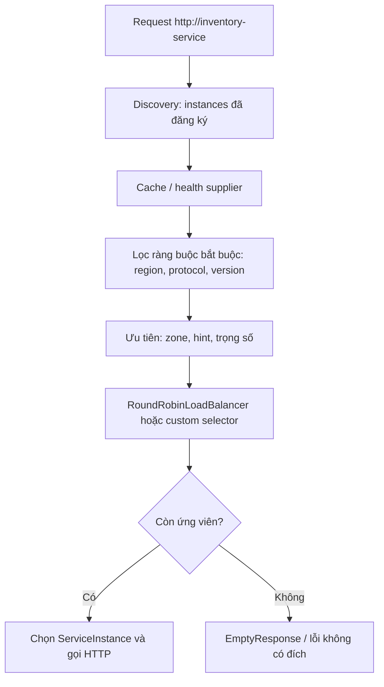
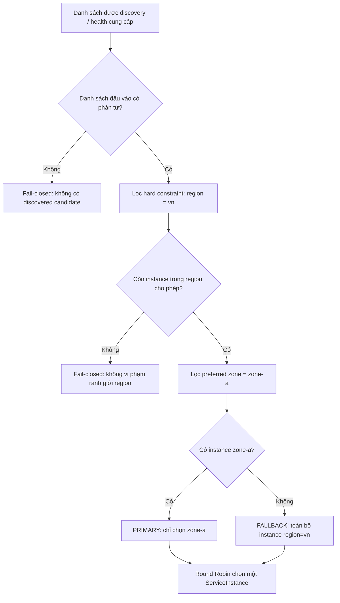

# Xử lý danh sách rỗng và bảo đảm fallback có chủ đích

Trong Spring Cloud LoadBalancer, `order-service` thường gọi `inventory-service` qua **service ID** như `http://inventory-service`. Một chuỗi `ServiceInstanceListSupplier` lấy các bản sao từ discovery, có thể áp dụng cache, health check, zone, version, trọng số hoặc chính sách lọc tùy biến trước khi thuật toán Round Robin/Random chọn một `ServiceInstance`. Vấn đề xảy ra khi **danh sách cuối cùng rỗng**: không còn địa chỉ hợp lệ nào để gửi request.

Danh sách rỗng không chỉ xuất hiện khi toàn bộ server ngừng chạy. Nó cũng có thể do sai service ID, registry chưa cập nhật, lọc zone quá chặt, phiên bản API không tương thích, yêu cầu lưu trú dữ liệu theo vùng, hoặc health probe đánh dấu mọi bản sao không khỏe. Nếu tự động “fallback về tất cả các instance” trong mọi trường hợp, ứng dụng có thể vượt ranh giới dữ liệu, chọn instance sai contract hoặc gửi request tới backend đã biết không sẵn sàng.

Mục tiêu bài học trong chương **Tùy biến LoadBalancer** là phân biệt **nguyên nhân rỗng**, chọn chính sách fallback dựa trên loại ràng buộc, cài đặt supplier/selector xử lý `EmptyResponse` có chủ đích, và kiểm thử cả trường hợp còn ứng viên lẫn trường hợp bắt buộc phải fail-closed. Các ví dụ liên hệ với discovery, health check, RestClient/WebClient/OpenFeign, retry/timeout và quan sát lỗi của module Spring Cloud LoadBalancer.

## 1. Danh sách nào đang rỗng?

Một lời gọi có thể đi qua nhiều danh sách khác nhau:



Đây là mô hình khái niệm: thứ tự thực tế phụ thuộc cấu hình supplier, discovery, caching và các lớp retry. Đặc biệt, một số supplier tích hợp **đã có hành vi fallback riêng**, nên không được mặc định kết luận “bộ lọc trả rỗng” chỉ từ kết quả cuối.

| Trạng thái | Ví dụ | Fallback có thể chấp nhận? |
|---|---|---|
| **Discovery rỗng** | Không có `inventory-service` trong registry | Không có đích an toàn để chọn; thường fail fast và kiểm tra discovery |
| **Lọc zone ưu tiên rỗng** | Có instance cùng region nhưng không cùng zone | Có thể mở rộng sang zone khác **trong tập đã được phép** |
| **Lọc region/tenant bắt buộc rỗng** | Không instance nào nằm trong vùng được phép xử lý dữ liệu | **Không** mở rộng ngoài ranh giới này |
| **Lọc API version rỗng** | Không có bản sao hỗ trợ contract v2 | Chỉ fallback khi có chứng cứ tương thích ngược và policy cho phép |
| **Health probe không tìm thấy bản sao khỏe** | Discovery còn A/B nhưng health check đều thất bại | Cần quyết định fail-open/fail-closed; không đồng nhất với discovery rỗng |
| **Cache cũ hoặc metadata thiếu** | Danh sách stale, zone metadata trống | Kiểm tra refresh và nguồn metadata; không tự giả định nơi đặt server |
| **Một lần retry tránh instance trước làm rỗng tập** | Chỉ có một ứng viên, retry-aware filter bỏ ứng viên đó | Cần chính sách retry/fallback rõ, không lặp vô hạn |

Điều quan trọng nhất là bảo toàn **provenance** của tập ứng viên: biết chúng đến từ discovery nào, đã qua bộ lọc bắt buộc nào và có còn tương thích với hợp đồng bảo mật/phiên bản API hay không.

## 2. Hành vi mặc định khi không có ServiceInstance

`RoundRobinLoadBalancer` dùng `ServiceInstanceListSupplier` để lấy ứng viên. Khi supplier phát ra **danh sách rỗng**, thuật toán lựa chọn không thể tạo một `DefaultResponse` chứa server hợp lệ; đường xử lý thông thường trả về một `EmptyResponse` với `hasServer() == false`.

```text
ServiceInstanceListSupplier -> []
RoundRobinLoadBalancer       -> EmptyResponse
HTTP client integration      -> response/exception không có đích
```

Tùy tích hợp và phiên bản:

- `@LoadBalanced WebClient.Builder` có thể biến trường hợp không có instance thành HTTP response `503` tổng hợp; `retrieve()` sau đó chuyển 503 thành `WebClientResponseException`.
- OpenFeign với `FeignBlockingLoadBalancerClient` có thể nhận một `Response` trạng thái 503 do tầng LoadBalancer tạo; `ErrorDecoder` có thể nhìn thấy 503 dù **không có provider request**.
- `RestTemplate`/`RestClient` với tích hợp blocking có thể ném exception tại bước chọn đích hoặc thể hiện lỗi khác tùy phiên bản/adapter.

**Không dựa riêng vào HTTP 503 để kết luận backend đã chết.** Một 503 do LoadBalancer tạo khi không có instance khác với 503 do provider chủ động trả sau khi đã nhận request. Ghi `serviceId`, `selectedInstance`, số ứng viên và nguồn lỗi để phân biệt.

### 2.1. Phân biệt một Flux không phát phần tử với Flux phát danh sách rỗng

`ServiceInstanceListSupplier.get()` trả về `Flux<List<ServiceInstance>>`. Hai trường hợp:

```java
Flux.just(List.<ServiceInstance>of()) // Có emission, nhưng list rỗng
Flux.<List<ServiceInstance>>empty()   // Không có emission nào
```

là **khác nhau**. Một selector chỉ dùng `supplier.get(request).next().map(...)` sẽ không chạy hàm `map` nếu publisher **không phát danh sách nào cả**. Nếu tự viết selector, phải quyết định xử lý cả hai tình huống, ví dụ dùng `defaultIfEmpty(List.of())` trước bước chọn instance. Đừng biến `Mono.empty()` ở tầng selector thành một “success không có kết quả” làm HTTP adapter không biết xử lý.

## 3. Fail-open và fail-closed không phải công tắc toàn cục

Hai chính sách thường được nhắc đến khi tập ứng viên ưu tiên rỗng:

| Chính sách | Ý nghĩa | Lợi ích | Nguy cơ |
|---|---|---|---|
| **Fail-open** | Nới điều kiện lọc và thử một tập ứng viên rộng hơn | Tăng xác suất có đích để phục vụ | Có thể chọn instance không phù hợp nếu nới sai điều kiện |
| **Fail-closed** | Từ chối gọi khi không còn ứng viên hợp lệ | Bảo vệ ràng buộc an toàn, dữ liệu, compatibility | Người dùng nhận lỗi hoặc dịch vụ suy giảm |

Ví dụ **có thể fail-open**: cùng region được phép có 3 instance nhưng `zone-a` không còn; chọn `zone-b` là hợp lý khi độ trễ thêm có thể chấp nhận và dữ liệu không vượt vùng cho phép.

Ví dụ **phải fail-closed**: chỉ instance trong `region=vn` được phép xử lý một nhóm dữ liệu, còn discovery chỉ có instance ở region khác. Không thể lấy tất cả instance làm fallback vì điều đó vi phạm policy đã đặt.

**Nguyên tắc:** nới **ràng buộc ưu tiên** (soft preference) khi policy cho phép; không nới **ràng buộc bắt buộc** (hard constraint) chỉ vì danh sách rỗng.

### 3.1. Bảng quyết định theo nguồn rỗng

| Điều kiện rỗng | Chính sách minh họa |
|---|---|
| Discovery trống | Trả no-instance; không tự thử một host ngẫu nhiên hoặc DNS không được quản lý |
| Có instance hợp lệ nhưng khác zone ưa thích | Chọn những instance cùng region đã được phép, ghi `fallback_reason=zone_empty` |
| Chỉ còn instance sai region | Trả no-instance; ghi `fallback_denied=region_boundary` |
| API version không khớp | Fail-closed trừ khi có **policy tương thích** được kiểm chứng |
| Tất cả probes unhealthy | Chọn fail-open/closed dựa trên độ tin cậy của probe và yêu cầu an toàn |
| Retry chỉ còn instance vừa thất bại | Dừng/cho phép thử lại theo retry budget; không vòng lặp vô hạn |

Không nên dùng một switch `fallbackToAllInstances=true` cho mọi supplier và mọi service ID. Chính sách của `inventory-service` có thể khác `payment-service`; dữ liệu đọc công khai có thể chấp nhận stale cache trong khi thanh toán không được trả “thành công” giả.

## 4. Các tầng fallback nên được thiết kế theo mức độ ưu tiên

Một policy minh họa cho `inventory-service` với yêu cầu bắt buộc `region=vn` và ưu tiên `zone=zone-a`:



Kết quả được xác định rõ:

1. **Tier 1 — Primary:** instance trong region cho phép **và** cùng zone ưa thích.
2. **Tier 2 — Allowed fallback:** instance trong region cho phép nhưng không cùng zone.
3. **No destination:** không instance nào vượt qua ràng buộc bắt buộc; trả lỗi có chủ đích, không nới sang region khác.

Ví dụ dữ liệu từ registry:

| Instance | Region | Zone | Trạng thái | Có thể chọn? |
|---|---|---|---|---|
| `inventory-A` | vn | zone-a | ready | Primary |
| `inventory-B` | vn | zone-b | ready | Fallback khi không có A |
| `inventory-C` | sg | zone-a | ready | **Không** vì sai region |
| `inventory-D` | vn | zone-a | chưa ready | Tùy policy health, không tự coi như ready |

Lưu ý: metadata `region`/`zone` **chỉ đáng tin nếu registry và quy trình đăng ký được kiểm soát**. Không dùng một metadata do client Internet gửi để tự xác định region cho dữ liệu nhạy cảm. Nếu có yêu cầu compliance thật, còn cần kiểm soát đường mạng, phân quyền, lưu trú dữ liệu và chính sách triển khai ở các tầng khác.

## 5. Viết ServiceInstanceListSupplier có fallback theo chính sách

Đối với một chính sách **lọc danh sách và fallback**, cách tùy biến gọn nhất thường là **bọc `ServiceInstanceListSupplier`** thay vì viết lại toàn bộ thuật toán chọn instance. Supplier nhận danh sách từ delegate, lọc theo hard constraint, áp preferred zone và trả danh sách ứng viên được phép. Sau đó `RoundRobinLoadBalancer` có thể xử lý chính danh sách này.

### 5.1. Mã Java: không nới ranh giới region

Ví dụ một class Java dùng Spring Cloud Commons/LoadBalancer và Reactor:

```java
import java.util.List;
import java.util.Map;
import java.util.Objects;

import org.springframework.cloud.client.ServiceInstance;
import org.springframework.cloud.client.loadbalancer.Request;
import org.springframework.cloud.loadbalancer.core.DelegatingServiceInstanceListSupplier;
import org.springframework.cloud.loadbalancer.core.ServiceInstanceListSupplier;

import reactor.core.publisher.Flux;

public final class RegionZoneFallbackSupplier
        extends DelegatingServiceInstanceListSupplier {

    private final String requiredRegion;
    private final String preferredZone;

    public RegionZoneFallbackSupplier(
            ServiceInstanceListSupplier delegate,
            String requiredRegion,
            String preferredZone) {
        super(Objects.requireNonNull(delegate, "delegate"));
        this.requiredRegion =
                Objects.requireNonNull(requiredRegion, "requiredRegion");
        this.preferredZone =
                Objects.requireNonNull(preferredZone, "preferredZone");
    }

    @Override
    public Flux<List<ServiceInstance>> get() {
        return delegate.get().map(this::selectCandidates);
    }

    @SuppressWarnings("rawtypes")
    @Override
    public Flux<List<ServiceInstance>> get(Request request) {
        // Bảo toàn request context nếu delegate có filter theo request.
        return delegate.get(request).map(this::selectCandidates);
    }

    private List<ServiceInstance> selectCandidates(
            List<ServiceInstance> discovered) {
        if (discovered == null || discovered.isEmpty()) {
            // Không tạo instance giả, không tự dùng host/port hardcoded.
            return List.of();
        }

        // HARD constraint: tuyệt đối không vượt region được phép.
        List<ServiceInstance> allowedRegion = discovered.stream()
                .filter(instance ->
                        requiredRegion.equals(metadata(instance, "region")))
                .toList();

        if (allowedRegion.isEmpty()) {
            // Không thể fallback qua ranh giới region.
            return List.of();
        }

        // SOFT preference: chọn zone ưu tiên khi có bản sao.
        List<ServiceInstance> preferred = allowedRegion.stream()
                .filter(instance ->
                        preferredZone.equals(metadata(instance, "zone")))
                .toList();

        // Fallback có chủ đích: mở rộng sang zone khác,
        // nhưng vẫn ở trong allowedRegion.
        return preferred.isEmpty() ? allowedRegion : preferred;
    }

    private static String metadata(ServiceInstance instance, String key) {
        if (instance == null) {
            return null;
        }
        Map<String, String> values = instance.getMetadata();
        return values == null ? null : values.get(key);
    }
}
```

Vì dùng `DelegatingServiceInstanceListSupplier`, class kế thừa `getServiceId()` từ delegate. Hai method `get()` và `get(Request)` đều áp cùng policy; biến `request` được chuyển xuống delegate để các lớp phía dưới vẫn có thể dùng request context khi cần.

**Bốn trường hợp đầu ra:**

1. `delegate` trả `[]` → supplier trả `[]`. Không có dữ liệu để “khôi phục” từ discovery.
2. `delegate` có A/B/C, A thuộc region/zone ưa thích → trả A.
3. Không có A nhưng có B cùng region → trả B; fallback được chấp nhận vì chỉ nới **zone**.
4. Chỉ còn C sai region → trả `[]`; chính sách không đánh đổi ranh giới dữ liệu để lấy availability.

Đoạn code chỉ minh họa **policy cố định cho một service ID**; `requiredRegion` và `preferredZone` phải được lấy từ cấu hình đáng tin trong hệ thống thật. Nó không tự kiểm tra readiness, tính tương thích API version hay tính toàn vẹn của metadata; nếu cần các điều kiện đó, chúng phải được đặt **trước bước nới zone** và không được bypass khi fallback.

### 5.2. Lưu ý với danh sách được phát nhiều lần

`get()`/`get(Request)` trả `Flux<List<ServiceInstance>>`, có thể phát lại khi discovery hoặc health cập nhật. Hàm `selectCandidates` ở ví dụ là **pure function**, không sửa danh sách delegate, không lưu cache mutable và không tạo side effect mạng. Nhờ vậy, một emission mới tự nhận policy tương tự.

Nếu supplier upstream phát **`Flux.empty()` mà không phát danh sách nào**, các phép `map` ở ví dụ cũng không phát kết quả. `RoundRobinLoadBalancer` và HTTP integration phải xử lý trường hợp đó theo cơ chế hiện hành; nếu viết selector riêng, hãy chuyển “không emission” thành một **kết quả không có đích** rõ ràng, không để request chờ vô hạn.

### 5.3. Vì sao không gọi lại discovery độc lập khi vùng ưu tiên rỗng?

Một kiểu implement dễ gây sai:

```java
// ANTIPATTERN, pseudocode:
if (zoneCandidates.isEmpty()) {
    return discoveryClient.getInstances("inventory-service");
}
```

Danh sách mới này có thể **bỏ qua** filter bắt buộc đã áp trước đó: region, version, health, tenant isolation hoặc blacklist. Nó cũng có thể khác snapshot đang được dùng trong cùng request. Nếu policy cho phép fallback zone, hãy dùng chính **tập đã qua hard constraints** (`allowedRegion`) thay vì “quay lại tất cả discovered instances” bất kể nguồn gốc.

## 6. Đăng ký supplier cho đúng service ID

Với ứng dụng blocking dùng `RestClient` hoặc OpenFeign, ví dụ cấu hình client-specific:

```java
import org.springframework.cloud.loadbalancer.core.ServiceInstanceListSupplier;
import org.springframework.context.ConfigurableApplicationContext;
import org.springframework.context.annotation.Bean;
import org.springframework.context.annotation.Configuration;

@Configuration(proxyBeanMethods = false)
public class InventoryLoadBalancerConfiguration {

    @Bean
    ServiceInstanceListSupplier inventoryServiceInstanceListSupplier(
            ConfigurableApplicationContext context) {

        ServiceInstanceListSupplier discovered =
                ServiceInstanceListSupplier.builder()
                        .withBlockingDiscoveryClient()
                        .withCaching()
                        .build(context);

        return new RegionZoneFallbackSupplier(
                discovered,
                "vn",       // HARD: region bắt buộc
                "zone-a");  // SOFT: zone ưu tiên
    }
}
```

Gắn cấu hình này **riêng cho `inventory-service`**:

```java
import org.springframework.boot.SpringApplication;
import org.springframework.boot.autoconfigure.SpringBootApplication;
import org.springframework.cloud.loadbalancer.annotation.LoadBalancerClient;

@SpringBootApplication
@LoadBalancerClient(
        name = "inventory-service",
        configuration = InventoryLoadBalancerConfiguration.class)
public class OrderApplication {

    public static void main(String[] args) {
        SpringApplication.run(OrderApplication.class, args);
    }
}
```

**Quan trọng về component scan:** đặt `InventoryLoadBalancerConfiguration` **ngoài vùng component scan mặc định của ứng dụng chính**, nhưng vẫn tham chiếu nó qua `@LoadBalancerClient(configuration=...)`. Nếu cấu hình này bị quét vào parent ApplicationContext, bean supplier có thể ảnh hưởng tới service ID khác hoặc xung đột auto-configuration.

`withBlockingDiscoveryClient()` được chọn vì ví dụ dùng discovery client blocking. Với reactive discovery, lựa chọn builder và nguồn discovery tương ứng phải phù hợp `ReactiveDiscoveryClient`. Các method và package có thể khác khi dùng Spring Cloud release train cũ; luôn chọn Spring Boot/Spring Cloud BOM tương thích.

### 6.1. Dùng đúng @LoadBalanced HTTP client

Ví dụ `RestClient` gọi URL logic:

```java
import org.springframework.cloud.client.loadbalancer.LoadBalanced;
import org.springframework.context.annotation.Bean;
import org.springframework.context.annotation.Configuration;
import org.springframework.web.client.RestClient;

@Configuration
class InventoryHttpConfiguration {

    @Bean
    @LoadBalanced
    RestClient.Builder loadBalancedRestClientBuilder() {
        return RestClient.builder();
    }
}
```

```java
import org.springframework.beans.factory.annotation.Qualifier;
import org.springframework.stereotype.Service;
import org.springframework.web.client.RestClient;

record ItemDto(String id, String name, String servedBy) {
}

@Service
class InventoryGateway {

    private final RestClient client;

    InventoryGateway(
            @Qualifier("loadBalancedRestClientBuilder")
            RestClient.Builder builder) {
        this.client = builder
                .baseUrl("http://inventory-service")
                .build();
    }

    ItemDto find(String itemId) {
        return client.get()
                .uri("/api/v1/items/{id}", itemId)
                .retrieve()
                .body(ItemDto.class);
    }
}
```

Nếu dùng `RestClient.create("http://inventory-service")` không có LoadBalancer integration, HTTP client có thể chỉ cố phân giải `inventory-service` như DNS hostname và **bỏ qua custom supplier**. Tương tự, `WebClient` cần `@LoadBalanced WebClient.Builder`; OpenFeign cần cấu hình `@FeignClient(name = "inventory-service")` và LoadBalancer starter tương ứng.

### 6.2. Đặt cache và health ở đúng thứ tự

Ví dụ trên dùng `withCaching()` rồi mới bọc supplier custom, nhằm cache **danh sách discovery** trước khi áp policy vùng. Không nên cache kết quả một filter theo request rồi phục vụ lại cho request khác nếu filter phụ thuộc `tenant`, version, hint hoặc context.

Nếu thay cache bằng `HealthCheckServiceInstanceListSupplier`, tài liệu Spring Cloud khuyến nghị đặt health ngay sau supplier lấy danh sách qua network, **trước các bước lọc khác**. Health supplier có cơ chế phát/caching riêng; tránh bọc trùng `CachingServiceInstanceListSupplier` mà không hiểu tác động làm mới danh sách.

**Không đủ để chỉ cấu hình `spring.cloud.loadbalancer.health-check.*` mà không tạo/bật supplier thích hợp.** Cũng không được giả định danh sách đã health-filter luôn phân biệt rõ `discovered_empty` và `all_unhealthy` cho downstream; bản thân supplier có thể đã fallback trước khi code của bạn nhìn thấy danh sách.

## 7. Health check rỗng khác discovery rỗng

Theo Spring Cloud Commons, `HealthCheckServiceInstanceListSupplier` kiểm tra sức khỏe các instance từ delegate. Khi **không có instance healthy nhưng danh sách delegate vẫn có phần tử**, cơ chế thường **trả lại toàn bộ danh sách đã truy xuất** (fail-open) thay vì trả `[]`.

```text
Discovery: [A, B]      Health: [A]      -> lựa chọn A
Discovery: [A, B]      Health: []       -> supplier có thể fallback [A, B]
Discovery: []          Health: []       -> vẫn không có đích
```

Đây là hành vi hữu ích khi probe có false negatives hoặc các instance có thể xử lý một phần yêu cầu. Nhưng nếu policy nghiệp vụ **bắt buộc không gọi bất cứ instance unhealthy nào**, cần thiết kế **fail-closed thực sự**; không thể chỉ đặt một lớp lọc `.filter(instance -> healthy)` **sau** health supplier mặc định rồi hy vọng biết được nó đã fallback hay chưa.

### 7.1. Phải giữ thông tin provenance trước khi fallback

Nếu layer upstream đã trả `[A, B]` sau khi mọi health probe thất bại, một wrapper chỉ nhìn thấy danh sách `[A, B]` có thể tưởng đây là danh sách khỏe. Để phân biệt:

- Giữ kết quả probe ở một nguồn trạng thái có thời điểm/cập nhật rõ và truy cập cùng policy.
- Hoặc tạo health supplier/custom filter **không tự fallback** nếu cần fail-closed.
- Hoặc để hệ thống orchestration/readiness/registry loại instances không được phục vụ trước khi LoadBalancer sử dụng chúng.

Khi thêm custom health state, phải xem xét race conditions và tính nhất quán của dữ liệu; **không dựa trên một boolean global** không phân biệt instance ID, thời điểm probe và kết quả mới nhất.

### 7.2. Tránh nhầm health với lỗi nghiệp vụ

Một request `GET /items/missing` trả HTTP 404 hợp lệ không có nghĩa instance unhealthy. Ngược lại, một provider đang trả `503` liên tục có thể vẫn còn trong registry nếu health probe chưa cập nhật. Circuit breaker có nhiệm vụ theo dõi **kết quả lời gọi** theo phạm vi được cấu hình; health supplier đánh giá **instance readiness**; LoadBalancer chọn **đích hiện có**. Ba lớp liên quan nhưng không thay thế nhau.

## 8. Xử lý EmptyResponse tường minh nếu tự tùy biến selector

Khi chỉ muốn sửa danh sách ứng viên, **không cần** viết lại `RoundRobinLoadBalancer`. Tuy nhiên, nếu custom selector cần thay đổi cách diễn giải một publisher không phát phần tử, phải đảm bảo mọi đường chọn instance đều kết thúc bằng `Response<ServiceInstance>` hợp lệ.

Ví dụ mở rộng Round Robin để trường hợp publisher không phát danh sách nào cũng trả `EmptyResponse`:

```java
import org.springframework.beans.factory.ObjectProvider;
import org.springframework.cloud.client.ServiceInstance;
import org.springframework.cloud.client.loadbalancer.EmptyResponse;
import org.springframework.cloud.client.loadbalancer.Request;
import org.springframework.cloud.client.loadbalancer.Response;
import org.springframework.cloud.loadbalancer.core.RoundRobinLoadBalancer;
import org.springframework.cloud.loadbalancer.core.ServiceInstanceListSupplier;

import reactor.core.publisher.Mono;

public final class EmptyAwareRoundRobinLoadBalancer
        extends RoundRobinLoadBalancer {

    public EmptyAwareRoundRobinLoadBalancer(
            ObjectProvider<ServiceInstanceListSupplier> supplierProvider,
            String serviceId) {
        super(supplierProvider, serviceId);
    }

    @SuppressWarnings("rawtypes")
    @Override
    public Mono<Response<ServiceInstance>> choose(Request request) {
        // Delegate giữ logic Round Robin, retry-awareness
        // và selected-instance callback của Spring Cloud.
        return super.choose(request)
                .switchIfEmpty(Mono.just(new EmptyResponse()));
    }
}
```

Với `supplier.get(request)` **phát danh sách rỗng**, Round Robin đã có khả năng tạo `EmptyResponse`. Đoạn `switchIfEmpty` ở trên xử lý thêm **trường hợp không có emission**, tránh để custom HTTP adapter nhận một `Mono.empty()` khó phân biệt với “không cần thực hiện request”.

Đây là ví dụ **tùy biến nhỏ có mục đích**, không cần được đưa vào mọi dự án. Nếu tích hợp hiện có đã giải quyết đúng đường publisher rỗng, dùng implementation mặc định sẽ đơn giản và ít lỗi hơn.

### 8.1. Đăng ký selector riêng theo service ID (tùy chọn)

Trong `InventoryLoadBalancerConfiguration` ở mục 6, nếu thật sự cần selector này, thêm bean:

```java
import org.springframework.cloud.client.ServiceInstance;
import org.springframework.cloud.loadbalancer.core.ReactorLoadBalancer;
import org.springframework.cloud.loadbalancer.core.ServiceInstanceListSupplier;
import org.springframework.cloud.loadbalancer.support.LoadBalancerClientFactory;
import org.springframework.context.annotation.Bean;
import org.springframework.core.env.Environment;

@Bean
ReactorLoadBalancer<ServiceInstance> customLoadBalancer(
        LoadBalancerClientFactory clientFactory,
        Environment environment) {

    String serviceId = environment.getProperty(
            LoadBalancerClientFactory.PROPERTY_NAME);

    return new EmptyAwareRoundRobinLoadBalancer(
            clientFactory.getLazyProvider(
                    serviceId, ServiceInstanceListSupplier.class),
            serviceId);
}
```

Đây là **method để đặt trong class configuration của `@LoadBalancerClient`**, không phải một file Java độc lập với `@Bean` ở mức top-level. `serviceId` lấy từ context con của LoadBalancer theo dịch vụ; không hardcode một tên khác khiến client routing sai.

**Không ném `RuntimeException` tùy tiện ngay trong `choose()`** nếu HTTP integration đang dựa vào `EmptyResponse`/`hasServer()` để tạo phản hồi không có đích. Exception bất ngờ có thể làm sai xử lý retry/lifecycle; nếu cần fail-closed cho yêu cầu bảo mật, cách rõ ràng hơn là để supplier trả `[]` và dùng error mapping/monitoring có kiểm soát ở caller.

## 9. Unit test cho policy fallback

Đoạn unit test sau tạo những `ServiceInstance` trực tiếp bằng `DefaultServiceInstance` và dùng `ServiceInstanceListSuppliers.from(...)` làm delegate. Nhờ vậy, **không cần registry thật** để xác minh logic lọc:

```java
import static org.junit.jupiter.api.Assertions.assertEquals;
import static org.junit.jupiter.api.Assertions.assertTrue;

import java.util.List;
import java.util.Map;

import org.junit.jupiter.api.Test;
import org.springframework.cloud.client.DefaultServiceInstance;
import org.springframework.cloud.client.ServiceInstance;
import org.springframework.cloud.loadbalancer.support.ServiceInstanceListSuppliers;

class RegionZoneFallbackSupplierTest {

    private static ServiceInstance instance(
            String id, int port, String region, String zone) {
        return new DefaultServiceInstance(
                id, "inventory-service", "127.0.0.1", port, false,
                Map.of("region", region, "zone", zone));
    }

    private static List<String> ids(ServiceInstance... discovered) {
        RegionZoneFallbackSupplier supplier =
                new RegionZoneFallbackSupplier(
                        ServiceInstanceListSuppliers.from(
                                "inventory-service", discovered),
                        "vn",
                        "zone-a");

        List<ServiceInstance> selected = supplier.get().blockFirst();
        return selected == null ? List.of()
                : selected.stream()
                        .map(ServiceInstance::getInstanceId)
                        .toList();
    }

    @Test
    void primaryZoneIsPreferred() {
        ServiceInstance a = instance("A", 8091, "vn", "zone-a");
        ServiceInstance b = instance("B", 8092, "vn", "zone-b");
        ServiceInstance c = instance("C", 8093, "sg", "zone-a");

        assertEquals(List.of("A"), ids(a, b, c));
    }

    @Test
    void emptyPreferredZoneFallsBackWithinAllowedRegion() {
        ServiceInstance b = instance("B", 8092, "vn", "zone-b");
        ServiceInstance c = instance("C", 8093, "sg", "zone-a");

        assertEquals(List.of("B"), ids(b, c));
    }

    @Test
    void neverFallsBackOutsideRequiredRegion() {
        ServiceInstance c = instance("C", 8093, "sg", "zone-a");
        assertTrue(ids(c).isEmpty());
    }

    @Test
    void emptyDiscoveryRemainsEmpty() {
        assertTrue(ids().isEmpty());
    }
}
```

Unit test dùng `blockFirst()` **chỉ trong JUnit** để đọc một emission của publisher có dữ liệu đã biết; không khuyến nghị gọi `block()` trên WebFlux event loop của ứng dụng thật. Các bản sao trong test là object in-memory, nên không có kết nối HTTP hay health probe.

### 9.1. Test thêm những cạnh khó

Ngoài bốn kiểm thử chính, cần bao phủ:

- **Thiếu metadata region:** instance bị loại theo hard constraint, không được coi như region mặc định.
- **Có region nhưng thiếu zone:** nếu không còn bản sao đúng preferred zone, policy minh họa có thể cho phép nó trong fallback cùng region; phải ghi rõ đây là quyết định mong muốn.
- **Hai bản sao cùng preferred zone:** cả hai vẫn là ứng viên, Round Robin có thể phân phối giữa hai.
- **Delegate phát nhiều snapshot:** chính sách chạy lại trên từng emission, không dùng danh sách cũ đã được mutate.
- **Delegate chỉ phát `Flux.empty()`:** tùy selector, không nên treo request hay biến thành thành công giả.
- **Một instance có metadata thay đổi:** kiểm tra cache/refresh để biết thời điểm policy mới có hiệu lực.
- **Retry tránh previous instance khiến không còn ứng viên:** xác minh không retry vô hạn và không bỏ hard constraints.
- **Caller thay service ID:** custom configuration chỉ được áp cho đúng `inventory-service`.

Không cần gọi HTTP để unit test policy; muốn chứng minh **LoadBalancer thật sự đã dùng custom supplier**, cần integration test riêng.

## 10. Integration test: phân biệt policy empty và transport error

Một integration test có thể dựng hai HTTP server giả lập trên cổng động, đưa `ServiceInstance` cùng metadata của chúng vào discovery/stub supplier của context test, rồi gọi qua `@LoadBalanced RestClient` hoặc WebClient.

**Các trường hợp cần kiểm chứng:**

| Input supplier sau discovery | Metadata | Kết quả selector | Kỳ vọng HTTP |
|---|---|---|---|
| A + B | A: vn/zone-a, B: vn/zone-b | A (primary) | Request tới A |
| B | vn/zone-b | B (fallback) | Request tới B |
| C | sg/zone-a | Không instance | Không có request tới C |
| `[]` | Không có | `EmptyResponse` | Không có request tới provider |
| B đã chọn nhưng TCP port đóng | vn/zone-b | B (được chọn) | Connect error/timeout, **không phải selection empty** |
| Provider B trả HTTP 503 | vn/zone-b | B (được chọn) | Provider nhận request và trả 503 |
| Lọc zone bắt buộc nhưng chỉ có C | sg/zone-a | Không instance | Không được tự thử C |

Với hàng không có instance, **không gắn cứng một exception class cho mọi HTTP client**. Một integration có thể nhận 503 tổng hợp, client khác ném exception. Kết quả quan trọng để chứng minh policy là `selectedInstance == null` và `providerReceivedRequest == false`.

### 10.1. Những phép đo cần đưa vào test

```text
scenario=zone_fallback:
  discoveredCount=2
  allowedRegionCount=1
  preferredZoneCount=0
  selectedInstance=B
  outboundRequestCount=1

scenario=region_denied:
  discoveredCount=1
  allowedRegionCount=0
  selectedInstance=none
  outboundRequestCount=0

scenario=connection_refused:
  discoveredCount=1
  allowedRegionCount=1
  selectedInstance=B
  transportError=connection_refused
```

Đây là **pseudocode cho test assertions/instrumentation**, không phải tên metric mặc định. Nếu test chỉ mock `RestClient` sau bước LoadBalancer, nó **không chứng minh** policy đã được dùng để chọn instance; nên gửi HTTP thật tới stub server hoặc kiểm tra kết quả từ custom supplier và callback chọn instance.

## 11. Lab: ba bản sao, một region bắt buộc và một zone ưu tiên

Để thực hành mà không cần service registry, dùng `SimpleDiscoveryClient` của Spring Cloud Commons. Giả sử `order-service` chạy cổng 8080, ba tiến trình `inventory-service` chạy các cổng 8091, 8092 và 8093.

### 11.1. Provider trả instance thực sự nhận request

Trong ứng dụng provider có `spring-boot-starter-web`:

```java
import org.springframework.beans.factory.annotation.Value;
import org.springframework.web.bind.annotation.GetMapping;
import org.springframework.web.bind.annotation.PathVariable;
import org.springframework.web.bind.annotation.RestController;

record ItemDto(String id, String name, String servedBy) {
}

@RestController
class InventoryDemoController {

    private final int port;

    InventoryDemoController(@Value("${server.port}") int port) {
        this.port = port;
    }

    @GetMapping("/api/v1/items/{id}")
    ItemDto get(@PathVariable String id) {
        return new ItemDto(
                id, "Demo item " + id, "inventory-" + port);
    }
}
```

Khởi chạy riêng từng tiến trình:

```bash
# Terminal A
java -jar inventory-service.jar --server.port=8091

# Terminal B
java -jar inventory-service.jar --server.port=8092

# Terminal C
java -jar inventory-service.jar --server.port=8093
```

### 11.2. Cấu hình instance có metadata

Trong `application-lab.yml` của client:

```yaml
server:
  port: 8080

spring:
  application:
    name: order-service
  cloud:
    discovery:
      client:
        simple:
          instances:
            inventory-service:
              - uri: http://localhost:8091
                metadata:
                  region: vn
                  zone: zone-a
              - uri: http://localhost:8092
                metadata:
                  region: vn
                  zone: zone-b
              - uri: http://localhost:8093
                metadata:
                  region: sg
                  zone: zone-a
```

Trong cấu hình này, A/B thuộc `region=vn`, C thuộc `region=sg`. Custom supplier ở mục 5 có hard constraint `region=vn` và preferred `zone=zone-a`. Đối với client chạy trong container, các URI `localhost` trên phải thay bằng hostname có thể truy cập qua mạng container; `localhost` của client không phải máy provider.

Nếu phiên bản Spring Cloud hoặc binding discovery bạn dùng không hỗ trợ metadata trong YAML theo ví dụ, hãy xác minh `getMetadata()` từ `DiscoveryClient` rồi dùng một provider metadata có kiểm soát trong integration test. **Không tự mặc định metadata đã được tải đúng chỉ vì ứng dụng khởi động thành công.**

### 11.3. Expose endpoint client để quan sát

Với `InventoryGateway` ở mục 6, thêm endpoint trong `order-service`:

```java
import org.springframework.web.bind.annotation.GetMapping;
import org.springframework.web.bind.annotation.PathVariable;
import org.springframework.web.bind.annotation.RestController;

@RestController
class InventoryProxyController {

    private final InventoryGateway gateway;

    InventoryProxyController(InventoryGateway gateway) {
        this.gateway = gateway;
    }

    @GetMapping("/test/items/{id}")
    ItemDto item(@PathVariable String id) {
        return gateway.find(id);
    }
}
```

Chạy client với profile lab:

```bash
java -jar order-service.jar --spring.profiles.active=lab
```

Gọi nhiều lần:

```bash
curl -i http://localhost:8080/test/items/42
curl -i http://localhost:8080/test/items/42
curl -i http://localhost:8080/test/items/42
```

Với metadata A/B/C đúng và policy được đăng ký, các response thành công phải đến từ `inventory-8091` (primary zone-a trong region vn), **không phải** 8093 dù C cũng ở zone-a. Khi chỉ còn một ứng viên, thuật toán Round Robin sẽ tiếp tục chọn ứng viên đó.

### 11.4. Thử fallback zone có chủ đích

Trong một **profile lab riêng**, thay danh sách discovery của `inventory-service` bằng B và C; giữ nguyên metadata. Khởi động lại client/test context để tránh nhầm với snapshot cache cũ. B thuộc region được phép nhưng zone khác; C thuộc zone ưu tiên nhưng **sai region**. Kỳ vọng chỉ B được chọn.

Nếu xóa B và chỉ giữ C, custom supplier phải trả `[]`, nên request không được gửi tới `inventory-8093`. Tình huống này kiểm chứng **fail-closed với hard constraint**, không phải backend 8093 chết.

Cuối cùng, bỏ toàn bộ `inventory-service` khỏi discovery: phải quan sát không có ứng viên được chọn. Nếu thay vì thay discovery bạn **chỉ tắt tiến trình A nhưng vẫn giữ A trong danh sách tĩnh**, supplier vẫn có thể chọn A và tạo **lỗi kết nối**. Đó **không phải** phép thử “preferred zone không có candidate”; cần mô phỏng thay đổi danh sách hoặc bật health/discovery refresh đúng cách.

## 12. Retry, timeout, fallback và circuit breaker phải cùng một ngân sách

Một custom fallback supplier chỉ quyết định **tập ứng viên của lần chọn**. Nó không tự biến request đã timeout thành thành công, không bảo đảm endpoint còn hoạt động và không kiểm soát toàn bộ vòng đời retry.

| Tình huống | Fallback ở LoadBalancer | Retry | Hành vi caller |
|---|---|---|---|
| Zone ưu tiên hết, zone khác cùng region còn | Có thể chọn cùng region | Không bắt buộc chỉ vì fallback | Gọi một instance hợp lệ |
| Discovery rỗng | Không có đích hợp lệ | Chỉ thử lại nếu discovery có thể phục hồi trong deadline | Fail fast / phản hồi suy giảm theo contract |
| Chỉ còn instance sai region | **Không** fallback | Không retry để lách hard constraint | Trả no-instance rõ ràng |
| Đã chọn B nhưng connect refused | Danh sách lựa chọn không tự đổi | Có thể retry có giới hạn nếu operation an toàn | Ghi lỗi transport, xem health/registry |
| Provider trả 503 | Supplier đã chọn đích thành công | Có thể retry idempotent, backoff và deadline | Phân biệt 503 từ provider và 503 tổng hợp |
| Circuit breaker OPEN | Không nên ép breaker cho gọi chỉ vì có fallback zone | Không retry `CallNotPermittedException` ngay | Fail fast hoặc fallback dữ liệu hợp lệ |
| GET có cache hợp lệ | Chưa chắc cần chọn instance | Không nhất thiết | Có thể degrade ở tầng nghiệp vụ theo TTL/contract |
| POST thanh toán timeout | Fallback zone không đảm bảo tránh side effect trùng | Không retry mù quáng | Idempotency key và xác minh kết quả |

### 12.1. Không “fallback bằng retry vô hạn”

Với deadline đầu-cuối `T`, mọi lần thử đều tiêu thụ cùng ngân sách:

\[
\sum_i T_{\mathrm{attempt},i}
+\sum_j T_{\mathrm{backoff},j}
+T_{\mathrm{overhead}}
\leq T_{\mathrm{deadline}}
\]

Nếu không còn instance hợp lệ, retry mỗi 100 ms trong 30 giây thường chỉ tạo tải lên discovery và giữ tài nguyên. Nên có deadline, giới hạn attempts, backoff/jitter và điều kiện dừng rõ ràng. Nếu thông tin discovery/health đang cũ, cần xác định phương pháp refresh; lặp lại cùng cached snapshot không tạo được ứng viên mới.

### 12.2. Fallback dữ liệu khác fallback ServiceInstance

Với GET đọc danh mục, ứng dụng đôi khi có thể phục vụ từ cache **đã được xác minh**, giới hạn TTL và có thông báo dữ liệu có thể cũ. Đó là **fallback tại tầng ứng dụng**, khác hẳn việc ép LoadBalancer chọn một instance không đáp ứng policy.

Với thao tác ghi giao dịch, không được trả “thành công” giả khi downstream thực sự chưa xác nhận. Nếu request đầu đã commit nhưng response bị mất, retry sang một instance khác có thể tạo ghi trùng; cần idempotency ở nơi tạo side effect.

## 13. Observability: ghi nguyên nhân fallback chứ không chỉ selectedInstance

Nếu chỉ log `"selected inventory-B"`, khó biết B được chọn do Round Robin bình thường, zone-a không còn hay metadata của A thiếu. Nên thiết kế các tín hiệu có giới hạn cardinality:

| Tín hiệu | Ý nghĩa |
|---|---|
| `serviceId` | Tên dịch vụ logic, ví dụ `inventory-service` |
| `discoveredCount` | Số instance trả từ discovery/cache |
| `healthEligibleCount` | Số instance được xem là khỏe tại tầng health nếu có |
| `hardEligibleCount` | Số instance còn lại sau hard constraints |
| `preferredCount` | Số instance trong zone ưu tiên |
| `fallbackTier` | `PRIMARY`, `SAME_REGION_OTHER_ZONE` hoặc `NONE` |
| `fallbackReason` | `preferred_zone_empty`, `hard_constraint_empty`, `discovery_empty` |
| `selectedInstance` | Instance đã chọn khi có đích |
| `responseOrigin` | Provider, gateway, LoadBalancer tổng hợp hoặc unknown |
| `retryCount`, `attemptCount` | Có bao nhiêu lần gửi request thật |
| `httpStatus`, `exceptionClass` | Lỗi HTTP, transport hay client-side selection |
| `traceId` / `spanId` | Liên kết các hop và provider logs |

Đây là **đề xuất instrumentation**, không phải tất cả metric được Spring Cloud LoadBalancer tạo sẵn. Có thể ghi các lý do sau chọn lọc vào structured logs/trace hoặc qua `LoadBalancerLifecycle`/metrics phù hợp. Không tạo label metric cho từng request ID hoặc full URL; instance/zone tags cũng cần kiểm soát cardinality theo số bản sao.

### 13.1. Khi nào cần cảnh báo?

- `fallbackTier=SAME_REGION_OTHER_ZONE` tăng đột biến: zone ưu tiên đang suy giảm hoặc metadata bị sai.
- `fallbackTier=NONE` kèm `discoveredCount=0`: lỗi đăng ký hoặc service ID chưa có instance.
- `fallbackTier=NONE` nhưng discovery còn instance: hard constraints có thể đã loại tất cả.
- `healthEligibleCount=0` nhưng vẫn có request tới provider: kiểm tra hành vi all-unhealthy fallback của health supplier.
- Chỉ một instance nhận mọi request: có thể là **chủ đích của preferred-zone policy**, không mặc định Round Robin lỗi.
- Retry attempts tăng khi fallback: kiểm tra timeout, lỗi connect ở zone dự phòng và tổng deadline.

Khi bảo mật/compliance yêu cầu fail-closed, **không tạo cảnh báo kiểu “hãy tắt bộ lọc region để khôi phục ngay”**. Quy trình khắc phục cần có quyền duyệt, lựa chọn hạ tầng và runbook rõ ràng, không làm yếu ranh giới an toàn chỉ vì tỷ lệ lỗi tăng.

## 14. Những sai lầm thường gặp

| Sai lầm | Hậu quả | Cách sửa |
|---|---|---|
| Fallback sang tất cả discovered instances khi danh sách lọc rỗng | Vi phạm hard constraints như region, version, tenant | Fallback chỉ trong tập đã qua điều kiện bắt buộc |
| Dùng một host/port mặc định cứng | Gọi instance ngoài discovery, thiếu TLS hoặc stale | Chỉ dùng đích được đăng ký/cho phép, có kiểm chứng riêng nếu disaster recovery |
| Coi mọi danh sách rỗng là “dịch vụ chết” | Chẩn đoán sai policy lọc hoặc cache | Tách discovered, health, hard, preferred counts |
| Coi mọi 503 là provider lỗi | Không biết 503 tổng hợp từ LoadBalancer | Ghi `selectedInstance` và nguồn response |
| Bật health check rồi nghĩ sẽ luôn có danh sách healthy | Có all-unhealthy fallback, probe lag và false negatives | Kiểm chứng chính sách supplier và hành vi mong muốn |
| Dùng preferred zone như hard requirement mà không ghi rõ | Làm dịch vụ ngừng khi zone gần có thể phục vụ | Phân loại rõ soft/hard và lý do fallback |
| Bỏ qua thiếu metadata | Instance có thể được gán vùng sai | Region metadata thiếu phải fail-closed |
| Cache danh sách đã lọc cho một tenant rồi dùng cho tenant khác | Lẫn ranh giới truy cập | Phân biệt cache discovery với kết quả per-request |
| Tự viết selector và bỏ qua `EmptyResponse` | Null/`Mono.empty()` khiến adapter khó xử lý | Trả `Response` không có đích tường minh |
| Tự viết Round Robin mà bỏ callback/selection context | Có thể ảnh hưởng sticky/retry-aware behavior | Ưu tiên built-in chooser, chỉ tùy biến supplier |
| Retry liên tục khi discovery rỗng | Retry storm, giữ tài nguyên | Deadline/attempt budget và fail fast |
| Thấy GET thành công rồi kết luận policy đúng | Có thể dùng sai instance/vùng | Assert selected instance, metadata và test fail-closed |
| Tắt một provider nhưng giữ trong danh sách tĩnh rồi kết luận lọc zone sai | Nhầm connect failure với selection-empty | Mô phỏng danh sách thực hoặc health/discovery refresh |

## 15. Checklist thiết kế fallback cho custom LoadBalancer

- [ ] Phân biệt **discovery rỗng**, **health không có bản sao khỏe**, **lọc hard constraint rỗng** và **lọc soft preference rỗng**.
- [ ] Rõ `serviceId` nào được cấu hình custom, không làm policy riêng tràn sang service khác.
- [ ] Có mô tả **hard constraints** (region, security, version compatibility) và **soft preferences** (zone, locality, weight).
- [ ] Chỉ fallback sau khi đã giữ toàn bộ hard constraints; không chạy lại discovery rồi bỏ qua các bước lọc trước.
- [ ] Khi không có instance hợp lệ, trả `EmptyResponse`/no-destination thay vì chọn host bất kỳ.
- [ ] Custom supplier xử lý được `get()` và `get(Request)`; không sửa mutable delegate list.
- [ ] Nếu tự viết chooser, xử lý cả publisher không phát phần tử và list rỗng.
- [ ] Hiểu all-unhealthy fallback của `HealthCheckServiceInstanceListSupplier`; có chính sách fail-closed riêng nếu bắt buộc.
- [ ] Kiểm tra vị trí cache/health trong supplier chain và thời điểm metadata/discovery được làm mới.
- [ ] Không dùng fallback để bypass circuit breaker, idempotency, auth hoặc overall deadline.
- [ ] Unit test có primary, zone fallback, hard-deny và discovery-empty.
- [ ] Integration test xác minh request thật chỉ đến instance được cho phép, không chỉ xem HTTP status.
- [ ] Có metric/log cho `discoveredCount`, `hardEligibleCount`, `fallbackTier`, `fallbackReason` và `selectedInstance`.
- [ ] Có runbook cho sự cố discovery, sai metadata, zone down và health probe bất ổn.

## 16. Tổng kết

**Danh sách rỗng là một tín hiệu cần được giải thích, không phải lý do mặc định để gọi bừa một bản sao.** Trong Spring Cloud LoadBalancer, `ServiceInstanceListSupplier` quyết định danh sách ứng viên, còn `RoundRobinLoadBalancer` hoặc chooser khác quyết định một đích trong danh sách đó. Khi không có ứng viên, `EmptyResponse` là kết quả đúng cho trường hợp **không có server hợp lệ**.

Fallback có chủ đích nghĩa là **nới những tiêu chí được phép nới** — ví dụ chuyển từ zone ưu tiên sang zone khác trong cùng region — trong khi vẫn giữ nguyên ranh giới bắt buộc về dữ liệu, bảo mật và phiên bản API. Khi kết hợp custom supplier với health/discovery refresh, retry budget, error mapping và observability, hệ thống có thể duy trì availability khi được phép mà không hy sinh những điều kiện an toàn để đổi lấy một request HTTP có vẻ thành công.

### Tài liệu tham khảo

- [Spring Cloud Commons — Spring Cloud LoadBalancer](https://docs.spring.io/spring-cloud-commons/reference/spring-cloud-commons/loadbalancer.html): `ServiceInstanceListSupplier`, zone preference, health, caching, configuration và custom LoadBalancer.
- [Spring Cloud Commons — Common Abstractions](https://docs.spring.io/spring-cloud-commons/reference/spring-cloud-commons/common-abstractions.html): `SimpleDiscoveryClient` và discovery properties.
- [Spring Cloud Commons — Configuration Properties](https://docs.spring.io/spring-cloud-commons/reference/configprops.html): thuộc tính LoadBalancer, retry và health.
- [Spring Cloud Commons source — RoundRobinLoadBalancer](https://github.com/spring-cloud/spring-cloud-commons/blob/main/spring-cloud-loadbalancer/src/main/java/org/springframework/cloud/loadbalancer/core/RoundRobinLoadBalancer.java): behavior của `EmptyResponse` và lựa chọn instance.
- [Spring Cloud Commons source — ZonePreferenceServiceInstanceListSupplier](https://github.com/spring-cloud/spring-cloud-commons/blob/main/spring-cloud-loadbalancer/src/main/java/org/springframework/cloud/loadbalancer/core/ZonePreferenceServiceInstanceListSupplier.java): fallback từ zone ưu tiên về danh sách nguồn khi không có zone match.
