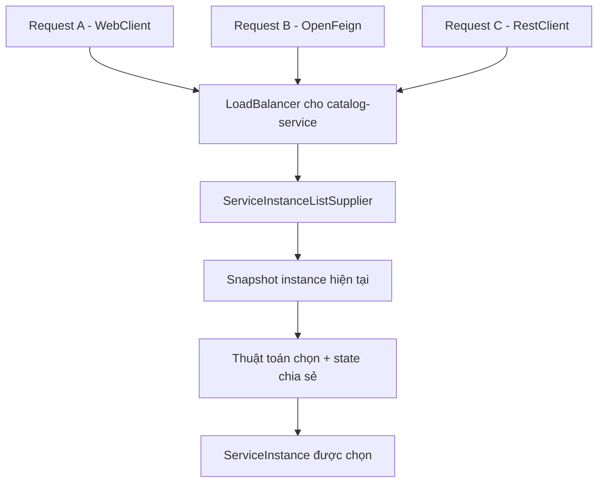
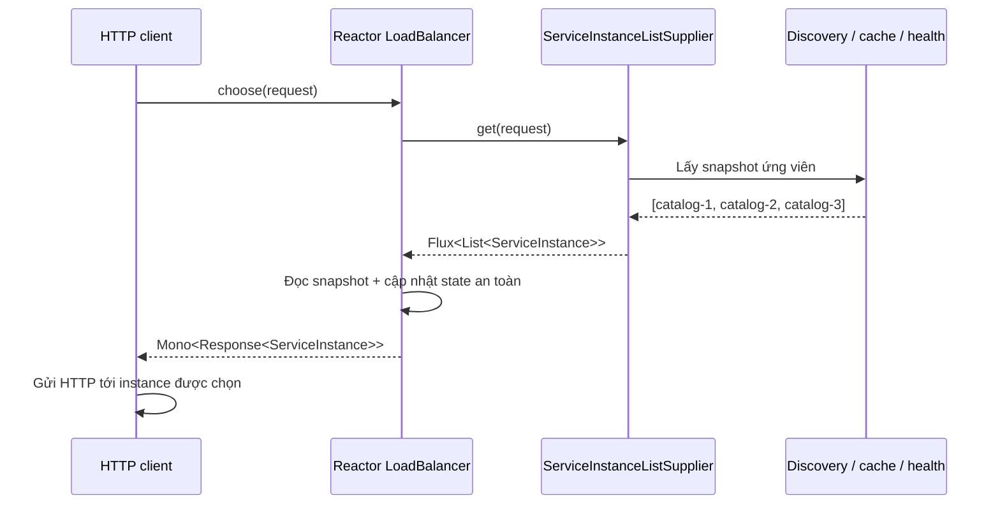

# Tính an toàn khi truy cập đồng thời và vòng đời trạng thái

Một LoadBalancer tùy biến thường chỉ chứa vài dòng chọn `ServiceInstance`, nhưng lại nằm trên đường đi của **rất nhiều request đồng thời**. Nếu thuật toán lưu một bộ đếm, danh sách instance, bảng trọng số hoặc thông tin phiên vào biến chia sẻ mà không có quy tắc đồng bộ, kết quả có thể là chọn sai instance, truy cập ngoài giới hạn danh sách, mất cập nhật hoặc giữ lại instance đã bị gỡ khỏi discovery.

Trong Spring Cloud LoadBalancer, một yêu cầu đến `catalog-service` có thể phát sinh từ `RestClient`, `RestTemplate`, `WebClient` hoặc OpenFeign. Các HTTP client này có mô hình thread khác nhau, nhưng cùng có thể gọi vào một LoadBalancer hoặc chuỗi `ServiceInstanceListSupplier` theo **service ID**. Vì vậy, tùy biến thuật toán không chỉ cần chọn đúng địa chỉ; nó còn cần **an toàn khi gọi đồng thời**, **không chia sẻ nhầm trạng thái giữa request**, và **quản lý vòng đời trạng thái theo service ID, registry, cache, retry và application context**.

Bài thuộc chương **Tùy biến LoadBalancer**, tập trung vào thiết kế trạng thái, viết một bộ chọn round-robin có tính an toàn đồng thời, hiểu ranh giới reactive và kiểm chứng hành vi khi nhiều request cùng chạy hoặc khi danh sách instance thay đổi.

## 1. Vì sao custom LoadBalancer phải quan tâm tới concurrency?

Giả sử `order-service` gọi ba bản sao của `catalog-service`:

| Service ID | Instance ID | Địa chỉ minh họa |
|---|---|---|
| `catalog-service` | `catalog-1` | `10.0.1.11:8080` |
| `catalog-service` | `catalog-2` | `10.0.1.12:8080` |
| `catalog-service` | `catalog-3` | `10.0.1.13:8080` |

Nhiều request HTTP có thể cùng truy cập một đối tượng LoadBalancer:



Những tình huống có thể xảy ra:

- **Race condition:** hai thread cùng đọc `counter = 4` rồi cùng ghi `counter = 5`, làm mất một lần tăng.
- **Danh sách thay đổi:** request A thấy ba instance, trong khi request B nhận danh sách mới còn hai instance từ discovery/health check.
- **Trạng thái sai phạm vi:** một bộ đếm hoặc danh sách `lastSelected` dùng chung cho `catalog-service` và `payment-service` dù hai dịch vụ có tập ứng viên khác nhau.
- **Lifecycle không rõ:** instance `catalog-2` đã bị deregister nhưng custom cache hoặc sticky map vẫn giữ thông tin cũ.
- **Retry:** một request nghiệp vụ được thực hiện lại và gọi `choose()` nhiều lần, làm tăng counter hoặc thay đổi trạng thái.
- **Reactive cancellation:** subscriber hủy pipeline, nhưng code đã lưu một trạng thái tạm hoặc mở tác vụ không có cơ chế dọn dẹp.

**An toàn đồng thời không có nghĩa mọi request phải chọn một instance khác nhau.** Hai request đồng thời chọn cùng instance là hợp lệ khi thuật toán cho phép. Điều cần đảm bảo là không có race làm hỏng dữ liệu, chọn chỉ số không hợp lệ hoặc khiến quyết định dựa trên trạng thái nửa cập nhật.

## 2. Phân loại trạng thái trước khi viết thuật toán

Khi thiết kế custom LoadBalancer, cần phân biệt **trạng thái cấu hình**, **trạng thái của từng request** và **trạng thái chia sẻ có thể thay đổi**.

| Loại trạng thái | Ví dụ | Phạm vi nên đặt | Quy tắc |
|---|---|---|---|
| Cấu hình bất biến | `serviceId`, tên policy, danh sách zone được phép | Field `final` của bean theo service | Khởi tạo một lần, không sửa tại runtime |
| Dữ liệu request | Hint, sticky cookie, trace ID, retry context | Biến cục bộ / `Request` / Reactor Context | Không lưu vào field của singleton |
| Snapshot ứng viên | `List<ServiceInstance>` trả từ supplier | Mỗi lần chọn hoặc snapshot immutable được công bố an toàn | Không mutate danh sách chia sẻ |
| State thuật toán | Bộ đếm round-robin, thống kê chọn | Atomic/đồng bộ thích hợp, phạm vi theo service | Cập nhật có tính nguyên tử |
| State theo instance | Weight động, số request in-flight, health score | Map có lifecycle/eviction rõ | Xóa state của instance cũ, giới hạn bộ nhớ |
| State vận hành | Timer, counter, cấu hình timeout/retry | Registry/config chuyên dụng | Không trộn với quyết định nghiệp vụ ngẫu nhiên |

Một nguyên tắc hiệu quả: **request data nên ở biến cục bộ hoặc đối tượng request bất biến; state chia sẻ nên được thu nhỏ tối đa**. Nếu thuật toán không cần ghi nhớ điều gì giữa các lần chọn, nên viết nó thành hàm chọn instance từ một snapshot thay vì tạo cache hoặc map không cần thiết.

## 3. Vòng đời bean và phạm vi theo service ID

Spring Cloud LoadBalancer dùng cơ chế **named client context** thông qua `LoadBalancerClientFactory`. Mỗi service ID có thể có child context riêng để chứa chính sách chọn instance và chuỗi supplier đặc thù. Custom bean thường được khai báo bằng `@LoadBalancerClient`:

```java
package com.example.orders;

import com.example.lb.catalog.CatalogLoadBalancerConfiguration;
import org.springframework.boot.SpringApplication;
import org.springframework.boot.autoconfigure.SpringBootApplication;
import org.springframework.cloud.loadbalancer.annotation.LoadBalancerClient;

@SpringBootApplication
@LoadBalancerClient(
        name = "catalog-service",
        configuration = CatalogLoadBalancerConfiguration.class)
public class OrderApplication {

    public static void main(String[] args) {
        SpringApplication.run(OrderApplication.class, args);
    }
}
```

Điểm quan trọng:

1. **Một bean không phải một request.** Bean LoadBalancer được lấy và tái sử dụng trong context tương ứng, vì vậy không được giả định mỗi lần `choose()` có một instance Java mới.
2. **State phải gắn với service ID.** Nếu `catalog-service` và `inventory-service` có chính sách riêng, mỗi dịch vụ nên có bộ đếm hoặc state riêng; không dùng biến `static` làm state chọn instance cho tất cả dịch vụ.
3. **Cấu hình riêng không nên bị component scan của application context chính thu nhận ngoài ý muốn.** Ví dụ đặt `CatalogLoadBalancerConfiguration` ở package ngoài vùng quét mặc định rồi tham chiếu qua `@LoadBalancerClient(configuration = ...)`.
4. **Child context cũng có vòng đời.** Khi context đóng, các tài nguyên riêng của bean cần được giải phóng. Không tạo scheduler, executor hoặc subscription chạy mãi mà không sở hữu/đóng chúng.
5. **Số bean không đồng nghĩa với số instance trong registry.** Một LoadBalancer cho `catalog-service` có thể lần lượt chọn 0, 2 hoặc 20 instance khi discovery/health thay đổi.

Nếu triển khai nhiều bản sao của `order-service`, **mỗi JVM có state LoadBalancer riêng**. Một bộ đếm nguyên tử trong JVM A không đồng bộ với JVM B; vòng round-robin cục bộ không bảo đảm một lịch chọn toàn cụm có thứ tự tuyệt đối.

## 4. Hợp đồng reactive của bộ chọn instance

Một cách tùy biến trực tiếp là cài đặt `ReactorServiceInstanceLoadBalancer`. Phương thức `choose(Request request)` trả về `Mono<Response<ServiceInstance>>`; nó cần tương tác với `ServiceInstanceListSupplier` để nhận tập ứng viên, rồi trả kết quả chọn hoặc một `EmptyResponse` nếu không có instance.

Luồng khái quát:



Một số nguyên tắc:

- Dùng `supplier.get(request)` nếu thuật toán/supplier cần ngữ cảnh của từng request. Gọi `get()` tùy tiện có thể làm mất dữ liệu request-based sticky session, hint hoặc retry.
- `Flux<List<ServiceInstance>>` từ supplier có thể phát danh sách theo cách phụ thuộc implementation. Với một quyết định đơn lẻ, có thể lấy snapshot đầu tiên bằng `.next()`; **không** có nghĩa đã đăng ký một subscription chạy mãi cho các lần cập nhật sau.
- Không gọi `.block()` hoặc `.subscribe()` bên trong `choose()`. Caller của LoadBalancer chịu trách nhiệm subscription, cancellation và error propagation.
- Không giữ `Request` của người dùng trong field của bean để “dùng cho request tiếp theo”; một request khác có thể chạy song song và ghi đè.
- `EmptyResponse` phải được phân biệt với kết quả có instance. HTTP client integration sẽ chuyển tình huống không có server thành phản hồi/exception theo phiên bản và client, không nên tự coi đó là `404` của tài nguyên nghiệp vụ.

## 5. Ví dụ sai: bộ đếm và danh sách có thể thay đổi

Một cài đặt round-robin nguy hiểm thường bắt đầu bằng những dòng tưởng như đơn giản:

```java
// SAI: minh họa race condition và index phụ thuộc state đang đổi.
private int cursor = 0;
private List<ServiceInstance> instances = new ArrayList<>();

ServiceInstance chooseUnsafe() {
    int index = cursor++ % instances.size();
    return instances.get(index);
}
```

Các vấn đề:

1. `cursor++` là phép đọc–tăng–ghi **không nguyên tử**; nhiều thread có thể làm mất lượt hoặc đọc giá trị không như mong đợi.
2. `instances` là `ArrayList` có thể bị thread khác sửa trong lúc chọn; `size()` và `get(index)` không tạo thành một snapshot nhất quán.
3. Nếu danh sách rỗng, phép chia lấy dư lỗi.
4. Khi counter overflow sang số âm, `%` có thể tạo index âm.
5. Nếu dùng một field `instances` cập nhật từ listener, thread đọc có thể không nhận được snapshot được công bố an toàn.

Chỉ thay `int` bằng `volatile int` **không làm phép tăng trở thành nguyên tử**. `volatile` có quy tắc visibility, nhưng không đủ để bảo đảm read–modify–write không bị race. Tương tự, thay `ArrayList` bằng `CopyOnWriteArrayList` không giải quyết tất cả việc đồng bộ giữa số lượng, lựa chọn và lifecycle state.

Đối với các thuật toán có lock, không giữ `synchronized` hay lock trong lúc chờ network, gọi registry, `block()` hay serialize HTTP. Critical section dài có thể khiến mọi request bị nối đuôi nhau ngay tại bộ cân bằng tải.

## 6. Ví dụ an toàn: custom round-robin với `AtomicInteger` và snapshot

Ví dụ dưới đây minh họa một custom LoadBalancer an toàn ở mức chọn instance. Nó sử dụng:

- `ObjectProvider<ServiceInstanceListSupplier>` để nhận supplier trong ngữ cảnh service.
- `supplier.get(request)` để chuyển tiếp request context.
- `Mono.defer(...)` để thực hiện công việc lựa chọn khi có subscription.
- `AtomicInteger.getAndUpdate(...)` để cấp một lượt chọn duy nhất cho mỗi lần chọn đã đi tới bước đó.
- `List.copyOf(...)` để lấy một danh sách bất biến cho phép tính `size` và `get`.
- `EmptyResponse` cho trường hợp không có ứng viên.

```java
package com.example.lb.catalog;

import java.util.List;
import java.util.concurrent.atomic.AtomicInteger;

import org.springframework.beans.factory.ObjectProvider;
import org.springframework.cloud.client.ServiceInstance;
import org.springframework.cloud.client.loadbalancer.DefaultResponse;
import org.springframework.cloud.client.loadbalancer.EmptyResponse;
import org.springframework.cloud.client.loadbalancer.Request;
import org.springframework.cloud.client.loadbalancer.Response;
import org.springframework.cloud.loadbalancer.core.ReactorServiceInstanceLoadBalancer;
import org.springframework.cloud.loadbalancer.core.ServiceInstanceListSupplier;
import reactor.core.publisher.Mono;

public final class SafeRoundRobinLoadBalancer
        implements ReactorServiceInstanceLoadBalancer {

    private final ObjectProvider<ServiceInstanceListSupplier> suppliers;
    private final String serviceId;
    private final AtomicInteger cursor = new AtomicInteger(0);

    public SafeRoundRobinLoadBalancer(
            ObjectProvider<ServiceInstanceListSupplier> suppliers,
            String serviceId) {
        this.suppliers = suppliers;
        this.serviceId = serviceId;
    }

    @Override
    public Mono<Response<ServiceInstance>> choose(Request request) {
        return Mono.defer(() -> {
            ServiceInstanceListSupplier supplier =
                    suppliers.getIfAvailable();

            if (supplier == null) {
                return Mono.<Response<ServiceInstance>>just(
                        new EmptyResponse());
            }

            return supplier.get(request)
                    .next()
                    .map(this::selectFromSnapshot)
                    .defaultIfEmpty(new EmptyResponse());
        });
    }

    private Response<ServiceInstance> selectFromSnapshot(
            List<ServiceInstance> instances) {

        if (instances == null || instances.isEmpty()) {
            return new EmptyResponse();
        }

        List<ServiceInstance> snapshot = List.copyOf(instances);
        int turn = cursor.getAndUpdate(
                current -> current == Integer.MAX_VALUE
                        ? 0
                        : current + 1);

        int index = Math.floorMod(turn, snapshot.size());
        return new DefaultResponse(snapshot.get(index));
    }
}
```

`serviceId` trong ví dụ là field bất biến giữ tên dịch vụ để dễ mở rộng logging/metrics, chứ thuật toán không cần dùng nó khi tính index. Có thể bổ sung getter hoặc log ở ranh giới thích hợp nếu thực sự cần quan sát.

### 6.1. Vì sao cách chọn này an toàn hơn?

**Bộ đếm nguyên tử:** `getAndUpdate` thực hiện cập nhật atomically, không bị mất lượt do hai thread cùng ghi. Giá trị trả về là giá trị **trước khi tăng**; sau `Integer.MAX_VALUE` thuật toán đặt lại `0` để không vô tình xử lý counter âm. `Math.floorMod(turn, snapshot.size())` tạo index hợp lệ khi `snapshot.size() > 0`.

**Snapshot cục bộ:** thuật toán kiểm tra và lấy item trên cùng một `List.copyOf(instances)`, không đọc size từ danh sách này rồi get từ danh sách khác. Với dữ liệu do supplier xuất bản đúng cách, không bị code chọn instance tự sửa danh sách chung.

**Trạng thái không chứa thông tin từng request:** biến `cursor` dùng chung để chọn thứ tự; mọi hint, cookie hoặc retry context đi qua `Request` và supplier, không bị ghi vào field mutable của singleton.

**Khi không có ứng viên:** trả `EmptyResponse` thay vì phép chia cho 0 hoặc chọn instance cũ đã bị mất khỏi danh sách.

### 6.2. Giới hạn của ví dụ

- `List.copyOf` tạo snapshot bất biến **sau khi** supplier phát danh sách. Nếu supplier của chính ứng dụng đang mutate cùng một `ArrayList` không có đồng bộ trong lúc sao chép, vẫn có race ở **nguồn dữ liệu**. Cách khắc phục là supplier **công bố những snapshot bất biến** hoặc có cơ chế đồng bộ lúc cập nhật, không dựa vào một bản copy ở bên nhận để chữa mọi race.
- Round-robin phân phối **lượt chọn**, không đảm bảo các request **hoàn thành** luân phiên, không cân bằng CPU, thời gian xử lý hoặc số request in-flight giữa các instance.
- Khi danh sách instance co/giãn, phép lấy modulo trên số lượng mới có thể khiến instance được chọn lặp lại hoặc tạm lệch tải. Đây là đặc tính bình thường của thuật toán đơn giản.
- `Mono.defer` làm việc chọn diễn ra theo subscription. Một Publisher được subscribe hai lần có thể tạo **hai lượt chọn**; nếu muốn ràng buộc một lựa chọn với một logical request, cần hiểu lifecycle Publisher do integration quản lý.
- `serviceId` và bộ đếm của ví dụ **chỉ an toàn nếu instance LoadBalancer có phạm vi đúng service**. Nếu vô tình chia sẻ bean giữa nhiều service ID, trạng thái vẫn bị trộn dù biến là `AtomicInteger`.
- Ví dụ chưa thêm retry-aware exclusion, dynamic weights hoặc request-specific policy; không nên quảng cáo đây là một bản thay thế đầy đủ cho LoadBalancer mặc định.

## 7. Gắn thuật toán với cấu hình riêng của service

Khai báo bean có thể sử dụng `LoadBalancerClientFactory` lấy provider lazy cho `ServiceInstanceListSupplier`:

```java
package com.example.lb.catalog;

import org.springframework.cloud.client.ServiceInstance;
import org.springframework.cloud.loadbalancer.core.ReactorServiceInstanceLoadBalancer;
import org.springframework.cloud.loadbalancer.core.ServiceInstanceListSupplier;
import org.springframework.cloud.loadbalancer.support.LoadBalancerClientFactory;
import org.springframework.context.annotation.Bean;
import org.springframework.context.annotation.Configuration;
import org.springframework.core.env.Environment;

@Configuration(proxyBeanMethods = false)
public class CatalogLoadBalancerConfiguration {

    @Bean
    ReactorServiceInstanceLoadBalancer catalogLoadBalancer(
            Environment environment,
            LoadBalancerClientFactory clientFactory) {

        String serviceId = environment.getProperty(
                LoadBalancerClientFactory.PROPERTY_NAME);

        return new SafeRoundRobinLoadBalancer(
                clientFactory.getLazyProvider(
                        serviceId, ServiceInstanceListSupplier.class),
                serviceId);
    }
}
```

Bean được khai báo với kiểu `ReactorServiceInstanceLoadBalancer` trong package `org.springframework.cloud.loadbalancer.core`; đây là interface mà lớp thuật toán ở phần trước triển khai. Khi chỉnh sửa để dùng một kiểu cha khác, phải đối chiếu chính xác API/package của Spring Cloud BOM đang dùng. **Chỉ đăng ký một bean thuật toán cho service ID này** để tránh cấu hình chọn instance mâu thuẫn.

**Vì sao provider lazy?** Bean supplier có thể được tạo qua cấu hình của named child context, còn factory chọn LoadBalancer cần tham chiếu supplier. Lấy provider lazy giúp tránh giải quyết sớm toàn bộ phụ thuộc trong lúc tạo bean và cho phép context quản lý lifecycle đúng phạm vi. Không lưu static supplier hoặc tự giữ instance của supplier từ một context khác.

Ví dụ cấu hình trên chỉ thể hiện **bean thuật toán**. Ứng dụng vẫn phải bảo đảm có `ServiceInstanceListSupplier` từ discovery/static instance, cache/health theo yêu cầu và các dependency Spring Cloud LoadBalancer phù hợp. Nếu supplier không được đăng ký, ví dụ trả `EmptyResponse` để lỗi được xử lý ở caller, thay vì tự gửi request đến một host dự phòng không được kiểm soát.

## 8. Snapshot bất biến khi danh sách instance thay đổi

Một custom `ServiceInstanceListSupplier` có thể làm mới danh sách khi registry, health check, metadata hoặc cấu hình thay đổi. Thay đổi này có thể diễn ra **đúng lúc nhiều request đang chọn instance**.

Mẫu sai:

```java
// SAI: nhiều thread đọc trong khi thread refresh sửa cùng list.
private final List<ServiceInstance> current = new ArrayList<>();

void refresh(List<ServiceInstance> next) {
    current.clear();
    current.addAll(next);
}
```

Request đồng thời có thể đọc list trong trạng thái **sau clear nhưng trước addAll**, khiến candidate count rỗng tạm thời hoặc gặp các race khác. Một lựa chọn an toàn hơn là cập nhật **tham chiếu tới snapshot bất biến**:

```java
import java.util.List;
import java.util.concurrent.atomic.AtomicReference;
import org.springframework.cloud.client.ServiceInstance;

final class CandidateSnapshot {

    private final AtomicReference<List<ServiceInstance>> current =
            new AtomicReference<>(List.of());

    void refresh(List<ServiceInstance> discovered) {
        // Tạo snapshot mới rồi publish trong một bước.
        List<ServiceInstance> next = List.copyOf(discovered);
        current.set(next);
    }

    List<ServiceInstance> snapshot() {
        return current.get();
    }
}
```

Khi `refresh()` chạy, request A có thể đọc **snapshot cũ**, request B đọc **snapshot mới**; cả hai đều đọc một danh sách tự nhất quán. Không request nào thấy list đang bị `clear/addAll` từng bước.

**Lưu ý:** nếu danh sách `discovered` đang bị mutate không đồng bộ trong chính lúc gọi `List.copyOf`, nguồn cần được sửa để tạo snapshot an toàn trước khi gọi `refresh`. `AtomicReference` chỉ bảo đảm **công bố tham chiếu** nguyên tử, không tự sửa tính đồng thời của dữ liệu nguồn hoặc object mutable nằm trong list. Nếu các phần tử `ServiceInstance` chứa metadata mutable, cần cân nhắc mô hình instance description bất biến phù hợp.

Thay snapshot không có nghĩa phải đánh dấu một instance là unhealthy ngay lập tức. Một request đang in-flight có thể đã chọn instance cũ trước khi refresh; xử lý các request đã gửi phụ thuộc timeout, graceful drain và retry policy.

## 9. Dùng `ConcurrentHashMap` đúng chỗ cho state theo instance

Một số thuật toán cần theo dõi trạng thái theo instance: số request in-flight, điểm tải, circuit state hoặc affinity. `ConcurrentHashMap` giúp truy cập map an toàn khi nhiều thread, nhưng **không tự giải quyết tính đúng của thuật toán có nhiều bước**.

Ví dụ nguy hiểm:

```java
// SAI nếu nhiều thread đọc/sửa cùng giá trị rồi put lại.
Integer current = inFlight.get(instanceId);
inFlight.put(instanceId, current + 1);
```

Một lựa chọn cho bộ đếm là `ConcurrentHashMap<String, AtomicInteger>`, tạo counter bằng `computeIfAbsent` và thay đổi atomically:

```java
private final ConcurrentHashMap<String, AtomicInteger> inFlight =
        new ConcurrentHashMap<>();

AtomicInteger counter = inFlight.computeIfAbsent(
        instanceId, ignored -> new AtomicInteger());

counter.incrementAndGet();
try {
    // Thao tác liên quan đến instance (minh họa).
} finally {
    counter.decrementAndGet();
}
```

Tuy nhiên, **không đặt đoạn `try/finally` trên quanh đúng mỗi lần `choose()` rồi gọi đó là số HTTP request in-flight**. Nếu giảm counter ngay sau khi chọn instance, bạn chỉ đo thời gian chọn, không đo thời gian xử lý HTTP. Để quản lý in-flight thật, phải gắn lifecycle decrement vào lúc HTTP request **hoàn thành, lỗi hoặc bị hủy**, thông qua instrumentation/filter hoặc integration chịu trách nhiệm thực thi HTTP.

Với reactive HTTP call, decrement khi Publisher kết thúc bằng `doFinally(...)` là một khả năng, nhưng cần cấp slot và tăng counter tại **thời điểm subscription** tương ứng, không ngay lúc lắp pipeline. Nếu dùng retry, phải quyết định counter đo logical request hay từng attempt rồi gắn hook đúng ranh giới.

### 9.1. State phải có chính sách dọn dẹp

Nếu mỗi instance mới hoặc mỗi request/session tạo một key vĩnh viễn, state của custom LoadBalancer sẽ tăng theo thời gian. Cần có quy tắc:

- Khi discovery không còn một instance, loại state của nó **khi không còn request cần tham chiếu**; tránh xóa khi đang còn decrement hoặc in-flight state.
- Khi scale-in/scale-out, xác định thời gian giữ state cũ và cách map instance ID sang key không bị trùng ngoài ý muốn.
- Giới hạn số key, thời gian sống và mức metric cardinality; không lưu mọi user ID/session ID vào singleton mãi mãi.
- Khi context đóng, dừng task refresh/scheduler và giải phóng tài nguyên custom đã tạo.
- Nếu dùng cache như Caffeine, cấu hình TTL/size và chính sách invalidation phù hợp. Không mặc định TTL của cache là đủ để xử lý mọi lỗi discovery.

Nếu không thật sự cần state theo instance, **không tạo map**: round-robin chỉ cần bộ đếm và snapshot.

## 10. Request context, retry và reactive subscription

Spring Cloud LoadBalancer cho phép lựa chọn theo ngữ cảnh request. Các supplier có thể dựa vào hint, cookie sticky-session, retry hoặc header/metadata đã được truyền qua HTTP integration.

Các rủi ro khi custom thuật toán lưu dữ liệu request vào bean:

```java
// SAI: request mới có thể ghi đè dữ liệu của request đang xử lý.
private String preferredZone;

Mono<Response<ServiceInstance>> choose(Request request) {
    preferredZone = readZone(request);
    return supplier.get(request)
            .next()
            .map(instances -> chooseForZone(instances, preferredZone));
}
```

Vì pipeline reactive có thể chạy sau khi `choose` trả về và request khác có thể đổi field, `preferredZone` không còn chắc thuộc request gốc. **Đúng hơn:** đọc zone/hint vào biến local bất biến **trong cùng subscription** hoặc truyền qua `Request`/Reactor Context theo contract.

```java
Mono<Response<ServiceInstance>> choose(Request request) {
    return Mono.defer(() -> {
        String preferredZone = readZone(request);
        return supplier.get(request).next()
                .map(instances ->
                        chooseForZone(instances, preferredZone));
    });
}
```

Snippet là **pseudocode về phạm vi biến**: `readZone` và `chooseForZone` là hàm minh họa, chưa phải implementation hoàn chỉnh. Giá trị `preferredZone` được giữ bởi closure của subscription này, không phải field mutable của singleton.

### 10.1. Retry làm thay đổi điều gì?

Một logical request có thể gọi `choose()` nhiều lần khi retry. Thuật toán cần quyết định rõ:

- **Round-robin:** có thể tăng counter mỗi attempt; điều này làm một request retry tiêu thụ nhiều lượt chọn.
- **Avoid previous instance:** supplier/LoadBalancer cần thông tin instance đã thất bại ở attempt trước; nếu custom code bỏ `Request`, có thể mất điều kiện này.
- **Sticky/hint:** nếu phải giữ ràng buộc version hoặc zone, mọi retry attempt cũng phải mang đủ request context; không fallback ngầm sang phiên bản không tương thích.
- **Timeout:** request có thể hoàn tất ở backend dù caller đã timeout; không suy từ lỗi timeout rằng instance luôn chết.
- **Cancellation:** nếu pipeline bị hủy trước khi chọn xong, state đã cập nhật ở subscription có thể đã tăng dù chưa gửi request. Điều đó chấp nhận được đối với **bộ đếm lượt chọn**, nhưng không chấp nhận được nếu đó là **đếm in-flight HTTP** mà không có decrement thích hợp.

Vì vậy, phải định nghĩa **“lượt chọn”**, **“HTTP attempt”** và **“logical request”** thành ba ranh giới riêng trong tài liệu, metric và test.

## 11. Đừng đưa tác vụ blocking vào đường chọn instance

Một custom LoadBalancer có thể bị gọi với tần suất rất cao. Những thao tác sau không nên thực hiện trực tiếp trong `choose()`:

- Gọi database hoặc HTTP health endpoint để kiểm tra từng instance ngay lúc chọn.
- Đọc một file cấu hình lớn ở mỗi request.
- `Thread.sleep` hoặc chờ một lock lâu.
- `Mono.block()` để nhận danh sách từ supplier reactive.
- Tạo mới scheduler/executor/HTTP client cho mỗi lần chọn.
- Ghi log toàn bộ metadata/danh sách ứng viên với lượng dữ liệu lớn ở mức INFO cho mọi request.

Nên:

- Sử dụng danh sách từ `ServiceInstanceListSupplier` đã được cập nhật qua discovery/cache/health pipeline phù hợp.
- Giữ phép chọn instance **nhanh, xác định được và ít cấp phát**; ví dụ đọc snapshot bất biến và tính index.
- Nếu phải tính weight động, thu thập metric ở background có lifecycle rõ, công bố **policy snapshot bất biến** cho đường đọc.
- Giới hạn metric labels; không gắn `requestId`, `traceId` hoặc instance ID biến thiên vào mọi timer/counter.
- Giữ timeout/retry ở tầng giao tiếp phù hợp, không thay thế chúng bằng `synchronized` hoặc sleep trong thuật toán chọn.

**Reactive API không tự bảo đảm non-blocking:** nếu `supplier.get(request)` hoặc custom code tự dùng blocking I/O, toàn bộ đường chọn vẫn có thể chặn event loop hoặc thread gọi.

## 12. Cập nhật dynamic policy bằng snapshot nguyên tử

Với thuật toán weighted hoặc ưu tiên zone, có thể cần tải lại policy từ config/feature flag. Không nên đổi nhiều field rời rạc mà request có thể đọc trạng thái nửa cũ nửa mới:

```java
// SAI: request có thể đọc weights mới nhưng zones cũ.
this.weights = newWeights;
this.allowedZones = newZones;
```

Một mẫu an toàn hơn là gói toàn bộ giá trị thành một policy bất biến và thay một lần:

```java
import java.util.Map;
import java.util.Set;
import java.util.concurrent.atomic.AtomicReference;

public final class RoutingPolicyHolder {

    public record Policy(
            Map<String, Integer> weights,
            Set<String> allowedZones) {

        public Policy {
            weights = Map.copyOf(weights);
            allowedZones = Set.copyOf(allowedZones);
        }
    }

    private final AtomicReference<Policy> current =
            new AtomicReference<>(
                    new Policy(Map.of(), Set.of()));

    public Policy snapshot() {
        return current.get();
    }

    public void update(
            Map<String, Integer> weights,
            Set<String> allowedZones) {
        validate(weights, allowedZones);
        current.set(new Policy(weights, allowedZones));
    }

    private static void validate(
            Map<String, Integer> weights,
            Set<String> zones) {
        if (weights == null || zones == null
                || weights.values().stream().anyMatch(
                        w -> w == null || w <= 0)
                || zones.stream().anyMatch(java.util.Objects::isNull)) {
            throw new IllegalArgumentException(
                    "Invalid routing policy");
        }
    }
}
```

Trong method chọn, đọc `Policy policy = holder.snapshot();` **một lần**, rồi dùng cùng policy cho toàn bộ phép tính. Khi update xảy ra, một request có thể dùng policy cũ và request tiếp theo dùng policy mới; không request nào thấy nửa cấu hình cũ/nửa mới.

Ví dụ trên tập trung vào nguyên lý **atomic publication**, chưa định nghĩa thuật toán weighted selection; việc chuyển weights thành xác suất, xử lý total weight overflow, cùng weight bằng 0, instance mới/mất và request context còn cần thiết kế riêng.

Với `Map.copyOf` và `Set.copyOf`, dữ liệu được bảo vệ khỏi sửa cấu trúc collection sau khi snapshot tạo. Nếu giá trị bên trong là object mutable, vẫn cần thiết kế immutable sâu hoặc quy ước không mutate.

## 13. Kiểm thử race condition, thay danh sách và lifecycle

Test tuần tự không đủ để phát hiện lỗi đồng thời; cần đồng thời nhiều request và thay đổi danh sách trong lúc chọn. Ví dụ kế hoạch kiểm thử:

| Tình huống | Cách tạo | Điều cần khẳng định |
|---|---|---|
| 1.000 lượt chọn song song | Nhiều subscriber/threads cùng gọi `choose` | Không lỗi, không chọn index ngoài phạm vi |
| Cập nhật danh sách 3 → 2 → 0 instance | Supplier phát snapshot mới | Chỉ chọn instance có trong snapshot, 0 trả no-server |
| Snapshot bị mutate | Thử mutate list được supplier giữ | Custom supplier phải publish immutable snapshot |
| Hai service ID | Tạo hai named client context riêng | Bộ đếm/state không lẫn giữa service |
| Retry | Gọi nhiều attempt của một logical request | Counter/metrics phản ánh đúng phạm vi đã định nghĩa |
| Hủy subscription | Cancel lúc supplier chưa phát danh sách | Không leak subscription, task hoặc in-flight slot |
| Rollout/scale-in | Loại một instance rồi thêm instance mới | State cũ được dọn, không giữ instance stale |
| Context shutdown | Đóng application context | Task scheduler/pool/custom cache dừng đúng vòng đời |

### 13.1. Kiểm thử đồng thời một cách có ý nghĩa

Một skeleton Reactor minh họa cách tạo nhiều subscription song song trong bài test có `Reactor Test`/JUnit:

```java
Flux<Response<ServiceInstance>> choices = Flux
        .range(0, 1_000)
        .flatMap(i -> loadBalancer.choose(new DefaultRequest<>())
                .subscribeOn(Schedulers.parallel()), 64);

StepVerifier.create(choices)
        .expectNextCount(1_000)
        .verifyComplete();
```

Đoạn code **chỉ minh họa cấu trúc kiểm thử**: cần khởi tạo `loadBalancer` với supplier thử nghiệm, import `DefaultRequest`, `Response`, `ServiceInstance`, `Schedulers`, `Flux` và `StepVerifier` cùng dependencies phù hợp. Kiểm tra `expectNextCount` chỉ xác nhận có 1.000 kết quả, **chưa đủ** để chứng minh thread safety.

Nên bổ sung assertion cho mọi `response.hasServer()`, tập ID được phép, điều kiện no-instance và tính phân phối ở kịch bản có danh sách **cố định**. Với danh sách đổi liên tục, không yêu cầu “mỗi ba lượt chọn phải đúng một instance”, vì số ứng viên và thứ tự có thể khác giữa các lượt.

Để làm race dễ xuất hiện hơn, cho một task phát snapshot 3/2/0 instance cùng lúc với nhiều subscriber, chạy nhiều vòng, ghi lại exception và kết quả; dù vậy, **test không thể chứng minh không có race trong mọi lịch thực thi**. Code cần có lập luận thread-safety dựa trên atomic/immutability và lifecycle bên cạnh stress test.

### 13.2. Kiểm thử dọn tài nguyên

Nếu custom LoadBalancer mở scheduler hoặc listener để refresh state, test nên đóng child context/application context rồi kiểm tra task không còn chạy và tài nguyên được giải phóng. Tránh dùng `@PreDestroy` chỉ để dọn một subscription không được lưu/không thể cancel; khi tạo tài nguyên, phải giữ đúng handle lifecycle như `Disposable` hoặc áp dụng cơ chế quản lý tài nguyên của framework.

Nếu custom algorithm chỉ gồm `AtomicInteger` và supplier do Spring quản lý như ví dụ an toàn, không cần tạo thêm một background task để “dọn bộ đếm” — state nhỏ gọn sẽ được giải phóng cùng bean khi context bị hủy.

## 14. Quan sát kết quả mà không làm tăng state vô hạn

Để kiểm tra hành vi custom LoadBalancer trong môi trường thật, thu thập:

- `serviceId`, loại thuật toán, tổng lượt chọn, số lần không có ứng viên.
- Thời gian chọn instance và số ứng viên trước khi chọn, bằng metric có nhãn giới hạn.
- Tỷ lệ HTTP 5xx, timeout, retry và p95/p99 theo dịch vụ gọi và operation.
- Định danh instance đã chọn ở **trace/log có sampling** thay vì thêm vào mọi metric label.
- Trạng thái cập nhật policy/health/registry, thời điểm snapshot mới được công bố.
- Số phần tử state map, số key bị evict và thời gian vòng đời của cache nếu có.

Một cảnh báo cần giải quyết cụ thể: **nếu số lần no-instance tăng, đừng vội tăng counter hoặc thay round-robin**. Hãy đối chiếu `DiscoveryClient`, supplier chain, health filter, zone/hint và cache. Nếu có instance nhưng request timeout, xem transport, readiness và khả năng phục vụ thực tế của backend.

Tránh log `Request` nguyên vẹn hoặc mọi header trong custom LB; request context có thể chứa cookie, token, ID người dùng hoặc hint nhạy cảm. Metrics nên đo **đặc tính thuật toán**, còn lỗi cụ thể được tra trong trace.

## 15. Checklist thiết kế trước khi triển khai

- [ ] Có phân loại rõ state bất biến, state từng request và state dùng chung.
- [ ] Mỗi service ID có state thích hợp; không dùng mutable static map/counter cho mọi dịch vụ.
- [ ] Những phép read–modify–write của shared state dùng atomic hoặc cơ chế đồng bộ đúng.
- [ ] Candidate list và policy được dùng như snapshot nhất quán; không mutate collection đang phát cho request khác.
- [ ] `choose(Request)` chuyển request context qua `supplier.get(request)` khi chính sách cần.
- [ ] Không `block()`, `subscribe()` hoặc gọi I/O blocking trong đường chọn.
- [ ] Trả no-instance đúng khi danh sách rỗng, không cố giữ instance stale để “cứu” availability.
- [ ] Hiểu tác động retry, double subscription và cancellation lên state/metrics.
- [ ] State theo instance hoặc session có giới hạn kích thước, eviction và lifecycle shutdown.
- [ ] Cấu hình per-service nằm đúng named client context; tránh bean custom vô tình thành global.
- [ ] Stress test concurrency, snapshot churn, scale-in và application shutdown.
- [ ] Observability ghi đủ lượt chọn/no-instance nhưng không tạo nhãn metric cardinality cao.

## 16. Ghi nhớ

Khi tùy biến Spring Cloud LoadBalancer, **đúng thuật toán** chưa đủ: phải chứng minh thuật toán **đúng dưới truy cập đồng thời** và hiểu **vòng đời state**. Bộ đếm shared nên được cập nhật bằng `AtomicInteger` hoặc cơ chế đồng bộ phù hợp; danh sách ứng viên và cấu hình động nên được công bố dưới dạng snapshot bất biến; request hint/cookie/trace không được lưu vào field mutable của singleton.

`ReactorServiceInstanceLoadBalancer.choose(Request)` nên kết hợp supplier qua reactive pipeline, trả `EmptyResponse` khi không có instance, không tự `block()` hay `subscribe()`. Bean LoadBalancer cần đúng phạm vi **service ID**, còn state theo instance phải được làm sạch khi topology thay đổi và không leak qua rollout. Cuối cùng, phải kiểm thử cùng lúc **concurrency, discovery refresh, retry, cancellation và shutdown** để hệ thống tiếp tục giao tiếp ổn định khi nhiều HTTP client cùng sử dụng LoadBalancer.

