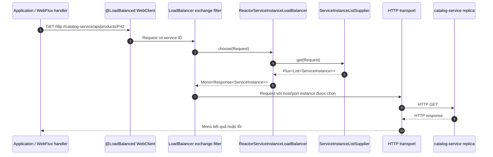
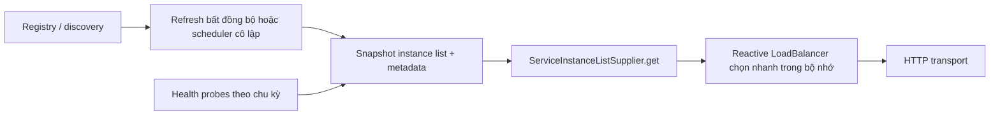

# Tránh I/O chặn luồng trong quá trình lựa chọn reactive

Khi `order-service` sử dụng `WebClient` để gọi `http://catalog-service/api/products/P42`, Spring Cloud LoadBalancer phải chọn một `ServiceInstance` trước khi HTTP client mở kết nối tới bản sao được chọn. Vì API chọn instance có thể trả về `Mono<Response<ServiceInstance>>`, người viết LoadBalancer tùy biến dễ kết luận rằng mọi thao tác bên trong đều “reactive”. **Điều đó không đúng:** nếu trong `choose()` có `Thread.sleep()`, gọi registry bằng SDK đồng bộ, truy vấn database hoặc gọi `.block()`, thread đang thực thi vẫn có thể bị chặn.

Một thao tác chọn đích chậm không chỉ làm request hiện tại tăng latency. Nếu nó chạy trên **Reactor Netty event loop** hoặc một scheduler đang phục vụ nhiều request khác, nó có thể làm những request không liên quan bị chậm, timeout và retry đồng loạt. Với module `SPRING_CLOUD_SERVICE_COMMUNICATION_LOAD_BALANCING`, mục tiêu là giữ quá trình chọn `ServiceInstance` theo service ID, discovery, health check và chính sách định tuyến **không tạo I/O blocking trên đường xử lý reactive**, đồng thời vẫn có timeout, khả năng quan sát và phương án chuyển tiếp khi phải tích hợp nguồn dữ liệu legacy.

## 1. Cơ chế chọn đích trong chuỗi reactive

Một luồng gọi `WebClient` có tích hợp Spring Cloud LoadBalancer có thể được mô tả như sau:



Ba interface cần phân biệt:

| Thành phần | Hợp đồng chính | Trách nhiệm |
|---|---|---|
| `ReactorServiceInstanceLoadBalancer` | `Mono<Response<ServiceInstance>> choose(Request request)` | Chọn một instance từ danh sách ứng viên |
| `ServiceInstanceListSupplier` | `Flux<List<ServiceInstance>> get(Request request)` hoặc `get()` | Cung cấp các snapshot danh sách instance của một service ID |
| `ReactiveDiscoveryClient` | `Flux<ServiceInstance> getInstances(String serviceId)` | Lấy thông tin discovery qua API reactive của implementation |
| `@LoadBalanced WebClient.Builder` | Xây `WebClient` có exchange filter LoadBalancer | Kết nối request HTTP logic với bước chọn instance |

**Reactive ở chữ ký phương thức không chứng minh implementation không chặn luồng.** Một `Flux` có thể chứa `Flux.just(discoveryClient.getInstances(...))`, trong đó `getInstances` đã chạy đồng bộ trước khi publisher được trả về. Ngược lại, một nguồn reactive thực sự chỉ phát tín hiệu sau khi được subscribe, không chặn thread caller để chờ remote I/O.

Nếu hệ thống chỉ cần round robin thông thường, ưu tiên sử dụng `RoundRobinLoadBalancer` có sẵn. LoadBalancer tùy biến chỉ nên được thêm khi có yêu cầu thực sự như ưu tiên zone, policy đặc thù hoặc danh sách ứng viên được xây dựng theo metadata; không cần viết lại thuật toán chỉ để có API reactive.

## 2. Vì sao chặn event loop đặc biệt nguy hiểm?

Trong ứng dụng dùng Spring WebFlux/Reactor Netty, một số thread event loop xử lý I/O cho **nhiều connection và request**. Chúng được thiết kế để thực hiện công việc ngắn, không phải đợi I/O đồng bộ.

Giả sử request A chọn instance bằng cách gọi registry HTTP đồng bộ và bị chậm 600 ms. Nếu lời gọi đó chạy trên event loop, trong khoảng thời gian này thread không thể tiếp tục xử lý hiệu quả các sự kiện I/O khác gắn với nó. B, C, D có thể bị chậm dù chúng không gọi registry tương tự.

```text
Event loop thread #1
  t=0ms:  xử lý request A → bắt đầu chọn instance
  t=1ms:  gọi DiscoveryClient.getInstances() đồng bộ
  t=2..600ms: thread bị chặn, không xử lý công việc khác
  t=601ms: trả danh sách instance
  t=602ms: tiếp tục xử lý I/O request B/C/D đang chờ
```

| Triệu chứng | Có thể xảy ra khi event loop bị chặn |
|---|---|
| HTTP latency p95/p99 tăng trên nhiều endpoint | Thread không xử lý kịp các sự kiện socket |
| Timeout dù downstream vẫn khỏe | Client không kịp xử lý kết quả |
| Retry tăng nhanh | Timeout kích hoạt attempts bổ sung |
| Connection pool pending tăng | Request bị ùn ở cả tầng gọi và tầng transport |
| CPU không nhất thiết cao | Thread có thể đang *đợi* I/O blocking, không tiêu tốn CPU |
| BlockHound hoặc log phát hiện blocking call | Có thao tác blocking tại vị trí không được phép |

Một thao tác CPU ngắn như tính chỉ số round robin, lọc một danh sách nhỏ hoặc đọc metadata có sẵn thường phù hợp với event loop. Vấn đề là **đợi kết quả** bằng cách chặn thread, hoặc đưa một phép tính quá nặng lên event loop mà không giới hạn thời gian.

## 3. Các thao tác nào có nguy cơ blocking trong `choose()`?

| Thao tác | Có nguy cơ blocking? | Khuyến nghị |
|---|---|---|
| Đọc `AtomicInteger`, `AtomicReference` | Thông thường không, thao tác ngắn | Có thể thực hiện trong bước chọn |
| Lọc danh sách instance đã có trong bộ nhớ | Thường không nếu danh sách nhỏ/giới hạn | Giữ thuật toán đơn giản; tránh xử lý quá nặng |
| Gọi `DiscoveryClient.getInstances()` của một implementation blocking | Có | Dùng nguồn reactive hoặc offload ra scheduler thích hợp |
| Gọi `WebClient` rồi `.block()` | **Có** | Trả/combine publisher, không block |
| Gọi `RestClient` hoặc OpenFeign blocking trong `map` | **Có** | Không gọi trên event loop; ưu tiên prefetch/cache |
| `Thread.sleep(...)` | **Có** | Không dùng trong logic chọn; timer reactive cho thử nghiệm |
| `Future.get()` / `CompletableFuture.join()` | **Có thể chặn** | Tích hợp future thành publisher phù hợp hoặc offload |
| `JdbcTemplate` / filesystem đồng bộ | **Có** | Tách khỏi đường chọn; nếu bắt buộc, cô lập thread và giới hạn |
| `Mono.just(blockingCall())` | **Có, ngay lúc dựng Mono** | Dùng `Mono.fromCallable(...)` kết hợp scheduler |
| `Mono.defer(() -> Mono.just(blockingCall()))` | **Có, khi subscribe** | `defer` chỉ làm *lazy*, không tự chuyển thành non-blocking |
| `Mono.delay(...)` / I/O reactive hợp lệ | Không chặn thread chờ theo cách đồng bộ | Dùng đúng scheduler và kiểm soát timeout/cancellation |

Một quy tắc đơn giản: **không có `block()` không có nghĩa không có blocking**. Một SDK registry có method `getInstances()` đồng bộ được gọi trong `map(...)` vẫn chặn thread, dù chuỗi bên ngoài là `Flux`.

## 4. Những anti-pattern thường gặp

### 4.1. Chặn trực tiếp trong `choose()`

```java
// SAI: nếu DiscoveryClient là blocking, choose() tự chặn caller.
@Override
public Mono<Response<ServiceInstance>> choose(Request request) {
    List<ServiceInstance> instances =
            discoveryClient.getInstances("catalog-service");
    return Mono.just(select(instances));
}
```

Thao tác `getInstances(...)` chạy **ngay trước khi `Mono` được tạo**, nghĩa là việc trả về publisher không đem lại lợi ích non-blocking.

### 4.2. Ép reactive kết quả về đồng bộ

```java
// SAI: block() giữ thread đang xử lý request.
@Override
public Mono<Response<ServiceInstance>> choose(Request request) {
    List<ServiceInstance> instances =
            reactiveDiscovery.getInstances("catalog-service")
                    .collectList()
                    .block();
    return Mono.just(select(instances));
}
```

Trong môi trường có Reactor non-blocking thread, `block()` có thể bị từ chối bằng exception; kể cả nơi nó không ném lỗi, nó vẫn tiêu tốn thread đang chờ.

### 4.3. Tự subscribe bên trong LoadBalancer

```java
// SAI: subscribe() tách công việc khỏi request, không trả được kết quả đúng.
@Override
public Mono<Response<ServiceInstance>> choose(Request request) {
    supplier.get(request)
            .next()
            .subscribe(instances -> updateSharedSelection(instances));

    return Mono.just(new EmptyResponse());
}
```

`subscribe()` thủ công tạo một luồng xử lý độc lập; `choose()` có thể trả `EmptyResponse` trước khi danh sách tới. Nó còn phá khả năng lan truyền cancellation, lỗi, tracing và deadline của request. **Hãy trả chính publisher đã ghép**, để framework quản lý subscription.

### 4.4. Lấy dữ liệu ngoài trong phép chọn mỗi request

```java
// SAI VỀ KIẾN TRÚC: chọn bản sao cần chờ API policy/DB cho mọi request.
return policyWebClient.get()
        .uri("/choose?service=catalog-service")
        .retrieve()
        .bodyToMono(String.class)
        .flatMap(instanceId -> findInstance(instanceId));
```

Đoạn này có thể **non-blocking ở cấp thread**, nhưng vẫn thêm một remote dependency và một round-trip vào mỗi lần chọn instance; nếu policy service hỏng, mọi request downstream đều không chọn được đích. Cách tốt hơn thường là **cập nhật policy/weights/metadata bất đồng bộ và chọn trên snapshot trong bộ nhớ**.

## 5. Thiết kế đúng: publisher lazy, chọn thuần bộ nhớ

Một LoadBalancer tùy biến non-blocking nên tuân theo các nguyên tắc:

1. `choose(Request)` **trả ngay** một `Mono`, không tự chờ danh sách hoặc kết nối.
2. Lấy snapshot danh sách thông qua `ServiceInstanceListSupplier` có API reactive.
3. Sau khi có snapshot, chỉ thực hiện phép tính nhẹ, xác định instance hoặc trả `EmptyResponse` nếu danh sách rỗng.
4. Để publisher trả kết quả/lỗi qua Reactor, không gọi `subscribe()` thủ công.
5. Có giới hạn thời gian chờ snapshot khi nguồn không đáp ứng, theo deadline của ứng dụng.
6. Không che giấu lỗi registry thành “không có instance” nếu điều đó khiến người vận hành hiểu sai.
7. Không tự tạo HTTP client hoặc mở TCP connection trong thuật toán chọn.

Sau đây là một implementation dùng round robin để **minh họa cấu trúc non-blocking**. Trong hệ thống không cần tùy biến, dùng `RoundRobinLoadBalancer` dựng sẵn sẽ đơn giản và ít rủi ro hơn.

### `NonBlockingRoundRobinLoadBalancer.java`

```java
package com.example.orders.loadbalancer;

import java.time.Duration;
import java.util.List;
import java.util.concurrent.atomic.AtomicInteger;

import org.springframework.beans.factory.ObjectProvider;
import org.springframework.cloud.client.ServiceInstance;
import org.springframework.cloud.client.loadbalancer.DefaultResponse;
import org.springframework.cloud.client.loadbalancer.EmptyResponse;
import org.springframework.cloud.client.loadbalancer.Request;
import org.springframework.cloud.client.loadbalancer.Response;
import org.springframework.cloud.loadbalancer.core.ReactorServiceInstanceLoadBalancer;
import org.springframework.cloud.loadbalancer.core.ServiceInstanceListSupplier;

import reactor.core.publisher.Mono;

public final class NonBlockingRoundRobinLoadBalancer
        implements ReactorServiceInstanceLoadBalancer {

    private final ObjectProvider<ServiceInstanceListSupplier> supplierProvider;
    private final AtomicInteger cursor = new AtomicInteger();
    private final String serviceId;

    public NonBlockingRoundRobinLoadBalancer(
            ObjectProvider<ServiceInstanceListSupplier> supplierProvider,
            String serviceId) {
        this.supplierProvider = supplierProvider;
        this.serviceId = serviceId;
    }

    @Override
    public Mono<Response<ServiceInstance>> choose(Request request) {
        return Mono.defer(() -> {
            ServiceInstanceListSupplier supplier =
                    supplierProvider.getIfAvailable();

            if (supplier == null) {
                return Mono.just(new EmptyResponse());
            }

            return supplier.get(request)
                    .next()
                    .map(this::selectFromSnapshot)
                    .switchIfEmpty(Mono.fromSupplier(EmptyResponse::new))
                    .timeout(Duration.ofMillis(300));
        });
    }

    private Response<ServiceInstance> selectFromSnapshot(
            List<ServiceInstance> instances) {

        if (instances == null || instances.isEmpty()) {
            return new EmptyResponse();
        }

        int index = Math.floorMod(
                cursor.getAndIncrement(), instances.size());
        return new DefaultResponse(instances.get(index));
    }

    public String getServiceId() {
        return serviceId;
    }
}
```

Mã này minh họa API Spring Cloud LoadBalancer hiện đại. Tên package, constructor và cách cấu hình per-client cần kiểm tra theo **Spring Cloud release train** của dự án. `Duration.ofMillis(300)` là **giới hạn thử nghiệm** cho thời gian chờ lựa chọn (bao gồm chờ publisher của supplier), không phải con số đúng cho production. Ngưỡng này phải nằm trong **deadline còn lại** của logical request và được điều chỉnh theo chi phí discovery thực tế.

Từng chi tiết quan trọng:

- `Mono.defer` khiến việc lấy supplier và xây chain diễn ra tại subscription, tránh làm thao tác có hiệu ứng ngoài xảy ra khi chỉ mới định nghĩa lời gọi.
- `supplier.get(request).next()` lấy **snapshot đầu tiên** của `Flux<List<ServiceInstance>>` rồi kết thúc phần subscription cần thiết. Nếu supplier tiếp tục phát cập nhật định kỳ, một lần chọn request không đợi vô hạn để gom tất cả snapshots.
- `map(this::selectFromSnapshot)` chỉ thao tác trên một danh sách đã có, không gọi HTTP/DB.
- `Math.floorMod(...)` tránh chỉ số âm khi `AtomicInteger` tràn số; thuật toán vẫn chọn một phần tử trong snapshot hiện tại.
- `switchIfEmpty` biến một nguồn hoàn tất mà không phát danh sách thành `EmptyResponse`; danh sách có `0` phần tử cũng cho `EmptyResponse` từ `selectFromSnapshot`.
- `timeout` phòng trường hợp supplier không phát snapshot kịp. Nó phát **lỗi timeout**, khác với việc supplier trả danh sách rỗng; không nên tự nuốt mọi lỗi thành `EmptyResponse`.
- Nếu không có supplier bean, ví dụ trả `EmptyResponse`. Trong production, có thể ưu tiên cấu hình fail-fast lúc khởi động để tránh một hệ thống im lặng khi thiếu nguồn discovery.

**Điều kiện quyết định:** implementation trên chỉ non-blocking khi **bản thân supplier và mọi thành phần upstream không chặn thread trong lúc phát dữ liệu**. `Mono.defer` không chữa một `DiscoveryClient.getInstances()` blocking được gọi bên trong supplier.

## 6. Đăng ký LoadBalancer theo service ID, không ảnh hưởng client khác

Spring Cloud LoadBalancer quản lý cấu hình theo service ID bằng `LoadBalancerClientFactory`. Có thể gắn LoadBalancer riêng cho `catalog-service`:

### Cấu hình trong ngữ cảnh con

```java
package com.example.cataloglbconfig;

import com.example.orders.loadbalancer.NonBlockingRoundRobinLoadBalancer;
import org.springframework.cloud.client.ServiceInstance;
import org.springframework.cloud.loadbalancer.core.ReactorServiceInstanceLoadBalancer;
import org.springframework.cloud.loadbalancer.core.ServiceInstanceListSupplier;
import org.springframework.cloud.loadbalancer.support.LoadBalancerClientFactory;
import org.springframework.context.annotation.Bean;
import org.springframework.context.annotation.Configuration;
import org.springframework.core.env.Environment;

@Configuration(proxyBeanMethods = false)
public class CatalogLoadBalancerConfiguration {

    @Bean
    ReactorServiceInstanceLoadBalancer catalogLoadBalancer(
            Environment environment,
            LoadBalancerClientFactory factory) {

        String serviceId = environment.getProperty(
                LoadBalancerClientFactory.PROPERTY_NAME);

        return new NonBlockingRoundRobinLoadBalancer(
                factory.getLazyProvider(
                        serviceId, ServiceInstanceListSupplier.class),
                serviceId);
    }
}
```

### Kích hoạt tại ứng dụng consumer

```java
package com.example.orders;

import com.example.cataloglbconfig.CatalogLoadBalancerConfiguration;
import org.springframework.boot.SpringApplication;
import org.springframework.boot.autoconfigure.SpringBootApplication;
import org.springframework.cloud.loadbalancer.annotation.LoadBalancerClient;

@SpringBootApplication
@LoadBalancerClient(
        name = "catalog-service",
        configuration = CatalogLoadBalancerConfiguration.class)
public class OrderApplication {

    public static void main(String[] args) {
        SpringApplication.run(OrderApplication.class, args);
    }
}
```

**Cảnh báo phạm vi bean:** Đặt `CatalogLoadBalancerConfiguration` **ngoài package được component scan của ứng dụng chính**, nếu chỉ muốn nó được dùng trong child context của `catalog-service`. Nếu cấu hình này bị quét vào parent context, bean tùy biến có thể lan sang những client/service ID khác. Đó là lỗi scope cấu hình, không phải lỗi reactive.

Sử dụng WebClient đã được tích hợp LoadBalancer:

```java
package com.example.orders.config;

import org.springframework.cloud.client.loadbalancer.LoadBalanced;
import org.springframework.context.annotation.Bean;
import org.springframework.context.annotation.Configuration;
import org.springframework.web.reactive.function.client.WebClient;

@Configuration(proxyBeanMethods = false)
public class HttpClientConfiguration {

    @Bean
    @LoadBalanced
    WebClient.Builder loadBalancedWebClientBuilder() {
        return WebClient.builder();
    }
}
```

```java
package com.example.orders.catalog;

import org.springframework.cloud.client.loadbalancer.LoadBalanced;
import org.springframework.stereotype.Component;
import org.springframework.web.reactive.function.client.WebClient;
import reactor.core.publisher.Mono;

@Component
public class CatalogClient {

    private final WebClient client;

    public CatalogClient(@LoadBalanced WebClient.Builder builder) {
        this.client = builder.clone()
                .baseUrl("http://catalog-service")
                .build();
    }

    public Mono<ProductDto> getProduct(String id) {
        return client.get()
                .uri("/api/products/{id}", id)
                .retrieve()
                .bodyToMono(ProductDto.class);
    }
}
```

`ProductDto` là DTO do ứng dụng tự khai báo. `CatalogClient` trả `Mono` để controller reactive hoặc tầng điều phối subscribe theo vòng đời request; nó không `.block()` để nhận giá trị ngay. Khi service ID khác như `inventory-service` được gọi, cấu hình policy riêng của service đó không nhất thiết giống `catalog-service`.

## 7. Nguồn discovery reactive thật sự quan trọng hơn thuật toán

Trong Spring Cloud, dữ liệu instance có thể xuất phát từ:

- `ReactiveDiscoveryClient` có API trả `Flux<ServiceInstance>`.
- `DiscoveryClient` truyền thống với API `List<ServiceInstance> getInstances(String)`.
- `SimpleDiscoveryClient` với danh sách tĩnh.
- Một `ServiceInstanceListSupplier` tùy biến đọc snapshot trong bộ nhớ/cache.
- Registry hoặc service mesh cấp danh sách theo cách riêng của deployment.

**Không được kết luận rằng mọi `ReactiveDiscoveryClient` đều không blocking chỉ vì nó trả `Flux`.** Hãy kiểm tra implementation registry thực tế và nơi nó thực hiện network I/O. Tương tự, khi Spring Cloud sử dụng adapter/supplier bao quanh `DiscoveryClient` blocking, cần xác minh nó đã được offload khỏi event loop ở phiên bản đang chạy.

Ví dụ một supplier tốt cho request path chỉ đọc snapshot đã được cập nhật trước đó:

```java
package com.example.orders.loadbalancer;

import java.util.List;
import java.util.concurrent.atomic.AtomicReference;
import org.springframework.cloud.client.ServiceInstance;
import org.springframework.cloud.loadbalancer.core.ServiceInstanceListSupplier;
import reactor.core.publisher.Flux;

public final class SnapshotSupplier implements ServiceInstanceListSupplier {

    private final String serviceId;
    private final AtomicReference<List<ServiceInstance>> snapshot =
            new AtomicReference<>(List.of());

    public SnapshotSupplier(String serviceId) {
        this.serviceId = serviceId;
    }

    @Override
    public String getServiceId() {
        return serviceId;
    }

    @Override
    public Flux<List<ServiceInstance>> get() {
        return Flux.defer(() -> Flux.just(snapshot.get()));
    }

    public void refresh(List<ServiceInstance> instances) {
        snapshot.set(List.copyOf(instances));
    }
}
```

Trong ví dụ, `get()` **không gọi network hoặc database**, chỉ đọc tham chiếu tới danh sách bất biến. Việc làm mới danh sách (`refresh`) phải được thực hiện bởi một tiến trình/cơ chế bất đồng bộ có kiểm soát **ở nơi khác**, với policy cho cache rỗng, dữ liệu cũ, thời hạn làm mới và readiness. Đừng gọi `refresh(discoveryClient.getInstances(...))` trên event loop chỉ vì `get()` đã nhanh.

Một snapshot bất biến giúp tránh việc người đọc đang chọn instance trong lúc thread khác sửa `ArrayList`. Khi refresh, nên phát hiện dữ liệu sai/không còn khả dụng và ghi metric tuổi dữ liệu, không giữ danh sách cũ vô hạn mà không cảnh báo.

## 8. Nếu bắt buộc phải dùng DiscoveryClient blocking

Một số registry client/SDK cũ chỉ có API đồng bộ. Nếu chưa thể thay bằng nguồn reactive, hãy **cô lập blocking I/O khỏi event loop**, thay vì đặt nó trực tiếp trong `choose()`.

Ví dụ supplier chuyển một lời gọi đồng bộ sang `boundedElastic`:

```java
package com.example.orders.loadbalancer;

import java.util.List;
import org.springframework.cloud.client.ServiceInstance;
import org.springframework.cloud.client.discovery.DiscoveryClient;
import org.springframework.cloud.loadbalancer.core.ServiceInstanceListSupplier;
import reactor.core.publisher.Flux;
import reactor.core.publisher.Mono;
import reactor.core.scheduler.Schedulers;

public final class IsolatedBlockingDiscoverySupplier
        implements ServiceInstanceListSupplier {

    private final DiscoveryClient discoveryClient;
    private final String serviceId;

    public IsolatedBlockingDiscoverySupplier(
            DiscoveryClient discoveryClient,
            String serviceId) {
        this.discoveryClient = discoveryClient;
        this.serviceId = serviceId;
    }

    @Override
    public String getServiceId() {
        return serviceId;
    }

    @Override
    public Flux<List<ServiceInstance>> get() {
        return Mono.fromCallable(
                    () -> discoveryClient.getInstances(serviceId))
                .subscribeOn(Schedulers.boundedElastic())
                .flux();
    }
}
```

Phân tích từng bước:

1. `Mono.fromCallable` làm lời gọi blocking **lazy**: chỉ thực hiện sau khi có subscription.
2. `subscribeOn(Schedulers.boundedElastic())` chuyển phần subscribe/callable lên scheduler dành cho blocking task có giới hạn.
3. `.flux()` cung cấp kiểu `Flux<List<ServiceInstance>>` mà supplier yêu cầu.
4. Khi được LoadBalancer dùng qua `supplier.get(request).next()`, bước chọn vẫn có thể đợi kết quả từ scheduler mà **không giữ event-loop thread bị block**.

**Đây là phương án chuyển tiếp, không phải non-blocking I/O thực sự.** Lời gọi SDK vẫn giữ một thread của `boundedElastic` trong thời gian chờ. Nếu tất cả request đều truy vấn registry và registry chậm, scheduler/queue vẫn có thể quá tải, chỉ chuyển điểm nghẽn ra khỏi event loop. Vì vậy nên **cache/refetch theo chu kỳ có kiểm soát** và giới hạn concurrency của các hoạt động refresh.

Đặc biệt:

- Không dùng `Schedulers.parallel()` để chạy I/O blocking.
- Không chỉ gắn `publishOn(Schedulers.boundedElastic())` **sau** khi `Mono.just(blockingCall())` đã chạy; blocking đã xảy ra trước khi chuyển scheduler.
- Không coi `timeout(...)` là đủ để chặn công việc SDK blocking: timeout có thể ngừng chờ publisher nhưng không bảo đảm interrupt/hủy I/O bên dưới.
- Không tự tạo một `newCachedThreadPool()` không giới hạn cho mỗi lựa chọn instance.
- Không đẩy `DiscoveryClient` lên `boundedElastic` rồi bỏ qua metrics về queue, số tác vụ đang chờ và thời gian refresh.

Khi đăng ký supplier tùy biến, bảo đảm chỉ một supplier chain có hiệu lực cho đúng service ID, không vô tình tạo nhiều bean `ServiceInstanceListSupplier` cạnh tranh hoặc ghi đè cache/health config đang chạy. Trong đa số hệ thống, dùng supplier builder có sẵn của Spring Cloud phù hợp loại discovery là lựa chọn an toàn hơn việc tự viết lớp offload.

## 9. Cache, health check và refresh: đưa I/O ra ngoài đường chọn

Một thiết kế tốt không cần liên tục hỏi registry hoặc gọi `/actuator/health` của từng instance **trong mỗi request**. Thay vào đó:



`ServiceInstanceListSupplier` có thể được xây theo một chuỗi supplier/decorator, ví dụ discovery → cache → health/zone preference → load balancing policy, tùy phiên bản và yêu cầu vận hành. **Thứ tự decorator quan trọng**: nếu cache ở sai chỗ, bạn có thể vô tình cache kết quả lọc theo một request/zone/hint cụ thể, hoặc giữ instance đã thay đổi trạng thái lâu hơn dự kiến. Hãy kiểm tra hướng dẫn phiên bản và dữ liệu thực tế của chuỗi supplier.

Điểm cần phân biệt:

- **Discovery refresh:** cập nhật danh sách instance từ registry.
- **Health check:** đánh giá tính khả dụng theo endpoint/metadata, có thể là probe định kỳ; health endpoint `200` không bảo đảm API nghiệp vụ không chậm.
- **Cache:** giảm I/O hoặc chi phí chọn, nhưng có thể lưu địa chỉ instance đã lỗi hoặc đã scale down.
- **Selection:** sử dụng snapshot tại thời điểm chọn; không thực hiện thêm probe I/O đồng bộ cho từng instance.

Ví dụ `HealthCheckServiceInstanceListSupplier` có thể dùng kết quả probe được cập nhật nền và phát lại danh sách ứng viên. Đừng thêm `webClient.get().retrieve()...block()` vào hàm `selectFromSnapshot` để “kiểm tra sức khỏe ngay trước khi chọn”: đó là một request HTTP phụ cho **mỗi** lần chọn, có nguy cơ lan truyền lỗi và tạo tải lớn vào downstream.

Nếu mọi instance bị đánh giá không khỏe, phải hiểu **chính sách fallback của supplier** đang dùng: một số cách triển khai có thể trả danh sách ban đầu để tránh trường hợp không còn ứng viên, không mặc định tất cả sẽ trả danh sách rỗng. Thiết kế fail-open/fail-closed phải được quyết định và kiểm thử có chủ đích.

## 10. Một vòng refresh tốt cần backpressure và giới hạn tài nguyên

Cập nhật instance list cũng cần được bảo vệ, ngay cả khi nó chạy ngoài request path:

| Mối nguy | Hệ quả | Biện pháp |
|---|---|---|
| Refresh nhanh hơn tốc độ registry trả lời | Những lần refresh chồng lên nhau | Giới hạn một refresh đang chạy/đặt concurrency nhỏ |
| Retry registry không giới hạn | Scheduler và network bị bão hòa | Backoff/jitter, retry budget, circuit breaker |
| Snapshot bị sửa giữa chừng | Chọn instance lỗi hoặc gặp race condition | Thay cả `List.copyOf(...)` qua `AtomicReference` |
| TTL quá dài | Gọi replica đã chết/đổi địa chỉ | Cân bằng TTL với độ trễ discovery và health |
| TTL quá ngắn | Quá nhiều I/O registry | Cache hợp lý, push updates nếu hỗ trợ |
| Không có instance trong snapshot | Tất cả request fail fast hoặc xử lý fallback | Alert và policy no-instance rõ ràng |
| Registry chậm nhưng snapshot còn khỏe | Có thể tiếp tục dùng dữ liệu cũ một thời gian | Đặt max-staleness, quan sát tuổi dữ liệu |
| Refresh chạy trên event loop và thực hiện I/O blocking | Chặn các HTTP request khác | Reactive client thực sự hoặc `boundedElastic` được giới hạn |

Nếu hệ thống dùng cơ chế streaming/watch từ registry, hãy xử lý sự kiện theo subscription dài hạn ở tầng quản lý instance, **không tạo một watch mới cho từng request**. Với supplier trả nhiều snapshot, LoadBalancer nên lấy snapshot phù hợp và dừng subscription của lần lựa chọn; không dùng `collectList()` lên một `Flux` không bao giờ complete.

## 11. Time budget: lựa chọn instance cũng phải có hạn

Một request có thể có deadline tổng 1.200 ms, bao gồm authentication, lựa chọn instance, chờ pool, TCP/TLS, server processing, body decode và retry. Nếu dành 700 ms để chọn instance, downstream có thể không còn đủ thời gian trả response.

Ví dụ phân bổ minh họa:

| Pha | Budget minh họa |
|---|---:|
| Gateway/ứng dụng trước khi gọi HTTP | 100 ms |
| Discovery/selection (khi cần refresh) | 150 ms |
| Pool acquire + connect/TLS | 200 ms |
| Server/response/body | 600 ms |
| Dự phòng để tổng hợp và trả response | 150 ms |
| **Tổng** | **1.200 ms** |

Các con số này chỉ cho bài tập, không phải defaults. **Đừng dùng timeout cục bộ của LoadBalancer để cấp lại toàn bộ ngân sách ở mỗi hop.** Nếu hệ thống đã có deadline được truyền từ upstream, lựa chọn instance phải dùng thời gian còn lại và dành dự phòng phù hợp cho HTTP transport.

Trong ví dụ `NonBlockingRoundRobinLoadBalancer`, `timeout(300 ms)` phòng trường hợp nguồn supplier không phản hồi. Nhưng nếu caller chỉ còn 100 ms đến deadline tổng, một giới hạn selection 300 ms là quá lớn. Việc đưa budget/request context vào LoadBalancer cần được thiết kế theo cơ chế `Request`, hints hoặc context được Spring Cloud version hiện hành hỗ trợ; nếu không, đặt **deadline tổng** ở lớp điều phối bên ngoài và giữ selection timeout cục bộ nhỏ, an toàn.

Với WebClient:

```java
Mono<ProductDto> callWithDeadline(
        CatalogClient catalogClient,
        String id,
        java.time.Duration remaining) {

    if (remaining.isZero() || remaining.isNegative()) {
        return Mono.error(new DeadlineExceededException());
    }

    return catalogClient.getProduct(id)
            .timeout(remaining);
}
```

Đây là mẫu minh họa về timeout tổng ở tầng reactive. `DeadlineExceededException` là exception của ứng dụng, phải được khai báo; không coi `Mono.timeout` là bảo đảm server đã dừng việc sau khi client cancel. Trong implementation thật, tính lại `remaining` sát thời điểm **subscribe** (ví dụ qua `Mono.defer`) nếu publisher có thể chờ trước khi được thực thi.

## 12. Khi không có instance, khi supplier lỗi và khi bị timeout

Ba tình huống phải được phân biệt trong mã và observability:

| Tình huống | Tín hiệu ở LoadBalancer | Cách hiểu |
|---|---|---|
| Supplier phát `List.of()` | `EmptyResponse` | Không có ứng viên ở snapshot hiện tại |
| Supplier `Flux.empty()` | `EmptyResponse` theo ví dụ trên | Supplier không phát snapshot nào |
| Supplier trả `Mono.error(...)` hoặc `Flux.error(...)` | Error signal | Discovery/supplier gặp lỗi |
| Supplier không phát gì trong hạn định | `TimeoutException` | Không có kết quả lựa chọn kịp thời |
| Đã chọn instance nhưng connect fail | Lỗi từ HTTP transport **sau** selection | Host/port không truy cập được |
| Server trả HTTP `503` | Có response HTTP **sau** kết nối | Downstream tự trả không khả dụng |

Không tự viết:

```java
// SAI nếu muốn giữ được nguyên nhân hỏng:
.onErrorResume(anyError -> Mono.just(new EmptyResponse()))
```

Cách đó gộp registry timeout, lỗi parse metadata và lỗi lập trình thành “không có instance”, làm người vận hành sửa sai lớp. Nếu hợp đồng API bên ngoài chỉ muốn trả `503 DEPENDENCY_UNAVAILABLE`, vẫn có thể ánh xạ ở ranh giới HTTP public, nhưng cần giữ `failureStage=discovery|selection|connect|response` trong logs/traces.

Khi một phép chọn đã bị cancel do deadline hoặc caller disconnect, hãy chắc rằng supplier/reactive I/O được viết để tôn trọng cancellation. **Không phải mọi nguồn legacy blocking đều có thể bị ngắt ngay lập tức** khi publisher bị cancel.

## 13. Retry có thể gọi lại `choose()` nhiều lần

Nếu WebClient dùng `retryWhen(...)`, hoặc Spring Cloud LoadBalancer retry chuyển sang instance khác, cùng một logical request có thể kích hoạt nhiều lần chọn:

```text
Logical GET http://catalog-service/api/products/P42
   ├─ Attempt 1 → choose() → catalog-a → connect timeout
   ├─ Backoff 100 ms
   └─ Attempt 2 → choose() → catalog-b → HTTP 200
```

Vì vậy, nếu mỗi `choose()` lại gọi một registry blocking trong 300 ms, hai attempts có thể tốn 600 ms chỉ để chọn đích, chưa tính chờ kết nối và response. Khi nhiều tầng cùng retry, chi phí có thể bị nhân lên theo số attempts thực tế.

Một thiết kế đúng cần:

1. **Không có I/O blocking trong mỗi `choose()`**, hoặc cô lập và cache hiệu quả nếu nguồn không thể thay thế.
2. Chọn một retry owner ở tầng phù hợp, không bật retry chồng ở Gateway, ứng dụng, LoadBalancer và transport.
3. Giới hạn attempts, backoff/jitter và dừng khi deadline không đủ.
4. Phân biệt retry cùng instance và retry sang instance khác; không giả định `retryWhen` luôn đổi instance.
5. Không retry vô điều kiện POST/PATCH có tác dụng phụ; dùng idempotency key và deduplication theo hợp đồng API.
6. Ghi lại `logical_request_id`, `attempt_number` và `service_id` thay vì chỉ một HTTP duration.

**Chọn reactive không làm retry trở nên miễn phí.** I/O vẫn tiêu tốn connection, băng thông, CPU downstream và tài nguyên registry nếu mỗi attempt làm mới danh sách.

## 14. Context, metadata và concurrency: không dùng ThreadLocal để giữ request

Khi làm LoadBalancer tùy biến, một số chính sách cần metadata như zone, tenant hoặc hint. Dữ liệu này phải đi qua những cơ chế context được hỗ trợ, thay vì giả định callback luôn chạy trên cùng thread:

- `Request`/request context của Spring Cloud LoadBalancer có thể mang hints hoặc thông tin cần thiết cho chính sách chọn.
- Reactor Context và tracing giúp lan truyền thông tin trong pipeline reactive.
- `ServiceInstance.getMetadata()` có thể chứa zone/weight/instance attributes do discovery công bố.
- Dữ liệu immutable/snapshot giúp tránh race khi nhiều requests chọn đồng thời.

**Không lấy zone hoặc tenant từ một `ThreadLocal` tùy ý bên trong `choose()`**, trừ khi ứng dụng đã triển khai context propagation được kiểm chứng. Khi có `subscribeOn`, `publishOn` hoặc event loop scheduling, thread thực thi có thể khác với thread nhận HTTP request.

Trong hệ thống multi-tenant, tenant hoặc user input cũng **không được quyền quyết định tùy ý host hoặc service ID** nếu không có kiểm tra. Chỉ dùng những service IDs và instance metadata được kiểm soát, tránh tạo nguy cơ SSRF hoặc gửi token đến endpoint sai vùng tin cậy.

Phép chọn có trạng thái như `AtomicInteger` có thể an toàn giữa nhiều thread, nhưng **không** dùng một `ArrayList` mutable được refresh từ background mà không đồng bộ; snapshot immutable là đơn giản nhất.

## 15. Đo riêng selection duration và HTTP transport latency

Muốn chứng minh việc chọn không blocking, chỉ xem tổng thời gian WebClient là chưa đủ. Cần đo các lớp:

| Metric/span | Ranh giới đo | Điều cần chú ý |
|---|---|---|
| `app.lb.selection.duration` | Từ lúc subscribe chọn đến khi có `Response<ServiceInstance>` | Không gộp cả HTTP transport |
| `app.lb.selection.outcome` | `selected`, `no_instance`, `error`, `timeout` | Cardinality thấp |
| Supplier refresh duration và cache age | Công việc background lấy danh sách | Không nhầm với thời gian chọn của mỗi request |
| Event-loop blocking warnings | Thread có thao tác blocking | BlockHound/debug cho môi trường test |
| Reactor boundedElastic pending/active | Hoạt động offload legacy | Bảo vệ scheduler khỏi nghẽn |
| HTTP pool pending/acquire | Chờ connection sau selection | Khác với thời gian chọn instance |
| TCP/TLS connect/handshake | Thiết lập connection thực | Không có trên request reuse socket |
| HTTP client/server latency | Request + downstream processing | Phải biết ranh giới của instrumentation |
| Attempts per logical request | Mức retry amplification | Một logical request có thể chọn nhiều lần |

Nếu cần thêm timer do ứng dụng tự đặt quanh phép chọn, phải đo **per-subscription**, không đo lúc tạo `Mono`:

```java
Mono<Response<ServiceInstance>> measuredChoose(
        Request request,
        NonBlockingRoundRobinLoadBalancer loadBalancer,
        io.micrometer.core.instrument.MeterRegistry registry) {

    return Mono.defer(() -> {
        long started = System.nanoTime();

        return loadBalancer.choose(request)
                .doFinally(signal -> registry.timer(
                        "app.lb.selection.duration",
                        "service.id", "catalog-service",
                        "terminal.signal", signal.name())
                    .record(
                        System.nanoTime() - started,
                        java.util.concurrent.TimeUnit.NANOSECONDS));
    });
}
```

Đoạn code là ví dụ wrapper đo timer; muốn đo **lựa chọn trong client đang dùng thực tế**, phải tích hợp wrapper vào đúng bean/hook, không chỉ gọi thủ công nó trong unit test. `doFinally` chạy với `complete`, `error` hoặc `cancel`; để phân loại kết quả “selected” so với “no_instance”, thêm ghi nhận outcome khi `Response.hasServer()` đã được quan sát hoặc dùng lifecycle hook thích hợp.

Trong Spring Cloud LoadBalancer, `LoadBalancerLifecycle` có callback cho vòng đời chọn/gọi request; tùy phiên bản, một callback hoàn tất có thể xảy ra **sau HTTP response**, nên không được mặc nhiên gọi duration của cả lifecycle là “pure selection time”. Kiểm tra chính xác thời điểm các hook của release train đang dùng.

**Không đặt hostname, IP, traceId, userId hoặc productId vào mọi metric label** nếu chúng có cardinality cao; service ID và outcome dạng tập hữu hạn thường an toàn hơn. Instance cụ thể nên nằm trong trace/log có kiểm soát.

## 16. Kiểm thử nhỏ bằng StepVerifier

Một unit test tối thiểu có thể cấp supplier chỉ trả danh sách trong bộ nhớ rồi kiểm tra LoadBalancer chọn được instance mà không phải gọi HTTP:

```java
import java.util.List;

import org.junit.jupiter.api.Test;
import org.springframework.beans.factory.support.DefaultListableBeanFactory;
import org.springframework.cloud.client.DefaultServiceInstance;
import org.springframework.cloud.client.ServiceInstance;
import org.springframework.cloud.client.loadbalancer.DefaultRequest;
import org.springframework.cloud.loadbalancer.core.ServiceInstanceListSupplier;
import reactor.core.publisher.Flux;
import reactor.test.StepVerifier;

import static org.junit.jupiter.api.Assertions.assertTrue;

class NonBlockingRoundRobinLoadBalancerTest {

    @Test
    void choosesAnInstanceFromReactiveSnapshot() {
        ServiceInstance a = new DefaultServiceInstance(
                "catalog-a", "catalog-service", "localhost", 8081, false);
        ServiceInstance b = new DefaultServiceInstance(
                "catalog-b", "catalog-service", "localhost", 8082, false);

        ServiceInstanceListSupplier supplier =
                new ServiceInstanceListSupplier() {
                    @Override
                    public String getServiceId() {
                        return "catalog-service";
                    }

                    @Override
                    public Flux<List<ServiceInstance>> get() {
                        return Flux.just(List.of(a, b));
                    }
                };

        DefaultListableBeanFactory beans = new DefaultListableBeanFactory();
        beans.registerSingleton("serviceInstanceListSupplier", supplier);

        var lb = new NonBlockingRoundRobinLoadBalancer(
                beans.getBeanProvider(ServiceInstanceListSupplier.class),
                "catalog-service");

        StepVerifier.create(lb.choose(new DefaultRequest<>()))
                .assertNext(response -> assertTrue(response.hasServer()))
                .verifyComplete();
    }
}
```

Test trên chủ yếu kiểm tra **hợp đồng lựa chọn và publisher hoàn tất**; nó chưa tự chứng minh toàn chuỗi discovery production không blocking. Cần bổ sung test với supplier lỗi/trống, timeout, cancellation và race giữa refresh với selection. Dependency test có thể gồm `reactor-test` (qua `spring-boot-starter-test` hoặc khai báo riêng tùy dự án).

Các ca kiểm thử cần có:

| Ca | Supplier hoặc môi trường giả lập | Kết quả mong muốn |
|---|---|---|
| Danh sách có 2 instance | `Flux.just(List.of(a, b))` | Trả `DefaultResponse` có server |
| Danh sách rỗng | `Flux.just(List.of())` | Trả `EmptyResponse`, không gọi transport |
| Không phát snapshot | `Flux.empty()` | Hoàn tất với `EmptyResponse` |
| Nguồn ném lỗi | `Flux.error(...)` | Giữ error signal, không tự che thành no-instance |
| Nguồn không phản hồi | `Flux.never()` | Selection timeout sau budget đã đặt |
| Nguồn blocking legacy | `Mono.fromCallable(...).subscribeOn(boundedElastic)` | Không chặn event-loop, nhưng có thể dùng thread offload |
| Nhiều request đồng thời | Gọi `choose()` từ nhiều subscriptions | Không có race hoặc thay đổi snapshot tại chỗ |
| Cancel trước khi có snapshot | Publisher bị cancel | Nguồn reactive được hủy khi hỗ trợ |
| Refresh đổi danh sách | Cập nhật snapshot bất biến | Request sau nhìn được danh sách mới |
| Retry gọi `choose()` nhiều lần | Hai attempts lỗi/thành công | Quan sát số lần chọn, budget và outcome |

Trong test chuyên sâu, có thể dùng `StepVerifier.withVirtualTime` với supplier phát dữ liệu chậm qua `Mono.delay` hoặc `Flux.delayElements` để kiểm tra timeout mà không chờ thời gian thật. Với việc phát hiện blocking trên event-loop, có thể dùng BlockHound trong môi trường test phù hợp, đồng thời đánh giá kết quả dưới tải; **không xem việc không có cảnh báo BlockHound là chứng minh toàn bộ hệ thống chắc chắn non-blocking**.

## 17. Bài thực hành tích hợp hai bản sao

**Mục tiêu:** tạo một `@LoadBalanced WebClient` dùng LoadBalancer tùy biến, chứng minh request đi đến instance được chọn, đo selection time riêng và so sánh với một nguồn discovery blocking được cô lập.

### Chuẩn bị

Chạy hai bản sao `catalog-service` với endpoint `GET /whoami` trả tên instance:

- `catalog-a` tại `localhost:8081`.
- `catalog-b` tại `localhost:8082`.

Trong consumer, cấu hình discovery tĩnh:

```yaml
spring:
  cloud:
    discovery:
      client:
        simple:
          instances:
            catalog-service:
              - uri: http://localhost:8081
              - uri: http://localhost:8082
```

`localhost` chỉ đúng khi consumer và hai bản sao dùng cùng ngữ cảnh mạng. Trong Docker/Kubernetes, cần host/port mà consumer thực sự truy cập được. Đừng sửa lỗi DNS/container bằng cách tăng selection timeout.

Tạo `@LoadBalancerClient` và bean WebClient như phần 6, gọi nhiều lần:

```java
Mono<String> whoAmI = webClient.get()
        .uri("http://catalog-service/whoami")
        .retrieve()
        .bodyToMono(String.class);
```

### Thực hiện bốn nhóm thử nghiệm

1. **Baseline:** dùng supplier trả snapshot có sẵn, đo p50/p95/p99 selection duration, HTTP response duration, số attempts, instance được chọn và thread/event-loop health. Không có registry/network I/O trong `selectFromSnapshot`.
2. **Legacy blocking sai cách:** trong môi trường test riêng, thêm delay mô phỏng vào nguồn blocking được gọi trực tiếp trong `choose()`; ghi lại cảnh báo event-loop blocking và request khác bị chậm. Không chạy fault injection này trên production hoặc endpoint thật.
3. **Offload legacy:** chuyển cùng nguồn vào `Mono.fromCallable(...).subscribeOn(Schedulers.boundedElastic())`, xác nhận event-loop không còn chờ đồng bộ. So sánh latency tổng: offload **không làm registry nhanh hơn**, chỉ chuyển chỗ bị block.
4. **Cache/snapshot:** làm mới danh sách ở background, chọn trực tiếp từ snapshot. Đo cải thiện selection p95 và tải registry; thử instance bị dừng để quan sát hệ quả của danh sách cũ và policy refresh/health.

Nếu muốn thử timeout, dùng `Flux.never()` hoặc supplier phát chậm trong test (không dùng `Thread.sleep` trên event loop). Khi supplier timeout, xác nhận request **chưa gửi HTTP** tới server. Khi đã chọn instance nhưng server không lắng nghe, xác nhận đó là **connect error sau selection**, không phải lỗi chọn.

### Bảng ghi kết quả

| Kịch bản | Selection latency | Event loop | Registry I/O | Kết quả đáng chú ý |
|---|---|---|---|---|
| Snapshot in-memory | Thấp | Không bị block bởi chọn | Không trên từng request | Đích được chọn nhanh |
| Blocking trực tiếp | Cao | Có nguy cơ bị block | Mỗi request | Lỗi lan sang request khác |
| Blocking trên boundedElastic | Vẫn chịu độ trễ registry | Được bảo vệ khỏi blocking trực tiếp | Vẫn mỗi request | Scheduler/queue có thể nghẽn |
| Snapshot được refresh nền | Thấp nếu cache hit | Không chặn chọn | Theo refresh policy | Cần kiểm soát độ mới dữ liệu |
| Supplier không có instance | Hoàn tất với empty response | Không mở HTTP transport | Theo nguồn supplier | Lỗi no-instance rõ |
| Supplier timeout | Đến selection budget | Cancellation best effort | Có thể còn việc nền | Không che thành no-instance |

Các kết quả ở bảng là **kỳ vọng định tính**, không phải các số liệu đo cố định. Nên lưu kèm các biểu đồ event-loop latency, số tác vụ scheduler pending, tuổi snapshot, instance ID và request total.

## 18. Chẩn đoán production khi “WebClient dùng reactive mà vẫn chậm”

| Triệu chứng | Nguyên nhân cần kiểm tra | Cách xác minh |
|---|---|---|
| Có `block()`/`Thread.sleep()` trong stack trace LoadBalancer | Blocking trong choose/supplier | Xem implementation và thread name |
| Selection p99 tăng theo registry p99 | Discovery I/O trên đường request | Cache hit/miss, registry latency, supplier refresh |
| CPU thấp nhưng request ứ | Thread đang chờ blocking I/O | Thread dump, event-loop metrics, boundedElastic pending |
| Selection nhanh nhưng HTTP chậm | Pool/connect/TLS/server | Phân rã HTTP transport metrics |
| Không có `ServiceInstance` | Danh sách discovery/supplier rỗng | Service ID, health, zone, cache |
| Supplier timeout liên tục | Registry chậm, scheduler nghẽn hoặc source treo | Publisher signals, refresh metrics, timeout và queue |
| Event-loop khỏe nhưng boundedElastic hết chỗ | Offload legacy quá nhiều | Giảm calls bằng cache/refetch, concurrency limit |
| Retry khiến chọn đích tăng gấp nhiều lần | Retry ở nhiều tầng | Attempts per logical request, retry owner |
| Một instance bị chọn sai zone/metadata | Supplier hoặc policy lọc không đúng | Instance metadata và snapshot đã đưa vào select |
| Dùng static discovery nhưng gọi không được server | Host/port không hợp lệ từ consumer | Namespace mạng, container DNS, server readiness |
| Metric “LB time” cao như HTTP total | Đo toàn lifecycle thay vì pure selection | Kiểm tra hook start/end thật sự |

Quy trình tìm nguyên nhân:

1. Xác nhận service ID và danh sách `ServiceInstance` được supplier phát.
2. Đo đúng ranh giới thời gian của `choose()`, tách với HTTP transport.
3. Kiểm tra thread thực thi và hành vi blocking ở **implementation supplier**.
4. Kiểm tra request path có remote registry call, probe health hoặc DB query không.
5. Đối chiếu kết quả với event-loop latency, boundedElastic queue và HTTP pool pending.
6. Kiểm tra có retry làm gọi lại `choose()` hay có timeout/deadline dừng subscription.
7. Sau khi xác định pha lỗi, mới chọn biện pháp: reactive discovery, offload, cache, giảm retry, pool tuning hoặc sửa downstream.

## 19. Những anti-pattern phải tránh

| Anti-pattern | Hệ quả | Cách thay thế |
|---|---|---|
| `choose()` trả Mono nhưng gọi `DiscoveryClient` đồng bộ trước khi return | Block thread hiện tại | Lazy publisher + reactive source/offload |
| `.block()` trên `ReactiveDiscoveryClient` | Deadlock/error trên event loop, tăng latency | `flatMap`/`map`, không block |
| `Mono.just(blockingCall())` | Blocking xảy ra eager | `fromCallable` + boundedElastic nếu bất khả kháng |
| `Mono.defer` nhưng vẫn làm blocking I/O | Chỉ trì hoãn thời điểm block | Đổi nguồn hoặc offload thích hợp |
| `subscribe()` thủ công trong `choose()` | Mất lifecycle/cancellation, race result | Trả trực tiếp publisher |
| Probe health synchronously trước mọi lựa chọn | HTTP requests nhân lên, dễ tạo cascade | Health supplier/probes định kỳ |
| Gọi policy API/DB ngoài ở mỗi request | Chọn đích phụ thuộc một remote service mới | Prefetch policy, in-memory snapshot |
| Cache vĩnh viễn không TTL/readiness | Giữ instance chết, lỗi định tuyến | Refresh có giới hạn, stale-age metrics |
| Dùng `Schedulers.parallel()` cho blocking I/O | Chiếm scheduler CPU | boundedElastic có giới hạn hoặc đổi API |
| Dùng `Flux.collectList()` cho stream snapshot vô hạn | Không bao giờ có lựa chọn | `next()` cho snapshot đầu tiên |
| Gộp mọi lỗi supplier thành `EmptyResponse` | Che registry timeout thành no-instance | Giữ error signal và phân loại ở API boundary |
| Không giới hạn thời gian lựa chọn | Một request có thể treo trước HTTP connect | Selection timeout + deadline tổng |
| Ghi instance ID/trace ID thành metric label | Tăng cardinality | Tags hữu hạn, chi tiết trong tracing/log |
| Cho phép user tự chọn arbitrary service ID/URL | Rủi ro SSRF và lộ credential | Validate service IDs và trust boundary |

## 20. Checklist trước khi đưa LoadBalancer tùy biến vào production

1. Đã xác định yêu cầu phải tùy biến hay có thể dùng `RoundRobinLoadBalancer`/supplier mặc định chưa?
2. `ReactorServiceInstanceLoadBalancer.choose(Request)` có trả publisher mà **không tự đợi I/O** chưa?
3. Bên trong `choose`, `ServiceInstanceListSupplier`, các decorator và các hàm `map/flatMap` có tránh `block/get/join/sleep` không?
4. Nguồn discovery thực tế dùng `ReactiveDiscoveryClient` hay `DiscoveryClient` blocking, và có biết thread thực thi I/O không?
5. Nếu buộc offload blocking, scheduler có bounded concurrency/queue và có metrics theo dõi khi registry chậm không?
6. Có thể dùng snapshot/cache/health refresh nền để loại registry/health probe khỏi mỗi lần chọn không?
7. Snapshot có bất biến, cập nhật thread-safe và có chính sách TTL/max-staleness/readiness hợp lý không?
8. Phép chọn có xử lý danh sách rỗng, publisher không phát, supplier error và timeout **khác nhau** không?
9. Selection timeout có phù hợp với deadline toàn request, không được cấp lại budget sau mỗi retry không?
10. Có tránh `subscribe()` thủ công, `ThreadLocal` không được propagate và thao tác blocking trong event-loop không?
11. Cấu hình `@LoadBalancerClient` có đúng service ID và nằm ngoài component scan root để không gây lan cấu hình không?
12. `@LoadBalanced WebClient.Builder` có dùng đúng bean/HTTP connector trong consumer thực tế không?
13. Đã kiểm tra nhiều subscriptions, nhiều requests đồng thời, refresh thay danh sách và cancellation khi caller hủy chưa?
14. Có metrics selection duration, outcome, cache age, scheduler pending và HTTP transport tách biệt không?
15. Đã thử lỗi registry, no-instance, một replica dừng, retry amplification và event-loop blocking trong môi trường test được giới hạn chưa?

**Kết luận:** Muốn LoadBalancer tùy biến hoạt động tốt trong luồng reactive, hãy giữ **quá trình chọn `ServiceInstance` ngắn và không có blocking I/O**, lấy ứng viên từ `ServiceInstanceListSupplier` thực sự không chặn event loop, và trả `Mono` để framework quản lý subscription/cancellation. Với nguồn legacy đồng bộ, `boundedElastic` chỉ là bước cô lập tạm thời; chiến lược bền vững hơn là **prefetch/cache/refresh bất đồng bộ**, kết hợp timeout/deadline, quan sát theo pha và retry có giới hạn. Chính sự tách biệt giữa *chọn đích* và *thực hiện HTTP* giúp ứng dụng WebClient giao tiếp ổn định với nhiều bản sao khi tải tăng hoặc discovery gặp sự cố.
