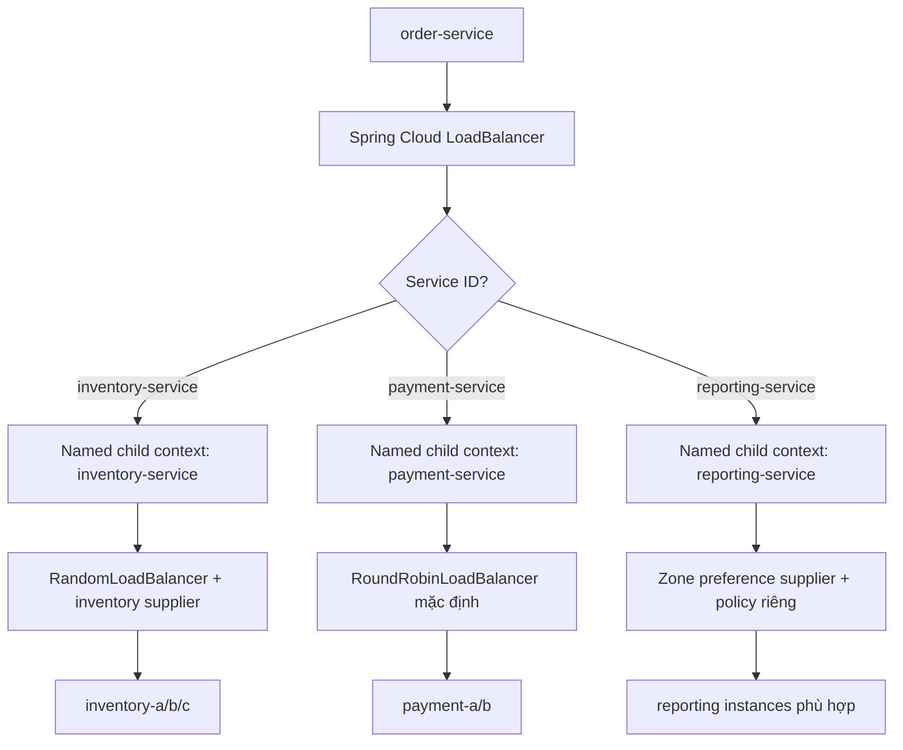

# Đăng ký tùy biến theo service ID mà không thay toàn hệ thống

Trong hệ thống microservices, không phải dependency nào cũng cần cùng một chính sách cân bằng tải. `inventory-service` có thể cần phân phối ngẫu nhiên giữa nhiều bản sao, `payment-service` cần tiếp tục dùng round robin mặc định, còn `reporting-service` có thể phải lọc theo zone hoặc metadata trước khi chọn instance.

**Spring Cloud LoadBalancer cho phép tùy biến riêng theo service ID bằng `@LoadBalancerClient` và `@LoadBalancerClients`.** Điều quan trọng là đăng ký bean `ReactorLoadBalancer<ServiceInstance>` hoặc `ServiceInstanceListSupplier` vào **ngữ cảnh cấu hình của đúng service**, thay vì vô tình tạo một bean ở application context chính khiến tất cả client đều sử dụng cùng policy.

Bài học thuộc chương **Tùy biến LoadBalancer**, module `SPRING_CLOUD_SERVICE_COMMUNICATION_LOAD_BALANCING`. Mục tiêu là hiểu cách mỗi service ID có LoadBalancer client context riêng, viết ví dụ tùy biến đúng phạm vi, tránh bẫy component scan, tích hợp qua RestClient/WebClient/OpenFeign, kiểm thử với nhiều service ID và có quy trình vận hành an toàn.

## 1. Vấn đề: một thuật toán không phù hợp mọi dependency

Giả sử `order-service` gọi ba dịch vụ:

| Service ID | Số bản sao | Chính sách mong muốn |
|---|---:|---|
| `inventory-service` | 3 | Chọn ngẫu nhiên giữa các ứng viên hợp lệ |
| `payment-service` | 2 | Tiếp tục dùng round robin mặc định |
| `reporting-service` | 4 | Ưu tiên instance cùng zone, sau đó chọn từ tập hợp phù hợp |

Nếu tạo một bean `RandomLoadBalancer` ở application context chính mà không kiểm soát phạm vi, bean này có thể ảnh hưởng tới cấu hình mặc định của nhiều service ID. Hậu quả là thay đổi nhỏ dành riêng cho inventory lại làm payment thay đổi thuật toán mà không được chủ ý.

Một thiết kế tốt phải chứng minh:

1. Request tới `inventory-service` dùng cấu hình tùy biến được đăng ký cho inventory.
2. Request tới `payment-service` vẫn dùng cấu hình mặc định.
3. Tập `ServiceInstance` cho mỗi service được lấy theo **đúng service ID**.
4. Các cấu hình khác nhau không tạo bean toàn cục ngoài ý muốn.
5. Ứng dụng vẫn xử lý chính xác danh sách instance rỗng, retry, health check và lỗi transport.



**Phạm vi tùy biến nằm ở cấu hình cho service ID**, không phải việc ứng dụng tạo một Java interface HTTP client mới hay đặt một `@Qualifier` ngẫu nhiên trên bean.

## 2. Cơ chế named child context của LoadBalancer

Spring Cloud LoadBalancer sử dụng `LoadBalancerClientFactory` để quản lý cấu hình theo tên client/service ID. Mỗi tên có thể gắn một **child ApplicationContext** riêng với thuật toán và supplier phù hợp. Các context này được tạo **lazily** khi cần cho lần sử dụng service ID đầu tiên, trừ khi cấu hình eager loading.

```text
ApplicationContext chính của order-service
│
├── RestClient.Builder / WebClient.Builder có @LoadBalanced
├── LoadBalancerClientFactory
│   │
│   ├── Child context: inventory-service
│   │     ├── ReactorLoadBalancer<ServiceInstance> = RandomLoadBalancer
│   │     └── ServiceInstanceListSupplier = inventory source
│   │
│   ├── Child context: payment-service
│   │     ├── ReactorLoadBalancer<ServiceInstance> = RoundRobinLoadBalancer
│   │     └── ServiceInstanceListSupplier = payment source
│   │
│   └── Child context: reporting-service
│         ├── ReactorLoadBalancer<ServiceInstance> = ...
│         └── ServiceInstanceListSupplier = zone-aware source
│
└── Các bean nghiệp vụ khác
```

Các child contexts có thể thấy một số bean từ parent theo cơ chế Spring context hierarchy. Chính đặc điểm này tạo ra **bẫy phạm vi**: nếu một bean LoadBalancer tùy biến vô tình được đăng ký ở parent, nó có thể được nhìn thấy bởi các child contexts khác, khiến cấu hình mặc định không được tạo như mong muốn.

### 2.1. Phân biệt tên sử dụng trong hệ thống

| Khái niệm | Ví dụ | Vai trò |
|---|---|---|
| Service ID trong URI | `http://inventory-service/items` | Tên logic LoadBalancer dùng để tìm danh sách instance |
| `@LoadBalancerClient(name=...)` | `inventory-service` | Chọn child context nhận cấu hình riêng |
| `LoadBalancerClientFactory.PROPERTY_NAME` | Giá trị service ID của child context hiện tại | Giúp bean factory method biết mình đang tạo policy cho service nào |
| `ServiceInstance.getServiceId()` | `inventory-service` | Thuộc tính của instance được discovery cung cấp |
| Feign `contextId` | `inventoryReadClient` | Định danh Feign client context/bean; không đương nhiên là tên LB service ID |
| Host vật lý | `10.0.1.11:8081` | Địa chỉ HTTP transport kết nối sau khi đã chọn instance |

**Service ID phải khớp về mặt giá trị** giữa URL logic, discovery và `@LoadBalancerClient`. Nếu đăng ký policy cho `inventory` nhưng client gọi `inventory-service`, policy sẽ không tự áp dụng cho cái tên khác đó.

## 3. Dependency tối thiểu và các điều kiện trước khi tùy biến

Giả sử dự án Spring Boot/Spring Cloud đã dùng một BOM tương thích, Maven dependency cho RestClient:

```xml
<dependencies>
    <dependency>
        <groupId>org.springframework.boot</groupId>
        <artifactId>spring-boot-starter-web</artifactId>
    </dependency>

    <dependency>
        <groupId>org.springframework.cloud</groupId>
        <artifactId>spring-cloud-starter-loadbalancer</artifactId>
    </dependency>

    <dependency>
        <groupId>org.springframework.boot</groupId>
        <artifactId>spring-boot-starter-test</artifactId>
        <scope>test</scope>
    </dependency>
</dependencies>
```

Cần một nguồn `ServiceInstance`: Eureka, Consul, Kubernetes discovery, `SimpleDiscoveryClient` hoặc một supplier tự định nghĩa. **Chỉ khai báo `@LoadBalancerClient` không tạo ra danh sách instance**.

Với WebClient, thêm `spring-boot-starter-webflux`. Với OpenFeign, thêm `spring-cloud-starter-openfeign`. Một số API và cấu hình có thay đổi giữa các release train, vì vậy hãy sử dụng đúng version tương thích của Spring Boot/Spring Cloud.

### 3.1. Chính sách mặc định

Theo tài liệu Spring Cloud Commons, thuật toán mặc định thông thường là `RoundRobinLoadBalancer`. Tùy biến có thể thay nó bằng `RandomLoadBalancer` hoặc bằng một implementation `ReactorLoadBalancer<ServiceInstance>` khác.

`RandomLoadBalancer` chọn ngẫu nhiên từ các **ứng viên mà supplier cung cấp**. Nó không tự health-check instance, không tự xác minh zone, không tự sửa discovery và không đảm bảo request tiếp theo luôn đi tới một bản sao khác.

## 4. Đăng ký cho một service bằng @LoadBalancerClient

Ví dụ một ứng dụng muốn **chỉ inventory sử dụng RandomLoadBalancer**, còn payment giữ mặc định.

### 4.1. Application configuration

```java
package com.example.order;

import org.springframework.boot.SpringApplication;
import org.springframework.boot.autoconfigure.SpringBootApplication;
import org.springframework.cloud.loadbalancer.annotation.LoadBalancerClient;

@SpringBootApplication
@LoadBalancerClient(
        name = "inventory-service",
        configuration = InventoryLoadBalancerConfiguration.class)
public class OrderServiceApplication {

    public static void main(String[] args) {
        SpringApplication.run(OrderServiceApplication.class, args);
    }
}
```

`name="inventory-service"` là khóa xác định **child LoadBalancer context** nhận cấu hình. Chỉ child context của inventory mới chủ động nhận class `InventoryLoadBalancerConfiguration` qua annotation này.

### 4.2. Cấu hình thuật toán riêng cho inventory

Đây là code theo ví dụ chính thức Spring Cloud Commons:

```java
package com.example.order;

import org.springframework.cloud.client.ServiceInstance;
import org.springframework.cloud.loadbalancer.core.RandomLoadBalancer;
import org.springframework.cloud.loadbalancer.core.ReactorLoadBalancer;
import org.springframework.cloud.loadbalancer.core.ServiceInstanceListSupplier;
import org.springframework.cloud.loadbalancer.support.LoadBalancerClientFactory;
import org.springframework.context.annotation.Bean;
import org.springframework.core.env.Environment;

// CHỦ Ý không gắn @Configuration và @Component ở class này.
// Class được Spring Cloud nạp vào child context của inventory-service.
public class InventoryLoadBalancerConfiguration {

    @Bean
    ReactorLoadBalancer<ServiceInstance> inventoryLoadBalancer(
            Environment environment,
            LoadBalancerClientFactory factory) {

        String serviceId = environment.getProperty(
                LoadBalancerClientFactory.PROPERTY_NAME);

        return new RandomLoadBalancer(
                factory.getLazyProvider(
                        serviceId,
                        ServiceInstanceListSupplier.class),
                serviceId);
    }
}
```

Giải thích từng thành phần:

- `ReactorLoadBalancer<ServiceInstance>` là hợp đồng thuật toán mà Spring Cloud LoadBalancer tìm để chọn instance.
- `LoadBalancerClientFactory.PROPERTY_NAME` lấy tên client trong child context hiện tại, **không lấy service ID từ biến hard-code ở mọi chỗ**.
- `getLazyProvider(serviceId, ServiceInstanceListSupplier.class)` cung cấp supplier phù hợp với child context đó, tránh việc dựng thuật toán trước khi supplier sẵn sàng.
- `RandomLoadBalancer` chọn từ danh sách mà supplier cung cấp. Nếu danh sách rỗng, không thể chọn một instance hợp lệ.
- Class **không có `@Configuration` hoặc `@Component`** nhằm tránh bị component scan của application context chính tự động phát hiện.

### 4.3. Vì sao không @Configuration?

Tài liệu Spring Cloud khuyến nghị class được truyền trong `@LoadBalancerClient(configuration=...)`:

- **Không annotate bằng `@Configuration`**, hoặc
- Đặt class có `@Configuration` **ngoài phạm vi component scan** của application chính.

Điều này giúp bean tùy biến chỉ được đăng ký vào child context được chỉ định. Một class không có `@Configuration` nhưng chứa method `@Bean` vẫn có thể được Spring Cloud xử lý khi được cung cấp trực tiếp dưới dạng load-balancer client configuration.

Cần phân biệt: `@Configuration` không phải một annotation “xấu”; rủi ro là **config class bị quét vào parent**, sau đó bean tùy biến bị chia sẻ cho các service khác. Đặt class ngoài component scan cũng hợp lệ, nhưng dễ nhầm khi tái cấu trúc package. Với bài thực hành, cách rõ nhất là **giữ class cấu hình LoadBalancer riêng không gắn stereotype**.

## 5. Vì sao @LoadBalanced RestClient.Builder vẫn dùng một bean chung?

Trong application, một bean `@LoadBalanced RestClient.Builder` có thể được dùng để tạo client cho nhiều service IDs:

```java
package com.example.order;

import org.springframework.cloud.client.loadbalancer.LoadBalanced;
import org.springframework.context.annotation.Bean;
import org.springframework.context.annotation.Configuration;
import org.springframework.web.client.RestClient;

@Configuration(proxyBeanMethods = false)
public class OutboundHttpConfiguration {

    @Bean("loadBalancedRestClientBuilder")
    @LoadBalanced
    RestClient.Builder loadBalancedRestClientBuilder() {
        return RestClient.builder();
    }
}
```

Caller tạo hai client khác nhau:

```java
import org.springframework.beans.factory.annotation.Qualifier;
import org.springframework.stereotype.Service;
import org.springframework.web.client.RestClient;

@Service
public class DownstreamGateway {

    private final RestClient inventory;
    private final RestClient payment;

    public DownstreamGateway(
            @Qualifier("loadBalancedRestClientBuilder")
            RestClient.Builder builder) {

        this.inventory = builder.clone()
                .baseUrl("http://inventory-service")
                .build();

        this.payment = builder.clone()
                .baseUrl("http://payment-service")
                .build();
    }

    public String inventoryInstance() {
        return inventory.get()
                .uri("/whoami")
                .retrieve()
                .body(String.class);
    }

    public String paymentInstance() {
        return payment.get()
                .uri("/whoami")
                .retrieve()
                .body(String.class);
    }
}
```

`clone()` giúp tách cấu hình base URL từng client thay vì thay đổi một builder đang được dùng chung. Điều quyết định policy là **hostname logic trong URL cuối cùng**:

- `inventory-service` → child context chứa `RandomLoadBalancer`.
- `payment-service` → child context mặc định với `RoundRobinLoadBalancer`, nếu không có tùy biến khác.

Một builder `@LoadBalanced` có thể phục vụ nhiều service IDs; **nó không ép tất cả service dùng cùng thuật toán**. Ngược lại, dùng `RestClient.create("http://inventory-service")` không qua builder đã được Spring Cloud cấu hình có thể bỏ qua cơ chế load balancing theo service ID.

### 5.1. Phân biệt direct URL

```java
RestClient direct = RestClient.create(
        "http://10.0.1.11:8081");
```

Client trên đi trực tiếp đến IP/port. Nó không dùng hostname logic `inventory-service` để nhờ Spring Cloud chọn từ discovery; do đó `@LoadBalancerClient(name="inventory-service", ...)` không tác động tới lựa chọn instance của request này.

## 6. Đăng ký nhiều service ID bằng @LoadBalancerClients

Nếu mỗi dependency cần chính sách khác nhau, dùng `@LoadBalancerClients` để đăng ký tập các cấu hình:

```java
import org.springframework.cloud.loadbalancer.annotation.LoadBalancerClient;
import org.springframework.cloud.loadbalancer.annotation.LoadBalancerClients;
import org.springframework.context.annotation.Configuration;

@Configuration(proxyBeanMethods = false)
@LoadBalancerClients({
    @LoadBalancerClient(
            name = "inventory-service",
            configuration = InventoryLoadBalancerConfiguration.class),
    @LoadBalancerClient(
            name = "reporting-service",
            configuration = ReportingLoadBalancerConfiguration.class)
})
public class LoadBalancerRegistrations {
}
```

Ở đây:

- Inventory có cấu hình riêng của inventory.
- Reporting có cấu hình riêng của reporting.
- Payment không xuất hiện trong annotation, nên nhận cấu hình mặc định **nếu không bị ảnh hưởng bởi global beans/properties khác**.

`ReportingLoadBalancerConfiguration` là một class cấu hình riêng do ứng dụng định nghĩa. Không cần khai báo mọi service trong `@LoadBalancerClients`; chỉ khai báo những service thực sự muốn thay policy mặc định hoặc cần custom bean.

### 6.1. Đừng đăng ký trùng cùng service ID tùy tiện

Nếu một service ID xuất hiện ở nhiều `@LoadBalancerClient` khác nhau, cần kiểm tra cơ chế merge/precedence trong Spring Cloud version đang dùng. Nhiều bean cùng kiểu `ReactorLoadBalancer` hoặc `ServiceInstanceListSupplier` ở một child context có thể gây ambiguous injection hoặc policy không đúng mong đợi.

Khuyến nghị:

1. Một service ID có **một đầu mối sở hữu** cấu hình thuật toán.
2. Một policy class nên có tên gợi đúng service hoặc mục tiêu nghiệp vụ.
3. Nếu tái sử dụng code chung, tái sử dụng **factory/helper classes**, không vô tình chia sẻ bean scope.
4. Kiểm thử từng service ID trong context thực, không suy đoán thứ tự override.

## 7. Tùy biến supplier riêng cho một service

Ngoài thuật toán, một service có thể cần chuỗi `ServiceInstanceListSupplier` riêng. Supplier quyết định **danh sách ứng viên** trước khi thuật toán chọn.

Ví dụ reporting muốn ưu tiên bản sao cùng zone. Một class có thể đăng ký supplier chuyên biệt:

```java
import org.springframework.cloud.loadbalancer.core.ServiceInstanceListSupplier;
import org.springframework.context.ConfigurableApplicationContext;
import org.springframework.context.annotation.Bean;

// Không @Configuration nếu class nằm trong component scan của ứng dụng.
public class ReportingLoadBalancerConfiguration {

    @Bean
    ServiceInstanceListSupplier reportingSupplier(
            ConfigurableApplicationContext context) {

        return ServiceInstanceListSupplier.builder()
                .withBlockingDiscoveryClient()
                .withCaching()
                .withZonePreference()
                .build(context);
    }
}
```

Để áp dụng, đăng ký:

```java
@LoadBalancerClient(
        name = "reporting-service",
        configuration = ReportingLoadBalancerConfiguration.class)
```

Một số điểm quan trọng:

- `withBlockingDiscoveryClient()` dùng nguồn `DiscoveryClient` blocking. Nếu dự án dùng `ReactiveDiscoveryClient`, chọn builder method và chain phù hợp reactive thay vì sao chép ví dụ blocking.
- `withCaching()` nên được đặt **ngay sau nguồn truy xuất instance**, trước các bộ lọc theo request/zone nếu cần phản ánh ngữ cảnh mới trên mỗi lần gọi.
- `withZonePreference()` thay đổi danh sách/ưu tiên ứng viên, không tự biến thuật toán thành weighted random hay least-connections.
- Không mặc định health check và cache nên được bọc cả hai tầng. Với `HealthCheckServiceInstanceListSupplier`, tài liệu khuyến cáo tránh bọc thêm cache bên ngoài vì health checker có cơ chế cache/replay riêng.
- Chính sách ưu tiên zone có thể fallback về tập delegate khi không có instance cùng zone; không xem mọi bộ lọc là ràng buộc cứng.
- Một service khác không dùng `ReportingLoadBalancerConfiguration` nếu class không bị đăng ký vào parent.

### 7.1. Khi nào nên tùy biến thuật toán, khi nào tùy biến supplier?

| Nhu cầu | Điểm tùy biến thích hợp |
|---|---|
| Chọn ngẫu nhiên từ tập ứng viên | `RandomLoadBalancer` |
| Chọn lần lượt, phân phối công bằng đơn giản | `RoundRobinLoadBalancer` |
| Chỉ chọn instance khỏe | Health-aware `ServiceInstanceListSupplier` |
| Ưu tiên cùng zone | Zone-aware supplier |
| Dựa vào metadata/hint | Hint-based hoặc custom supplier |
| Phân phối theo trọng số | Weighted supplier hoặc thuật toán tùy biến phù hợp |
| Sticky routing theo yêu cầu | Request-aware supplier hoặc policy phù hợp |
| Ghi metric trước/sau lựa chọn | `LoadBalancerLifecycle` instrumentation |
| Timeout/retry HTTP | HTTP transport và retry policy, không chỉ selector |

**Đừng xây một thuật toán chọn instance custom** nếu yêu cầu chỉ là lọc candidate theo metadata. Duy trì supplier chain rõ ràng thường dễ kiểm thử và bảo trì hơn.

## 8. Phạm vi cấu hình: parent context và child context

Đây là phần quan trọng nhất để tránh thay đổi toàn hệ thống.

### 8.1. Cấu hình đúng phạm vi

```java
public class InventoryLoadBalancerConfiguration {

    @Bean
    ReactorLoadBalancer<ServiceInstance> randomInventory(
            Environment environment,
            LoadBalancerClientFactory factory) {
        String id = environment.getProperty(
                LoadBalancerClientFactory.PROPERTY_NAME);

        return new RandomLoadBalancer(
                factory.getLazyProvider(
                        id, ServiceInstanceListSupplier.class),
                id);
    }
}
```

Class này chỉ được Spring Cloud sử dụng nhờ:

```java
@LoadBalancerClient(
        name = "inventory-service",
        configuration = InventoryLoadBalancerConfiguration.class)
```

### 8.2. Cấu hình dễ gây lỗi phạm vi

```java
// CẢNH BÁO: Nếu package này thuộc component scan của application chính,
// bean RandomLoadBalancer có thể bị đăng ký trong parent context.
@Configuration
public class AccidentallyGlobalLoadBalancerConfiguration {

    @Bean
    ReactorLoadBalancer<ServiceInstance> randomForEverything(
            Environment environment,
            LoadBalancerClientFactory factory) {

        String id = environment.getProperty(
                LoadBalancerClientFactory.PROPERTY_NAME);

        return new RandomLoadBalancer(
                factory.getLazyProvider(
                        id, ServiceInstanceListSupplier.class),
                id);
    }
}
```

Ở parent context, `LoadBalancerClientFactory.PROPERTY_NAME` có thể không có giá trị service ID. Bean trên có thể gây lỗi khởi tạo hoặc ảnh hưởng các child contexts nếu được kế thừa. Một bean tùy biến ở parent cũng có thể làm điều kiện `@ConditionalOnMissingBean` của thuật toán mặc định không còn đúng trong những child contexts.

**Cách khắc phục:** Không annotate config per-client với `@Configuration` khi nó nằm trong component scan, hoặc chuyển nó ra ngoài scan scope. Tạo một lớp đăng ký `@LoadBalancerClient` ở parent và giữ class cấu hình riêng không có stereotype là cách triển khai dễ đọc.

### 8.3. Vì sao @Primary không giải quyết đúng bản chất?

Đặt `@Primary` trên RandomLoadBalancer trong parent có thể chỉ làm bean đó được ưu tiên hơn nữa. Nó **không giới hạn** bean cho inventory. Phạm vi đúng phải được thiết lập qua `@LoadBalancerClient`/child context, không phải chỉ qua thứ tự ưu tiên khi inject.

### 8.4. @Qualifier thuộc một vấn đề khác

`@Qualifier("loadBalancedRestClientBuilder")` chọn đúng **builder có tích hợp LoadBalancer**. Nó không quyết định `inventory-service` dùng Random hay RoundRobin. Thực tế lựa chọn policy dựa trên service ID mà interceptor/filter nhận từ URI logic.

## 9. Cấu hình property theo từng client

Spring Cloud Commons cũng hỗ trợ các thuộc tính cá nhân hóa theo client với tiền tố:

```text
spring.cloud.loadbalancer.clients.<clientId>.*
```

Các giá trị mặc định chung ở `spring.cloud.loadbalancer.*` có thể được merge với cấu hình riêng, trong đó client-specific có độ ưu tiên cao hơn cho những property mà cơ chế config hỗ trợ.

Ví dụ muốn health check của inventory chạy với chu kỳ khác:

```yaml
spring:
  cloud:
    loadbalancer:
      health-check:
        initial-delay: 1s
      clients:
        inventory-service:
          health-check:
            interval: 10s
        reporting-service:
          health-check:
            interval: 30s
```

Đây là ví dụ về **configuration properties per-service**, không phải cơ chế đăng ký Java policy bean. Các property health check chỉ có tác dụng khi supplier/health-check mechanism phù hợp thực sự được bật.

### 9.1. Phân biệt property toàn cục và per-service

| Cấu hình | Phạm vi chủ ý |
|---|---|
| `spring.cloud.loadbalancer.configurations=zone-preference` | Predefined supplier configuration mặc định rộng hơn, có thể ảnh hưởng nhiều clients |
| `@LoadBalancerClient(name="inventory-service", configuration=...)` | Bean tùy biến cho inventory child context |
| `spring.cloud.loadbalancer.clients.inventory-service.health-check.interval` | Chỉ property của inventory nếu phiên bản/consumer hỗ trợ |
| `spring.cloud.loadbalancer.cache.enabled=false` | Thiết lập chung khi không có override riêng phù hợp |
| `spring.cloud.loadbalancer.eager-load.clients` | Danh sách client contexts được khởi tạo sớm |

**Không mặc định mọi property của Spring Cloud đều hỗ trợ override theo client theo cùng cách.** Kiểm tra các property classes và effective behavior trong Spring Cloud release train của dự án.

### 9.2. Khi nào dùng annotation, khi nào dùng properties?

- Dùng **`@LoadBalancerClient`** khi cần thay bean thuật toán, supplier hoặc lifecycle cụ thể cho service ID.
- Dùng **client-specific properties** khi chỉ cần điều chỉnh tham số đã được framework expose rõ.
- Kết hợp cả hai khi vừa thay supplier/algorithm vừa cần TTL, timeout hay interval per-client được hỗ trợ.
- Tránh dùng một property global chỉ để giải quyết riêng một dependency nếu có cơ chế per-client rõ ràng hơn.

## 10. Tích hợp với RestClient, WebClient và OpenFeign

Tùy biến theo service ID thuộc **Spring Cloud LoadBalancer**, nên có thể áp dụng cho nhiều kiểu HTTP clients miễn là lời gọi thực sự dùng Spring Cloud LoadBalancer.

### 10.1. RestClient

```java
@RestController
class InventoryController {

    private final RestClient client;

    InventoryController(
            @Qualifier("loadBalancedRestClientBuilder")
            RestClient.Builder builder) {
        this.client = builder.build();
    }

    @GetMapping("/probe-inventory")
    String probe() {
        return client.get()
                .uri("http://inventory-service/whoami")
                .retrieve()
                .body(String.class);
    }
}
```

Vì URL dùng `inventory-service` và builder có `@LoadBalanced`, policy trong inventory child context được sử dụng.

### 10.2. WebClient

```java
@Configuration(proxyBeanMethods = false)
class ReactiveHttpClientConfiguration {

    @Bean("loadBalancedWebClientBuilder")
    @LoadBalanced
    WebClient.Builder loadBalancedWebClientBuilder() {
        return WebClient.builder();
    }
}
```

Ví dụ:

```java
Mono<String> value = loadBalancedWebClientBuilder
        .build()
        .get()
        .uri("http://inventory-service/whoami")
        .retrieve()
        .bodyToMono(String.class);
```

`loadBalancedWebClientBuilder` ở đây là builder đã inject từ bean được đánh dấu `@LoadBalanced`. Reactive client có thể sử dụng policy tương ứng trong child context mà không cần khai báo lại thuật toán tại WebClient. Cần subscribe/compose publisher để HTTP request thực sự được thực hiện.

### 10.3. OpenFeign

```java
@FeignClient(name = "inventory-service")
public interface InventoryFeignClient {

    @GetMapping("/whoami")
    String whoami();
}
```

Khi Feign dùng service ID với Spring Cloud LoadBalancer integration, policy inventory có thể áp dụng.

Ngược lại:

```java
@FeignClient(
        name = "inventory-service",
        url = "http://inventory-a.internal:8081")
public interface DirectInventoryFeignClient {

    @GetMapping("/whoami")
    String whoami();
}
```

Feign client có `url` cố định gọi target đó trực tiếp và **không chọn instance theo inventory service ID bằng Spring Cloud LoadBalancer** cho request ấy. Việc đặt `@LoadBalancerClient` không sửa được direct URL thành tên logic.

### 10.4. HTTP Interfaces

Với HTTP Interface dựa trên `HttpServiceProxyFactory`, adapter được tạo từ `RestClient` hoặc `WebClient` đã cấu hình load balancing. Annotation `@HttpExchange` chỉ xác định HTTP contract, không tự kích hoạt policy per-service. Cần chắc chắn base URL dùng hostname logic `inventory-service`.

## 11. Kiểm thử hai service ID: chứng minh không ảnh hưởng toàn hệ thống

Chỉ nhìn response thành công từ inventory chưa chứng minh phạm vi tùy biến đúng. Test tốt phải **kiểm tra đồng thời policy của inventory và payment**.

Thiết kế:

- `inventory-service` có hai HTTP server A/B.
- `payment-service` có hai HTTP server A/B.
- Inventory child context trả `RandomLoadBalancer`.
- Payment child context trả `RoundRobinLoadBalancer`.
- Client dùng cùng `@LoadBalanced RestClient.Builder` nhưng gọi hai hostname logic khác nhau.
- Mỗi HTTP stub trả body là tên instance của chính nó.
- Test kiểm tra type bean thật trong từng child context và HTTP request thật.

**Lưu ý:** Với RandomLoadBalancer, không được assert sau 4–8 lần gọi nhất thiết phải thấy cả A và B; random có thể chọn lặp lại một instance. Với payment RoundRobin, nếu hai instance hợp lệ, retry/cache/filter và các lời gọi nền đã được kiểm soát, hai lần chọn liên tiếp thường phải tới hai instance khác nhau. Nếu test có nhiều luồng hoặc policy custom khác, cần kiểm tra điều kiện này.

## 12. Ví dụ integration test hoàn chỉnh với hai service ID

Ví dụ sau dùng JDK `HttpServer` để không cần Eureka hay Consul. `SimpleDiscoveryClient` được cấu hình bởi `@DynamicPropertySource`, cấp URI cổng động cho bốn HTTP servers. Test chứng minh cả **bean scope** lẫn **đường đi request**.

### 12.1. Test application

Giả sử class `InventoryLoadBalancerConfiguration` từ mục 4 có mặt trong cùng package test hoặc đã được import theo đúng kiểu package của dự án. Class này **không được annotate `@Configuration`**.

```java
package com.example.order;

import org.springframework.boot.SpringBootConfiguration;
import org.springframework.boot.autoconfigure.EnableAutoConfiguration;
import org.springframework.cloud.client.loadbalancer.LoadBalanced;
import org.springframework.cloud.loadbalancer.annotation.LoadBalancerClient;
import org.springframework.context.annotation.Bean;
import org.springframework.web.client.RestClient;

@SpringBootConfiguration
@EnableAutoConfiguration
@LoadBalancerClient(
        name = "inventory-service",
        configuration = InventoryLoadBalancerConfiguration.class)
class TestApplication {

    @Bean("loadBalancedBuilder")
    @LoadBalanced
    RestClient.Builder loadBalancedBuilder() {
        return RestClient.builder();
    }
}
```

### 12.2. HTTP stub cho mỗi instance

```java
package com.example.order;

import java.io.IOException;
import java.io.OutputStream;
import java.io.UncheckedIOException;
import java.net.InetSocketAddress;
import java.nio.charset.StandardCharsets;

import com.sun.net.httpserver.HttpServer;

final class InstanceStub implements AutoCloseable {

    private final HttpServer server;

    private InstanceStub(String instanceId) throws IOException {
        this.server = HttpServer.create(
                new InetSocketAddress("127.0.0.1", 0), 0);

        server.createContext("/whoami", exchange -> {
            byte[] payload = instanceId.getBytes(
                    StandardCharsets.UTF_8);

            exchange.getResponseHeaders().set(
                    "Content-Type", "text/plain; charset=UTF-8");
            exchange.getResponseHeaders().set(
                    "X-Instance-Id", instanceId);

            exchange.sendResponseHeaders(200, payload.length);

            try (OutputStream out =
                         exchange.getResponseBody()) {
                out.write(payload);
            }
        });

        server.start();
    }

    static InstanceStub start(String id) {
        try {
            return new InstanceStub(id);
        } catch (IOException error) {
            throw new UncheckedIOException(error);
        }
    }

    String uri() {
        return "http://127.0.0.1:"
                + server.getAddress().getPort();
    }

    @Override
    public void close() {
        server.stop(0);
    }
}
```

### 12.3. Integration test cả hai dịch vụ

```java
package com.example.order;

import java.util.HashSet;
import java.util.Set;

import org.junit.jupiter.api.AfterAll;
import org.junit.jupiter.api.Test;
import org.springframework.beans.factory.annotation.Autowired;
import org.springframework.beans.factory.annotation.Qualifier;
import org.springframework.boot.test.context.SpringBootTest;
import org.springframework.cloud.loadbalancer.core.RandomLoadBalancer;
import org.springframework.cloud.loadbalancer.core.ReactorLoadBalancer;
import org.springframework.cloud.loadbalancer.core.RoundRobinLoadBalancer;
import org.springframework.cloud.loadbalancer.support.LoadBalancerClientFactory;
import org.springframework.test.context.DynamicPropertyRegistry;
import org.springframework.test.context.DynamicPropertySource;
import org.springframework.web.client.RestClient;

import static org.junit.jupiter.api.Assertions.*;

@SpringBootTest(
        classes = TestApplication.class,
        webEnvironment = SpringBootTest.WebEnvironment.NONE,
        properties = {
                "spring.cloud.loadbalancer.cache.enabled=false",
                "spring.cloud.loadbalancer.retry.enabled=false"
        }
)
class ScopedLoadBalancerTest {

    private static final InstanceStub INVENTORY_A =
            InstanceStub.start("inventory-a");
    private static final InstanceStub INVENTORY_B =
            InstanceStub.start("inventory-b");

    private static final InstanceStub PAYMENT_A =
            InstanceStub.start("payment-a");
    private static final InstanceStub PAYMENT_B =
            InstanceStub.start("payment-b");

    @DynamicPropertySource
    static void registerInstances(DynamicPropertyRegistry registry) {
        registry.add(
                "spring.cloud.discovery.client.simple.instances."
                        + "inventory-service[0].uri",
                INVENTORY_A::uri);
        registry.add(
                "spring.cloud.discovery.client.simple.instances."
                        + "inventory-service[1].uri",
                INVENTORY_B::uri);

        registry.add(
                "spring.cloud.discovery.client.simple.instances."
                        + "payment-service[0].uri",
                PAYMENT_A::uri);
        registry.add(
                "spring.cloud.discovery.client.simple.instances."
                        + "payment-service[1].uri",
                PAYMENT_B::uri);
    }

    @Autowired
    LoadBalancerClientFactory factory;

    @Autowired
    @Qualifier("loadBalancedBuilder")
    RestClient.Builder builder;

    @Test
    void inventoryUsesRandomButPaymentKeepsRoundRobin() {
        ReactorLoadBalancer<?> inventoryPolicy =
                factory.getInstance(
                        "inventory-service",
                        ReactorLoadBalancer.class);

        ReactorLoadBalancer<?> paymentPolicy =
                factory.getInstance(
                        "payment-service",
                        ReactorLoadBalancer.class);

        assertInstanceOf(
                RandomLoadBalancer.class, inventoryPolicy);
        assertInstanceOf(
                RoundRobinLoadBalancer.class, paymentPolicy);

        assertNotSame(inventoryPolicy, paymentPolicy);
    }

    @Test
    void inventoryCallAlwaysUsesAnInventoryInstance() {
        RestClient client = builder.clone().build();

        for (int n = 0; n < 12; n++) {
            String body = client.get()
                    .uri("http://inventory-service/whoami")
                    .retrieve()
                    .body(String.class);

            assertTrue(Set.of(
                    "inventory-a", "inventory-b")
                    .contains(body));
        }
    }

    @Test
    void paymentStillReachesBothInstances() {
        RestClient client = builder.clone().build();
        Set<String> observed = new HashSet<>();

        for (int n = 0; n < 4; n++) {
            String body = client.get()
                    .uri("http://payment-service/whoami")
                    .retrieve()
                    .body(String.class);

            observed.add(body);
        }

        assertEquals(
                Set.of("payment-a", "payment-b"),
                observed);
    }

    @AfterAll
    static void stopServers() {
        INVENTORY_A.close();
        INVENTORY_B.close();
        PAYMENT_A.close();
        PAYMENT_B.close();
    }
}
```

### 12.4. Test chứng minh điều gì?

| Phép đo | Bằng chứng |
|---|---|
| `factory.getInstance("inventory-service", ...)` là `RandomLoadBalancer` | Inventory dùng policy tùy biến |
| `factory.getInstance("payment-service", ...)` là `RoundRobinLoadBalancer` | Payment vẫn dùng mặc định |
| Mọi response inventory thuộc tập A/B của inventory | Không gửi request sang payment |
| Payment nhìn thấy cả A/B khi gọi tuần tự | Policy mặc định thực sự được sử dụng trên transport |
| Không hard-code địa chỉ instance ở client | URL logic đã đi qua LoadBalancer |
| Hai service có policy bean khác nhau | Không có một bean custom toàn cục chung cho cả hai |

**Giới hạn:** Test không tự chứng minh chất lượng phân phối ngẫu nhiên của RandomLoadBalancer hay fairness dưới tải thực; nó chứng minh **đúng implementation được đăng ký** và request đi vào tập instance mong đợi.

### 12.5. Về các phiên bản và biến số

- Dùng Spring Boot Test, Spring Cloud LoadBalancer starter, Spring Web và Java có module `jdk.httpserver`.
- Đảm bảo các method `getInstance` và `ReactorLoadBalancer` tương ứng với Spring Cloud BOM sử dụng.
- Nếu còn global configuration từ dự án thật, test context cần tách biệt để không nhiễu.
- Một số integration có thể khởi tạo child context lazily; `factory.getInstance(...)` trong test kích hoạt tạo context tương ứng.
- `SimpleDiscoveryClient` công bố danh sách tĩnh, không tự deregister một server vừa tắt.
- Retry được tắt để không làm một logical request sinh thêm HTTP attempts; cache được tắt để đơn giản phép đo.
- Nếu bắt buộc kiểm thử thuật toán Random theo xác suất, dùng test thống kê hoặc test double riêng; không yêu cầu chuỗi A,B,A,B.

## 13. Kiểm tra không có bean LoadBalancer custom ở parent

Để xác nhận cấu hình không bị rò ra toàn hệ thống, có thể bổ sung vào test:

```java
@Autowired
org.springframework.context.ApplicationContext parent;

@Test
void noLoadBalancerPolicyBeanInParentContext() {
    assertTrue(
            parent.getBeansOfType(
                    ReactorLoadBalancer.class).isEmpty());
}
```

Đây là assertion phù hợp cho **test application được kiểm soát trong ví dụ**, nơi parent không định nghĩa thuật toán trực tiếp. Nếu ứng dụng thực tế chủ ý có global LoadBalancer bean vì một lý do khác, assertion tổng quát này có thể cần thay bằng kiểm tra riêng rằng **bean inventory** không nằm trong parent.

Cần phân biệt:

- Bean policy tồn tại trong **child context inventory**: bình thường.
- Bean policy tồn tại trong **child context payment** do framework mặc định tạo: bình thường.
- Bean policy inventory xuất hiện trong **parent** do quét nhầm `@Configuration`: dấu hiệu cần sửa.

Không nên kiểm tra dựa vào `ApplicationContext.getBean(...)` mà không xác định phạm vi, vì Spring cho phép child nhìn thấy bean parent.

## 14. Eager loading và thời điểm khởi tạo

Spring Cloud LoadBalancer thường tạo named child context theo nhu cầu khi service ID được sử dụng lần đầu. Nếu cần khởi tạo sớm (ví dụ để phát hiện lỗi bean config trước khi nhận traffic), có property:

```yaml
spring:
  cloud:
    loadbalancer:
      eager-load:
        clients:
          - inventory-service
          - payment-service
```

Ưu điểm:

- Phát hiện sớm một số lỗi cấu hình policy/supplier.
- Giảm bất ngờ latency khởi tạo context ở request đầu.

Nhược điểm:

- Tăng công việc startup và số child contexts được tạo.
- Không chứng minh discovery đã có instance khỏe tại thời điểm startup.
- Không tự kiểm tra HTTP endpoint thật hoặc TLS certificate.

**Eager loading không làm thay đổi phạm vi cấu hình:** inventory vẫn phải dùng inventory configuration; payment vẫn phải dùng default configuration. Với native image/AOT, tài liệu Spring Cloud hướng dẫn khai báo tường minh service IDs bằng `@LoadBalancerClient` hoặc eager-load list cho việc xử lý trước trong build.

## 15. Tương tác với discovery, cache, health và zone

Một thay đổi thuật toán theo service ID không làm các vấn đề hạ tầng biến mất.

### 15.1. Service-specific supplier chain

Nếu policy inventory cần chọn trong tập đã lọc:

```text
DiscoveryClient
    → Caching (nếu phù hợp)
    → Health / Zone / Hint / Metadata filtering
    → RandomLoadBalancer
    → selected ServiceInstance
```

Khi một supplier trả rỗng, `RandomLoadBalancer` không thể tạo instance hợp lệ. Đừng cho thuật toán tự thêm IP dự phòng ngoài discovery, trừ khi đó là policy đã được thiết kế, bảo vệ và kiểm thử tường minh.

### 15.2. Cache và dữ liệu cũ

`spring.cloud.loadbalancer.cache.*` có thể ảnh hưởng thời điểm thay đổi danh sách instance được nhìn thấy. Cache của LoadBalancer không đồng nghĩa cache của Eureka/Consul SDK; nếu dùng hai tầng cache, thời gian hội tụ sau scale-up/down có thể dài hơn mong đợi.

Khi kiểm thử một thuật toán mới, tắt cache hoặc dùng danh sách cố định để tách phần selection khỏi phần freshness. Khi kiểm thử production behavior, bật lại cache/health theo cấu hình thật và đo thời gian thay đổi được phản ánh.

### 15.3. Health check và weighted/zone policies

Nếu muốn inventory dùng Random nhưng chỉ trong các bản sao khỏe, thêm health-aware supplier được đăng ký **trong inventory child context**. Nếu reporting cần zone, supplier reporting phải có dữ liệu zone đúng trong `ServiceInstance.getMetadata()` hoặc cấu hình phù hợp.

Việc một policy Random được đăng ký **không tự thay thế** những bước filtering này. Ngược lại, một bộ lọc quá nghiêm có thể khiến algorithm luôn nhìn thấy một instance duy nhất, dẫn tới kết quả quan sát giống như “không cân bằng”.

### 15.4. Retry có thể chọn lại instance

Khi retry sang instance tiếp theo, `RetryAwareServiceInstanceListSupplier` có thể tránh instance trước nếu còn ứng viên khác. Với một policy Random, việc chọn lại vẫn chịu những điều kiện:

- Retry đã được kích hoạt đúng ở HTTP client.
- Lỗi nằm trong chính sách retryable.
- Candidate list còn đủ instance hợp lệ.
- Retry-aware supplier có hiệu lực, hoặc selection policy có cách xử lý khác.
- Deadline và attempt budget chưa hết.

Không nên kết luận “Random luôn chọn khác instance sau lỗi”. Random có thể chọn lại cùng một bản sao nếu danh sách ứng viên không được lọc hoặc chỉ còn một ứng viên.

## 16. Kết hợp nhiều policy nhưng tránh đăng ký chồng

Giả sử:

- Inventory: `RandomLoadBalancer`.
- Reporting: zone preference supplier + mặc định round robin.
- Payment: mặc định không tùy biến.

Một quy ước hợp lý:

```text
OrderServiceApplication
    @LoadBalancerClients({
        inventory-service -> InventoryLoadBalancerConfiguration,
        reporting-service -> ReportingLoadBalancerConfiguration
    })

InventoryLoadBalancerConfiguration
    @Bean ReactorLoadBalancer<ServiceInstance> -> RandomLoadBalancer

ReportingLoadBalancerConfiguration
    @Bean ServiceInstanceListSupplier -> withZonePreference()

Payment
    không có custom class -> default RoundRobinLoadBalancer
```

Không cần tạo bean `RoundRobinLoadBalancer` thủ công cho payment chỉ để giữ mặc định. Càng ít bean custom không cần thiết, càng dễ xác minh phạm vi và thay đổi khi nâng cấp Spring Cloud.

Nếu reporting muốn **cả** supplier riêng và thuật toán riêng, có thể đặt cả hai bean trong **cùng ReportingLoadBalancerConfiguration**, miễn là chỉ có một policy phù hợp cho mỗi loại bean và được test riêng.

## 17. Observability: xác minh policy đang chạy trên đúng service

Những thông tin hữu ích khi theo dõi thay đổi:

| Tín hiệu | Nguồn đo |
|---|---|
| `serviceId` | URI logic / LoadBalancer client context |
| `policyClass` | Bean `ReactorLoadBalancer` của child context |
| `candidateCount` | Supplier sau các bước filter |
| `selectedInstanceId` | Kết quả `choose(...)` hoặc lifecycle |
| `httpTarget` | Transport (host/port/scheme đã chọn) |
| `responseStatus` | HTTP client/server |
| `selectionFailure` | Không có candidate, exception |
| `latency` | Client HTTP và end-to-end logical request |
| `retryAttempts` | Retry instrumentation |
| `configVersion` | Phiên bản/cấu hình rollout do hệ thống quản lý |

Một log nội bộ minh họa:

```text
event=loadbalancer.selection
serviceId=inventory-service
policyClass=RandomLoadBalancer
candidateCount=3
selectedInstanceId=inventory-b
attempt=1
outcome=SUCCESS
```

**Đây là ví dụ instrumentation do ứng dụng bổ sung**, không phải các field Spring Cloud tự log đầy đủ mặc định. Với Micrometer, tránh gắn instance ID động, raw URI hoặc request ID làm tag metric cardinality cao. Dùng logs/traces có sampling để xem từng lần chọn.

### 17.1. Đừng lấy tần suất Random làm bằng chứng policy duy nhất

Một cửa sổ ngắn có thể tạo chuỗi:

```text
inventory-a, inventory-a, inventory-a, inventory-b
```

Chuỗi đó không chứng minh policy đã cấu hình sai. Muốn xác nhận có đúng bean, xem `LoadBalancerClientFactory.getInstance(...)` như test mục 12. Muốn đánh giá phân phối, thu đủ mẫu, biết candidate count, kiểm soát concurrency/filter và dùng phân tích thống kê phù hợp. Đừng biến tỷ lệ 50/50 trên 10 request thành điều kiện bắt buộc.

## 18. Troubleshooting theo triệu chứng

| Triệu chứng | Nguyên nhân thường gặp | Hướng kiểm tra |
|---|---|---|
| Payment cũng dùng Random | Custom config bị component scan vào parent | Bỏ `@Configuration` ở config per-service hoặc chuyển ngoài scan |
| Inventory vẫn dùng RoundRobin | Tên `@LoadBalancerClient` không khớp service ID hoặc config không được đăng ký | Kiểm tra `name`, factory child context, bean type |
| Code có `RandomLoadBalancer` nhưng request đi cố định một IP | Client dùng direct URL hoặc supplier chỉ có một candidate | Kiểm tra builder `@LoadBalanced`, URL và candidate list |
| `LoadBalancerClientFactory.PROPERTY_NAME` là null | Bean method chạy trong parent context sai phạm vi | Kiểm tra class bị scan; giữ nó trong child context |
| `NoUniqueBeanDefinitionException` với load balancer | Nhiều policy beans cùng kiểu trong child | Chỉ đăng ký một policy hoặc phân giải rõ |
| Cấu hình reporting làm ảnh hưởng inventory | Supplier bean bị parent scan hoặc global property thay đổi | Tách scope/beans; kiểm tra prefix global/per-service |
| Random test thỉnh thoảng không thấy B | Tính ngẫu nhiên hoặc filter đã bỏ B | Không assert sample ngắn phải chứa cả hai |
| RoundRobin không xen kẽ đúng chuỗi | Index ban đầu, retry, gọi nền hoặc concurrency | Assert tập eligible và số request có kiểm soát |
| Inventory không có instance | Discovery trả rỗng hoặc service ID sai | Xem `SimpleDiscoveryClient`/registry và supplier |
| Instance đã chết vẫn bị chọn | Cache stale/health chưa cập nhật | Đo discovery/health/cache freshness |
| HTTP 503 dù chọn được instance | Server/proxy lỗi, không phải tự động no-instance | Phân biệt LB selection và HTTP status |
| OpenFeign không dùng policy | Có `url` trực tiếp hoặc thiếu LB integration | Xem Feign target config và starter |
| Test parent có bean custom không mong đợi | Application scan quá rộng | Cô lập test context và sửa package/stereotype |
| Sau nâng cấp policy đổi hành vi | API hoặc auto-config version đổi | Kiểm tra Spring Cloud BOM và tests policy scope |

## 19. Quy trình triển khai an toàn trong production

1. Xác định rõ **service ID nào** cần thay policy và mục tiêu đo được của thay đổi.
2. Viết class per-service config **không annotate `@Configuration`** nếu nằm trong component scan của application.
3. Đăng ký qua `@LoadBalancerClient(name=..., configuration=...)` hoặc nhóm `@LoadBalancerClients`.
4. Giữ bean `@LoadBalanced` ở client HTTP và dùng URL hostname logic đúng service ID.
5. Kiểm tra factory child contexts cho ít nhất **một service được tùy biến và một service không tùy biến**.
6. Kiểm tra source `ServiceInstanceListSupplier`, cache/health/zone/hint tương ứng.
7. Tạo test HTTP với nhiều instance và instance marker; tránh assertion dựa trên chuỗi Random cố định.
8. Dùng metrics/tracing phân biệt selection, HTTP response, lỗi transport và retry attempts.
9. Triển khai có giới hạn phạm vi, ví dụ canary hoặc rollback theo phiên bản ứng dụng.
10. So trước/sau về p95/p99 latency, error rates, retry amplification và distribution theo instance/zone.
11. Nếu phát hiện policy ảnh hưởng service ngoài dự kiến, rollback config scope trước khi điều chỉnh thuật toán.
12. Sau thay đổi dependency hoặc Spring Cloud release train, chạy lại test per-service isolation.

## 20. Checklist tự đánh giá

- [ ] Tôi đã phân biệt thuật toán chọn instance và supplier tạo danh sách ứng viên.
- [ ] `@LoadBalancerClient(name=...)` dùng đúng service ID trong URI logic.
- [ ] Class cấu hình per-service không bị component scan của parent nạp vào ngoài ý muốn.
- [ ] Bean `ReactorLoadBalancer<ServiceInstance>` lấy service ID từ child context qua `LoadBalancerClientFactory.PROPERTY_NAME`.
- [ ] Supplier được lấy lazy từ đúng service ID.
- [ ] Service không đăng ký custom config vẫn dùng policy mặc định.
- [ ] Một service ID không có nhiều beans cùng loại vô tình chồng chéo.
- [ ] `@LoadBalanced RestClient.Builder` hoặc WebClient.Builder được inject đúng.
- [ ] OpenFeign client không có direct `url` nếu muốn qua Spring Cloud LoadBalancer.
- [ ] Tôi đã kiểm tra property global và per-client không tác động nhầm các service khác.
- [ ] Có test kiểm tra type policy qua `LoadBalancerClientFactory.getInstance(...)`.
- [ ] Có test HTTP tới các instance thật và kiểm tra instance marker.
- [ ] Không ép Random phải phân phối 50/50 trong số request nhỏ.
- [ ] Có test/no-instance và health/cache/routing nếu ứng dụng dùng chúng.
- [ ] Retry/timeout được cấu hình và đo độc lập với selector.
- [ ] Có log/trace/metrics để xác nhận policyClass/serviceId/selectedInstance.
- [ ] Có quy trình rollback nếu config ảnh hưởng ngoài phạm vi mong muốn.

## 21. Kết luận

**Tùy biến LoadBalancer theo service ID** là cách an toàn để thay đổi chính sách một dependency mà không bắt toàn bộ ứng dụng chuyển thuật toán. Với `@LoadBalancerClient(name="inventory-service", configuration=InventoryLoadBalancerConfiguration.class)`, Spring Cloud đăng ký cấu hình tùy biến vào named child context cho inventory; các service ID khác tiếp tục dùng cấu hình mặc định hoặc cấu hình riêng của chúng.

Điều kiện quyết định là **đặt bean đúng scope**: class cấu hình per-client không được vô tình trở thành `@Configuration` trong component scan của application chính. Hãy kiểm tra policy thật qua `LoadBalancerClientFactory`, kiểm thử đồng thời ít nhất hai service IDs, xác nhận client HTTP dùng service ID logic và nhớ rằng thuật toán chỉ chọn từ danh sách do supplier cung cấp.

Kết hợp per-service policy với discovery, cache, health, retry, timeout và observability đúng cách sẽ cho phép tinh chỉnh routing của inventory hoặc reporting mà vẫn giữ payment và những dependency khác ổn định.

### Tài liệu tham khảo

- [Spring Cloud Commons — Spring Cloud LoadBalancer](https://docs.spring.io/spring-cloud-commons/reference/spring-cloud-commons/loadbalancer.html) — `@LoadBalancerClient`, `@LoadBalancerClients`, default `RoundRobinLoadBalancer`, `RandomLoadBalancer` và cảnh báo component scan.
- [Spring Cloud Commons — Common Abstractions](https://docs.spring.io/spring-cloud-commons/reference/spring-cloud-commons/common-abstractions.html) — `@LoadBalanced RestClient.Builder`, `@LoadBalanced WebClient.Builder` và URI service ID.
- [Spring Cloud Commons — Configuration Properties](https://docs.spring.io/spring-cloud-commons/reference/configprops.html) — các thuộc tính `spring.cloud.loadbalancer.*`, cache, retry, eager loading và per-client settings.
- [Spring Cloud Commons — LoadBalancerClientConfiguration source](https://github.com/spring-cloud/spring-cloud-commons/blob/main/spring-cloud-loadbalancer/src/main/java/org/springframework/cloud/loadbalancer/annotation/LoadBalancerClientConfiguration.java) — default `RoundRobinLoadBalancer` và các supplier configurations (tham khảo theo nhánh/phiên bản tương ứng).

