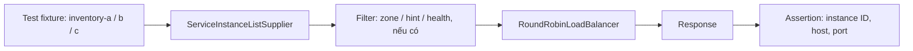

# Giả lập ServiceInstance và danh sách bản sao xác định

## Mục tiêu

Trong Spring Cloud LoadBalancer, một lời gọi như `http://inventory-service/api/items/SKU-42` không trỏ trực tiếp tới một máy chủ. LoadBalancer dùng **service ID** `inventory-service` để lấy danh sách `ServiceInstance`, chọn một bản sao rồi mới gửi HTTP request bằng `RestClient`, `WebClient`, `RestTemplate` hoặc OpenFeign.

Khi viết **kiểm thử tự động**, ta không nên phụ thuộc vào danh sách instance thực tế của Eureka, Consul, Kubernetes hay một registry đang thay đổi. Nếu một test mong đợi `inventory-a` nhưng discovery bất ngờ trả thêm `inventory-b`, kết quả sẽ không ổn định. Giải pháp là **giả lập danh sách instance có chủ đích**, điều khiển cả dữ liệu lẫn thứ tự, rồi kiểm tra hành vi của supplier và thuật toán chọn instance.

Sau bài học, bạn có thể:

- Tạo `DefaultServiceInstance` với instance ID, service ID, host, port, TLS và metadata rõ ràng.
- Cung cấp danh sách cố định qua `ServiceInstanceListSupplier` mà không chạy registry thật.
- Sử dụng `ServiceInstanceListSuppliers.from(...)` và `toProvider(...)` cho unit test.
- Dùng JUnit 5, AssertJ và Reactor `StepVerifier` để kiểm tra supplier trả danh sách đúng.
- Kiểm tra `RoundRobinLoadBalancer` với seed xác định, gồm các tình huống **0, 1 và nhiều instance**.
- Viết fake supplier thay đổi snapshot để mô phỏng scale-out, scale-in và discovery mất hết instance.
- Hiểu cách Mockito mock `get(Request)` khác với `get()`.
- Tách **unit test chọn instance** khỏi **integration test gửi HTTP thật**.
- Tránh test flaky do thứ tự không ổn định, cache, retry, nhiều thread và random selection.

> Phạm vi API được tham khảo từ Spring Cloud Commons/LoadBalancer 5.0.x. Những ví dụ về class và constructor dựa trên API hiện hành; với dự án dùng release khác, hãy đối chiếu Spring Cloud BOM và Javadoc cùng phiên bản. Bài chỉ tạo tài liệu hướng dẫn; không chạy build hay vòng QA học thuật của mô-đun.

## 1. Kiểm thử LoadBalancer thực sự kiểm tra điều gì?

Giả sử `order-service` nhìn thấy ba bản sao:

| Instance ID | Service ID | Host | Port | Metadata |
|---|---|---|---:|---|
| `inventory-a` | `inventory-service` | `127.0.0.1` | 18081 | `zone=zone-a` |
| `inventory-b` | `inventory-service` | `127.0.0.1` | 18082 | `zone=zone-b` |
| `inventory-c` | `inventory-service` | `127.0.0.1` | 18083 | `zone=zone-a` |

Để test một cơ chế cân bằng tải, cần tách ba quyết định:

1. **Discovery** trả danh sách instance gốc nào?
2. **Supplier chain** lọc, sắp xếp hoặc biến đổi danh sách đó thế nào?
3. **LoadBalancer** chọn instance nào từ danh sách cuối cùng?



Trong **unit test** của thuật toán chọn instance, test dừng ở `Response<ServiceInstance>`; **không cần mở TCP connection**. Trong **integration test**, test mới dùng HTTP server giả hoặc server thực khởi động trên port ngẫu nhiên để xác nhận URL logic được đổi thành đúng địa chỉ vật lý.

### 1.1. Deterministic nghĩa là gì?

Một test có tính xác định khi cùng đầu vào, cùng trạng thái ban đầu và cùng thứ tự kích hoạt dẫn đến cùng kết quả có thể kiểm chứng.

Đối với LoadBalancer, những yếu tố phải kiểm soát gồm:

- Danh sách instance và **thứ tự phần tử**.
- Service ID của supplier khớp service ID đang chọn.
- Trạng thái/seed của thuật toán round robin.
- Số lượt gọi `choose()` và việc có test khác dùng chung load balancer không.
- Metadata như `zone`, `weight` hoặc `hint`.
- Các thành phần bổ sung: cache, health check, request-aware filter, retry.
- Thời gian và concurrency nếu đang mô phỏng thay đổi topology.

**Một danh sách cố định không làm thuật toán RandomLoadBalancer trở thành deterministic.** Với thuật toán random, nên kiểm tra kết quả thuộc tập hợp cho phép hoặc cung cấp điểm điều khiển random phù hợp; không khẳng định lần 1 luôn chọn instance A.

## 2. Các thành phần cần biết

| Thành phần | Vai trò ở runtime | Cách sử dụng trong test |
|---|---|---|
| `ServiceInstance` | Đại diện một bản sao dịch vụ | Tạo dữ liệu giả với đầy đủ field |
| `DefaultServiceInstance` | Triển khai `ServiceInstance` có sẵn | Dùng làm fixture thay vì mock mọi getter |
| `ServiceInstanceListSupplier` | Trả danh sách instance dưới dạng `Flux<List<ServiceInstance>>` | Dùng fixed supplier, fake mutable hoặc Mockito |
| `ServiceInstanceListSuppliers` | Tiện ích tạo supplier/provider cố định | Tạo unit test gọn, không cần Spring context |
| `RoundRobinLoadBalancer` | Chọn instance theo vòng, có trạng thái vị trí | Khởi tạo mới mỗi test và đặt seed |
| `Request` / `Response<ServiceInstance>` | Ngữ cảnh lựa chọn và kết quả | Kiểm tra `hasServer()` trước khi lấy server |
| `LoadBalancerClientFactory` | Quản lý context riêng theo service ID | Chủ yếu cần trong Spring integration test |
| `SimpleDiscoveryClient` | Discovery đơn giản từ properties | Hữu ích cho test chạy toàn bộ HTTP flow |

**Không nhầm** `ServiceInstanceListSupplier` với HTTP connection pool. Supplier trả **danh sách địa chỉ backend có thể chọn**; connection pool quản lý socket/kết nối đến những địa chỉ đó.

## 3. Chuẩn bị dependency cho kiểm thử

Ứng dụng mẫu dùng Spring Boot và một Spring Cloud Release Train tương thích. Với Maven, import **Spring Cloud BOM** tương ứng trong `dependencyManagement`; không tự ghép các phiên bản framework rời rạc.

Các dependency tối thiểu cho ví dụ:

```xml
<dependencies>
    <dependency>
        <groupId>org.springframework.cloud</groupId>
        <artifactId>spring-cloud-starter-loadbalancer</artifactId>
    </dependency>

    <dependency>
        <groupId>org.springframework.boot</groupId>
        <artifactId>spring-boot-starter-test</artifactId>
        <scope>test</scope>
    </dependency>

    <dependency>
        <groupId>io.projectreactor</groupId>
        <artifactId>reactor-test</artifactId>
        <scope>test</scope>
    </dependency>
</dependencies>
```

`spring-boot-starter-test` cung cấp JUnit Jupiter, AssertJ và Mockito theo bộ dependency được quản lý; `reactor-test` cung cấp `StepVerifier` để kiểm tra dữ liệu reactive từ supplier. Các ví dụ chọn instance **không cần** Eureka, Consul, server HTTP hoặc Spring Boot application context.

Nếu dùng Spring Boot 4.x và sau đó viết integration test qua MVC controller, thêm starter MVC phù hợp. Với bài này, ưu tiên bắt đầu từ **unit test nhỏ**, chỉ mở rộng sang HTTP khi thật sự cần chứng minh giao tiếp mạng.

## 4. Tạo fixture ServiceInstance thật, không cần mock getter

`DefaultServiceInstance` nhận tối thiểu:

```java
new DefaultServiceInstance(
        "inventory-a",        // instanceId
        "inventory-service",  // serviceId
        "127.0.0.1",          // host
        18081,                // port
        false                 // secure: HTTP thay vì HTTPS
);
```

Khi cần metadata, dùng constructor có thêm `Map<String, String>`:

```java
import java.util.Map;
import org.springframework.cloud.client.DefaultServiceInstance;

DefaultServiceInstance a = new DefaultServiceInstance(
        "inventory-a",
        "inventory-service",
        "127.0.0.1",
        18081,
        false,
        Map.of(
                "zone", "zone-a",
                "hint", "stable",
                "weight", "3"
        )
);
```

Những field quan trọng:

| Field | Dùng để test |
|---|---|
| `instanceId` | Xác định bản sao được chọn; khác với `serviceId` |
| `serviceId` | Bảo đảm fixture thuộc đúng dịch vụ logic |
| `host` và `port` | Xác nhận URL vật lý/đích HTTP |
| `secure` | Kiểm tra chọn `http` hay `https` theo instance |
| `metadata.zone` | Kịch bản ưu tiên theo zone |
| `metadata.hint` | Kịch bản hint routing |
| `metadata.weight` | Kịch bản weighted routing |

`DefaultServiceInstance` có các setter và metadata map có thể thay đổi. Trong test deterministic, **không dùng chung object mutable giữa nhiều test**. Tạo fixture mới trước mỗi test, tránh thay metadata của một instance đang được supplier/cache tham chiếu.

### 4.1. Tập fixture dùng lại trong cùng test

```java
import org.springframework.cloud.client.DefaultServiceInstance;

final class InventoryInstances {

    static final String SERVICE_ID = "inventory-service";

    static DefaultServiceInstance a() {
        return new DefaultServiceInstance(
                "inventory-a", SERVICE_ID, "127.0.0.1", 18081, false);
    }

    static DefaultServiceInstance b() {
        return new DefaultServiceInstance(
                "inventory-b", SERVICE_ID, "127.0.0.1", 18082, false);
    }

    static DefaultServiceInstance c() {
        return new DefaultServiceInstance(
                "inventory-c", SERVICE_ID, "127.0.0.1", 18083, false);
    }

    private InventoryInstances() {
    }
}
```

Đặt helper này trong `src/test/java`. Mỗi lần gọi `a()` hoặc `b()` tạo một object mới; nhờ đó test này không vô tình thay đổi dữ liệu của test khác.

Port 18081–18083 chỉ là **giá trị fixture** khi test chọn instance; không cần có HTTP server thực đang lắng nghe trên các port đó.

## 5. Supplier cố định: ServiceInstanceListSuppliers.from(...)

Spring Cloud LoadBalancer có tiện ích:

```java
import org.springframework.cloud.loadbalancer.core.ServiceInstanceListSupplier;
import org.springframework.cloud.loadbalancer.support.ServiceInstanceListSuppliers;

ServiceInstanceListSupplier supplier = ServiceInstanceListSuppliers.from(
        "inventory-service",
        InventoryInstances.a(),
        InventoryInstances.b()
);
```

`ServiceInstanceListSuppliers.from(serviceId, instances...)` tạo một supplier với danh sách instance đã cung cấp. Đây là API đơn giản để viết test, không cần kết nối discovery.

Supplier trả một publisher:

```java
Flux<List<ServiceInstance>> snapshots = supplier.get();
```

**Lưu ý cấu trúc kiểu dữ liệu:** mỗi phần tử của `Flux` là **một danh sách instance**, không phải một instance riêng lẻ. Vì thế test nên kiểm tra:

- Supplier phát ra một snapshot gồm đúng hai instance.
- Thứ tự danh sách đúng với fixture.
- Mọi instance có `serviceId = inventory-service`.
- Không có phát sinh mạng hoặc chờ registry.

### 5.1. Unit test kiểm tra danh sách và thứ tự

```java
import static org.assertj.core.api.Assertions.assertThat;

import java.util.List;
import org.junit.jupiter.api.Test;
import org.springframework.cloud.client.ServiceInstance;
import org.springframework.cloud.loadbalancer.core.ServiceInstanceListSupplier;
import org.springframework.cloud.loadbalancer.support.ServiceInstanceListSuppliers;
import reactor.test.StepVerifier;

class FixedSupplierTest {

    private static final String SERVICE_ID = "inventory-service";

    @Test
    void returnsExactlyTwoInstancesInKnownOrder() {
        ServiceInstanceListSupplier supplier = ServiceInstanceListSuppliers.from(
                SERVICE_ID,
                InventoryInstances.a(),
                InventoryInstances.b()
        );

        assertThat(supplier.getServiceId()).isEqualTo(SERVICE_ID);

        StepVerifier.create(supplier.get())
                .assertNext(instances -> {
                    assertThat(instances)
                            .extracting(ServiceInstance::getInstanceId)
                            .containsExactly("inventory-a", "inventory-b");

                    assertThat(instances)
                            .allSatisfy(instance ->
                                    assertThat(instance.getServiceId())
                                            .isEqualTo(SERVICE_ID));

                    assertThat(instances.get(0).getPort()).isEqualTo(18081);
                    assertThat(instances.get(1).getPort()).isEqualTo(18082);
                })
                .verifyComplete();
    }

    @Test
    void canRepresentNoAvailableInstances() {
        ServiceInstanceListSupplier supplier =
                ServiceInstanceListSuppliers.from(SERVICE_ID);

        StepVerifier.create(supplier.get())
                .assertNext(instances -> assertThat(instances).isEmpty())
                .verifyComplete();
    }
}
```

Điểm then chốt: `Flux.just(List.of())` (hoặc publisher của fixed supplier trả một **danh sách rỗng**) khác với `Flux.empty()` (không phát snapshot nào).

`RoundRobinLoadBalancer` nhận danh sách rỗng thì trả `EmptyResponse`. Nếu một supplier tự viết **không phát gì cả**, `choose()` có thể hoàn tất trống; hành vi caller lúc đó khác trường hợp nhận `EmptyResponse`. Trong test nên quy định rõ hợp đồng: **một snapshot, có thể rỗng**, rồi kiểm chứng nhánh không có instance.

### 5.2. Fixed fixture không bảo đảm immutability tuyệt đối

Tiện ích `ServiceInstanceListSuppliers.from(...)` dùng các object instance bạn truyền vào. Nó không clone sâu object hoặc metadata. Nếu sau đó có code sửa `DefaultServiceInstance` hoặc map metadata có thể thay đổi, dữ liệu test có thể không còn cố định như mong đợi.

Vì vậy:

- Tạo instance mới trong từng test.
- Không mutate danh sách/object sau khi đưa vào supplier.
- Nếu cần mô phỏng topology thay đổi, dùng **fake supplier động** riêng (phần 8) thay vì sửa mảng/metadata của fixed fixture.

## 6. Kiểm thử RoundRobinLoadBalancer có seed xác định

Một supplier cố định chưa đủ để kiểm thử **thứ tự chọn instance** nếu thuật toán có trạng thái khởi tạo không được kiểm soát.

`RoundRobinLoadBalancer` có constructor nhận `seedPosition`. Đối với test hai instance, dùng `seedPosition = -1` để lần chọn đầu tăng vị trí lên 0, tiếp theo 1, rồi lặp lại:

```text
Instances: [inventory-a, inventory-b]
Seed position: -1

choose #1 → inventory-a
choose #2 → inventory-b
choose #3 → inventory-a
choose #4 → inventory-b
```

Đây là hành vi của implementation đang tham khảo, không phải cam kết rằng mọi LoadBalancer hoặc mọi release luôn dùng chính xác thứ tự này.

### 6.1. Một lớp test đầy đủ, không khởi động Spring

`ServiceInstanceListSuppliers.toProvider(...)` tạo `ObjectProvider<ServiceInstanceListSupplier>` phù hợp với constructor của `RoundRobinLoadBalancer`:

```java
import static org.assertj.core.api.Assertions.assertThat;

import java.util.ArrayList;
import java.util.List;
import org.junit.jupiter.api.Test;
import org.springframework.cloud.client.ServiceInstance;
import org.springframework.cloud.client.loadbalancer.Response;
import org.springframework.cloud.loadbalancer.core.RoundRobinLoadBalancer;
import org.springframework.cloud.loadbalancer.support.ServiceInstanceListSuppliers;

class RoundRobinSelectionTest {

    private static final String SERVICE_ID = "inventory-service";

    @Test
    void choosesInstancesInDeterministicOrder() {
        RoundRobinLoadBalancer loadBalancer = new RoundRobinLoadBalancer(
                ServiceInstanceListSuppliers.toProvider(
                        SERVICE_ID,
                        InventoryInstances.a(),
                        InventoryInstances.b()
                ),
                SERVICE_ID,
                -1
        );

        List<String> selected = new ArrayList<>();
        for (int i = 0; i < 4; i++) {
            Response<ServiceInstance> response = loadBalancer.choose().block();
            assertThat(response).isNotNull();
            assertThat(response.hasServer()).isTrue();
            selected.add(response.getServer().getInstanceId());
        }

        assertThat(selected).containsExactly(
                "inventory-a",
                "inventory-b",
                "inventory-a",
                "inventory-b"
        );
    }

    @Test
    void returnsNoServerWhenListIsEmpty() {
        RoundRobinLoadBalancer loadBalancer = new RoundRobinLoadBalancer(
                ServiceInstanceListSuppliers.toProvider(SERVICE_ID),
                SERVICE_ID,
                -1
        );

        Response<ServiceInstance> response = loadBalancer.choose().block();

        assertThat(response).isNotNull();
        assertThat(response.hasServer()).isFalse();
    }

    @Test
    void alwaysChoosesTheOnlyAvailableInstance() {
        RoundRobinLoadBalancer loadBalancer = new RoundRobinLoadBalancer(
                ServiceInstanceListSuppliers.toProvider(
                        SERVICE_ID,
                        InventoryInstances.c()
                ),
                SERVICE_ID,
                -1
        );

        for (int i = 0; i < 3; i++) {
            Response<ServiceInstance> response = loadBalancer.choose().block();
            assertThat(response).isNotNull();
            assertThat(response.hasServer()).isTrue();
            assertThat(response.getServer().getInstanceId())
                    .isEqualTo("inventory-c");
        }
    }
}
```

Khi `hasServer() == false`, **không dereference `response.getServer()`** rồi đọc `getHost()`; với kết quả rỗng sẽ không có một instance hợp lệ.

### 6.2. Vì sao không dùng RoundRobinLoadBalancer mặc định rồi đòi lần đầu là A?

Constructor không truyền seed có thể dùng vị trí khởi tạo mang yếu tố ngẫu nhiên. Một instance của `RoundRobinLoadBalancer` dùng chung giữa các test hoặc nhiều thread cũng đã có trạng thái `position` thay đổi.

Để kiểm tra thứ tự:

1. Tạo **LoadBalancer mới cho từng test**.
2. Dùng **seed tường minh**, chẳng hạn `-1`.
3. Dùng danh sách có thứ tự rõ ràng.
4. Không chạy song song các lời gọi vào **cùng một LoadBalancer** khi assertion kỳ vọng thứ tự tuần tự.
5. Không để retry hoặc một HTTP client khác gọi `choose()` ẩn trong lúc đang test.

Trong production, thứ tự request tới backend còn chịu concurrency, cache, filter, retry và kết quả discovery. Test này chỉ chứng minh **hành vi thuật toán đối với một snapshot xác định**.

## 7. Dùng StepVerifier để kiểm tra output reactive

`ServiceInstanceListSupplier#get()` trả `Flux<List<ServiceInstance>>`. `RoundRobinLoadBalancer#choose()` trả `Mono<Response<ServiceInstance>>`. `StepVerifier` giúp kiểm tra:

- Publisher có phát đúng số phần tử không.
- Snapshot chứa instance nào.
- Publisher hoàn tất bình thường hay báo lỗi.
- Kết quả có `hasServer()` và ID mong đợi không.

Ví dụ test reactive cho một lần chọn:

```java
import static org.assertj.core.api.Assertions.assertThat;

import org.junit.jupiter.api.Test;
import org.springframework.cloud.loadbalancer.core.RoundRobinLoadBalancer;
import org.springframework.cloud.loadbalancer.support.ServiceInstanceListSuppliers;
import reactor.test.StepVerifier;

class ReactiveSelectionTest {

    @Test
    void firstSelectionIsInventoryA() {
        String id = "inventory-service";
        var loadBalancer = new RoundRobinLoadBalancer(
                ServiceInstanceListSuppliers.toProvider(
                        id,
                        InventoryInstances.a(),
                        InventoryInstances.b()
                ),
                id,
                -1
        );

        StepVerifier.create(loadBalancer.choose())
                .assertNext(response -> {
                    assertThat(response.hasServer()).isTrue();
                    assertThat(response.getServer().getInstanceId())
                            .isEqualTo("inventory-a");
                })
                .verifyComplete();
    }
}
```

Không nhất thiết phải dùng `StepVerifier.withVirtualTime()` cho fixed supplier không có timer. **Virtual time** hữu ích khi kiểm thử retry backoff, timeout, scheduler hoặc polling health check; nó không làm thuật toán random tự trở thành deterministic.

## 8. Fake supplier có thể đổi snapshot để mô phỏng thay đổi topology

Fixed supplier thích hợp cho dữ liệu không đổi. Nếu cần test chuyển từ hai instance xuống một, hoặc toàn bộ instance biến mất, hãy tạo một fake có thể cập nhật danh sách **theo bước test**.

### 8.1. Viết MutableServiceInstanceListSupplier

```java
import java.util.List;
import java.util.concurrent.atomic.AtomicReference;
import org.springframework.cloud.client.ServiceInstance;
import org.springframework.cloud.loadbalancer.core.ServiceInstanceListSupplier;
import reactor.core.publisher.Flux;

final class MutableServiceInstanceListSupplier
        implements ServiceInstanceListSupplier {

    private final String serviceId;
    private final AtomicReference<List<ServiceInstance>> snapshot =
            new AtomicReference<>(List.of());

    MutableServiceInstanceListSupplier(String serviceId) {
        this.serviceId = serviceId;
    }

    void replace(List<ServiceInstance> next) {
        for (ServiceInstance instance : next) {
            if (!serviceId.equals(instance.getServiceId())) {
                throw new IllegalArgumentException(
                        "Wrong service ID: " + instance.getServiceId());
            }
        }
        snapshot.set(List.copyOf(next));
    }

    @Override
    public String getServiceId() {
        return serviceId;
    }

    @Override
    public Flux<List<ServiceInstance>> get() {
        return Flux.defer(() -> Flux.just(snapshot.get()));
    }
}
```

Hai điểm chủ chốt:

- `AtomicReference` cập nhật cả snapshot như một giá trị; test không sửa một danh sách đang được thread khác đọc.
- `Flux.defer(...)` đọc snapshot **khi có subscription mới**, không “chụp” danh sách một lần ở thời điểm tạo publisher.

`List.copyOf(...)` bảo vệ cấu trúc list khỏi thay đổi bên ngoài, nhưng không clone sâu từng `ServiceInstance`. Trong test tiếp tục tránh mutate đối tượng instance đã đưa vào supplier.

### 8.2. Test scale-in rồi mất hết instance

Sử dụng một Spring `DefaultListableBeanFactory` rất nhỏ để tạo `ObjectProvider` cho LoadBalancer mà không khởi động toàn bộ Spring Boot application:

```java
import static org.assertj.core.api.Assertions.assertThat;

import java.util.List;
import org.junit.jupiter.api.Test;
import org.springframework.beans.factory.support.DefaultListableBeanFactory;
import org.springframework.cloud.client.ServiceInstance;
import org.springframework.cloud.loadbalancer.core.RoundRobinLoadBalancer;
import org.springframework.cloud.loadbalancer.core.ServiceInstanceListSupplier;

class DynamicTopologyTest {

    @Test
    void seesNewSnapshotOnNextSelection() {
        String serviceId = "inventory-service";

        MutableServiceInstanceListSupplier supplier =
                new MutableServiceInstanceListSupplier(serviceId);

        supplier.replace(List.<ServiceInstance>of(InventoryInstances.a()));

        DefaultListableBeanFactory beanFactory =
                new DefaultListableBeanFactory();
        beanFactory.registerSingleton("supplier", supplier);

        RoundRobinLoadBalancer loadBalancer = new RoundRobinLoadBalancer(
                beanFactory.getBeanProvider(ServiceInstanceListSupplier.class),
                serviceId,
                -1
        );

        var first = loadBalancer.choose().block();
        assertThat(first).isNotNull();
        assertThat(first.hasServer()).isTrue();
        assertThat(first.getServer().getInstanceId())
                .isEqualTo("inventory-a");

        // Mô phỏng A bị rút và B là bản sao duy nhất còn lại.
        supplier.replace(List.<ServiceInstance>of(InventoryInstances.b()));

        var second = loadBalancer.choose().block();
        assertThat(second).isNotNull();
        assertThat(second.hasServer()).isTrue();
        assertThat(second.getServer().getInstanceId())
                .isEqualTo("inventory-b");

        // Mô phỏng discovery không còn một instance nào.
        supplier.replace(List.of());

        var third = loadBalancer.choose().block();
        assertThat(third).isNotNull();
        assertThat(third.hasServer()).isFalse();
    }
}
```

Đây là test của **fake supplier trực tiếp nối vào RoundRobin**, không có `CachingServiceInstanceListSupplier`. Vì vậy, snapshot mới có hiệu lực ở lần gọi `choose()` kế tiếp. Trong hệ thống có caching/health check, thay đổi instance ở nguồn discovery **không nhất thiết xuất hiện ngay**: cần test TTL, refresh và supplier chain riêng.

### 8.3. Những trạng thái nên mô phỏng

| Bước | Danh sách snapshot | Assertion quan trọng |
|---|---|---|
| Khởi động | `[A, B]` | Có thể chọn A/B |
| Scale-out | `[A, B, C]` | C xuất hiện trong tập ứng viên |
| Scale-in | `[B, C]` | A không còn được chọn sau khi snapshot mới thực sự áp dụng |
| Chỉ còn một bản sao | `[C]` | Luôn chọn C |
| Mất toàn bộ instance | `[]` | `hasServer() == false` |
| Khôi phục | `[B]` | Lần chọn sau có thể trả B |
| Sai service ID | Ví dụ instance thuộc `payment-service` | Fixture fail fast để không kiểm thử sai đích |

**Đừng dùng `Thread.sleep(...)` để chờ topology thay đổi trong test này.** Bạn kiểm soát được snapshot nên hãy cập nhật và gọi assertion trực tiếp. Những bài test có scheduler/health checks thì dùng công cụ chờ theo điều kiện hoặc virtual time khi phù hợp.

## 9. Mockito: mock supplier thay vì mock toàn bộ ServiceInstance

Khi muốn kiểm tra một class đang tương tác với `ServiceInstanceListSupplier`, có thể dùng Mockito. Tuy nhiên, cần phân biệt hai method:

```java
Flux<List<ServiceInstance>> get();
Flux<List<ServiceInstance>> get(Request request);
```

`RoundRobinLoadBalancer#choose(...)` có thể gọi **`supplier.get(request)`**, không nhất thiết gọi `supplier.get()`. Mockito mock là một object giả với những method chưa stub có thể trả `null`. Chỉ stub `get()` rồi đưa mock vào LoadBalancer có thể làm test lỗi vì `get(request)` chưa được cấu hình.

### 9.1. Stub get(Request) khi test thuật toán chọn instance

```java
import static org.assertj.core.api.Assertions.assertThat;
import static org.mockito.ArgumentMatchers.any;
import static org.mockito.Mockito.mock;
import static org.mockito.Mockito.when;

import java.util.List;
import org.junit.jupiter.api.Test;
import org.springframework.beans.factory.support.DefaultListableBeanFactory;
import org.springframework.cloud.client.ServiceInstance;
import org.springframework.cloud.client.loadbalancer.Request;
import org.springframework.cloud.loadbalancer.core.RoundRobinLoadBalancer;
import org.springframework.cloud.loadbalancer.core.ServiceInstanceListSupplier;
import reactor.core.publisher.Flux;

class MockSupplierTest {

    @Test
    void loadBalancerUsesRequestAwareSupplierMethod() {
        String id = "inventory-service";
        ServiceInstanceListSupplier supplier =
                mock(ServiceInstanceListSupplier.class);

        when(supplier.getServiceId()).thenReturn(id);
        when(supplier.get(any(Request.class)))
                .thenReturn(Flux.just(List.<ServiceInstance>of(
                        InventoryInstances.a(),
                        InventoryInstances.b()
                )));

        var factory = new DefaultListableBeanFactory();
        factory.registerSingleton("supplier", supplier);

        var lb = new RoundRobinLoadBalancer(
                factory.getBeanProvider(ServiceInstanceListSupplier.class),
                id,
                -1
        );

        var response = lb.choose().block();
        assertThat(response).isNotNull();
        assertThat(response.hasServer()).isTrue();
        assertThat(response.getServer().getInstanceId())
                .isEqualTo("inventory-a");
    }
}
```

Trong test này, Mockito không mock `DefaultServiceInstance`: dữ liệu instance vẫn dùng object thật để các getter `getHost()`, `getPort()`, `getUri()` và `getMetadata()` hoạt động tự nhiên.

**Tránh over-mocking:** nếu mục tiêu là kiểm thử chính `ServiceInstanceListSupplier` hoặc filter của nó, đừng mock luôn hành vi cần được kiểm tra. Dùng fake/fixed supplier làm nguồn, để class dưới test thực sự thực hiện logic của mình.

## 10. Kiểm thử supplier lọc theo metadata

Khi kiểm thử zone, hint hoặc weighted supplier, cần cả **dữ liệu nguồn xác định** và **ngữ cảnh lọc xác định**. Ví dụ:

```java
import java.util.Map;
import org.springframework.cloud.client.DefaultServiceInstance;

DefaultServiceInstance stableA = new DefaultServiceInstance(
        "stable-a", "inventory-service", "127.0.0.1", 18081, false,
        Map.of("zone", "zone-a", "hint", "stable", "weight", "5")
);

DefaultServiceInstance canaryB = new DefaultServiceInstance(
        "canary-b", "inventory-service", "127.0.0.1", 18082, false,
        Map.of("zone", "zone-b", "hint", "canary", "weight", "1")
);
```

### 10.1. Test contract của một custom filter

Nếu bạn viết supplier lọc nghiêm ngặt theo zone, có thể kiểm thử nó bằng fixed supplier:

```java
import java.util.List;
import org.springframework.cloud.client.ServiceInstance;
import org.springframework.cloud.loadbalancer.core.ServiceInstanceListSupplier;
import reactor.core.publisher.Flux;

final class StrictZoneSupplier implements ServiceInstanceListSupplier {

    private final ServiceInstanceListSupplier delegate;
    private final String zone;

    StrictZoneSupplier(ServiceInstanceListSupplier delegate, String zone) {
        this.delegate = delegate;
        this.zone = zone;
    }

    @Override
    public String getServiceId() {
        return delegate.getServiceId();
    }

    @Override
    public Flux<List<ServiceInstance>> get() {
        return delegate.get().map(instances ->
                instances.stream()
                        .filter(instance -> instance.getMetadata() != null)
                        .filter(instance -> zone.equals(
                                instance.getMetadata().get("zone")))
                        .toList());
    }
}
```

Test:

```java
import static org.assertj.core.api.Assertions.assertThat;

import java.util.Map;
import org.junit.jupiter.api.Test;
import org.springframework.cloud.client.DefaultServiceInstance;
import org.springframework.cloud.client.ServiceInstance;
import org.springframework.cloud.loadbalancer.support.ServiceInstanceListSuppliers;
import reactor.test.StepVerifier;

class StrictZoneSupplierTest {

    @Test
    void keepsOnlyZoneAAndReturnsEmptyOnNoMatch() {
        var zoneA = new DefaultServiceInstance(
                "zone-a-instance", "inventory-service",
                "127.0.0.1", 18081, false, Map.of("zone", "zone-a"));
        var zoneB = new DefaultServiceInstance(
                "zone-b-instance", "inventory-service",
                "127.0.0.1", 18082, false, Map.of("zone", "zone-b"));

        var base = ServiceInstanceListSuppliers.from(
                "inventory-service", zoneA, zoneB
        );

        var matched = new StrictZoneSupplier(base, "zone-a");
        StepVerifier.create(matched.get())
                .assertNext(instances -> assertThat(instances)
                        .extracting(ServiceInstance::getInstanceId)
                        .containsExactly("zone-a-instance"))
                .verifyComplete();

        // Strict policy: không có zone-x thì danh sách phải rỗng.
        var noMatch = new StrictZoneSupplier(base, "zone-x");
        StepVerifier.create(noMatch.get())
                .assertNext(instances -> assertThat(instances).isEmpty())
                .verifyComplete();
    }
}
```

Đây là **custom strict filter** minh họa việc fail-closed. Nó **không phải** `ZonePreferenceServiceInstanceListSupplier` mặc định của Spring Cloud.

Nếu test chính implementation có sẵn `ZonePreferenceServiceInstanceListSupplier`, hãy nhớ nó **ưu tiên zone**, nhưng khi không có instance nào khớp zone, nó có thể **fallback về toàn bộ danh sách delegate**. Vì thế expectation “không có zone A thì danh sách phải rỗng” là **sai đối với built-in zone preference**, dù đúng với strict filter tự viết.

Tương tự, `HintBasedServiceInstanceListSupplier` mặc định trả lại toàn bộ danh sách khi không có instance match hint. **Luôn đọc contract của supplier đang test** trước khi viết assertion về fallback.

### 10.2. Test weighted supplier thế nào cho ổn định?

`WeightedServiceInstanceListSupplier` dùng metadata `weight` hoặc hàm tính trọng số để ảnh hưởng xác suất chọn instance. Không nên viết:

```java
// Fragile: không bảo đảm lần gọi đầu phải ra canary.
assertThat(loadBalancer.choose().block().getServer().getInstanceId())
        .isEqualTo("canary-b");
```

Với weighted/random routing, các hướng test tốt hơn:

1. Kiểm tra cấu hình weight và dữ liệu đầu vào.
2. Nếu test lớp chuẩn bị danh sách, kiểm tra tập ứng viên hợp lệ và metadata.
3. Nếu muốn kiểm tra phân phối xác suất, dùng test thống kê riêng với đủ mẫu và khoảng chấp nhận — **không dùng nó làm unit test thứ tự chính xác**.
4. Với thuật toán tự viết có random source inject được, dùng seed/test double cho random để cố định kết quả.

Test phân phối có thể flaky khi tải CI hoặc implementation thay đổi; chỉ sử dụng khi thật sự cần chứng minh chất lượng phân phối, không biến mọi build thành phép kiểm tra tỉ lệ 50/50 tuyệt đối.

## 11. Đưa fixed supplier vào context của một service ID

Unit test trực tiếp ở phần 6 không cần Spring context. Nhưng nếu cần xác minh cấu hình `@LoadBalancerClient`, có thể đăng ký một supplier cố định **trong child context của đúng service ID**:

```java
import org.springframework.cloud.client.DefaultServiceInstance;
import org.springframework.cloud.loadbalancer.annotation.LoadBalancerClient;
import org.springframework.cloud.loadbalancer.core.ServiceInstanceListSupplier;
import org.springframework.cloud.loadbalancer.support.ServiceInstanceListSuppliers;
import org.springframework.context.annotation.Bean;
import org.springframework.context.annotation.Configuration;

@Configuration(proxyBeanMethods = false)
@LoadBalancerClient(
        name = "inventory-service",
        configuration = FixedInventoryLoadBalancerConfiguration.class
)
class TestLoadBalancerRegistration {
}

// Không thêm @Configuration nếu class nằm trong component scan chính.
class FixedInventoryLoadBalancerConfiguration {

    @Bean
    ServiceInstanceListSupplier fixedInventorySupplier() {
        return ServiceInstanceListSuppliers.from(
                "inventory-service",
                new DefaultServiceInstance(
                        "inventory-a", "inventory-service",
                        "127.0.0.1", 18081, false),
                new DefaultServiceInstance(
                        "inventory-b", "inventory-service",
                        "127.0.0.1", 18082, false)
        );
    }
}
```

**Phạm vi test:** import `TestLoadBalancerRegistration` chỉ trong test context phù hợp hoặc đưa annotation vào một test configuration/application class. Đừng đặt nó thành cấu hình production. Spring Cloud LoadBalancer tạo child context theo service ID; cách đăng ký trên đảm bảo `inventory-service` có supplier riêng.

Tránh lỗi quét bean: class cấu hình truyền vào `@LoadBalancerClient(configuration=...)` nên không có `@Configuration` nếu nằm trong component scan chính, hoặc phải đặt ngoài phạm vi component scan. Nếu bị quét vào parent context, một supplier intended cho `inventory-service` có thể ảnh hưởng các service ID khác.

### 11.1. Khi nào dùng @Primary hoặc @MockBean/@MockitoBean?

Đối với unit test của một class Spring, override một bean trong application context có thể tiện. Nhưng **LoadBalancerClientFactory có child contexts**, nên thay một bean ở parent context không phải lúc nào cũng thay supplier bên trong child context đúng cách.

Trong Spring Boot/Spring Framework mới, cơ chế bean override cho test có thể dùng `@MockitoBean` theo phiên bản. Tuy nhiên, khi cần kiểm thử chính thuật toán LoadBalancer, fixed supplier đăng ký **theo service ID** thường rõ ràng hơn việc mock bean quá rộng hoặc bật `allow-bean-definition-overriding`.

## 12. Integration test: một danh sách cố định chưa chứng minh HTTP đã được gửi

Một unit test trả `Response<ServiceInstance>` xác định **đích được chọn**, nhưng chưa chứng minh:

- `@LoadBalanced RestClient.Builder` thực sự dùng service ID trong URL.
- HTTP request tới đúng server/port.
- URI template, header và body được giữ lại sau khi LoadBalancer rewrite URL.
- Khi instance không tồn tại, caller phân biệt lỗi selection với HTTP status từ backend.

Để kiểm chứng end-to-end, có thể dùng `SimpleDiscoveryClient` trong test:

```yaml
spring:
  cloud:
    discovery:
      client:
        simple:
          instances:
            inventory-service:
              - uri: http://localhost:18081
              - uri: http://localhost:18082
```

Đây là **danh sách cố định ở tầng discovery**. Bạn vẫn phải khởi động hai backend test trên các port đó nếu thật sự gửi HTTP. Cấu hình YAML một mình **không tạo server** tại `localhost:18081`.

### 12.1. Nên dùng HTTP server test có port động

Để tránh xung đột trên máy CI, dùng WireMock, MockWebServer hoặc HTTP server thử nghiệm khác, gán port `0` để hệ điều hành chọn port còn trống. Sau khi server chạy, cung cấp URI thật qua property test hoặc `@DynamicPropertySource`:

```java
import org.springframework.test.context.DynamicPropertyRegistry;
import org.springframework.test.context.DynamicPropertySource;

@DynamicPropertySource
static void inventoryInstances(DynamicPropertyRegistry registry) {
    registry.add(
            "spring.cloud.discovery.client.simple.instances.inventory-service[0].uri",
            () -> serverA.baseUrl()
    );
    registry.add(
            "spring.cloud.discovery.client.simple.instances.inventory-service[1].uri",
            () -> serverB.baseUrl()
    );
}
```

`serverA` và `serverB` là **các HTTP test servers được khởi động trước khi Spring context bind property**, mỗi object cung cấp `baseUrl()` tương ứng. Đoạn code chỉ mô tả phần gán property, không giả định một thư viện cụ thể có method `baseUrl()`. Với WireMock hoặc MockWebServer, thay bằng method lấy URL thật của thư viện được chọn.

Không dùng port cố định trong integration test chạy song song khi có thể tránh; port động giúp CI ổn định và không đụng các service local của lập trình viên.

### 12.2. Kiểm tra bằng dữ liệu phân biệt backend

Cấu hình hai HTTP server trả nội dung khác nhau cho cùng request:

```http
GET /whoami
```

Server A trả:

```json
{"instanceId":"inventory-a"}
```

Server B trả:

```json
{"instanceId":"inventory-b"}
```

Sau đó gọi service ID logic:

```java
String body = loadBalancedRestClient.get()
        .uri("http://inventory-service/whoami")
        .retrieve()
        .body(String.class);
```

Trong đó `loadBalancedRestClient` phải được tạo từ bean `@LoadBalanced RestClient.Builder`. Nếu sử dụng `RestClient.create()` hoặc client không gắn LoadBalancer, hostname `inventory-service` có thể bị DNS xử lý như một host thật và test không còn kiểm tra Spring Cloud LoadBalancer.

Assertion có thể kiểm tra body thuộc `{"instanceId":"inventory-a"}` hoặc `{"instanceId":"inventory-b"}`. Khi muốn kiểm tra **thứ tự round robin**, cố định seed/thuật toán và loại các thành phần phụ như retry, concurrency và filter; nếu không hãy chỉ kiểm tra rằng request đến một backend hợp lệ và ít nhất một backend test ghi nhận request.

### 12.3. Vì sao test HTTP và test lựa chọn nên tách?

| Unit test | HTTP integration test |
|---|---|
| Không có network | Có HTTP server test thực |
| Chạy nhanh, ít resource | Khởi động app/server, chậm hơn |
| Seed và snapshot cố định | Có scheduler, socket, timeout |
| Assert `hasServer()` và instance ID | Assert HTTP request/response, host/port, headers |
| Debug lỗi thuật toán/supplier | Debug lỗi wiring, URI, transport, interceptor |
| Phù hợp chạy trên mọi commit | Chạy trên CI, đặc biệt trước release |

Không dùng integration test lớn để thay thế một test unit đơn giản cho phương thức lọc instance. Ngược lại, chỉ test supplier không thể bảo đảm mọi HTTP client đã được cấu hình `@LoadBalanced` đúng cách.

## 13. Các edge case phải kiểm thử

| ID | Dữ liệu / điều kiện | Kết quả cần kiểm tra |
|---|---|---|
| T01 | Supplier trả `[A, B]` theo thứ tự cố định | Snapshot có đúng 2 phần tử, ID/host/port đúng |
| T02 | Supplier trả `[]` | LoadBalancer trả kết quả không có server |
| T03 | Supplier trả `[A]` | Mọi lựa chọn đều là A |
| T04 | Round robin với seed `-1`, danh sách `[A, B]` | Thứ tự tuần tự A → B → A → B |
| T05 | Mô phỏng `[A] → [B]` | Lần chọn sau khi snapshot cập nhật trả B |
| T06 | `[A, B] → [] → [B]` | Mất hết instance rồi khôi phục |
| T07 | Instance có `secure=true` | `getUri()` dùng `https`, không phải `http` |
| T08 | Instance của sai service ID | Test fixture phát hiện sai thay vì im lặng chọn nhầm |
| T09 | Metadata zone/hint đầy đủ | Supplier theo request/filter đúng chính sách |
| T10 | Không có instance khớp zone/hint | Phân biệt built-in fallback với custom fail-closed |
| T11 | Duplicate host nhưng khác `instanceId` | Assertion xét đúng nhận dạng, không chỉ host |
| T12 | Cache/health check xuất hiện | Hiệu lực cập nhật snapshot đúng timing |
| T13 | Nhiều lời gọi đồng thời | Không assert thứ tự hoàn tất ngẫu nhiên |
| T14 | HTTP integration test với hai server test | Request thật đến đúng một backend đã khai báo |
| T15 | Tắt một HTTP server nhưng giữ instance trong list | Phân biệt lỗi kết nối với supplier không còn instance |

### 13.1. Kiểm tra HTTPS trong fixture

```java
import static org.assertj.core.api.Assertions.assertThat;

import org.junit.jupiter.api.Test;
import org.springframework.cloud.client.DefaultServiceInstance;

class SecureInstanceFixtureTest {

    @Test
    void usesHttpsForSecureInstance() {
        var instance = new DefaultServiceInstance(
                "inventory-secure",
                "inventory-service",
                "127.0.0.1",
                18443,
                true
        );

        assertThat(instance.isSecure()).isTrue();
        assertThat(instance.getUri().toString())
                .isEqualTo("https://127.0.0.1:18443");
    }
}
```

Test này xác minh **thuộc tính URI** của fixture, **không** thực hiện TLS handshake hay kiểm tra certificate. Muốn kiểm tra HTTPS thật, cần integration test có TLS server và truststore hợp lệ.

### 13.2. Kiểm tra metadata không bị lẫn

```java
import static org.assertj.core.api.Assertions.assertThat;

import java.util.Map;
import org.junit.jupiter.api.Test;
import org.springframework.cloud.client.DefaultServiceInstance;

class InstanceMetadataTest {

    @Test
    void keepsMetadataOnTheCorrectInstance() {
        var canary = new DefaultServiceInstance(
                "inventory-canary",
                "inventory-service",
                "127.0.0.1",
                18084,
                false,
                Map.of("hint", "canary", "zone", "zone-b")
        );

        assertThat(canary.getInstanceId()).isEqualTo("inventory-canary");
        assertThat(canary.getMetadata())
                .containsEntry("hint", "canary")
                .containsEntry("zone", "zone-b");
    }
}
```

Đừng dùng chung mutable `Map` trong nhiều fixture, vì một test sửa metadata có thể làm test khác chạy sai. Với instance từ registry thật, metadata còn phụ thuộc cách registry chuyển đổi/chuẩn hóa dữ liệu; unit test fixture không chứng minh registry luôn cung cấp chính xác metadata đó.

## 14. Cách tránh flaky test

### 14.1. Không assert thứ tự hoàn tất dưới concurrency

`RoundRobinLoadBalancer` cập nhật vị trí khi chọn, nhưng HTTP request sau đó có thể hoàn tất với thứ tự bất kỳ:

```text
Selection: A, B, A, B
Completion: B, A, B, A
```

Nếu test chỉ cần đảm bảo các request được gửi tới instance hợp lệ, hãy assert tập kết quả hoặc số lượt nhận ở mỗi backend trong ngưỡng phù hợp. Chỉ assert **thứ tự chọn** khi bạn chủ động gọi `choose()` tuần tự trong cùng một unit test.

### 14.2. Không dùng Thread.sleep để đợi cache

Một supplier có cache/health check hoạt động theo scheduler. `Thread.sleep(100)` có thể đủ trên máy cá nhân nhưng không đủ trên CI chậm. Thay vào đó:

- Mock/tiêm Clock hoặc scheduler khi API hỗ trợ.
- Dùng `StepVerifier.withVirtualTime(...)` cho publisher điều khiển được bằng virtual scheduler.
- Dùng chờ theo điều kiện với timeout rõ và assertion trạng thái.
- Tách test thuần thuật toán khỏi test cache/health-check theo thời gian.

Nếu chỉ test danh sách cố định, **đừng bật thêm health check và cache**: chúng làm tăng độ phức tạp mà không tăng giá trị xác minh.

### 14.3. Test không có instance không phải test lỗi mạng

Hai tình huống dễ nhầm:

- `ServiceInstanceListSupplier` trả danh sách rỗng → LoadBalancer không có server; HTTP request có thể **chưa được gửi đi**.
- Supplier trả `inventory-a:18081` nhưng port đó không có server → LoadBalancer vẫn có thể **chọn A thành công**, rồi HTTP client lỗi kết nối.

Không assert “HTTP 503 do backend” cho trường hợp không có instance. Một integration adapter có thể ánh xạ lỗi selection thành một response/status cụ thể ở caller; đó không chứng minh backend đã trả 503.

### 14.4. Để fixture đúng cả service ID và instance ID

Hai bản sao của cùng service có thể cùng `serviceId` nhưng **instanceId khác nhau**. Nếu test tạo:

```java
new DefaultServiceInstance(
        "payment-a", "payment-service", "127.0.0.1", 19001, false)
```

rồi truyền vào supplier của `inventory-service`, helper fixed supplier không tự bảo đảm dữ liệu đó đúng nghiệp vụ. Thêm assertion/validation như trong `MutableServiceInstanceListSupplier.replace(...)` để bắt fixture sai càng sớm càng tốt.

### 14.5. Reset test state giữa các phương thức

- Không dùng static `RoundRobinLoadBalancer` mutable cho toàn test suite.
- Tạo fixture mới mỗi test, nhất là khi metadata có thể sửa.
- Không đặt fake supplier mutable làm singleton dùng chung cho các test chạy song song.
- Không để `@SpringBootTest` cache application context bị các test trước thay đổi instance list mà không reset.
- Không dựa vào thứ tự chạy các method JUnit.
- Với random/weighted selection, tránh assert một sequence cụ thể nếu chưa chủ động inject seed/random source.

## 15. Một số lỗi thường gặp và cách xử lý

| Triệu chứng | Nguyên nhân | Cách xử lý |
|---|---|---|
| Test round robin lúc pass lúc fail | Không đặt seed; LoadBalancer được dùng chung | Tạo instance LoadBalancer mới, seed `-1`, gọi tuần tự |
| Mockito test ném `NullPointerException` | Chỉ mock `supplier.get()` nhưng LoadBalancer gọi `get(Request)` | Stub đúng `get(any(Request.class))` |
| Test snapshot không có phần tử | Supplier trả `Flux.empty()` thay vì `Flux.just(emptyList())` | Quy định contract một snapshot có thể rỗng |
| `getServer()` gây lỗi | Response không có server | Assert `hasServer()` trước |
| Snapshot đổi nhưng chọn vẫn thấy instance cũ | Có cache/health check hoặc fake đã chụp giá trị trước | Tách unit test, kiểm tra TTL, dùng `Flux.defer` |
| Test chỉ có 1 instance nhưng vẫn đòi luân phiên | Round robin không thể chọn instance thứ hai | Assert luôn chọn instance duy nhất |
| Fixed fixture trả sai backend | `serviceId` của instance không khớp supplier | Validate service ID và metadata trong test |
| Assertion zone không đúng | Built-in zone preference fallback toàn danh sách nếu không match | Đọc contract trước; dùng strict supplier nếu cần fail-closed |
| Assertion weighted luôn đòi canary ở lần 1 | Weighted/random selection không có thứ tự cố định | Assert membership hoặc test thống kê riêng |
| Integration test `Connection refused` | Chỉ khai báo instance URI mà không bật HTTP server | Khởi động HTTP test server trước |
| Test chạy cục bộ được nhưng CI lỗi port | Dùng port cố định bị chiếm | Dùng HTTP server trên port ngẫu nhiên |
| Không thấy LoadBalancer trong RestClient test | Dùng `RestClient.create()` thay vì builder `@LoadBalanced` | Inject đúng bean đã được Spring cấu hình |
| Spring test override supplier không có tác dụng | Override ở parent, supplier thật ở child context theo service ID | Đăng ký fixture bằng `@LoadBalancerClient` đúng ID |
| Tests phụ thuộc thời gian không ổn định | `Thread.sleep` và scheduler thực | Kiểm thử bằng virtual time hoặc chờ theo điều kiện |

## 16. Bài thực hành đề xuất

Hãy tự viết một test class `InventoryLoadBalancerPracticeTest` mà **không cần Spring Boot context**:

1. Tạo fixture `inventory-a`, `inventory-b`, `inventory-c` với host `127.0.0.1` và ba port khác nhau.
2. Dùng `ServiceInstanceListSuppliers.from(...)` để trả đúng `[A, B]`.
3. Dùng `StepVerifier` kiểm tra một snapshot gồm hai instance và đúng thứ tự.
4. Tạo `RoundRobinLoadBalancer` với seed `-1` và khẳng định bốn lần chọn lần lượt A, B, A, B.
5. Tạo supplier rỗng, kiểm tra `hasServer() == false`.
6. Tạo supplier một phần tử C, kiểm tra ba lần chọn đều là C.
7. Dùng `MutableServiceInstanceListSupplier` mô phỏng `[A] → [B] → [] → [C]` và assert kết quả từng bước.
8. Thêm metadata `zone`, `hint` và thử một strict filter tự viết; so sánh với chính sách fallback của built-in supplier.
9. Viết thêm HTTP integration test dùng hai mock server trên port động và `SimpleDiscoveryClient`, nhưng **không dùng** HTTP test thay thế unit tests ở trên.

Tiêu chí hoàn thành:

- Test không phụ thuộc Eureka, Consul hay registry ngoài.
- Không hardcode port mạng cho unit tests; port trong fixture chỉ là dữ liệu.
- Không dùng `Thread.sleep` trong test chọn instance thuần.
- Không có test ngẫu nhiên đòi thứ tự cố định.
- Thông báo thất bại cho biết **service ID, instance ID, snapshot và kết quả được chọn**.
- Có case rỗng, một instance, nhiều instance và topology thay đổi.
- Có sự phân biệt rõ giữa **không chọn được server** và **chọn được server nhưng không kết nối được**.

## 17. Checklist trước khi đưa test vào CI

- [ ] Dữ liệu `DefaultServiceInstance` có service ID, instance ID, host/port, secure và metadata nhất quán.
- [ ] Supplier test trả `Flux<List<ServiceInstance>>` đúng contract, không phải `Flux<ServiceInstance>`.
- [ ] Snapshot có thứ tự rõ và không bị test khác mutate.
- [ ] Test RoundRobin tạo load balancer riêng và đặt seed tường minh.
- [ ] Kiểm tra `hasServer()` trước khi dùng `getServer()`.
- [ ] Có unit tests cho danh sách 0/1/n instance.
- [ ] Nếu test mock bằng Mockito, đã stub đúng `get(Request)`.
- [ ] Fake topology dùng snapshot copy và được reset giữa các test.
- [ ] Không vô tình bật cache/health check trong unit test thuần thuật toán.
- [ ] Có test fallback đúng behavior built-in zone/hint khi không có match.
- [ ] Với weighted/random, không assert thứ tự chính xác thiếu seed.
- [ ] Cấu hình riêng theo service ID không bị component scan thành bean toàn cục.
- [ ] HTTP integration test có backend thật hoặc mock server đang chạy.
- [ ] HTTP test dùng port động, không phụ thuộc service external của CI.
- [ ] Kiểm tra đường đi qua `@LoadBalanced`, không dùng HTTP client trực tiếp thay thế.
- [ ] Tách lỗi no-instance, connect timeout và HTTP error do backend trả.
- [ ] Test suite không phụ thuộc thứ tự method hoặc tài nguyên static chia sẻ.
- [ ] Đã xác nhận API và dependency tương thích với Spring Boot/Cloud BOM của dự án.

## Kết luận

Để kiểm thử Spring Cloud LoadBalancer ổn định, hãy **kiểm soát danh sách `ServiceInstance` trước khi kiểm soát thuật toán chọn instance**. `DefaultServiceInstance` cho phép tạo bản sao có ID, host/port và metadata xác định; `ServiceInstanceListSuppliers.from(...)` và `toProvider(...)` cung cấp dữ liệu cho unit tests mà không cần service registry. Với `RoundRobinLoadBalancer`, seed cố định và thứ tự danh sách rõ ràng cho phép kiểm tra chính xác các lượt chọn. Fake supplier động giúp kiểm thử scale-out, scale-in, mất toàn bộ instance và khôi phục mà không phụ thuộc thời gian thực.

Điều quan trọng nhất là **tách tầng kiểm thử**: unit test supplier/selection kiểm tra danh sách và `Response<ServiceInstance>`; integration test mới kiểm tra HTTP được gửi tới đúng đích. Khi giữ trạng thái test độc lập, xử lý đúng `get(Request)`, phân biệt fallback built-in với strict policy và không đòi kết quả ngẫu nhiên thành thứ tự cố định, bộ kiểm thử sẽ nhanh, dễ chẩn đoán và đáng tin cậy trên CI.

## Tài liệu tham khảo

- [Spring Cloud Commons 5.0.x — Spring Cloud LoadBalancer, supplier chain và cấu hình riêng](https://docs.spring.io/spring-cloud-commons/reference/spring-cloud-commons/loadbalancer.html)
- [Spring Cloud Commons — Spring RestClient/RestTemplate/WebClient as LoadBalancer Client](https://docs.spring.io/spring-cloud-commons/reference/spring-cloud-commons/common-abstractions.html)
- [Spring Cloud Commons source — DefaultServiceInstance](https://github.com/spring-cloud/spring-cloud-commons/blob/main/spring-cloud-commons/src/main/java/org/springframework/cloud/client/DefaultServiceInstance.java)
- [Spring Cloud LoadBalancer source — ServiceInstanceListSuppliers.from/toProvider](https://github.com/spring-cloud/spring-cloud-commons/blob/main/spring-cloud-loadbalancer/src/main/java/org/springframework/cloud/loadbalancer/support/ServiceInstanceListSuppliers.java)
- [Spring Cloud LoadBalancer source — RoundRobinLoadBalancer](https://github.com/spring-cloud/spring-cloud-commons/blob/main/spring-cloud-loadbalancer/src/main/java/org/springframework/cloud/loadbalancer/core/RoundRobinLoadBalancer.java)
- [Spring Cloud LoadBalancer tests — LoadBalancerTests](https://github.com/spring-cloud/spring-cloud-commons/blob/main/spring-cloud-loadbalancer/src/test/java/org/springframework/cloud/loadbalancer/core/LoadBalancerTests.java)
- [Project Reactor — StepVerifier](https://projectreactor.io/docs/test/release/api/reactor/test/StepVerifier.html)
- [Spring Framework — DynamicPropertySource](https://docs.spring.io/spring-framework/reference/testing/testcontext-framework/ctx-management/dynamic-property-sources.html)
