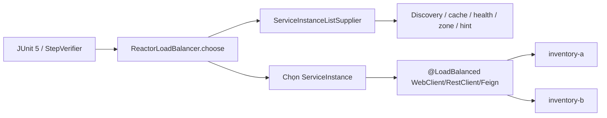
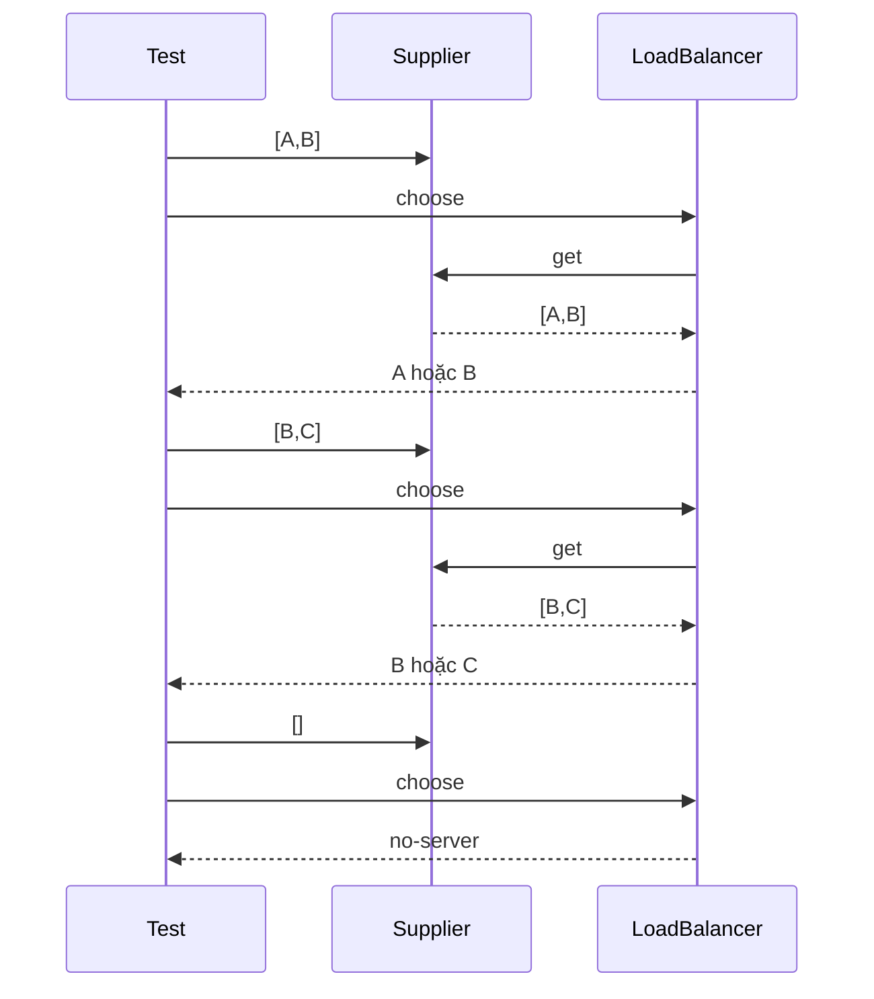

# Kiểm thử thuật toán mà không phụ thuộc thứ tự ngẫu nhiên tình cờ

## 1. Bối cảnh và mục tiêu

Trong chương **Kiểm thử tự động** của module `SPRING_CLOUD_SERVICE_COMMUNICATION_LOAD_BALANCING`, mục tiêu không chỉ là gọi `inventory-service` qua `RestClient`, `WebClient` hoặc OpenFeign. Ta phải bảo đảm thuật toán cân bằng tải phía client chọn đúng `ServiceInstance` theo service ID, discovery, health check, zone, trọng số, hint và chính sách retry/timeout, kể cả khi nhiều bản sao thay đổi liên tục.

Giả sử `order-service` gọi `http://inventory-service/api/inventory/ABC-1`. Danh sách ban đầu:

| ID | Endpoint | Zone | Trạng thái |
|---|---|---|---|
| `inventory-a` | `127.0.0.1:8081` | `zone-a` | Ứng viên |
| `inventory-b` | `127.0.0.1:8082` | `zone-a` | Ứng viên |
| `inventory-c` | `127.0.0.1:8083` | `zone-b` | Ứng viên |

Một test ngây thơ sẽ khẳng định request thứ nhất phải tới A, thứ hai tới B, thứ ba tới C. Test này **không đáng tin** với `RandomLoadBalancer`, và có thể sai ngay cả với `RoundRobinLoadBalancer` khi seed khởi tạo, danh sách instance, thời điểm subscribe hoặc request nền chưa được kiểm soát.

**Đề bài của chúng ta:** kiểm thử thuật toán **mà không phụ thuộc thứ tự ngẫu nhiên tình cờ**. Muốn vậy, phải tách:

- **Thuộc tính bất biến:** luôn chọn từ tập instance hợp lệ; danh sách rỗng không được chọn server; một ứng viên thì phải chọn nó.
- **Thuộc tính tuần tự có điều kiện:** Round Robin quay vòng nếu seed, snapshot và thứ tự subscribe cố định.
- **Thuộc tính xác suất:** Random/weighted thường phân phối dài hạn theo xác suất, không bảo đảm mẫu nhỏ đúng tỷ lệ.
- **Thuộc tính tích hợp:** client HTTP thực sự resolve service ID và gửi request tới instance đã chọn, timeout/retry có giới hạn.
- **Thuộc tính vận hành:** cache, health, discovery và concurrency không làm lộ dữ liệu/stale state hoặc chọn ngoài policy được cam kết.

Sau bài này, bạn sẽ viết được JUnit/Reactor tests có thể lặp lại, biết khi nào dùng seed, fake supplier, stub nguồn ngẫu nhiên, property-based tests, StepVerifier và mock HTTP servers, đồng thời chẩn đoán flaky tests trong CI.

## 2. Ranh giới kiểm thử trong Spring Cloud LoadBalancer



| Cấp test | Input cần kiểm soát | Assertion nên viết | Không nên suy ra |
|---|---|---|---|
| Unit chooser | Snapshot, service ID, seed nếu có | Membership, singleton, empty, vòng Round Robin | Registry/TLS/HTTP đã hoạt động |
| Unit supplier | Metadata, `Request` context, health state | Danh sách đủ điều kiện sau filter | Random sẽ chọn ứng viên đầu |
| Test thuật toán tự viết | Scorer, weight, random index | Boundary, tính hợp lệ và quy luật | Phân phối mạng thật |
| Integration HTTP | Hai mock servers, discovery tĩnh | URL logic đi đúng instance, body/status/attempt count | Lần đầu luôn vào A |
| Statistical/load | Nhiều samples, policy/traffic cố định | Phân phối với sai số thống kê | Mười request phải đúng tỷ lệ tuyệt đối |

`RoundRobinLoadBalancer`, `RandomLoadBalancer` đều dựa vào `ServiceInstanceListSupplier`. Nếu test muốn kiểm tra **riêng thuật toán**, không nên dựng Eureka/Consul/Kubernetes hoặc chờ health probes thật. Với test HTTP integration mới cần mock servers và Spring application context.

### 2.1. Lựa chọn nào là một HTTP attempt?

`WebClient.get().retrieve().bodyToFlux(Item.class)` có thể phát mười item từ **một** JSON array; LoadBalancer vẫn thường chọn **một** instance cho HTTP exchange đó. Ngược lại, `Flux.fromIterable(skus).flatMap(gateway::findOne)` tạo nhiều outbound GET, mỗi GET có thể chọn một instance khác.

Do đó, test phân phối phải đếm **số HTTP requests/attempts**, không đếm `onNext` của body Flux.

## 3. Những invariant phải kiểm tra

Cho `L` là snapshot ứng viên thực sự chuyển tới thuật toán sau khi đã lọc:

| Trường hợp | Tính chất cần bảo đảm |
|---|---|
| `L = []` | Không chọn server; reactive response có `hasServer() == false` theo API |
| `L = [A]` | Chọn A trong mọi lần nếu không có policy khác loại A |
| `L = [A,B,C]` | Instance được chọn thuộc đúng `L` |
| Service ID `inventory-service` | Instance được chọn thuộc service ID mong muốn |
| Hard filter chỉ cho A/B | Không được chọn C |
| Policy zone/hint có fallback | Khi không match, kiểm tra **hợp đồng fallback**, không mặc định empty |
| Scale-in/scale-out | Đọc snapshot hiện tại đúng ranh giới subscription |
| Retry | Không quá số attempts và deadline theo policy |
| Concurrent choices | Không làm hỏng state hoặc trả instance ngoài snapshot |
| Metadata cấu hình | ID/host/port/secure không bị tự bịa hoặc đổi ngoài hợp đồng |

**Những điều không phải invariant:** lần chọn ngẫu nhiên đầu tiên là A; ba random calls cho đủ A/B/C; hai requests concurrent phải hoàn thành theo thứ tự gọi; retry luôn đổi instance; weight 1:3:6 cho ra đúng 1:3:6 trong mười requests.

### 3.1. Tại sao assert một lựa chọn cụ thể quá yếu hoặc quá mạnh?

`assertNotNull(result)` quá yếu: thuật toán có thể trả một instance từ service khác. `assertEquals("A", chosen)` quá mạnh nếu thuật toán được phép chọn A/B. Điều nên viết là:

```java
Response<ServiceInstance> response = loadBalancer.choose()
        .block(Duration.ofSeconds(1));

assertThat(response).isNotNull();
assertThat(response.hasServer()).isTrue();
assertThat(response.getServer().getServiceId())
        .isEqualTo("inventory-service");
assertThat(response.getServer().getInstanceId())
        .isIn("inventory-a", "inventory-b");
```

Đây là assertion cho tập ứng viên `[A,B]`, không phải lời hứa về distribution.

## 4. Fixture JUnit không cần Service Registry

Dùng JUnit Jupiter, AssertJ và reactor-test. Quản lý version qua Spring Boot/Spring Cloud BOM tương thích; các API minh họa lấy Spring Cloud Commons **4.3.x** làm mốc.

```xml
<dependencies>
  <dependency>
    <groupId>org.springframework.cloud</groupId>
    <artifactId>spring-cloud-starter-loadbalancer</artifactId>
  </dependency>
  <dependency>
    <groupId>org.springframework.boot</groupId>
    <artifactId>spring-boot-starter-test</artifactId>
    <scope>test</scope>
  </dependency>
  <dependency>
    <groupId>io.projectreactor</groupId>
    <artifactId>reactor-test</artifactId>
    <scope>test</scope>
  </dependency>
</dependencies>
```

Định nghĩa nguồn dữ liệu bất biến:

```java
import org.springframework.cloud.client.ServiceInstance;
import org.springframework.cloud.client.DefaultServiceInstance;

final class InventoryFixture {
    static final String ID = "inventory-service";

    static ServiceInstance instance(String id, int port) {
        return new DefaultServiceInstance(
                id, ID, "127.0.0.1", port, false);
    }

    static final ServiceInstance A = instance("inventory-a", 8081);
    static final ServiceInstance B = instance("inventory-b", 8082);
    static final ServiceInstance C = instance("inventory-c", 8083);

    private InventoryFixture() {}
}
```

Spring Cloud Commons cung cấp tiện ích `ServiceInstanceListSuppliers` cho test độc lập với registry:

```java
import org.springframework.cloud.loadbalancer.support.ServiceInstanceListSuppliers;
import org.springframework.cloud.loadbalancer.core.ServiceInstanceListSupplier;
import org.springframework.beans.factory.ObjectProvider;

ObjectProvider<ServiceInstanceListSupplier> provider =
        ServiceInstanceListSuppliers.toProvider(
                InventoryFixture.ID,
                InventoryFixture.A,
                InventoryFixture.B,
                InventoryFixture.C);
```

Supplier này phát danh sách đã cho. Không có network, cache TTL, health scheduler hay dữ liệu instance thực khiến test thay đổi giữa hai lần chạy. Tiện ích `from(serviceId, instances...)` cũng hữu ích khi cần supplier thay vì provider.

### 4.1. Không để test dùng chung counter

Mỗi test phải tạo `RoundRobinLoadBalancer` mới; đừng dùng một bean static cho nhiều test chạy song song. `RoundRobinLoadBalancer` giữ counter nội bộ, các lần chọn từ test trước có thể thay đổi vị trí trong test sau. Khi dùng Spring context caching, state của bean có thể còn sống giữa test classes: hoặc test invariants không dựa seed, hoặc dùng fixture/context riêng.

## 5. RoundRobinLoadBalancer: kiểm tra thứ tự **khi đủ điều kiện**

Spring Cloud Commons 4.3 có constructor `RoundRobinLoadBalancer(provider, serviceId, seedPosition)`. Seed mặc định được chọn khi tạo instance nếu không truyền tham số thứ ba; test khẳng định “lần đầu luôn A” không ổn định.

### 5.1. Test exact order với seed -1

```java
@Test
void fixedSeedCyclesInListOrder() {
    var lb = new RoundRobinLoadBalancer(
            ServiceInstanceListSuppliers.toProvider(
                    "inventory-service",
                    InventoryFixture.A,
                    InventoryFixture.B,
                    InventoryFixture.C),
            "inventory-service",
            -1);

    List<String> selected = new ArrayList<>();
    for (int i = 0; i < 6; i++) {
        var response = lb.choose().block(Duration.ofSeconds(1));
        assertThat(response.hasServer()).isTrue();
        selected.add(response.getServer().getInstanceId());
    }

    assertThat(selected).containsExactly(
            "inventory-a", "inventory-b", "inventory-c",
            "inventory-a", "inventory-b", "inventory-c");
}
```

**Vì sao test này deterministic?** Nó khóa cả bốn biến: seed `-1`, list `[A,B,C]`, LoadBalancer mới không chia sẻ counter, sáu `choose()` được subscribe **và hoàn tất tuần tự**. Trong implementation đang kiểm tra, counter tăng từ `-1` để lần đầu dùng index 0. Đây là test white-box theo phiên bản: khi nâng major Release Train, phải kiểm tra sự thay đổi của thuật toán trước khi giữ assertion exact order.

### 5.2. Test vòng quay không cần biết offset đầu

```java
@Test
void defaultSeedStillBalancesCompleteCycles() {
    var lb = new RoundRobinLoadBalancer(
            ServiceInstanceListSuppliers.toProvider(
                    "inventory-service",
                    InventoryFixture.A,
                    InventoryFixture.B,
                    InventoryFixture.C),
            "inventory-service");

    Map<String, Long> counts = IntStream.range(0, 12)
            .mapToObj(i -> lb.choose().block(Duration.ofSeconds(1)))
            .map(result -> result.getServer().getInstanceId())
            .collect(Collectors.groupingBy(
                    Function.identity(), Collectors.counting()));

    assertThat(counts)
            .containsEntry("inventory-a", 4L)
            .containsEntry("inventory-b", 4L)
            .containsEntry("inventory-c", 4L);
}
```

Ở đây không cần biết A/B/C ai được chọn đầu tiên, vì 12 lượt tạo đủ bốn vòng với ba ứng viên **nếu snapshot không thay đổi**. Không áp test này lên danh sách động, supplier bị lọc theo request hoặc các lần gọi concurrent bởi nhiều consumer.

### 5.3. Empty và singleton

```java
@Test
void noCandidatesReturnsNoServer() {
    var lb = new RoundRobinLoadBalancer(
            ServiceInstanceListSuppliers.toProvider("inventory-service"),
            "inventory-service", -1);

    StepVerifier.create(lb.choose())
            .assertNext(response ->
                    assertThat(response.hasServer()).isFalse())
            .verifyComplete();
}

@Test
void oneCandidateAlwaysWins() {
    var lb = new RoundRobinLoadBalancer(
            ServiceInstanceListSuppliers.toProvider(
                    "inventory-service", InventoryFixture.B),
            "inventory-service", -1);

    for (int i = 0; i < 20; i++) {
        var response = lb.choose().block(Duration.ofSeconds(1));
        assertThat(response.getServer().getInstanceId())
                .isEqualTo("inventory-b");
    }
}
```

`choose()` trả `Mono<Response<ServiceInstance>>`. Với danh sách rỗng, Spring Cloud thường trả response không có server, không nhất thiết ném exception ở bước chọn. HTTP client có thể biến tình huống này thành response 503/404 hoặc exception riêng; test ở hai lớp phải tách nhau.

## 6. RandomLoadBalancer: membership, empty, singleton

Với random chooser, bất kỳ chuỗi `A,A,A` hoặc `B,C,B` đều có thể là kết quả hợp lệ. Không assert thứ tự hay “mọi instance xuất hiện một lần trong ba attempts”.

```java
@Test
void randomPicksOnlyCurrentCandidates() {
    var lb = new RandomLoadBalancer(
            ServiceInstanceListSuppliers.toProvider(
                    "inventory-service",
                    InventoryFixture.A,
                    InventoryFixture.B,
                    InventoryFixture.C),
            "inventory-service");

    Set<String> allowed = Set.of(
            "inventory-a", "inventory-b", "inventory-c");

    for (int i = 0; i < 500; i++) {
        var result = lb.choose().block(Duration.ofSeconds(1));
        assertThat(result).isNotNull();
        assertThat(result.hasServer()).isTrue();
        assertThat(result.getServer().getServiceId())
                .isEqualTo("inventory-service");
        assertThat(allowed).contains(
                result.getServer().getInstanceId());
    }
}
```

Test trên **ổn định về kết luận** dù nguồn random tạo bất kỳ chuỗi nào. Nó chứng minh kết quả không nằm ngoài tập, nhưng **không** chứng minh phân phối đồng đều; cần kiểm tra logic và thống kê ở lớp khác.

```java
@Test
void randomWithSingletonAlwaysChoosesIt() {
    var lb = new RandomLoadBalancer(
            ServiceInstanceListSuppliers.toProvider(
                    "inventory-service", InventoryFixture.C),
            "inventory-service");

    for (int i = 0; i < 30; i++) {
        assertThat(lb.choose().block(Duration.ofSeconds(1))
                .getServer().getInstanceId())
                .isEqualTo("inventory-c");
    }
}

@Test
void randomWithEmptyListHasNoServer() {
    var lb = new RandomLoadBalancer(
            ServiceInstanceListSuppliers.toProvider("inventory-service"),
            "inventory-service");

    StepVerifier.create(lb.choose())
            .assertNext(r -> assertThat(r.hasServer()).isFalse())
            .verifyComplete();
}
```

**Không nên làm:**

```java
// FLAKY: Random không có nghĩa là A rồi B rồi C.
assertThat(lb.choose().block().getServer().getInstanceId())
        .isEqualTo("inventory-a");

// FLAKY: Một mẫu nhỏ không buộc chứa mọi instance.
assertThat(firstThree).containsExactlyInAnyOrder(
        "inventory-a", "inventory-b", "inventory-c");
```

## 7. Thuật toán custom: inject nguồn random thay vì đoán seed ngầm

Nếu tự viết chiến lược random/weighted/canary, tách logic chọn index khỏi việc lấy random:

```java
import java.util.List;
import java.util.function.IntUnaryOperator;
import org.springframework.cloud.client.ServiceInstance;

final class IndexSelector {
    private final IntUnaryOperator nextIndex;

    IndexSelector(IntUnaryOperator nextIndex) {
        this.nextIndex = nextIndex;
    }

    ServiceInstance select(List<ServiceInstance> candidates) {
        if (candidates.isEmpty()) {
            throw new IllegalArgumentException("No candidates");
        }
        int index = nextIndex.applyAsInt(candidates.size());
        if (index < 0 || index >= candidates.size()) {
            throw new IllegalStateException("Index outside candidates");
        }
        return candidates.get(index);
    }
}
```

Trong production:

```java
IndexSelector selector = new IndexSelector(
        bound -> ThreadLocalRandom.current().nextInt(bound));
```

Trong unit test, inject chuỗi **hoàn toàn xác định**:

```java
@Test
void customSelectorCanReplayIndices() {
    int[] indexes = {2, 0, 1, 2};
    AtomicInteger cursor = new AtomicInteger();

    IndexSelector selector = new IndexSelector(
            bound -> indexes[cursor.getAndIncrement()]);

    List<ServiceInstance> list = List.of(
            InventoryFixture.A,
            InventoryFixture.B,
            InventoryFixture.C);

    List<String> actual = IntStream.range(0, indexes.length)
            .mapToObj(i -> selector.select(list).getInstanceId())
            .toList();

    assertThat(actual).containsExactly(
            "inventory-c", "inventory-a",
            "inventory-b", "inventory-c");
}
```

Đây là cách thiết kế **thuật toán tự viết**, không phải API constructor cho `RandomLoadBalancer` có sẵn của Spring Cloud. Không cần dùng reflection sửa biến random nội bộ của thư viện để test đúng một chuỗi.

### 7.1. Seed reproducible không đồng nghĩa test luôn đúng

Có thể tạo `Random(12345L)` và inject `seeded::nextInt`. Seed sẽ hữu ích khi cùng PRNG implementation, version và thứ tự các lần gọi, nhưng nếu thay implementation hoặc số lần gọi RNG, chuỗi thay đổi. Với test tính chất membership, hãy test membership; chỉ so exact sequence khi **sequence chính là hợp đồng của custom component**.

Không giả định `ThreadLocalRandom.current()` cho phép setSeed như `Random` instance; nó được thiết kế cho randomness theo thread.

## 8. Property-based và metamorphic tests

Một test property-based không biết trước instance nào được chọn, nhưng khẳng định đầu ra **luôn** thuộc tập ứng viên hợp lệ với nhiều input khác nhau.

```java
@Test
void membershipHoldsAcrossListSizes() {
    for (int size = 1; size <= 12; size++) {
        List<ServiceInstance> snapshot =
                IntStream.range(0, size)
                        .mapToObj(i -> (ServiceInstance)
                                new DefaultServiceInstance(
                                        "instance-" + i,
                                        "inventory-service",
                                        "127.0.0.1",
                                        9000 + i,
                                        false))
                        .toList();

        var lb = new RandomLoadBalancer(
                ServiceInstanceListSuppliers.toProvider(
                        "inventory-service",
                        snapshot.toArray(ServiceInstance[]::new)),
                "inventory-service");

        Set<String> allowed = snapshot.stream()
                .map(ServiceInstance::getInstanceId)
                .collect(Collectors.toSet());

        for (int attempt = 0; attempt < 100; attempt++) {
            var response = lb.choose().block(Duration.ofSeconds(1));
            assertThat(response.hasServer()).isTrue();
            assertThat(allowed).contains(
                    response.getServer().getInstanceId());
        }
    }
}
```

Test này duyệt nhiều kích thước list; với mỗi kích thước có nhiều lựa chọn. Nếu dùng jqwik, có thể sinh danh sách và metadata rồi **shrink** khi test fail, ghi lại seed/input để replay.

### 8.1. Metamorphic properties

| Biến đổi input | Điều có thể khẳng định |
|---|---|
| `[A,B]` thêm C | Kết quả thuộc `[A,B,C]` |
| `[A,B]` chỉ giữ B | Mọi lựa chọn hợp lệ là B |
| Đổi thứ tự `[A,B,C]` thành `[C,B,A]` | Membership không đổi; **thứ tự Round Robin có thể đổi** |
| Danh sách thành rỗng | `hasServer()==false` |
| Hard filter loại C | Không chọn C nếu filter thực trả `[A,B]` |
| Client đổi zone trong preference policy | Kiểm tra danh sách sau filter theo hợp đồng fallback |
| Snapshot thay đổi khi scale-in | Lựa chọn dựa vào snapshot được supplier phát tại thời điểm tương ứng |

Đừng tạo một metamorphic assertion không được policy bảo đảm. Ví dụ “đảo thứ tự input mà lựa chọn đầu tiên không đổi” không phải invariant của Round Robin.

## 9. Weighted routing: test ranh giới và phân phối riêng nhau

`WeightedServiceInstanceListSupplier` của Spring Cloud sử dụng metadata key `weight` hoặc `WeightFunction` custom. Trong nhánh 4.3, khi thiếu metadata thì mặc định weight bằng 1 theo tài liệu. Nhưng **tỷ lệ xác suất dài hạn không phải ràng buộc exact count cho mẫu nhỏ**.

Ví dụ:

| Instance | Weight | Tỷ lệ mục tiêu minh họa |
|---|---:|---:|
| A | 1 | 10% |
| B | 3 | 30% |
| C | 6 | 60% |

### 9.1. Kiểm tra pure weighted mapping

Với thuật toán custom dùng ticket trong khoảng `[0,totalWeight)` và cumulative weights `[1,4,10]`:

```java
@Test
void weightedTicketBoundariesAreExact() {
    var weights = List.of(1, 3, 6);

    // pickByTicket là hàm custom, không phải API Spring Cloud.
    assertThat(pickByTicket(weights, 0)).isEqualTo(0);
    assertThat(pickByTicket(weights, 1)).isEqualTo(1);
    assertThat(pickByTicket(weights, 3)).isEqualTo(1);
    assertThat(pickByTicket(weights, 4)).isEqualTo(2);
    assertThat(pickByTicket(weights, 9)).isEqualTo(2);
}
```

Test boundary này deterministic và phát hiện lỗi off-by-one. Ngoài ra cần test weight âm, 0, overflow, thiếu metadata, giá trị không parse được **theo policy hiện hành**; không giả định thư viện và custom scorer có cùng semantics với input không hợp lệ.

### 9.2. Statistical distribution không nên là cổng CI đơn giản

Ví dụ **sai** với mười draws từ RNG thật:

```java
assertThat(countA).isEqualTo(1);
assertThat(countB).isEqualTo(3);
assertThat(countC).isEqualTo(6);
```

Ngay cả một thuật toán đúng vẫn có thể tạo kết quả khác. Một statistical test cần xác định số mẫu N đủ lớn, sai số/false-positive rate, giả định các draws, khả năng replay seed và báo cáo tần suất thực. Chi-square/goodness-of-fit có thể hữu ích, nhưng p-value hoặc ngưỡng confidence không phải “bằng chứng chắc chắn đúng/sai”. Đặt test phân phối chuyên sâu ở pipeline riêng; CI hằng ngày ưu tiên pure logic và invariant.

### 9.3. Hai nguồn random độc lập

Nếu `WeightFunction` tự tạo random weights trong khi chooser cũng random, chỉ cố định seed ở chooser không đủ tái hiện. Phải điều khiển **cả nguồn metadata/weight và nguồn random chọn index**. Với test supplier, dùng weight cố định; với test random, dùng snapshot/weight đã cố định.

## 10. Test zone/hint/health phải bắt đầu từ supplier

Nhiều policy trong Spring Cloud LoadBalancer **lọc danh sách** trước khi `RoundRobinLoadBalancer` hoặc `RandomLoadBalancer` chọn. Test chỉ thấy một lần chọn A không chứng minh danh sách đã được lọc đúng: A có thể được chọn tình cờ từ `[A,B,C]`.

### 10.1. ZonePreference có thể fallback toàn danh sách

Với `A(zone-a), B(zone-a), C(zone-b)` và client zone-a, `ZonePreferenceServiceInstanceListSupplier` trong Commons 4.3 ưu tiên A/B. Nếu client zone-x không có match, supplier có thể trả lại toàn tập `[A,B,C]`.

| Case | Input | Kết quả mong đợi theo preference |
|---|---|---|
| Có zone match | zone-a, [A,B,C] | [A,B] |
| Không có zone match | zone-x, [A,B,C] | [A,B,C] |
| Không đặt zone | [A,B,C] | [A,B,C] |
| Delegate rỗng | [] | [] |

**Đừng test rằng zone-x buộc no-instance** nếu policy đang dùng là preference có fallback. Nếu cần cách ly dữ liệu theo region/tenant, phải viết **hard filter** cho phép fail-closed và test kết quả empty khi không match.

### 10.2. Hint-Based Supplier

`HintBasedServiceInstanceListSupplier` sử dụng metadata `hint`; có thể đọc từ header `X-SC-LB-Hint` hoặc cấu hình. Trong Commons 4.3, nếu không có match, nó có thể fallback toàn danh sách. Test ít nhất: hint match, không có hint, hint không match, metadata thiếu và request-specific hint khác default hint.

Đặc biệt: supplier có thể dùng `get(Request)` thay vì `get()`. Test phải truyền đúng `Request` context; mock một method không được production sử dụng tạo test xanh giả.

### 10.3. Health-check supplier

`HealthCheckServiceInstanceListSupplier` có lịch probe, khả năng replay cache và các điều kiện fallback. Một test không nên `Thread.sleep(100)` rồi giả định health đã cập nhật.

Tách thành:

1. **Pure chooser test:** đưa snapshot `[B]` sau khi A bị loại, kiểm tra chọn B.
2. **Supplier health test:** dùng fake HTTP probe/scheduler nếu version hỗ trợ kiểm soát thời gian.
3. **Integration health test:** dùng mock server đổi health response rồi **await điều kiện có timeout**, không sleep cố định.
4. **Fallback test:** khi toàn bộ instance unhealthy, xác minh behavior thật của supplier; một số implementation có thể trả all instances thay vì empty.

Health interval/refresh và cache TTL **không** phải deadline cho một HTTP request; phải test riêng latency/timeout của client.

## 11. Snapshot thay đổi động và interleaving



Một supplier có thể thay snapshot trong test:

```java
final class MutableInstances implements ServiceInstanceListSupplier {

    private final String serviceId;
    private final AtomicReference<List<ServiceInstance>> current =
            new AtomicReference<>(List.of());

    MutableInstances(String serviceId) {
        this.serviceId = serviceId;
    }

    void set(List<ServiceInstance> next) {
        current.set(List.copyOf(next));
    }

    @Override
    public String getServiceId() {
        return serviceId;
    }

    @Override
    public Flux<List<ServiceInstance>> get() {
        return Flux.defer(() -> Flux.just(current.get()));
    }
}
```

`AtomicReference` và `List.copyOf` bảo vệ tính toàn vẹn snapshot; `Flux.defer` lấy snapshot tại lúc subscribe. Đoạn sau chỉ phù hợp khi đã có `SimpleObjectProvider` trong phiên bản Spring Cloud tương ứng:

```java
@Test
void picksOnlyFromLatestSnapshot() {
    MutableInstances supplier = new MutableInstances("inventory-service");
    ObjectProvider<ServiceInstanceListSupplier> provider =
            new SimpleObjectProvider<>(supplier);

    var lb = new RoundRobinLoadBalancer(
            provider, "inventory-service", -1);

    supplier.set(List.of(InventoryFixture.A, InventoryFixture.B));
    assertThat(lb.choose().block(Duration.ofSeconds(1))
            .getServer().getInstanceId())
            .isIn("inventory-a", "inventory-b");

    supplier.set(List.of(InventoryFixture.B, InventoryFixture.C));
    assertThat(lb.choose().block(Duration.ofSeconds(1))
            .getServer().getInstanceId())
            .isIn("inventory-b", "inventory-c");

    supplier.set(List.of());
    assertThat(lb.choose().block(Duration.ofSeconds(1))
            .hasServer()).isFalse();
}
```

**Điều kiện:** test không bật cache LoadBalancer. Nếu có `CachingServiceInstanceListSupplier`, snapshot có thể stale theo TTL. Test cache phải đo riêng khi nào update xuất hiện và không giả định đồng bộ tức thì.

### 11.1. Concurrent updates không có thứ tự tuyệt đối

Nếu request đã lấy snapshot `[A,B]` trước khi test chuyển sang `[B,C]`, việc chọn A có thể vẫn hợp lệ đối với **request đã bắt đầu trước update**. Không assert “sau một lệnh `set` thì không request nào được trả A” nếu chưa thiết lập happens-before giữa update và từng subscription.

Dùng `CountDownLatch`, `Phaser` hoặc fake publisher có kiểm soát để tái hiện interleaving. Tránh tạo race bằng `Thread.sleep` và hy vọng scheduler chạy đúng thứ tự.

## 12. Concurrency test: kiểm tra tập và số kết quả

```java
@Test
void concurrentChoicesRemainValid() {
    var lb = new RoundRobinLoadBalancer(
            ServiceInstanceListSuppliers.toProvider(
                    "inventory-service",
                    InventoryFixture.A,
                    InventoryFixture.B,
                    InventoryFixture.C),
            "inventory-service", -1);

    Set<String> allowed = Set.of(
            "inventory-a", "inventory-b", "inventory-c");

    List<String> chosen = Flux.range(0, 300)
            .flatMap(i -> lb.choose()
                    .map(response -> {
                        assertThat(response.hasServer()).isTrue();
                        return response.getServer().getInstanceId();
                    }), 16)
            .collectList()
            .block(Duration.ofSeconds(5));

    assertThat(chosen).hasSize(300);
    assertThat(allowed).containsAll(chosen);
}
```

Test này không hardcode thứ tự phần tử trong `chosen`. Trong pipeline có `flatMap`, thứ tự subscription, supplier emission và completion có thể khác nhau; order của log chưa phải contract. Muốn test phân phối Round Robin theo counter, hãy làm **test riêng với snapshot ổn định** và assertion counts sau khi mọi request hoàn tất.

Đảm bảo mỗi test khởi tạo LB riêng, không dùng chung seed hoặc `AtomicInteger` giữa test classes chạy parallel. Khi muốn stress race, làm nhiều lần với các seeds/inputs có thể replay và thu lại trạng thái khi lỗi, thay vì bật rerun-on-failure không kiểm soát.

## 13. Virtual time và tránh Thread.sleep

`StepVerifier.withVirtualTime` giúp kiểm tra timing của Reactor operators mà không chờ wall clock:

```java
@Test
void delayedSignalUsesVirtualClock() {
    StepVerifier.withVirtualTime(() ->
                    Mono.delay(Duration.ofSeconds(5))
                            .map(tick -> "ready"))
            .expectSubscription()
            .expectNoEvent(Duration.ofSeconds(4))
            .thenAwait(Duration.ofSeconds(1))
            .expectNext("ready")
            .verifyComplete();
}
```

Tạo publisher **bên trong supplier lambda** là quan trọng để StepVerifier thay scheduler/timer khi thiết lập virtual time. Với `retryWhen`/`Mono.delay`, có thể kiểm tra thời gian backoff theo virtual scheduler tương ứng khi version Reactor hỗ trợ.

Nhưng virtual time **không** tự điều khiển:

- TCP connect/read timeout của HTTP client thật.
- Eureka/Consul discovery call/network thật.
- Scheduler/queue private không dùng virtual scheduler của Reactor.
- CPU contention hoặc thứ tự thread hoàn thành.
- Random seed của `RandomLoadBalancer`.

Với health check chạy nền hoặc HTTP integration, dùng condition-based await có deadline (ví dụ Awaitility) thay cho `Thread.sleep(200)`. Một sleep cố định khiến test có thể pass local nhưng fail trên CI chậm, và không chứng minh trạng thái đã cập nhật.

## 14. Integration test cho RestClient, WebClient và OpenFeign

Unit chooser **không** chứng minh HTTP client mang LoadBalancer filter/interceptor. Tối thiểu cần một integration test với hai HTTP servers giả:

```text
JUnit test
  -> order-service test application
     -> @LoadBalanced WebClient.Builder / RestClient.Builder
     -> Spring Cloud LoadBalancer (serviceId=inventory-service)
     -> SimpleDiscoveryClient
        -> mock-server-a (random port, body.instanceId=A)
        -> mock-server-b (random port, body.instanceId=B)
```

Dùng WireMock, MockWebServer hoặc Spring Boot test servers. Mỗi mock server trả một JSON response mang `instanceId` khác nhau. Trong CI, dùng **dynamic port** và cấp địa chỉ qua `@DynamicPropertySource` trước khi Spring test context tạo bean, thay vì hardcode 8081/8082.

### 14.1. Baseline cấu hình discovery tĩnh

Ví dụ cho lab thủ công chạy cùng máy:

```yaml
spring:
  application:
    name: order-service
  cloud:
    discovery:
      client:
        simple:
          instances:
            inventory-service:
              - uri: http://127.0.0.1:8081
                instance-id: inventory-a
              - uri: http://127.0.0.1:8082
                instance-id: inventory-b
    loadbalancer:
      retry:
        enabled: false
      cache:
        enabled: false
```

Với CI, chuyển hai URI sang cổng do mock servers cấp. `localhost`/`127.0.0.1` chỉ đúng nếu test caller và servers ở cùng network namespace. Không dùng registry hoặc dependency production cho integration test độc lập.

### 14.2. Ví dụ reactive response

```java
Mono<InventoryStock> result = webClient.get()
        .uri("http://inventory-service/api/inventory/ABC-1")
        .retrieve()
        .bodyToMono(InventoryStock.class);

StepVerifier.create(result)
        .assertNext(item -> assertThat(item.instanceId())
                .isIn("inventory-a", "inventory-b"))
        .verifyComplete();
```

`webClient` phải được tạo từ `@LoadBalanced WebClient.Builder`. Test nên đọc log/request count tại mock server để xác nhận request thực tới A hoặc B, không chỉ tin body trả về. Nếu tạo `WebClient.create("http://inventory-service")` không có LoadBalancer filter, hostname logic có thể bị DNS xử lý như host vật lý và thất bại.

### 14.3. Các assertion HTTP ổn định

- Một GET thành công đi tới **đúng một** mock server khi retry tắt.
- Mỗi HTTP response có body/status khớp contract của mock server nhận request.
- Với nhiều GET, tập instance đã nhận request không chứa server ngoài registry.
- Nếu danh sách discovery rỗng, không server nào nhận HTTP; lỗi được phát ở caller/LoadBalancer.
- Với `RestClient`, kiểm tra blocking response và exception; không giả định là reactive.
- Với OpenFeign, kiểm tra decoder/error behavior và retry policy; Spring Cloud OpenFeign thường cấu hình `Retryer.NEVER_RETRY` mặc định.
- Với JSON array trả `Flux` nhiều phần tử, **một** HTTP request vẫn do một server xử lý.

## 15. Retry và health: test attempts, không dự đoán node kế tiếp

Với retry, một logical request có thể thực hiện nhiều HTTP attempts và mỗi attempt có thể chọn instance mới. Nhưng `avoid-previous-instance` hoặc Round Robin **không bảo đảm** chắc chắn sẽ đổi instance trong mọi điều kiện.

| Case | Điều chỉnh | Assertion cần có |
|---|---|---|
| R1 | A trả 503, B trả 200, retry tắt | Chính xác một HTTP attempt; kết quả tùy instance ban đầu |
| R2 | Ép initial request vào A bằng policy kiểm soát, bật một retry | Attempts không vượt giới hạn; nếu retry tới B thì có thể 200 |
| R3 | Cả A/B trả 503 | Kết thúc theo max attempts, không lặp vô hạn |
| R4 | Chỉ có A | Không đòi retry phải tới B |
| R5 | Không có instance | Không có HTTP request ở cả A/B |
| R6 | A timeout sau khi nhận request | Không suy từ timeout rằng server chưa xử lý |
| R7 | HTTP 404 không retryable theo policy | Không phát sinh attempts ngoài mong đợi |
| R8 | POST giữ hàng chưa idempotent | Không bật retry gây side effects lặp |

**Chọn đúng một retry owner** khi đo: Reactor `retryWhen`, Spring Cloud LoadBalancer retry, Spring Retry hoặc Feign Retryer. Nếu hai lớp cùng retry, số HTTP requests có thể nhân lên; một kết quả HTTP 200 cuối cùng **không** cho biết đã có một hay năm attempts.

Khi test health, điều khiển snapshot đầu vào để test thuật toán, rồi chạy health supplier riêng để kiểm tra phản ứng theo lịch. Khi tất cả instance unhealthy, Spring Cloud có thể có fallback trả toàn danh sách tùy implementation, nên không assert fail-closed nếu chưa cấu hình hard filter.

## 16. Flaky tests: phát hiện và sửa đúng nguyên nhân

| Test bị lỗi lúc có lúc không | Nguyên nhân thực | Giải pháp |
|---|---|---|
| Random lần đầu không vào A | Random là ngẫu nhiên | Test membership thay exact choice |
| Round Robin bắt đầu ở C | Seed mặc định/counter cũ | Seed cố định hoặc so count trọn vòng |
| Log `flatMap` không theo A,B,C | Completion không có thứ tự | Assert set/count và đúng number of responses |
| Health vẫn chứa A sau 200 ms | Timer/cache/discovery cập nhật trễ | Await condition/virtual scheduler |
| Một test làm test khác fail | Shared LB bean, counter/snapshot/hook | Isolation per test, cleanup global state |
| Retry count thay đổi giữa runs | Nhiều retry layers hoặc race | Tắt các tầng thừa, đo HTTP attempts |
| CI treo vì cổng bị chiếm | Hardcode network port | Dynamic port mock server |
| Test luôn pass sau rerun | Nondeterminism bị che | Ghi seed/state/timing, không tự rerun vô hạn |
| Request chọn node đã stop | Cache/registry stale | Test cache TTL và độ trễ health riêng |
| Mock `get()` nhưng prod gọi `get(request)` | Sai overload supplier | Mock/cấp request context thật |
| Test chọn instance chỉ dựa hostname | Nhiều ports trên một host | So instance ID + port |
| Test random 20 calls không đủ 50/50 | Sample nhỏ | Tách statistical test với confidence bound |

### 16.1. Quy tắc giữ test độc lập

1. Mỗi test tạo LoadBalancer/counter mới hoặc reset state trong fixture riêng.
2. Dữ liệu ứng viên là `List` có thứ tự xác định; không dựa vào thứ tự iteration của `HashMap`.
3. Không dùng hệ thống discovery thật trong unit tests.
4. Không mutate `ArrayList` được chia sẻ giữa thread; đổi snapshot bằng immutable list.
5. Không có random sequence assertion trừ khi tất cả RNG calls và state được kiểm soát.
6. Không dùng wall clock/sleep cho một điều kiện có thể await.
7. Dùng timeout hữu hạn và cleanup test servers, scheduler/context.
8. Không thay các global hooks giữa test chạy parallel mà không khôi phục.
9. Khi lỗi, lưu version, seed (nếu có), service ID, snapshot và expected invariant.
10. Chạy test dưới concurrency để phát hiện shared state, nhưng không biến thread scheduling thành một “thứ tự đúng” giả.

## 17. Ghi báo cáo thất bại có thể tái hiện

Một test fail nên cung cấp dữ liệu đủ điều tra, thay vì chỉ “random failed”:

```text
TEST_ID=LB_RANDOM_MEMBERSHIP
SERVICE_ID=inventory-service
SPRING_CLOUD_VERSION=<resolved-version>
CANDIDATES=[inventory-a:8081, inventory-b:8082]
ALGORITHM=RandomLoadBalancer
EXPECTED=selected instance belongs to candidates
ACTUAL=inventory-c
RANDOM_SEED=<n/a for built-in; custom seeded value if used>
SUBSCRIPTIONS=500
CONCURRENCY=1
CACHE_ENABLED=false
RETRY_ENABLED=false
REQUEST_CONTEXT=<redacted-sanitized-context>
```

Đây là báo cáo **giả định** để luyện trình bày, không phải kết quả đã chạy. Đối với zone/health, lưu snapshot **trước và sau filter**. Với HTTP integration, lưu số requests thực ở A/B, exception/status và trace correlation. Không log access token, PII hoặc hostnames nội bộ nhạy cảm vào hệ thống chia sẻ ngoài phạm vi cho phép.

**Không cộng p95 latency của các stage** để suy ra p95 total request; khi đánh giá performance, đo end-to-end thực trên cùng request và phân tích trace ở từng attempt.

## 18. Bài tập và tiêu chí hoàn thành

### Bài 1 — Sửa test Random bị flaky

Thay assertion “random lần đầu là A” bằng kiểm tra `hasServer`, service ID, membership; thêm empty/singleton cases. Giải thích test mới bắt được lỗi nào và không chứng minh điều gì về phân phối.

### Bài 2 — Hai cách test Round Robin

Với `[A,B,C]`, viết một test exact order dùng `seedPosition=-1`, và một test vòng hoàn chỉnh không truyền seed mà kiểm tra count sau 12 lần chọn. Nêu điều kiện để cả hai deterministic.

### Bài 3 — Custom random dependency

Cài `IndexSelector`, inject chuỗi chỉ số `[2,0,1,2]`, kiểm tra C/A/B/C và xử lý index âm/vượt giới hạn.

### Bài 4 — Weighted mapping

Tạo hàm pure `pickByTicket` cho trọng số 1/3/6; xác minh toàn bộ ticket 0..9, sau đó lập kế hoạch statistical test N lớn với false-positive rate có kiểm soát.

### Bài 5 — Supplier theo zone

Cho A/B ở zone-a và C ở zone-b. Test zone-a trả [A,B] và zone-x fallback toàn list với `ZonePreferenceServiceInstanceListSupplier`. Nếu nghiệp vụ cần hard zone, viết filter riêng không fallback và kiểm tra no-instance.

### Bài 6 — Membership thay đổi

Dùng `MutableInstances` chuyển `[A,B]` → `[B,C]` → `[]`. Test theo snapshot; sau đó thêm cache vào một test tích hợp khác để đo staleness.

### Bài 7 — Concurrency không gắn với order

Thực hiện 300 calls trong `flatMap` concurrency 16. Kiểm tra 300 kết quả hợp lệ, không dự đoán thứ tự completion. Thêm synchronization barrier để tái hiện interleaving sau scale-in.

### Bài 8 — Hai HTTP mock servers

Chạy A/B trên dynamic ports, đăng ký SimpleDiscoveryClient cùng service ID, tạo `@LoadBalanced WebClient.Builder`, gửi 20 GET tuần tự và kiểm tra request counts/body. Bật retry có giới hạn ở một lớp rồi đo attempts thật.

### Bài 9 — Chuyển sleep sang điều kiện

Lấy một test dùng `Thread.sleep(200)` để chờ health supplier. Dùng await condition có deadline hoặc virtual time nếu scheduler hỗ trợ. Chạy nhiều test song song để chứng minh không còn phụ thuộc tải máy CI.

### Bài 10 — Phân biệt Random với Round Robin

Giải thích vì sao Round Robin chia đều **số lượt chọn** qua các vòng ổn định, còn Random chỉ có phân phối kỳ vọng dài hạn; cả hai không mặc nhiên làm CPU/latency hay số HTTP success của các replica bằng nhau.

### Checklist

- [ ] Test thuật toán được tách khỏi test HTTP client/discovery.
- [ ] Random tests không hardcode một chuỗi output tình cờ.
- [ ] Round Robin exact order chỉ khi seed, snapshot, counter và subscription được kiểm soát.
- [ ] Có empty và singleton test.
- [ ] Mọi instance được chọn thuộc tập eligible.
- [ ] Zone/hint/health fallback được test theo contract thật.
- [ ] Source random trong thuật toán custom có thể inject/replay.
- [ ] Weighted mapping test các boundary bằng dữ liệu deterministic.
- [ ] Property-based test dùng invariant, không oracle ngẫu nhiên.
- [ ] Concurrency test không khẳng định thứ tự kết thúc.
- [ ] Không dùng `Thread.sleep` thay điều kiện quan sát.
- [ ] HTTP integration có dynamic ports, kiểm tra attempts và body server.
- [ ] Retry count không bị nhân do nhiều lớp retry.
- [ ] Test log có đủ seed/input/version/snapshot để debug.
- [ ] Không nhầm nhiều phần tử Flux với nhiều HTTP requests.

## Nguồn tham khảo

- [Spring Cloud Commons 4.3 — LoadBalancer](https://docs.spring.io/spring-cloud-commons/reference/4.3/spring-cloud-commons/loadbalancer.html): Round Robin, Random, weighted, zone/hint/health/caching, retry và lifecycle.
- [Spring Cloud Commons — RoundRobinLoadBalancer source](https://github.com/spring-cloud/spring-cloud-commons/blob/main/spring-cloud-loadbalancer/src/main/java/org/springframework/cloud/loadbalancer/core/RoundRobinLoadBalancer.java): `seedPosition` và counter, cần kiểm tra source tag tương ứng dependency khi test white-box.
- [Spring Cloud Commons — LoadBalancerTests](https://github.com/spring-cloud/spring-cloud-commons/blob/main/spring-cloud-loadbalancer/src/test/java/org/springframework/cloud/loadbalancer/core/LoadBalancerTests.java): ví dụ kiểm thử bằng danh sách instance và seed.
- [Spring Cloud Commons — ServiceInstanceListSuppliers](https://github.com/spring-cloud/spring-cloud-commons/blob/main/spring-cloud-loadbalancer/src/main/java/org/springframework/cloud/loadbalancer/support/ServiceInstanceListSuppliers.java): `from` và `toProvider`.
- [Project Reactor — Testing](https://projectreactor.io/docs/core/release/reference/testing.html): `StepVerifier`, `withVirtualTime`, `TestPublisher`.
- [JUnit 5 User Guide](https://junit.org/junit5/docs/current/user-guide/): test lifecycle, parameterization và concurrency.
- [jqwik — Property-Based Testing](https://jqwik.net/docs/current/user-guide.html): generators, shrinking và seed replay.
- [Spring Cloud OpenFeign](https://docs.spring.io/spring-cloud-openfeign/reference/spring-cloud-openfeign.html): Feign client integration và Retryer.
- [Spring Cloud Release Train](https://spring.io/projects/spring-cloud/): kiểm tra các version Spring Boot/Spring Cloud tương thích.

**Kết luận:** kiểm thử cân bằng tải bền vững không phải đoán lần tiếp theo sẽ trúng A, B hay C, mà là chứng minh tập lựa chọn **luôn hợp lệ** và trạng thái rỗng/singleton/filter/retry được xử lý theo hợp đồng. Chỉ kiểm tra exact order khi đã cố định seed và mọi state liên quan; với chính sách ngẫu nhiên, dùng invariant và test phân phối độc lập thay vì đặt kỳ vọng xác suất thành một assertion tuyệt đối.
