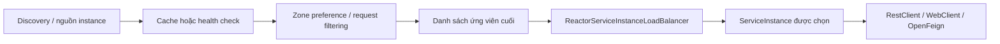

# Kiểm thử chuỗi supplier, cache, vùng và health check

## 1. Mục tiêu bài học

Trong hệ thống microservice, cân bằng tải phía client không chỉ là chọn một `ServiceInstance` theo Round Robin. Trước khi thuật toán chọn đích chạy, Spring Cloud LoadBalancer phải biết **những instance nào còn là ứng viên**: discovery trả về gì, cache còn dữ liệu cũ không, instance ở zone nào và health check có xác nhận instance đó khỏe không.

Chỉ kiểm thử phương thức HTTP của `RestClient`, `WebClient` hoặc OpenFeign là chưa đủ. Một request có thể thất bại vì supplier cung cấp danh sách sai, mặc dù thuật toán chọn đích vẫn chạy đúng.

Bài thuộc chương **Kiểm thử tự động** của module `SPRING_CLOUD_SERVICE_COMMUNICATION_LOAD_BALANCING`. Module nghiên cứu cơ chế chọn `ServiceInstance` theo service ID, discovery, health check, chính sách định tuyến và tích hợp HTTP client cùng retry/timeout/observability. Trong bài này, ta tập trung vào **kiểm thử chuỗi `ServiceInstanceListSupplier`**, xem rõ từng lớp biến đổi danh sách trước khi request đi tới downstream.

Sau bài này, bạn có thể:

1. Đọc đúng hợp đồng `Flux<List<ServiceInstance>>` và viết fixture có thể kiểm tra độc lập.
2. Kiểm thử lọc theo **zone**, kể cả khi không có instance cùng vùng.
3. Kiểm thử **cache hit, cache miss và invalidation** mà không cần `Thread.sleep`.
4. Thiết kế kiểm thử **health check** có stub HTTP và giới hạn thời gian, không phụ thuộc lịch scheduler theo kiểu may rủi.
5. Kiểm thử **thứ tự các supplier** và xác định nơi dữ liệu cũ hoặc instance không khỏe lọt vào danh sách.
6. Tách kiểm thử supplier khỏi kiểm thử lựa chọn instance, HTTP transport, timeout và retry.

## 2. Chuỗi supplier hoạt động ở đâu?

`ServiceInstanceListSupplier` phát ra **danh sách** các instance cho một service ID. Những lớp wrapper như `CachingServiceInstanceListSupplier`, `ZonePreferenceServiceInstanceListSupplier` và `HealthCheckServiceInstanceListSupplier` có thể thay đổi danh sách đó. Cuối cùng, `ReactorServiceInstanceLoadBalancer.choose(Request)` nhận danh sách và trả `Response<ServiceInstance>`.



Ví dụ `order-service` gọi `stock-service` có ba instance:

| Instance | Zone (metadata) | Tình trạng | Ý nghĩa kiểm thử |
| --- | --- | --- | --- |
| `stock-a` | `zone-a` | Khỏe | Đích ưu tiên khi caller ở `zone-a` |
| `stock-b` | `zone-b` | Khỏe | Đích dự phòng khi không còn instance cùng zone |
| `stock-c` | `zone-a` | Không khỏe | Cần bị loại khi health-check thực sự có hiệu lực |

Với health check lọc C và zone preference `zone-a`, tập ứng viên mong đợi là `[stock-a]`. Nếu A và C không khỏe, kết quả sẽ phụ thuộc **chính sách all-down của phiên bản health-check supplier**; không được tự mặc định B luôn được chọn nếu B cũng không khỏe. Khi chỉ dùng zone preference trên danh sách còn B, việc không có ứng viên cùng `zone-a` sẽ khiến zone supplier trả **toàn bộ danh sách đầu vào**, tức `[stock-b]`.

### 2.1. Đừng nhầm ba ranh giới

| Ranh giới | Điều cần test | Điều không được suy ra |
| --- | --- | --- |
| `ServiceInstanceListSupplier.get()` hoặc `get(request)` | Tập ứng viên, thứ tự, metadata và thời điểm phát danh sách | Chưa chứng minh request HTTP đã đến instance |
| `ReactorServiceInstanceLoadBalancer.choose(request)` | Chọn một instance thuộc danh sách hoặc trả `EmptyResponse` | Chưa chứng minh instance khỏe tại thời điểm gửi |
| HTTP client gọi bằng service ID | Status, body, exception, số request server thực nhận | Không đủ để kết luận cache hoặc zone filtering đúng nếu không theo dõi danh sách |

Một request có thể được chọn tới A rồi gặp timeout. Đó là kết quả khác hoàn toàn với trường hợp supplier trả danh sách rỗng khiến LoadBalancer không chọn được đích. Test cần phân biệt hai tình huống.

## 3. Thiết kế chiến lược kiểm thử theo lớp

Nên có ít nhất ba mức kiểm thử:

1. **Unit test có tính xác định** với `ServiceInstanceListSuppliers.from(...)` hoặc supplier giả; không có network, không cần Spring Boot context. Dùng để xác nhận zone filter và cache.
2. **Component/integration test** với một chain thật trong context của `stock-service`, có fake discovery và health endpoint điều khiển được. Dùng để phát hiện sai thứ tự wrapper, sai cấu hình đường dẫn health check hoặc scheduler.
3. **HTTP end-to-end test** gọi `http://stock-service/...` bằng `@LoadBalanced` client hoặc `@FeignClient(name="stock-service")`; đếm request nhận ở từng instance, xác nhận từ kết quả supplier tới hành vi HTTP thực tế.

Đừng dùng một test end-to-end lớn để thay toàn bộ unit test. Khi test lớn thất bại, ta khó phân biệt lỗi discovery, stale cache, zone metadata, health probe, thuật toán Round Robin và client HTTP.

### 3.1. Dependency cần có

Một ứng dụng Spring Boot + Spring Cloud có thể dùng các dependency Maven sau; **không ghi đè phiên bản** của starter nếu đã quản lý bằng Spring Boot/Spring Cloud BOM tương thích:

```xml
<dependencies>
    <dependency>
        <groupId>org.springframework.cloud</groupId>
        <artifactId>spring-cloud-starter-loadbalancer</artifactId>
    </dependency>
    <dependency>
        <groupId>org.springframework.boot</groupId>
        <artifactId>spring-boot-starter-test</artifactId>
        <scope>test</scope>
    </dependency>
    <dependency>
        <groupId>io.projectreactor</groupId>
        <artifactId>reactor-test</artifactId>
        <scope>test</scope>
    </dependency>
</dependencies>
```

Nếu dùng health check reactive qua `WebClient`, bảo đảm lớp HTTP client tương ứng nằm trong classpath. Nếu kiểm thử health bằng `RestTemplate` hoặc `RestClient` trong stack blocking, chọn builder `withBlockingHealthChecks()` hoặc `withBlockingRestClientHealthChecks()` **theo phiên bản Spring Cloud đang sử dụng**.

## 4. Fixture chung: service ID và instance có metadata

Đặt fixture trong `src/test/java`. Không cần chạy registry Eureka/Consul để test logic supplier.

```java
package example.loadbalancer;

import java.time.Duration;
import java.util.List;

import org.springframework.cloud.client.DefaultServiceInstance;
import org.springframework.cloud.client.ServiceInstance;

final class StockFixtures {
    static final String SERVICE_ID = "stock-service";
    static final Duration WAIT = Duration.ofSeconds(2);

    static DefaultServiceInstance instance(String id, int port, String zone) {
        var instance = new DefaultServiceInstance(
                id, SERVICE_ID, "127.0.0.1", port, false);
        instance.getMetadata().put("zone", zone);
        return instance;
    }

    static List<String> ids(List<ServiceInstance> instances) {
        return instances.stream()
                .map(ServiceInstance::getInstanceId)
                .toList();
    }

    private StockFixtures() {}
}
```

`DefaultServiceInstance` giúp xác định `instanceId`, host, port, zone và metadata trong từng test. Dùng danh sách hữu hạn giúp assertion dựa trên **tập kết quả chính xác**, thay vì chạy HTTP thật rồi đoán từ log.

Hợp đồng `get()` có dạng:

```java
Flux<List<ServiceInstance>> get();
```

Để kiểm tra một lần phát danh sách, test thường dùng `supplier.get().next().block(WAIT)` hoặc `StepVerifier`. **Chỉ block trong kiểm thử**; không đưa `block()` vào code production xử lý WebClient reactive.

Nếu supplier có cơ chế phát **nhiều lần theo thời gian** (như health check), `next()` đơn thuần có thể lấy trạng thái ban đầu trước khi đợt probe hoàn tất. Khi đó test phải chờ một **điều kiện xác định**, có timeout, thay vì khẳng định ngay emission đầu tiên là danh sách khỏe cuối cùng.

## 5. Unit test zone preference: đúng vùng và fallback

`ZonePreferenceServiceInstanceListSupplier` đọc zone của caller từ `LoadBalancerZoneConfig` (thường được cấp bởi `spring.cloud.loadbalancer.zone`) và đọc zone của instance ở metadata key `zone`.

Hành vi cần kiểm tra:

- **Có instance cùng zone:** chỉ trả các instance trong zone đó.
- **Không có instance cùng zone:** trả lại **toàn bộ danh sách do delegate cấp**.
- **Không cấu hình zone:** không lọc theo zone.
- **Delegate trả danh sách rỗng:** kết quả vẫn rỗng.
- **Metadata zone** sai hoặc thiếu: không tự sáng tạo zone từ host hay cổng.

Ví dụ test JUnit 5:

```java
package example.loadbalancer;

import org.junit.jupiter.api.Test;
import org.springframework.cloud.loadbalancer.config.LoadBalancerZoneConfig;
import org.springframework.cloud.loadbalancer.core.ZonePreferenceServiceInstanceListSupplier;
import org.springframework.cloud.loadbalancer.support.ServiceInstanceListSuppliers;

import static example.loadbalancer.StockFixtures.*;
import static org.junit.jupiter.api.Assertions.assertEquals;

class ZonePreferenceSupplierTest {

    @Test
    void keepsOnlyInstancesInPreferredZone() {
        var a = instance("a", 8081, "zone-a");
        var b = instance("b", 8082, "zone-b");
        var c = instance("c", 8083, "zone-a");

        var source = ServiceInstanceListSuppliers.from(SERVICE_ID, a, b, c);
        var zone = new ZonePreferenceServiceInstanceListSupplier(
                source, new LoadBalancerZoneConfig("zone-a"));

        var result = zone.get().next().block(WAIT);
        assertEquals(java.util.List.of("a", "c"), ids(result));
    }

    @Test
    void fallsBackToAllCandidatesIfZoneHasNoMatch() {
        var a = instance("a", 8081, "zone-a");
        var b = instance("b", 8082, "zone-b");

        var source = ServiceInstanceListSuppliers.from(SERVICE_ID, a, b);
        var zone = new ZonePreferenceServiceInstanceListSupplier(
                source, new LoadBalancerZoneConfig("zone-c"));

        assertEquals(java.util.List.of("a", "b"),
                ids(zone.get().next().block(WAIT)));
    }

    @Test
    void preservesEmptyCandidateList() {
        var source = ServiceInstanceListSuppliers.from(SERVICE_ID);
        var zone = new ZonePreferenceServiceInstanceListSupplier(
                source, new LoadBalancerZoneConfig("zone-a"));

        assertEquals(java.util.List.of(),
                ids(zone.get().next().block(WAIT)));
    }
}
```

**Lưu ý:** `ZonePreferenceServiceInstanceListSupplier` là **preference**, không phải “cấm tuyệt đối traffic sang zone khác”. Khi không tìm thấy instance cùng vùng, nó chủ động fallback về toàn bộ danh sách còn lại. Nếu sản phẩm yêu cầu *chỉ được đi trong zone*, cần một filter nghiêm ngặt riêng và viết test cho trường hợp không có ứng viên. Không dùng kết quả của zone preference có sẵn để khẳng định đã thực hiện hard isolation.

### 5.1. Kiểm tra request context khi có supplier theo request

Một số wrapper phục vụ retry/hint/sticky session cần gọi `get(Request)` thay vì `get()`. Khi test chain:

1. Tạo fake supplier mà `get(request)` trả danh sách khác với `get()`.
2. Gọi `choose(requestWithContext)` từ LoadBalancer hoặc `get(requestWithContext)` từ wrapper đang kiểm tra.
3. Xác minh supplier nhận đúng `Request` và không làm mất metadata cần cho lọc.

Chú ý sự khác nhau giữa phiên bản Spring Cloud: cơ chế chuyển tiếp `get(Request)` qua `DelegatingServiceInstanceListSupplier` từng có cờ cấu hình riêng. Tránh giả định mọi wrapper mặc nhiên forward context; đặc biệt **cache và health-check** được thiết kế để đặt trước các filter phụ thuộc request.

## 6. Kiểm thử cache không phụ thuộc đồng hồ thật

`CachingServiceInstanceListSupplier` giữ danh sách cho service ID và giảm số lần truy vấn nguồn. Khi test, phải phân biệt **cache hit** và **nguồn discovery không thay đổi**: nếu nguồn luôn trả A, việc nhận A hai lần chưa chứng minh có cache.

Thiết kế test tốt cần:

1. Một **delegate mutable**: lần đầu trả `[a]`, sau đó đổi thành `[b]`.
2. Một counter đếm số lần thực sự gọi delegate.
3. Một `CacheManager` riêng cho test.
4. Khẳng định lần thứ hai vẫn nhận `[a]`, số lần đọc nguồn là `1`.
5. Chủ động xóa cache key của service ID, khẳng định lần tiếp theo trả `[b]` và counter tăng thành `2`.

Ví dụ dùng `ConcurrentMapCacheManager` (không có TTL tự động; phù hợp **chỉ** để kiểm chứng hit/miss/invalidation):

```java
package example.loadbalancer;

import java.util.List;
import java.util.concurrent.atomic.AtomicInteger;
import java.util.concurrent.atomic.AtomicReference;

import org.junit.jupiter.api.Test;
import org.springframework.cache.concurrent.ConcurrentMapCacheManager;
import org.springframework.cloud.client.ServiceInstance;
import org.springframework.cloud.loadbalancer.core.CachingServiceInstanceListSupplier;
import org.springframework.cloud.loadbalancer.core.ServiceInstanceListSupplier;
import reactor.core.publisher.Flux;

import static example.loadbalancer.StockFixtures.*;
import static org.junit.jupiter.api.Assertions.*;

class CachingSupplierTest {

    @Test
    void returnsCachedInstancesUntilCacheIsEvicted() {
        var a = instance("a", 8081, "zone-a");
        var b = instance("b", 8082, "zone-a");

        var current = new AtomicReference<List<ServiceInstance>>(List.of(a));
        var sourceReads = new AtomicInteger();

        ServiceInstanceListSupplier delegate = new ServiceInstanceListSupplier() {
            @Override
            public String getServiceId() {
                return SERVICE_ID;
            }

            @Override
            public Flux<List<ServiceInstance>> get() {
                return Flux.defer(() -> {
                    sourceReads.incrementAndGet();
                    return Flux.just(current.get());
                });
            }
        };

        var cacheManager = new ConcurrentMapCacheManager(
                CachingServiceInstanceListSupplier.SERVICE_INSTANCE_CACHE_NAME);
        var cached = new CachingServiceInstanceListSupplier(
                delegate, cacheManager);

        assertEquals(List.of("a"), ids(cached.get().next().block(WAIT)));
        assertEquals(1, sourceReads.get());

        current.set(List.of(b)); // Discovery đã thay đổi, cache chưa đổi.
        assertEquals(List.of("a"), ids(cached.get().next().block(WAIT)));
        assertEquals(1, sourceReads.get());

        var cache = cacheManager.getCache(
                CachingServiceInstanceListSupplier.SERVICE_INSTANCE_CACHE_NAME);
        assertNotNull(cache);
        cache.evict(SERVICE_ID);

        assertEquals(List.of("b"), ids(cached.get().next().block(WAIT)));
        assertEquals(2, sourceReads.get());
    }
}
```

**Giới hạn của test:** `ConcurrentMapCacheManager` trong ví dụ không tự hết hạn. Test trên **chứng minh đường đi hit/miss/invalidation**, không chứng minh `spring.cloud.loadbalancer.cache.ttl` hoạt động. Để test TTL, dùng cache implementation thực tế và clock/expiry controller phù hợp hoặc một integration test có timeout được ràng buộc; tránh dùng `Thread.sleep(35_000)`.

### 6.1. Cache TTL trong ứng dụng thật

Ví dụ:

```yaml
spring:
  cloud:
    loadbalancer:
      cache:
        enabled: true
        ttl: 10s
        capacity: 256
```

Spring Cloud LoadBalancer có implementation mặc định và có thể chọn Caffeine khi dependency tương ứng hiện diện. `ttl` là hạn sử dụng danh sách cache, **không bảo đảm discovery refresh đúng tại thời điểm TTL kết thúc**; danh sách thường được nạp lại ở lần truy cập tiếp theo. Cấu hình Caffeine specification có thể ghi đè các thuộc tính cache chung; nếu registry đã có cache, cần cân nhắc tránh cache hai lần.

Những tình huống cần test ở integration:

| Thay đổi | Dự kiến trong TTL | Dự kiến sau hết hạn và truy cập lại |
| --- | --- | --- |
| Registry thêm instance C | Có thể vẫn thấy A/B | Có cơ hội thấy A/B/C nếu discovery đã cập nhật |
| Registry xóa instance A | Có thể vẫn thấy A | Không còn A nếu danh sách nguồn đã loại A |
| Network tới registry gián đoạn | Tùy cache và policy lỗi | Đọc log/exception thực, không suy mặc định |
| Cache được xóa có chủ đích | Lần đọc sau nạp lại nguồn | Nguồn được gọi thêm lần nữa |

**Một nhận xét quan trọng:** Cache stale có thể dẫn tới request tới instance đã mất. Nó không có nghĩa thuật toán `RoundRobinLoadBalancer` chọn sai; thuật toán có thể chỉ đang chọn chính xác từ **danh sách cache còn cũ**.

## 7. Kiểm thử health check: điều khiển probe thay vì đoán scheduler

`HealthCheckServiceInstanceListSupplier` định kỳ kiểm tra endpoint health của từng `ServiceInstance` rồi phát danh sách ứng viên theo chính sách của phiên bản. Khi service discovery đã lọc instance chết, health checker bổ sung có thể không cần thiết; nó thường hữu ích hơn với `SimpleDiscoveryClient` hoặc danh sách instance tĩnh.

Chính sách probe phải được test với **HTTP server giả có trạng thái điều khiển được**. Một `AtomicBoolean healthy` cho từng server sẽ giúp:

- A trả `200` khi khỏe; đổi thành `503` khi không khỏe.
- B luôn trả `200` làm đối chứng.
- Có thể bật lại A và quan sát trở lại danh sách.
- Đếm số lần endpoint `/actuator/health` được gọi để chứng minh scheduler hoạt động.

### 7.1. Một stub health endpoint bằng JDK

Ví dụ sau là helper cho test tích hợp; không cài thêm thư viện mock HTTP:

```java
package example.loadbalancer;

import com.sun.net.httpserver.HttpServer;
import java.io.IOException;
import java.net.InetSocketAddress;
import java.util.concurrent.atomic.AtomicBoolean;
import java.util.concurrent.atomic.AtomicInteger;

final class HealthStub implements AutoCloseable {
    final AtomicBoolean healthy = new AtomicBoolean(true);
    final AtomicInteger probes = new AtomicInteger();
    final HttpServer server;

    HealthStub() throws IOException {
        server = HttpServer.create(
                new InetSocketAddress("127.0.0.1", 0), 0);

        server.createContext("/actuator/health", exchange -> {
            probes.incrementAndGet();
            boolean up = healthy.get();
            byte[] body = (up ? "{\"status\":\"UP\"}"
                              : "{\"status\":\"DOWN\"}").getBytes();
            exchange.getResponseHeaders()
                    .add("Content-Type", "application/json");
            exchange.sendResponseHeaders(up ? 200 : 503, body.length);
            try (var response = exchange.getResponseBody()) {
                response.write(body);
            } finally {
                exchange.close();
            }
        });
        server.start();
    }

    int port() {
        return server.getAddress().getPort();
    }

    @Override
    public void close() {
        server.stop(0);
    }
}
```

Khi tạo `DefaultServiceInstance` cho hai stub, dùng `localhost`/`127.0.0.1` và `port()` thực tế. Health probe nên dùng đúng URL/port mà instance đã đăng ký. Hai server trong cùng máy không cần Docker, nhưng vẫn cần cleanup bằng `try-with-resources` hoặc `@AfterAll` để tránh rò rỉ port/scheduler.

### 7.2. Cấu hình dành cho môi trường test

Một ví dụ tùy biến service ID `stock-service`:

```yaml
spring:
  cloud:
    loadbalancer:
      health-check:
        initial-delay: 0s
        interval: 1s
        path:
          default: /actuator/health
        update-results-list: false
        refetch-instances: true
        refetch-instances-interval: 1s
```

Ở đây `update-results-list=false` giúp một số phiên bản đợi tổng hợp danh sách healthy trước khi phát thay vì phát sau mỗi kết quả probe riêng lẻ; vẫn cần xác nhận output của phiên bản đang dùng. `refetch-instances=true` dùng khi nguồn không tự phát danh sách mới và cần lấy lại snapshot discovery định kỳ. Các khoảng 1 giây chỉ để test; môi trường production cần chọn theo tải và yêu cầu cập nhật.

**Đặc biệt cần xác nhận chính sách all-down theo phiên bản:** Một số dòng tài liệu mô tả khi tất cả instance không khỏe sẽ fallback về toàn bộ danh sách ban đầu, trong khi tài liệu nguồn mới mô tả phát danh sách rỗng. Vì vậy, **không viết test phụ thuộc giả định all-down** khi chưa khóa version Spring Cloud/BOM và đọc triển khai `HealthCheckServiceInstanceListSupplier` của version đó. Hãy ghi rõ expected behavior của dự án: *fail open* hay *fail closed*, rồi kiểm thử tương ứng.

### 7.3. Kịch bản kiểm thử health có điều kiện chờ

Với hai stub A/B, cả hai ban đầu khỏe:

1. Tạo/dùng supplier từ source discovery có `ServiceInstance(A, B)`, bọc bởi `HealthCheckServiceInstanceListSupplier` trong Spring context (qua builder `withHealthChecks()` hoặc `withBlockingHealthChecks()`).
2. **Chờ** cho tới khi `probes` của A và B đều dương, sau đó xác nhận danh sách kết quả chứa A/B.
3. Đổi `A.healthy.set(false)`; chờ ít nhất một vòng probe kế tiếp và xác nhận danh sách chỉ còn B.
4. Đổi `A.healthy.set(true)`; chờ vòng probe mới và xác nhận A quay lại.
5. Đổi cả A/B sang unhealthy; kiểm tra **chính sách all-down thực tế** của phiên bản đang dùng. Không dùng assertion có vẻ đúng từ tài liệu khác dòng phiên bản.

Nên dùng **polling có timeout** trong test thay vì `Thread.sleep(1000)` rồi assert ngay. Ví dụ pseudo-test với Awaitility:

```java
// Minh họa assertion, giả sử "supplier" là health-check supplier thật
// đã tạo trong Spring context và A, B là hai HealthStub.
await().atMost(Duration.ofSeconds(8)).untilAsserted(() -> {
    assertTrue(a.probes.get() > 0);
    assertTrue(b.probes.get() > 0);
    assertEquals(List.of("a", "b"), currentHealthyIds(supplier));
});

a.healthy.set(false);
await().atMost(Duration.ofSeconds(8)).untilAsserted(() ->
    assertEquals(List.of("b"), currentHealthyIds(supplier)));
```

Đoạn trên **minh họa cấu trúc kiểm thử**, không phải lớp test tự chạy độc lập: `await()` cần dependency `org.awaitility:awaitility`; `currentHealthyIds` là helper phải lấy snapshot **mới nhất** của health supplier theo cơ chế emission/version đã chọn. Nếu supplier phát nhiều lần hoặc replay dữ liệu ban đầu, không nên chỉ dùng `get().next()` rồi coi đó là trạng thái mới nhất.

Nếu test trực tiếp `Flux`, có thể dùng `StepVerifier` hoặc `StepVerifier.withVirtualTime`, nhưng virtual time chỉ có hiệu quả khi **toàn bộ scheduler liên quan được điều khiển**. Nếu health check thực hiện HTTP thực, Reactor virtual scheduler một mình không làm network chạy tức thì. Hãy dùng event/polling có timeout hoặc cung cấp scheduler/HTTP stub có thể kiểm soát chính xác.

## 8. Thứ tự wrapper quyết định ý nghĩa kết quả

Theo khuyến nghị của Spring Cloud LoadBalancer, **cache hoặc health check đặt ngay sau supplier lấy instance qua mạng**, trước những bộ lọc theo zone/hint/request. Với health-check supplier, thường **không cần** thêm `CachingServiceInstanceListSupplier` vì bản thân health check có cơ chế replay/cache; hai tầng cache có thể khiến trạng thái unhealthy còn bị giữ lại ngoài dự kiến.

### 8.1. Hai chain thực tế

Trường hợp chỉ ưu tiên zone và dùng cache:

```java
import org.springframework.cloud.loadbalancer.core.ServiceInstanceListSupplier;
import org.springframework.context.ConfigurableApplicationContext;
import org.springframework.context.annotation.Bean;

public class StockZoneSupplierConfiguration {
    @Bean
    ServiceInstanceListSupplier stockInstances(
            ConfigurableApplicationContext context) {
        return ServiceInstanceListSupplier.builder()
                .withDiscoveryClient()
                .withCaching()
                .withZonePreference()
                .build(context);
    }
}
```

Trường hợp cần health check reactive và ưu tiên zone, thay tầng cache bằng health check:

```java
public class StockHealthSupplierConfiguration {
    @Bean
    ServiceInstanceListSupplier stockInstances(
            ConfigurableApplicationContext context) {
        return ServiceInstanceListSupplier.builder()
                .withDiscoveryClient()
                .withHealthChecks()
                .withZonePreference()
                .build(context);
    }
}
```

**Hai class trên là hai lựa chọn cấu hình**, không đăng ký đồng thời cho cùng service. Đặt class config ngoài phạm vi component scan tự động hoặc không chú thích `@Configuration` rồi gắn **một** class bằng `@LoadBalancerClient(name="stock-service", configuration=...)`.

`withDiscoveryClient()` phù hợp khi có `ReactiveDiscoveryClient` và HTTP client reactive cần thiết. Với discovery blocking, chọn `withBlockingDiscoveryClient()`, với health check blocking chọn builder tương thích (`withBlockingHealthChecks()` hoặc `withBlockingRestClientHealthChecks()` theo thư viện). Luôn kiểm tra phiên bản Spring Cloud trước khi sao chép nguyên đoạn config.

### 8.2. Vì sao thứ tự quan trọng?

Giả sử trạng thái thay đổi:

```text
T0: discovery = [A(zone-a, healthy), B(zone-b, healthy)]
T1: A ngừng khỏe, discovery vẫn chưa loại A
T2: health check phát hiện A unhealthy
T3: A hồi phục
```

Nếu health check được đặt đúng ngay sau discovery, nó có thể lọc A ở `T2` và lớp zone preference chỉ nhận B; do không có zone-a khỏe, zone preference trả B. Nếu một cache khác được đặt **sau health check**, cache có thể giữ lại `[A,B]` cũ khiến zone preference tiếp tục chọn A. Do đó test phải kiểm tra **đầu ra thực tế của từng tầng**, đặc biệt tại `T1/T2/T3`.

Tương tự, nếu cache đặt sau một bộ lọc phụ thuộc request, kết quả của request trước có thể bị tái sử dụng cho request sau với context khác. Kiểm thử cần tạo hai request khác hint/zone và bảo đảm chúng không dùng chung một kết quả đã lọc sai.

## 9. Ma trận kiểm thử chuẩn cho cả chuỗi

| Kịch bản | Input nguồn | Cache/zone/health | Đầu ra cần kiểm tra |
| --- | --- | --- | --- |
| Cold cache | A/B | Cache chưa có dữ liệu | Delegate được gọi, nhận A/B |
| Warm cache | Nguồn đổi sang B/C | Cache chưa hết hạn | Vẫn nhận snapshot cached, delegate không bị gọi thêm |
| Cache invalidation | Nguồn B/C | Cache đã bị xóa | Nhận B/C, delegate được gọi lại |
| Đúng vùng | A:zone-a, B:zone-b | Caller zone-a | Chỉ A |
| Không có vùng phù hợp | A:zone-a, B:zone-b | Caller zone-c | Fallback A/B |
| Không cấu hình zone | A/B | Zone null | Trả danh sách nguồn |
| Một instance hỏng health | A hỏng, B khỏe | Probe cập nhật | Chỉ B khi health supplier lọc và đã cập nhật |
| Tất cả hỏng health | A/B hỏng | Probe cập nhật | Theo policy **all-down của version** đã chốt |
| Discovery trả rỗng | [] | Bất kỳ zone | [] hoặc no-instance phù hợp |
| Discovery phát exception | N/A | Cache miss | Lỗi được quan sát, không ngụy trang thành danh sách rỗng |
| Request khác hint | A/B có hint khác | Filter theo request | Không rò danh sách đã lọc từ request trước |
| Retry chọn instance mới | A/B | Retry-aware supplier + policy retry | Instance được chọn theo chính sách; tách retry khỏi vòng lọc |

Kiểm tra assertion theo **tập instance và số lần nguồn được gọi**, sau đó mới kiểm tra HTTP response. Một test chỉ xác minh request cuối trả 200 không phát hiện được việc traffic đi sai zone hoặc bị cache quá hạn.

## 10. Integration test theo service ID

Khi unit test pass, cần ít nhất một integration test tạo Spring child context theo tên dịch vụ. Ví dụ đăng ký:

```java
import org.springframework.cloud.loadbalancer.annotation.LoadBalancerClient;
import org.springframework.context.annotation.Configuration;

@Configuration(proxyBeanMethods = false)
@LoadBalancerClient(
        name = "stock-service",
        configuration = StockZoneSupplierConfiguration.class)
class StockLoadBalancerRegistration {}
```

Cấu hình `@LoadBalanced RestClient.Builder` hoặc `@LoadBalanced WebClient.Builder` cho caller và gọi URL theo service ID:

```java
// Với RestClient được build từ @LoadBalanced RestClient.Builder:
String response = restClient.get()
        .uri("http://stock-service/stocks/{sku}", "SKU-1")
        .retrieve()
        .body(String.class);
```

Ở test này, nên dùng discovery giả hoặc `SimpleDiscoveryClient` với URL trỏ tới hai stub HTTP local. Stub A/B trả body chứa `instanceId`, nhờ đó có thể xác nhận request thật được gửi tới đâu.

**Hợp đồng kiểm tra:**

1. Khi A/B đều thuộc danh sách và A cùng zone với caller, client gọi nhiều lần sẽ chỉ tới A (nếu không bật cơ chế retry hay filter thay đổi instance).
2. Nếu A biến mất khỏi nguồn/cached list và cache đã được invalidated hoặc TTL hết, caller có thể chuyển sang B theo quy tắc fallback zone.
3. Khi hai instance đều biến mất, supplier trả [] và client phải xử lý no-instance theo tích hợp cụ thể; không hard-code mọi client đều trả cùng một status exception.
4. Gây HTTP 503 hoặc timeout từ server đã được chọn rồi so sánh số request server nhận với cấu hình retry. Supplier test **không** thay thế retry test.

### 10.1. Kiểm tra cache không chỉ bằng HTTP status

Nếu cả A/B đều trả 200, một integration test chỉ assert 200 không thể biết traffic có đi đúng đích. Hãy cho A/B trả hai header hoặc body khác nhau:

```text
stock-a -> {"instance":"a","stock":12}
stock-b -> {"instance":"b","stock":12}
```

Lúc này, kiểm thử việc đổi zone, cache invalidation và health trạng thái mới có thể dùng kết quả instance để chẩn đoán.

### 10.2. Tránh test flaky

- Không phụ thuộc cổng cố định; bind stub HTTP vào cổng `0` rồi lấy port thực.
- Không dùng `Thread.sleep` cố định để chờ cache TTL/health; dùng polling có deadline và sự kiện/kết quả quan sát được.
- Đảm bảo test độc lập: context, cache, scheduler và stub phải được reset/đóng giữa các case.
- Với danh sách là `Flux` phát nhiều snapshots, test phải biết mình kiểm tra **first emission** hay **latest state**.
- Tắt retry trong các test chỉ cần kiểm tra supplier, ví dụ `spring.cloud.loadbalancer.retry.enabled=false`; bật riêng ở test retry.
- Tách test zone từ test health để khi sai biết tầng nào gây ra.
- Không dùng xác suất Round Robin hay Random để chứng minh filter; assert trực tiếp danh sách supplier trước.

## 11. Chẩn đoán khi kiểm thử không như kỳ vọng

| Triệu chứng | Nguyên nhân có thể | Cách xác minh |
| --- | --- | --- |
| Test vẫn thấy instance A sau khi discovery loại A | Cache còn snapshot cũ hoặc registry chưa refresh | Đếm `delegate.get()`, kiểm tra TTL/cache key và snapshot nguồn |
| Test zone-a vẫn nhận B | Không có instance zone-a trong danh sách sau health, nên fallback | Kiểm tra danh sách trước/sau zone filter |
| Zone filtering không hoạt động | Metadata key `zone` sai, caller chưa cấu hình zone | Kiểm tra `LoadBalancerZoneConfig` và metadata |
| Health test lúc pass lúc fail | Scheduler/probe chưa chạy, assertion đọc emission đầu | Chờ số probe + điều kiện danh sách, có timeout |
| All-down test khác tài liệu | Dòng Spring Cloud khác nhau hoặc policy khác | Xem phiên bản thực và mã nguồn của health supplier |
| Cache test đọc nguồn mỗi lần | Không có cache đúng tên, cache manager khác, cache không hoạt động | Kiểm tra `CachingServiceInstanceListSupplier.SERVICE_INSTANCE_CACHE_NAME` và hit/miss |
| Cache test không cập nhật | Chưa evict/TTL chưa hết, có cache ở registry | Xem từng tầng cache và nguồn |
| Dùng `get(request)` nhưng mất hint | Wrapper không forward request context đúng cách | Dùng fake delegate để xác nhận `get(request)` được gọi |
| API client trả timeout nhưng supplier đúng | Kết nối/HTTP transport hoặc instance thực không phản hồi | Test riêng HTTP, timeout và retry |

## 12. Bài tập thực hành

1. Mở rộng `ZonePreferenceSupplierTest` để kiểm tra zone null, zone viết hoa/thường và instance thiếu metadata `zone`.
2. Mở rộng `CachingSupplierTest` thành ba lượt nguồn `[A] → [B] → []`; chứng minh khi cache chứa danh sách rỗng, hành vi cache hit/miss của implementation có thể khác trường hợp chứa dữ liệu.
3. Chạy hai stub HTTP `HealthStub`, tắt A rồi bật lại; viết test chỉ pass sau khi probe thực hiện và danh sách healthy được cập nhật.
4. Tạo chain `discovery → health → zone`. Cho A cùng zone nhưng hỏng, B khác zone nhưng khỏe; chứng minh B là ứng viên sau khi health filter loại A.
5. Tạo test HTTP có `@LoadBalanced` client và body chứa `instanceId`; đối chiếu lựa chọn instance trước và sau cache invalidation.
6. Khi tất cả instance unhealthy, xác định policy của Spring Cloud đang dùng, viết assertion theo policy đó và đề xuất yêu cầu nghiệp vụ nếu muốn fail closed thay vì fail open.

## 13. Tài liệu đối chiếu

- [Spring Cloud Commons – Spring Cloud LoadBalancer](https://docs.spring.io/spring-cloud-commons/reference/spring-cloud-commons/loadbalancer.html): cache, zone preference, health checks, thứ tự `ServiceInstanceListSupplier`, cấu hình theo service ID.
- [Spring Cloud LoadBalancer – Configuration Properties](https://docs.spring.io/spring-cloud-commons/reference/configprops.html): thuộc tính TTL/cache và health-check, cần đối chiếu với BOM của dự án.
- [Spring Cloud Commons – CachingServiceInstanceListSupplier source](https://github.com/spring-cloud/spring-cloud-commons/blob/main/spring-cloud-loadbalancer/src/main/java/org/springframework/cloud/loadbalancer/core/CachingServiceInstanceListSupplier.java): cách implementation truy vấn cache theo service ID.
- [Spring Cloud Commons – ZonePreferenceServiceInstanceListSupplier source](https://github.com/spring-cloud/spring-cloud-commons/blob/main/spring-cloud-loadbalancer/src/main/java/org/springframework/cloud/loadbalancer/core/ZonePreferenceServiceInstanceListSupplier.java): fallback khi không có instance cùng zone.
- [Reactor Test – StepVerifier](https://projectreactor.io/docs/test/release/api/reactor/test/StepVerifier.html): kiểm tra các emission và lỗi từ publisher.

**Ghi nhớ:** Muốn kiểm thử chuỗi supplier đáng tin cậy, hãy kiểm tra **đầu ra của mỗi tầng và thời điểm dữ liệu thay đổi**. Cache có thể giữ snapshot cũ; zone preference có fallback khi thiếu vùng phù hợp; health check phụ thuộc probe/scheduler và policy theo phiên bản. Chỉ khi những điều này rõ ràng mới kiểm tra thuật toán chọn `ServiceInstance` và request HTTP thực tế.
