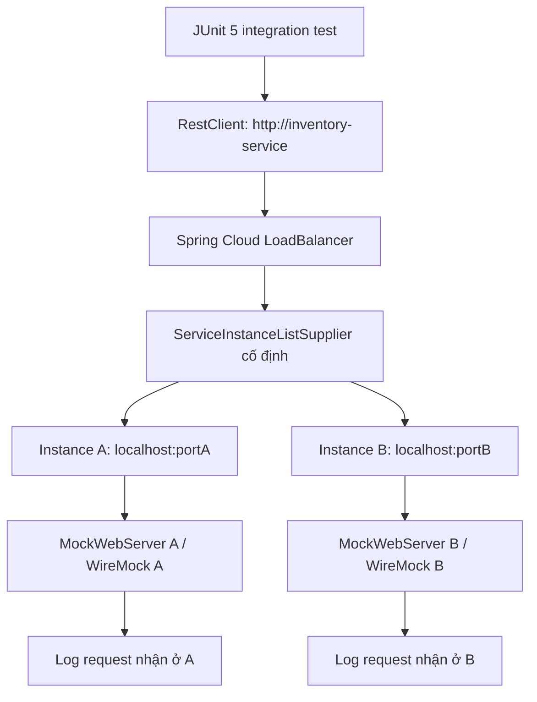

# Dựng nhiều HTTP server giả với WireMock hoặc MockWebServer

Khi kiểm thử Spring Cloud LoadBalancer, một HTTP server giả duy nhất chỉ chứng minh rằng client có thể gửi request và nhận response. Nó **chưa chứng minh được LoadBalancer thực sự chọn giữa nhiều `ServiceInstance`**. Để kiểm tra round robin, vùng ưu tiên, health check, failover hoặc retry, bài kiểm thử cần ít nhất hai endpoint độc lập, mỗi endpoint có cổng riêng, phản hồi riêng và khả năng ghi nhận những request thực sự được gửi đến nó.

Ví dụ, `order-service` gọi `inventory-service` qua URI logic `http://inventory-service`. Trong production, service ID được giải quyết thành các replica thông qua discovery và `ServiceInstanceListSupplier`. Trong test, ta có thể thay nguồn instance thật bằng danh sách cố định trỏ tới hai HTTP server cục bộ được dựng bằng **MockWebServer** hoặc **WireMock**. Nhờ vậy, bài kiểm thử kiểm soát được response, lỗi, độ trễ và có thể đối chiếu instance được chọn.

Bài học thuộc chương **Kiểm thử tự động** của module `SPRING_CLOUD_SERVICE_COMMUNICATION_LOAD_BALANCING`. Phạm vi liên quan đến giao tiếp giữa dịch vụ bằng `RestClient`, `WebClient`, OpenFeign, lựa chọn `ServiceInstance`, discovery, health check, timeout, retry và quan sát lỗi. Mục tiêu không phải giả lập toàn bộ Kubernetes/Eureka/Consul, mà là tạo **môi trường HTTP đủ thật, có thể lặp lại** để phát hiện lỗi ở lớp chọn instance và HTTP client.

## 1. Phải kiểm thử đúng ranh giới: mock interface hay server HTTP thật?

Có ba mức kiểm thử thường bị nhầm:

| Mức | Cách làm | Kiểm tra được | Không kiểm tra được |
|---|---|---|---|
| **Unit test thuật toán** | Tạo `ServiceInstance` giả, gọi trực tiếp `choose(Request)` hoặc `get(Request)`. | Lọc/ưu tiên, thuật toán chọn, xử lý danh sách rỗng. | URI rewrite, HTTP transport, headers, timeout thật. |
| **Mock client interface** | Mockito `@Mock` hoặc bean giả cho `InventoryClient`. | Logic nghiệp vụ của `order-service`. | Gần như không đi qua LoadBalancer hoặc TCP. |
| **HTTP stub integration test** | Dựng 2–3 HTTP servers cục bộ và gọi qua `@LoadBalanced RestClient/WebClient` hoặc Feign. | Chọn instance, chuyển service ID thành host:port, gửi HTTP, đọc response và quan sát lỗi. | Không tự kiểm tra registry thật, networking production hoặc service mesh. |

Không phải lúc nào integration test cũng tốt hơn unit test. Đối với một thuật toán tùy chỉnh, unit test xác minh từng nhánh chính sách nhanh và chính xác. Nhưng khi cần trả lời câu hỏi **“Spring Cloud LoadBalancer có thực sự chuyển request đến từng replica đúng cách không?”**, bắt buộc phải có kiểm thử ở ranh giới HTTP.

## 2. Topology thử nghiệm: hai server giả, một service ID

Ta sẽ dựng hai server trên loopback:



Hai server trả cùng kiểu JSON nhưng chứa dấu hiệu riêng:

```json
{"instanceId":"inventory-a","stock":17}
```

```json
{"instanceId":"inventory-b","stock":17}
```

Điểm quan trọng của bài kiểm thử là **dùng service ID logic**, không gọi trực tiếp `http://localhost:portA` hoặc `http://localhost:portB` trong code client cần kiểm tra. Nếu test gửi thẳng tới các cổng, nó chỉ kiểm tra HTTP server, **không chứng minh LoadBalancer đã hoạt động**.

### Vì sao phải dùng port động?

Khi nhiều test chạy trên CI hoặc nhiều worker chạy song song, cổng cố định như 8081/8082 rất dễ va chạm. MockWebServer và WireMock đều hỗ trợ khởi động trên cổng động do hệ điều hành cấp:

- MockWebServer: gọi `start()` rồi đọc `getPort()`.
- WireMock: cấu hình `dynamicPort()` rồi gọi `port()` sau khi `start()`.
- Sau khi server đã chạy, dùng các cổng này để tạo `ServiceInstance` của LoadBalancer.

**Phải khởi động HTTP stubs trước khi Spring tạo bean lấy danh sách instance.** Nếu đọc `port()` khi server chưa khởi động, test có thể gặp cổng chưa hợp lệ hoặc lỗi ngắt quãng.

## 3. Dependency và lựa chọn phiên bản

Một cấu hình Gradle Groovy minh họa cho project Spring Boot/Spring Cloud đã chọn BOM tương thích:

```groovy
dependencies {
    implementation 'org.springframework.boot:spring-boot-starter-web'
    implementation 'org.springframework.cloud:spring-cloud-starter-loadbalancer'

    testImplementation 'org.springframework.boot:spring-boot-starter-test'
    testImplementation 'com.squareup.okhttp3:mockwebserver:4.12.0'
}
```

Ví dụ bên dưới minh họa API của **MockWebServer 4.x** (`okhttp3.mockwebserver.*`), Java 17+ và Spring Boot/Spring Cloud hỗ trợ `RestClient`. Đây là mô hình dependency cho test, không phải chỉ thị nâng/hạ phiên bản trong project bất kỳ. Nếu dự án dùng MockWebServer 5.x, package/API và artifact có thể khác: cần đối chiếu phiên bản test library với code.

Nếu chọn WireMock thay vì MockWebServer, sử dụng dependency test WireMock 3.x tương thích với Java và stack của dự án, ví dụ nhóm artifact `org.wiremock:wiremock` với phiên bản được khóa trong dependency management. **Không cần đồng thời cài cả hai thư viện chỉ để kiểm thử một đường gọi.**

Với `WebClient` cần dependency WebFlux phù hợp; với OpenFeign cần starter OpenFeign. Trong bài thực hành chính, ta dùng `RestClient` để thấy đường đi HTTP đồng bộ, sau đó chuyển cùng topology sang WebClient và Feign.

## 4. MockWebServer: server thật ở localhost nhưng dữ liệu được kiểm soát

MockWebServer là HTTP server nhẹ dành cho test. Nó nhận TCP/HTTP thật, hỗ trợ tạo response, chèn header, phản hồi chậm, ngắt kết nối và lấy lại request đã nhận để assert.

Ví dụ một server độc lập:

```java
import okhttp3.mockwebserver.MockResponse;
import okhttp3.mockwebserver.MockWebServer;

MockWebServer replicaA = new MockWebServer();
replicaA.start();

replicaA.enqueue(new MockResponse()
    .setResponseCode(200)
    .addHeader("Content-Type", "application/json")
    .setBody("{\"instanceId\":\"inventory-a\",\"stock\":17}"));

int portA = replicaA.getPort();

// Sau khi test kết thúc:
replicaA.shutdown();
```

`enqueue(...)` phù hợp khi biết số request và muốn mô phỏng **chuỗi phản hồi**: request đầu trả `500`, request sau trả `200`. Mỗi server có hàng đợi phản hồi riêng. Nếu test LoadBalancer gọi nhiều lần nhưng chỉ enqueue đúng một response cho server A, request tiếp theo đến A có thể bị chờ/hỏng tùy dispatcher và timeout — thường là nguyên nhân tạo test flaky.

Trong bài test gửi nhiều request, ta có thể dùng `Dispatcher` thay cho hàng đợi. Dispatcher định nghĩa response dựa trên method/path, vì vậy A có thể phản hồi ổn định cho mọi request đúng hợp đồng.

## 5. Ví dụ integration test hoàn chỉnh: hai MockWebServer + RestClient

Test dưới đây dùng:

1. Hai `MockWebServer` thật, mỗi server lắng nghe một cổng động.
2. Một `ServiceInstanceListSupplier` cung cấp **cố định** hai `DefaultServiceInstance`.
3. `@LoadBalancerClient` để đưa supplier vào **named context của `inventory-service`**.
4. Một `@LoadBalanced RestClient.Builder` và bean `RestClient` có `baseUrl("http://inventory-service")`.
5. JUnit 5 xác minh **cả hai server đã nhận request thật**.

### 5.1. Lớp test và vòng đời hai server

```java
import java.io.IOException;
import java.util.HashSet;
import java.util.List;
import java.util.Set;
import java.util.concurrent.TimeUnit;

import okhttp3.mockwebserver.Dispatcher;
import okhttp3.mockwebserver.MockResponse;
import okhttp3.mockwebserver.MockWebServer;
import okhttp3.mockwebserver.RecordedRequest;

import org.junit.jupiter.api.AfterAll;
import org.junit.jupiter.api.Test;
import org.springframework.beans.factory.annotation.Autowired;
import org.springframework.boot.SpringBootConfiguration;
import org.springframework.boot.autoconfigure.EnableAutoConfiguration;
import org.springframework.boot.test.context.SpringBootTest;
import org.springframework.cloud.client.ServiceInstance;
import org.springframework.cloud.client.DefaultServiceInstance;
import org.springframework.cloud.client.loadbalancer.LoadBalanced;
import org.springframework.cloud.loadbalancer.annotation.LoadBalancerClient;
import org.springframework.cloud.loadbalancer.core.ServiceInstanceListSupplier;
import org.springframework.context.annotation.Bean;
import org.springframework.web.client.RestClient;
import reactor.core.publisher.Flux;

import static org.junit.jupiter.api.Assertions.*;

@SpringBootTest(
    classes = MultiReplicaLoadBalancerIT.TestApplication.class,
    webEnvironment = SpringBootTest.WebEnvironment.NONE
)
class MultiReplicaLoadBalancerIT {

    static final MockWebServer REPLICA_A = new MockWebServer();
    static final MockWebServer REPLICA_B = new MockWebServer();

    // static initializer chạy trước khi Spring tạo test ApplicationContext.
    static {
        REPLICA_A.setDispatcher(replyAs("inventory-a"));
        REPLICA_B.setDispatcher(replyAs("inventory-b"));
        try {
            REPLICA_A.start();
            REPLICA_B.start();
        } catch (IOException exception) {
            throw new ExceptionInInitializerError(exception);
        }
    }

    private static Dispatcher replyAs(String instanceId) {
        return new Dispatcher() {
            @Override
            public MockResponse dispatch(RecordedRequest request) {
                if (!"GET".equals(request.getMethod())
                        || !"/api/items/42".equals(request.getPath())) {
                    return new MockResponse().setResponseCode(404);
                }

                return new MockResponse()
                    .setResponseCode(200)
                    .addHeader("Content-Type", "application/json")
                    .setBody("{\"instanceId\":\"" + instanceId
                        + "\",\"stock\":17}");
            }
        };
    }

    record InventoryReply(String instanceId, int stock) {}

    @Autowired
    RestClient inventoryRestClient;

    @Test
    void callsBothReplicasThroughLogicalServiceId() {
        int beforeA = REPLICA_A.getRequestCount();
        int beforeB = REPLICA_B.getRequestCount();
        Set<String> reachedReplicas = new HashSet<>();

        for (int attempt = 0; attempt < 12; attempt++) {
            InventoryReply reply = inventoryRestClient.get()
                .uri("/api/items/42")
                .retrieve()
                .body(InventoryReply.class);

            assertNotNull(reply);
            assertEquals(17, reply.stock());
            reachedReplicas.add(reply.instanceId());
        }

        assertTrue(reachedReplicas.contains("inventory-a"));
        assertTrue(reachedReplicas.contains("inventory-b"));

        int callsA = REPLICA_A.getRequestCount() - beforeA;
        int callsB = REPLICA_B.getRequestCount() - beforeB;
        assertTrue(callsA > 0);
        assertTrue(callsB > 0);
        assertEquals(12, callsA + callsB);
    }

    @AfterAll
    static void stopServers() throws IOException {
        REPLICA_A.shutdown();
        REPLICA_B.shutdown();
    }

    @SpringBootConfiguration
    @EnableAutoConfiguration
    @LoadBalancerClient(
        name = "inventory-service",
        configuration = InventoryInstancesConfiguration.class
    )
    static class TestApplication {

        @Bean
        @LoadBalanced
        RestClient.Builder loadBalancedRestClientBuilder() {
            return RestClient.builder();
        }

        @Bean
        RestClient inventoryRestClient(
                @LoadBalanced RestClient.Builder builder) {
            return builder.clone()
                .baseUrl("http://inventory-service")
                .build();
        }
    }

    // Được đăng ký trong LoadBalancer child context của inventory-service.
    // Không được tự component-scan nó như bean config global.
    static class InventoryInstancesConfiguration {

        @Bean
        ServiceInstanceListSupplier inventoryInstances() {
            List<ServiceInstance> instances = List.of(
                new DefaultServiceInstance(
                    "inventory-a", "inventory-service",
                    "localhost", REPLICA_A.getPort(), false),
                new DefaultServiceInstance(
                    "inventory-b", "inventory-service",
                    "localhost", REPLICA_B.getPort(), false)
            );

            return new ServiceInstanceListSupplier() {
                @Override
                public String getServiceId() {
                    return "inventory-service";
                }

                @Override
                public Flux<List<ServiceInstance>> get() {
                    return Flux.just(instances);
                }
            };
        }
    }
}
```

### 5.2. Điều gì được kiểm tra, điều gì chưa?

Đường đi của mỗi request là `inventoryRestClient → LoadBalancer chọn một trong hai `ServiceInstance` → HTTP thật đến localhost:portA/portB → JSON decode`. Khi cả hai server nhận request, bài test chứng minh adapter và LoadBalancer đã sử dụng **cả hai đích** trong lượt kiểm tra.

Giả định bài test là cấu hình round robin mặc định thông dụng và không có chính sách affinity/hard filter thay thế. Vì test kiểm tra kết quả của **12 request tuần tự** và yêu cầu hai replica đều được chọn, thay đổi thuật toán sang một chính sách chỉ gửi một replica sẽ khiến điều kiện này không còn là kỳ vọng đúng. Khi thuật toán được tùy biến, thay assertion theo **hợp đồng lựa chọn** của thuật toán, không cố ép round robin.

Test **không dùng registry thật**: `ServiceInstanceListSupplier` tĩnh đang thay thế discovery. Đây là điểm có chủ ý để loại trừ network và control plane khi cần kiểm tra thuật toán chọn/HTTP integration. Muốn kiểm tra Eureka/Consul/Kubernetes DiscoveryClient, cần một lớp integration/contract test khác có registry hoặc môi trường điều phối phù hợp.

### 5.3. Lưu ý về vòng đời và test chạy song song

Ví dụ đặt hai server ở static fields để chúng được start **trước khi** Spring tạo child context. Với suite lớn, hãy quản lý vòng đời bằng JUnit extension/fixture chuyên dụng, tránh dùng chung cặp server giữa những test chạy song song hoặc cache `ApplicationContext` chứa cổng của server đã dừng. Khi mỗi test method muốn response khác nhau, cần fixture được reset/tách biệt trước mỗi case; đừng dựa vào state `getRequestCount()` bắt đầu từ 0 nếu đã có test khác dùng cùng server.

**Nếu test thất bại vì cổng thay đổi nhưng Spring context vẫn được cache**, cần giải quyết lifecycle/test isolation chứ không thêm `Thread.sleep` để “đợi LoadBalancer”.

## 6. Vì sao không nên assert thứ tự A, B, A, B một cách mù quáng?

Round robin thường khiến hai instance được chọn luân phiên trong điều kiện danh sách ổn định, nhưng **test không nên dựa vào vị trí bắt đầu tuyệt đối** hoặc timing tình cờ:

- Bộ đếm khởi tạo của thuật toán có thể không bắt đầu từ vị trí mà test giả định.
- Lời gọi khác của setup/health check hoặc các test song song có thể tác động lựa chọn.
- Danh sách instance có thể thay đổi thứ tự do discovery/cache.
- Retry có thể tạo thêm lần chọn hoặc reuse cùng instance, tùy integration.
- Weighted/affinity/zone routing không bắt buộc chia đều số request.

Tốt hơn nên assert **tính chất muốn kiểm tra**, chẳng hạn:

| Mục tiêu | Assertion có ý nghĩa |
|---|---|
| Cả hai instance có thể được chọn | Sau số request đủ và thuật toán được cấu hình rõ, cả A/B có request nhận được. |
| Không chọn ngoài tập | Mọi `instanceId` trả về thuộc `{A,B}`. |
| Tổng lời gọi đúng | Delta `getRequestCount()` trên A + B bằng số attempts được kỳ vọng. |
| Header đúng | `RecordedRequest.getHeader(...)` trên server nhận request có giá trị expected. |
| Tải phân bố hợp lý | So sánh số calls theo mức lệch được hợp đồng thuật toán cho phép, không theo tỉ lệ ngẫu nhiên cố định cho sample nhỏ. |

Khi kiểm thử **thuật toán chọn chính xác**, dùng thêm unit test gọi `ReactorLoadBalancer.choose(Request)` trực tiếp với supplier cố định để khẳng định chuỗi lựa chọn mà không bị ảnh hưởng HTTP transport. HTTP integration test nên xác minh rằng lựa chọn có **hiệu lực trên mạng**.

## 7. RecordedRequest: khẳng định endpoint thực sự nhận gì

MockWebServer lưu các request đã nhận. Ngoài đếm, có thể dùng `takeRequest(timeout, unit)` để assert:

```java
RecordedRequest recorded =
    REPLICA_A.takeRequest(1, TimeUnit.SECONDS);

assertNotNull(recorded);
assertEquals("GET", recorded.getMethod());
assertEquals("/api/items/42", recorded.getPath());
```

Chỉ gọi `takeRequest` cho server **được biết đã nhận request** và sau khi HTTP call hoàn tất. Nếu lấy từ B trong khi LoadBalancer đã chọn A, test sẽ chờ hết timeout rồi trả `null`; điều đó không tự chứng minh lỗi trong HTTP client.

Chú ý `takeRequest` **lấy request khỏi hàng đợi record**, còn `getRequestCount()` là bộ đếm tích lũy. Trong suite lớn, sử dụng delta counters và fixture riêng để tránh assert nhầm dữ liệu từ test trước. Với nhiều request tới nhiều replica, có thể thu toàn bộ `RecordedRequest` trong số lượng kỳ vọng, phân nhóm theo server, rồi kiểm tra method/path/header. Không bắt buộc kiểm tra thứ tự toàn cục giữa các server vì request chạy đồng thời có thể hoàn tất khác thứ tự.

### Không kiểm tra credential bằng cách in ra log

Test có thể xác nhận header `Authorization` đã được thêm khi policy yêu cầu, nhưng dùng **credential giả**, không in bearer token thật hoặc full request dump vào log CI. Khi kiểm thử user/tenant routing, phải xác minh header đã đi qua trust boundary đúng cách; tên header `X-Internal-*` không tự chứng minh đáng tin.

## 8. Lựa chọn thay thế: hai WireMockServer

WireMock phù hợp khi cần khai báo stub theo method/path/query/header, kiểm tra request journal hoặc mô phỏng nhiều kịch bản có điều kiện. Mỗi `WireMockServer` có server port và stub registry riêng.

```java
import com.github.tomakehurst.wiremock.WireMockServer;
import static com.github.tomakehurst.wiremock.client.WireMock.*;
import static com.github.tomakehurst.wiremock.core.WireMockConfiguration.*;

WireMockServer replicaA =
    new WireMockServer(wireMockConfig().dynamicPort());
WireMockServer replicaB =
    new WireMockServer(wireMockConfig().dynamicPort());

replicaA.start();
replicaB.start();

replicaA.stubFor(get(urlEqualTo("/api/items/42"))
    .willReturn(aResponse()
        .withStatus(200)
        .withHeader("Content-Type", "application/json")
        .withBody("{\"instanceId\":\"inventory-a\",\"stock\":17}")));

replicaB.stubFor(get(urlEqualTo("/api/items/42"))
    .willReturn(aResponse()
        .withStatus(200)
        .withHeader("Content-Type", "application/json")
        .withBody("{\"instanceId\":\"inventory-b\",\"stock\":17}")));

int portA = replicaA.port();
int portB = replicaB.port();

// Chuyển portA/portB vào danh sách ServiceInstance của test.

// Khi test kết thúc:
replicaA.stop();
replicaB.stop();
```

Đoạn mã này là **fixture minh họa**; khi dùng thật hãy đưa startup/teardown vào vòng đời JUnit (ví dụ `@BeforeAll`/`@AfterAll` hoặc extension) và chỉ tạo Spring context **sau khi** có port động. Có thể dùng cách tạo `ServiceInstanceListSupplier` tương tự mục 5; không cần thay đổi client từ service ID sang URL cụ thể.

WireMock hỗ trợ xác minh request journal theo từng server, chẳng hạn:

```java
replicaA.verify(
    atLeast(1),
    getRequestedFor(urlEqualTo("/api/items/42")));
```

Chỉ dùng assertion này khi chính sách thử nghiệm bảo đảm A phải nhận ít nhất một request. Nếu test đang kiểm tra hard region filter loại A, khẳng định ngược lại: **A phải nhận 0 request**.

### So sánh chọn thư viện

| Tiêu chí | MockWebServer | WireMock |
|---|---|---|
| Mô hình phổ biến | Mock HTTP server gọn, enqueue/dispatcher, lấy RecordedRequest. | HTTP stubbing với mapping/request journal/verify phong phú. |
| Dựng nhiều replica | Tạo nhiều `MockWebServer` và port động. | Tạo nhiều `WireMockServer` và port động. |
| Mô phỏng response tuần tự | Hàng đợi `enqueue(...)` hoặc dispatcher. | Scenario/stateful mappings hoặc stub thay đổi theo test. |
| Kiểm tra request | `takeRequest(...)`, count, header/path/body. | `verify(...)` và request journal trên từng server. |
| Mô phỏng HTTP lỗi/độ trễ | `MockResponse`, `SocketPolicy` và delay. | Response stub với delay, fault và scenario. |
| Tốt cho | Client integration test nhỏ, ít boilerplate. | Kiểm thử contract nhiều nhánh và matching phức tạp. |

Không có thư viện nào “tự bật” Spring Cloud LoadBalancer; chúng chỉ đóng vai các HTTP endpoint. **Nguồn `ServiceInstance` và bean client `@LoadBalanced` vẫn phải cấu hình đúng.**

## 9. Mô phỏng replica trả 503 nhưng replica còn lại vẫn khỏe

Một failure mode quan trọng là A trả `503 Service Unavailable`, B trả `200 OK`. Với MockWebServer, đổi dispatcher của A trong một fixture **riêng**:

```java
REPLICA_A.setDispatcher(new Dispatcher() {
    @Override
    public MockResponse dispatch(RecordedRequest request) {
        return new MockResponse()
            .setResponseCode(503)
            .addHeader("Content-Type", "application/json")
            .setBody("{\"error\":\"temporarily unavailable\"}");
    }
});
```

Trong khi B vẫn trả `200`. Khi gọi nhiều lần qua service ID, hãy ghi hai loại kết quả:

- **Response từ A**: HTTP 503 thực sự do server giả phát ra; với `RestClient.retrieve()`, mặc định 5xx thường được chuyển thành exception phù hợp.
- **Response từ B**: HTTP 200 và JSON hợp lệ.

**Cần kiểm tra hành vi retry đang được bật hay tắt.** Một request bị A trả 503 **không mặc nhiên** được gửi lại sang B. Nếu chưa bật retry ở lớp thích hợp, request tới A có thể thất bại và request tới B có thể thành công. Đây là đúng hành vi theo cấu hình.

Không nên sửa test thành “chạy lại vài lần đến khi thành công” để che sự cố; hãy assert riêng request được A nhận, status A đã phát và kết quả logical call khi retry được cấu hình chủ động.

## 10. Mô phỏng timeout, connection reset và socket lỗi

Để kiểm tra timeout, cần tạo **delay có kiểm soát** rồi cấu hình timeout của HTTP client ở phía caller. Với MockWebServer 4.x:

```java
import java.util.concurrent.TimeUnit;

new MockResponse()
    .setResponseCode(200)
    .setHeadersDelay(2, TimeUnit.SECONDS)
    .setBody("{\"instanceId\":\"inventory-a\",\"stock\":17}");
```

Nếu muốn kiểm tra **read/response timeout**, timeout client phải nhỏ hơn delay mà server thực sự áp dụng. Đừng dựa vào timeout mặc định của `RestClient`, `WebClient` hoặc Feign vì chúng phụ thuộc HTTP engine và cấu hình dự án. Với WebClient/Reactor Netty có thể dùng `responseTimeout(...)`; với RestClient dùng HTTP request factory phù hợp; với Feign dùng cấu hình connect/read timeout theo client.

MockWebServer còn có `SocketPolicy` để mô phỏng lỗi transport:

```java
import okhttp3.mockwebserver.SocketPolicy;

new MockResponse()
    .setSocketPolicy(SocketPolicy.DISCONNECT_AT_START);
```

Đây là lỗi **kết nối/socket**, không phải HTTP response 503 từ upstream. Khi debug, cần kiểm tra exception/cause, số HTTP attempts, selected instance và timeout stage.

**Phân biệt ba trường hợp cần ba bài test:**

| Trường hợp | Dựng như thế nào | Quan sát kỳ vọng |
|---|---|---|
| Server trả 503 | `setResponseCode(503)`. | Có HTTP response từ một replica. |
| Server không gửi headers kịp | Delay lớn hơn response timeout. | Caller timeout, không chắc upstream chưa xử lý. |
| Socket bị ngắt | `SocketPolicy.DISCONNECT_AT_START` hoặc server đóng kết nối có kiểm soát. | Lỗi transport, không bịa HTTP status. |

Nếu test có retry, một logical request có thể phát nhiều HTTP attempts. Khi assert count, phải biết retry được thực hiện ở client wrapper, Feign, Spring Cloud LoadBalancer hay gateway; mỗi lớp có ngữ nghĩa khác nhau về số attempts và khả năng chọn lại instance.

## 11. Test không có ServiceInstance khác test server HTTP không lắng nghe

Đây là hai lỗi khác nhau thường bị gộp thành `503`:

**Không có instance phù hợp:**

```java
// Trong một test ApplicationContext riêng:
@Bean
ServiceInstanceListSupplier emptyInventorySupplier() {
    return new ServiceInstanceListSupplier() {
        @Override
        public String getServiceId() {
            return "inventory-service";
        }

        @Override
        public Flux<List<ServiceInstance>> get() {
            return Flux.just(List.of());
        }
    };
}
```

Ở tình huống này, LoadBalancer không có đích để chọn, và **không server giả nào nhận HTTP request**. Tùy client/adapter, lỗi có thể được ánh xạ thành exception hoặc status tổng hợp ở caller; không được khẳng định đó là `503` thực sự do A/B trả.

**Có instance, nhưng không kết nối được:**

- Supplier vẫn trả `ServiceInstance` với host/port cụ thể.
- Server đích đã shutdown hoặc không có listener tại port được chọn.
- LoadBalancer có thể chọn được instance nhưng HTTP client gặp connection refused/reset.

Test case thứ hai cần tách khỏi test “discovery rỗng”, bởi source và cách phục hồi khác nhau. Không nên tạo một port tự chọn bừa rồi mặc định chắc chắn không có server lắng nghe; ưu tiên fixture có lifecycle chủ động hoặc cơ chế fault injection của stub phù hợp.

## 12. Test health check và zone routing bằng nhiều server giả

Một `ServiceInstance` có thể có metadata `zone=zone-a`/`zone-b`. Với supplier có request-aware filter hoặc health check, có thể test:

| Bản sao | Metadata | Phản hồi `/actuator/health` | Response nghiệp vụ |
|---|---|---|---|
| A | `zone=zone-a` | 200 | 200 |
| B | `zone=zone-b` | 200 | 200 |
| C | `zone=zone-b` | 503 hoặc timeout | 503/connection reset |

Thay vì chỉ đưa A/B trong supplier, thêm C tương ứng và khai báo metadata test (ví dụ `DefaultServiceInstance#setMetadata(...)` hoặc constructor phù hợp với phiên bản Spring Cloud). Đừng nhầm `MockWebServer` trả 503 cho endpoint nghiệp vụ với một **health check supplier tự động loại instance**: việc loại C chỉ diễn ra khi Spring Cloud LoadBalancer thật sự được cấu hình health check, probe path, chu kỳ và thời gian cập nhật.

### Ưu tiên zone và hard constraint

Giả sử caller ở `zone-a`:

- Nếu policy chỉ là **soft zone preference**, có thể chọn A khi khỏe; khi A không còn phù hợp, hệ thống **có thể** fallback sang B nếu hợp đồng cho phép.
- Nếu region là **hard data-residency constraint**, khi danh sách eligible rỗng phải fail closed, không chọn C/B ở region cấm.

Kiểm thử phần lọc bằng **unit test supplier.get(Request)** để xác định tập eligible; kiểm thử phần chọn và gửi HTTP bằng nhiều stub để xác nhận server không hợp lệ **không nhận** request. Khi dùng custom routing header, dữ liệu phải được chuẩn hóa/tính từ chính sách đã xác minh; user-supplied header không tự trở thành quyền chọn vùng.

## 13. Kiểm thử với WebClient và OpenFeign trên cùng topology

Mô hình stub servers và danh sách `ServiceInstance` có thể dùng lại, nhưng bean HTTP client phải tích hợp đúng:

### WebClient

```java
@Bean
@LoadBalanced
WebClient.Builder loadBalancedWebClientBuilder() {
    return WebClient.builder();
}

@Bean
WebClient inventoryWebClient(
        @LoadBalanced WebClient.Builder builder) {
    return builder.clone()
        .baseUrl("http://inventory-service")
        .build();
}
```

Trong test:

```java
StepVerifier.create(
        inventoryWebClient.get()
            .uri("/api/items/42")
            .retrieve()
            .bodyToMono(InventoryReply.class))
    .assertNext(reply ->
        assertTrue(Set.of("inventory-a", "inventory-b")
            .contains(reply.instanceId())))
    .verifyComplete();
```

`StepVerifier` thuộc `reactor-test`; cần dependency test tương ứng nếu starter không tự cung cấp. `WebClient` reactive thường chỉ gửi HTTP khi được subscribe, vì vậy gọi `bodyToMono(...)` mà không subscribe sẽ **không** tạo RecordedRequest ở server.

Với retry:

```java
.retryWhen(Retry.backoff(2, Duration.ofMillis(100))
    .filter(this::isRetryable))
```

Đoạn trên là cấu hình minh họa: `isRetryable` phải do test/ứng dụng định nghĩa, chỉ retry lỗi hợp lệ. Chú ý `retryWhen` có thể re-subscribe nguồn nhưng **không bảo đảm** lần sau chọn replica khác; cần ghi instance ID thực và số request mà mỗi server nhận.

### OpenFeign

```java
@FeignClient(
    name = "inventory-service",
    contextId = "inventoryRead")
interface InventoryReadClient {

    @GetMapping("/api/items/{id}")
    InventoryReply getItem(@PathVariable("id") String id);
}
```

Để Feign dùng LoadBalancer trong test, không đặt `url` cố định ở annotation/property và cần starter/integration phù hợp. Một URL như `http://localhost:portA` có thể bỏ qua lựa chọn replica theo service ID, làm test “có phản hồi thành công” dù LoadBalancer hoàn toàn không được kiểm tra.

Feign có thể có retry behavior khác `RestClient`/`WebClient` tùy phiên bản; trong một số bản Spring Cloud OpenFeign, integration mặc định sử dụng `Retryer.NEVER_RETRY`. Hãy cấu hình retry rõ theo client khi cần, không dùng cùng một số attempts kỳ vọng cho cả ba client mà chưa kiểm tra cơ chế thực tế.

## 14. Cách viết test ít flaky và dễ chẩn đoán

Một HTTP stub integration test tốt phải có **điều kiện chờ và trạng thái khởi tạo xác định**, không phụ thuộc vào thứ tự giữa các test:

1. **Lifecycle:** start server trước khi Spring context khởi tạo supplier; stop sau khi test không còn dùng context đó.
2. **Dynamic ports:** luôn lấy port thực từ server đã start.
3. **Không chia sẻ mutable state:** fixture của các test lỗi/timeout cần độc lập; không thay dispatcher của server đang dùng chung song song.
4. **Timeout hữu hạn:** `takeRequest(1, TimeUnit.SECONDS)` hoặc await có giới hạn; không gọi hàm blocking vô thời hạn.
5. **Dùng delta counters:** đo `getRequestCount()` trước/sau mỗi scenario để tránh dữ liệu test trước.
6. **Assertions theo contract:** kiểm tra tập instance eligible và response/status, không hard-code trật tự round robin trừ khi thuật toán và seed đều được kiểm soát.
7. **Kiểm soát retry:** không bật retry ngầm khi đang test số attempts; nếu bật, đo logical requests và attempts riêng.
8. **Reset cache/health nếu cần:** có thể phải tạo application context riêng cho test thay đổi supplier/topology, không sửa static instance list rồi hy vọng mọi cache cập nhật tức thì.
9. **Bắt lỗi ở đúng tầng:** HTTP 503, no-instance, connect refused, read timeout và decode error có assertion khác nhau.
10. **Dùng service ID logic:** request test phải đi qua bean `@LoadBalanced` chứ không gửi trực tiếp đến localhost.

### Những nguyên nhân flaky đặc trưng

| Triệu chứng | Nguyên nhân khả dĩ | Hướng sửa |
|---|---|---|
| Chạy riêng PASS, chạy suite FAIL | Context cache giữ port/server đã stop; shared dispatcher bị đổi. | Quản lý lifecycle theo test class, context isolation hoặc test resource chung có hợp đồng rõ. |
| Thỉnh thoảng chờ vô hạn | `enqueue` thiếu response cho một replica; gọi `takeRequest()` không timeout. | Dispatcher tổng quát hoặc enqueue đủ, bounded waits. |
| Chỉ A nhận request | Client đang trỏ URL cố định, không dùng LoadBalancer hoặc routing policy khác round robin. | Kiểm tra `@LoadBalanced` bean, `baseUrl`/Feign `url`, supplier và logs. |
| Có request đến A/B nhưng test thấy JSON decode error | Stub không khớp DTO/content type hoặc response body không hợp lệ. | Assert HTTP body, content type và contract. |
| Test health thất bại ngẫu nhiên | Health probe/re-cache chạy bất đồng bộ và chưa đủ thời gian ổn định. | Điều khiển clock/scheduler khi unit test; với integration dùng bounded await và assertions về trạng thái. |
| Timeout test mất nhiều thời gian | Timeout HTTP client chưa được cấu hình hoặc quá dài. | Thiết lập read/response timeout rõ, không dùng sleep để đoán. |
| Assert đúng một request nhưng thấy nhiều | Có retry ở client, LoadBalancer hoặc proxy. | Tắt retry cho base test hoặc ghi nhận attempts theo từng tầng. |

## 15. Quan sát request nào tới replica nào

Một bài test nhiều server giả nên ghi ba lớp dữ kiện:

| Lớp | Tín hiệu |
|---|---|
| **LoadBalancer** | `targetService`, selected `ServiceInstance`, candidate set/health policy, lý do no-instance. |
| **HTTP server giả** | Port thực, request method/path/headers/body đã nhận, response/độ trễ/lỗi đã phát. |
| **Client nghiệp vụ** | Logical result, HTTP status hoặc exception, duration, retry attempts, decode outcome. |

`RecordedRequest` hoặc WireMock request journal **chứng minh request đã đến server giả nào**, nhưng không tự cho biết bước lựa chọn instance của Spring Cloud xảy ra theo cách nào. Ví dụ, một client cấu hình URL A cố định cũng tạo RecordedRequest ở A. Vì vậy cần kết hợp bằng chứng **URI logic `inventory-service`**, **LoadBalancer configuration**, **hai cổng độc lập** và **recorded requests**.

Đối với tracing/logging, dùng correlation ID test riêng cho mỗi logical request nếu cần so khớp. Tránh gắn `traceId`/`requestId` ngẫu nhiên vào metric labels có cardinality cao; không log token thật, cookie hoặc thông tin cá nhân. Trong các phép thử concurrent, xác minh correlation ID của request A không bị gắn sang request B qua singleton filter hay `ThreadLocal`.

## 16. Ma trận kịch bản cho Spring Cloud LoadBalancer

Đây là tập kiểm thử gợi ý sau khi có fixture nhiều server:

| Kịch bản | Fixture | Assertion chính |
|---|---|---|
| **Round robin** | 2 server 200, supplier cố định. | Cả A/B đều nhận HTTP requests qua service ID. |
| **No-instance** | Supplier trả danh sách rỗng. | Không có HTTP request tới server; lỗi ở tầng chọn instance. |
| **Transport failure** | Instance tồn tại nhưng socket bị reset/refused. | Lỗi transport, không nhầm HTTP 503. |
| **Upstream 503** | A trả 503, B trả 200. | Status 503 thực từ A; retry chỉ nếu cấu hình cho phép. |
| **Response timeout** | A trì hoãn headers/body. | Client hết hạn theo timeout cấu hình; tránh chờ vô hạn. |
| **Retry next instance** | A lỗi, B khỏe, policy LB retry phù hợp. | Đếm attempts và instance chọn ở từng attempt; không suy từ final 200. |
| **Health filtering** | C trả health 503. | C chỉ bị loại khi health supplier/probes thực sự chạy và cập nhật. |
| **Zone preference** | A zone-a, B zone-b. | Với context hợp lệ, tập eligible/selection đúng policy. |
| **Hard region constraint** | Chỉ instance ở region cấm còn khỏe. | Fail closed; server region cấm nhận 0 requests. |
| **Connection reuse** | Gửi nhiều request liên tiếp qua pool. | Ghi thêm connection metrics nếu cần; request count không đồng nghĩa socket count. |
| **Concurrent calls** | N request có correlation ID khác nhau. | Không lẫn header/context; kết quả thuộc đúng lời gọi. |
| **Instance shutdown** | A dừng giữa các request. | Phân biệt stale discovery/cache, connection reset, retry outcome. |

Không cần thực thi toàn bộ ma trận trong một phương thức test khổng lồ. Tách thành nhóm **selection**, **HTTP contract**, **fault tolerance**, **security/routing** và **concurrency** để fixture và kỳ vọng từng nhóm dễ hiểu.

## 17. Bài thực hành mở rộng

Sau khi bài test cơ bản ở mục 5 hoạt động:

1. **Thêm replica C:** dựng thêm MockWebServer/WireMock với port động, thêm `DefaultServiceInstance` vào supplier, kiểm tra cả ba đều có cơ hội nhận HTTP request dưới thuật toán tương ứng.
2. **Thêm metadata zone:** tạo A/B ở hai zone, viết hoặc dùng request-aware supplier phù hợp, kiểm tra `zone-a` chỉ chọn A trong trường hợp hard constraint.
3. **Thêm response 429:** A trả `429` cùng `Retry-After`. Xác minh client không tự retry tức thì, và deadline/budget được tôn trọng khi bật chính sách riêng.
4. **Mô phỏng read timeout:** A trả response chậm, B trả nhanh; kiểm tra số attempts thực và tổng deadline.
5. **Tắt A sau lựa chọn:** quan sát connection reset, lỗi HTTP client và giới hạn retry khi cache instance chưa cập nhật.
6. **So sánh client:** dùng cùng server stubs với `RestClient`, `WebClient`, OpenFeign và ghi nhận sự khác nhau về filter, exception, retry và timeouts.
7. **Thêm log selected instance:** instrument LoadBalancer lifecycle trong test và đối chiếu `selectedInstanceId` với `RecordedRequest`/request journal của replica tương ứng.

Với mỗi kịch bản, thu thập service ID, instance ID, server port, HTTP status/exception, retry attempt và request counts. Không kết luận việc chọn instance đúng chỉ từ một request thành công.

## 18. Checklist trước khi đưa suite vào CI

- Mỗi test integration dùng **ít nhất hai HTTP server giả** khi mục tiêu là kiểm tra lựa chọn nhiều replica.
- HTTP stubs dùng **port động**, start trước khi Spring xây nguồn `ServiceInstance` và được stop đúng vòng đời.
- Client test gọi **service ID logic** qua `@LoadBalanced` builder hoặc Feign có LB integration; không đặt URL localhost cố định trong client cần kiểm tra.
- Supplier test cung cấp rõ danh sách `DefaultServiceInstance` với host/port thật của server đang chạy.
- MockWebServer `enqueue/Dispatcher` hoặc WireMock mappings được tạo đủ cho tất cả requests dự kiến.
- Assert request counts **theo từng server**, method/path/header và response; không chỉ assert giá trị JSON cuối.
- Tránh giả định round robin bắt đầu ở A hoặc retry chắc chắn chuyển sang B nếu không có cấu hình rõ.
- Phân biệt no-instance, HTTP 503, connect reset, response timeout và decode failure.
- Có test riêng cho discovery/health/zone policy nếu được sử dụng trong ứng dụng; stub server không thay thế registry thật.
- Kiểm soát retry/budget/deadline và số attempts; không dùng `Thread.sleep` để sửa test không xác định.
- Tránh chia sẻ dispatcher/queue/state giữa test chạy song song; chú ý Spring context cache và port đã đóng.
- Không log credential thật hoặc toàn bộ request body nhạy cảm vào CI artifacts.
- Chọn phiên bản WireMock/MockWebServer tương thích Java, Spring Boot và BOM dự án; không sao chép package giữa major versions.

**Ghi nhớ:** **WireMock và MockWebServer giả lập HTTP server, còn Spring Cloud LoadBalancer quyết định server nào được chọn từ service ID và danh sách `ServiceInstance`.** Để kiểm thử lựa chọn replica thật sự, cần nhiều server độc lập, port động, source instance có kiểm soát, client dùng `@LoadBalanced` và assertion trên request nhận được ở từng server. Khi thêm 503, timeout, reset, health check và retry, luôn tách **lỗi chọn instance** khỏi **lỗi HTTP/transport** và kiểm tra số attempts thực tế. Một suite như vậy giúp giao tiếp bằng RestClient, WebClient và OpenFeign ổn định hơn mà không cần phụ thuộc vào toàn bộ hạ tầng discovery của production.
