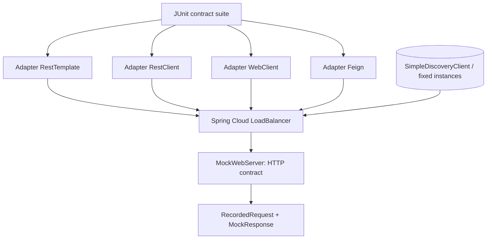
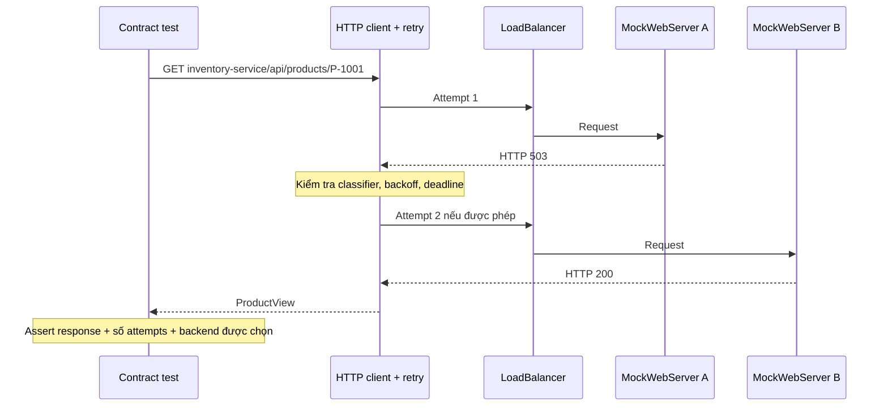
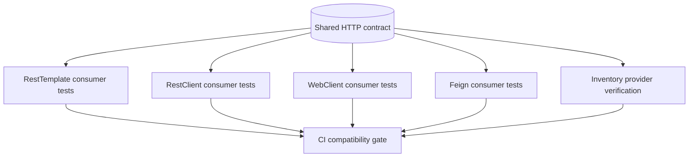

# Kiểm thử RestTemplate, RestClient, WebClient và Feign theo cùng hợp đồng

Trong hệ thống microservice, `order-service` có thể gọi `inventory-service` qua `RestTemplate`, `RestClient`, `WebClient` hoặc `OpenFeign`. Khi tích hợp Spring Cloud LoadBalancer, cả bốn cách đều có thể sử dụng **service ID logic** `inventory-service` để tìm một `ServiceInstance`, nhưng chúng khác nhau về cách dựng request, cách nhận response, xử lý lỗi và cơ chế thực thi đồng bộ/reactive.

Nếu mỗi nhóm viết test theo cách riêng, một client có thể thiếu header, encode path variable sai, tự động retry `POST` hoặc vô tình gọi hostname trực tiếp thay vì đi qua LoadBalancer. Để tránh điều đó, ta cần **một HTTP contract chung** và một bộ kiểm thử cho mọi implementation.

Bài thuộc chương **Kiểm thử tự động** của module Spring Cloud LoadBalancer. Mục tiêu là xây dựng test contract có thể tái sử dụng với **RestTemplate, RestClient, WebClient và Feign**; phân biệt test API semantics với test load balancing; dùng HTTP server giả lập thật, kiểm tra lỗi/retry/timeout và tránh các bài test không ổn định.

## 1. “Cùng hợp đồng” nghĩa là gì?

**Contract** là tập hành vi mà `inventory-service` hứa với caller, **không phụ thuộc thư viện Java ở caller**. Ví dụ:

| Điều kiện đầu vào | Hành vi HTTP được thỏa thuận | Điều cần kiểm chứng ở cả bốn client |
|---|---|---|
| `GET /api/products/P-1001` và header `X-Trace-Test: contract-42` | `200 OK`, `Content-Type: application/json`, body có `id` và `availableQuantity`. | URL/path, header gửi đi, status thành công và dữ liệu deserialize đúng. |
| `GET /api/products/missing` | `404 Not Found` với JSON lỗi có mã `PRODUCT_NOT_FOUND`. | Client **không biến 404 thành thành công**, giữ được mã HTTP/semantics. |
| Backend trả `503 Service Unavailable` | Lỗi tạm thời, theo chính sách retry được khai báo. | Không tự khẳng định retry nếu không có chính sách; đếm HTTP attempts thật. |
| API yêu cầu bearer token | Thiếu token → `401`; token thiếu quyền → `403`. | Gắn credential phù hợp, không truyền token sai audience/host. |
| Một instance unreachable | Request có thể lỗi connection hoặc được retry sang instance khác nếu bật retry-aware LoadBalancer. | Phân biệt **không tìm được instance** và **instance được chọn nhưng không kết nối được**. |

Đối tượng dữ liệu của ví dụ:

```json
{
  "id": "P-1001",
  "availableQuantity": 7
}
```

Ví dụ DTO Java 17+:

```java
public record ProductView(String id, int availableQuantity) {}
```

**Điểm quan trọng:** Contract chung quy định *cái gì* phải giống nhau. Không nên ép bốn thư viện ném **cùng một Java exception** hoặc dùng cùng cách lập lịch thread. Một `404` có thể xuất hiện dưới `HttpClientErrorException` (RestTemplate/RestClient), `WebClientResponseException` hoặc `FeignException`; test nên chuẩn hóa **HTTP status**, không ép tên exception.

## 2. Tách contract test khỏi các bài test riêng của HTTP transport

Một test suite tốt có ít nhất ba lớp:

| Lớp test | Đối tượng thật | Đối tượng thay thế | Chứng minh được gì? |
|---|---|---|---|
| **Unit/adapter test** | Code chuyển tham số, header, DTO và xử lý lỗi ở adapter. | HTTP exchange giả hoặc mock dependency. | Request mapping và phân loại lỗi cục bộ, chạy nhanh. |
| **HTTP contract integration test** | Bốn client thật, Jackson/codec, Spring Cloud LoadBalancer, discovery supplier. | Một/two HTTP servers điều khiển bằng `MockWebServer`. | Request thực qua TCP, service ID được resolve, method/path/header/body/status đúng. |
| **Resilience/topology test** | Client, LoadBalancer, retry/timeout/health/supplier theo cấu hình. | Backend giả lập lỗi, chậm, disconnect hoặc hai instance khác nhau. | Retry thực, chọn instance, timeout, số attempts và hành vi khi thiếu đích. |

Contract test **không thay thế** bài test về timeout, TLS, connection pool, caching hay distribution. Ngược lại, mock trực tiếp Java interface `InventoryFeignClient` chỉ kiểm tra tầng gọi interface, **không chứng minh** Feign đã gửi HTTP hay LoadBalancer đã chọn `ServiceInstance`.



Sơ đồ là kiến trúc kiểm thử chung: `MockWebServer` là HTTP server thật trên port động, **không phải** mock trực tiếp `ClientHttpConnector`, `ClientHttpRequestFactory` hay Feign interface.

## 3. Kiểm soát phiên bản và dependency trước khi viết test

Các client không xuất hiện ở mọi phiên bản framework:

- `RestTemplate`: HTTP client đồng bộ lâu đời của Spring Framework; vẫn hữu ích để kiểm thử hệ thống hiện hữu.
- `RestClient`: có từ **Spring Framework 6.1**, thông dụng với Spring Boot **3.2+**.
- `WebClient`: thuộc Spring WebFlux, sử dụng pipeline reactive và `Mono`/`Flux`.
- `OpenFeign`: tích hợp bằng Spring Cloud OpenFeign và `@FeignClient`.
- Spring Cloud LoadBalancer: phải có dependency và cấu hình tương thích để service ID được phân giải.

Ví dụ phần dependencies Maven; phiên bản thực tế phải được quản lý bởi Spring Boot/Cloud BOM tương thích và version `MockWebServer`/OkHttp phù hợp:

```xml
<dependencies>
    <dependency>
        <groupId>org.springframework.boot</groupId>
        <artifactId>spring-boot-starter-web</artifactId>
    </dependency>
    <dependency>
        <groupId>org.springframework.boot</groupId>
        <artifactId>spring-boot-starter-webflux</artifactId>
    </dependency>
    <dependency>
        <groupId>org.springframework.cloud</groupId>
        <artifactId>spring-cloud-starter-loadbalancer</artifactId>
    </dependency>
    <dependency>
        <groupId>org.springframework.cloud</groupId>
        <artifactId>spring-cloud-starter-openfeign</artifactId>
    </dependency>
    <dependency>
        <groupId>org.springframework.boot</groupId>
        <artifactId>spring-boot-starter-test</artifactId>
        <scope>test</scope>
    </dependency>
    <dependency>
        <groupId>io.projectreactor</groupId>
        <artifactId>reactor-test</artifactId>
        <scope>test</scope>
    </dependency>
    <dependency>
        <groupId>com.squareup.okhttp3</groupId>
        <artifactId>mockwebserver</artifactId>
        <scope>test</scope>
    </dependency>
</dependencies>
```

**Mục đích của ví dụ:** tập hợp bốn clients trong một module test để minh họa. Production thường **không cần mang cả MVC và WebFlux vào mọi service**. Chỉ thêm dependencies tương ứng với client cần test. Spring Boot có thể chọn servlet application type khi MVC và WebFlux cùng hiện diện; việc này không làm `WebClient` biến thành blocking, nhưng ảnh hưởng cấu hình application context. Dùng dependency management tương thích thay vì chọn ngẫu nhiên version của Feign, Reactor Netty hay OkHttp.

Nếu một artifact test không được BOM dự án quản lý, **khai báo phiên bản phù hợp có chủ đích** thay vì để một dependency không có version khiến build thất bại. Các đoạn test bên dưới giả định Java 17+, JUnit Jupiter, Jackson JSON và API `MockWebServer` kiểu `okhttp3.mockwebserver.MockWebServer` được dự án lựa chọn.

## 4. Khai báo bốn client với cùng service ID

Trong ứng dụng Spring Boot có LoadBalancer, đăng ký những beans HTTP client riêng:

```java
import org.springframework.cloud.client.loadbalancer.LoadBalanced;
import org.springframework.context.annotation.Bean;
import org.springframework.context.annotation.Configuration;
import org.springframework.web.client.RestClient;
import org.springframework.web.client.RestTemplate;
import org.springframework.web.reactive.function.client.WebClient;

@Configuration(proxyBeanMethods = false)
class InventoryHttpClientsConfig {

    @Bean
    @LoadBalanced
    RestTemplate inventoryRestTemplate() {
        return new RestTemplate();
    }

    @Bean
    @LoadBalanced
    RestClient.Builder inventoryRestClientBuilder() {
        return RestClient.builder();
    }

    @Bean
    @LoadBalanced
    WebClient.Builder inventoryWebClientBuilder() {
        return WebClient.builder();
    }
}
```

Feign dùng interface, không phải `RestClient.Builder`:

```java
import org.springframework.cloud.openfeign.FeignClient;
import org.springframework.web.bind.annotation.GetMapping;
import org.springframework.web.bind.annotation.PathVariable;
import org.springframework.web.bind.annotation.RequestHeader;

@FeignClient(name = "inventory-service")
public interface InventoryFeignClient {

    @GetMapping("/api/products/{id}")
    ProductView findProduct(
            @PathVariable("id") String productId,
            @RequestHeader("X-Trace-Test") String trace);
}
```

Application cần kích hoạt Feign client scanning, ví dụ `@EnableFeignClients(clients = InventoryFeignClient.class)`. Vì interface chỉ đặt `name`, không đặt `url` cố định, Feign có thể sử dụng service ID `inventory-service` khi Spring Cloud LoadBalancer hoạt động.

**Vì sao ví dụ dùng `RestClient.builder()` và `WebClient.builder()`?** Để minh họa marker `@LoadBalanced` trong một test tối giản. Trong hệ thống production, một builder được Spring Boot quản lý có thể mang codec, TLS, observation và timeout customizers; khi tự tạo builder, cần kiểm tra không mất những tùy chỉnh quan trọng. Test cũng phải sử dụng **cùng cách xây client như production** khi mục tiêu là kiểm chứng hành vi thật.

### Đừng nhầm logical URL với URL của server giả lập

Mọi client bên dưới sẽ gọi:

```text
http://inventory-service/api/products/P-1001
```

`inventory-service` là service ID, **không phải hostname `localhost` có thể DNS resolve**. `SimpleDiscoveryClient` trong test sẽ ánh xạ service ID thành URI của HTTP server giả lập, chẳng hạn `http://127.0.0.1:54721`. Nếu vô tình đổi client sang gọi trực tiếp URL server giả lập, test vẫn có thể qua nhưng **đã bỏ qua LoadBalancer**.

## 5. Thiết lập HTTP server giả lập với port động

`MockWebServer` từ OkHttp mockwebserver có thể trả HTTP response đã lập trình và lưu `RecordedRequest` để assert. Nó phù hợp contract integration test vì sử dụng HTTP thật ở loopback, nhưng không cần khởi động ứng dụng `inventory-service`.

Sử dụng `@DynamicPropertySource` để ánh xạ URI của server test vào `SimpleDiscoveryClient` **trước khi Spring tạo application context**:

```java
import java.io.IOException;
import okhttp3.mockwebserver.MockWebServer;
import org.junit.jupiter.api.AfterAll;
import org.springframework.test.context.DynamicPropertyRegistry;
import org.springframework.test.context.DynamicPropertySource;

// Phần trích từ lớp ProductContractIT.
static final MockWebServer backend = startBackend();

private static MockWebServer startBackend() {
    MockWebServer server = new MockWebServer();
    try {
        server.start(); // OS chọn port còn trống
        return server;
    } catch (IOException ex) {
        throw new ExceptionInInitializerError(ex);
    }
}

@DynamicPropertySource
static void registerInventoryInstance(DynamicPropertyRegistry registry) {
    registry.add(
            "spring.cloud.discovery.client.simple.instances.inventory-service[0].uri",
            () -> backend.url("/").toString());
}

@AfterAll
static void stopBackend() throws IOException {
    backend.shutdown();
}
```

**Không hard-code port** như `8081` trong test nếu test có thể chạy đồng thời trên CI. Port do OS cấp tránh đụng các service khác. `@DynamicPropertySource` phù hợp vì giá trị port chỉ biết lúc chạy. Server phải được start **trước** khi Spring binder lấy giá trị; khởi tạo static như trên xử lý điều đó.

Đây là **đoạn trích trong lớp test**, không phải một file Java đứng riêng. Phần tiếp theo kết hợp các thành phần thành contract suite. Trong dự án nhiều test classes, quản lý lifecycle server/context có chủ đích; không chia sẻ một HTTP server global giữa các test độc lập chạy song song.

## 6. Chuẩn hóa lời gọi của bốn client bằng test-only adapter

Một contract test **không cần sửa API production** chỉ để bốn client có cùng return type. Ta viết một adapter **chỉ dùng trong test**:

```java
record ClientCase(
        String name,
        java.util.function.Function<String, ProductView> readProduct) {}
```

Mỗi adapter nhận `productId` và trả `ProductView`, trong khi bốn implementation thực hiện HTTP theo cách riêng. Header `X-Trace-Test` sẽ được truyền giống nhau:

| Client | Cách tạo GET | Cách đọc JSON |
|---|---|---|
| RestTemplate | `exchange(..., HttpMethod.GET, HttpEntity, ...)` | `ResponseEntity<ProductView>.getBody()` |
| RestClient | `get().uri(...).header(...).retrieve()` | `body(ProductView.class)` |
| WebClient | `get().uri(...).header(...).retrieve()` | `bodyToMono(ProductView.class)` |
| OpenFeign | Gọi method Java với `@PathVariable`, `@RequestHeader` | Feign decoder trả `ProductView` |

**Vì sao test adapter của WebClient có thể `block()`?** Test chung được viết ở JUnit imperative test thread, không phải Reactor event-loop; dùng `block(Duration)` **chỉ tại ranh giới test adapter**, với thời hạn hữu hạn để test không treo. Trong code ứng dụng reactive, giữ `Mono`/`Flux` xuyên suốt và dùng `StepVerifier` cho những kiểm thử riêng.

Trong suite bên dưới, `client.readProduct().apply(id)` cho phép cùng một bộ assertions chạy cho cả bốn client. Khi cần test async cancellation, backpressure hoặc context propagation, đừng ép mọi case vào adapter blocking; bổ sung reactive-specific tests riêng.

## 7. Ví dụ integration test: một contract suite cho cả bốn client

Ví dụ sau sử dụng các classes `InventoryHttpClientsConfig`, `InventoryFeignClient` và `ProductView` đã khai báo ở phần trước. Đặt chúng trong package test/demo phù hợp. Nhánh `MockWebServer` dưới đây minh họa API phổ biến của OkHttp MockWebServer 4.x; nếu dự án dùng đời API khác, điều chỉnh artifact/import theo version đã khóa.

```java
import java.io.IOException;
import java.time.Duration;
import java.util.List;
import java.util.Objects;
import java.util.concurrent.TimeUnit;
import java.util.function.Function;

import feign.FeignException;
import okhttp3.mockwebserver.MockResponse;
import okhttp3.mockwebserver.MockWebServer;
import okhttp3.mockwebserver.RecordedRequest;
import org.junit.jupiter.api.AfterAll;
import org.junit.jupiter.api.Test;
import org.springframework.beans.factory.annotation.Autowired;
import org.springframework.boot.SpringBootConfiguration;
import org.springframework.boot.autoconfigure.EnableAutoConfiguration;
import org.springframework.boot.test.context.SpringBootTest;
import org.springframework.cloud.client.loadbalancer.LoadBalanced;
import org.springframework.cloud.openfeign.EnableFeignClients;
import org.springframework.context.annotation.Import;
import org.springframework.http.HttpEntity;
import org.springframework.http.HttpHeaders;
import org.springframework.http.HttpMethod;
import org.springframework.test.context.DynamicPropertyRegistry;
import org.springframework.test.context.DynamicPropertySource;
import org.springframework.web.client.RestClient;
import org.springframework.web.client.RestClientResponseException;
import org.springframework.web.client.RestTemplate;
import org.springframework.web.reactive.function.client.WebClient;
import org.springframework.web.reactive.function.client.WebClientResponseException;

import static org.junit.jupiter.api.Assertions.*;

@SpringBootTest(
        classes = ProductContractIT.TestApplication.class,
        webEnvironment = SpringBootTest.WebEnvironment.NONE)
class ProductContractIT {

    private static final String SERVICE_URL = "http://inventory-service";
    private static final String TRACE_VALUE = "contract-42";
    private static final String SUCCESS_JSON =
            "{\"id\":\"P-1001\",\"availableQuantity\":7}";

    private static final MockWebServer backend = startBackend();

    @Autowired
    @LoadBalanced
    RestTemplate restTemplate;

    @Autowired
    @LoadBalanced
    RestClient.Builder restClientBuilder;

    @Autowired
    @LoadBalanced
    WebClient.Builder webClientBuilder;

    @Autowired
    InventoryFeignClient feignClient;

    @SpringBootConfiguration
    @EnableAutoConfiguration
    @EnableFeignClients(clients = InventoryFeignClient.class)
    @Import(InventoryHttpClientsConfig.class)
    static class TestApplication {}

    private static MockWebServer startBackend() {
        MockWebServer server = new MockWebServer();
        try {
            server.start();
            return server;
        } catch (IOException ex) {
            throw new ExceptionInInitializerError(ex);
        }
    }

    @DynamicPropertySource
    static void instances(DynamicPropertyRegistry properties) {
        properties.add(
                "spring.cloud.discovery.client.simple.instances.inventory-service[0].uri",
                () -> backend.url("/").toString());
    }

    @AfterAll
    static void closeServer() throws IOException {
        backend.shutdown();
    }

    private List<ClientCase> clients() {
        RestClient restClient = restClientBuilder.clone()
                .baseUrl(SERVICE_URL)
                .build();
        WebClient webClient = webClientBuilder.clone()
                .baseUrl(SERVICE_URL)
                .build();

        return List.of(
                new ClientCase("RestTemplate", id -> {
                    HttpHeaders headers = new HttpHeaders();
                    headers.set("X-Trace-Test", TRACE_VALUE);
                    HttpEntity<Void> entity = new HttpEntity<>(headers);
                    return Objects.requireNonNull(
                            restTemplate.exchange(
                                    SERVICE_URL + "/api/products/{id}",
                                    HttpMethod.GET,
                                    entity,
                                    ProductView.class,
                                    id).getBody());
                }),
                new ClientCase("RestClient", id ->
                        Objects.requireNonNull(
                                restClient.get()
                                        .uri("/api/products/{id}", id)
                                        .header("X-Trace-Test", TRACE_VALUE)
                                        .retrieve()
                                        .body(ProductView.class))),
                new ClientCase("WebClient", id ->
                        Objects.requireNonNull(
                                webClient.get()
                                        .uri("/api/products/{id}", id)
                                        .header("X-Trace-Test", TRACE_VALUE)
                                        .retrieve()
                                        .bodyToMono(ProductView.class)
                                        .block(Duration.ofSeconds(3)))),
                new ClientCase("Feign", id ->
                        feignClient.findProduct(id, TRACE_VALUE))
        );
    }

    @Test
    void allClientsHonorSuccessContract() throws Exception {
        for (ClientCase client : clients()) {
            backend.enqueue(new MockResponse()
                    .setResponseCode(200)
                    .addHeader("Content-Type", "application/json")
                    .setBody(SUCCESS_JSON));

            ProductView result = client.readProduct().apply("P-1001");
            assertEquals("P-1001", result.id(), client.name());
            assertEquals(7, result.availableQuantity(), client.name());

            RecordedRequest actual = backend.takeRequest(
                    3, TimeUnit.SECONDS);
            assertNotNull(actual, client.name() + " did not reach backend");
            assertEquals("GET", actual.getMethod(), client.name());
            assertEquals("/api/products/P-1001",
                    actual.getPath(), client.name());
            assertEquals(TRACE_VALUE,
                    actual.getHeader("X-Trace-Test"), client.name());
        }
    }

    @Test
    void allClientsPreserveNotFoundSemantics() throws Exception {
        for (ClientCase client : clients()) {
            backend.enqueue(new MockResponse()
                    .setResponseCode(404)
                    .addHeader("Content-Type", "application/json")
                    .setBody("{\"code\":\"PRODUCT_NOT_FOUND\"}"));

            RuntimeException failure = assertThrows(
                    RuntimeException.class,
                    () -> client.readProduct().apply("missing"),
                    client.name());

            assertEquals(404, httpStatusOf(failure), client.name());

            RecordedRequest actual = backend.takeRequest(
                    3, TimeUnit.SECONDS);
            assertNotNull(actual);
            assertEquals("/api/products/missing", actual.getPath());
        }
    }

    private static int httpStatusOf(RuntimeException error) {
        if (error instanceof RestClientResponseException ex) {
            return ex.getStatusCode().value();
        }
        if (error instanceof WebClientResponseException ex) {
            return ex.getStatusCode().value();
        }
        if (error instanceof FeignException ex) {
            return ex.status();
        }
        throw new AssertionError("Unexpected client error type: " + error);
    }

    private record ClientCase(
            String name, Function<String, ProductView> readProduct) {}
}
```

**Điểm cần nắm:** Các import và classes nằm ngoài snippet (`InventoryHttpClientsConfig`, `InventoryFeignClient`, `ProductView`) đã có ở các phần trước, nên ghép chúng thành các Java files cùng package. `MockWebServer` không cần được đưa vào Spring context dưới dạng bean; chỉ cần URL của nó được đăng ký thành một `ServiceInstance` tĩnh.

### Vì sao `httpStatusOf` cần ba nhánh?

RestTemplate và RestClient thường đưa `4xx` vào họ `RestClientResponseException`; WebClient dùng `WebClientResponseException`; Feign dùng `FeignException`. Test quy đổi về `404`, chính là **HTTP contract**. Nếu dự án có `ErrorDecoder` hoặc exception translator riêng, adapter contract nên quy đổi tiếp sang loại lỗi nghiệp vụ chung như `ProductNotFound`, rồi assert trên nó thay vì khóa cứng mọi client vào exception mặc định.

### Một giới hạn cần ghi rõ

Test trên **giả định retry cho status `404` bị vô hiệu hóa**, và tất cả clients đang dùng HTTP transport/configuration dự kiến. Nếu transport hoặc custom filter thực hiện retry không mong muốn, request count không còn 1:1; hãy xác nhận chính sách trước khi dùng kết quả để kết luận đúng/sai.

Vì server và context được chia sẻ trong class, không chạy các test methods của class này song song nếu vẫn sử dụng FIFO `enqueue()/takeRequest()`. Khi suite lớn, nên tách queue/server theo test case hoặc dùng dispatcher gắn response với path/request ID để tránh các tests giành response của nhau.

## 8. Tiêu chí kiểm thử chung phải nằm ở cả request và response

Contract test dễ mắc lỗi **chỉ kiểm tra body** và bỏ qua đường request:

```java
assertEquals("P-1001", result.id()); // Chưa đủ để khẳng định client đúng.
```

Một test đầy đủ cần kiểm tra:

- HTTP method được chọn (`GET`, `POST`, ...).
- Path đúng template, path variable đã encode theo hợp đồng.
- Query params và header bắt buộc, ví dụ `X-Trace-Test`.
- `Content-Type` và `Accept` khi contract yêu cầu.
- JSON body trả về deserialize đúng field và kiểu dữ liệu.
- Semantics của HTTP status, kể cả lỗi `404`/`400`/`503`.
- **Request thật tới mock backend** qua service ID, không chỉ gọi Java method.

Nếu API có `POST` hoặc `PUT`, cần thêm body schema, charset, số lượng request thật và idempotency. Đối với token, kiểm tra **sự hiện diện và phạm vi sử dụng header** bằng token giả kiểm soát được; không đưa bearer token production vào log `RecordedRequest`, ảnh snapshot hoặc console CI.

## 9. Hợp đồng lỗi và HTTP client exception khác nhau

Không nên chỉ assert loại exception:

```text
RestTemplate/RestClient -> RestClientResponseException (thường cho 4xx/5xx)
WebClient               -> WebClientResponseException (khi retrieve() nhận 4xx/5xx)
OpenFeign               -> FeignException (theo ErrorDecoder mặc định)
```

Với `WebClient`, `exchangeToMono` có thể được dùng để tự quyết định cách xử lý status; lúc đó `404` **không nhất thiết trở thành exception**. Với Feign, `ErrorDecoder` tùy chỉnh cũng có thể ánh xạ `404` sang domain exception. Điều cần giữ nhất quán là một **contract nghiệp vụ**:

```java
public sealed interface ProductResult {
    record Found(ProductView value) implements ProductResult {}
    record Missing(String productId) implements ProductResult {}
    record Unavailable(String reason) implements ProductResult {}
}
```

Tầng adapter có thể map `200` → `Found`, `404` → `Missing`, `503` hoặc lỗi mạng → `Unavailable`. Đó là lựa chọn của ứng dụng, **không phải hành vi tự động của bốn HTTP clients**. Khi muốn test adapter, assert cùng domain result; khi muốn test transport, giữ lại các lỗi nguyên gốc để phân biệt connect, read timeout và no-instance.

## 10. Kiểm thử WebClient theo reactive contract với StepVerifier

Trong contract integration suite ở phần 7, ta dùng `block(Duration)` để đưa kết quả về dạng đồng bộ nhằm so sánh với ba client khác. Nhưng `WebClient` vẫn có những tính chất **chỉ test reactive mới nhìn thấy**: publisher được thực thi khi subscribe, phát một kết quả/hoàn tất/error, cancellation và timeout của Reactor pipeline.

Ví dụ bổ sung trong `ProductContractIT`:

```java
import reactor.test.StepVerifier;

@Test
void webClientCompletesReactiveContract() throws Exception {
    backend.enqueue(new MockResponse()
            .setResponseCode(200)
            .addHeader("Content-Type", "application/json")
            .setBody(SUCCESS_JSON));

    WebClient client = webClientBuilder.clone()
            .baseUrl(SERVICE_URL)
            .build();

    Mono<ProductView> response = client.get()
            .uri("/api/products/{id}", "P-1001")
            .header("X-Trace-Test", TRACE_VALUE)
            .retrieve()
            .bodyToMono(ProductView.class);

    StepVerifier.create(response)
            .assertNext(product -> {
                assertEquals("P-1001", product.id());
                assertEquals(7, product.availableQuantity());
            })
            .expectComplete()
            .verify(Duration.ofSeconds(3));

    RecordedRequest actual = backend.takeRequest(3, TimeUnit.SECONDS);
    assertNotNull(actual);
    assertEquals("/api/products/P-1001", actual.getPath());
}
```

Ví dụ cần import thêm `reactor.core.publisher.Mono` và các imports trong lớp test trước. Dùng timeout cho `verify(...)` để tránh test treo khi mock backend hoặc Reactor scheduler có lỗi.

### Một publisher được tạo chưa có nghĩa HTTP đã được gửi

`Mono` trả về từ `bodyToMono(...)` thường **lazy**: request thực diễn ra khi subscribe. Nếu chỉ assert publisher không null hoặc tạo publisher rồi kết thúc test, ta chưa test HTTP gì cả.

Không dùng `Thread.sleep()` để “đợi HTTP hoàn tất” trong test reactive. `StepVerifier` định nghĩa signal mong đợi và giới hạn thời gian kiểm chứng rõ hơn. Để test timeout theo **virtual time**, cần phân biệt timeout do Reactor scheduler với **timeout ở socket/transport**: `withVirtualTime` chỉ giúp những operator sử dụng scheduler có thể điều khiển, không giả lập được TCP thật hoặc DNS timeout.

### Hành vi cancel và stream

Với `Flux`/SSE, test nên kiểm tra số items, completion hoặc cancellation:

```java
StepVerifier.create(streamingClient.getEvents())
        .expectNextCount(3)
        .thenCancel()
        .verify(Duration.ofSeconds(3));
```

`streamingClient` là gateway giả định. Test này minh họa cách xác minh contract của **stream đang mở**, không phải test chức năng `getProduct`. Cancellation phía client không bảo đảm backend đã dừng xử lý ngay; nếu có HTTP resources phải kiểm tra lifecycle và metrics của connector.

## 11. Unit test bằng MockRestServiceServer: hữu ích nhưng không chứng minh LoadBalancer

Với `RestTemplate`, Spring Test hỗ trợ `MockRestServiceServer` để kiểm tra cách dựng HTTP request **không cần socket thật**:

```java
import org.junit.jupiter.api.Test;
import org.springframework.http.HttpMethod;
import org.springframework.http.MediaType;
import org.springframework.test.web.client.MockRestServiceServer;
import org.springframework.web.client.RestTemplate;

import static org.springframework.test.web.client.match.MockRestRequestMatchers.*;
import static org.springframework.test.web.client.response.MockRestResponseCreators.*;

@Test
void restTemplateMapsPathAndJson() {
    RestTemplate template = new RestTemplate(); // standalone, không có LB
    MockRestServiceServer server = MockRestServiceServer
            .bindTo(template)
            .build();

    server.expect(requestTo("http://example.test/api/products/P-1001"))
            .andExpect(method(HttpMethod.GET))
            .andRespond(withSuccess(
                    "{\"id\":\"P-1001\",\"availableQuantity\":7}",
                    MediaType.APPLICATION_JSON));

    ProductView result = template.getForObject(
            "http://example.test/api/products/{id}",
            ProductView.class, "P-1001");

    assertEquals("P-1001", result.id());
    server.verify();
}
```

Với `RestClient`, các phiên bản Spring Framework hỗ trợ `MockRestServiceServer.bindTo(RestClient.Builder)` cũng có thể viết test tương tự:

```java
RestClient.Builder builder = RestClient.builder();
MockRestServiceServer server = MockRestServiceServer
        .bindTo(builder)
        .build();

server.expect(requestTo("http://example.test/api/products/P-1001"))
        .andRespond(withSuccess(
                "{\"id\":\"P-1001\",\"availableQuantity\":7}",
                MediaType.APPLICATION_JSON));

ProductView result = builder.build().get()
        .uri("http://example.test/api/products/{id}", "P-1001")
        .retrieve()
        .body(ProductView.class);

server.verify();
```

**Phạm vi đúng của test này:** kiểm tra URI expansion, mapping và response decoding của client. `MockRestServiceServer` chặn request ở test exchange/request factory, vì vậy **không chứng minh** network/TCP thực, service discovery, số instance hoặc thuật toán LoadBalancer. Muốn chứng minh `http://inventory-service` được rewrite đúng thành URI backend, phải có integration test qua real HTTP server như phần 7.

Tương tự:

- Mock `ExchangeFunction` của WebClient có thể xác minh filter/headers và body mapping, nhưng chưa đủ bằng chứng cho HTTP transport.
- Mock trực tiếp `InventoryFeignClient` có thể test logic `OrderService`, nhưng không test Feign encoder/decoder, `RequestInterceptor` hay load-balancing wrapper.
- `WebTestClient` chủ yếu phục vụ kiểm thử HTTP **server** hoặc WebFlux handler; không tự thay thế test outbound client qua LoadBalancer.

## 12. Kiểm thử hai ServiceInstance: chọn đích thật, không chỉ một mock server

Một contract test với **một instance** chứng minh service ID có thể được phân giải tới HTTP backend, nhưng **chưa chứng minh cân bằng tải giữa nhiều instance**. Cần một suite riêng với hai `MockWebServer` trên hai port động:

```text
inventory-service
   ├─ instance A -> MockWebServer A -> body {"instance":"inventory-a"}
   └─ instance B -> MockWebServer B -> body {"instance":"inventory-b"}
```

Trong một test class **riêng**, đăng ký hai URI:

```java
@DynamicPropertySource
static void registerTwoInstances(DynamicPropertyRegistry registry) {
    registry.add(
            "spring.cloud.discovery.client.simple.instances.inventory-service[0].uri",
            () -> inventoryA.url("/").toString());
    registry.add(
            "spring.cloud.discovery.client.simple.instances.inventory-service[1].uri",
            () -> inventoryB.url("/").toString());
}
```

`inventoryA` và `inventoryB` là hai `MockWebServer` đã start trước khi Spring context khởi tạo. Trong loop gửi 10–20 GET tuần tự:

1. Enqueue đủ số `200` ở **mỗi backend** (hoặc dùng dispatcher trả response theo request mà không cần FIFO).
2. Gửi request bằng một client `@LoadBalanced` đến **service ID** `inventory-service`.
3. Ghi `RecordedRequest` và đếm requests của mỗi backend.
4. Nếu thuật toán được cố định là round robin, xác minh **cả hai instance** đã được sử dụng mà không áp đặt thứ tự tuyệt đối.
5. Đọc `instance` trong response để phân biệt backend, không tin chỉ dựa vào dữ liệu response giống hệt nhau.

Ví dụ assertion sau phần phát requests:

```java
assertTrue(inventoryA.getRequestCount() > 0,
        "No requests reached inventory A");
assertTrue(inventoryB.getRequestCount() > 0,
        "No requests reached inventory B");
```

**Không dùng assertion này với thuật toán random nếu số samples quá nhỏ**: có thể tình cờ chọn một instance nhiều lần. Khi muốn xác minh chính xác chính sách chọn đích, cố định algorithm/supplier và thiết lập bài test riêng cho `RoundRobinLoadBalancer` hoặc thuật toán custom.

### Điều không nên assert

Không viết test phụ thuộc vào `A → B → A → B` nếu thứ tự không được đảm bảo bởi cấu hình, concurrent scheduling, trạng thái counter hay cache. Cũng không suy một instance đang down là “test pass vì mọi request tự chuyển sang B” nếu chưa bật retry/health filtering phù hợp.

Nếu có circuit breaker theo service ID, hãy chú ý trạng thái breaker có thể ảnh hưởng cả hai instance trong test; reset hoặc tách test context để tránh trạng thái test trước làm thay đổi bài test sau.

## 13. Kiểm thử lỗi khi không có instance khác với lỗi kết nối

Hai tình huống nhìn giống nhau ở UI nhưng khác cơ chế:

**Trường hợp A — Discovery không có `ServiceInstance`**

```text
Client -> LoadBalancer -> supplier = []
                     -> không có endpoint được chọn
                     -> lỗi/no-instance response theo từng integration
```

**Trường hợp B — Discovery có instance, nhưng endpoint không reachable**

```text
Client -> LoadBalancer -> inventory-1:8081
                     -> TCP connect/HTTP transport thất bại
                     -> connection exception hoặc retry theo policy
```

Viết hai bài test riêng, mỗi bài có context/supplier được điều khiển:

- A: supplier trả danh sách rỗng, assert **không có HTTP request tới mock backend**, xác nhận error class/response của client integration hiện tại.
- B: supplier trả một endpoint test bị đóng hoặc proxy mô phỏng lỗi, assert client đã cố gọi đích được chọn và lỗi thuộc nhóm transport (hoặc được recovery theo retry policy).

Không assert mặc định **mọi client đều nhận HTTP 503** khi không có instance: blocking/reactive LoadBalancer integrations có thể xử lý khác nhau, và custom error mapping của ứng dụng có thể biến lỗi thành domain exception. Chỉ assert một hình thức status/exception cụ thể sau khi đã **định nghĩa nó thành contract ở tầng adapter**.

### Đừng dùng cổng không có listener để test connect timeout

Một port không có process lắng nghe có thể trả `Connection refused` ngay, **không phải** `connect timeout`. Nếu cần mô phỏng kết nối treo, dùng fault proxy hoặc network simulation trong môi trường test được kiểm soát; đặt deadline test để tránh CI bị treo. Không phụ thuộc vào một IP tùy ý trên Internet để tạo timeout.

## 14. Kiểm thử HTTP 503, retry và số request thật

Retry thường là tính năng tùy chọn và có thể xuất hiện ở nhiều tầng:

- HTTP transport (Apache HC5, OkHttp, JDK).
- Spring Cloud LoadBalancer retry-aware wrapper/filter.
- Reactor `retryWhen`, Spring Retry hoặc Resilience4j ở tầng nghiệp vụ.
- Feign `Retryer` (trong nhiều dòng Spring Cloud OpenFeign có `Retryer.NEVER_RETRY` mặc định).

Để kiểm tra retry, không nên chỉ assert client cuối cùng trả `200`: cần đếm **HTTP attempts thực sự đến backend**.



Đây là **kịch bản có điều kiện**: retry-on-next-instance chỉ xảy ra khi phiên bản, dependency, supplier và chính sách cho phép. Không mặc định mỗi `503` sẽ retry, cũng không đảm bảo attempt thứ hai luôn chọn instance khác.

Trong test riêng:

1. Cố định policy retry tối đa một lượt cho **GET idempotent**.
2. Backend giả lập trả `503` ở lần đầu, `200` ở lần tiếp theo.
3. Assert body kết quả và số `RecordedRequest` đúng policy.
4. Assert trace ID/correlation header được giữ nhất quán giữa attempts.
5. Nếu muốn test đổi instance, dùng hai backend và quan sát nơi mỗi attempt đến.
6. Thử lại với `400` hoặc `401` để xác nhận classifier **không retry** khi không có lý do.

Không viết test mặc định yêu cầu `POST` được retry sau response timeout khi chưa có idempotency-key/deduplication ở backend. Một request ghi có thể đã commit dù caller chỉ thấy timeout.

### Test retry phải tách khỏi common contract suite

Suite `200/404` chung nên chạy với cấu hình retry được kiểm soát để một request logic chỉ tương ứng một HTTP request khi đó là kỳ vọng. Bài kiểm tra retry nên dùng cấu hình riêng, vì RestTemplate, RestClient, WebClient và Feign **không có chính sách retry mặc định giống hệt nhau**, và HTTP transport có thể phục hồi một số kết nối ở mức thấp.

## 15. Kiểm thử timeout và response chậm theo đúng tầng

Một HTTP request có thể chờ ở nhiều pha khác nhau:

```text
Service discovery -> chọn instance
  -> pending acquire từ connection pool
  -> TCP connect / TLS handshake
  -> chờ response headers
  -> đọc body / stream
  -> decode và xử lý kết quả
```

Vì vậy, “timeout sau 1 giây” chưa đủ là một contract thống nhất cho mọi HTTP client. RestTemplate/RestClient có thể dùng socket read timeout theo request factory; WebClient có connector response timeout hoặc Reactor `timeout`; Feign có `connectTimeout` và `readTimeout` với behavior của transport hiện tại.

`MockWebServer` có thể tạo response chậm **có kiểm soát**:

```java
backend.enqueue(new MockResponse()
        .setResponseCode(200)
        .addHeader("Content-Type", "application/json")
        .setHeadersDelay(2, TimeUnit.SECONDS)
        .setBody("{\"id\":\"P-1001\",\"availableQuantity\":7}"));
```

Ở đây server chờ trước khi gửi **response headers**. Với timeout đọc/chờ response ngắn hơn 2 giây, test có thể quan sát exception tương ứng; nhưng chính xác loại lỗi/giới hạn thời gian phụ thuộc HTTP engine và cấu hình. Đoạn này **không mô phỏng TCP connect timeout**.

Ví dụ nếu cần giới hạn **toàn bộ reactive operation** (bao gồm phần pipeline nằm trong `timeout`), có thể test:

```java
Mono<ProductView> response = webClient.get()
        .uri("/api/products/{id}", "P-1001")
        .retrieve()
        .bodyToMono(ProductView.class)
        .timeout(Duration.ofMillis(500));

StepVerifier.create(response)
        .expectError(java.util.concurrent.TimeoutException.class)
        .verify(Duration.ofSeconds(3));
```

Đây là **test Reactor overall timeout** tại vị trí operator được đặt, không chứng minh `Reactor Netty HttpClient.responseTimeout(...)` hoặc TLS handshake timeout. Trong dự án thật, hãy cấu hình transport timeout và test riêng khi cần chứng minh chính xác semantics của nó.

### Vì sao không assert chính xác 500 ms?

CI có thể chịu pause GC, scheduler contention hoặc latency ngoài ý muốn. Thay vì `assertEquals(500, elapsedMs)`, nên:

- Dùng deadline test đủ rộng để tránh treo.
- Assert đúng loại outcome và số attempts khi cần.
- Đặt chênh lệch rõ giữa server delay (2 s) và timeout cấu hình (500 ms).
- Nếu thật sự cần kiểm tra timing, dùng khoảng tolerance hợp lý, không yêu cầu chính xác đến milli giây.

Đối với **connect timeout**, dùng fault proxy/mạng test có kiểm soát; không nhầm `Connection refused` từ cổng đóng với TCP SYN bị drop. Với **pool acquisition timeout**, tạo concurrency vượt hạn mức trong test integration riêng và theo dõi pending/leased connection; không dùng một request đơn để kết luận pool đã bão hòa.

## 16. Kiểm thử lỗi transport mà không làm giả status HTTP

Lỗi HTTP `503` là một **response có status**; TCP disconnect là lỗi **không nhất thiết có HTTP response**. Bộ test cần tách hai trường hợp:

```java
import okhttp3.mockwebserver.SocketPolicy;

backend.enqueue(new MockResponse()
        .setSocketPolicy(SocketPolicy.DISCONNECT_AT_START));
```

Trong API `MockWebServer` phù hợp, policy này giúp mô phỏng một kết nối bị đóng ở phía server. **Exception được ném có thể khác nhau** giữa RestTemplate, RestClient, WebClient và Feign, tùy retry nội bộ, keep-alive, protocol và transport. Không assert cùng một tên exception cho tất cả.

Một test không có retry có thể assert:

1. Caller không nhận một `ProductView` hợp lệ.
2. Error được phân loại là lỗi transport (hoặc domain error tương ứng).
3. Nếu transport tự retry, quan sát và ghi nhận số attempts thật; không nhầm thành backend trả `503`.
4. Thời hạn test hữu hạn, socket/MockWebServer được dọn sau test.

### Ma trận các lỗi cần cố ý tạo

| Lỗi mô phỏng | Công cụ/cách tạo | Kết luận mong muốn |
|---|---|---|
| `404`, `503`, `429` | `MockResponse.setResponseCode(...)`. | Test mapping HTTP status, error body, retry classifier. |
| Response headers đến muộn | `setHeadersDelay(...)`. | Test response/read hoặc Reactor overall timeout tùy cấu hình. |
| Body gửi chậm/ngắt quãng | MockWebServer body delay hoặc dispatcher streaming. | Test read inactivity, decoder, cancellation. |
| Disconnect/reset | `SocketPolicy` hoặc fault proxy. | Test transport failure và recovery, không phải HTTP status. |
| Không có ServiceInstance | Fixed supplier/empty discovery profile. | Test no-instance behavior trước khi TCP được gửi. |
| Instance có URI sai | Supplier trả backend không nghe cổng. | Test connect/refused/timeout theo fault thực. |
| Backend A lỗi, backend B khỏe | Hai MockWebServer, retry policy rõ. | Test lựa chọn instance và số attempts. |
| Token thiếu hoặc scope sai | Resource server test/HTTP stub kiểm tra header và policy. | Test client authentication/authorization contract. |

Không trộn các dạng fault trong cùng một test nếu mục tiêu là xác định nguyên nhân cụ thể.

## 17. Kiểm thử header xác thực và định tuyến an toàn

Với các API bảo vệ bằng OAuth2, “cùng contract” có thể bao gồm:

- Bearer access token được gắn vào **đúng service ID**.
- `401` khi thiếu token và `403` khi token thiếu quyền.
- Không vô tình chuyển token của `inventory-service` tới một URL ngoài tập cho phép.
- Token relay dùng đúng request/user context; `client_credentials` dùng service identity.
- Retry không làm mất `Authorization` hoặc thêm token người dùng khác trong attempt tiếp theo.

Ví dụ với mock token **giả**, test có thể assert request header:

```java
RecordedRequest actual = backend.takeRequest(3, TimeUnit.SECONDS);
assertNotNull(actual);
assertEquals("Bearer test-token-for-inventory",
        actual.getHeader("Authorization"));
```

Test này chỉ chứng minh header đã được gửi. Nó **không chứng minh JWT hợp lệ**, audience/scope đúng hoặc server thực sự kiểm tra quyền. Muốn kiểm tra authorization, phải test cả `inventory-service` dưới vai trò Resource Server với token được ký bởi test issuer/keys phù hợp hoặc một môi trường OAuth2 test; không xem một MockWebServer trả 200 là bằng chứng xác thực.

**Không lưu/ghi** access token thật, client secret hoặc header nhạy cảm vào test snapshot, console CI, HTTP wiretap. `MockWebServer RecordedRequest` có thể chứa header đầy đủ trong bộ nhớ; hạn chế ghi toàn bộ đối tượng vào log và dọn server sau test.

## 18. Test consumer và provider để tránh “stub đúng nhưng API thật sai”

Một hạn chế của `MockWebServer`: ta có thể lập trình **bất kỳ response nào**, kể cả response không hề được `inventory-service` thật cung cấp. Khi đó consumer test xanh nhưng production vẫn lỗi vì API contract đã thay đổi.

Nên có **hai phía kiểm chứng**:

1. **Consumer contract tests:** bốn HTTP clients ở `order-service` gửi request và xử lý response theo cùng contract artifact/fixtures.
2. **Provider verification:** ứng dụng `inventory-service` thực sự xử lý các request/response scenarios đó với schema, status, header và authorization tương ứng.

Có thể lưu hợp đồng dưới dạng OpenAPI schema, JSON examples có kiểm tra schema, hoặc contract artifacts qua Spring Cloud Contract/Pact tùy nền tảng. Nếu dùng Spring Cloud Contract, consumer stubs và provider verification phải cùng xuất phát từ contract được quản lý/version; tránh tự viết bốn mock bodies giống nhau nhưng không có provider test.



**Đừng nhầm shared contract với shared implementation.** Các clients có thể dùng API khác nhau, nhưng tất cả phải thỏa cùng tiêu chuẩn request/response. Provider verification xác minh backend thực; LoadBalancer integration tests xác minh service ID resolution; cả hai là những bằng chứng bổ sung cho nhau.

### Contract versioning

Khi provider đổi JSON field từ `availableQuantity` thành `stockOnHand` hoặc đổi status `404` thành `200` body rỗng, consumer tests phải phát hiện tương thích bị phá. Nếu provider thêm field JSON mới và client được phép bỏ qua unknown fields theo chính sách serialization, đó có thể là thay đổi backward-compatible; nhưng phải test với ObjectMapper/config thực tế thay vì giả định tất cả decoders giống nhau.

Những thay đổi về pagination, auth scope, default headers, enum values và redirect handling cũng là phần của contract khi caller phụ thuộc vào chúng.

## 19. Tránh flaky tests khi chạy CI

Flaky test thường đến từ **tài nguyên và thời gian không được cô lập**, chứ không phải Spring Cloud LoadBalancer hoạt động ngẫu nhiên:

| Nguyên nhân | Biểu hiện | Cách xử lý |
|---|---|---|
| Port cố định như 8081 đã bị chiếm | CI lỗi bind không đều. | Sử dụng `MockWebServer.start()` với port 0/dynamic. |
| Dùng chung `MockWebServer` và `enqueue` giữa tests chạy song song | Response của test A bị test B tiêu thụ. | Chạy tuần tự hoặc server/dispatcher độc lập cho từng case. |
| Spring Test context cache còn giá trị dynamic property cũ | Test mới trỏ sang port của server đã shutdown. | Dùng test application/context được phân tách; khi cần, `@DirtiesContext` và lifecycle rõ. |
| Assert round robin A-B-A-B tuyệt đối | Khác counter/supplier state/scheduling. | Cố định algorithm và assert property cần thiết; dùng test thuật toán riêng. |
| `Thread.sleep(...)` để đợi async call | CI nhanh/chậm khác nhau. | Dùng `StepVerifier`, `takeRequest(timeout)` hoặc condition polling có deadline. |
| Timeout threshold sát server delay | Hôm chạy nhanh hôm chạy chậm. | Tạo khoảng cách đáng kể, tolerance và overall test deadline. |
| Retry/connection pool/health cache tồn tại giữa tests | Request count hoặc selected instance không như kỳ vọng. | Tách context, reset state hoặc dùng fixture độc lập. |
| Feign/WebClient dùng proxy hoặc client custom ngoài dự kiến | Mock server không nhận request. | Kiểm tra effective beans, Feign delegate và connector thực. |
| Test gọi hệ thống OAuth2/registry thật | Lỗi do mạng hoặc dependency bên ngoài. | Dùng test issuer/registry stub cho contract suite; giữ smoke tests thật tách riêng. |

### Tổ chức fixture cho concurrency

Nếu suite sử dụng `@ParameterizedTest` hoặc `@TestFactory`, hãy bảo đảm mỗi test case có quyền sở hữu response queue. Một loop tuần tự như phần 7 đơn giản và dễ hiểu, nhưng khi case đầu fail, loop có thể dừng trước các clients khác. Khi cần báo cáo từng client độc lập, hãy chạy **bốn test cases riêng** với server/fixture riêng, hoặc dispatcher ánh xạ request ID sang response, tránh trạng thái FIFO chia sẻ.

### Dọn resource

Sau test, đóng `MockWebServer`, không để JVM giữ socket; nếu tự tạo `ConnectionProvider` của Reactor Netty hoặc Apache connection manager, quản lý đúng lifecycle của provider. Không tự dispose HTTP resources toàn ứng dụng mà Spring Boot đang sở hữu khi test class khác còn dùng chung context.

## 20. Kết hợp log, metrics và assertions để biết request đi đâu

Khi test về Spring Cloud LoadBalancer fail, cần xác định ít nhất ba sự kiện:

1. **Client đã tạo logical request chưa?** Có URL, method, headers, body đúng không?
2. **LoadBalancer đã chọn instance nào?** Supplier có instance hợp lệ không, có sử dụng service ID không?
3. **HTTP server giả lập đã nhận attempt thật chưa?** `RecordedRequest` có path/header đúng và có bao nhiêu requests?

Với fault injection, còn ghi:

- Connection acquisition và connect/read/response timeout nếu connector cho phép.
- Số attempts sau retry, instance được chọn từng attempt.
- HTTP status do backend trả hay exception xảy ra trước khi có HTTP response.
- Logical latency so với per-attempt latency.
- Trạng thái discovery/health/caching nếu instance bị thêm/bớt.

Một log **minh họa**:

```text
traceId=contract-42
clientType=WebClient
serviceId=inventory-service
selectedInstance=inventory-test-1
attempt=1
method=GET
path=/api/products/P-1001
httpStatus=200
outcome=SUCCESS
```

Không phải toàn bộ fields trên được Spring Cloud LoadBalancer tự log mặc định; cần instrument đúng tầng hoặc lấy thông tin qua test fixture. Đừng đưa Authorization header, raw bearer token hoặc dữ liệu nhạy cảm vào log CI.

### Những metrics không nên dùng để chứng minh contract một mình

- `http.client.requests` thành công có thể chỉ cho biết “có outbound request”, không khẳng định path variable/header đúng.
- Một histogram latency không chứng minh request đi qua LoadBalancer.
- Một status `200` không chứng minh instance nào trả response nếu tất cả backend có cùng body.
- Số request đến mock server tăng không chứng minh thuật toán đã chọn đúng khi có proxy/ngữ cảnh nhiều instance.

Test contract cần **assertions trên RecordedRequest và response**; metrics/tracing chỉ cung cấp góc nhìn bổ sung cho lỗi không ổn định và các pha transport.

## 21. Ma trận test tối thiểu cho bốn HTTP clients

Một ma trận test nên được dùng như tiêu chí chấp nhận thay vì viết bốn suites độc lập tùy tiện:

| Scenario | RestTemplate | RestClient | WebClient | OpenFeign |
|---|:---:|:---:|:---:|:---:|
| GET thành công, decode `ProductView` | ✓ | ✓ | ✓ | ✓ |
| Path variable, method và custom header đúng | ✓ | ✓ | ✓ | ✓ |
| `404` được quy đổi thành semantics thống nhất | ✓ | ✓ | ✓ | ✓ |
| `400`/`503` và error body theo API contract | ✓ | ✓ | ✓ | ✓ |
| `http://inventory-service` thực sự resolve qua LoadBalancer | ✓ | ✓ | ✓ | ✓ |
| Không có instance: lỗi được phân loại, không gửi HTTP | ✓ | ✓ | ✓ | ✓ |
| Hai instance: xác minh có routing tới nhiều backend | ✓ | ✓ | ✓ | ✓ |
| Timeout response/chờ body theo HTTP engine | ✓ | ✓ | ✓ | ✓ |
| Retry chỉ xảy ra với lỗi được phép và trong budget | ✓ | ✓ | ✓ | ✓ |
| OAuth2/Authorization theo contract (nếu endpoint protected) | ✓ | ✓ | ✓ | ✓ |
| Publisher lazy, completion, cancellation | — | — | ✓ | — |
| Blocking thread/executor behavior | ✓ | ✓ | Kiểm thử riêng khi dùng blocking bridge | ✓ |

**Dấu ✓ nghĩa là phải thiết kế test phù hợp**, không có nghĩa cùng đoạn test chạy trực tiếp với mọi client mà không cần adapter/fixture. Với retry, timeout, TLS hoặc pool, **mỗi client có transport implementation riêng** nên test cả effective configuration — không chỉ dùng một timeout value chung rồi cho rằng behavior là tương đương.

### Thứ tự chạy trong CI

Một cách tổ chức:

```text
1. Unit tests: DTO, path/header, error translator, domain adapter
2. Consumer contract tests: 4 clients + MockWebServer + 1 instance
3. LoadBalancer tests: 2 instances, no-instance, supplier/health/cache
4. Resilience tests: 503, disconnect, retry, deadlines, pool saturation
5. Provider contract verification: inventory-service thực thi đúng API
6. Smoke tests ở môi trường kiểm thử: discovery, TLS, auth, real network path
```

Không bắt unit/contract suite luôn phải gọi Eureka, Kubernetes hay Authorization Server thật: điều đó làm test chậm và không ổn định. Các smoke tests thật có giá trị nhưng nên tách khỏi contract tests deterministic. Bài test provider có thể chạy độc lập với client implementation khi contract artifact đã được version hóa.

## 22. Thực hành mở rộng và câu hỏi tự kiểm chứng

Sau khi hoàn thành suite `200/404` cơ bản, thử từng bài tập theo thứ tự:

1. **Thêm query parameter:** `GET /api/products/{id}?includeAvailability=true`. Cập nhật contract fixture và cả bốn adapters, assert path/query sau khi encode; tránh so sánh URL string thô nếu thứ tự query params không thuộc contract.
2. **Thêm error body có mã ổn định:** `{"code":"PRODUCT_NOT_FOUND"}`. Tạo error translator cho cả bốn clients, viết test chung cho domain exception `ProductNotFound`.
3. **Thêm `POST` có JSON body:** ghi nhận body ở `RecordedRequest` và kiểm tra Content-Type, schema và idempotency key. Không cấu hình retry tự động cho POST trước khi có hợp đồng deduplication.
4. **Hai instance có response khác nhau:** kiểm tra selected backend IDs và riêng một test cho thuật toán round robin. Không phụ thuộc vào response queue chung giữa các tests chạy song song.
5. **Một backend bị rút khỏi supplier:** phân biệt behavior discovery/cache với việc đóng socket của backend. Nếu `SimpleDiscoveryClient` là static, cần test harness điều khiển supplier thay vì kỳ vọng nó tự deregister.
6. **Lỗi response và retry:** backend trả `503` rồi `200`; ghi tổng requests thực, attempts và latency. Thử lại với `401`/`400` phải không retry trừ khi contract quy định khác.
7. **Timeout trước response headers:** dùng `setHeadersDelay`; thử transport timeout và overall deadline riêng. Với WebClient, bổ sung `StepVerifier`.
8. **Token relay:** xác minh header gắn theo đúng request, không rò token user A sang user B khi chạy concurrent tests; dùng credentials giả.

**Câu hỏi kiểm tra tư duy:**

- Nếu một test dùng `MockRestServiceServer` và URL `http://inventory-service`, tại sao chưa thể kết luận LoadBalancer đã chọn đúng `ServiceInstance`?
- Khi RestClient báo `HttpClientErrorException.NotFound` còn Feign báo `FeignException.NotFound`, contract có bị phá không?
- Vì sao một MockWebServer duy nhất chứng minh resolve service ID nhưng chưa chứng minh distribution giữa hai instance?
- Khi backend trả `503` sau hai HTTP attempts, một test chỉ assert response cuối có thể bỏ sót lỗi gì?
- Vì sao ngắt `localhost:8081` không phải là cách chắc chắn để mô phỏng **TCP connect timeout**?
- Khi dùng `@DynamicPropertySource` với port động, tại sao phải quan tâm Spring Test context caching và lifecycle backend?

## 23. Checklist hoàn thành và những lỗi cần tránh

- [ ] Hợp đồng HTTP có method, path/query, headers, response schema và status/error semantics rõ ràng.
- [ ] DTO và serialization config được dùng tương đương giữa các clients, hoặc khác biệt được thể hiện thành contract.
- [ ] Bốn client được cấu hình đúng: `@LoadBalanced RestTemplate`, `@LoadBalanced RestClient.Builder`, `@LoadBalanced WebClient.Builder` và `@FeignClient(name=...)`.
- [ ] Feign không bị ép URL cố định nếu mục tiêu là kiểm thử discovery/service ID.
- [ ] Có `spring-cloud-starter-loadbalancer` và nguồn `ServiceInstance` được điều khiển trong test.
- [ ] Spring Boot/Cloud, Feign, Reactor Netty/OkHttp và MockWebServer có phiên bản tương thích.
- [ ] Dùng port động; Spring context nhận URI mock backend qua `@DynamicPropertySource` trước khi khởi tạo.
- [ ] Test assert **RecordedRequest** (method, path, headers) và **response** (status/body), không chỉ một phía.
- [ ] Contract chung normalize status hoặc domain error, **không ép bốn client ném cùng Java exception**.
- [ ] Test suite 200/404 không bị ảnh hưởng bởi retry/timeout ngoài ý muốn.
- [ ] Các bài test retry đếm attempts thật và phân biệt retry transport/LoadBalancer/tầng nghiệp vụ.
- [ ] Có bài test no-instance riêng với bài test endpoint unreachable.
- [ ] Có bài test hai instance và thuật toán định tuyến tách khỏi contract cơ bản.
- [ ] WebClient có `StepVerifier`/publisher tests riêng; `block(Duration)` chỉ dùng tại test adapter imperative khi cần.
- [ ] Không dùng `Thread.sleep()` tùy tiện hoặc assert thời gian chính xác từng millisecond.
- [ ] Không kết luận `MockRestServiceServer`/mock Feign interface đã kiểm thử TCP hoặc LoadBalancer.
- [ ] Fault injection, timeout, HTTP 503, TLS/auth và health checks được kiểm tra trong suites riêng.
- [ ] Consumer stub được đồng bộ với provider verification hoặc contract artifact versioned.
- [ ] MockWebServer queue, Spring context, connection pool và retry state được cô lập giữa tests.
- [ ] Không ghi token, client secret hoặc dữ liệu nhạy cảm vào `RecordedRequest` dumps/CI logs.
- [ ] Chạy kiểm tra trên CI ở môi trường phù hợp và theo dõi flaky tests, không đánh đồng một lần xanh với khả năng chịu lỗi production.

**Kết luận:** Một bộ **HTTP contract chung** giúp `RestTemplate`, `RestClient`, `WebClient` và `OpenFeign` cung cấp cùng hành vi nghiệp vụ dù khác API, threading model và cách biểu diễn lỗi. Với Spring Cloud LoadBalancer, hãy kiểm thử đồng thời **URL logic theo service ID**, **lời gọi HTTP thật đến `ServiceInstance` giả lập** và **request/response contract**. `MockWebServer` cùng `@DynamicPropertySource` giúp tạo integration tests deterministic; `StepVerifier` kiểm tra semantics reactive; còn các suites riêng về retry, timeout, health, token và nhiều instance bảo đảm những khác biệt vận hành không bị che giấu. Consumer tests chỉ thực sự đáng tin khi được đối chiếu với **provider contract verification** và cấu hình HTTP clients thực tế.
