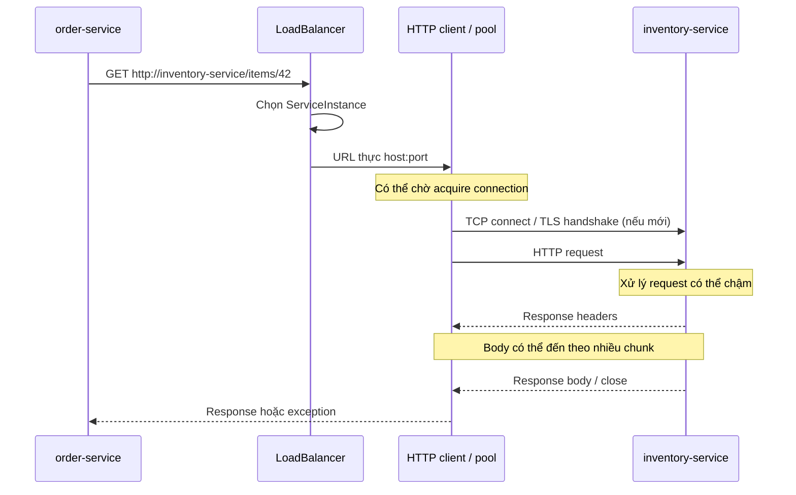
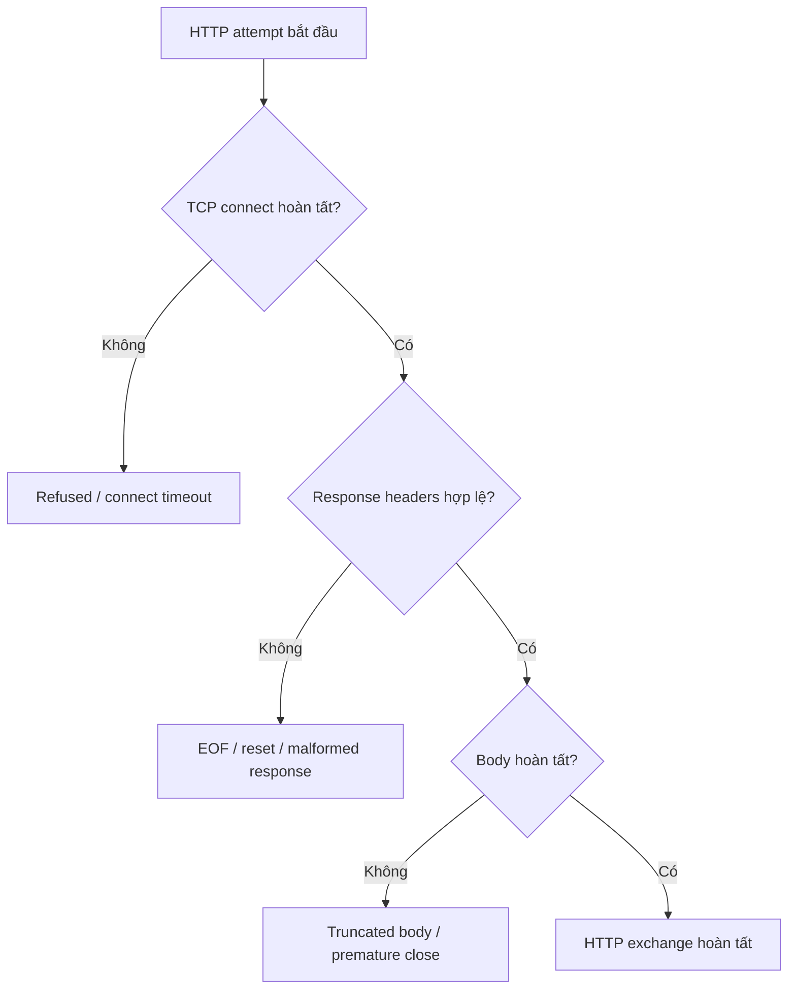
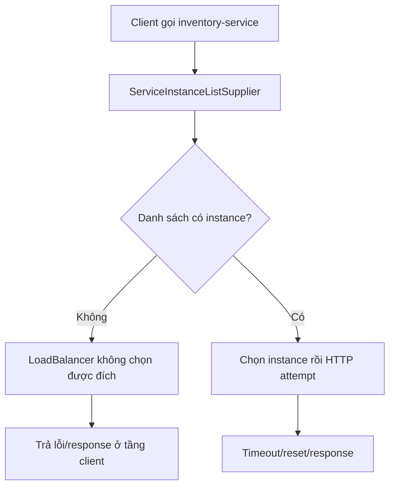
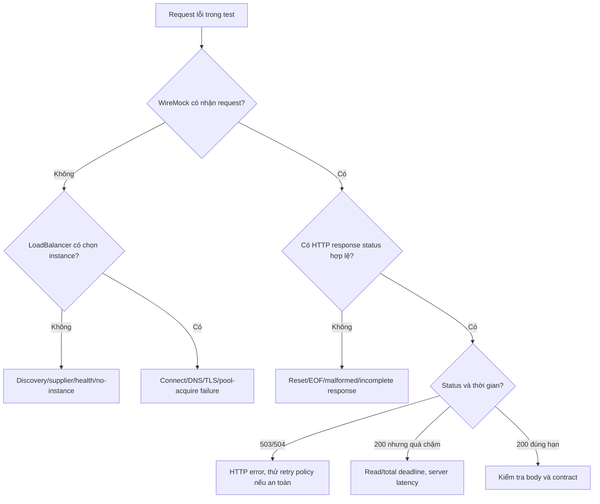

# Kiểm thử timeout, kết nối bị ngắt và phản hồi chậm

Một ứng dụng dùng Spring Cloud LoadBalancer có thể gọi `http://inventory-service` theo service ID và chọn nhiều `ServiceInstance` qua discovery. Luồng giao tiếp vẫn có thể thất bại dù thuật toán round-robin hoạt động đúng: kết nối không thiết lập được, một socket đang mở bị đóng, backend trả lời chậm hoặc một proxy ngắt kết nối giữa lúc đọc response. **Bài kiểm thử chỉ xác nhận HTTP 200 trong điều kiện bình thường không đủ để chứng minh ứng dụng chịu lỗi ổn định.**

Bài học thuộc chương **Kiểm thử tự động** của module **Spring Cloud Service Communication Load Balancing**, tập trung vào **kiểm thử timeout, kết nối bị ngắt và phản hồi chậm** cho `RestClient`, `WebClient` và những điểm cần lưu ý với OpenFeign. Mục tiêu là tạo lỗi có kiểm soát, chứng minh đường đi qua LoadBalancer, đo số HTTP attempts, xác nhận timeout/retry hợp lý và phát hiện lỗi làm cạn thread hoặc connection pool. Tất cả ví dụ sử dụng backend stub trong môi trường test; không gửi traffic gây lỗi vào production.

## 1. Ba loại lỗi chính không thể dùng một test thay cho nhau

| Loại lỗi | Thời điểm lỗi | Biểu hiện thường gặp | Điều quan trọng cần khẳng định |
|---|---|---|---|
| **Connect timeout** | Khi TCP connection mới chưa thiết lập xong trong thời hạn | Connect timeout / wrapped I/O exception | Client không giữ tài nguyên chờ quá lâu; không nhầm với lỗi sau khi đã connect |
| **Connection refused** | Hệ điều hành đích từ chối kết nối, ví dụ không có process lắng nghe | `ConnectException: Connection refused` | Thường là lỗi **nhanh**, không phải cứ refused là timeout |
| **Connection reset/đóng đột ngột** | Socket đã hoặc đang dùng bị peer/proxy đóng trước khi nhận response hoàn chỉnh | `Connection reset`, premature close, EOF | Không có response HTTP hợp lệ; retry chỉ khi operation an toàn |
| **Chậm response headers** | Kết nối thành công, server giữ request trước khi gửi headers | Read/response timeout | Thời gian connect không cho biết thời gian phục vụ |
| **Body gửi chậm/từng phần** | Headers đến kịp nhưng các chunk xuất hiện chậm | Timeout giữa các chunk hoặc tổng download quá lâu | Phân biệt **idle/read timeout** với **total deadline** |
| **HTTP 503/504** | Backend/proxy trả response HTTP lỗi có status hợp lệ | `WebClientResponseException`, `HttpServerErrorException` | Đây là **HTTP response**, không phải socket reset |
| **Không có instance** | LoadBalancer không tìm được `ServiceInstance` trước khi gửi request | Lỗi chọn đích hoặc response do client/integration tạo | Không phải lỗi kết nối tới một IP cụ thể |

Đặc biệt, test server trả chậm `2s` chỉ mô phỏng **response chậm**, vì kết nối TCP thường đã được thiết lập ngay. Dùng nó để khẳng định `connectTimeout=500ms` hoạt động là một kết luận sai.

### 1.1. Các mốc thời gian phải phân biệt



Một request tổng thể có thể gồm nhiều thành phần:

\[
T_{\text{end-to-end}} \approx T_{\text{LB}} + T_{\text{pool-acquire}} +
T_{\text{connect/TLS}} + T_{\text{request}} +
T_{\text{server-wait}} + T_{\text{body}}
\]

Đây là mô hình chẩn đoán, **không** phải công thức mọi transport tự đo và xuất ra. Tùy connection reuse, `T_connect` có thể bằng 0 cho request đang dùng socket cũ. Với retry, toàn bộ chuỗi có thể lặp lại cho nhiều attempts.

### 1.2. Mỗi bài test cần một giả thuyết rõ ràng

Ví dụ thay vì viết test tên `shouldTimeout`, hãy đặc tả:

> “Khi cả hai instance kết nối thành công nhưng đều giữ response headers 1.200 ms, `WebClient` cấu hình response timeout 300 ms phải kết thúc bằng lỗi trong deadline test; mỗi attempt có thể được server ghi nhận và không có body thành công.”

Một test khác cho connection reset sẽ yêu cầu **exception ở tầng transport**, không phải chỉ assert HTTP `503`. Một test retry sẽ đếm attempts, không chỉ kiểm tra kết quả cuối là 200.

## 2. Chọn tầng kiểm thử phù hợp

| Tầng | Công cụ/mô hình | Nên kiểm tra | Không đủ để chứng minh |
|---|---|---|---|
| Unit test | Mockito/fake `ExchangeFunction`, fake `ServiceInstanceListSupplier` | Error mapping, policy, logic chọn instance, predicate retry | TCP reset, pool, TLS và timeout của socket thật |
| Client integration test | WireMock 3, HTTP stub server, WebTestClient/StepVerifier | Delayed headers/body, HTTP status, malformed response, một số socket faults | Mọi hành vi kernel/proxy trên môi trường production |
| LoadBalancer integration test | Hai server stub + `SimpleDiscoveryClient` | Service ID routing, failover/attempt count, không có instance | Service discovery thực đang hội tụ trong cluster |
| Network fault test | Proxy có kiểm soát, container network fault injection | SYN drop, latency, packet loss, half-open connection, proxy idle close | Các chính sách nghiệp vụ như idempotency nếu không có assertions |
| End-to-end/chaos test | Staging giống topology production | Timeouts qua gateway/mesh, graceful shutdown, p99 dưới tải | Tính quyết định tuyệt đối nếu thiếu môi trường cô lập |

**Quy tắc:** dùng fake để thử quyết định logic; dùng HTTP server thật để thử HTTP behavior; dùng network fault injection khi cần mô phỏng **đúng tầng TCP**. Không viết một mock trả `Mono.error(new TimeoutException())` rồi tuyên bố đã kiểm thử connect timeout của Reactor Netty.

### 2.1. Tại sao cần hai backend stub?

Spring Cloud LoadBalancer chọn `ServiceInstance` theo **service ID**. Để xem retry có chọn lại instance không, ít nhất hai endpoint giúp quan sát hành vi:

```text
Caller: GET http://inventory-service/api/items/42
  LoadBalancer chọn:
  - inventory-a -> http://127.0.0.1:18081
  - inventory-b -> http://127.0.0.1:18082

Stub A: có thể trì hoãn, reset hoặc trả 503
Stub B: có thể trả 200, cũng có thể chậm
```

Hai server cần có access log hoặc request journal để trả lời: **server nào nhận request, bao nhiêu lần, trước/sau retry?** Không suy ra thứ tự A rồi B từ code test, vì round-robin có state và các test khác có thể làm thay đổi bộ đếm.

### 2.2. Tắt retry khi lấy baseline

Trước khi kiểm thử timeout hoặc reset **của một attempt**, tắt retry ở những tầng đang được cấu hình:

```yaml
spring:
  cloud:
    loadbalancer:
      retry:
        enabled: false
```

Với `WebClient`, kiểm tra có `retryWhen` tại application/filter hay không. Với OpenFeign, kiểm tra `Retryer` đang được sử dụng; Spring Cloud OpenFeign mặc định tạo `Retryer.NEVER_RETRY` ở lớp Feign, **nhưng không khẳng định tầng khác không retry**. Gateway/mesh/HTTP transport cũng có thể có chính sách retry độc lập.

Mọi so sánh `elapsed time` hoặc request count chỉ có ý nghĩa khi biết số attempts.

## 3. Công cụ dựng môi trường: WireMock 3 và cổng động

WireMock hỗ trợ mô phỏng **HTTP status, fixed/random delays, chunked dribble** và một số socket faults. Trong thực hành này dùng **WireMock 3.x**, JUnit 5 và Spring Boot Test. Cần những test dependencies phù hợp, ví dụ `wiremock`/`wiremock-standalone` của phiên bản WireMock 3 dùng trong dự án, cùng `spring-boot-starter-test`; không tùy ý kéo hai artifact WireMock xung đột phiên bản.

Ví dụ Maven minh họa (quản lý phiên bản qua BOM hoặc `dependencyManagement`):

```xml
<dependency>
    <groupId>org.springframework.boot</groupId>
    <artifactId>spring-boot-starter-test</artifactId>
    <scope>test</scope>
</dependency>
<dependency>
    <groupId>org.wiremock</groupId>
    <artifactId>wiremock</artifactId>
    <scope>test</scope>
</dependency>
```

Tùy release train, cần `spring-cloud-starter-loadbalancer`, Spring WebFlux cho `WebClient` và `reactor-test` cho `StepVerifier`. Test integration có HTTP client thật khác với `WebTestClient.bindToController(...)`: bind trực tiếp controller không đi qua TCP và **không kiểm tra outbound LoadBalancer**.

### 3.1. Mẫu khởi tạo hai server và cấu hình SimpleDiscoveryClient

```java
// Các import @SpringBootTest, @DynamicPropertySource,
// DynamicPropertyRegistry, WireMockServer và static WireMock helpers
// được lược bớt để tập trung vào cấu trúc test.

@SpringBootTest
class InventoryFaultIntegrationTest {

    static final WireMockServer instanceA =
            new WireMockServer(wireMockConfig().dynamicPort());

    static final WireMockServer instanceB =
            new WireMockServer(wireMockConfig().dynamicPort());

    static {
        instanceA.start();
        instanceB.start();
    }

    @DynamicPropertySource
    static void discovery(DynamicPropertyRegistry registry) {
        registry.add(
                "spring.cloud.discovery.client.simple.instances.inventory-service[0].uri",
                instanceA::baseUrl);
        registry.add(
                "spring.cloud.discovery.client.simple.instances.inventory-service[1].uri",
                instanceB::baseUrl);
        registry.add("spring.cloud.loadbalancer.retry.enabled", () -> false);
    }

    @AfterEach
    void resetStubs() {
        instanceA.resetAll();
        instanceB.resetAll();
    }

    @AfterAll
    static void stopStubs() {
        instanceA.stop();
        instanceB.stop();
    }
}
```

**Ý nghĩa:**

- `dynamicPort()` không phụ thuộc cổng cố định trên máy developer/CI.
- Hai server được start trước khi Spring context đọc dynamic properties.
- `SimpleDiscoveryClient` nhận hai URI trong danh sách instance của `inventory-service`.
- `retry.enabled=false` tạo baseline một attempt trên đường LB phù hợp.
- `resetAll()` xóa stub mappings và journal state giữa các test. Đối với scenario state, cần thiết lập lại đầy đủ trước mỗi case.

Đây là **khung test** cần mở rộng bằng Spring Boot application/test configuration và HTTP client bean thực tế; nó chưa phải integration test tự chạy độc lập. Với dự án có thêm Eureka/Consul trên classpath, phải kiểm tra `ServiceInstanceListSupplier` nào đang trả danh sách: không giả định `SimpleDiscoveryClient` luôn thắng mọi nguồn khác.

Nếu cần nhiều test contexts khác nhau về discovery list, tránh thay dynamic property khi context đã được tạo rồi mong child LoadBalancer context tự cập nhật. Dùng các context cô lập hoặc một supplier test có khả năng cập nhật snapshot, tùy mục đích.

## 4. Cấu hình WebClient thật cho test response timeout

Để kiểm thử timeout ở tầng HTTP client, dùng `WebClient` thực sự nối tới Reactor Netty và LoadBalancer, không fake HTTP exchange.

```java
@TestConfiguration(proxyBeanMethods = false)
class FaultClientTestConfiguration {

    @Bean
    @LoadBalanced
    WebClient.Builder faultTestingWebClientBuilder() {
        HttpClient httpClient = HttpClient.create()
                .option(ChannelOption.CONNECT_TIMEOUT_MILLIS, 250)
                .responseTimeout(Duration.ofMillis(300));

        return WebClient.builder()
                .clientConnector(
                        new ReactorClientHttpConnector(httpClient));
    }

    @Bean
    WebClient inventoryTestWebClient(
            @LoadBalanced WebClient.Builder builder) {
        return builder
                .baseUrl("http://inventory-service")
                .build();
    }
}
```

Trong `@SpringBootTest`, có thể dùng `@Import(FaultClientTestConfiguration.class)` và inject `WebClient inventoryTestWebClient`. Các class cần import gồm `io.netty.channel.ChannelOption`, `reactor.netty.http.client.HttpClient`, `ReactorClientHttpConnector`, `WebClient` và `@LoadBalanced`. Nếu ứng dụng đã có `WebClient.Builder` beans, hãy dùng qualifier riêng để tránh ambiguity và đảm bảo context đang test là context được instrument/định tuyến đúng.

**Các giới hạn không được trộn:**

- `CONNECT_TIMEOUT_MILLIS = 250`: dành cho quá trình **thiết lập TCP connection** mới.
- `responseTimeout(300ms)`: giới hạn **response/read wait theo semantics Reactor Netty**, không phải timeout cho toàn bộ một logical operation có nhiều retries.
- `Mono.timeout(...)`: giới hạn thời gian chờ của **publisher theo vị trí operator**, có thể bao gồm pool acquire, connect, response, retry và backoff tùy nơi đặt.
- Pending-acquire timeout của connection pool là một thời hạn khác, cần cấu hình `ConnectionProvider` nếu muốn kiểm thử nó riêng.

Cấu hình quá nhỏ trên máy CI thiếu tài nguyên có thể gây lỗi giả. Chọn các mốc đủ xa nhau và test timeout bằng bất đẳng thức/ràng buộc hợp lý, không so mili giây chính xác với đồng hồ hệ điều hành.

## 5. Test phản hồi chậm trước headers

Trường hợp đơn giản và có thể tái lập: client kết nối được, server nhận request, giữ response **1.200 ms**; client chỉ chờ response 300 ms.

### 5.1. WireMock fixed delay cho cả hai instance

```java
@BeforeEach
void prepareSlowResponse() {
    instanceA.stubFor(get(urlEqualTo("/api/items/42"))
            .willReturn(aResponse()
                    .withStatus(200)
                    .withHeader("Content-Type", "application/json")
                    .withBody("{\"id\":42}")
                    .withFixedDelay(1200)));

    instanceB.stubFor(get(urlEqualTo("/api/items/42"))
            .willReturn(aResponse()
                    .withStatus(200)
                    .withHeader("Content-Type", "application/json")
                    .withBody("{\"id\":42}")
                    .withFixedDelay(1200)));
}
```

**Tại sao cấu hình cả hai?** Nếu chỉ A chậm mà round-robin chọn B nhanh, test timeout có thể pass/fail phụ thuộc state chọn instance. Khi đang kiểm thử riêng **response timeout**, hãy cho mọi ứng viên cùng một hành vi lỗi hoặc cố định supplier một instance.

### 5.2. Test với StepVerifier

```java
@Autowired
WebClient inventoryTestWebClient;

@Test
void slowHeadersMustFailInsteadOfWaitingForever() {
    Mono<String> request = inventoryTestWebClient.get()
            .uri("/api/items/42")
            .retrieve()
            .bodyToMono(String.class);

    StepVerifier.create(request)
            .expectError()
            .verify(Duration.ofSeconds(3));

    await().atMost(Duration.ofSeconds(3)).untilAsserted(() -> {
        int received = instanceA.findAll(getRequestedFor(
                urlEqualTo("/api/items/42"))).size()
                + instanceB.findAll(getRequestedFor(
                urlEqualTo("/api/items/42"))).size();
        assertEquals(1, received); // Với retry thật sự đã tắt.
    });
}
```

Ví dụ sử dụng `reactor-test`, JUnit 5 và Awaitility (`org.awaitility.Awaitility.await`, cần dependency test phù hợp). `verify(Duration.ofSeconds(3))` là **deadline bảo vệ chính bài test**, không phải deadline transport: client vẫn cần response timeout 300 ms. Với một số thứ tự/lúc lỗi, journal của stub có thể cập nhật muộn; `await().atMost(...)` giúp quan sát nhật ký có giới hạn thời gian, không dùng `Thread.sleep` tùy tiện rồi đoán lúc server đã hoàn tất.

**Không assert chính xác thời gian 300 ms ± 1 ms.** Scheduler, GC, hệ điều hành, CI và kết nối đầu tiên có overhead. Điều cốt lõi là request không chờ đến 1.200 ms rồi được coi là thành công, không bị treo vô hạn, và số attempts trong baseline đúng chính sách.

### 5.3. Assert loại exception ở đâu?

Với `WebClient.retrieve()`, một HTTP response status 503 hợp lệ thường được chuyển thành `WebClientResponseException`. Lỗi I/O/timeout của Reactor Netty thường được bọc thành `WebClientRequestException` với một nguyên nhân sâu hơn như Netty `ReadTimeoutException`. Nhưng đường exception chính xác còn tùy connector và release train.

**Test mạnh:** kiểm tra phân nhóm **HTTP status error** vs **transport error**, không so sánh toàn bộ chuỗi message tiếng Anh hoặc chi tiết stack trace có thể thay đổi theo JDK/OS.

## 6. Chậm khi trả body: test khác chậm trước headers

Server có thể gửi HTTP 200 và headers nhanh, sau đó gửi body rất chậm. Đây là một lỗi quan trọng vì **đã có status 200 không có nghĩa download thành công**.

### 6.1. WireMock chunked dribble

```java
instanceA.stubFor(get(urlEqualTo("/api/stream"))
        .willReturn(aResponse()
                .withStatus(200)
                .withBody("0123456789".repeat(100))
                .withChunkedDribbleDelay(20, 2000)));
```

Trong ví dụ 20 chunks/2 giây, mỗi khoảng giữa chunks xấp xỉ 100 ms, **ngắn hơn response timeout 300 ms** đã cấu hình, dù tổng download có thể mất gần 2 giây. Vì vậy, test kết thúc theo **tổng deadline** cần một phép đo khác:

```java
Mono<String> body = inventoryTestWebClient.get()
        .uri("/api/stream")
        .retrieve()
        .bodyToMono(String.class)
        .timeout(Duration.ofMillis(1000));

StepVerifier.create(body)
        .expectError(TimeoutException.class)
        .verify(Duration.ofSeconds(3));
```

Để test deterministic trên hai instance, cả A và B phải có stub giống nhau hoặc supplier phải cố định một instance. `TimeoutException` ở đây là exception từ operator Reactor `timeout`, khác với lỗi transport `ReadTimeoutException`.

**Hai kỳ vọng khác nhau:**

- **Read/response timeout:** thời gian không nhận dữ liệu vượt ngưỡng theo transport semantics.
- **Total deadline:** toàn bộ pipeline cần hoàn tất trước một thời hạn tuyệt đối; body gửi nhỏ giọt liên tục vẫn phải được dừng khi vượt deadline.

Nếu response chứa binary/file lớn, không dùng `bodyToMono(byte[].class)` cho production. Test phù hợp hơn là đọc `Flux<DataBuffer>`/download tới tệp tạm với giới hạn byte và kiểm tra cleanup khi timeout.

### 6.2. Test hủy subscription

```java
StepVerifier.create(
        inventoryTestWebClient.get()
                .uri("/api/stream")
                .retrieve()
                .bodyToFlux(DataBuffer.class))
        .thenCancel()
        .verify();
```

`thenCancel()` chỉ kiểm tra pipeline phản ứng với cancellation ở mức Reactor theo cách test. Để xác minh **socket/connection pool không rò rỉ**, cần tiếp tục đo pool active/pending và thực hiện nhiều request sau cancel. Với pooled `DataBuffer`, test custom operator phải đảm bảo release/discard theo contract; không tự gọi `release` trên buffer đang được downstream sử dụng.

### 6.3. Virtual time không thay đổi đồng hồ của WireMock

`StepVerifier.withVirtualTime` chỉ kiểm soát các **Reactor schedulers/operators** được thiết lập đúng để dùng virtual scheduler. Nó **không** khiến WireMock fixed delay, TCP socket, DNS, kernel connect timeout hoặc Netty transport timeout tự trôi theo thời gian ảo.

Dùng virtual time cho unit test `Mono.delay`, retry backoff và state machine reactive; dùng integration test thật với deadline rộng, local stub và metrics cho thời gian HTTP thực. Không trộn hai loại rồi kỳ vọng `thenAwait(Duration.ofSeconds(10))` làm server hoàn tất 10 giây xử lý mạng trong vài microseconds.

## 7. Kết nối bị ngắt: phân biệt HTTP fault và TCP fault

Một backend có thể ngắt connection trước headers, ngay sau headers hoặc giữa response body. Những điểm đóng khác nhau sẽ tạo exception và ảnh hưởng retry khác nhau.



### 7.1. WireMock faults

WireMock cung cấp các fault modes:

| Fault | Mô phỏng | Ghi chú |
|---|---|---|
| `Fault.EMPTY_RESPONSE` | Đóng/trả response rỗng, không có HTTP response hợp lệ | Có thể gây EOF hoặc lỗi protocol |
| `Fault.MALFORMED_RESPONSE_CHUNK` | Headers rồi nội dung không hợp lệ/đóng | Dùng để kiểm tra decoder/transport error |
| `Fault.RANDOM_DATA_THEN_CLOSE` | Gửi dữ liệu không hợp lệ trước khi đóng | Kiểm tra phản ứng client với malformed HTTP |
| `Fault.CONNECTION_RESET_BY_PEER` | Cố đóng socket bằng RST | **Không ổn định giữa OS**; trên Windows có thể treo thay vì reset |

Ví dụ:

```java
instanceA.stubFor(get(urlEqualTo("/api/items/42"))
        .willReturn(aResponse()
                .withFault(Fault.EMPTY_RESPONSE)));

instanceB.stubFor(get(urlEqualTo("/api/items/42"))
        .willReturn(aResponse()
                .withFault(Fault.EMPTY_RESPONSE)));
```

Sau đó gửi GET và kiểm tra **transport error**, không chờ `WebClientResponseException` có status HTTP 503. Muốn xác nhận test không treo trong một môi trường OS cụ thể, đặt deadline của verifier.

### 7.2. Tại sao không nhất quyết assert “Connection reset by peer”?

WireMock tài liệu hóa `CONNECTION_RESET_BY_PEER` qua cách đóng socket phụ thuộc OS; trên một số hệ điều hành (đặc biệt Windows), reset có thể không xuất hiện như trên Unix/Linux. Reactor Netty, Apache HttpClient, OkHttp hoặc JDK HttpClient cũng có thể bọc lỗi dưới class khác.

Một test portable thường assert:

1. HTTP call **thất bại**.
2. Lỗi thuộc **transport/protocol failure**, không phải HTTP 4xx/5xx response.
3. Không vượt deadline test.
4. Không lặp vô hạn nếu retry đã tắt.
5. Client vẫn có thể thực hiện request **tiếp theo** khi stub phục hồi.

Nếu yêu cầu đúng socket RST behavior, chạy test riêng trong môi trường Linux/container được kiểm soát với proxy/socket fault injection, và ghi rõ assumptions.

### 7.3. Connection refused khác reset và timeout

Để mô phỏng **connection refused**, dừng một stub hoặc chọn một port cục bộ chắc chắn không có listener, rồi gửi request tới đúng endpoint đó. Client thường thất bại nhanh vì hệ điều hành từ chối kết nối.

**Không dùng việc dừng một trong hai instance rồi mặc định lần gọi sẽ lỗi:** LoadBalancer có thể chọn instance còn sống. Để kiểm tra một destination cụ thể, dùng client direct tới `localhost:port` đó hoặc một test context chỉ có một `ServiceInstance`. Sau đó tách bài test selection/failover của LoadBalancer ở một scenario khác.

**Lưu ý:** server ngừng nhận connection sau khi client đã kết nối có thể gây reset/premature close, không nhất thiết `Connection refused`. Hãy mô tả điểm cấy lỗi đúng với assertion.

## 8. Test connect timeout: phải kiểm soát TCP handshake

`withFixedDelay` của WireMock làm server **trì hoãn HTTP response**, không chặn SYN/SYN-ACK. Vì vậy, một test nhằm chứng minh `connectTimeout` cần lỗi ở pha **thiết lập socket**.

Các lựa chọn:

- **Network fault injection trong container/staging** để DROP SYN hoặc tạo blackhole có kiểm soát, đảm bảo kết nối không lập xong.
- **Proxy/transport mô phỏng** có khả năng trì hoãn chính TCP connect, không chỉ trì hoãn kết nối từ proxy tới upstream sau khi client đã connect proxy.
- **Unit-level transport test** dùng fake connector để xác minh config/exception handling, và tách khỏi bài test TCP thật.
- Một IP chưa route/không tồn tại **không phải giả lập chắc chắn**: nhiều hệ thống trả lỗi `Network unreachable` ngay thay vì chờ connect timeout.

```text
Thử nghiệm cần chứng minh:
T0    client bắt đầu TCP connect mới
T1    SYN không nhận được SYN-ACK trong ngân sách
T2    transport báo connect timeout
T3    caller trả lỗi hoặc retry có giới hạn

Không chấp nhận:
T0    client connect thành công tới WireMock
T1    WireMock sleep 2 giây trước headers
T2    client read timeout
=> rồi báo là connect timeout đã được test.
```

Nếu dùng Toxiproxy, `toxics` có thể làm chậm/đứt **dữ liệu đi qua kết nối đã chấp nhận**; chúng không mặc nhiên mô phỏng client TCP connect timeout tới proxy. Phải xác định hop nào đang bị fault và đọc kết quả packet capture khi cần.

### 8.1. Điều kiện của test connect timeout

- Disable connection reuse hoặc tạo một **new connection** để chắc chắn đi qua connect phase.
- Không để DNS lookup hoặc pool acquire delay làm kết quả bị nhầm.
- Ghi thời gian bắt đầu và kết thúc, exception chain.
- Giữ test deadline lớn hơn cấu hình connect timeout một biên hợp lý.
- Chạy trên nền tảng hạ tầng được kiểm soát, không phụ thuộc Internet công cộng.

## 9. RestClient: kiểm thử blocking timeout bằng transport thật

`RestClient` thường giữ thread caller trong lúc chờ HTTP response. Một test lỗi chậm cần giới hạn **connect** và **read/response** riêng ở request factory/HTTP transport thực tế.

Ví dụ với `SimpleClientHttpRequestFactory`:

```java
@TestConfiguration(proxyBeanMethods = false)
class BlockingFaultClientConfiguration {

    @Bean
    @LoadBalanced
    RestClient.Builder faultTestingRestClientBuilder() {
        SimpleClientHttpRequestFactory factory =
                new SimpleClientHttpRequestFactory();

        factory.setConnectTimeout(250); // milliseconds
        factory.setReadTimeout(300);    // milliseconds

        return RestClient.builder()
                .requestFactory(factory);
    }

    @Bean
    RestClient blockingInventoryClient(
            @LoadBalanced RestClient.Builder builder) {
        return builder.baseUrl("http://inventory-service").build();
    }
}
```

Mẫu dùng API `SimpleClientHttpRequestFactory` của Spring Framework; với Apache HttpClient 5/JDK HttpClient/transport khác phải cấu hình timeout **trong transport đó**, không sao chép máy móc các setters. Khi tự tạo builder, production nên dùng Boot configurer/customizers để giữ observation, converter, proxy/TLS; mục tiêu bài test này là cô lập timeout behavior.

### 9.1. JUnit test chậm trước response

```java
@Test
void restClientReadTimeoutIsReported() {
    // WireMock A và B đã stub fixedDelay=1200ms như mục 5.
    assertThatThrownBy(() -> blockingInventoryClient.get()
            .uri("/api/items/42")
            .retrieve()
            .body(String.class))
            .isInstanceOf(ResourceAccessException.class);
}
```

Với một response bị trì hoãn vượt read timeout, `RestClient` thường chuyển I/O error thành `ResourceAccessException`. Chi tiết cause (`SocketTimeoutException`, transport-specific timeout) có thể thay đổi theo request factory, Java version và Spring version. Nếu test dùng Apache client, cập nhật assertion theo exception classification thực tế.

**Tránh tạo một `RestClient` bằng `RestClient.create()` ở test rồi dùng nó để đánh giá bean đang chạy trong application:** client mới có thể không có `@LoadBalanced`, không dùng cùng factory/pool và không có cùng timeout/tracing.

### 9.2. Nguy cơ giữ Servlet worker

Với blocking caller, một response chậm chiếm một worker tới khi timeout hoặc phản hồi hoàn thành. Đo số thread đang chờ và request pool. Test đơn lẻ `readTimeoutIsReported` chỉ chứng minh một request; load test mức concurrency kiểm tra thêm hệ thống có **trả lỗi sớm và không cạn thread** khi nhiều request cùng lúc bị delay.

## 10. OpenFeign: test cấu hình và exception mapping riêng

Spring Cloud OpenFeign có mô hình HTTP blocking và có thể chọn instance qua `FeignBlockingLoadBalancerClient`. Feign client có thể dùng Apache HttpClient 5, OkHttp hoặc transport khác; timeout và wrapper exceptions khác RestClient/WebClient.

Ví dụ cấu hình test:

```yaml
spring:
  cloud:
    openfeign:
      client:
        config:
          inventory-service:
            connectTimeout: 250
            readTimeout: 300
```

Ở cấu hình Spring Cloud OpenFeign, các giá trị `connectTimeout` và `readTimeout` là **mili giây**. Interface ví dụ:

```java
@FeignClient(name = "inventory-service")
interface InventoryFeignClient {

    @GetMapping("/api/items/{id}")
    String getItem(@PathVariable("id") long id);
}
```

Test slow response phải xác minh exception từ đường Feign (ví dụ một `RetryableException` hoặc wrapped transport error theo transport/decoder) và số attempts trong journal. **Không assert chính xác class lỗi từ Reactor Netty cho Feign**, vì Feign không mặc định dùng HTTP client đó.

Khi thêm `Retryer` tùy chỉnh, cần test riêng số attempts, backoff và idempotency. Mặc định Spring Cloud OpenFeign có `Retryer.NEVER_RETRY` ở lớp Feign nhưng retry có thể được cấu hình ở tầng LoadBalancer, HTTP transport hoặc gateway. Vì vậy hãy đếm **backend received requests**, không suy luận từ số lần Feign method được gọi.

## 11. Phản hồi HTTP lỗi khác network failure

Một HTTP 503 có status hợp lệ:

```java
instanceA.stubFor(get(urlEqualTo("/api/items/42"))
        .willReturn(aResponse()
                .withStatus(503)
                .withHeader("Content-Type", "application/problem+json")
                .withBody("{\"title\":\"Overloaded\",\"status\":503}")));
```

Với `WebClient.retrieve()`, test có thể assert status thông qua exception:

```java
StepVerifier.create(
        inventoryTestWebClient.get()
                .uri("/api/items/42")
                .retrieve()
                .bodyToMono(String.class))
        .expectErrorMatches(error ->
                error instanceof WebClientResponseException ex
                && ex.getStatusCode().value() == 503)
        .verify(Duration.ofSeconds(3));
```

Muốn kết quả deterministic, cấu hình **cả hai** instance trả 503 hoặc dùng supplier chỉ có một instance. Nếu A 503 còn B 200, test có thể thành công do round-robin dù retry chưa bật.

Với `RestClient.retrieve()`, HTTP 5xx thường được chuyển thành `HttpServerErrorException`. Với `exchange(...)`, status handlers của `retrieve()` không được tự áp dụng; test cần kiểm tra status trong callback nếu đi theo đường đó.

**Không dùng một helper `expectAnyError()` chung để chứng minh cả connect reset, response timeout và 503**. Những lỗi này cần chính sách retry, alert và fallback khác nhau.

## 12. Test không có ServiceInstance: lỗi trước HTTP transport

Một trường hợp cần test riêng là discovery/supplier trả danh sách rỗng. Khi đó Spring Cloud LoadBalancer không chọn được instance và có thể báo lỗi/response theo HTTP integration.



Nếu không chọn được đích, **không có TCP connect tới inventory stub**. Assert cả hai điều kiện:

1. Caller nhận loại lỗi/response được contract của integration định nghĩa.
2. Stub request journals cho thấy **không có request** tại A/B.

Trong test có một `ServiceInstanceListSupplier` fake trả `Flux.just(List.of())`, nhưng không được tự động sửa danh sách của một context dùng chung giữa test khác. Dùng context riêng hoặc supplier test có reset state chuẩn.

Khi debug: `no instance` khác `instance đã chọn nhưng socket connect refused`. Cả hai có thể biểu hiện là 5xx ở gateway, nhưng nguyên nhân và remediation khác nhau.

## 13. Retry: kiểm thử số attempts, lựa chọn instance và điều kiện an toàn

Spring Cloud LoadBalancer có những thuộc tính như:

```yaml
spring:
  cloud:
    loadbalancer:
      retry:
        enabled: true
        max-retries-on-same-service-instance: 0
        max-retries-on-next-service-instance: 1
        retry-on-all-operations: false
        retry-on-all-exceptions: false
        retryable-status-codes:
          - 503
```

Đây là **test profile** để thử retry, không áp dụng đồng thời với profile baseline `enabled=false`. Cơ chế bật retry của blocking `RestTemplate` cần Spring Retry trên classpath; reactive `WebClient` có integration riêng. `RestClient` và OpenFeign phải kiểm tra wiring thực tế theo release train, không suy rằng mỗi HTTP client đều có hành vi giống nhau chỉ vì đọc chung YAML.

### 13.1. Nhóm test retry cần có

| Case | Setup | Điều phải xác minh |
|---|---|---|
| GET gặp 503, sau đó 200 | Một route trả 503, route hợp lệ khác trả 200; chọn thứ tự test có kiểm soát | Tối đa số attempts cho phép, thành công khi policy thực sự retry |
| GET gặp 404 | Cả hai trả 404 | Không retry nếu policy chỉ cho phép 503 |
| GET bị reset | Stub cắt socket | Retry chỉ nếu exception được policy nhận diện; không treo |
| GET slow response | Headers delay vượt timeout | Retry không vượt tổng deadline |
| POST không idempotent | Server nhận POST, response bị mất | **Không** tự động gửi trùng request |
| POST có idempotency key | Server lưu key và xử lý một lần | Retry có thể trả lại cùng kết quả, không double commit |
| Chỉ một instance | Không có đích khác thật sự | Đừng assert failover chắc chắn đến một host khác |
| Không có instance | Supplier trả rỗng | Không gửi socket attempt vô hạn |

### 13.2. Không phụ thuộc round-robin khởi đầu ở A

Một anti-pattern:

```java
// Mong manh: giả sử attempt đầu chắc chắn trúng A.
assertEquals(1, instanceA.findAll(
        getRequestedFor(urlEqualTo("/api/items/42"))).size());
assertEquals(1, instanceB.findAll(
        getRequestedFor(urlEqualTo("/api/items/42"))).size());
```

Với round-robin, state counter có thể bắt đầu từ offset khác hoặc bị request test khác tác động. Để kiểm thử **next-instance retry** quyết định được:

- Dùng supplier/LoadBalancer fake có thứ tự lựa chọn định trước trong **test context riêng**, hoặc
- Quan sát request đầu tới instance nào rồi cấy lỗi phù hợp theo protocol test, hoặc
- Test policy chọn đích ở unit test và test HTTP retry independently với một stub, sau đó có một integration test ít phụ thuộc thứ tự để kiểm chứng wiring.

Một test chỉ assert “cả A và B đã được gọi” không đủ để chứng minh tính đúng đắn khi service chỉ còn một replica hoặc LB retry vẫn quay lại A. Cần biết **retry context** và tập candidate hợp lệ của bài test.

### 13.3. Tránh retry nhiều tầng

Một lần gọi `inventoryWebClient.get()` có thể bị retry bởi:

- Spring Cloud LoadBalancer retry integration.
- Reactor `.retryWhen(...)` tại service method/filter.
- HTTP client transport trong một số trường hợp.
- Gateway hoặc service mesh.

Nếu mỗi tầng thử nhiều lần, tổng outbound requests có thể lớn hơn logical requests đáng kể. Test cần ghi **logical request ID**, **attempt count**, **backend received count** riêng. Khi lấy baseline, tắt tất cả retry không thuộc phạm vi test; khi bật một tầng, chứng minh chính xác tầng đó tạo attempts.

### 13.4. Retry không thay thế idempotency

Giả lập tình huống server đã ghi đơn hàng nhưng response bị ngắt:

```text
POST /orders (Idempotency-Key: key-123)
  -> inventory-a ghi dữ liệu thành công
  -> connection bị ngắt trước response
  -> caller không biết thao tác đã commit hay chưa
  -> retry, có thể đến inventory-b
```

Nếu hai replica không chia sẻ cơ chế deduplication, retry có thể tạo bản ghi trùng. Bài test phải assert **chỉ một row/transaction được commit**, không chỉ assert response 200 ở lần retry. Key phải được kiểm tra phía server, không đủ chỉ tạo header ở client.

## 14. Tổng deadline, backoff và giới hạn số request đang chờ

Một request có retry cần xét:

\[
T_{\text{logical}} \approx
\sum_{i=1}^{N} T_{\text{attempt},i}
+ \sum_{i=1}^{N-1} T_{\text{backoff},i}
+ T_{\text{other}}
\]

Ví dụ mỗi attempt chờ tối đa 300 ms, một retry có backoff 200 ms, tổng có thể tiến gần 800 ms cộng overhead. Nếu caller SLA chỉ 600 ms, cần giới hạn attempt hoặc tổng deadline. Không nên chỉ tăng `readTimeout` rồi để mọi request treo lâu hơn.

Với reactive pipeline, một cách minh họa giới hạn tổng:

```java
Mono<String> call = inventoryTestWebClient.get()
        .uri("/api/items/42")
        .retrieve()
        .bodyToMono(String.class)
        .retryWhen(Retry.backoff(1, Duration.ofMillis(100))
                .filter(this::isRetryable))
        .timeout(Duration.ofSeconds(1));
```

`isRetryable` cần lọc rõ transport errors hoặc status phù hợp; không retry `CallNotPermittedException`, validation errors hoặc mọi 4xx. `.timeout(...)` đặt **sau** `.retryWhen(...)` để áp dụng cho chuỗi bên ngoài trong ví dụ. Nếu LB retry cũng bật, phải tắt một trong hai hoặc tính lại tổng attempts.

**Test thêm:** khi cả A và B đều chậm, ứng dụng nên báo lỗi trong deadline, không để `pendingAcquire`/worker queue tăng vô hạn. Offload blocking client sang `boundedElastic` không tự giải quyết dependency nghẽn; nó chỉ tránh chiếm event-loop khi dùng đúng.

## 15. Kiểm thử pool và connection reuse khi bị reset

Một số lỗi chỉ xuất hiện khi HTTP client **tái sử dụng socket idle** bị server/proxy đóng. Nếu test luôn dùng một HTTP client hoặc TCP connection mới cho mỗi request, nó có thể bỏ sót lỗi stale connection.

Các pha test nên có:

1. Gửi request bình thường để client tạo pooled connection.
2. Trả connection về pool, để nó idle vượt timeout của proxy/backend.
3. Đóng socket hoặc tạo network fault có kiểm soát.
4. Gửi request thứ hai **qua cùng HTTP client/pool**.
5. Quan sát client phát hiện socket stale, mở lại connection hoặc báo lỗi.
6. Xác nhận request thứ ba vẫn hoạt động và pool không giữ connection lỗi vô hạn.

**Đừng assert phải có chính xác một `Connection reset`:** nếu server gửi FIN sạch và client đã nhận, pool thường loại connection cũ đúng cách. Lỗi xuất hiện tùy race. Với test cố định hành vi reset, dùng một fault proxy/server hỗ trợ deterministic socket behavior trong môi trường OS đã xác nhận.

Tách hai loại state:

| State | Cơ chế quản lý | Khi sai/stale |
|---|---|---|
| Danh sách `ServiceInstance` | Discovery, supplier, LoadBalancer cache, health | Chọn instance đã chết |
| TCP/TLS connection trong HTTP pool | Reactor Netty, Apache HttpClient, OkHttp... | Tái dùng socket không còn hợp lệ |

TTL của LoadBalancer **không phải** maxIdleTime của HTTP connection pool. Một test scale-in nên đo cả **candidate selection** và **transport connection lifecycle**, không quy mọi socket reset cho round-robin.

## 16. Kiểm thử bảo vệ tài nguyên khi downstream chậm đồng loạt

Khi cả A và B đều trả response sau 5 giây, retry sang replica còn lại thường không giúp. Nên kiểm thử resilience khác:

| Cơ chế | Test cần có |
|---|---|
| Connect/response timeout | Caller không giữ thread/connection vô hạn |
| Connection pool limit | Pending acquire có ngưỡng, không tạo vô hạn socket |
| Bulkhead | Khi hết permit, request vượt giới hạn bị từ chối sớm |
| Circuit breaker | Slow-call rate/failure rate có thể mở mạch theo ngưỡng |
| Load shedding | Trả lỗi/response giảm chức năng đúng contract thay vì chờ mọi request |
| Retry budget | Outbound attempts không làm backend quá tải hơn |
| Cancellation | Hủy reactive subscription không rò `DataBuffer`/connection |

### 16.1. Test concurrency thay vì chỉ test một request

Dùng một load generator hoặc integration harness có giới hạn, gửi ví dụ 50 request đồng thời qua cùng WebClient/RestClient, cho cả hai stub chậm. Đo:

- Số request active và pending ở caller.
- p95/p99 và tỷ lệ timeout.
- Số request backend thật nhận.
- Số thread block trong RestClient/OpenFeign.
- Reactor Netty event-loop responsiveness với WebClient.
- `BulkheadFullException`/`CallNotPermittedException` nếu có Resilience4j.

Không kết luận “WebClient luôn tốt hơn” chỉ từ một phép đo. Reactive không chặn event-loop khi network chờ, nhưng nếu custom `ExchangeFilterFunction` gọi `Thread.sleep`/JDBC đồng bộ, event-loop vẫn bị chặn. Khi mọi backend chậm, điều quan trọng là **hạn chế inflight và tổng deadline**, không chỉ đổi client.

### 16.2. Phân biệt slow-call với HTTP error

Nếu server trả 200 sau 3 giây nhưng SLO là 500 ms, **availability theo HTTP status** vẫn cao trong khi **on-time success** thấp. Một circuit breaker chỉ theo dõi error rate có thể không mở; cần kiểm thử slow-call threshold nếu policy dùng nó.

Các trường hợp riêng:

- 200 sau 3 giây → slow success hoặc client timeout tùy deadline.
- 503 sau 100 ms → fast failure.
- Không có instance → local rejection trước HTTP.
- Bulkhead full → local rejection.
- Reset giữa response → transport error sau khi backend nhận.

Đừng đếm tất cả các trường hợp bằng cùng nhãn “server failure”.

## 17. Metrics, tracing và request journals trong test

Một test đáng tin nên đối chiếu ba con số:

1. **Logical requests:** caller thực hiện bao nhiêu thao tác nghiệp vụ.
2. **Outbound attempts:** HTTP client/LoadBalancer cố gửi request bao nhiêu lần.
3. **Backend received requests:** WireMock/access log nhận được bao nhiêu lần.

Một attempt có thể thất bại trước khi backend nhận, nên (2) và (3) không luôn bằng nhau.

Với Spring Cloud LoadBalancer, có thể bật lifecycle metrics:

```yaml
spring:
  cloud:
    loadbalancer:
      stats:
        micrometer:
          enabled: true
        include-path: false
```

Các meters như `loadbalancer.requests.success`, `failed` và `discard` giúp điều tra bước chọn đích. **`success` ở lớp LoadBalancer không luôn đồng nghĩa HTTP 2xx**: response HTTP 503 có thể đã được chuyển qua LB thành công rồi được client/application đánh giá là lỗi. Cần thêm `http.client.requests`/server metrics và access log để hiểu full behavior.

### 17.1. Ví dụ đếm request server nhận

```java
int receivedA = instanceA.findAll(
        getRequestedFor(urlPathEqualTo("/api/items/42")))
        .size();

int receivedB = instanceB.findAll(
        getRequestedFor(urlPathEqualTo("/api/items/42")))
        .size();

int backendReceived = receivedA + receivedB;

assertTrue(backendReceived >= 1);
```

Trong baseline retry-off với **một request đã thực sự tới backend**, có thể assert `backendReceived == 1`. Nhưng trong connect timeout, connect refused hay không có instance, backend có thể nhận **0**. Cần điều chỉnh assertion theo **giai đoạn lỗi**, không dùng quy tắc một server request cho mọi scenario.

### 17.2. Correlation ID phải nằm ngoài metric tags không kiểm soát

Có thể gửi `X-Test-Request-Id` ổn định cho một logical request trong test để tìm các attempts trong logs. Không đưa raw request ID, token, path chứa ID động hoặc payload nhạy cảm vào low-cardinality metric labels. Các headers debug không được sử dụng như bằng chứng ủy quyền/tenant.

## 18. Làm sao để test ổn định trên CI?

Nhiều timeout test trở nên flaky vì phụ thuộc timing tuyệt đối hoặc tài nguyên chia sẻ. Các nguyên tắc:

- **Cổng động:** WireMock `dynamicPort()`; tránh cổng 18081/18082 có thể bị chiếm.
- **Context cô lập:** không dùng chung LoadBalancer child context/supplier mutable giữa các scenario cần topology khác nhau.
- **Reset stub + journal:** dọn state sau mỗi test; test scenario phải đăng ký stub cần thiết từ đầu.
- **Tắt retry ngoài phạm vi:** nếu chưa test retry, đừng để tầng khác gửi thêm requests.
- **Chênh lệch timing đủ lớn:** ví dụ fixedDelay 1.200 ms và timeout 300 ms thay vì 310 ms so với 300 ms.
- **Deadline test lớn hơn timeout ứng dụng:** tránh verifier cắt test trước khi transport kịp báo lỗi.
- **Không assert message lỗi cụ thể:** exception wrappers có thể khác giữa OS, JDK và HTTP transport.
- **Không assert thứ tự A/B cố định:** round-robin counter có state, request health cũng có thể dùng đường khác.
- **Không dùng `Thread.sleep` trong client code production:** dùng stub delay trong test; chờ readiness bằng await có thời hạn nếu phải đồng bộ.
- **Dùng virtual time có mục tiêu:** chỉ cho Reactor retry/backoff/logical timers, không dùng để thay thế TCP/network clock.
- **Đóng tài nguyên:** dừng WireMock servers, dispose custom `ConnectionProvider` do test sở hữu và cleanup file temp.
- **Test dưới tải ở suite riêng:** không biến mọi unit test thành chaos test kéo dài; chạy network fault suite trong CI job có giới hạn tài nguyên.

### 18.1. Kiểm tra test đang chứng minh đúng điều gì

| Assertion | Độ tin cậy | Giới hạn |
|---|---|---|
| `expectError()` | Chứng minh đã có lỗi | Không cho biết lỗi ở TCP/HTTP/LoadBalancer |
| Exception là `WebClientResponseException` 503 | Chứng minh response status 503 được xử lý | Không kiểm tra retry/instance |
| Exception thuộc transport category | Phân biệt với HTTP status response | Không chứng minh TCP RST cụ thể nếu bị wrapper |
| Backend journal nhận một request | Chứng minh server nhận HTTP request | Không chứng minh load balancing nếu chỉ một direct endpoint |
| Hai stub cho thấy failover | Chứng minh traffic tới cả hai endpoint | Cần tách LB retry khỏi hai logical requests |
| `loadbalancer.requests.discard` tăng | Chứng minh lifecycle không chọn được instance khi instrumentation bật | Không đồng nghĩa socket refused |
| Connection pool active trở về baseline | Gợi ý cleanup hoạt động | Không đảm bảo không rò memory nếu chưa đo dài hạn |

## 19. Bảng test matrix nên có trong dự án

| STT | Scenario | Mô phỏng | Kỳ vọng chính |
|---:|---|---|---|
| 1 | Happy path | A/B trả 200 nhanh | Đúng body, service ID chọn được instance |
| 2 | Slow headers | Cả A/B fixedDelay vượt response timeout | Transport timeout có giới hạn |
| 3 | Slow body | Dribble nhiều chunks | Kiểm tra read timeout vs total deadline |
| 4 | Premature close | `EMPTY_RESPONSE`/`MALFORMED_RESPONSE_CHUNK` | Không coi là HTTP 503 |
| 5 | TCP reset | Fault proxy/`CONNECTION_RESET_BY_PEER` ở OS được hỗ trợ | Transport error, không treo |
| 6 | Connection refused | Endpoint không còn listener | Fail fast, không nhầm connect timeout |
| 7 | Connect timeout | SYN drop/network blackhole được kiểm soát | Connect timeout đúng ngưỡng |
| 8 | 503 | Response HTTP hợp lệ status 503 | Status mapping, retry chỉ khi cấu hình |
| 9 | No instance | Supplier trả empty list | Không có TCP attempt |
| 10 | Failover | One unhealthy, one healthy | Đếm attempts và instance theo policy |
| 11 | All slow | Mọi replica trả lời chậm | Bulkhead/deadline giảm cascading failure |
| 12 | POST after-commit disconnect | Server commit rồi mất response | Không double commit |
| 13 | Idle stale socket | Proxy đóng sau idle | Reconnect/cleanup phù hợp |
| 14 | Reactive cancellation | Cancel trước body hoàn tất | Không giữ pool/`DataBuffer` |
| 15 | Retry amplification | LB retry + app retry nếu bật | Phát hiện số attempts ngoài budget |

Nên chạy matrix ở ít nhất một HTTP client chính của dự án, và thêm các case riêng theo transport thật: Reactor Netty cho WebClient, Apache/JDK cho RestClient, HTTP client mà Feign đang sử dụng. Không bắt buộc sao chép tất cả test cho mọi API endpoint nếu các endpoint dùng chung client infrastructure; ưu tiên một bộ **client contract/resilience tests** và các workflow quan trọng.

## 20. Cách đọc kết quả để không sửa sai lớp



Nếu không biết request đã đi qua LB chưa, không nên vội tăng connect timeout. Nếu backend nhận request rồi trả 503, tăng read timeout cũng không sửa được chính sách overload. Nếu GET retry sang instance khác vẫn chậm, vấn đề có thể là cả cluster bị nghẽn, không phải thuật toán round-robin.

## 21. Bài thực hành tổng hợp

Chuẩn bị dự án Spring Boot có `@LoadBalanced WebClient.Builder`, `SimpleDiscoveryClient` và hai WireMock servers. Thực hiện theo các vòng sau.

**Vòng A — Cô lập từng loại lỗi:**

1. Tắt retry toàn bộ các tầng.
2. Stub response 200/50 ms, xác minh baseline và candidate set.
3. Stub headers delay 1.200 ms, response timeout 300 ms; xác minh lỗi và một backend request.
4. Stub `EMPTY_RESPONSE` rồi `MALFORMED_RESPONSE_CHUNK`, so sánh exception category với HTTP 503.
5. Stub body dribble trong 2 giây với total `Mono.timeout(1s)`, xác minh deadline của workflow.

**Vòng B — Chuyển sang blocking client:**

1. Tạo `@LoadBalanced RestClient.Builder` với connect/read timeout cụ thể.
2. Chạy cùng slow headers test; kiểm tra `ResourceAccessException` hoặc transport wrapper phù hợp.
3. Chạy cùng test với Feign và xác minh transport/error decoder thực tế.
4. Dưới 20–50 request đồng thời, đo thread/connection pool thay vì chỉ một request.

**Vòng C — Retry và failover:**

1. Bật riêng Spring Cloud LoadBalancer retry cho GET và retryable HTTP 503 trong profile test.
2. Thiết lập một route 503 và một route 200 với selection có thể dự đoán bằng supplier riêng hoặc test control.
3. Ghi attempts ở mỗi stub; xác minh không vượt budget.
4. Làm cả hai route chậm; so sánh p99 và outbound request count trước/sau retry.
5. Gửi POST idempotency test; server commit một lần, reset response rồi retry. Assert dữ liệu server không bị ghi trùng.

**Vòng D — Network fault và vận hành:**

1. Chạy network fault suite ở Linux/container/CI môi trường ổn định cho SYN drop và RST.
2. Dừng một instance khi traffic đang diễn ra; kiểm tra discovery/cache hội tụ và connection errors.
3. Đo LB metrics, pool pending/active, server received và trace correlation.
4. Đóng/mở bulkhead/circuit breaker, xem caller có trả lỗi trong deadline và phục hồi đúng không.

### 21.1. Tiêu chí hoàn thành

- Xác định chính xác **giai đoạn lỗi**: trước instance, lúc connect, trước headers, khi đọc body hoặc từ HTTP status.
- Assert được **deadline** và phân biệt client timeout với test verifier timeout.
- Không có false positive do chọn ngẫu nhiên instance khỏe khi đang test instance lỗi.
- Bật/tắt retry có thể đo được số attempts, không tạo side effect trùng.
- Client không làm rò connection/buffer sau cancel, timeout hoặc socket reset.
- Có log/metrics chứng minh backend thật nhận request hoặc không nhận request.
- Bộ test chạy ổn định trên CI; các test phụ thuộc kernel/network được tách thành suite riêng.

## 22. Checklist trước khi merge

- [ ] Có test riêng cho connect timeout, connection refused, reset/EOF và response timeout.
- [ ] Không dùng `WireMock.withFixedDelay` để chứng minh connect timeout.
- [ ] Dùng cổng động, stub/journal isolation và test deadline rõ ràng.
- [ ] Biết Spring Cloud LoadBalancer đã chọn instance hay chưa.
- [ ] Biết HTTP transport đang chạy là Reactor Netty, Apache, JDK hoặc OkHttp.
- [ ] Cấu hình client ở test trùng với timeout/retry/pool chính của production hoặc khác biệt đã được ghi rõ.
- [ ] Test timeout không phụ thuộc round-robin luôn chọn một instance cụ thể.
- [ ] Test HTTP 503 tách khỏi network exception.
- [ ] Retry profile có số attempts tối đa; baseline không bị retry vô tình.
- [ ] POST có side effect không retry khi thiếu idempotency key/dedup của server.
- [ ] Tổng deadline bao gồm retries/backoff, tránh chờ vô hạn.
- [ ] Có test cancellation/cleanup cho reactive body và long-running request.
- [ ] Có thông tin từ server journal, LB lifecycle và transport metrics để chẩn đoán.
- [ ] Test TCP RST/SYN drop chạy ở môi trường OS/network đã xác minh; không bắt CI Windows tuân semantics Linux.
- [ ] Không lưu token, request body nhạy cảm hoặc raw URL có secrets trong logs/metrics.
- [ ] Đã tách Content QA chuyên môn và test thực thi build theo quy trình của dự án; bài học này là hướng dẫn, không khẳng định đã chạy test.

**Kết luận:** kiểm thử độ ổn định giao tiếp giữa các dịch vụ không chỉ là làm server trả HTTP 500 rồi nhìn ứng dụng báo lỗi. Muốn đánh giá Spring Cloud LoadBalancer và HTTP client đúng cách, phải **cấy lỗi ở đúng tầng**, từ không có `ServiceInstance`, connect timeout, TCP reset đến chậm headers/body; sau đó chứng minh **deadline, retry budget, idempotency, lựa chọn instance và cleanup tài nguyên** bằng evidence từ caller và backend. `RestClient`, `WebClient` và OpenFeign có cách thực thi khác nhau, nhưng cùng cần một bộ test tự động có thể lặp lại, đo được kết quả và không nhầm lỗi network với lỗi HTTP.

## Tài liệu tham khảo

- [Spring Cloud Commons — Common Abstractions, Retrying Failed Requests](https://docs.spring.io/spring-cloud-commons/reference/spring-cloud-commons/common-abstractions.html): retry blocking/reactive, các điều kiện kích hoạt và chọn instance.
- [Spring Cloud Commons — Spring Cloud LoadBalancer](https://docs.spring.io/spring-cloud-commons/reference/spring-cloud-commons/loadbalancer.html): `ServiceInstanceListSupplier`, cache, health, per-client config và lifecycle.
- [Spring Cloud Commons — Configuration Properties](https://docs.spring.io/spring-cloud-commons/reference/configprops.html): `spring.cloud.loadbalancer.retry.*` và thống kê LB.
- [Spring Framework — WebClient Configuration](https://docs.spring.io/spring-framework/reference/web/webflux-webclient/client-builder.html): connect/read/response timeout và Reactor Netty connector.
- [Reactor Netty — HTTP Client](https://projectreactor.io/docs/netty/release/reference/http-client.html): response timeout, connect timeout, connection pool và metrics.
- [WireMock — Simulating Faults](https://wiremock.org/docs/simulating-faults/): fixed delay, chunked dribble, HTTP corrupt response, connection reset và giới hạn theo hệ điều hành.
- [Project Reactor — Testing](https://projectreactor.io/docs/core/release/reference/testing.html): `StepVerifier`, virtual time và kiểm thử reactive publishers.
- [Spring Cloud OpenFeign — Features](https://docs.spring.io/spring-cloud-openfeign/reference/spring-cloud-openfeign.html): timeout, retry behavior và integration.
