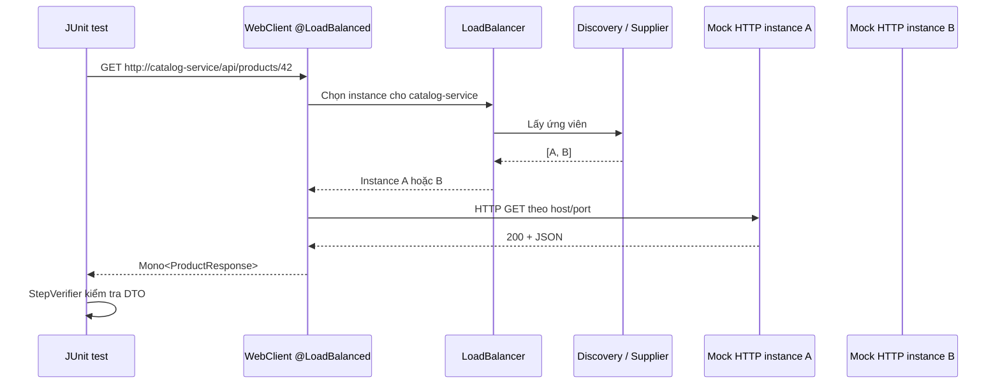

# Kiểm thử reactive bằng StepVerifier và kiểm soát thời gian

Khi tích hợp `WebClient` với Spring Cloud LoadBalancer, một lời gọi đến `http://catalog-service` không chỉ phụ thuộc vào HTTP response. Trước khi gửi request, ứng dụng còn cần lấy danh sách `ServiceInstance`, áp dụng các bước discovery, health check, zone/hint, chọn một instance rồi mới mở kết nối. Các bước này có thể trả dữ liệu, hoàn thành rỗng, phát lỗi hoặc chậm hơn dự kiến.

Với mã reactive dựa trên Project Reactor, chỉ gọi phương thức và so sánh ngay giá trị trả về là chưa đủ: kết quả thường là `Mono<T>` hoặc `Flux<T>` và chỉ được phát khi có **subscription**. `StepVerifier` của thư viện `reactor-test` cho phép kiểm tra **thứ tự tín hiệu, dữ liệu, lỗi, hoàn thành, hủy và thời gian** của các Publisher. Khi dùng `VirtualTimeScheduler`, nhiều kiểm thử liên quan tới `delay`, `timeout` và `retryWhen` có thể diễn ra nhanh, xác định được mà không cần `Thread.sleep()`.

Bài này thuộc phần **Kiểm thử tự động** của module Spring Cloud LoadBalancer. Trọng tâm là kiểm thử **bộ chọn instance/reactive supplier**, giả lập tình huống không có instance hoặc nguồn discovery chậm, kiểm soát thời gian ở tầng Reactor và phân biệt unit test với integration test thực sự đi qua WebClient, LoadBalancer, HTTP connector và server đích.

## 1. Chia bài toán thành các tầng kiểm thử

Cùng một lỗi “không gọi được `catalog-service`” có thể xuất hiện ở nhiều tầng. Không nên viết một integration test lớn rồi cố dùng nó để chứng minh tất cả hành vi.

| Tầng | Đối tượng kiểm thử | Dữ liệu/giả lập | Điều nên khẳng định |
|---|---|---|---|
| Reactive operator | `Mono`/`Flux`, `timeout`, `retryWhen`, `onErrorResume` | Publisher giả, virtual time | Đúng tín hiệu, thời điểm, số attempt và fallback |
| `ServiceInstanceListSupplier` | Danh sách ứng viên, filter/hint/health tùy biến | Danh sách instance cố định hoặc nguồn `TestPublisher` | Ứng viên đầu ra đúng theo request context |
| `ReactorServiceInstanceLoadBalancer` | Thuật toán chọn instance | Supplier giả, không mở HTTP thật | Có/chưa có server, instance thuộc tập hợp lệ, không lỗi khi rỗng |
| WebClient response mapping | `retrieve`, `onStatus`, DTO/JSON | `ExchangeFunction` giả | Phân loại HTTP 2xx/4xx/5xx và decode đúng |
| Integration HTTP + LoadBalancer | `@LoadBalanced WebClient.Builder`, client context, discovery và backend thử nghiệm | Instance mock thực, HTTP server giả | Service ID được phân giải đúng, request đến đúng đích, HTTP response chính xác |
| Tích hợp vận hành | Retry, timeout, health, cache, scale-in | Registry/server môi trường thử nghiệm | Hội tụ discovery, lỗi mạng, retry và độ trễ phù hợp thực tế |

**Nguyên tắc:** `StepVerifier` rất mạnh để kiểm tra một Publisher nhưng **không tự chứng minh request HTTP thực đã được gửi đến instance đúng**. Để kiểm tra kết nối, TLS, DNS, wire format và phản hồi HTTP thực, vẫn cần integration test với server/connector tương ứng.

## 2. Chuẩn bị Reactor Test và JUnit

Trong dự án Spring Boot/WebFlux đã sử dụng Reactor, thêm `reactor-test` vào test scope. Ví dụ Maven:

```xml
<dependency>
    <groupId>io.projectreactor</groupId>
    <artifactId>reactor-test</artifactId>
    <scope>test</scope>
</dependency>
<dependency>
    <groupId>org.springframework.boot</groupId>
    <artifactId>spring-boot-starter-test</artifactId>
    <scope>test</scope>
</dependency>
```

Khi cần thử thuật toán LoadBalancer, ứng dụng còn phải có dependency `spring-cloud-starter-loadbalancer` phù hợp với **Spring Cloud BOM** đang sử dụng. Không tự ghép phiên bản `reactor-test` không tương thích với `reactor-core`; ưu tiên phiên bản do Spring Boot dependency management quản lý.

Những import phổ biến:

```java
import java.time.Duration;
import java.util.concurrent.TimeoutException;

import org.junit.jupiter.api.Test;
import reactor.core.publisher.Flux;
import reactor.core.publisher.Mono;
import reactor.test.StepVerifier;
import reactor.test.publisher.TestPublisher;
import reactor.test.scheduler.VirtualTimeScheduler;
import reactor.util.retry.Retry;
```

Không phải mọi ví dụ trong bài cần toàn bộ import này. Với JUnit 5, `StepVerifier` có thể chạy trong một test method và báo lỗi assertion khi tín hiệu thực tế khác chuỗi kỳ vọng.

**Phạm vi của bài:** các snippet sử dụng những API thông dụng của Reactor và Spring Cloud LoadBalancer. Một số constructor/package trong Spring Cloud có thể thay đổi theo release train, nên luôn đồng bộ dependency và kiểm tra với BOM thực tế khi biến ví dụ thành test chạy trong repository.

## 3. Đọc tín hiệu Publisher bằng StepVerifier

Một `Mono<T>` có thể phát **tối đa một** giá trị rồi hoàn thành, hoàn thành rỗng, hoặc phát lỗi. `Flux<T>` có thể phát nhiều giá trị. `StepVerifier` gắn subscription và xác nhận trình tự tín hiệu thay vì lấy kết quả bằng `block()`.

Ví dụ `Mono` thành công:

```java
@Test
void monoEmitsProductAndCompletes() {
    Mono<String> publisher = Mono.just("catalog-1");

    StepVerifier.create(publisher)
            .expectNext("catalog-1")
            .verifyComplete();
}
```

Ví dụ `Flux` có nhiều phần tử:

```java
@Test
void fluxEmitsCandidateIdsInOrder() {
    Flux<String> ids = Flux.just(
            "catalog-1", "catalog-2", "catalog-3");

    StepVerifier.create(ids)
            .expectNext("catalog-1", "catalog-2", "catalog-3")
            .verifyComplete();
}
```

Ví dụ hoàn thành rỗng và phát lỗi:

```java
@Test
void emptyPublisherCompletesWithoutNextValue() {
    StepVerifier.create(Mono.<String>empty())
            .verifyComplete();
}

@Test
void publisherPropagatesError() {
    StepVerifier.create(
            Mono.<String>error(
                    new IllegalStateException("discovery failed")))
            .expectErrorMatches(error ->
                    error instanceof IllegalStateException
                    && "discovery failed".equals(error.getMessage()))
            .verify();
}
```

Các bước thường dùng:

| API StepVerifier | Ý nghĩa |
|---|---|
| `expectSubscription()` | Xác nhận sự kiện subscription trước khi xét tín hiệu tiếp theo |
| `expectNext(value)` | So sánh một giá trị `onNext` |
| `assertNext(consumer)` | Kiểm tra nhiều thuộc tính của giá trị bằng assertions |
| `expectNextCount(n)` | Xác nhận số phần tử, không so nội dung từng phần tử |
| `expectError(type)` / `expectErrorMatches(predicate)` | Xác nhận lỗi terminal |
| `verifyComplete()` | Xác nhận Publisher hoàn thành thành công |
| `thenCancel().verify()` | Yêu cầu hủy subscription và xác nhận bước kiểm thử kết thúc |
| `thenAwait(duration)` | Tiến thời gian chờ trong kịch bản; với virtual time không phải sleep thực |
| `expectNoEvent(duration)` | Xác nhận trong khoảng thời gian không xuất hiện tín hiệu mới |

**Lưu ý:** `expectNoEvent` cũng tính **subscription** là một sự kiện. Nếu muốn xác nhận “sau khi đã subscribe, chưa có giá trị/lỗi”, hãy đặt `expectSubscription()` **trước** `expectNoEvent(...)`.

## 4. Kiểm thử bộ chọn instance bằng supplier cố định

Để kiểm tra LoadBalancer, nên bắt đầu từ một danh sách instance **ổn định** không phụ thuộc Eureka/Consul, không cần HTTP server và không có thời gian chờ discovery.

Ví dụ dùng `RoundRobinLoadBalancer` dựng sẵn với một `ServiceInstanceListSupplier` thử nghiệm. Test sau đây có thể đặt trong một class JUnit riêng:

```java
import static org.junit.jupiter.api.Assertions.*;

import java.util.List;

import org.junit.jupiter.api.Test;
import org.springframework.beans.factory.support.DefaultListableBeanFactory;
import org.springframework.cloud.client.DefaultServiceInstance;
import org.springframework.cloud.client.ServiceInstance;
import org.springframework.cloud.client.loadbalancer.DefaultRequest;
import org.springframework.cloud.loadbalancer.core.RoundRobinLoadBalancer;
import org.springframework.cloud.loadbalancer.core.ServiceInstanceListSupplier;

import reactor.core.publisher.Flux;
import reactor.test.StepVerifier;

class RoundRobinReactiveTest {

    private static final String SERVICE_ID = "catalog-service";

    private static final class FixedSupplier
            implements ServiceInstanceListSupplier {

        private final List<ServiceInstance> instances;

        FixedSupplier(List<ServiceInstance> instances) {
            this.instances = List.copyOf(instances);
        }

        @Override
        public String getServiceId() {
            return SERVICE_ID;
        }

        @Override
        public Flux<List<ServiceInstance>> get() {
            return Flux.just(instances);
        }
    }

    private static RoundRobinLoadBalancer newLoadBalancer(
            List<ServiceInstance> instances) {

        DefaultListableBeanFactory factory =
                new DefaultListableBeanFactory();

        factory.registerSingleton(
                "catalogInstances",
                new FixedSupplier(instances));

        return new RoundRobinLoadBalancer(
                factory.getBeanProvider(
                        ServiceInstanceListSupplier.class),
                SERVICE_ID);
    }

    private static ServiceInstance instance(
            String instanceId, int port) {
        return new DefaultServiceInstance(
                instanceId, SERVICE_ID, "127.0.0.1", port, false);
    }

    @Test
    void choosesOnlyFromRegisteredCandidates() {
        RoundRobinLoadBalancer loadBalancer = newLoadBalancer(
                List.of(
                        instance("catalog-1", 8101),
                        instance("catalog-2", 8102)));

        StepVerifier.create(
                loadBalancer.choose(new DefaultRequest<>()))
                .assertNext(response -> {
                    assertTrue(response.hasServer());

                    ServiceInstance chosen = response.getServer();
                    assertEquals(SERVICE_ID, chosen.getServiceId());

                    assertTrue(List.of(
                            "catalog-1", "catalog-2")
                            .contains(chosen.getInstanceId()));
                })
                .verifyComplete();
    }
}
```

Điều được chứng minh: một lượt chọn phát **một `Response<ServiceInstance>`**, có server, mang service ID đúng và instance thuộc danh sách đã cung cấp. Không yêu cầu instance đầu tiên phải là `catalog-1`, vì seed/counter của round-robin có thể khác theo constructor, bean lifecycle hoặc phiên bản.

**Không dùng kiểu assertion này để chứng minh tải phân phối đều trong production.** Test trên không có mạng, độ trễ backend, health filter, zone preference, sticky session hoặc nhiều process caller. Nó chỉ tập trung vào **hợp đồng reactive của bước chọn instance**.

## 5. Trường hợp không có instance và supplier phát lỗi

Một trường hợp quan trọng hơn cả happy path là **danh sách ứng viên rỗng**. Ở tầng LoadBalancer, kết quả mong đợi thường là `Response` không chứa server; ở HTTP integration, trường hợp đó có thể được chuyển thành phản hồi lỗi hoặc exception tùy client/cấu hình.

Sử dụng các helper ở phần trước:

```java
@Test
void returnsNoServerWhenCandidateListIsEmpty() {
    RoundRobinLoadBalancer loadBalancer =
            newLoadBalancer(List.of());

    StepVerifier.create(
            loadBalancer.choose(new DefaultRequest<>()))
            .assertNext(response ->
                    assertFalse(response.hasServer()))
            .verifyComplete();
}
```

**Khác biệt quan trọng:** “không có instance” không phải HTTP `404 Not Found` do `catalog-service` trả về. Chưa có kết nối đến catalog; nguyên nhân có thể là discovery rỗng, health filter loại hết, zone/hint không có match hoặc named client context cấu hình sai.

Với một supplier phát lỗi, test nên xác định **lỗi được truyền đi như thế nào** theo contract của LoadBalancer đang kiểm thử. Ví dụ publisher giả trả exception:

```java
ServiceInstanceListSupplier brokenSupplier =
        new ServiceInstanceListSupplier() {

            @Override
            public String getServiceId() {
                return "catalog-service";
            }

            @Override
            public Flux<List<ServiceInstance>> get() {
                return Flux.error(
                        new IllegalStateException(
                                "discovery unavailable"));
            }
        };
```

Đưa `brokenSupplier` vào một bean factory test như phần trước rồi:

```java
StepVerifier.create(
        loadBalancer.choose(new DefaultRequest<>()))
        .expectErrorMatches(error ->
                error instanceof IllegalStateException
                && error.getMessage()
                        .contains("discovery unavailable"))
        .verify();
```

Ở snippet này, `loadBalancer` giả định đã được tạo với `brokenSupplier`. Nếu thuật toán custom có chính sách **fallback sang cached instance list** khi nguồn discovery lỗi, expected signal phải thay đổi theo chính sách đó; không mặc định mọi supplier failure đều propagate nguyên exception.

## 6. Kiểm tra việc truyền `Request` context đến supplier

Một số `ServiceInstanceListSupplier` dùng thông tin từng request như hint, cookie sticky session hoặc dữ liệu retry để lọc ứng viên. Nếu custom LoadBalancer gọi `supplier.get()` thay vì `supplier.get(request)`, test chỉ dựa trên danh sách tĩnh có thể vẫn pass, trong khi routing theo request không hoạt động.

Ví dụ một supplier spy ghi nhận request mà nó nhận:

```java
import java.util.List;
import java.util.concurrent.atomic.AtomicReference;

import org.springframework.cloud.client.ServiceInstance;
import org.springframework.cloud.client.loadbalancer.Request;
import org.springframework.cloud.loadbalancer.core.ServiceInstanceListSupplier;
import reactor.core.publisher.Flux;

final class RecordingSupplier
        implements ServiceInstanceListSupplier {

    private final List<ServiceInstance> instances;
    private final AtomicReference<Request> observed =
            new AtomicReference<>();

    RecordingSupplier(List<ServiceInstance> instances) {
        this.instances = List.copyOf(instances);
    }

    @Override
    public String getServiceId() {
        return "catalog-service";
    }

    @Override
    public Flux<List<ServiceInstance>> get() {
        return Flux.just(instances);
    }

    @Override
    public Flux<List<ServiceInstance>> get(Request request) {
        observed.set(request);
        return get();
    }

    Request lastRequest() {
        return observed.get();
    }
}
```

Nếu `RecordingSupplier` được đăng ký vào bean factory của LoadBalancer test:

```java
DefaultRequest<String> request =
        new DefaultRequest<>("hint-canary");

StepVerifier.create(loadBalancer.choose(request))
        .assertNext(response -> assertTrue(response.hasServer()))
        .verifyComplete();

assertSame(request, recordingSupplier.lastRequest());
```

Snippet trên dùng `assertSame` của JUnit; `loadBalancer` và `recordingSupplier` phải là **hai đối tượng được nối với nhau qua provider test**, không phải biến mới không liên quan.

Test này chỉ khẳng định **request context được truyền đến supplier**, chưa chứng minh policy hint đã lọc đúng. Để kiểm tra hint/zone/sticky thật, cần thêm bộ ứng viên có metadata phân biệt và assert danh sách/instance được chọn đúng theo semantics của supplier đang dùng.

## 7. Chủ động điều khiển thời điểm phát dữ liệu bằng `TestPublisher`

`TestPublisher` của `reactor-test` cho phép kiểm thử tự quyết định lúc nào nguồn phát dữ liệu, hoàn thành hoặc lỗi. Nó đặc biệt hữu ích khi muốn chứng minh LoadBalancer **đang chờ discovery supplier** thay vì trả sớm một instance không hợp lệ.

Ví dụ ý tưởng với nguồn phát danh sách:

```java
import java.util.List;

import reactor.test.publisher.TestPublisher;
import reactor.test.StepVerifier;
import org.springframework.cloud.client.ServiceInstance;

TestPublisher<List<ServiceInstance>> source =
        TestPublisher.create();

ServiceInstanceListSupplier supplier =
        new ServiceInstanceListSupplier() {

            @Override
            public String getServiceId() {
                return "catalog-service";
            }

            @Override
            public Flux<List<ServiceInstance>> get() {
                return source.flux();
            }
        };
```

Sau khi đăng ký supplier này vào provider của LoadBalancer, có thể điều khiển khi nào nó phát snapshot:

```java
StepVerifier.create(
        loadBalancer.choose(new DefaultRequest<>()))
        .expectSubscription()
        .then(() -> source.next(
                List.of(instance("catalog-1", 8101))))
        .assertNext(response -> {
            assertTrue(response.hasServer());
            assertEquals(
                    "catalog-1",
                    response.getServer().getInstanceId());
        })
        .verifyComplete();
```

Trong snippet, `loadBalancer` và helper `instance(...)` được chuẩn bị tương tự phần 4, còn `supplier` chính là đối tượng bọc `source.flux()`. Một LoadBalancer tiêu thụ snapshot đầu tiên có thể hoàn thành sau sự kiện `next` dù nguồn chưa gọi `complete()`. Nếu cần kiểm tra publisher nhiều snapshot, phải làm rõ thuật toán dùng lần phát đầu hay tiếp tục theo dõi nguồn.

Các kịch bản có ích:

- `source.next(List.of())`: nguồn có phản hồi nhưng không có ứng viên.
- `source.error(new IllegalStateException(...))`: discovery stream thất bại.
- `source.complete()` trước khi phát danh sách: supplier không tạo snapshot nào; chính sách xử lý empty publisher cần được kiểm tra.
- Nhiều `next`: kiểm tra operator `next()` chỉ dùng lần phát đầu hay custom supplier xử lý refresh theo cách khác.

Không dùng `TestPublisher` để giả vờ rằng registry hoặc TCP đã thực sự bị lỗi. Đây vẫn là **unit test cho Reactive Streams**, không phải mô phỏng toàn bộ network stack.

## 8. Kiểm soát thời gian: real time và virtual time

Hai phương pháp cần phân biệt:

| Cách kiểm thử | Thời gian sử dụng | Phù hợp | Hạn chế |
|---|---|---|---|
| `StepVerifier.create(...)` thông thường | Đồng hồ/scheduler thực | Tác vụ nhanh, Publisher không phụ thuộc thời gian, integration test có deadline | Có thể chờ lâu, dễ flaky nếu so mốc sát nhau |
| `StepVerifier.withVirtualTime(...)` | `VirtualTimeScheduler` của Reactor | `delayElements`, `Mono.delay`, `timeout`, `Retry.backoff` dùng scheduler tương thích | Không làm DNS/TCP/TLS, HTTP connector hoặc thư viện ngoài Reactor chạy nhanh theo giả lập |

**Virtual time** thay việc đợi đồng hồ thực bằng việc điều khiển đồng hồ scheduler phục vụ các operator Reactor. Ví dụ một Publisher chỉ phát sau 10 giây:

```java
@Test
void verifiesDelayedMonoWithoutRealWaiting() {
    StepVerifier.withVirtualTime(
            () -> Mono.delay(Duration.ofSeconds(10)))
            .expectSubscription()
            .expectNoEvent(Duration.ofSeconds(9))
            .thenAwait(Duration.ofSeconds(1))
            .expectNext(0L)
            .verifyComplete();
}
```

Ở đây:

1. `withVirtualTime` tạo context scheduler ảo.
2. Supplier `() -> Mono.delay(...)` **tạo Publisher sau khi virtual scheduler đã được bật**.
3. `expectSubscription()` xác nhận subscription.
4. `expectNoEvent(9 s)` xác nhận chưa có dữ liệu trước mốc 10 giây ảo.
5. `thenAwait(1 s)` đưa đồng hồ ảo đến thời điểm phát.
6. `expectNext(0L)` và `verifyComplete()` khẳng định đúng kết quả.

**Lỗi thường gặp:** tạo Publisher có timer/scheduler *trước* khi gọi `withVirtualTime` rồi truyền Publisher đã tạo sẵn vào lambda. Một số operator đã capture scheduler thực từ lúc assembly nên việc dùng virtual time có thể không còn tác dụng. Luôn tạo **toàn bộ phần pipeline liên quan đến thời gian bên trong supplier lambda**.

`expectNoEvent` sau `expectSubscription` là cần thiết; nếu đặt `expectNoEvent` đầu tiên, sự kiện subscription cũng được tính là event và test có thể fail ngay.

## 9. Kiểm thử `timeout` mà không `Thread.sleep()`

Giả sử ứng dụng đặt deadline cho một lời gọi lấy danh sách instance, nhưng supplier không bao giờ phát giá trị. Thay vì đợi hai giây thực, có thể kiểm thử timeout bằng virtual time:

```java
@Test
void timesOutWhenNoSignalArrives() {
    StepVerifier.withVirtualTime(
            () -> Mono.<String>never()
                    .timeout(Duration.ofSeconds(2)))
            .expectSubscription()
            .thenAwait(Duration.ofSeconds(2))
            .expectError(TimeoutException.class)
            .verify(Duration.ofSeconds(5));
}
```

Lỗi `TimeoutException` ở đây đến từ **Reactor `timeout` operator**, không nhất thiết có nghĩa HTTP client đã mở TCP connection rồi hết connect/read timeout. `verify(Duration.ofSeconds(5))` là một **giới hạn thời gian thực** cho toàn quá trình kiểm thử để tránh bị treo; nó không thay `timeout(Duration.ofSeconds(2))` bên trong pipeline.

Với LoadBalancer, cũng có thể thêm deadline tại một ranh giới cần kiểm thử:

```java
Mono<Response<ServiceInstance>> choice =
        loadBalancer.choose(new DefaultRequest<>())
                .timeout(Duration.ofSeconds(2));
```

Để dùng virtual time, đặt **cả phép tạo `choice`** bên trong lambda của `withVirtualTime`:

```java
StepVerifier.withVirtualTime(() ->
        loadBalancer.choose(new DefaultRequest<>())
                .timeout(Duration.ofSeconds(2)))
        .expectSubscription()
        .thenAwait(Duration.ofSeconds(2))
        .expectError(TimeoutException.class)
        .verify(Duration.ofSeconds(5));
```

Trong ví dụ này, `loadBalancer` phải dùng một supplier không phát tín hiệu (`Flux.never()`) để timeout thực sự xảy ra. Nếu supplier lập tức trả `EmptyResponse`, pipeline sẽ hoàn thành trước timeout và test phải kỳ vọng kết quả “không có server” thay vì `TimeoutException`.

**Cần phân biệt các timeout:** timeout lấy instance, timeout mượn connection, connect timeout, response/read timeout và deadline end-to-end là những giới hạn khác nhau. Virtual time chứng minh được semantics của operator Reactor, **không chứng minh thời điểm socket timeout của Reactor Netty/HTTP client thực tế**.

## 10. Kiểm thử retry/backoff theo cách xác định được

Retry khiến một logical request có thể tạo nhiều subscription/HTTP attempt. Nếu chỉ viết `expectNext(...)` và bỏ qua số lần thử, test có thể pass trong khi policy retry sai hoặc tăng tải quá nhiều.

Ví dụ một nguồn thất bại hai lần rồi thành công lần thứ ba, sử dụng `Retry.backoff`:

```java
import java.time.Duration;
import java.util.concurrent.atomic.AtomicInteger;
import reactor.core.publisher.Mono;
import reactor.test.StepVerifier;
import reactor.util.retry.Retry;

@Test
void retriesTwiceAndThenSucceeds() {
    AtomicInteger attempts = new AtomicInteger();

    StepVerifier.withVirtualTime(() ->
            Mono.defer(() -> {
                int current = attempts.incrementAndGet();

                if (current < 3) {
                    return Mono.<String>error(
                            new IllegalStateException("temporary"));
                }

                return Mono.just("catalog-1");
            })
            .retryWhen(
                    Retry.backoff(2, Duration.ofSeconds(1))
                            .jitter(0d)))
            .expectSubscription()
            .thenAwait(Duration.ofSeconds(4))
            .expectNext("catalog-1")
            .verifyComplete();

    assertEquals(3, attempts.get());
}
```

Trong ví dụ cần import `assertEquals` từ JUnit. `Retry.backoff(2, ...)` cho phép **tối đa hai lần retry**, tức tối đa ba attempts. Thông thường backoff tăng theo cấp số nhân; `jitter(0d)` được dùng **trong test** để loại thành phần ngẫu nhiên và làm phép kiểm tra dễ dự đoán. Việc chờ bốn giây ảo chỉ để đi qua các mốc retry, không phải khuyến nghị time budget của production.

**Không mặc định test retry này đã kiểm tra Spring Cloud LoadBalancer chọn instance khác ở attempt tiếp theo.** Nó chỉ kiểm tra resubscription của một Mono. Muốn chứng minh retry-aware supplier loại instance trước, phải có request context và instance list thích hợp, hoặc integration test đi qua đúng LoadBalancer retry policy.

### 10.1. Kiểm tra những lỗi không được retry

Đối với HTTP `400`, `401`, `403` hoặc `404`, nhiều hợp đồng API không cho phép retry cùng request, còn `429` và một số lỗi `5xx` phải xét chính sách rõ ràng. Một test nên có predicate:

```java
Retry retryPolicy = Retry.backoff(
                2, Duration.ofMillis(100))
        .jitter(0d)
        .filter(error -> error instanceof TimeoutException);
```

Nếu pipeline phát `IllegalArgumentException` hoặc một lỗi nghiệp vụ không nằm trong predicate, xác nhận lỗi kết thúc **ngay attempt đầu**. Với `POST` tạo đơn hàng, retry phải xét idempotency vì server có thể đã xử lý request nhưng response bị mất.

### 10.2. Vị trí của timeout thay đổi ý nghĩa kiểm thử

```java
// Timeout tính cho từng attempt trước khi retry.
source.timeout(Duration.ofSeconds(2))
      .retryWhen(retryPolicy);

// Deadline cho toàn bộ pipeline kể cả retry/backoff.
source.retryWhen(retryPolicy)
      .timeout(Duration.ofSeconds(5));
```

Hai cách này có ý nghĩa khác nhau. Kịch bản đầu có thể kéo dài quá hai giây do retries; kịch bản sau áp giới hạn cho toàn chuỗi, bao gồm các lần thử lại và backoff. Để kiểm thử deadline tổng, thiết kế nguồn đủ chậm và dùng virtual time nếu các timer đều thuộc Reactor.

## 11. Kiểm thử danh sách instance đến chậm

Một supplier có thể trả danh sách theo `Flux<List<ServiceInstance>>` nhưng bị delay (ví dụ một lớp thử nghiệm mô phỏng việc phát snapshot chậm). Không cần ngủ thật:

```java
ServiceInstanceListSupplier delayedSupplier =
        new ServiceInstanceListSupplier() {

            @Override
            public String getServiceId() {
                return "catalog-service";
            }

            @Override
            public Flux<List<ServiceInstance>> get() {
                return Flux.just(List.of(
                        instance("catalog-1", 8101)))
                        .delayElements(Duration.ofSeconds(5));
            }
        };
```

Sau khi đăng ký `delayedSupplier` vào provider của LoadBalancer:

```java
StepVerifier.withVirtualTime(() ->
        loadBalancer.choose(new DefaultRequest<>()))
        .expectSubscription()
        .expectNoEvent(Duration.ofSeconds(4))
        .thenAwait(Duration.ofSeconds(1))
        .assertNext(response -> {
            assertTrue(response.hasServer());
            assertEquals(
                    "catalog-1",
                    response.getServer().getInstanceId());
        })
        .verifyComplete();
```

**Chú ý:** `delayElements(Duration)` trong test này mô phỏng **thời điểm phát tín hiệu Reactor**, không phải đo chính xác latency của Eureka, Consul, DNS hay registry. Nếu supplier thực tế dùng thread blocking hoặc một scheduler ngoài khả năng kiểm soát của virtual scheduler, test phải chạy bằng thời gian thực hoặc một cơ chế fake clock/transport tương ứng.

Khi sử dụng custom supplier, cần kiểm tra liệu nó có dùng `get(request)` để giữ hint/cookie/retry context. Việc giả lập danh sách chậm không nên vô tình bỏ qua một filter phụ thuộc request mà production đang sử dụng.

## 12. WebClient: dùng `ExchangeFunction` giả để kiểm tra decode và lỗi HTTP

Một lỗi phản hồi HTTP nên được kiểm tra ở đúng tầng. Nếu chỉ muốn xem `WebClient.retrieve()` biến response thành DTO hoặc exception thế nào, **không cần chạy LoadBalancer**.

Ví dụ WebClient với `ExchangeFunction` giả luôn trả JSON:

```java
import static org.junit.jupiter.api.Assertions.assertEquals;

import org.junit.jupiter.api.Test;
import org.springframework.http.HttpHeaders;
import org.springframework.http.HttpStatus;
import org.springframework.http.MediaType;
import org.springframework.web.reactive.function.client.ClientResponse;
import org.springframework.web.reactive.function.client.ExchangeFunction;
import org.springframework.web.reactive.function.client.WebClient;

import reactor.core.publisher.Mono;
import reactor.test.StepVerifier;

class CatalogWebClientTest {

    record ProductResponse(String id, String name) { }

    @Test
    void mapsJsonResponseToDto() {
        ExchangeFunction fakeExchange = request ->
                Mono.just(
                        ClientResponse.create(HttpStatus.OK)
                                .header(
                                        HttpHeaders.CONTENT_TYPE,
                                        MediaType.APPLICATION_JSON_VALUE)
                                .body(
                                        "{\"id\":\"42\",\"name\":\"Keyboard\"}")
                                .build());

        WebClient client = WebClient.builder()
                .exchangeFunction(fakeExchange)
                .build();

        Mono<ProductResponse> response = client.get()
                .uri("http://catalog-service/api/products/42")
                .retrieve()
                .bodyToMono(ProductResponse.class);

        StepVerifier.create(response)
                .assertNext(product -> {
                    assertEquals("42", product.id());
                    assertEquals("Keyboard", product.name());
                })
                .verifyComplete();
    }
}
```

Trong test này, `catalog-service` chỉ là URL để xây request; `fakeExchange` chặn trước transport nên **không có DNS, LoadBalancer, HTTP socket hoặc server thật**. Test chứng minh đường giải mã của WebClient và bộ codec; nếu thiếu Jackson/codec phù hợp với DTO, test có thể thất bại ở tầng decode.

Để kiểm tra một status lỗi:

```java
ExchangeFunction fakeExchange = request -> Mono.just(
        ClientResponse.create(HttpStatus.SERVICE_UNAVAILABLE)
                .body("upstream unavailable")
                .build());

WebClient client = WebClient.builder()
        .exchangeFunction(fakeExchange)
        .build();

StepVerifier.create(
        client.get()
                .uri("http://catalog-service/api/products/42")
                .retrieve()
                .bodyToMono(String.class))
        .expectErrorMatches(error ->
                error instanceof WebClientResponseException ex
                && ex.getStatusCode().value() == 503)
        .verify();
```

Ở snippet thứ hai cần import `WebClientResponseException` từ `org.springframework.web.reactive.function.client`. Với `retrieve()`, HTTP 4xx/5xx thường được ánh xạ thành response exception; còn lỗi kết nối thực thường thuộc nhóm request exception. Kiểu lỗi cụ thể có thể thay đổi nếu ứng dụng dùng `onStatus` hoặc handler tùy biến.

**Không nhầm `WebClientResponseException(503)` do fakeExchange trả với lỗi “không có instance” của LoadBalancer.** Hai tình huống có thể có cùng status ở một số integration, nhưng khác điểm phát sinh. Unit test phải mô tả rõ lỗi đang được giả lập.

## 13. Integration test thực sự với `@LoadBalanced WebClient.Builder`

Sau unit test, cần một số **integration test** để xác minh toàn bộ chuỗi:



Một setup hữu ích:

1. Khởi tạo application context test có dependency Spring Cloud LoadBalancer và một nguồn instance **tĩnh**, không cần registry bên ngoài.
2. Cho nguồn instance trả `DefaultServiceInstance` trỏ đến **port thật** của một hoặc hai HTTP mock server (chẳng hạn MockWebServer/WireMock).
3. Dùng `@LoadBalanced WebClient.Builder` từ context Spring, không tự tạo một `WebClient.builder()` khác bỏ qua auto-configuration.
4. Gửi URL logic với service ID `catalog-service` và path variable; server giả ghi nhận method, path, headers, body.
5. Xác minh response bằng `StepVerifier` và xác minh server nào đã nhận request bằng assertion của mock server.
6. Thử danh sách rỗng, backend trả 503, kết nối bị từ chối, timeout theo connector và retry theo cấu hình đã bật.

Test integration nên đặt **timeout thời gian thực hợp lý** cho việc chờ response và mock server; không để test vô hạn chỉ vì quá trình kết nối hoặc background task bị treo. Có thể dùng `StepVerifier.create(publisher).expectNext(...).verifyComplete()` rồi giới hạn `verify(Duration)` theo overload phù hợp, hoặc dùng StepVerifier có điểm cuối và `verify(Duration.ofSeconds(...))`.

**Không nên dùng virtual time để tăng tốc TCP handshake, connect timeout, DNS refresh, TLS hoặc HTTP server thật.** Các thành phần đó không nhất thiết dùng Reactor `VirtualTimeScheduler`. Virtual time phù hợp nhất với **logic Reactive Streams**; integration test cần đồng hồ thật, server giả ổn định và dữ liệu môi trường có kiểm soát.

## 14. Kiểm tra cancellation và dọn tài nguyên

Với pipeline reactive, request có thể bị hủy khi caller ngắt kết nối, time budget của upstream hết hoặc logic `take`/`timeout` kết thúc subscription. Nếu một custom supplier hay LoadBalancer mở subscription riêng trong `choose()`, nó có thể làm rò công việc khi downstream đã hủy.

Ví dụ kiểm tra một Publisher nhận được tín hiệu cancel:

```java
import static org.junit.jupiter.api.Assertions.assertEquals;

import java.util.concurrent.atomic.AtomicInteger;
import reactor.core.publisher.Mono;
import reactor.test.StepVerifier;

AtomicInteger cancellations = new AtomicInteger();

Mono<String> neverCompletes = Mono.<String>never()
        .doOnCancel(cancellations::incrementAndGet);

StepVerifier.create(neverCompletes)
        .expectSubscription()
        .thenCancel()
        .verify();

assertEquals(1, cancellations.get());
```

Test này khẳng định **cancellation signal** được gửi tới Publisher; nó chưa chứng minh HTTP connection đã được thu hồi, pool slot được trả hoặc child context đã đóng. Nếu custom code quản lý resource, cần thêm kiểm tra lifecycle thực tế, chẳng hạn `doFinally` trên pipeline, `Disposable` của task định kỳ và kiểm thử context shutdown.

Khi dùng `Flux.interval` hay một publisher không kết thúc, tránh viết `verifyComplete()` vì nguồn không hoàn thành; dùng `thenCancel().verify()` hoặc một operator giới hạn như `take(n)` đúng theo mục tiêu.

### 14.1. Concurrency test không chỉ là `expectNextCount`

Một custom round-robin dùng `AtomicInteger` hoặc supplier giữ snapshot bất biến cần test với nhiều subscription cùng lúc. Ví dụ:

```java
Flux<Response<ServiceInstance>> selections = Flux
        .range(0, 500)
        .flatMap(
                i -> loadBalancer.choose(new DefaultRequest<>())
                        .subscribeOn(Schedulers.parallel()),
                32);

StepVerifier.create(selections)
        .expectNextCount(500)
        .verifyComplete();
```

Các import bổ sung gồm `Response`, `ServiceInstance` và `Schedulers`. Code này khẳng định có 500 kết quả, **không chứng minh thread-safety**. Hãy bổ sung assertion trên mọi result: `hasServer()`, ID thuộc snapshot hợp lệ, không có ngoại lệ và state không bị rò. Nếu danh sách instance thay đổi đồng thời, không nên yêu cầu thứ tự round-robin cố định như một test tuần tự.

Với race condition thật, cần bổ sung stress test nhiều vòng, thay snapshot 3 → 2 → 0 instance, cancellation và retry; kiểm tra invariant của thuật toán thay vì chỉ dựa trên tổng số emissions.

## 15. Những anti-pattern làm test reactive chậm hoặc không ổn định

| Anti-pattern | Vì sao không tốt | Cách thay thế |
|---|---|---|
| `Thread.sleep(5000)` trong unit test | Tốn thời gian, dễ flaky dưới CI tải cao | `withVirtualTime`, `thenAwait` |
| `Mono.block()` để lấy kết quả | Chuyển về blocking, mất kiểm tra tín hiệu/cancellation | `StepVerifier.create(...)` |
| `subscribe()` rồi assert ngay biến local | Race giữa callback và assertion | Để StepVerifier quản lý subscription |
| Tạo timer pipeline trước `withVirtualTime` | Scheduler có thể đã bị capture | Tạo pipeline trong lambda supplier |
| `expectNoEvent` ngay từ bước đầu | Subscription bị tính là event | `expectSubscription()` trước |
| Test HTTP connector bằng virtual time | DNS/TCP/TLS không bắt buộc dùng scheduler ảo | Integration test thời gian thực |
| Retry có jitter ngẫu nhiên nhưng assert mốc sát | Test không xác định | Dùng `jitter(0d)` trong test hoặc assert hành vi không phụ thuộc mốc |
| Assert đúng instance đầu tiên của round-robin | Seed và vị trí có thể khác | Assert thuộc tập ứng viên; chỉ assert phân phối khi seed/state đã kiểm soát |
| Test không có timeout thời gian thực | CI có thể bị treo vô hạn | `verify(Duration)` hoặc timeout test runner |
| Sử dụng virtual scheduler chung với parallel tests | Có thể ảnh hưởng scheduler hooks toàn cục | Cô lập test thời gian ảo; không chạy song song khi dùng global scheduler |
| Dùng `StepVerifier` cho fake ExchangeFunction rồi kết luận LoadBalancer đúng | Không có actual LB/HTTP trong fake | Integration test với `@LoadBalanced` và mock HTTP server |
| Dùng `expectNextCount` rồi gọi là test cân bằng tải | Chỉ đếm emission, không kiểm tra invariant | Assert service ID/instance ID, snapshot và no-instance |

**Vấn đề đặc biệt với virtual time:** Reactor có cơ chế thay thế scheduler factory/hook cho phạm vi virtual-time test. Nếu nhiều test cùng thao tác global scheduler, kết quả có thể ảnh hưởng lẫn nhau. Nên để test có virtual time chạy riêng, không tự `VirtualTimeScheduler.getOrSet()` rồi quên `reset()`; khi dùng `StepVerifier.withVirtualTime` đúng cách, thư viện sẽ quản lý nhiều phần khởi tạo/dọn dẹp tương ứng.

## 16. Ma trận kiểm thử cho Spring Cloud LoadBalancer reactive

Một bộ test đủ bao phủ nên xác định rõ **đầu vào – hành vi – expected signal**:

| Kịch bản | Đầu vào | Kỳ vọng |
|---|---|---|
| Có một instance | `[catalog-1]` | `Response.hasServer() = true`, ID là `catalog-1` |
| Có nhiều instance | `[catalog-1, catalog-2]` | Instance thuộc tập ứng viên, không giả định seed |
| Không có instance | `[]` | `Response.hasServer() = false` ở tầng LB |
| Supplier lỗi | `Flux.error(...)` | Error signal hoặc fallback đúng policy |
| Supplier hoàn thành rỗng | `Flux.empty()` | Empty/no-server theo logic thuật toán |
| Supplier chậm | Snapshot sau 5 giây ảo | Chưa có value trước hạn, sau hạn chọn đúng |
| Request hint/cookie | `get(request)` có metadata | Supplier nhận đúng context, filter đúng |
| Timeout Reactor | `Mono.never().timeout(...)` | `TimeoutException` ở mốc ảo đã cấu hình |
| Retry thành công | Hai lỗi tạm thời rồi thành công | Tối đa số attempts đã định, backoff hợp lý |
| Retry không hợp lệ | Lỗi nghiệp vụ 4xx | Không retry khi predicate không cho phép |
| HTTP 200 | Fake ExchangeFunction trả JSON | Decoder tạo DTO |
| HTTP 503 | Fake ExchangeFunction trả response lỗi | `WebClientResponseException` hoặc mapping tùy chỉnh |
| Integration LoadBalancer | Service ID + mock HTTP instances | Request đến địa chỉ instance được chọn |
| Cancellation | Publisher chưa xong bị cancel | Tín hiệu cancel và tài nguyên được xử lý đúng |
| Concurrency | Nhiều subscription cùng chọn | Không race, không leak state, kết quả thuộc snapshot |

Đối với hệ thống có nhiều phiên bản Spring Cloud, nên phân tách rõ test theo **API của framework** và test theo **hợp đồng ứng dụng**. Chẳng hạn status HTTP khi không có instance có thể khác tùy integration/config, nhưng invariant “không được âm thầm gọi một host không thuộc danh sách ứng viên hợp lệ” vẫn đáng kiểm tra.

## 17. Checklist khi viết test mới

- [ ] Test có xác định **tầng** đang kiểm thử: operator, supplier, LoadBalancer, WebClient codec hay integration HTTP?
- [ ] Nguồn dữ liệu test được kiểm soát và không phụ thuộc registry production.
- [ ] Có kịch bản thành công, danh sách rỗng, supplier error và latency bất thường.
- [ ] Dùng `StepVerifier` để kiểm tra cả onNext, terminal signal, lỗi và cancellation nếu liên quan.
- [ ] Khi dùng `withVirtualTime`, Publisher có timer được tạo **trong lambda** sau khi scheduler ảo được kích hoạt.
- [ ] Không dùng `Thread.sleep()` để kiểm thử backoff/delay của Reactor.
- [ ] Retry có số attempt, error predicate và timeout rõ ràng; tránh jitter ngẫu nhiên trong test xác định.
- [ ] Giới hạn thời gian thực cho test có nguy cơ treo.
- [ ] Không suy từ một publisher fake rằng discovery, TLS hoặc HTTP network hoạt động đúng.
- [ ] Có assertion về `serviceId`, instance ID hợp lệ, request context và lỗi no-instance.
- [ ] Test cancellation, concurrency, refresh/scale-in cho custom LoadBalancer có state.
- [ ] Không chạm registry/dịch vụ thật hoặc làm phát sinh dữ liệu nghiệp vụ ngoài môi trường kiểm thử.

## 18. Ghi nhớ

`StepVerifier` là công cụ kiểm chứng **hợp đồng Reactive Streams**: dữ liệu nào được phát, có hoàn thành không, lỗi nào xảy ra và subscription bị hủy ra sao. Với Spring Cloud LoadBalancer, nó giúp kiểm thử `ReactorServiceInstanceLoadBalancer.choose(Request)`, `ServiceInstanceListSupplier` và policy xử lý khi danh sách ứng viên rỗng hoặc đến muộn.

`StepVerifier.withVirtualTime` giúp kiểm tra `delay`, `timeout` và `Retry.backoff` một cách nhanh, xác định được, miễn là pipeline dùng scheduler tương thích và được tạo đúng thời điểm. **Virtual time không thay thế integration test với socket thật**. Cách kiểm thử bền vững là tách unit test Reactor, test lựa chọn instance, test WebClient response mapping và một tập integration test đủ nhỏ để xác minh service ID, discovery, network, timeout và retry trong điều kiện gần thực tế.

