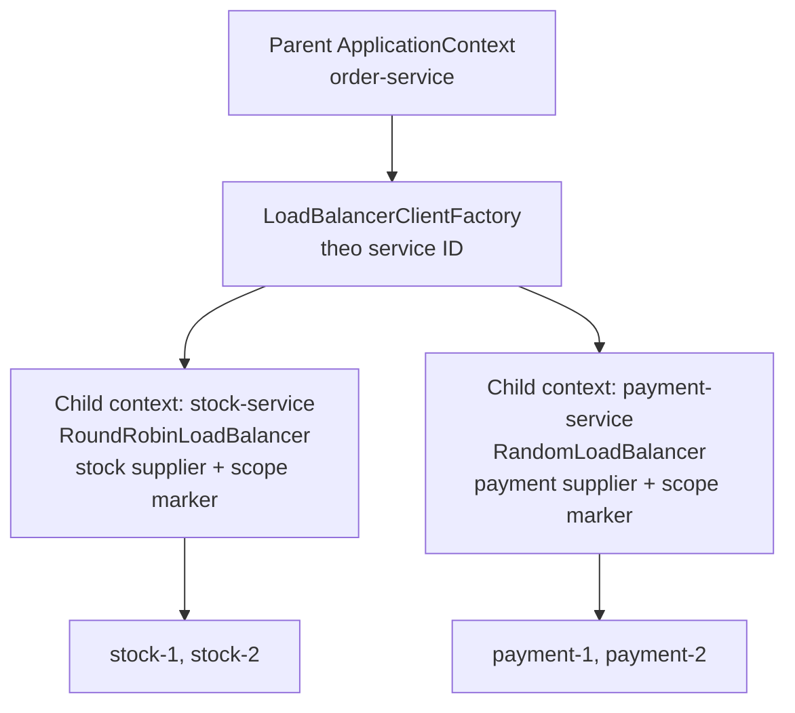

# Kiểm thử cấu hình riêng từng service ID và ngữ cảnh con

## 1. Vì sao phải kiểm thử phạm vi cấu hình LoadBalancer?

Ứng dụng `order-service` gọi hai dịch vụ:

- `stock-service` cần chọn instance theo **Round Robin** để phân phối luân phiên.
- `payment-service` cần chọn instance theo **Random** cho một chính sách thử nghiệm riêng.

Với Spring Cloud LoadBalancer, cấu hình của `stock-service` không được làm thay đổi thuật toán, supplier hay bean riêng của `payment-service`. Một lỗi khá khó thấy là đặt lớp cấu hình được truyền vào `@LoadBalancerClient` trong phạm vi component scan của ứng dụng chính. Khi đó bean dự kiến dành riêng cho một service có thể bị đăng ký ở **parent application context**, rồi ảnh hưởng tới service khác.

Trong module `SPRING_CLOUD_SERVICE_COMMUNICATION_LOAD_BALANCING`, bạn học cách cân bằng tải phía client bằng `service ID`, discovery, health check, định tuyến, tích hợp `RestClient`, `WebClient` và OpenFeign, kèm timeout/retry và quan sát lỗi. Bài thuộc chương **Kiểm thử tự động**, tập trung xác nhận rằng mỗi service ID thực sự sử dụng **đúng thuật toán, đúng `ServiceInstanceListSupplier`, đúng properties và đúng phạm vi bean**.

Sau khi học, bạn sẽ:

1. Giải thích mối quan hệ giữa **parent context**, **child context theo service ID** và `LoadBalancerClientFactory`.
2. Đăng ký hai cấu hình khác nhau bằng `@LoadBalancerClients` và nhận diện nguy cơ cấu hình bị scan toàn cục.
3. Viết integration test xác nhận kiểu LoadBalancer, nguồn instance, tên service ID và sự cách ly bean.
4. Kiểm tra cấu hình properties theo từng client và phân biệt thuộc tính toàn cục.
5. Thiết kế kiểm thử việc khởi tạo context lười, cache/health, HTTP routing và retry mà không tạo test phụ thuộc thứ tự chạy.

## 2. Child context của Spring Cloud LoadBalancer hoạt động như thế nào?

Spring Cloud LoadBalancer sử dụng một **named child application context** cho mỗi service ID. Theo mặc định, context của một service thường được **khởi tạo lười** khi bắt đầu cần cân bằng tải tới service đó; có thể cấu hình eager load nếu muốn khởi tạo sớm.



Khi HTTP client gọi `http://stock-service/stocks/SKU-1` qua cơ chế `@LoadBalanced`, phần `stock-service` trong URL là **service ID**; `LoadBalancerClientFactory` dùng ID này để lấy đối tượng cân bằng tải và các bean liên quan từ context thích hợp.

Điểm cần phân biệt:

| Khái niệm | Ví dụ | Vai trò trong test |
| --- | --- | --- |
| Parent application context | Ứng dụng `order-service` | Chứa auto-configuration và các bean dùng chung |
| Child context có tên | `stock-service` | Chứa thuật toán và supplier được cấu hình riêng cho ID này |
| `LoadBalancerClientFactory` | Bean trong parent | Truy xuất bean theo tên client, tạo child context khi cần |
| `@LoadBalancerClient(name = ...)` | `stock-service` | Gắn cấu hình riêng với đúng service ID |
| `ReactorServiceInstanceLoadBalancer` | `RoundRobinLoadBalancer` | Chọn instance từ supplier của context tương ứng |
| `ServiceInstanceListSupplier` | Danh sách các `stock-*` | Cấp danh sách instance hợp lệ của cùng service |
| `spring.application.name` | `order-service` | Tên dịch vụ **đang chạy**, không thay thế service ID đích |
| `@FeignClient(contextId = ...)` | `stockFeignV2` | Phân biệt cấu hình Feign bean; không mặc nhiên đổi tên service ID LoadBalancer |

**Một điểm quan trọng:** Child context vẫn có **quan hệ parent–child**. Nó có thể nhìn thấy những bean của parent theo cơ chế Spring. Vì vậy, “có child context riêng” không tự động bảo đảm mọi bean được cách ly. Đúng cấu hình là: những bean chỉ dành cho một service **được đăng ký trong child context của service đó**, không vô tình trở thành bean parent.

### 2.1. Hợp đồng mà kiểm thử cần bảo vệ

Với hai service ID `stock-service` và `payment-service`:

- `factory.getInstance("stock-service", ReactorServiceInstanceLoadBalancer.class)` phải trỏ tới thuật toán stock.
- `factory.getInstance("payment-service", ReactorServiceInstanceLoadBalancer.class)` phải trỏ tới thuật toán payment.
- Supplier của `stock-service` không được cấp instance mang `serviceId="payment-service"`, và ngược lại.
- Hai marker bean cùng **kiểu** hoặc cùng **tên bean** có thể tồn tại ở hai child context mà không xung đột.
- Marker chỉ dành riêng cho client không được xuất hiện ở parent.
- Gọi lại `getInstance` cho cùng service ID trong cùng ứng dụng thông thường nhận lại bean của context đã được tạo; truy vấn service khác không phải cách “đổi tên” bean của service trước.

## 3. Cấu hình hai service khác nhau

Đây là mẫu Spring Cloud LoadBalancer với Spring Boot và Java 17+. Dùng các dependency do **Spring Boot BOM** và **Spring Cloud BOM tương thích** quản lý; không tự lấy những phiên bản starter rời rạc.

```xml
<dependencies>
    <dependency>
        <groupId>org.springframework.cloud</groupId>
        <artifactId>spring-cloud-starter-loadbalancer</artifactId>
    </dependency>
    <dependency>
        <groupId>org.springframework.boot</groupId>
        <artifactId>spring-boot-starter-test</artifactId>
        <scope>test</scope>
    </dependency>
</dependencies>
```

### 3.1. Đăng ký cấu hình theo service ID

```java
import org.springframework.boot.SpringBootConfiguration;
import org.springframework.boot.autoconfigure.EnableAutoConfiguration;
import org.springframework.cloud.loadbalancer.annotation.LoadBalancerClient;
import org.springframework.cloud.loadbalancer.annotation.LoadBalancerClients;

@SpringBootConfiguration(proxyBeanMethods = false)
@EnableAutoConfiguration
@LoadBalancerClients({
    @LoadBalancerClient(
        name = "stock-service",
        configuration = StockLoadBalancerConfig.class
    ),
    @LoadBalancerClient(
        name = "payment-service",
        configuration = PaymentLoadBalancerConfig.class
    )
})
public class TestApplication {
}
```

`@LoadBalancerClients` cho phép đăng ký nhiều cấu hình trên cùng một ứng dụng. Có thể đặt `@LoadBalancerClient` riêng trên các lớp cấu hình khác nhau; điều cần nhất quán là **giá trị `name` khớp service ID trong lời gọi HTTP**.

**Không đặt `@Configuration` lên `StockLoadBalancerConfig` và `PaymentLoadBalancerConfig` khi chúng nằm trong phạm vi component scan của ứng dụng chính.** Spring Cloud sẽ đăng ký chúng vào context riêng qua annotation. Nếu cần đánh dấu `@Configuration`, phải đặt các lớp đó ngoài phạm vi component scan của parent và kiểm thử để bảo đảm không bị nhập vào parent.

### 3.2. Định nghĩa thuật toán, nguồn instance và marker bean riêng

Ví dụ cấu hình stock:

```java
import org.springframework.cloud.client.DefaultServiceInstance;
import org.springframework.cloud.client.ServiceInstance;
import org.springframework.cloud.loadbalancer.core.ReactorLoadBalancer;
import org.springframework.cloud.loadbalancer.core.RoundRobinLoadBalancer;
import org.springframework.cloud.loadbalancer.core.ServiceInstanceListSupplier;
import org.springframework.cloud.loadbalancer.support.LoadBalancerClientFactory;
import org.springframework.cloud.loadbalancer.support.ServiceInstanceListSuppliers;
import org.springframework.context.annotation.Bean;
import org.springframework.core.env.Environment;

public class StockLoadBalancerConfig {

    @Bean
    ReactorLoadBalancer<ServiceInstance> stockAlgorithm(
            LoadBalancerClientFactory factory, Environment env) {
        String serviceId = env.getRequiredProperty(
                LoadBalancerClientFactory.PROPERTY_NAME);

        return new RoundRobinLoadBalancer(
                factory.getLazyProvider(
                        serviceId, ServiceInstanceListSupplier.class),
                serviceId);
    }

    @Bean
    ServiceInstanceListSupplier stockInstances(Environment env) {
        String serviceId = env.getRequiredProperty(
                LoadBalancerClientFactory.PROPERTY_NAME);

        return ServiceInstanceListSuppliers.from(
                serviceId,
                new DefaultServiceInstance(
                        "stock-1", serviceId, "127.0.0.1", 18081, false),
                new DefaultServiceInstance(
                        "stock-2", serviceId, "127.0.0.1", 18082, false));
    }

    @Bean
    ScopeMarker scopeMarker(Environment env) {
        return new ScopeMarker(
                env.getRequiredProperty(LoadBalancerClientFactory.PROPERTY_NAME),
                "round-robin");
    }
}
```

Ví dụ cấu hình payment:

```java
import org.springframework.cloud.client.DefaultServiceInstance;
import org.springframework.cloud.client.ServiceInstance;
import org.springframework.cloud.loadbalancer.core.RandomLoadBalancer;
import org.springframework.cloud.loadbalancer.core.ReactorLoadBalancer;
import org.springframework.cloud.loadbalancer.core.ServiceInstanceListSupplier;
import org.springframework.cloud.loadbalancer.support.LoadBalancerClientFactory;
import org.springframework.cloud.loadbalancer.support.ServiceInstanceListSuppliers;
import org.springframework.context.annotation.Bean;
import org.springframework.core.env.Environment;

public class PaymentLoadBalancerConfig {

    @Bean
    ReactorLoadBalancer<ServiceInstance> paymentAlgorithm(
            LoadBalancerClientFactory factory, Environment env) {
        String serviceId = env.getRequiredProperty(
                LoadBalancerClientFactory.PROPERTY_NAME);

        return new RandomLoadBalancer(
                factory.getLazyProvider(
                        serviceId, ServiceInstanceListSupplier.class),
                serviceId);
    }

    @Bean
    ServiceInstanceListSupplier paymentInstances(Environment env) {
        String serviceId = env.getRequiredProperty(
                LoadBalancerClientFactory.PROPERTY_NAME);

        return ServiceInstanceListSuppliers.from(
                serviceId,
                new DefaultServiceInstance(
                        "payment-1", serviceId, "127.0.0.1", 19081, false),
                new DefaultServiceInstance(
                        "payment-2", serviceId, "127.0.0.1", 19082, false));
    }

    @Bean
    ScopeMarker scopeMarker(Environment env) {
        return new ScopeMarker(
                env.getRequiredProperty(LoadBalancerClientFactory.PROPERTY_NAME),
                "random");
    }
}
```

Marker dùng chung về **kiểu Java**, nhưng hai child context chứa hai **instance bean khác nhau**:

```java
public record ScopeMarker(String serviceId, String policy) {}
```

Những cổng `18081/18082/19081/19082` trong ví dụ chỉ là dữ liệu `ServiceInstance` cho **test chọn đích**; test ở phần kế tiếp chưa gửi HTTP nên không cần mở server ở các cổng đó. Khi chuyển sang HTTP end-to-end, phải dùng địa chỉ thực của stub server.

### 3.3. Vì sao dùng `LoadBalancerClientFactory.PROPERTY_NAME`?

Trong mỗi child context, Spring Cloud đặt một thuộc tính cho biết **tên client hiện hành**. Đọc thuộc tính qua `Environment` sẽ cho:

```text
Trong stock child context:
  serviceId = stock-service

Trong payment child context:
  serviceId = payment-service
```

Đây là cách cấu hình dùng được theo service ID, thay vì hard-code “stock-service” trong thuật toán rồi vô tình tái sử dụng bean đó cho payment. `getLazyProvider(serviceId, ServiceInstanceListSupplier.class)` sẽ lấy supplier theo đúng named context khi thuật toán được sử dụng.

`ServiceInstanceListSuppliers.from(...)` là fixture cung cấp instance cố định, giúp test hoàn toàn không phụ thuộc discovery thực. Trong môi trường vận hành, có thể thay bằng chuỗi `withDiscoveryClient()`, `withBlockingDiscoveryClient()`, cache, zone/health check phù hợp.

## 4. Integration test: chứng minh bean không rò giữa các context

Ví dụ kiểm thử dùng JUnit 5 và Spring Boot Test. Bạn có thể đặt các lớp `TestApplication`, `StockLoadBalancerConfig`, `PaymentLoadBalancerConfig` và `ScopeMarker` ở `src/test/java` cùng package; hoặc đặt chúng làm các `static nested class` trong test rồi đổi tên class theo scope tương ứng. Cần bảo đảm **không có component scan vô tình thu nạp hai lớp child config vào parent**.

```java
import java.time.Duration;
import java.util.List;

import org.junit.jupiter.api.Test;
import org.springframework.beans.factory.annotation.Autowired;
import org.springframework.boot.test.context.SpringBootTest;
import org.springframework.cloud.client.ServiceInstance;
import org.springframework.cloud.client.loadbalancer.DefaultRequest;
import org.springframework.cloud.client.loadbalancer.Response;
import org.springframework.cloud.loadbalancer.core.RandomLoadBalancer;
import org.springframework.cloud.loadbalancer.core.ReactorServiceInstanceLoadBalancer;
import org.springframework.cloud.loadbalancer.core.RoundRobinLoadBalancer;
import org.springframework.cloud.loadbalancer.core.ServiceInstanceListSupplier;
import org.springframework.cloud.loadbalancer.support.LoadBalancerClientFactory;
import org.springframework.context.ApplicationContext;

import static org.junit.jupiter.api.Assertions.*;

@SpringBootTest(
    classes = TestApplication.class,
    properties = {
        "spring.cloud.loadbalancer.cache.enabled=false",
        "spring.cloud.loadbalancer.retry.enabled=false"
    })
class ClientContextIsolationTest {
    private static final Duration TIMEOUT = Duration.ofSeconds(2);

    @Autowired
    LoadBalancerClientFactory factory;

    @Autowired
    ApplicationContext parent;

    @Test
    void algorithmsAreSpecificToEachService() {
        var stock = factory.getInstance(
                "stock-service", ReactorServiceInstanceLoadBalancer.class);
        var payment = factory.getInstance(
                "payment-service", ReactorServiceInstanceLoadBalancer.class);

        assertNotNull(stock);
        assertNotNull(payment);
        assertInstanceOf(RoundRobinLoadBalancer.class, stock);
        assertInstanceOf(RandomLoadBalancer.class, payment);
        assertNotSame(stock, payment);

        // Cùng service ID thì factory tái sử dụng bean cùng context.
        assertSame(stock, factory.getInstance(
                "stock-service", ReactorServiceInstanceLoadBalancer.class));
    }

    @Test
    void suppliersStayWithinTheirOwnService() {
        var stock = factory.getInstance(
                "stock-service", ServiceInstanceListSupplier.class);
        var payment = factory.getInstance(
                "payment-service", ServiceInstanceListSupplier.class);

        assertNotNull(stock);
        assertNotNull(payment);
        assertNotSame(stock, payment);
        assertEquals("stock-service", stock.getServiceId());
        assertEquals("payment-service", payment.getServiceId());

        assertEquals(List.of("stock-1", "stock-2"), instanceIds(stock));
        assertEquals(List.of("payment-1", "payment-2"),
                instanceIds(payment));
    }

    @Test
    void markersAreIsolatedAndNotRegisteredInParent() {
        var stock = factory.getInstance("stock-service", ScopeMarker.class);
        var payment = factory.getInstance("payment-service", ScopeMarker.class);

        assertNotNull(stock);
        assertNotNull(payment);
        assertEquals("stock-service", stock.serviceId());
        assertEquals("round-robin", stock.policy());
        assertEquals("payment-service", payment.serviceId());
        assertEquals("random", payment.policy());
        assertNotSame(stock, payment);

        // Parent không được chứa marker dành riêng cho từng client.
        assertTrue(parent.getBeansOfType(ScopeMarker.class).isEmpty());
    }

    @Test
    void selectedInstancesHaveTheExpectedServiceId() {
        assertChosenFrom("stock-service", List.of("stock-1", "stock-2"));
        assertChosenFrom(
                "payment-service", List.of("payment-1", "payment-2"));
    }

    private void assertChosenFrom(String serviceId, List<String> allowedIds) {
        var lb = factory.getInstance(
                serviceId, ReactorServiceInstanceLoadBalancer.class);
        assertNotNull(lb);

        Response<ServiceInstance> response =
                lb.choose(new DefaultRequest()).block(TIMEOUT);

        assertNotNull(response);
        assertTrue(response.hasServer());
        ServiceInstance chosen = response.getServer();
        assertEquals(serviceId, chosen.getServiceId());
        assertTrue(allowedIds.contains(chosen.getInstanceId()));
    }

    private static List<String> instanceIds(
            ServiceInstanceListSupplier supplier) {
        List<ServiceInstance> instances =
                supplier.get().next().block(TIMEOUT);
        assertNotNull(instances);
        return instances.stream()
                .map(ServiceInstance::getInstanceId)
                .toList();
    }
}
```

**Những điều test xác nhận:**

- Stock dùng `RoundRobinLoadBalancer`, payment dùng `RandomLoadBalancer`, kể cả khi cả hai nằm trong cùng parent application.
- Supplier trả đúng **service ID và instance IDs**. Nếu hai nguồn bị dùng chung, test sẽ fail ngay cả khi HTTP response ngẫu nhiên vẫn là 200.
- Hai bean có cùng tên `scopeMarker` trong code nhưng thuộc hai child context; parent không được nhìn thấy một `ScopeMarker` của client.
- `choose(...)` trả instance của **đúng dịch vụ đích**, không phải chỉ trả một response có `hasServer=true`.

**Lưu ý về tính xác định:** Với `RandomLoadBalancer`, test **không khẳng định** payment luôn chọn `payment-1`. Với `RoundRobinLoadBalancer`, test cũng không phụ thuộc vào seed nội bộ hay thứ tự chạy test. Ta chỉ khẳng định instance được chọn thuộc đúng tập ứng viên và đúng `service ID`. Nếu muốn kiểm thử tỷ lệ phân phối, dùng test chuyên biệt có thống kê và dung sai.

## 5. Kiểm tra cấu hình properties theo từng service ID

Bên cạnh Java config, Spring Cloud LoadBalancer hỗ trợ nhiều thuộc tính theo tiền tố:

```text
spring.cloud.loadbalancer.clients.<clientId>.*
```

Ví dụ (theo các phiên bản Spring Cloud Commons hỗ trợ cơ chế per-client properties):

```yaml
spring:
  cloud:
    loadbalancer:
      health-check:
        initial-delay: 1s
        interval: 25s
      clients:
        stock-service:
          health-check:
            interval: 5s
        payment-service:
          health-check:
            interval: 30s
      eager-load:
        clients:
          - stock-service
```

Ở ví dụ này, `stock-service` có interval health check 5 giây, `payment-service` là 30 giây nếu các client thực sự dùng supplier health check tương ứng. `initial-delay=1s` đặt giá trị mặc định. **Đặt thuộc tính interval không tự tạo health checker** nếu chuỗi supplier không chứa health-check supplier.

Nên kiểm chứng properties bằng cả hai bước:

1. Kiểm tra **giá trị sau binding** của properties ở ngữ cảnh service tương ứng hoặc xác nhận từ cấu hình hiệu lực, tránh chỉ tìm chuỗi YAML.
2. Nếu chính sách ảnh hưởng hành vi (health interval, retry, cache), dùng test có nguồn instance/probe kiểm soát được để xác nhận hoạt động đúng.

### 5.1. Không phải mọi thuộc tính đều có thể bật độc lập theo client

Một số thuộc tính có tính **global enable/disable**, như:

| Thuộc tính | Hệ quả cần nhớ |
| --- | --- |
| `spring.cloud.loadbalancer.enabled` | Bật/tắt cơ chế LoadBalancer toàn cục |
| `spring.cloud.loadbalancer.retry.enabled` | Cơ chế retry có cờ global; per-client thường dùng để tắt/bổ sung cấu hình khi global đã cho phép |
| `spring.cloud.loadbalancer.cache.enabled` | Cờ cache global; muốn một client không cache có thể cấu hình supplier chain riêng không gồm cache |
| `spring.cloud.loadbalancer.stats.micrometer.enabled` | Điều khiển thống kê LoadBalancer ở mức global |
| `spring.cloud.loadbalancer.clients.<id>.health-check.interval` | Thuộc tính có thể tùy biến riêng theo service trong các phiên bản hỗ trợ |

Đọc tài liệu/configprops của **đúng BOM**: cấu trúc per-client và ngoại lệ có thể khác giữa các phiên bản. Các cấu hình theo `spring.cloud.openfeign.client.config.<name>` dành cho **Feign client** như timeout và Retryer, không đồng nghĩa đã cấu hình thuật toán LoadBalancer cho service ID đó.

## 6. Kiểm thử lazy initialization và eager loading

Spring Cloud LoadBalancer thường khởi tạo context của `stock-service` ở **lần đầu client cần dùng tới nó**. Muốn khởi tạo trước, dùng:

```yaml
spring:
  cloud:
    loadbalancer:
      eager-load:
        clients:
          - stock-service
          - payment-service
```

Khi viết test khởi tạo lười, **không** đặt assertion dựa trên số context đã tạo sau khi những test khác gọi `factory.getInstance(...)`. Spring Test có thể **cache parent ApplicationContext giữa các test**; child context cũng có thể đã được tạo từ trước. Thứ tự chạy test JUnit không phải hợp đồng của hệ thống.

Một chiến lược chính xác:

1. Tạo một **test context độc lập, sạch** (ví dụ một test class riêng, hoặc `@DirtiesContext` với lý do rõ ràng).
2. Trong từng lớp child config, tăng `AtomicInteger` khi bean marker được tạo; đọc counter **trước khi** gọi `getInstance` và trước khi có client tự khởi tạo service.
3. Với lazy: sau khi parent khởi động, counter của client chưa dùng dự kiến bằng 0; gọi `factory.getInstance("stock-service", ScopeMarker.class)` rồi xác nhận stock tăng đúng một, payment vẫn chưa tăng.
4. Với eager-load chỉ định `stock-service`: sau khi parent khởi động, stock có thể đã tạo, payment chỉ được tạo khi dùng lần đầu.
5. Đóng toàn bộ context đã mở và tránh dùng biến static giữa nhiều test mà không reset.

Kiểm tra chính việc **bean/context đã tạo** chứ không dùng thời gian khởi động làm bằng chứng. Một ứng dụng khởi động nhanh/chậm không chứng minh lazy/eager là đúng.

## 7. Các lỗi scope thường bị bỏ sót

### 7.1. Lớp child config bị component scan vào parent

Ví dụ cấu trúc dễ gây lỗi:

```java
// Nằm trong package mà @SpringBootApplication quét.
@Configuration
public class StockLoadBalancerConfig {
    @Bean
    ReactorLoadBalancer<ServiceInstance> stockAlgorithm(...) {
        // Bean dự kiến chỉ dành cho stock-service.
    }
}
```

Nếu class này đồng thời được dùng trong `@LoadBalancerClient(configuration=...)`, Spring có thể đăng ký bean vào cả **parent** lẫn **child**. Lúc đó, bean của parent được child khác nhìn thấy; việc chọn theo type hoặc `@ConditionalOnMissingBean` có thể dẫn đến kết quả khó đoán.

Giải pháp là tách các lớp cấu hình cho child khỏi component scan của parent hoặc để lớp đó **không được annotate `@Configuration`** và chỉ đăng ký qua `@LoadBalancerClient`. Test `markersAreIsolatedAndNotRegisteredInParent` bảo vệ trực tiếp lỗi này.

### 7.2. Hard-code nhầm service ID trong supplier

```java
@Bean
ServiceInstanceListSupplier wrongSupplier() {
    // Sai nếu config này được dùng cho payment-service:
    return ServiceInstanceListSuppliers.from(
            "stock-service", /* ... */);
}
```

Bean tồn tại đúng child context vẫn có thể cấp sai danh sách nếu tác giả hard-code tên service khác. Test phải assert `supplier.getServiceId()` **và** từng `ServiceInstance.getServiceId()`. Đừng chỉ assert danh sách khác rỗng.

### 7.3. Tạo bean toàn cục với mục đích riêng

Nếu muốn tùy biến tất cả service, một cấu hình global là có chủ đích và có thể phù hợp. Nhưng khi yêu cầu chỉ áp dụng cho `stock-service`, hãy dùng `@LoadBalancerClient(name="stock-service", configuration=...)`. Một test “stock dùng thuật toán đúng” **chưa đủ**; phải chứng minh payment và ít nhất một service không cấu hình riêng vẫn giữ chính sách của chúng.

### 7.4. Kiểm thử Feign context khác với LoadBalancer context

Một interface `@FeignClient(name = "stock-service", contextId = "stockClientV2")` có thể tạo cấu hình Feign riêng theo `contextId`, nhưng **service ID cho LoadBalancer vẫn là `stock-service`** nếu bạn gọi theo tên đó và không cấu hình URL tĩnh bỏ qua discovery. Đừng lấy `contextId` làm key cho `@LoadBalancerClient` khi đích HTTP đang dùng service ID khác.

## 8. Kiểm thử HTTP end-to-end theo đúng service ID

Bài test trước kiểm tra bean wiring và chọn instance; nó **không gửi HTTP**. Để kiểm chứng hành vi end-to-end, dùng hai stub server thực với cổng động:

```text
order-service
  ├─ GET http://stock-service/stocks/SKU-1
  │    ├─ stock-1 -> {"service":"stock-service","instance":"stock-1"}
  │    └─ stock-2 -> {"service":"stock-service","instance":"stock-2"}
  └─ GET http://payment-service/methods
       ├─ payment-1 -> {"service":"payment-service","instance":"payment-1"}
       └─ payment-2 -> {"service":"payment-service","instance":"payment-2"}
```

Với `RestClient`, bạn có thể dùng:

```java
import org.springframework.cloud.client.loadbalancer.LoadBalanced;
import org.springframework.context.annotation.Bean;
import org.springframework.context.annotation.Configuration;
import org.springframework.web.client.RestClient;

@Configuration(proxyBeanMethods = false)
public class HttpClientConfig {
    @Bean
    @LoadBalanced
    RestClient.Builder loadBalancedBuilder() {
        return RestClient.builder();
    }
}
```

```java
// Trong code test/ứng dụng đã inject đúng @LoadBalanced RestClient.Builder:
RestClient client = builder.build();

String stockBody = client.get()
        .uri("http://stock-service/stocks/{sku}", "SKU-1")
        .retrieve()
        .body(String.class);

String paymentBody = client.get()
        .uri("http://payment-service/methods")
        .retrieve()
        .body(String.class);
```

Nên kiểm tra:

- `stockBody` có `service=stock-service` và instance thuộc `stock-*`; payment tương tự.
- Mỗi stub ghi access count, giúp xác nhận HTTP **thực sự được gửi** tới instance đã được chọn.
- Không có request stock nào tới payment hoặc ngược lại.
- Với Round Robin, tập instance stock được chọn theo các vòng trong môi trường **không có retry**, không phụ thuộc seed đầu tiên; tránh assertion cố định request đầu luôn đến `stock-1`.
- Với Random, kiểm tra **đúng tập instance**; không dựa vào một vài request để chứng minh phân phối xác suất.
- Sau khi đổi danh sách supplier hoặc health/discovery, response có thể đổi instance theo đúng danh sách hiện hành.

Phải thay fixture `ServiceInstanceListSuppliers.from(...)` bằng các `ServiceInstance` dùng **cổng thật của stub server**. Nếu lấy nguyên cổng minh họa ở mục 3 rồi gọi HTTP, bạn sẽ gặp lỗi kết nối không liên quan tới phạm vi bean.

Khi dùng `WebClient`, phương pháp tương tự với `@LoadBalanced WebClient.Builder`; với OpenFeign dùng `@FeignClient(name="stock-service")` không có URL cố định. Timeout, retry và status phải được xác minh riêng tại tầng client, vì một logical call có thể tạo nhiều HTTP attempts.

## 9. Ma trận kiểm thử để ngăn hồi quy

| Tình huống | Điều cần assert | Lỗi phát hiện |
| --- | --- | --- |
| Chỉ stock có cấu hình Round Robin | Stock dùng đúng algorithm | Bean sai/không được nạp |
| Payment có cấu hình Random | Payment dùng Random | Config stock rò sang payment |
| Hai client có supplier riêng | `serviceId` và IDs của từng instance | Sai service ID hoặc dùng chung supplier |
| Hai client có bean `scopeMarker` cùng tên | Giá trị marker khác nhau theo ID | Parent/child bị nhập nhằng |
| Parent không có marker client | `parent.getBeansOfType(...)` rỗng | Child config bị component scan toàn cục |
| Lặp lại `getInstance` cùng service | Cùng bean trong cùng context | Không tái sử dụng context đúng như dự kiến |
| Service chưa được gọi | Chưa tạo child nếu lazy, trong context sạch | Khởi tạo sớm ngoài dự kiến |
| Eager-load stock | Stock được khởi tạo từ startup | Eager-load properties sai |
| Tùy biến health interval từng service | Giá trị binding và probe cadence riêng | Property bị coi là global hoặc sai key |
| Client chưa có cấu hình riêng | Thuật toán mặc định không bị thay toàn cục | Rò bean/custom config |
| Gọi HTTP qua service ID | Server thực nhận request đúng dịch vụ | URI/config URL bỏ qua load balancing |
| Retry/timeout với một service | Retry attempts, outcome đúng ở service đó | Nhiều lượt gọi ngoài dự kiến |
| Child context đóng/reset | Resource, cache, scheduler được dọn dẹp | Test ảnh hưởng lẫn nhau |

Trong test không có mục tiêu network, cấu hình `spring.cloud.loadbalancer.retry.enabled=false` và dùng supplier cố định để tăng tính xác định. Với cache/health, thử riêng theo context của từng service và đo event/điều kiện với timeout thay vì `Thread.sleep`.

## 10. Chẩn đoán khi test thất bại

| Triệu chứng | Nơi cần xem |
| --- | --- |
| `stock-service` dùng Random dù đã khai báo Round Robin | Tên trong `@LoadBalancerClient`, class config có bị scan ở parent, bean theo type |
| `factory.getInstance(...)` trả `null` | Auto-configuration/classpath, tên service, child config có bean đúng type không |
| Supplier payment cấp `stock-1` | `ServiceInstanceListSupplier` có hard-code service ID hoặc lấy nhầm context |
| Parent tìm thấy `ScopeMarker` | Child config bị component scan hoặc import sai vào parent |
| Test lazy luôn thấy context đã tạo | Test dùng chung cached Spring context hoặc đã gọi `factory.getInstance(...)` trước |
| Health interval giống nhau ở mọi client | Per-client properties binding, supplier thực có health check hay không |
| Cả hai client đều gọi cùng stub HTTP | Dùng URL cố định, không có `@LoadBalanced` hoặc mapping service ID sai |
| Có nhiều request hơn số logical calls | Feign/LoadBalancer/gateway retry hoặc chính test gọi lại |
| Test lựa chọn Random flaky | Assertion phụ thuộc phân phối hoặc thứ tự cụ thể |

**Cách debug hữu ích:** Lấy bean bằng `LoadBalancerClientFactory.getInstance(serviceId, type)` cho từng service, ghi kiểu thực tế và `supplier.getServiceId()`. Nếu hai service cho kết quả khác kỳ vọng, cần phân biệt **lỗi nạp config vào context** với **lỗi logic chọn đích**; xử lý scope trước khi sửa thuật toán.

## 11. Bài tập mở rộng

1. Đăng ký thêm `shipping-service` **không có** cấu hình riêng. Viết test xác nhận thuật toán mặc định (thường Round Robin), đồng thời bảo đảm marker của stock/payment không xuất hiện ở child shipping.
2. Thay source cố định của stock bằng supplier có metadata `zone`; bật ưu tiên zone **chỉ** cho stock. Xác nhận payment giữ nguyên Random và danh sách instance của nó.
3. Viết test khởi tạo lười với parent context sạch, đo số lần bean `ScopeMarker` được tạo trước/sau khi gọi `getInstance` từng service ID. Sau đó bật eager-load chỉ cho stock và so sánh.
4. Thêm per-client health-check interval cho stock/payment và dùng hai health stub ghi thời điểm probe. Kiểm thử có timeout, lưu ý scheduler và phiên bản Spring Cloud.
5. Viết test phát hiện việc cố tình đặt `@Configuration` lên `StockLoadBalancerConfig` trong component scan của parent. Test nào sẽ fail trước: kiểu LoadBalancer, marker scope hay HTTP routing?
6. Dùng `@FeignClient(name="stock-service", contextId="stockClientV2")` rồi giải thích vì sao `@LoadBalancerClient(name="stock-service")` vẫn điều khiển chọn instance, đồng thời phân biệt cấu hình timeout riêng của Feign.

## 12. Tài liệu tham khảo

- [Spring Cloud Commons – LoadBalancer](https://docs.spring.io/spring-cloud-commons/reference/spring-cloud-commons/loadbalancer.html): named child contexts, `@LoadBalancerClient(s)`, eager loading và cấu hình per-client.
- [Spring Cloud Commons – Configuration Properties](https://docs.spring.io/spring-cloud-commons/reference/configprops.html): tên thuộc tính và giá trị mặc định theo phiên bản.
- [Spring Cloud source – LoadBalancerClientConfiguration](https://github.com/spring-cloud/spring-cloud-commons/blob/main/spring-cloud-loadbalancer/src/main/java/org/springframework/cloud/loadbalancer/annotation/LoadBalancerClientConfiguration.java): thuật toán/supplier mặc định và cơ chế conditional beans.
- [Spring Cloud source – NamedContextFactory](https://github.com/spring-cloud/spring-cloud-commons/blob/main/spring-cloud-context/src/main/java/org/springframework/cloud/context/named/NamedContextFactory.java): cách tạo named context, truyền tên client và lấy bean theo context.
- [Spring Cloud source – LoadBalancerTests](https://github.com/spring-cloud/spring-cloud-commons/blob/main/spring-cloud-loadbalancer/src/test/java/org/springframework/cloud/loadbalancer/core/LoadBalancerTests.java): ví dụ kiểm thử factory và lựa chọn service instance.

**Điểm cần ghi nhớ:** **Cấu hình theo service ID** chỉ thực sự đúng khi các bean chọn đích và supplier được tạo trong **child context chính xác**, không rò sang parent hoặc service khác. Kiểm thử tốt cần xác minh đồng thời **loại bean, nguồn instance, service ID, phạm vi bean, thời điểm tạo context và hành vi HTTP**. Như vậy, việc tùy biến LoadBalancer cho một dịch vụ không vô tình làm thay đổi giao tiếp tới các dịch vụ còn lại.
