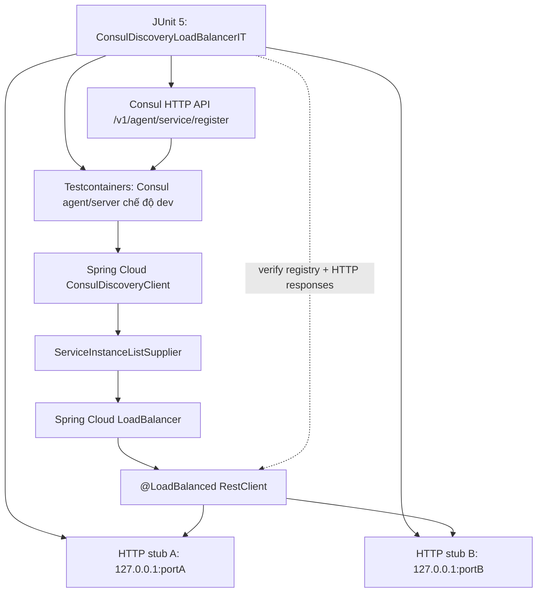

# Kiểm tra tích hợp discovery thực bằng môi trường cô lập

Trong hệ thống microservices, một bài test cân bằng tải có thể chạy “xanh” dù ứng dụng chưa từng kết nối tới **service registry thật**. Nếu test tự cung cấp danh sách `ServiceInstance` bằng `SimpleDiscoveryClient` hoặc một mock `DiscoveryClient`, nó kiểm tra được thuật toán chọn instance và đường đi HTTP, nhưng **chưa kiểm chứng** các hành vi của Eureka, Consul hay nền tảng discovery thực: đăng ký, công bố danh sách, lọc trạng thái sức khỏe, cập nhật khi instance biến mất và độ trễ hội tụ.

Bài học thuộc chương **Kiểm thử tự động** của module `SPRING_CLOUD_SERVICE_COMMUNICATION_LOAD_BALANCING`. Mục tiêu là tạo một bài **integration test có service discovery thật nhưng môi trường hoàn toàn cô lập**, để xác minh đường đi từ registry → `DiscoveryClient` → `ServiceInstanceListSupplier` → Spring Cloud LoadBalancer → RestClient → bản sao HTTP thực sự nhận request. Ví dụ chính sử dụng **Consul chạy trong Testcontainers**, hai HTTP stub bằng JDK `HttpServer` và JUnit 5. Các nguyên tắc cũng áp dụng cho Eureka, Kubernetes Discovery, WebClient và OpenFeign.

> **Thông điệp cốt lõi:** Muốn kiểm chứng tích hợp discovery, phải có **backend registry thật** trong bài test; nhưng backend đó phải là tài nguyên test được tạo và hủy riêng, không dùng registry staging/production, không chỉnh thủ công tên service hoặc trạng thái của dịch vụ thật.

## 1. “Discovery thật” khác gì một danh sách instance giả?

Có nhiều cấp độ kiểm thử, mỗi cấp trả lời câu hỏi khác nhau.

| Cấp độ | Nguồn danh sách instance | Kiểm tra được | Chưa kiểm tra được |
|---|---|---|---|
| Unit test thuật toán | `ServiceInstanceListSupplier` mock/static | Round robin, random, chọn theo metadata, danh sách rỗng | Registry API, đăng ký, health, propagation |
| Integration test không registry | `SimpleDiscoveryClient` với URI cấu hình | `@LoadBalanced` RestClient/WebClient, chọn host và gọi HTTP | Giao thức discovery và các lifecycle thực |
| **Integration test real discovery** | **Consul/Eureka chạy cô lập** | Registry registration/query, `DiscoveryClient`, supplier, HTTP routing, trạng thái instance | Toàn bộ failure mode của production cluster |
| End-to-end staging | Registry, gateway, DNS, TLS và mạng gần production | Tích hợp liên service ở nhiều tầng | Tính cô lập và khả năng tái hiện tuyệt đối |
| Resilience/chaos test | Discovery cluster có fault injection | Phân vùng mạng, cluster restart, cache stale, recovery | Kết quả đơn giản và nhanh của unit tests |

Một test chỉ assert:

```java
assertEquals(2,
        simpleDiscoveryClient.getInstances("inventory-service").size());
```

chưa chứng minh rằng Consul hay Eureka được gọi. Nó chỉ chứng minh **danh sách cấu hình tĩnh** có hai phần tử. Bài này cần bằng chứng mạnh hơn: chính test **đăng ký instance qua HTTP API của Consul**, Spring Cloud Consul **đọc lại từ Consul** và HTTP client load-balanced **gọi đúng một trong các bản sao**.

## 2. Phạm vi bài test và những thành phần được dùng

Mô hình triển khai:



Các bộ phận:

1. **Consul thật** trong một Docker container, không dùng mock HTTP response cho API registry.
2. **Hai HTTP server thật** chạy trên máy test, mỗi server có cổng động và trả marker `inventory-a`/`inventory-b`.
3. **Consul HTTP API** dùng để đăng ký và hủy đăng ký từng instance.
4. **TTL health checks** của Consul dùng để chuyển một instance sang `passing` hoặc `critical` theo lệnh test, không cần chờ lỗi mạng thật.
5. **Spring Cloud Consul DiscoveryClient** truy vấn Consul và trả danh sách `ServiceInstance`.
6. **Spring Cloud LoadBalancer** chọn instance theo service ID.
7. **RestClient** được dựng từ bean `@LoadBalanced RestClient.Builder` để gọi `http://inventory-service/whoami`.
8. **Awaitility** chờ trạng thái registry/discovery hội tụ thay vì `Thread.sleep(...)` cố định.

**Điểm chủ ý trong mô hình:** HTTP stub chạy cùng JVM với test, và Consul **chỉ lưu** `Address=127.0.0.1` cùng cổng của stub. **Consul container không tự gửi request tới địa chỉ loopback đó.** TTL check được cập nhật **trực tiếp qua API của Consul**; vì vậy bài test kiểm chứng registry + health filtering thật, nhưng **chưa kiểm chứng chức năng Consul tự gọi HTTP health endpoint**. Nếu muốn test health probe thật, xem mục 17.

## 3. Vì sao chọn Consul + Testcontainers?

Một registry dùng chung trên máy developer khiến test phụ thuộc trạng thái ngoài:

- Một service có cùng tên đã được đăng ký từ trước.
- Một instance thuộc một nhóm khác bất ngờ xuất hiện.
- Registry restart giữa lúc CI chạy.
- Health check thay đổi sau những lần chạy trước.
- Thời gian và thứ tự deploy làm test không tái hiện được.
- Test xóa nhầm registration của môi trường khác.

Testcontainers giải quyết phần lớn rủi ro này bằng cách cấp một registry **mới cho mỗi test class/run**, mapping cổng động và quản lý vòng đời Docker container.

| Điều kiện cô lập | Giải pháp |
|---|---|
| Registry mới cho bài test | `GenericContainer` chạy Consul `agent -dev` |
| Không trùng cổng 8500 | Testcontainers `getMappedPort(8500)` |
| Không đụng service bên ngoài | JVM client chỉ trỏ Consul của container |
| Không dùng endpoint thật | Hai `HttpServer` cổng động của test |
| Không đăng ký chính ứng dụng test | `spring.cloud.consul.discovery.register=false` |
| Không giữ instance giữa các test | `@BeforeEach` đăng ký lại, `@AfterEach` deregister |
| Không lệ thuộc thứ tự test | Mỗi method tạo trạng thái ban đầu riêng |
| Không lặp retry gây nhiễu | `spring.cloud.loadbalancer.retry.enabled=false` |
| Không bị cache LB làm trễ kết quả | `spring.cloud.loadbalancer.cache.enabled=false` |

**Không chạy Consul chế độ `-dev` ở production.** Chế độ dev được chọn vì thử nghiệm ngắn, không cần cluster nhiều node, ACL hoặc TLS production; CI phải cô lập Docker/network và không xuất cổng Consul ra Internet.

## 4. Điều kiện môi trường và dependency

Yêu cầu tối thiểu cho hướng dẫn:

- JDK 17+ để dùng Java text blocks và API `java.net.http.HttpClient`.
- Spring Boot có `RestClient` (Spring Framework 6.1+), Spring Cloud release train tương thích.
- Docker Engine/Podman tương thích Testcontainers và quyền khởi tạo container trong CI.
- Maven/Gradle quản lý version qua Spring Boot parent/BOM và Spring Cloud BOM tương ứng.
- Network CI có thể kéo image Consul từ registry nội bộ hoặc Docker Hub đã phê duyệt.
- Không có cấu hình `SimpleDiscoveryClient` nào vô tình đăng ký cùng `inventory-service` trong test này.

Ví dụ Maven dependencies (giả định project **đã import Spring Cloud BOM tương thích**):

```xml
<dependencies>
    <dependency>
        <groupId>org.springframework.boot</groupId>
        <artifactId>spring-boot-starter-web</artifactId>
    </dependency>

    <dependency>
        <groupId>org.springframework.cloud</groupId>
        <artifactId>spring-cloud-starter-loadbalancer</artifactId>
    </dependency>

    <dependency>
        <groupId>org.springframework.cloud</groupId>
        <artifactId>spring-cloud-starter-consul-discovery</artifactId>
    </dependency>

    <dependency>
        <groupId>org.springframework.boot</groupId>
        <artifactId>spring-boot-starter-test</artifactId>
        <scope>test</scope>
    </dependency>

    <dependency>
        <groupId>org.springframework.boot</groupId>
        <artifactId>spring-boot-testcontainers</artifactId>
        <scope>test</scope>
    </dependency>

    <dependency>
        <groupId>org.testcontainers</groupId>
        <artifactId>junit-jupiter</artifactId>
        <scope>test</scope>
    </dependency>

    <dependency>
        <groupId>org.awaitility</groupId>
        <artifactId>awaitility</artifactId>
        <scope>test</scope>
    </dependency>
</dependencies>
```

Testcontainers version nên lấy từ dependency management của Spring Boot hoặc BOM do dự án quy định; không trộn ngẫu nhiên các major versions. `spring-boot-testcontainers` hữu ích cho Spring Boot tích hợp Testcontainers, nhưng ví dụ bên dưới chủ yếu dùng JUnit extension và `@DynamicPropertySource`; với một project có quản lý dependency riêng, kiểm tra trước khi thêm dependency trùng chức năng.

Ví dụ pin image:

```java
DockerImageName.parse("hashicorp/consul:1.22.7")
```

Đây là **một tag cụ thể cho ví dụ**; khi đưa vào CI ổn định, pin theo image digest được tổ chức kiểm duyệt, lưu ý kiến trúc CPU và khả năng truy cập registry. Không dùng `latest` vì có thể thay hành vi khi pipeline chạy lại.

## 5. Thiết kế test case và kết quả kỳ vọng

| Kịch bản | Thao tác lên Consul | Kỳ vọng `DiscoveryClient` | Kỳ vọng HTTP client |
|---|---|---|---|
| Hai instance healthy | Đăng ký A/B, cả hai TTL `passing` | Có A và B | Gọi được cả hai instance qua service ID |
| Instance B unhealthy | Set check B `critical` | Chỉ còn A nếu `query-passing=true` | Các request mới đi tới A |
| B phục hồi | Set B lại `passing` | A và B xuất hiện lại | Có thể chọn lại B |
| Deregister B | Consul xóa registration B | Chỉ còn A | Chỉ route tới A |
| Deregister cả A và B | Xóa cả hai | Danh sách rỗng | Không có request tới HTTP stub; caller nhận lỗi |
| Service ID chưa đăng ký | Không đăng ký tên đó | Danh sách rỗng | Không chọn được instance |
| Registry unavailable | Stop/block Consul | Query lỗi hoặc cache còn stale | Hành vi phụ thuộc discovery/cache/fallback; test riêng |
| B vẫn registered nhưng cổng HTTP chết | Consul TTL vẫn passing | Có thể vẫn thấy B | Có thể connect fail khi chọn B |

Không gộp trường hợp `critical` với việc tắt HTTP server. **Một instance unhealthy theo Consul** là kết quả của health query. **Một instance không kết nối được** là lỗi transport. TTL check giúp mô phỏng chúng riêng biệt.

## 6. Cấu hình Spring Boot test tối thiểu

Trong test class sẽ dùng `@SpringBootTest(webEnvironment = NONE)` và property:

```properties
spring.application.name=discovery-it-client
spring.cloud.consul.discovery.enabled=true
spring.cloud.consul.discovery.register=false
spring.cloud.consul.discovery.query-passing=true
spring.cloud.consul.config.enabled=false

spring.cloud.loadbalancer.cache.enabled=false
spring.cloud.loadbalancer.retry.enabled=false
```

Hai property `spring.cloud.consul.host` và `spring.cloud.consul.port` được cấp **động** bằng `@DynamicPropertySource` từ Testcontainers; **không hard-code** `localhost:8500`.

Ý nghĩa:

- `discovery.enabled=true` giữ Spring Cloud Consul DiscoveryClient hoạt động.
- `register=false` tránh Spring Boot test app tự công bố mình là một service.
- `query-passing=true` yêu cầu Consul chỉ trả các instance có health checks `passing` theo cơ chế của Consul.
- `config.enabled=false` tránh vô tình tải configuration từ Consul KV nếu ứng dụng có thêm integration này.
- Cache LB và retry tắt để một lần gọi gần với một lựa chọn/HTTP attempt, tăng tính dễ kiểm chứng.
- Đây là test registry, **không kiểm tra cache TTL hay retry**. Sau khi xác minh đường cơ bản, hãy có test riêng bật cache/retry để đo propagation.

Theo tài liệu Spring Cloud Consul, `query-passing` làm query service instance yêu cầu Consul lọc các health checks ở trạng thái `passing`. Nếu tắt property này, B có thể vẫn xuất hiện dù TTL check của B chuyển `critical`. Vì vậy nó phải là một **điều kiện test được xác nhận**, không thể thiếu rồi vẫn kỳ vọng health filtering.

## 7. Cấu hình RestClient bằng @LoadBalanced

Spring Cloud LoadBalancer cần được cài vào transport. Với RestClient:

```java
import org.springframework.boot.SpringBootConfiguration;
import org.springframework.boot.autoconfigure.EnableAutoConfiguration;
import org.springframework.cloud.client.loadbalancer.LoadBalanced;
import org.springframework.context.annotation.Bean;
import org.springframework.web.client.RestClient;

@SpringBootConfiguration
@EnableAutoConfiguration
class DiscoveryTestApp {

    @Bean("discoveryLoadBalancedBuilder")
    @LoadBalanced
    RestClient.Builder discoveryLoadBalancedBuilder() {
        return RestClient.builder();
    }
}
```

Gọi:

```java
RestClient client = builder.build();

String result = client.get()
        .uri("http://inventory-service/whoami")
        .retrieve()
        .body(String.class);
```

**Hostname `inventory-service` là service ID**. LoadBalancer nhận tên đó và chọn instance được ConsulDiscoveryClient cung cấp. Nếu dùng `http://127.0.0.1:<port>` thì HTTP client gọi trực tiếp một stub, **không chứng minh discovery hay LoadBalancer**. Nếu tạo `RestClient.create(...)` ngoài builder đã được Spring cấu hình, request có thể dùng DNS và không qua cơ chế client-side balancing.

### 7.1. Vì sao không mock DiscoveryClient?

Mock này có thể kiểm thử thuật toán chọn một instance:

```java
when(discoveryClient.getInstances("inventory-service"))
        .thenReturn(List.of(instanceA, instanceB));
```

Nhưng nó loại bỏ phần quan trọng nhất của đề bài: **Spring Cloud Consul có gọi đúng Consul HTTP API hay không, registry cập nhật thế nào và health filters có được áp dụng không**. Hãy dùng mock đó ở một test đơn vị riêng, không thay thế bài test Consul thật.

## 8. Registry registration qua HTTP API của Consul

Consul agent cung cấp các endpoint:

| Method | Endpoint | Tác dụng |
|---|---|---|
| `PUT` | `/v1/agent/service/register` | Đăng ký instance với service ID và health check |
| `PUT` | `/v1/agent/service/deregister/{instanceId}` | Gỡ instance đã đăng ký ở agent |
| `PUT` | `/v1/agent/check/pass/{checkId}` | Chuyển TTL check sang `passing` |
| `PUT` | `/v1/agent/check/fail/{checkId}` | Chuyển TTL check sang `critical` |
| `GET` | `/v1/health/service/{serviceName}?passing=true` | Query các instance có health `passing` |
| `GET` | `/v1/catalog/service/{serviceName}` | Xem catalog entries, **không** cùng semantics health query |

Ví dụ JSON đăng ký A:

```json
{
  "ID": "inventory-a",
  "Name": "inventory-service",
  "Address": "127.0.0.1",
  "Port": 18081,
  "Check": {
    "CheckID": "ttl-inventory-a",
    "Name": "Test health inventory-a",
    "TTL": "10m"
  }
}
```

Điều kiện:

- `Name` là **service ID logic**, có thể chung cho nhiều registrations.
- `ID` là **instance/registration ID** duy nhất trong agent, A và B phải khác nhau.
- `Address` và `Port` là địa chỉ mà **order-service test JVM** sẽ kết nối, không phải địa chỉ mà container dùng để truy cập host.
- `CheckID` là ID của TTL health check; test chủ động báo `pass`/`fail`.
- `TTL=10m` giúp tránh tự hết hạn trong bài test ngắn. Nếu test dài hơn phải heartbeat định kỳ hoặc điều chỉnh phù hợp; trong production, TTL check đòi hỏi heartbeat thật.

**Consul sẽ không tự xác thực HTTP stub** qua TTL check. Khi test gọi `/check/pass/ttl-inventory-a`, trạng thái được xem là healthy dù HTTP server A đã chết. Đây là hành vi có chủ đích để kiểm tra riêng registry health status và network reachability.

## 9. Mã thử nghiệm hoàn chỉnh: Testcontainers + Consul + hai HTTP stubs

Đặt ví dụ này trong một file test Java, chẳng hạn:

```text
src/test/java/com/example/discovery/ConsulDiscoveryLoadBalancerIT.java
```

Code minh họa cho JUnit 5, Spring Boot có RestClient, Spring Cloud Consul Discovery, Spring Cloud LoadBalancer, Testcontainers và Awaitility. **Không yêu cầu một Consul server chạy sẵn bên ngoài.**

### 9.1. Imports và định nghĩa test class

```java
package com.example.discovery;

import java.io.IOException;
import java.io.OutputStream;
import java.io.UncheckedIOException;
import java.net.InetSocketAddress;
import java.net.URI;
import java.net.http.HttpClient;
import java.net.http.HttpRequest;
import java.net.http.HttpResponse;
import java.nio.charset.StandardCharsets;
import java.time.Duration;
import java.util.ArrayList;
import java.util.List;
import java.util.Set;
import java.util.concurrent.atomic.AtomicInteger;

import com.sun.net.httpserver.HttpServer;
import org.junit.jupiter.api.AfterAll;
import org.junit.jupiter.api.AfterEach;
import org.junit.jupiter.api.BeforeEach;
import org.junit.jupiter.api.Tag;
import org.junit.jupiter.api.Test;
import org.junit.jupiter.api.parallel.Execution;
import org.junit.jupiter.api.parallel.ExecutionMode;

import org.springframework.beans.factory.annotation.Autowired;
import org.springframework.beans.factory.annotation.Qualifier;
import org.springframework.boot.SpringBootConfiguration;
import org.springframework.boot.autoconfigure.EnableAutoConfiguration;
import org.springframework.boot.test.context.SpringBootTest;
import org.springframework.cloud.client.ServiceInstance;
import org.springframework.cloud.client.discovery.DiscoveryClient;
import org.springframework.cloud.client.loadbalancer.LoadBalanced;
import org.springframework.context.annotation.Bean;
import org.springframework.test.annotation.DirtiesContext;
import org.springframework.test.context.DynamicPropertyRegistry;
import org.springframework.test.context.DynamicPropertySource;
import org.springframework.web.client.RestClient;

import org.testcontainers.containers.GenericContainer;
import org.testcontainers.containers.wait.strategy.Wait;
import org.testcontainers.junit.jupiter.Container;
import org.testcontainers.junit.jupiter.Testcontainers;
import org.testcontainers.utility.DockerImageName;

import static org.assertj.core.api.Assertions.*;
import static org.awaitility.Awaitility.await;

@Testcontainers
@Tag("integration")
@Execution(ExecutionMode.SAME_THREAD)
@DirtiesContext(classMode = DirtiesContext.ClassMode.AFTER_CLASS)
@SpringBootTest(
        classes = ConsulDiscoveryLoadBalancerIT.TestApp.class,
        webEnvironment = SpringBootTest.WebEnvironment.NONE,
        properties = {
                "spring.application.name=discovery-it-client",
                "spring.cloud.consul.discovery.enabled=true",
                "spring.cloud.consul.discovery.register=false",
                "spring.cloud.consul.discovery.query-passing=true",
                "spring.cloud.consul.config.enabled=false",
                "spring.cloud.loadbalancer.cache.enabled=false",
                "spring.cloud.loadbalancer.retry.enabled=false"
        })
class ConsulDiscoveryLoadBalancerIT {

    private static final String SERVICE = "inventory-service";

    @Container
    static final GenericContainer<?> CONSUL =
            new GenericContainer<>(
                    DockerImageName.parse("hashicorp/consul:1.22.7"))
                    .withExposedPorts(8500)
                    .withCommand(
                            "agent", "-dev", "-client=0.0.0.0")
                    .waitingFor(
                            Wait.forHttp("/v1/status/leader")
                                    .forPort(8500)
                                    .forStatusCode(200));

    private static final ProbeServer A =
            ProbeServer.start("inventory-a");
    private static final ProbeServer B =
            ProbeServer.start("inventory-b");

    private static final HttpClient CONSUL_HTTP =
            HttpClient.newHttpClient();

    @DynamicPropertySource
    static void consulProperties(DynamicPropertyRegistry registry) {
        registry.add(
                "spring.cloud.consul.host",
                CONSUL::getHost);
        registry.add(
                "spring.cloud.consul.port",
                () -> CONSUL.getMappedPort(8500));
    }

    @Autowired
    DiscoveryClient discoveryClient;

    @Autowired
    @Qualifier("loadBalancedBuilder")
    RestClient.Builder builder;

    @SpringBootConfiguration
    @EnableAutoConfiguration
    static class TestApp {

        @Bean("loadBalancedBuilder")
        @LoadBalanced
        RestClient.Builder loadBalancedBuilder() {
            return RestClient.builder();
        }
    }

    // Xem các method test và helper trong các mục tiếp theo.
}
```

`@Container` bảo đảm Consul có vòng đời do Testcontainers JUnit extension quản lý. `@DynamicPropertySource` đưa **host và mapped port thật** của container vào Spring Environment trước khi tạo client discovery.

`@DirtiesContext(AFTER_CLASS)` được thêm vì Spring TestContext có thể cache `ApplicationContext` lâu hơn vòng đời container tĩnh. Khi container dừng sau test class, không nên tái sử dụng một context còn giữ kết nối tới container đã dừng. Với suite dùng container dạng Spring bean/service connection, quản lý lifecycle có thể khác và cần thiết kế riêng.

### 9.2. Stub HTTP có marker và request counter

Thêm nested class sau vào `ConsulDiscoveryLoadBalancerIT` (cùng file):

```java
private static final class ProbeServer implements AutoCloseable {

    private final HttpServer server;
    private final AtomicInteger calls = new AtomicInteger();

    private ProbeServer(String instanceId) throws IOException {
        this.server = HttpServer.create(
                new InetSocketAddress("127.0.0.1", 0), 0);

        server.createContext("/whoami", exchange -> {
            calls.incrementAndGet();
            byte[] payload = instanceId.getBytes(
                    StandardCharsets.UTF_8);

            exchange.getResponseHeaders().set(
                    "Content-Type", "text/plain; charset=UTF-8");
            exchange.getResponseHeaders().set(
                    "X-Instance-Id", instanceId);

            exchange.sendResponseHeaders(200, payload.length);
            try (OutputStream out =
                         exchange.getResponseBody()) {
                out.write(payload);
            }
        });

        server.start();
    }

    static ProbeServer start(String instanceId) {
        try {
            return new ProbeServer(instanceId);
        } catch (IOException error) {
            throw new UncheckedIOException(error);
        }
    }

    int port() {
        return server.getAddress().getPort();
    }

    int calls() {
        return calls.get();
    }

    @Override
    public void close() {
        server.stop(0);
    }
}
```

Ở đây:

- Cổng `0` yêu cầu hệ điều hành chọn một cổng còn trống, tránh xung đột CI.
- Response body chứa `inventory-a` hoặc `inventory-b`; client có thể chứng minh **instance thực nhận**.
- `AtomicInteger` ghi số HTTP requests mà stub thực sự nhận.
- Stub không phải mock của `DiscoveryClient`. Nó là HTTP endpoint thực và được Consul công bố như một service instance.

### 9.3. Helper gửi yêu cầu tới Consul thật

Thêm các method sau vào **cùng test class**:

```java
private static String consulBaseUrl() {
    return "http://" + CONSUL.getHost()
            + ":" + CONSUL.getMappedPort(8500);
}

private static void consulPut(String path, String body) {
    HttpRequest.Builder request =
            HttpRequest.newBuilder(
                    URI.create(consulBaseUrl() + path));

    if (body == null) {
        request.PUT(HttpRequest.BodyPublishers.noBody());
    } else {
        request.header("Content-Type", "application/json");
        request.PUT(
                HttpRequest.BodyPublishers.ofString(body));
    }

    try {
        HttpResponse<String> response = CONSUL_HTTP.send(
                request.build(),
                HttpResponse.BodyHandlers.ofString());

        assertThat(response.statusCode())
                .as("Consul PUT %s: %s", path, response.body())
                .isBetween(200, 299);
    } catch (InterruptedException error) {
        Thread.currentThread().interrupt();
        throw new IllegalStateException(
                "Interrupted during Consul HTTP call", error);
    } catch (IOException error) {
        throw new UncheckedIOException(error);
    }
}

private static void register(String id, int port) {
    String json = """
            {
              "ID": "%s",
              "Name": "inventory-service",
              "Address": "127.0.0.1",
              "Port": %d,
              "Check": {
                "CheckID": "ttl-%s",
                "Name": "Test TTL health %s",
                "TTL": "10m"
              }
            }
            """.formatted(id, port, id, id);

    consulPut(
            "/v1/agent/service/register"
                    + "?replace-existing-checks=true",
            json);
}

private static void passing(String id) {
    consulPut("/v1/agent/check/pass/ttl-" + id, null);
}

private static void critical(String id) {
    consulPut("/v1/agent/check/fail/ttl-" + id, null);
}

private static void deregister(String id) {
    consulPut("/v1/agent/service/deregister/" + id, null);
}

private RestClient loadBalancedClient() {
    return builder.clone().build();
}

private String whoAmI(RestClient client) {
    return client.get()
            .uri("http://inventory-service/whoami")
            .retrieve()
            .body(String.class);
}

private void awaitPorts(int... expected) {
    await().atMost(Duration.ofSeconds(20))
            .pollInterval(Duration.ofMillis(250))
            .untilAsserted(() -> {
                List<Integer> ports = discoveryClient
                        .getInstances(SERVICE)
                        .stream()
                        .map(ServiceInstance::getPort)
                        .toList();

                assertThat(ports)
                        .containsExactlyInAnyOrder(
                                java.util.Arrays.stream(expected)
                                        .boxed().toArray(Integer[]::new));
            });
}
```

Các helper sử dụng **HTTP API thật**. `register(...)` tạo registration gồm service name, instance ID, host/port và TTL check. `passing`/`critical` thay đổi health status của Consul, còn `deregister` loại registration khỏi agent.

`awaitPorts` **poll `DiscoveryClient` của Spring Cloud** cho đến khi trả đúng các cổng kỳ vọng. Nó không chỉ query trực tiếp Consul API và do đó giúp xác minh đường đi Consul → Spring Cloud client. Phép poll giới hạn 20 giây là **giới hạn test**, không phải thông số cần dùng nguyên xi cho mọi CI.

### 9.4. Setup và cleanup trước/sau từng test

```java
@BeforeEach
void registerHealthyInstances() {
    register("inventory-a", A.port());
    register("inventory-b", B.port());

    passing("inventory-a");
    passing("inventory-b");

    awaitPorts(A.port(), B.port());
}

@AfterEach
void cleanupRegistrations() {
    try {
        deregister("inventory-a");
    } finally {
        deregister("inventory-b");
    }
}

@AfterAll
static void stopHttpServers() {
    A.close();
    B.close();
}
```

Mỗi test bắt đầu với A và B ở trạng thái `passing`. Sau test, registration được hủy dù một assertion thất bại. Nếu Consul container đã chết, cleanup có thể thất bại; nên giữ log container/error để phân biệt **lỗi test logic** với **lỗi hạ tầng**.

Lưu ý:

- Không dùng `@TestMethodOrder` để test thứ hai phụ thuộc trạng thái của test thứ nhất.
- Class đang dùng `@Execution(SAME_THREAD)` để tránh các test methods cùng thay health/registration song song trong một registry.
- Cả A và B là resources tĩnh của test class. Khi mở rộng chạy nhiều test classes song song, mỗi class nên có container hoặc service ID namespace riêng.
- Đừng để tên `inventory-service` của test trùng với đăng ký ở một registry thật: tất cả request phải hướng đến **Consul container riêng**.

## 10. Test case 1 — Consul trả hai instance và RestClient gọi thật

Thêm method JUnit:

```java
@Test
void discoversTwoRealInstancesAndRoutesHttpRequests() {
    List<ServiceInstance> discovered =
            discoveryClient.getInstances(SERVICE);

    assertThat(discovered)
            .extracting(ServiceInstance::getPort)
            .containsExactlyInAnyOrder(A.port(), B.port());

    RestClient client = loadBalancedClient();
    List<String> responses = new ArrayList<>();

    for (int n = 0; n < 8; n++) {
        responses.add(whoAmI(client));
    }

    assertThat(responses)
            .allMatch(Set.of(
                    "inventory-a", "inventory-b")::contains);

    // Với RoundRobinLoadBalancer mặc định và 2 ứng viên:
    assertThat(responses)
            .contains("inventory-a", "inventory-b");

    assertThat(A.calls() + B.calls()).isGreaterThanOrEqualTo(8);
}
```

**Bằng chứng thu được:**

1. `discoveryClient.getInstances("inventory-service")` trả đúng hai cổng **đã đăng ký vào Consul**.
2. `@LoadBalanced RestClient` gọi **service ID logic** chứ không biết port A/B.
3. Hai HTTP server trả marker đúng; client quan sát được kết quả từ cả A và B.
4. Không có HTTP response đến từ một endpoint ngoài tập instance đã đăng ký.

Không assert chuỗi cố định `A,B,A,B,...` bởi round-robin index có thể đã được sử dụng ở bước khác hoặc danh sách có thứ tự khác. **Với test mặc định RoundRobin và hai instance đều eligible**, có thể assert đã nhìn thấy cả hai trong tám lời gọi tuần tự. Nếu ứng dụng có custom random/sticky/hint/zone policy, phải điều chỉnh phép kiểm chứng theo policy đã cấu hình.

### 10.1. Vì sao kiểm tra port tốt hơn chỉ đọc instance ID?

Một số discovery implementation có thể chuẩn hóa instance ID hoặc metadata khác nhau theo version. Port của hai HTTP stub là giá trị do **chính bài test tạo ra**, nên đối chiếu port vừa chứng minh registration đã tới client vừa tránh lệ thuộc chuỗi ID do provider tự dựng. Khi cần kiểm tra metadata/zone, tạo test riêng với trường `Meta` và assert theo `getMetadata()`.

### 10.2. Khi kết quả chỉ trả inventory-a

Có thể do:

- Supplier chỉ nhận một instance.
- B chưa `passing` hoặc đang bị health query loại.
- Caching/zone/hint filter chặn B.
- Ứng dụng không dùng default RoundRobin.
- Request đang dùng direct URL vô tình cố định A.
- Còn retry/đường HTTP client khác đang chen vào.

Tách từng tầng để xác định: Consul registry → Spring `DiscoveryClient` → supplier eligible list → selected `ServiceInstance` → stub response marker.

## 11. Test case 2 — B critical, A vẫn phục vụ

Thêm method:

```java
@Test
void filtersUnhealthyInstanceThroughRealConsul() {
    critical("inventory-b");

    awaitPorts(A.port());

    RestClient client = loadBalancedClient();

    int beforeB = B.calls();
    for (int n = 0; n < 6; n++) {
        assertThat(whoAmI(client))
                .isEqualTo("inventory-a");
    }

    assertThat(B.calls()).isEqualTo(beforeB);

    // Phục hồi ngay trong cùng một test.
    passing("inventory-b");
    awaitPorts(A.port(), B.port());
}
```

**Điều được chứng minh:** Consul vẫn có registration B, nhưng health query `passing=true` loại B trong giai đoạn `critical`. Spring Cloud Consul DiscoveryClient trả một tập ứng viên mới, và client LoadBalancer chỉ gửi request tới A sau khi tập ứng viên hội tụ.

**Điều chưa được chứng minh:** Consul agent đã tự kiểm tra HTTP health endpoint của B hay không. Đó là TTL status do test đặt trực tiếp; nếu muốn kiểm chứng HTTP probe thực, dùng biến thể mục 17.

### 11.1. Nếu B vẫn xuất hiện sau khi critical

Kiểm tra lần lượt:

- Property `spring.cloud.consul.discovery.query-passing=true` có hiệu lực không?
- TTL check `ttl-inventory-b` có thực sự liên kết với registration ID `inventory-b`?
- Endpoint `/v1/agent/check/fail/ttl-inventory-b` có trả 2xx không?
- Spring Cloud đang dùng `ConsulDiscoveryClient` hay một discovery source khác?
- LoadBalancer/supplier có cache dữ liệu cũ không?
- Test có đang chạy song song và test khác chuyển B sang `passing` không?

`awaitPorts(...)` phải timeout và báo lỗi nếu không hội tụ; **không** dùng `Thread.sleep(100)` rồi sửa assertion thành “thỉnh thoảng B cũng hợp lệ”.

## 12. Test case 3 — Deregister hai bản sao và xác minh no-instance

Thêm method:

```java
@Test
void stopsRoutingWhenBothRegistrationsDisappear() {
    RestClient client = loadBalancedClient();

    // Bị mất B nhưng A còn sống.
    deregister("inventory-b");
    awaitPorts(A.port());

    assertThat(whoAmI(client)).isEqualTo("inventory-a");

    // Mất nốt A.
    deregister("inventory-a");
    awaitPorts();

    int beforeA = A.calls();
    int beforeB = B.calls();

    assertThatThrownBy(() -> whoAmI(client))
            .isInstanceOf(RuntimeException.class);

    // Không còn endpoint nào nhận request từ lời gọi thất bại.
    assertThat(A.calls()).isEqualTo(beforeA);
    assertThat(B.calls()).isEqualTo(beforeB);
}
```

Đây là test quan trọng để phát hiện cấu hình **fallback ngầm hoặc URL vật lý hard-code**. Sau khi cả A/B bị deregister và `DiscoveryClient` trả danh sách rỗng, request logic `inventory-service` không được gửi tới A/B.

**Loại exception cụ thể** từ `RestClient` khi không có instance có thể khác giữa Spring Cloud release train và HTTP client integration: response 503 do LoadBalancer sinh ra rồi `retrieve()` chuyển thành exception, hoặc lỗi lựa chọn được biểu diễn dưới dạng exception khác. Đừng assert mọi phiên bản phải ném cùng một lớp lỗi. Hãy assert **không có request HTTP tới stub** và **caller không nhận một response thành công giả**, sau đó chọn assertion exception/status phù hợp phiên bản ứng dụng đang dùng.

Nếu doanh nghiệp cố tình có fallback/circuit breaker, test phải kiểm tra fallback được kích hoạt **đúng policy**; không nên coi mọi fallback là bug.

## 13. Nâng bằng chứng: kiểm tra trực tiếp Consul HTTP API

Kiểm tra `DiscoveryClient` là quan trọng, nhưng để biết registry thay đổi thật, có thể query thêm các endpoint Consul:

```text
GET /v1/agent/services
GET /v1/agent/checks
GET /v1/health/service/inventory-service?passing=true
GET /v1/catalog/service/inventory-service
```

So sánh:

| Nguồn | Trạng thái B `critical` |
|---|---|
| `/v1/agent/services` | B vẫn **registered** |
| `/v1/agent/checks` | Check B là `critical` |
| `/v1/health/service/inventory-service?passing=true` | B **không** xuất hiện |
| `DiscoveryClient.getInstances("inventory-service")` | B **không** xuất hiện nếu client dùng `query-passing=true` |
| HTTP client sau hội tụ | Không route sang B |

Đây là cách phân biệt **registry mất registration** và **registry vẫn có instance nhưng filter vì unhealthy**. Với Consul, `/catalog/service/...` là góc nhìn catalog; nó không hoàn toàn tương đương `/health/service/...?...`. Nếu assert trên catalog khi mục tiêu là “chỉ instance khỏe”, test có thể kết luận sai.

### 13.1. Các loại metadata nên ghi nhận

- `serviceId`: tên logic.
- `instanceId`: ID của registration.
- `host`, `port`, `secure`/scheme.
- `metadata`: zone, version, hint, weight nếu có.
- `registryHealth`: `passing/warning/critical`.
- `retrievedAt`: thời điểm query.
- `selectedInstance`: bản sao được LoadBalancer chọn.
- `actualHttpResponder`: marker từ HTTP stub.

Không dùng request ID, port động hoặc IP tự do làm tag Micrometer không kiểm soát; với test, ghi chúng vào assertion/log là đủ.

## 14. Vì sao phải dùng polling thay cho sleep cố định?

Service discovery thường có **eventual consistency** ở nhiều tầng:

```text
Consul registration
      ↓
Consul health query/catal​og update
      ↓
Spring Cloud ConsulDiscoveryClient
      ↓
ServiceInstanceListSupplier
      ↓
LoadBalancer cache / health filter (nếu bật)
      ↓
HTTP client
```

Ngay cả khi `PUT /agent/service/register` đã trả 2xx, một lần query khác có thể chưa trả kết quả mong muốn tức thì, đặc biệt khi registry nhiều node, có watch, cache hoặc network delay. Vì thế test nên:

```java
await().atMost(Duration.ofSeconds(20))
        .pollInterval(Duration.ofMillis(250))
        .untilAsserted(() ->
                assertThat(discoveryClient
                        .getInstances("inventory-service"))
                        .hasSize(2));
```

Polling hữu hạn đảm bảo:

- Thành công sớm khi dữ liệu hội tụ.
- Thất bại sau một deadline có thông báo assertion.
- Không đợi lâu cố định ở máy chạy nhanh.
- Không phụ thuộc chính xác lịch thread/scheduler.
- Có thể gắn thông tin registry snapshot khi timeout để điều tra.

**Tránh retry vô hạn**: test bị sai service ID hay sai cấu hình phải fail trong giới hạn, không được treo CI.

### 14.1. Hai thời điểm phải phân biệt

- **Registry write acknowledged:** Consul đã chấp nhận registration/health mutation.
- **Consumer observed update:** Spring `DiscoveryClient`/supplier của app đã nhìn thấy thay đổi.

Một bài test end-to-end cần nhìn thời điểm thứ hai. Không chỉ kiểm tra HTTP `PUT` status mà tuyên bố đường đi discovery đã đúng.

## 15. Khi bật cache, health supplier và retry

Bài test cơ bản tắt LoadBalancer cache/retry để tạo baseline. Khi kiểm chứng hành vi production, hãy bật chúng **trong test khác**, không trộn nhiều nguyên nhân gây nhiễu vào một phép đo.

| Tính năng | Cách đưa vào test | Điều cần đo |
|---|---|---|
| LB cache | Bật `spring.cloud.loadbalancer.cache.enabled`, chỉnh TTL phù hợp | Thời gian từ deregister đến khi selection không dùng instance cũ |
| Consul watch | Bật catalog watch nếu ứng dụng dựa trên nó | Event/watch và thời điểm phản ánh |
| Health-aware supplier | Tạo supplier chain phù hợp | Danh sách sau health filter khác discovery list thế nào |
| Retry same-instance | Cấu hình retry + dependency đúng client | Một logical call có bao nhiêu HTTP attempt |
| Retry next-instance | Bật retry-aware supplier và hai instance | Sau lỗi A có chọn lại B không |
| Zone/hint | Đăng ký metadata tương ứng | Candidate sau filtering có đúng yêu cầu |
| TLS/mTLS | Consul/HTTP stub dùng TLS và cert test | Truststore, SAN, hostname verification |
| Timeouts | Để stub chậm hoặc cắt kết nối | Connect/read/deadline phân loại rõ |

### 15.1. Cache có thể giữ instance đã biến mất

Nếu LB caching bật, deregister B khỏi Consul **không có nghĩa request ngay lập tức ngừng chọn B**. Supplier có thể còn snapshot cũ cho đến TTL/replay/update. Một test có thể:

1. Đăng ký A/B; chờ Spring nhận cả hai.
2. Gọi đủ để LB cache danh sách.
3. Deregister B; lưu thời điểm `t0`.
4. Poll lựa chọn/response cho tới khi B không còn được chọn sau các cơ chế hội tụ.
5. Ghi `t1 - t0` làm **convergence latency**.
6. Assert có cận thời gian hợp lý, không dùng “phải biến mất trong 1 ms”.

**Không chỉ dùng `DiscoveryClient.getInstances()` để kết luận LB cache đã cập nhật.** Discovery có thể trả A trong khi `CachingServiceInstanceListSupplier` vẫn giữ A/B. Để đo tầng LB thật, instrument supplier hoặc quan sát request lựa chọn trong môi trường kiểm soát.

### 15.2. Consul query-passing không giống HealthCheckServiceInstanceListSupplier

`spring.cloud.consul.discovery.query-passing=true` yêu cầu **Consul registry** lọc checks. `HealthCheckServiceInstanceListSupplier` của Spring Cloud LoadBalancer là một **bộ lọc ở phía client** có thể tự gọi health endpoint của instance. Hai cơ chế khác tầng, khác interval/cache và có thể cùng hiện diện.

Khi test health, phải biết chính xác tầng nào đang thực hiện filtering để giải thích kết quả. Trong ví dụ này, filtering chính đến từ **Consul health query**.

### 15.3. Retry làm sai phép đếm request

Khi bật retry, một logical call có thể đến A rồi B. Không assert “mỗi lần gọi Java tạo đúng một HTTP request”. Dùng correlation ID và counters trên stub A/B để đo số HTTP attempts. Với thao tác ghi, chỉ bật retry khi có idempotency hoặc hợp đồng an toàn.

## 16. Cô lập test theo lớp, không chỉ theo Docker container

Testcontainers chỉ cô lập backend registry. Cần thêm các lớp cô lập:

### 16.1. Data isolation

- Không dùng tên service ID đã trỏ vào registry ngoài.
- Đăng ký instance IDs duy nhất trong test agent.
- Với nhiều test classes song song, dùng prefix ngẫu nhiên hoặc container riêng.
- Trước mỗi test, xác định rõ các registrations và TTL statuses.
- Sau test, deregister; khi container dừng thì mọi dữ liệu dev agent cũng biến mất.

### 16.2. Network isolation

- Test JVM chỉ dùng host/mapped port của container Testcontainers.
- HTTP stubs bind `127.0.0.1` và port động, không bind `0.0.0.0` nếu không cần nhận traffic bên ngoài.
- Không để app tự fallback sang `localhost:8500` nơi có Consul của developer.
- Không dùng `host.testcontainers.internal` làm địa chỉ instance trong registry nếu **JVM client** không resolve hostname đó; hostname này chủ yếu dành cho **container truy cập host**.
- Nếu CI chạy remote Docker engine, phải kiểm tra địa chỉ container do Testcontainers cấp và routing giữa host/container.

### 16.3. Lifecycle isolation

- `@Container static` tạo một registry trong vòng đời test class.
- Spring TestContext có cache; `@DirtiesContext(AFTER_CLASS)` giúp tránh tái sử dụng client context trỏ container đã dừng.
- Khi các test khác chia sẻ context, không tắt container trước khi context bị giải phóng.
- Không bật container reuse một cách vô thức cho suite cần reset dữ liệu nghiêm ngặt.
- Không chạy test trong CI thiếu Docker rồi âm thầm thay bằng mock: hãy đánh dấu/tag rõ và báo skipped/failure có nguyên nhân.

### 16.4. Security isolation

Consul `agent -dev` thường không đại diện cấu hình ACL/TLS production. Đừng công bố admin API tới network công khai. Nếu cần test token, ACL, certificate rotation hoặc mTLS, dựng **test registry với cấu hình bảo mật riêng** và secrets dành cho test; không dùng production token/cert.

## 17. Mở rộng: Consul tự gọi HTTP health endpoint thật

Bài test chính dùng **TTL health check** vì ổn định và tách biệt trạng thái registry khỏi tình trạng TCP của stub. Nếu muốn kiểm tra **Consul HTTP check** thực sự gọi server A/B, cần giải quyết vấn đề networking:

- HTTP stubs chạy trên máy host.
- Consul chạy trong container.
- `127.0.0.1` **bên trong container** là container Consul, **không phải** test JVM.
- Vì vậy `Check.HTTP=http://127.0.0.1:<hostPort>/health` sẽ thất bại khi Consul container thực hiện check.

Testcontainers hỗ trợ mở cổng host cho container:

```java
// Chạy sau khi HTTP server host đã start,
// nhưng trước khi khởi tạo/start Consul container.
Testcontainers.exposeHostPorts(serverA.port(), serverB.port());
```

Sau đó Consul có thể gọi:

```text
http://host.testcontainers.internal:<portA>/health
http://host.testcontainers.internal:<portB>/health
```

Ví dụ đăng ký check HTTP **thay cho TTL**:

```json
{
  "ID": "inventory-a",
  "Name": "inventory-service",
  "Address": "127.0.0.1",
  "Port": 18081,
  "Check": {
    "CheckID": "http-inventory-a",
    "Name": "Inventory A real HTTP health",
    "HTTP": "http://host.testcontainers.internal:18081/health",
    "Interval": "1s",
    "Timeout": "500ms"
  }
}
```

`Address=127.0.0.1` vẫn phục vụ **client JVM ngoài container**, còn `Check.HTTP` phục vụ **Consul agent trong container**. Đây là hai góc nhìn network khác nhau và phải được thiết kế riêng. Tùy backend Docker/CI, `Testcontainers.exposeHostPorts(...)` cần được gọi đúng trước khi container start và có thể yêu cầu cấu hình host access phù hợp.

Kịch bản mở rộng:

1. Stub trả `200` từ `/health` khi khỏe.
2. Consul HTTP check chuyển trạng thái `passing`.
3. Chuyển stub B trả `503` ở `/health`, không dừng TCP.
4. Chờ Consul check B `critical` và Spring DiscoveryClient chỉ trả A.
5. Client gọi service ID và chỉ nhận response từ A.
6. B khôi phục `/health` về 200; chờ B được chọn lại.

**Không dùng bản mở rộng này nếu chưa xử lý đúng networking**. TTL health check của mục 9–12 đủ để kiểm tra thực tế chức năng query/filter của registry, còn HTTP health probe là một integration test **cấp độ sâu hơn**.

## 18. Biến thể cho Eureka và Kubernetes Discovery

Lựa chọn Consul ở đây là ví dụ cụ thể, không phải yêu cầu dự án phải chuyển registry thật sang Consul.

### 18.1. Eureka

Với Spring Cloud Netflix Eureka, có thể dựng Eureka Server cô lập, khởi động hai instance client dùng Eureka registration thật, rồi chờ Eureka client có đủ danh sách. Khác biệt so với Consul:

- Registration và heartbeat lease có cơ chế riêng.
- Eureka server/cache và client registry fetch có interval; các bản sao bị gỡ có thể mất thời gian hội tụ.
- Có thể có nhiều tầng cache: Eureka SDK và Spring Cloud LoadBalancer.
- `eureka.client.register-with-eureka` và `fetch-registry` của từng app/test client cần cấu hình đúng.
- Test không được mặc định deregister ngay lập tức đồng nghĩa các client không còn cache instance.

Test nên chứng minh `DiscoveryClient` thực sự là Eureka source, và dùng polling dựa trên trạng thái consumer. Không tạo một `SimpleDiscoveryClient` giả rồi gọi đó là kiểm thử Eureka.

### 18.2. Kubernetes Discovery

Với Kubernetes discovery, cần một môi trường Kubernetes riêng như `kind`/`k3d` hoặc một Kubernetes test cluster, tạo Services/EndpointSlices/Pods phù hợp và cấu hình Spring Cloud Kubernetes Discovery theo implementation đang dùng.

Điểm khác biệt:

- “Instance” có thể đến từ endpoints của Kubernetes Service, phụ thuộc namespace, selector và readiness.
- Watch/list API và RBAC phải được cấu hình.
- Kubernetes Service DNS/load balancing **không đồng nghĩa** client-side Spring Cloud LoadBalancer đang chọn Pod.
- Không nên dùng cluster production chỉ để kiểm tra một phản ứng unregister.

### 18.3. Chọn mức thực tế phù hợp

| Mục tiêu | Môi trường phù hợp |
|---|---|
| Chọn theo round robin khi có danh sách tĩnh | Unit test + `SimpleDiscoveryClient` |
| Verify Consul HTTP registration/query | Consul container thực, TTL check |
| Verify Consul HTTP health probing | Consul container + host networking/probe thật |
| Verify Eureka heartbeat/lease/caches | Eureka server + Eureka clients thật trong test |
| Verify Kubernetes endpoints/watch | Test cluster kind/k3d và RBAC |
| Verify gateway/TLS/firewall production | Staging có bảo mật/tài nguyên gần production |

## 19. Chạy trong CI: phân tầng tốc độ và yêu cầu Docker

Đừng bắt tất cả unit tests chạy Docker nếu phần lớn không cần registry. Có thể dùng convention:

```text
Unit tests:
  *Test.java
  chạy mỗi pull request, không cần Docker

Integration tests:
  *IT.java
  cần Docker/Testcontainers và các registry images
  chạy ở job riêng hoặc theo profile build

Resilience/E2E:
  *ChaosIT.java, *E2E.java
  chạy ở môi trường có quyền fault injection
```

Ví dụ với Maven, nếu dự án dùng plugin/test naming tương ứng:

```shell
# Chạy riêng class integration khi đã cấu hình Surefire/Failsafe phù hợp.
mvn -Dtest=ConsulDiscoveryLoadBalancerIT test
```

Nếu dự án tách `*IT` sang Maven Failsafe, cần chạy `mvn verify` với cấu hình includes phù hợp thay vì giả định Surefire tự nhận tên `*IT`. Kiểm tra naming convention của build thực tế.

Checklist CI:

- Docker daemon khả dụng và có quyền start container.
- Image Consul được pin/pull từ registry có kiểm soát.
- Testcontainer mapped port dùng động, không ấn định `8500`.
- JUnit/CI timeout đủ cho image startup, nhưng có deadline cho await.
- Artifact logs giữ thông tin Consul startup, registry HTTP 4xx/5xx và assertion failures.
- Container/resource cleanup hoạt động khi test thất bại.
- Parallelization có giới hạn; không có nhiều test cùng mutate một service ID trong một registry.
- Test không cần token, network route hoặc credentials production.

### 19.1. Docker không khả dụng thì sao?

Nếu CI thiếu Docker:

- Job integration có thể fail fast với thông báo infrastructure requirement.
- Có thể cấu hình skip **tường minh** dựa trên profile/tag khi pipeline chỉ chạy unit tests.
- Không được im lặng coi một integration test bị skip là **PASS cho Consul integration**.
- Không thay `GenericContainer` bằng mock mà vẫn giữ tên/tiêu chí “real discovery”.

## 20. Troubleshooting: lỗi thường gặp của discovery integration tests

| Triệu chứng | Nguyên nhân thường gặp | Kiểm tra |
|---|---|---|
| Testcontainers không start | Docker daemon không có quyền, image không pull được | Docker engine, Testcontainers logs, image tag |
| Spring gọi `localhost:8500` của máy khác | `@DynamicPropertySource` không có hiệu lực hoặc bootstrap config override | Effective `spring.cloud.consul.host/port` |
| `DiscoveryClient` luôn trả rỗng | Registration sai `Name`, health còn critical, sai Consul agent | `/agent/services`, `/agent/checks`, `/health/service?...` |
| Registration A/B có nhưng chưa visible | Registry propagation hoặc watch/cache | Poll trên Spring `DiscoveryClient` và xem Consul health endpoint |
| B critical vẫn xuất hiện | Chưa bật `query-passing`, check ID không đúng | Effective property và TTL check state |
| `No instances available for inventory-service` | Sai service ID hoặc cả hai không eligible | Service `Name` trong Consul, URI logic và filters |
| `UnknownHostException: inventory-service` | Client dùng builder không có `@LoadBalanced` | Bean RestClient và interceptor |
| Request luôn đi tới A | B không có trong eligible set hoặc client direct URL | Discovery list, marker, RoundRobin policy |
| Assertion A/B thứ tự thất bại | RR index/lazy child context hoặc test concurrency | Không assert thứ tự cố định |
| Kết nối tới `127.0.0.1` thất bại | Stub đã dừng hoặc client chạy **trong container khác** | Topology network và host/port của registry |
| Consul HTTP health check fail | Container không thể gọi host loopback | `Testcontainers.exposeHostPorts` + `host.testcontainers.internal` |
| B deregister nhưng vẫn được chọn | LB cache còn stale hoặc client context khác | Bật/tắt cache đúng test, đo convergence |
| `GET` bị gửi nhiều lần | Retry ở LB hoặc HTTP client khác | `retry.enabled=false` và đếm stub requests |
| Test thứ hai không start Consul | Spring TestContext tái sử dụng context trỏ container đã dừng | `@DirtiesContext`/container lifecycle strategy |
| Health TTL chuyển critical bất ngờ | TTL hết hạn, test chạy lâu hoặc thiếu heartbeat | Tăng TTL phù hợp test hoặc gửi pass định kỳ |
| Đổi status nhưng không khớp HTTP thực | TTL chỉ đo registry flag, không đo khả dụng mạng | Dùng HTTP check test riêng |
| CI chạy pass local nhưng fail remote Docker | Địa chỉ host/container khác nhau | Mapped port, Docker network, runner topology |
| Tests đụng môi trường ngoài | Registry host/port hard-code hoặc service ID trùng | Container isolation, dynamic properties, hạn chế external access |

## 21. Chỉ số và log giúp bài test có thể điều tra

Ngoài assertions, có thể ghi các dữ liệu sau vào log của test:

```text
testCase=HEALTH_FILTER
consulHost=localhost
consulPort=<mappedPort>
serviceId=inventory-service
registeredIds=[inventory-a, inventory-b]
passingIds=[inventory-a]
discoveredPorts=[<portA>]
clientUri=http://inventory-service/whoami
httpResponder=inventory-a
logicalCallOutcome=SUCCESS
```

Đây là format tự thiết kế, **không phải log mặc định** của Spring Cloud. Trong CI, log host/port động có ích để xác định lỗi. Không đưa token ACL, private keys, URL có credentials hay response body nhạy cảm vào artifact log.

Những phép đo nên tách riêng:

| Chỉ số | Tác dụng |
|---|---|
| Consul register acknowledgment | Agent chấp nhận registration chưa? |
| Health status cập nhật | TTL check passing/critical đúng chưa? |
| Consumer discovery latency | Bao lâu Spring DiscoveryClient thấy trạng thái mới? |
| Eligible instance count | Bao nhiêu instance sau filter? |
| Selected instance | LoadBalancer chọn bản sao nào? |
| Server-observed HTTP requests | Stub nào thực nhận request? |
| Final outcome | Client nhận success, HTTP error hay exception? |
| Cache convergence time | Sau deregister bao lâu LB ngừng dùng instance cũ? |

Không nhập nhằng “discovery trả hai instance” với “hai instance thật sự đã nhận request”: test phải chứng minh cả hai bước.

## 22. Các bẫy về độ chính xác của bài test

### 22.1. Đừng giả định thời gian hội tụ bằng 0

Consul có thể cập nhật rất nhanh trên dev agent; production registry có watch, client cache và network. Test nên dùng `await().atMost(...)` để mô hình hóa hội tụ, không assert thay đổi registry xuất hiện **ngay lập tức** trong Spring client.

### 22.2. Đừng khẳng định mọi error “no-instance” là HTTP 503

Một số blocking/reactive clients sinh response 503 nội bộ, số khác biểu diễn bằng exception khi không chọn được instance. Assertion cần phù hợp integration/phiên bản và luôn xác nhận **không có HTTP stub nhận request**.

### 22.3. Đừng chỉ kiểm tra @LoadBalanced mà quên registry

Bean được annotate `@LoadBalanced` chưa chứng minh `ConsulDiscoveryClient` truy vấn đúng Consul. Cần assert danh sách từ discovery sau khi chính test thay đổi Consul registry, rồi assert request từ client tới stub thật.

### 22.4. Không ép random phải chọn đủ A/B trong ít request

Bài test dùng default `RoundRobinLoadBalancer` nên có thể expect cả hai sau nhiều calls có kiểm soát. Với random algorithm, xác suất chọn lặp là hợp lệ; khi đó ưu tiên assert policy class và mỗi result thuộc tập candidate.

### 22.5. TTL health của registry không phải health thật của ứng dụng

Khi set Consul TTL `passing`, Consul tin instance còn khỏe trong khoảng TTL. Nếu stub chết nhưng vẫn passing, registry có thể tiếp tục công bố instance. Muốn đo health endpoint, phải dùng health check kiểu HTTP và điều kiện network từ mục 17.

### 22.6. Discovered khác eligible và selected

Discovery từ Consul có thể trả A/B, nhưng LoadBalancer supplier theo zone/hint/metadata hoặc health riêng có thể chỉ còn A. Khi báo lỗi, ghi **tập trước filter**, **tập sau filter**, **instance được chọn** và **HTTP responder**.

### 22.7. Đừng tắt TLS/authentication trong production để “làm test xanh”

Chế độ dev test dùng Consul không ACL/TLS là phạm vi cô lập. Nếu sản phẩm thật yêu cầu ACL/TLS, cần một suite test riêng với test identities/CA, không vô hiệu hostname verification hoặc dùng token production.

## 23. Checklist nghiệm thu

- [ ] Có service registry **thật** được khởi động và dừng trong test, không dùng registry staging/production.
- [ ] `@DynamicPropertySource` cấp đúng host/mapped port của registry.
- [ ] Test app không tự động đăng ký vào Consul nếu không phải mục tiêu kiểm thử.
- [ ] Hai HTTP stubs bind cổng động, trả marker riêng, có cleanup.
- [ ] Đăng ký cả hai qua Consul `/agent/service/register`.
- [ ] Mỗi instance có ID khác nhau nhưng cùng `Name=inventory-service`.
- [ ] TTL checks được đặt `passing` trước khi assert hai instance.
- [ ] Spring `DiscoveryClient.getInstances()` trả đúng URI/port từ Consul.
- [ ] RestClient thực sự được tạo từ bean `@LoadBalanced`.
- [ ] Caller dùng hostname **service ID logic**, không dùng IP/port stub trực tiếp.
- [ ] Request HTTP đến đúng A/B và marker response khớp.
- [ ] Khi B `critical`, Consul health query và Spring DiscoveryClient đều loại B theo policy test.
- [ ] Khi B `passing` lại, ứng dụng nhìn thấy B mà không cần restart context.
- [ ] Khi cả A/B deregister, client không nhận response thành công và không stub nào nhận thêm HTTP request.
- [ ] Các trạng thái được chờ bằng polling có deadline, không dựa vào sleep cố định.
- [ ] Cache và retry bị tắt ở baseline, có test riêng cho production settings.
- [ ] Test cases không phụ thuộc thứ tự thực thi và không chạy song song trên cùng registrations.
- [ ] CI có Docker/ảnh Consul được pin, logs và cleanup được quản lý.
- [ ] Test phân biệt registry health status với transport/network reachability.
- [ ] Test không tạo hoặc xóa service/ACL/certificate ngoài môi trường cô lập.
- [ ] Báo cáo cuối ghi registered/discovered/selected/HTTP responder/final outcome.

## 24. Tổng kết

**Kiểm thử tích hợp discovery thực** phải bao gồm một registry chạy thật, client discovery của Spring, supplier và LoadBalancer thực, cùng endpoint HTTP để chứng minh request tới đúng bản sao. `SimpleDiscoveryClient` rất hữu ích cho unit/integration test nhanh, nhưng không thay thế kiểm thử đăng ký, health và cập nhật instance của Eureka/Consul/Kubernetes.

Với Consul trong Testcontainers, mỗi bài test có thể **tự tạo registry**, đăng ký hai instance HTTP cổng động bằng `/v1/agent/service/register`, chuyển TTL checks `passing/critical`, quan sát `DiscoveryClient.getInstances("inventory-service")` hội tụ và xác nhận `@LoadBalanced RestClient` gọi tới đúng instance. Khi deregister cả hai, client phải ngừng route và trả lỗi thích hợp, không tự dùng một URL vật lý còn sót.

Muốn bài test đáng tin cậy dưới CI, hãy cô lập cả **registry, dữ liệu, network và vòng đời Spring context**, chờ eventual consistency bằng polling có deadline, tắt các lớp cache/retry gây nhiễu ở baseline, giữ negative cases và luôn phân biệt **registration → discovery → selection → HTTP attempt → final result**. Đây là nền tảng để mở rộng sang health probe thật, lỗi registry, retry/fallback, TLS và discovery trong production.

### Tài liệu tham khảo

- [Spring Cloud Consul — Service Discovery](https://docs.spring.io/spring-cloud-consul/reference/discovery.html) — `spring-cloud-starter-consul-discovery`, đăng ký, health, `DiscoveryClient` và `query-passing`.
- [HashiCorp Consul — Agent Service HTTP API](https://developer.hashicorp.com/consul/api-docs/agent/service) — `register`/`deregister` và service checks.
- [HashiCorp Consul — Agent Check HTTP API](https://developer.hashicorp.com/consul/api-docs/agent/check) — TTL checks `pass`/`fail`.
- [HashiCorp Consul — Health HTTP API](https://developer.hashicorp.com/consul/api-docs/health) — `/health/service/{service}?passing=true`.
- [Spring Boot — Testcontainers](https://docs.spring.io/spring-boot/reference/testing/testcontainers.html) — JUnit extension, `@Container`, `@DynamicPropertySource` và context lifecycle.
- [Testcontainers for Java — Networking](https://java.testcontainers.org/features/networking/) — mapped ports, `exposeHostPorts` và `host.testcontainers.internal`.
- [Spring Cloud Commons — LoadBalancer](https://docs.spring.io/spring-cloud-commons/reference/spring-cloud-commons/loadbalancer.html) — supplier, lựa chọn, cache, retry, health và round robin.
- [Spring Cloud Commons — Common Abstractions](https://docs.spring.io/spring-cloud-commons/reference/spring-cloud-commons/common-abstractions.html) — `@LoadBalanced RestClient.Builder`.

