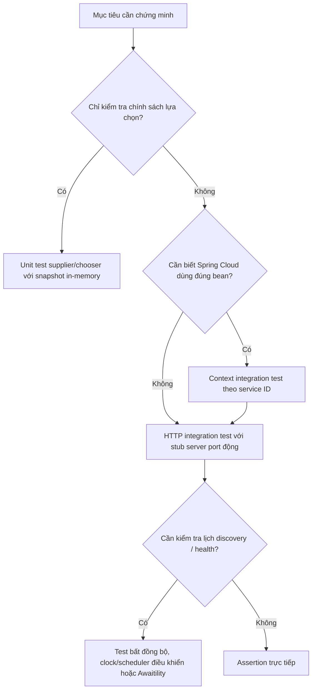

# Giữ test ổn định khi chạy song song và khi danh sách thay đổi

Một bộ kiểm thử Spring Cloud LoadBalancer có thể chạy tốt trên máy lập trình nhưng thất bại ngẫu nhiên trong CI khi nhiều test chạy song song hoặc khi danh sách `ServiceInstance` thay đổi. Nguyên nhân thường không phải thuật toán cân bằng tải sai, mà là **test phụ thuộc vào trạng thái dùng chung, thứ tự chạy, thời điểm cập nhật discovery hoặc vị trí bộ đếm Round Robin**.

Ví dụ, một test gọi `inventory-service` rồi khẳng định **lần đầu luôn tới instance A, lần hai luôn tới B**. Trong thực tế, Spring Cloud LoadBalancer có thể khởi tạo context theo service ID một cách lazy, có cache danh sách instance, bộ đếm Round Robin có vị trí khởi đầu không cố định và những lời gọi từ test khác có thể đã tiêu thụ lượt chọn. Khi thêm/bớt instance giữa hai lần gọi, ngay cả phép chia theo chỉ số cũng thay đổi.

Chủ đề **Kiểm thử tự động** này hướng đến cách viết test có giá trị trong module `SPRING_CLOUD_SERVICE_COMMUNICATION_LOAD_BALANCING`: kiểm chứng chọn instance theo service ID, discovery/health check, định tuyến và lỗi khi không có đích; đồng thời giữ bộ test ổn định dưới tải song song, instance động, retry và timeout. Cách tiếp cận là **cô lập fixture, kiểm tra bất biến, điều khiển thời điểm cập nhật và chỉ dùng chờ bất đồng bộ có giới hạn**.

## 1. Một test “flaky” thường thất bại ở đâu?

Xét hai bản sao giả lập:

```text
inventory-service
  A: localhost:8091
  B: localhost:8092
```

Test ngây thơ:

```java
// KHÔNG NÊN: giả định thứ tự Round Robin bắt đầu bằng A.
assertEquals("A", inventoryClient.getItem("42").servedBy());
assertEquals("B", inventoryClient.getItem("42").servedBy());
```

Những điều test trên âm thầm giả định:

1. Chưa có lời gọi nào tới `inventory-service` trước test.
2. Bộ đếm chọn instance bắt đầu ở một giá trị cố định.
3. Danh sách discovery luôn theo thứ tự `[A, B]`.
4. Không có test khác dùng cùng LoadBalancer/context.
5. Cache, health check và retry không đổi danh sách ứng viên.
6. Mỗi request chỉ phát sinh **một HTTP attempt** và luôn thành công.

Chỉ cần một giả định sai, test có thể thất bại mặc dù hệ thống vẫn chọn **một instance hợp lệ**. Ngược lại, một test chỉ kiểm tra HTTP 200 có thể luôn xanh dù client bỏ qua service ID và gọi cứng một cổng.

### Ma trận các nguồn bất định

| Nguồn bất định | Biểu hiện khi chạy song song | Thiết kế test phù hợp |
|---|---|---|
| Bộ đếm Round Robin | Thứ tự A/B đảo giữa các lần chạy | Kiểm tra tập được phép hoặc seed/instance riêng cho test |
| Context theo service ID được tái sử dụng | Test B kế thừa state test A | Context/fixture độc lập, tránh mutation trên bean toàn cục |
| Registry stub dùng chung | Một test xóa instance khiến test khác mất đích | Mỗi test có registry/supplier riêng |
| `List<ServiceInstance>` bị sửa tại chỗ | `ConcurrentModificationException` hoặc nhìn thấy trạng thái nửa chừng | Snapshot bất biến và publish nguyên tử |
| LoadBalancer cache | Cập nhật registry nhưng client vẫn thấy snapshot cũ | Tắt cache trong test cần đổi tức thì hoặc kiểm tra refresh có giới hạn |
| Health checker chạy theo lịch | Instance xuất hiện/mất đi sau interval không dự đoán | Fake health source, scheduler điều khiển hoặc eventual assertion |
| Port cố định | Hai test class tranh cổng 8091 | HTTP stub dùng port động và quản lý lifecycle riêng |
| `Thread.sleep` | Test quá nhanh ở local, quá chậm ở CI | Await condition có timeout và thông báo lỗi rõ |
| Retry tự động | Một logical call tạo nhiều HTTP requests | Kiểm tra attempts và retry budget riêng |
| Test sử dụng `static` hoặc singleton mutable | Các phép thử can thiệp lẫn nhau | Không share mutable state; nếu bắt buộc, cô lập/khóa |

**Nguyên tắc:** test thuật toán chọn một đích, test quá trình cập nhật danh sách và test tích hợp HTTP là **ba tầng kiểm chứng khác nhau**. Không nên dùng một assertion về HTTP response để thay cho tất cả.

## 2. Định nghĩa đúng các bất biến cần kiểm tra

Khi muốn kiểm tra hành vi LoadBalancer, nên bắt đầu từ **điều luôn phải đúng** hơn là một thứ tự quan sát ngẫu nhiên.

| Tình huống | Assertion nên có | Assertion dễ flaky |
|---|---|---|
| Tập ứng viên `[A, B]` | Mọi lựa chọn thuộc `{A, B}` | Request đầu luôn chọn A |
| Chỉ còn B | Mọi lựa chọn sau khi cập nhật được thấy đều là B | Chắc chắn phải chờ đúng 50 ms để chọn B |
| Danh sách rỗng | Không có server, `hasServer()==false` | Bắt buộc có một exception class cho mọi HTTP client |
| Thêm C | Sau điểm đồng bộ xác định, C có thể trở thành ứng viên | C nhất định được chọn trong hai request đầu |
| Lọc theo region | Không bao giờ chọn instance sai region | Một host cứng luôn được chọn |
| Nhiều request đồng thời | Không chọn ngoài tập đã công bố; không ném lỗi race | Tỷ lệ A/B đúng tuyệt đối 50/50 trên một batch ngắn |
| Retry | Attempts nằm trong budget và chỉ gọi đích hợp lệ | Retry chắc chắn chọn instance khác |
| Health/refetch | Cuối cùng đạt trạng thái mong muốn trong thời hạn test | Trạng thái đổi ngay sau đúng một `sleep` |

### 2.1. Round Robin có trạng thái, không có “lần đầu” toàn cục

`RoundRobinLoadBalancer` lưu vị trí quay vòng và có constructor cho phép truyền `seedPosition`. Trong đường dùng thông thường, vị trí khởi đầu có thể được khởi tạo ngẫu nhiên. Khi nhiều request chọn instance đồng thời, **thứ tự hoàn thành** cũng khác thứ tự gọi.

Giả sử danh sách đang là `[A, B]` rồi thay thành `[B, C, D]`:

```text
snapshot #1 = [A, B]       → index = position % 2
snapshot #2 = [B, C, D]    → index = position % 3
```

Không có cam kết request tiếp theo sẽ chuyển sang B hoặc C dựa trên lịch sử cũ. Test đúng phải kiểm tra **đích nằm trong snapshot thích hợp** và chính sách hard constraints được giữ, thay vì suy từ modulo trước/sau khi kích thước danh sách thay đổi.

## 3. Chọn tầng kiểm thử trước khi viết fixture



**Unit test supplier:** nhanh, không mở HTTP socket, chủ động đưa `ServiceInstance` vào từng snapshot. Thích hợp để chứng minh lọc zone, fallback và chọn tập ứng viên.

**Unit test chooser:** tạo `RoundRobinLoadBalancer` mới cho từng test, inject supplier riêng. Thích hợp để kiểm tra `Response<ServiceInstance>`, không có đích và bất biến dưới truy cập đồng thời.

**Spring context integration test:** xác minh `@LoadBalancerClient`, child context theo service ID và `ServiceInstanceListSupplier` được đăng ký đúng. Thích hợp để phát hiện cấu hình riêng vô tình trở thành global.

**HTTP integration test:** có provider HTTP thật hoặc stub, dùng `@LoadBalanced RestClient.Builder`, `WebClient.Builder` hoặc OpenFeign. Thích hợp để chứng minh URI logic đã được chuyển thành URI instance và đo số HTTP attempts.

**Scheduling/health integration test:** kiểm tra discovery refresh, health probe và cache TTL bằng clock/scheduler điều khiển nếu có thể; nếu không, dùng điều kiện đạt được với timeout tối đa được kiểm soát.

Không nên dùng duy nhất `@SpringBootTest` cho mọi case: khởi tạo cả Spring context và mở socket trong từng phép thử làm bộ suite chậm, khó cô lập và dễ tranh tài nguyên hơn một số unit test nhỏ.

## 4. Fixture danh sách instance bất biến và cập nhật nguyên tử

Một vấn đề cốt lõi khi chạy song song là **không sửa `ArrayList` đang được nhiều request đọc**. Thay vì dùng `clear()`/`add()` trên cùng list, hãy tạo danh sách mới, immutable và publish bằng `AtomicReference`.

Mẫu `ServiceInstanceListSupplier` dưới đây hoạt động như một registry trong bộ nhớ cho test:

```java
import java.util.List;
import java.util.Objects;
import java.util.concurrent.atomic.AtomicReference;

import org.springframework.cloud.client.ServiceInstance;
import org.springframework.cloud.client.loadbalancer.Request;
import org.springframework.cloud.loadbalancer.core.ServiceInstanceListSupplier;

import reactor.core.publisher.Flux;

public final class SnapshotServiceInstanceListSupplier
        implements ServiceInstanceListSupplier {

    private final String serviceId;
    private final AtomicReference<List<ServiceInstance>> snapshot =
            new AtomicReference<>(List.of());

    public SnapshotServiceInstanceListSupplier(String serviceId) {
        this.serviceId = Objects.requireNonNull(serviceId);
    }

    @Override
    public String getServiceId() {
        return serviceId;
    }

    public void publish(List<ServiceInstance> instances) {
        // Sao chép trước khi publish: caller không thể mutate list đã phát.
        snapshot.set(List.copyOf(instances));
    }

    public List<ServiceInstance> current() {
        return snapshot.get();
    }

    @Override
    public Flux<List<ServiceInstance>> get() {
        // Lấy snapshot khi có subscription, không phải khi tạo Flux.
        return Flux.defer(() -> Flux.just(snapshot.get()));
    }

    @SuppressWarnings("rawtypes")
    @Override
    public Flux<List<ServiceInstance>> get(Request request) {
        return get();
    }
}
```

### Những bảo đảm và giới hạn của fixture

- `publish()` thay toàn bộ danh sách bằng một reference mới; reader không thể nhìn thấy trạng thái “đã xóa A nhưng chưa thêm B” do update nhiều bước.
- `List.copyOf()` khiến danh sách công bố không thể bị thêm/xóa phần tử; trong test nên dùng `DefaultServiceInstance` được dựng một lần và **không sửa metadata** sau khi publish.
- `Flux.defer` lấy snapshot **khi subscribe**, để request mới không giữ list từ thời điểm fixture được dựng.
- Mỗi test nên tạo **một instance supplier riêng**. Nếu nhiều test chia sẻ supplier này, atomic update tránh hỏng cấu trúc dữ liệu nhưng **không ngăn chúng làm thay đổi kỳ vọng của nhau**.
- Supplier chỉ mô phỏng thay đổi danh sách. Nó không mô phỏng tự động cache, health probe hoặc network discovery; muốn kiểm tra các cơ chế đó cần test riêng.

### Tạo những ServiceInstance có ID ổn định

```java
import java.util.Map;

import org.springframework.cloud.client.DefaultServiceInstance;
import org.springframework.cloud.client.ServiceInstance;

static ServiceInstance instance(String id, int port, String zone) {
    return new DefaultServiceInstance(
            id,
            "inventory-service",
            "127.0.0.1",
            port,
            false,
            Map.of("zone", zone));
}
```

Trong test, `instanceId` phải phân biệt A/B/C; không nên suy ID chỉ từ vị trí trong list. Port ở ví dụ này là metadata của object **chưa mở socket**, nên không có tranh chấp cổng. Với HTTP integration test thực, dùng port động do hệ điều hành cấp.

## 5. Test RoundRobinLoadBalancer mà không phụ thuộc thứ tự ngẫu nhiên

Spring Cloud cung cấp `RoundRobinLoadBalancer` có constructor nhận `ObjectProvider<ServiceInstanceListSupplier>` và `serviceId`. Trong một unit test, ta có thể tạo bean factory cục bộ để inject đúng fixture:

```java
import org.springframework.beans.factory.support.DefaultListableBeanFactory;
import org.springframework.cloud.loadbalancer.core.RoundRobinLoadBalancer;
import org.springframework.cloud.loadbalancer.core.ServiceInstanceListSupplier;

static RoundRobinLoadBalancer newBalancer(
        SnapshotServiceInstanceListSupplier supplier) {

    DefaultListableBeanFactory factory =
            new DefaultListableBeanFactory();
    factory.registerSingleton("testInstanceSupplier", supplier);

    // Seed cố định giúp debug unit test; không được dùng làm
    // lời hứa về thứ tự trong integration test chạy chung context.
    return new RoundRobinLoadBalancer(
            factory.getBeanProvider(ServiceInstanceListSupplier.class),
            supplier.getServiceId(),
            0);
}
```

Helper này sử dụng **bean factory riêng**, không cần toàn bộ Spring Boot context và không dùng `static` singleton giữa các test. Ví dụ chạy JUnit Jupiter:

```java
import static org.junit.jupiter.api.Assertions.assertEquals;
import static org.junit.jupiter.api.Assertions.assertFalse;
import static org.junit.jupiter.api.Assertions.assertNotNull;
import static org.junit.jupiter.api.Assertions.assertTrue;

import java.time.Duration;
import java.util.HashSet;
import java.util.List;
import java.util.Set;

import org.junit.jupiter.api.Test;
import org.springframework.cloud.client.ServiceInstance;
import org.springframework.cloud.client.loadbalancer.DefaultRequest;
import org.springframework.cloud.client.loadbalancer.Response;
import org.springframework.cloud.loadbalancer.core.RoundRobinLoadBalancer;

class DynamicListRoundRobinTest {

    private static Response<ServiceInstance> choose(
            RoundRobinLoadBalancer balancer) {
        Response<ServiceInstance> response = balancer
                .choose(new DefaultRequest<>())
                .block(Duration.ofSeconds(2));
        assertNotNull(response, "LoadBalancer must emit a Response");
        return response;
    }

    @Test
    void selectsOnlyPublishedInstances() {
        var a = instance("A", 8091, "zone-a");
        var b = instance("B", 8092, "zone-b");

        var supplier = new SnapshotServiceInstanceListSupplier(
                "inventory-service");
        supplier.publish(List.of(a, b));
        var balancer = newBalancer(supplier);

        Set<String> observed = new HashSet<>();
        for (int i = 0; i < 20; i++) {
            var response = choose(balancer);
            assertTrue(response.hasServer());
            String selectedId = response.getServer().getInstanceId();
            assertTrue(Set.of("A", "B").contains(selectedId));
            observed.add(selectedId);
        }

        // Với một balancer riêng, snapshot cố định [A, B]
        // và 20 lần chọn tuần tự, cả hai phải có cơ hội.
        assertEquals(Set.of("A", "B"), observed);
    }

    @Test
    void usesNewSnapshotAfterPublish() {
        var a = instance("A", 8091, "zone-a");
        var b = instance("B", 8092, "zone-b");
        var c = instance("C", 8093, "zone-c");

        var supplier = new SnapshotServiceInstanceListSupplier(
                "inventory-service");
        supplier.publish(List.of(a, b));
        var balancer = newBalancer(supplier);

        choose(balancer); // Có thể tiêu thụ một lần chọn bất kỳ.
        supplier.publish(List.of(c));

        for (int i = 0; i < 10; i++) {
            var response = choose(balancer);
            assertTrue(response.hasServer());
            assertEquals("C", response.getServer().getInstanceId());
        }
    }

    @Test
    void emptySnapshotHasNoServer() {
        var supplier = new SnapshotServiceInstanceListSupplier(
                "inventory-service");
        supplier.publish(List.of());
        var balancer = newBalancer(supplier);

        var response = choose(balancer);
        assertFalse(response.hasServer());
    }
}
```

Các helper `instance(...)` và `newBalancer(...)` ở mục 4–5 có thể đặt thành phương thức `static` của lớp test hoặc một lớp fixture dùng riêng trong `src/test/java`; chúng là những snippet được trình bày riêng để tập trung từng trách nhiệm.

### Vì sao test này ổn định?

- Mỗi phương thức kiểm thử tạo **supplier và chooser mới**, nên không kế thừa vị trí từ test khác.
- Test `selectsOnlyPublishedInstances` kiểm tra **bất biến thuộc tập ứng viên**; việc thấy cả A/B dựa trên 20 lần chọn tuần tự trong một instance, không phụ thuộc lượt đầu là A hay B.
- Test `usesNewSnapshotAfterPublish` không cần `sleep`: fixture không dùng cache/scheduler và `Flux.defer` đọc snapshot mới khi subscribe. Sau khi publish `[C]`, mọi lần chọn tiếp theo phải là C.
- Test `emptySnapshotHasNoServer` kiểm tra giao diện `Response.hasServer()` thay vì cố gắn chặt một exception của RestClient/WebClient/Feign.

**Không suy rộng** rằng application integration có cache/health cũng đổi danh sách ngay như unit fixture này. Những lớp đó có lifecycle riêng; cần test cập nhật cuối cùng bằng một khoảng thời gian giới hạn.

### 5.1. Khi nào assert thứ tự chính xác là hợp lý?

Nếu **chính việc sắp xếp lượt chọn** là requirement của thuật toán tự viết, có thể kiểm thử trong một instance mới với seed cố định, danh sách bất biến và các lời gọi tuần tự. Khi đó test trực tiếp hàm/chooser cụ thể, không chạy thông qua shared Spring application context.

Không cần assert A→B→A→B trong một test HTTP tích hợp chỉ nhằm chứng minh `inventory-service` được load-balance. HTTP connection, retries và request scheduling có thể thay đổi kết quả quan sát dù mọi lần chọn đều hợp lệ.

## 6. Kiểm thử lựa chọn đồng thời mà không kiểm tra thứ tự hoàn thành

Để kiểm tra thread-safety, dùng **nhiều lời gọi cùng lúc trên một chooser** trong phạm vi **một test duy nhất**. Đồng thời có thể đổi snapshot giữa `[A, B]` và `[B, C]`.

Một kiểm thử hợp lệ cần đảm bảo:

- Không có exception do đọc/ghi danh sách đua nhau.
- Mỗi kết quả có server thuộc tập các instance từng được publish.
- Mỗi snapshot chỉ chứa những instance được cho phép, không có object bị mutate giữa chừng.
- Không yêu cầu các lượt chọn hoàn thành đúng thứ tự request bắt đầu.

```java
import static org.junit.jupiter.api.Assertions.assertNotNull;
import static org.junit.jupiter.api.Assertions.assertTrue;

import java.time.Duration;
import java.util.List;
import java.util.Set;
import java.util.concurrent.CompletableFuture;
import java.util.concurrent.CountDownLatch;
import java.util.concurrent.ExecutorService;
import java.util.concurrent.Executors;
import java.util.concurrent.TimeUnit;
import java.util.stream.IntStream;

import org.junit.jupiter.api.Test;
import org.springframework.cloud.client.loadbalancer.DefaultRequest;

class ConcurrentDynamicListTest {

    @Test
    void changingSnapshotsDoesNotBreakConcurrentSelection()
            throws Exception {
        var a = instance("A", 8091, "zone-a");
        var b = instance("B", 8092, "zone-b");
        var c = instance("C", 8093, "zone-c");

        var supplier = new SnapshotServiceInstanceListSupplier(
                "inventory-service");
        supplier.publish(List.of(a, b));
        var balancer = newBalancer(supplier);

        ExecutorService pool = Executors.newFixedThreadPool(8);
        CountDownLatch start = new CountDownLatch(1);
        try {
            List<CompletableFuture<Void>> tasks =
                    IntStream.range(0, 8)
                            .mapToObj(worker ->
                                    CompletableFuture.runAsync(() -> {
                                        try {
                                            start.await();
                                            for (int i = 0; i < 100; i++) {
                                                if (worker == 0) {
                                                    supplier.publish(i % 2 == 0
                                                            ? List.of(a, b)
                                                            : List.of(b, c));
                                                } else {
                                                    var result = balancer
                                                            .choose(new DefaultRequest<>())
                                                            .block(Duration.ofSeconds(2));
                                                    assertNotNull(result);
                                                    assertTrue(result.hasServer());
                                                    assertTrue(Set.of("A", "B", "C")
                                                            .contains(result.getServer()
                                                                    .getInstanceId()));
                                                }
                                            }
                                        } catch (InterruptedException interrupted) {
                                            Thread.currentThread().interrupt();
                                            throw new RuntimeException(interrupted);
                                        }
                                    }, pool))
                            .toList();

            start.countDown();
            CompletableFuture.allOf(
                    tasks.toArray(new CompletableFuture[0]))
                    .get(15, TimeUnit.SECONDS);
        } finally {
            pool.shutdownNow();
        }
    }
}
```

Assertion bên trong `CompletableFuture` được truyền về `allOf(...).get(...)`. Nếu một task thất bại, JUnit sẽ nhận exception và test thất bại; không được dùng `submit(...)` rồi **bỏ qua Future** vì lỗi của worker thread có thể bị mất khỏi báo cáo.

**Giới hạn của test:** việc không xuất hiện race trong 100 vòng không phải bằng chứng toán học rằng implementation luôn thread-safe. Nhưng test cố định quy tắc publish snapshot bất biến, chạy nhanh không cần `sleep` và là một regression test hữu ích. Để săn lỗi concurrency sâu hơn, có thể tăng số vòng trong stress suite riêng hoặc dùng công cụ chuyên biệt; không biến test chức năng hằng ngày thành một benchmark ngẫu nhiên mất nhiều phút.

### 6.1. Kiểm tra snapshot tại thời điểm xác định

Khi update diễn ra **đồng thời**, một request có thể đọc snapshot cũ ngay trước `publish` hoặc snapshot mới ngay sau đó. Vì thế test ở trên chỉ kiểm tra tập `{A, B, C}`. Nếu muốn assert “từ đây trở đi chỉ chọn C”, cần một **điểm đồng bộ**:

1. Chờ writer hoàn tất lần `publish(List.of(c))`.
2. Đảm bảo không còn writer khác tiếp tục thay đổi list.
3. Tạo những lượt chọn **mới sau điểm đồng bộ**.
4. Assert mọi lựa chọn đều từ snapshot mới, với fixture không cache.

Không nên khẳng định một request đã bắt đầu **trước** lần publish phải nhìn thấy snapshot mới. Tùy thời điểm subscription và vị trí đọc supplier, nó có thể chọn A/B một cách hợp lệ.

## 7. Cô lập Spring context và cấu hình theo service ID

Spring Cloud LoadBalancer dùng **child context riêng cho từng service ID**, thường khởi tạo lazy khi có yêu cầu đầu tiên. Context này có thể chứa `ServiceInstanceListSupplier`, `ReactorLoadBalancer` và các bean cấu hình định tuyến riêng. Đây là nơi nhiều integration test vô tình chia sẻ trạng thái.

Ví dụ hai test class đều gọi `http://inventory-service` nhưng một class muốn danh sách `[A, B]` và class kia muốn `[C]`. Nếu cả hai sử dụng **cùng application context cache** rồi sửa cùng một supplier bean, chạy song song sẽ làm chúng ghi đè fixture của nhau. Việc thêm `@BeforeEach reset()` không đảm bảo an toàn vì `@BeforeEach` của test này có thể chạy **giữa** request của test kia.

### 7.1. Chiến lược cô lập nên ưu tiên

| Phương án | Dùng khi nào? | Lưu ý |
|---|---|---|
| Tạo supplier/chooser mới trong mỗi unit test | Test thuật toán/list filtering | Nhanh, cô lập nhất; không cần Spring context |
| Mỗi test class có context/config cố định riêng | Test tích hợp bean/LoadBalancer | Không mutate fixture của class khác |
| Dùng service ID riêng trong fixture | Test nhiều cấu hình theo service ID | Cần bảo đảm client thực sự gọi đúng service ID đó |
| Stub HTTP/registry có lifecycle riêng và port động | Test giao tiếp thật | Không dùng global static stub bị test khác chỉnh |
| `@DirtiesContext` | Test thật sự làm bẩn shared Spring context | Tốn thời gian tạo context; không thay thế đồng bộ với test khác đang chạy |
| `@ResourceLock` hoặc `@Execution(SAME_THREAD)` | Có tài nguyên chung không thể cô lập | Biện pháp có chủ đích cuối cùng, giảm parallelism |

**Không lạm dụng `@DirtiesContext`** chỉ để che vấn đề mutable global state: nó đánh dấu context cần bỏ khỏi cache, nhưng nếu nhiều bài test đang dùng context và một test chỉnh bean dùng chung thì vẫn cần xem xét thứ tự chạy/giới hạn đồng thời.

### 7.2. Đăng ký một supplier riêng cho client thử nghiệm

Ví dụ cấu hình test được đưa vào child context của `inventory-service`:

```java
import org.springframework.cloud.loadbalancer.core.ServiceInstanceListSupplier;
import org.springframework.context.annotation.Bean;
import org.springframework.context.annotation.Configuration;

@Configuration(proxyBeanMethods = false)
public class InventoryLbTestConfiguration {

    @Bean
    ServiceInstanceListSupplier inventoryTestSupplier() {
        SnapshotServiceInstanceListSupplier supplier =
                new SnapshotServiceInstanceListSupplier(
                        "inventory-service");
        supplier.publish(java.util.List.of());
        return supplier;
    }
}
```

Gắn cấu hình này cho đúng service ID trong **ứng dụng test**, không áp vào ứng dụng production:

```java
import org.springframework.boot.autoconfigure.SpringBootApplication;
import org.springframework.cloud.loadbalancer.annotation.LoadBalancerClient;

@SpringBootApplication
@LoadBalancerClient(
        name = "inventory-service",
        configuration = InventoryLbTestConfiguration.class)
public class LoadBalancerTestApplication {
}
```

Đặt `InventoryLbTestConfiguration` **ngoài phạm vi component scan** của application chính hoặc trong cấu trúc test bảo đảm chỉ được nạp ở child context. Nếu Spring quét class này vào parent context, bean `ServiceInstanceListSupplier` có thể áp rộng hơn dự kiến, gây nhiễm các test service ID khác.

Để cập nhật fixture **đúng bean trong child context**, có thể dùng `LoadBalancerClientFactory`:

```java
import org.springframework.cloud.loadbalancer.support.LoadBalancerClientFactory;
import org.springframework.cloud.loadbalancer.core.ServiceInstanceListSupplier;

ServiceInstanceListSupplier configured =
        clientFactory.getInstance(
                "inventory-service", ServiceInstanceListSupplier.class);

SnapshotServiceInstanceListSupplier supplier =
        (SnapshotServiceInstanceListSupplier) configured;

supplier.publish(java.util.List.of(a, b));
```

Ở đây `clientFactory` được inject từ Spring context, còn `a`, `b` là fixture `ServiceInstance` của test. **Chỉ cast** khi cấu hình đã bảo đảm bean đúng kiểu; nếu còn caching/health/decorator, kiểu bean top-level có thể khác và phải truy cập fixture thông qua một test service/hook thích hợp. Đừng cast tùy tiện rồi coi `ClassCastException` là lỗi của Spring Cloud.

Nếu nhiều test cùng truy cập child context này, chúng vẫn có thể ảnh hưởng nhau khi `publish`. Vì vậy ưu tiên **mỗi suite có context riêng** hoặc không mutate list trong các test được bật `CONCURRENT`.

### 7.3. Không để test config làm thay đổi production

Không đưa test supplier vào `@ComponentScan` của ứng dụng production. Nên đặt dưới `src/test/java`, dùng cấu hình theo test scope và service ID rõ ràng. Một test vô tình đăng ký `@Primary ServiceInstanceListSupplier` trong parent context có thể khiến nhiều client khác chọn cùng một list giả, che lỗi discovery thật.

## 8. Test HTTP thực: cổng động và nguồn đích có thể quan sát

Đối với integration test dùng `RestClient`, `WebClient` hoặc OpenFeign, mục tiêu là chứng minh:

1. Client gọi URL logic theo **service ID**, không gọi thẳng cổng stub.
2. LoadBalancer chọn một `ServiceInstance` thuộc fixture.
3. HTTP request thực đến **đúng stub server**.
4. Khi fixture đổi và cơ chế cập nhật đã hoàn tất, request tiếp theo tuân thủ tập ứng viên mới.
5. Khi supplier rỗng, **không có provider nào nhận request**.

### 8.1. Mở port động, không giữ cứng 8091/8092

Trong test JVM, có thể dùng MockWebServer hoặc một HTTP stub tương đương. Ví dụ với thư viện test `okhttp3.mockwebserver.MockWebServer`:

```java
import okhttp3.mockwebserver.MockResponse;
import okhttp3.mockwebserver.MockWebServer;

void prepareServers() throws Exception {
    try (MockWebServer serverA = new MockWebServer();
         MockWebServer serverB = new MockWebServer()) {

        serverA.start();  // Hệ điều hành chọn port rảnh.
        serverB.start();

        serverA.enqueue(new MockResponse()
                .addHeader("Content-Type", "application/json")
                .setBody("{\"id\":\"42\",\"servedBy\":\"A\"}"));
        serverB.enqueue(new MockResponse()
                .addHeader("Content-Type", "application/json")
                .setBody("{\"id\":\"42\",\"servedBy\":\"B\"}"));

        int portA = serverA.getPort();
        int portB = serverB.getPort();

        // Trong integration test, publish các ServiceInstance
        // với portA/portB rồi gọi @LoadBalanced HTTP client.
        // Xác minh stub thực sự nhận request trước khi đóng server.
    }
}
```

Đây là **đoạn minh họa lifecycle server**, không phải test tích hợp hoàn chỉnh: phần code giả định test đã có cấu hình supplier và HTTP client. Stub response cũng cần đủ field để tương thích với DTO thật; nếu DTO có `name`/`available`, hãy trả các field đó. Sau khi lấy port, phải đăng ký instance với `host=127.0.0.1` và port mới, không hardcode `localhost:8091`.

Thư viện MockWebServer là **test dependency tùy chọn**, không phải thư viện Spring Cloud LoadBalancer tự cung cấp. Có thể thay bằng WireMock, MockServer, `HttpServer` của JDK hoặc Testcontainers tùy mục tiêu; nguyên tắc isolation và port động không thay đổi.

### 8.2. Quy tắc khởi tạo và đóng tài nguyên

| Tài nguyên | Khuyến nghị |
|---|---|
| HTTP stub server | Tạo theo test/test class, port động, đóng trong `@AfterEach`/`@AfterAll` hoặc try-with-resources |
| `ServiceInstanceListSupplier` | Tạo mới theo test hoặc context riêng; không share mutable list |
| `RestClient`/`WebClient` | Xây từ `@LoadBalanced` builder trong integration test, tránh dùng bare builder |
| HTTP connections | Đóng client/pool khi context kết thúc; không giữ request nền sau test |
| Testcontainers | Dùng container/port được quản lý theo lifecycle; không giả định mapped port cố định |
| Đếm request đã nhận | Đặt lại capture buffer/stub queue giữa các phase |
| Test properties | Namespace/service ID rõ ràng; không đổi `System.setProperty` toàn JVM giữa các test chạy song song |

Không dùng test logic kiểu “thử port ngẫu nhiên bằng cách tự tìm một cổng còn trống, rồi mở server sau”: giữa hai bước một tiến trình khác có thể chiếm port (**TOCTOU**). Hãy để server **bind cổng 0** hoặc API tương ứng và đọc port được cấp sau khi khởi động.

### 8.3. Cách assert khi chuyển từ A/B sang C

Giả sử stub A/B đang được đăng ký và C là bản sao mới:

```text
Phase 1:
  snapshot = [A, B]
  gửi requests qua http://inventory-service
  mọi provider nhận request thuộc {A, B}

Barrier:
  publish snapshot = [C]
  nếu có cache/health: chờ điều kiện refresh đạt được
  xóa/đánh dấu capture của phase trước

Phase 2:
  gửi requests MỚI qua http://inventory-service
  tất cả response/capture thuộc C
  A/B không nhận requests mới của phase 2
```

**Tránh** assert rằng một request đã gửi từ Phase 1 nhưng hoàn tất trong Phase 2 phải được chuyển sang C; request có thể đã chọn A/B trước lúc publish. Để phép thử rõ ràng, chờ toàn bộ requests phase 1 hoàn thành trước barrier.

Trong một test nhiều client và retries, `providerRequestCount` có thể lớn hơn số logical calls. Hãy kiểm tra retry config và ghi rõ **số attempts** kỳ vọng, không mặc định một lần `RestClient.get()` tương đương đúng một request mạng trong mọi stack.

## 9. Cache làm thay đổi thời điểm nhìn thấy danh sách mới

Spring Cloud LoadBalancer có cơ chế cache danh sách instance, thường thông qua `CachingServiceInstanceListSupplier`. Nếu test cập nhật discovery stub nhưng LoadBalancer tiếp tục dùng cache cũ, đó **có thể là hành vi đúng theo TTL**, không phải test đang đọc nhầm source code.

### Hai loại test cần tách

**Test logic cập nhật tức thời:** không dùng cache/health scheduler; dùng `SnapshotServiceInstanceListSupplier` trực tiếp như mục 4–6. Mỗi lần `publish` có hiệu lực từ lần subscription tiếp theo.

**Test cache refresh:** chủ động bật caching và đặt TTL ngắn, xác định thời điểm hết hạn, rồi kiểm tra eventually thấy snapshot mới. Không được kỳ vọng đổi ngay sau `publish`.

Một cấu hình dành riêng cho test cần update tức thì có thể là:

```yaml
spring:
  cloud:
    loadbalancer:
      cache:
        enabled: false
```

Tuy nhiên, **chỉ tắt property này chưa đủ nếu test chủ động tạo custom supplier có cache hoặc discovery client tự cache**. Hãy kiểm tra chuỗi supplier thật. Tài liệu Spring Cloud khuyến nghị caching nằm ngay sau lớp lấy instance từ network và trước các filter theo request; cache ở sai vị trí có thể làm **kết quả lọc của request khác** bị dùng lại.

### 9.1. Nếu test chính cache

```yaml
spring:
  cloud:
    loadbalancer:
      cache:
        enabled: true
        ttl: 500ms
```

Giá trị 500 ms chỉ để minh họa test và cần xác minh cùng phiên bản Spring Cloud/cấu hình cache. Khi có Caffeine, `spring.cloud.loadbalancer.cache.caffeine.spec` có thể ghi đè các thuộc tính cache khác như TTL. Không được tin rằng `ttl: 500ms` có hiệu lực nếu một cấu hình Caffeine spec khác đang được nạp.

**Không viết** `Thread.sleep(501)` rồi assert đúng ngay: scheduler/OS/CI có jitter và thời điểm ghi cache có thể khác thời điểm test ghi nhận. Hãy poll **một điều kiện quan sát được** trong khoảng thời gian tối đa hợp lý.

## 10. Health-check và discovery refetch là hai lịch cập nhật khác nhau

Khi dùng `HealthCheckServiceInstanceListSupplier`, test phải tính đến:

- Chu kỳ probe health và `initial-delay`/`interval`.
- Discovery có phát snapshot mới liên tục hay chỉ trả danh sách tại thời điểm gọi.
- Cơ chế `refetch-instances`, nếu được bật, và khoảng refetch tương ứng.
- Có cache ở discovery hoặc cache của health supplier.
- Trường hợp **tất cả instance unhealthy**: health supplier thông dụng **fallback về danh sách nguồn** thay vì trả rỗng, nếu nguồn vẫn có instance.

Ví dụ cấu hình lab để quan sát refresh nhanh hơn môi trường thật:

```yaml
spring:
  cloud:
    loadbalancer:
      health-check:
        initial-delay: 0s
        interval: 200ms
        refetch-instances: true
        refetch-instances-interval: 200ms
        repeat-health-check: true
        path:
          inventory-service: /actuator/health/readiness
```

Đây là **cấu hình thử nghiệm**, không phải khuyến nghị thăm dò 5 lần/giây ở production. Chỉ khai báo properties không tự bật health supplier; test phải cấu hình đúng `ServiceInstanceListSupplier`, ví dụ builder có `withHealthChecks()` hoặc `withBlockingHealthChecks()` theo HTTP stack đang dùng. Tránh bọc health supplier thêm một lớp caching không cần thiết.

### 10.1. Không nhầm “all unhealthy” với “discovery empty”

```text
Discovery: [A, B], Health: [A]  -> eligible A
Discovery: [A, B], Health: []   -> có thể fallback [A, B]
Discovery: [],     Health: []   -> không có nguồn để fallback
```

Nếu test khẳng định “khi tất cả probes trả 503 thì LoadBalancer luôn trả `EmptyResponse`”, test đó có thể **sai với hành vi mặc định** của `HealthCheckServiceInstanceListSupplier`. Muốn chính sách fail-closed, phải triển khai custom health policy và kiểm thử nó độc lập, không cố định expectation trái với implementation đang dùng.

### 10.2. Chờ kết quả health một cách có giới hạn

Với Awaitility (test dependency tùy chọn), có thể viết:

```java
import static org.awaitility.Awaitility.await;
import static org.junit.jupiter.api.Assertions.assertEquals;
import static org.junit.jupiter.api.Assertions.assertNotNull;

import java.time.Duration;
import java.util.List;
import java.util.Set;
import java.util.stream.Collectors;

await()
        .atMost(Duration.ofSeconds(8))
        .pollInterval(Duration.ofMillis(50))
        .untilAsserted(() -> {
            List<ServiceInstance> visible = healthSupplier.get()
                    .blockFirst(Duration.ofSeconds(1));
            assertNotNull(visible, "Health supplier emitted no list");

            Set<String> visibleIds = visible
                    .stream()
                    .map(ServiceInstance::getInstanceId)
                    .collect(Collectors.toSet());
            assertEquals(Set.of("B"), visibleIds);
        });
```

Mẫu này chỉ có ý nghĩa **khi còn ít nhất một instance được probe healthy và supplier thực sự phát list**; `assertNotNull` giúp phản ánh rõ trường hợp publisher không có emission. Nếu mọi probe đều thất bại, chính sách fallback mặc định có thể làm `visibleIds` không rỗng. Vì vậy tên `visibleIds` được dùng thay vì `healthyIds` để tránh đánh đồng **danh sách nhìn thấy** với **kết quả probe thật**.

`atMost` là **deadline kiểm thử**, không phải “delay để làm dữ liệu đúng”. Nếu điều kiện không đạt, Awaitility báo failure với bằng chứng có thể chẩn đoán; test không tiếp tục chạy vô hạn. Đừng đồng thời đặt `atMost` quá nhỏ so với `health-check.interval` thật.

## 11. Cấu hình JUnit 5 khi bật chạy song song

JUnit Jupiter hỗ trợ chạy song song, nhưng **bật một thuộc tính không có nghĩa tất cả test tự chạy concurrent**. Cần xác định cả chế độ mặc định cho method và class.

Ví dụ `junit-platform.properties` thuộc phạm vi test:

```properties
junit.jupiter.execution.parallel.enabled=true
junit.jupiter.execution.parallel.mode.default=concurrent
junit.jupiter.execution.parallel.mode.classes.default=concurrent
junit.jupiter.execution.parallel.config.strategy=fixed
junit.jupiter.execution.parallel.config.fixed.parallelism=4
```

Cấu hình này là **một profile chạy parallel để phát hiện nhiễm fixture**, không bắt buộc bật cho mọi suite nặng. Trước khi bật, kiểm kê resource dùng chung:

| Resource | Nguy cơ khi chạy parallel | Cách xử lý |
|---|---|---|
| Singleton Spring bean chứa `List<ServiceInstance>` mutable | Test A sửa list của B | Mỗi test/context có supplier riêng; snapshot immutable |
| Child context cùng `serviceId` | Chia sẻ chooser position/cache giữa test | Cấu hình tách bạch, không assert global order |
| `System.setProperty` / biến môi trường process | Một test đổi config của test khác | Dùng test-specific property sources; không mutate global state giữa test |
| Mock HTTP server cổng cố định | Bind failure hoặc request đi nhầm server | Port động, lifecycle theo test |
| Database schema/trạng thái dùng chung | Xung đột dữ liệu, unique constraint | Schema/namespace/key riêng, transaction cleanup phù hợp |
| MockServer/WireMock expectation dùng chung | Request của test này tiêu thụ stub của test khác | Isolated stub instance hoặc request matching độc lập |
| Static Reactor scheduler / VirtualTimeScheduler | Test thao tác clock của test khác | Không chia sẻ global virtual clock giữa tests concurrent |
| `@MockBean`/test replacement bean | Khác cấu hình context cache, reset không đúng lúc | Test context cố định, giới hạn phạm vi override |

### 11.1. @ResourceLock khi không thể cô lập một tài nguyên chung

Ví dụ một số test tích hợp vẫn phải dùng một registry giả lập được chia sẻ:

```java
import org.junit.jupiter.api.Test;
import org.junit.jupiter.api.parallel.ResourceAccessMode;
import org.junit.jupiter.api.parallel.ResourceLock;

class SharedRegistryIntegrationTest {

    @Test
    @ResourceLock(
            value = "test-registry-inventory",
            mode = ResourceAccessMode.READ_WRITE)
    void changesRegistrySnapshot() {
        // Chỉ phép thử dùng cùng tên lock mới bị tuần tự hóa.
    }
}
```

`@ResourceLock` giúp JUnit đồng bộ các test **cùng khai báo resource lock**. Nó không tự khóa registry ngoài JUnit nếu có code nền hoặc test khác **không khai báo cùng lock**; do đó cần áp dụng nhất quán cho các test chia sẻ resource đó.

Một cách khác là `@Execution(ExecutionMode.SAME_THREAD)` cho test class có state không thể cô lập. Tuy nhiên, **giảm concurrency chỉ là phương án dự phòng**, không giải quyết sai lệch do cache hoặc việc test phụ thuộc vào thứ tự chạy.

### 11.2. @TestInstance(PER_CLASS) không đồng nghĩa an toàn với parallel

Nếu dùng `@TestInstance(TestInstance.Lifecycle.PER_CLASS)`, mọi test method trong class có thể dùng chung instance test và các field mutable của nó. Khi phương thức chạy concurrent, một field kiểu `currentInstances` hoặc `capturedRequests` có thể bị sửa ngoài ý muốn.

Ưu tiên mỗi method tạo fixture cục bộ; nếu cần `PER_CLASS` vì setup đắt, hãy bảo đảm resource được quản lý thread-safe và kỳ vọng các method không xung đột, hoặc giới hạn execution mode cho class đó.

## 12. Tránh phụ thuộc thời gian thực trong test reactive

Reactor cung cấp `StepVerifier` để kiểm tra tín hiệu `Mono`/`Flux`. Với logic hoàn toàn dựa trên timer/scheduler, có thể dùng **virtual time** để không chờ hàng giây thật.

Ví dụ một publisher thử lại việc lấy instance sau một khoảng backoff **do ứng dụng tự định nghĩa**:

```java
import java.time.Duration;

import reactor.core.publisher.Mono;
import reactor.test.StepVerifier;

StepVerifier.withVirtualTime(() ->
        Mono.delay(Duration.ofSeconds(30))
                .map(tick -> "snapshot-refetched"))
        .expectSubscription()
        .thenAwait(Duration.ofSeconds(30))
        .expectNext("snapshot-refetched")
        .verifyComplete();
```

Điểm then chốt là `withVirtualTime` nhận **`Supplier<Publisher<?>>`**; publisher có yếu tố thời gian phải được **tạo sau khi virtual scheduler được kích hoạt**. Nếu tạo `Mono.delay(...)` từ trước rồi truyền vào, timer có thể đã gắn scheduler thực và test vẫn chờ wall-clock.

### 12.1. Những việc không thể “ảo hóa” chỉ bằng StepVerifier

- TCP connect tới HTTP stub thật.
- Socket timeout do HTTP transport/operating system quản lý.
- Discovery client đang chạy scheduler riêng không được inject virtual scheduler.
- Background health checks dùng scheduler riêng của Spring Cloud nhưng test chưa thay nguồn clock/scheduler.

Với các việc trên, phải dùng **bounded real-time integration test**, scheduler có thể điều khiển hoặc mock/fake thích hợp; đừng kỳ vọng virtual time tự làm registry thực cập nhật ngay.

**Chú ý parallelism:** một số cơ chế virtual time của Reactor can thiệp vào factory scheduler toàn cục trong thời gian test. Không để nhiều test cùng chỉnh virtual scheduler trong JVM một cách thiếu kiểm soát; chọn suite riêng, isolation thích hợp hoặc áp khóa cho tài nguyên scheduler chung.

### 12.2. Phân biệt StepVerifier với việc test LoadBalancer

Một test `StepVerifier.create(supplier.get()).expectNext(...)` chứng minh publisher của supplier phát list đúng. Nó **không chứng minh** HTTP client đã gọi đúng service ID. Ngược lại, một integration test chỉ nhìn response có `servedBy=A` không chứng minh supplier có khả năng xử lý mọi snapshot rỗng hoặc mọi lần update race.

Giữ các tầng rõ:

```text
Supplier unit test      -> List<ServiceInstance> snapshots
Chooser unit test       -> Response<ServiceInstance> / hasServer
Reactive pipeline test  -> Publisher signals, retry/backoff/timeout
HTTP integration test   -> Request thật tới instance được chọn
Spring wiring test      -> Bean và child context theo service ID
```

## 13. Retry và timeout tạo thêm bất định cần đo riêng

Khi có retry, **một logical request không nhất thiết bằng một HTTP attempt**. Ví dụ một GET bị `503` rồi thử lại có thể gọi hai provider, thậm chí nhiều hơn nếu retry được bật ở nhiều tầng. Nếu test chỉ assert “server A nhận đúng một request” trong khi policy có retry, phép thử có thể không ổn định.

| Thiết lập test | Kỳ vọng cần xác định |
|---|---|
| Retry bị tắt | Một logical call thường có tối đa một attempt ở tầng được kiểm soát |
| Retry tối đa 1 lần | Tối đa hai attempts **ở tầng đó**, kiểm tra tầng khác có retry hay không |
| Retry tránh instance trước đó | Có thể sang instance khác nếu còn ứng viên; không bảo đảm khi chỉ có một bản sao |
| Danh sách đổi giữa hai attempts | Attempt sau có thể chọn snapshot mới **nếu** tích hợp đọc lại supplier |
| Timeout attempt đầu | Không chắc provider chưa xử lý, đặc biệt với POST |
| Overall deadline hết | Không tiếp tục retry chỉ vì status cuối có thể hồi phục |
| Health check loại instance | Retry có thể thấy snapshot theo probe/cache chứ không phải trạng thái tức thời |

### 13.1. Đếm attempts, đừng chỉ kiểm tra response cuối

Một test retry nên kiểm tra:

```text
logicalRequestCount = 1
providerAttemptCount = 2
firstAttempt.status = 503
secondAttempt.status = 200
finalResult = SUCCESS
overallDuration <= configuredDeadline + boundedSchedulingTolerance
```

Đây là **pseudocode cho assertion**, không phải metric sẵn có của Spring Cloud. Số attempts kỳ vọng phải được xác định từ đúng cơ chế retry được bật. Một test LoadBalancer chỉ quan tâm lựa chọn có thể chủ động **tắt retry** để không làm nhiễu.

### 13.2. Timeout trong CI và hạn mức thực tế

Không chọn một timeout quá nhỏ chỉ vì trên laptop thao tác thường mất 2 ms. Với integration test có socket/HTTP và CI bị chia CPU:

1. Đặt thời hạn vừa đủ lớn để tránh false negatives do scheduling.
2. Dùng **polling đến khi điều kiện đúng** thay vì `sleep` cố định.
3. Khi timeout, báo **snapshot và attempts thực tế** để biết lỗi do cache hay chọn instance.
4. Không tăng timeout tùy tiện đến vài phút nếu một test đơn giản bị treo; phải xác định deadlock, callback không chạy hoặc resource chưa đóng.
5. Phân biệt **deadline của business request** và **timeout giám sát của test**. Timeout test bao toàn bộ setup/assertion có thể lớn hơn deadline HTTP nghiệp vụ.

Một `@Timeout(15)` của JUnit có thể giúp ngăn test đứng vô hạn, nhưng không thay cho timeout của `Mono.block(Duration)`, HTTP transport hoặc Awaitility. Khi timeout, đảm bảo đóng executor/server và hủy request còn đang chạy.

### 13.3. Thao tác ghi và việc test đồng thời

Với `POST` tạo đơn hàng/thanh toán, retry sau read timeout có thể tạo side effect trùng dù lần đầu đã commit. Những test này cần **idempotency key ổn định**, unique constraint/state store dùng chung giữa instances và kiểm tra số giao dịch nghiệp vụ thực sự.

Đừng chỉ kiểm tra số lần server nhận HTTP rồi kết luận “exactly once”. Một server có thể nhận hai attempts nhưng deduplicate thành **một logical effect** — đó mới là kết quả cần kiểm thử đối với nghiệp vụ ghi.

## 14. Ma trận kiểm thử hồi quy cho danh sách động

Bộ test ổn định nên được tổ chức theo **tín hiệu cần chứng minh** và **tầng thực hiện assertion**, thay vì chạy mọi kịch bản qua một full-stack test tốn thời gian.

| Case | Snapshot / điều kiện | Kỳ vọng bắt buộc | Tầng phù hợp |
|---|---|---|---|
| Một bản sao | `[A]` | 20 lượt chọn đều A | Unit chooser |
| Hai bản sao ổn định | `[A, B]` | Mọi lựa chọn thuộc `{A,B}`; phân phối có cơ hội tới cả hai khi gọi tuần tự | Unit chooser |
| Discovery rỗng | `[]` | `hasServer()==false` | Unit chooser |
| Publisher không emission | `Flux.empty()` | Test ghi nhận đúng behavior của chooser/adapter, không treo vô hạn | Unit + integration theo phiên bản |
| Thêm bản sao | `[A] → [A,B]` | Các lựa chọn sau barrier thuộc snapshot được phép | Unit supplier/chooser |
| Xóa bản sao | `[A,B] → [B]` | Không còn chọn A sau barrier và refresh đã hoàn tất | Unit + HTTP integration |
| Đảo thứ tự danh sách | `[A,B] → [B,A]` | Không chọn instance lạ; không phụ thuộc lượt đầu | Unit chooser |
| Thay metadata zone | Instance chuyển zone trong snapshot mới | Hard/soft constraints vẫn được áp đúng | Unit custom supplier |
| Nhiều thread chọn | `[A,B]`, 8 workers | Không có race exception, đích luôn hợp lệ | Unit concurrency |
| Nhiều thread + update | `[A,B] ↔ [B,C]` | Không thấy trạng thái nửa cập nhật | Unit concurrency |
| Cache còn TTL | Registry đổi `[A] → [B]` | Snapshot cũ có thể tồn tại tới lúc hết TTL; eventually là B | Integration cache |
| Readiness đổi | A unhealthy, B healthy | Theo chu kỳ probe: ưu tiên/giữ B | Integration health |
| All unhealthy | Discovery vẫn có `[A,B]` | Kiểm tra fallback của health supplier, không mặc định `[]` | Integration health |
| Test chạy parallel | Fixture của test A/B khác nhau | Không nhiễm state, không tranh port | JUnit parallel suite |
| HTTP chọn đúng | Provider A/B trả `servedBy` | Response đến từ instance được đăng ký, không bypass LB | HTTP integration |
| Port đóng | Có instance nhưng không lắng nghe | Connect failure, không nhầm selection-empty | HTTP integration |
| Retry | 503 rồi 200 | Đúng số attempts theo policy và vẫn giữ deadline | HTTP integration |
| Breaker OPEN | Không cho phép request mới | Không có HTTP request mới sau khi breaker từ chối | Resilience integration |

### 14.1. Mọi test cần có một ranh giới snapshot rõ ràng

Đối với snapshot fixture không cache, `supplier.publish(...)` chính là điểm đồng bộ giữa các bước **tuần tự**. Với registry/health/cache thật, “publish registry” chỉ là thời điểm **nguồn dữ liệu thay đổi**, chưa phải thời điểm **LoadBalancer thấy dữ liệu mới**. Cần có điều kiện quan sát được xác nhận refresh đã tới client trước khi assert.

Nếu muốn kiểm tra behavior **trong khoảng chuyển tiếp**, hãy định nghĩa rõ lựa chọn nào được chấp nhận: thường là một trong hai snapshot cũ/mới, không phải một giá trị từ danh sách mutable đang cập nhật dở. Không tạo test bắt buộc “ngay sau khi registry cập nhật, mọi request đang chạy phải đổi đích”.

### 14.2. Kiểm tra hard constraints kể cả dưới tải song song

Với custom supplier lọc `region=vn` và ưu tiên `zone-a`, test concurrency không chỉ kiểm tra ID có trong union A/B/C. Nó còn phải kiểm tra **mọi kết quả đều thuộc region bắt buộc**, dù một thread đang thêm instance sai region vào discovery.

Ví dụ invariant:

```java
// Trong một test policy riêng:
Response<ServiceInstance> response = choose(balancer);
if (response.hasServer()) {
    assertEquals("vn",
            response.getServer().getMetadata().get("region"));
}
```

Invariant này có ý nghĩa cao hơn “HTTP status 200” vì một instance sai region vẫn có thể trả 200 dù request đã vi phạm chính sách định tuyến.

## 15. Quy trình chẩn đoán một test flaky trong CI

Khi test thất bại ngẫu nhiên, không nên tăng `Thread.sleep` từ 500 ms lên 2 giây ngay. Hãy tìm câu trả lời dựa trên dữ liệu:

| Triệu chứng | Nguyên nhân thường gặp | Việc cần làm |
|---|---|---|
| Request đầu đôi khi là A, đôi khi là B | Seed/counter Round Robin khác, context tái sử dụng | Bỏ assert thứ tự đầu, tạo chooser riêng |
| Chạy đơn lẻ xanh, chạy suite đỏ | Chia sẻ Spring context, port, registry hoặc static field | Cô lập fixture và bật test parallel có kiểm soát |
| Lỗi bind address already in use | Port cố định của hai stub | Dùng port 0 và lifecycle đóng server |
| Sau publish B vẫn chọn A | Cache TTL, health refetch chưa chạy, snapshot cũ | Kiểm tra chain, TTL, điều kiện eventual |
| Thỉnh thoảng `ConcurrentModificationException` | Test sửa `ArrayList` trong khi chooser đọc | Publish `List.copyOf()` qua `AtomicReference` |
| Expected 1 HTTP request, observed 2 | Retry ở client/LB/gateway | Log attempt index, tắt retry cho test selection |
| Test dùng `sleep` luôn đỏ trên CI chậm | Phụ thuộc lịch thread/scheduler | Await condition với timeout giới hạn |
| Health all-down vẫn chọn instance | Health supplier fail-open về danh sách nguồn | Kiểm tra hành vi mặc định và policy |
| Test “empty” nhận connect refused | Danh sách vẫn chứa port đã chết | Tách selection-empty khỏi transport failure |
| Test không bao giờ kết thúc | Publisher không emission, thiếu timeout, executor leak | Bound `block()`/Awaitility và cleanup resource |
| Test B thay đổi state của test A | Mutable bean trong shared child context | Test-specific context, không mutate cùng supplier |
| Kết quả khác khi CI có nhiều CPU | Thread scheduling và thứ tự completion thay đổi | Assert invariant, không assert order dưới concurrency |

### 15.1. Thu thập thông tin gì khi test thất bại?

Các trường hữu ích trong test failure report:

- Tên test, unique test run ID, seed **nếu test cố ý dùng random**.
- `serviceId`, context/test profile và các cấu hình cache/health/retry đang bật.
- Snapshot ID/sequence do fixture tạo; danh sách instance ID/host/port được publish.
- `selectedInstanceId`, số ứng viên sau filters, kết quả `hasServer()`.
- Thời điểm publish, thời điểm request bắt đầu, thời điểm subscriber nhận response.
- HTTP attempts và provider capture theo từng phase.
- Duration của điều kiện eventual và giới hạn timeout.
- Root cause của exception; phân biệt selection, connection, HTTP status và decoding.

Không log token, cookie, dữ liệu người dùng hoặc toàn bộ response body nhạy cảm. Test fixture có thể sử dụng tên A/B/C và port cục bộ để tránh PII/cardinality không kiểm soát.

### 15.2. Cách tái hiện lỗi ổn định

1. Chạy riêng **test thất bại** với cùng test profile.
2. Chạy lặp lại test đó nhiều lần **trong cùng JVM** để phát hiện state leak theo lượt.
3. Chạy toàn bộ class/suite với JUnit concurrent để phát hiện resource collision.
4. Thử nhiều thứ tự sắp xếp test; không suy từ thứ tự mặc định.
5. Ghi snapshot sequence và số attempts để phân biệt lỗi lựa chọn với lỗi mạng.
6. Khi tìm ra shared state, sửa fixture/test architecture trước khi tăng timeout.
7. Giữ một regression test nhỏ, nhanh và không lệ thuộc timing để ngăn tái phát.

Một test thất bại 1/100 lần không có nghĩa chỉ cần “rerun until green”; rerun giúp thu thập bằng chứng nhưng không thay cho việc sửa ranh giới trạng thái hoặc expectation.

## 16. Checklist trước khi bật parallel tests

- [ ] Mỗi test có fixture `ServiceInstanceListSupplier` riêng hoặc context/namespace độc lập.
- [ ] Danh sách instance được publish bằng **snapshot bất biến**, không `clear/add` trên list dùng chung.
- [ ] `ServiceInstance` có ID ổn định và metadata không bị mutate sau khi công bố.
- [ ] Không assert “request đầu luôn là instance A” trong shared/parallel context.
- [ ] Test chooser kiểm tra `hasServer()`, tập instance được phép và hard constraints.
- [ ] Có case cho `[]` và, nếu custom selector yêu cầu, publisher không phát danh sách.
- [ ] Các lượt chọn khi snapshot đổi có **barrier** rõ ràng; không kỳ vọng update tức thời khi có cache.
- [ ] Spring child context theo service ID được cấu hình đúng; test config không rò sang production hoặc service khác.
- [ ] Không dùng static mutable registry, fake clock, queue/capture buffer giữa các test concurrent nếu chưa đồng bộ.
- [ ] HTTP stub dùng port động, đóng server và connection pool khi test kết thúc.
- [ ] Không bypass LoadBalancer bằng một bare HTTP client khi mục tiêu là test service ID routing.
- [ ] Unit test không mở socket vô ích; integration test kiểm tra request thật tại provider.
- [ ] Cache và health refetch có profile riêng, TTL/interval rõ ràng, eventual assertion có deadline.
- [ ] Không dùng `Thread.sleep` làm phép đồng bộ chính; dùng `CountDownLatch`, `Future`, Awaitility hoặc StepVerifier phù hợp.
- [ ] Reactor virtual-time tests được cô lập khi chạy song song với các test dùng scheduler toàn cục.
- [ ] Retry/circuit breaker/timeout có test riêng; số HTTP attempts và deadline được đo đúng.
- [ ] Thao tác ghi có kiểm thử idempotency và số side effects thật khi retry.
- [ ] Khi một test fail, log snapshot, service ID, selected instance, attempts và nguồn lỗi đủ để điều tra.
- [ ] Kiểm thử lại trong CI với parallelism giới hạn, không chỉ trên laptop cá nhân.

## 17. Tổng kết

**Test Spring Cloud LoadBalancer ổn định không phải test dự đoán đúng một thứ tự ngẫu nhiên**. Điều cần chứng minh là mọi lần chọn đều tuân thủ danh sách và ràng buộc được công bố, việc cập nhật snapshot không tạo trạng thái nửa chừng, khi không còn instance thì client xử lý đúng đường không có đích, và các thao tác HTTP thực chỉ đến những bản sao được phép.

Chiến lược có thể áp dụng lâu dài là: **fixture độc lập → snapshot bất biến → invariant assertions → barrier khi cập nhật → eventual assertion cho cache/health → đo HTTP attempts → cleanup resource rõ ràng**. Cách này cho phép tăng tốc CI bằng parallel execution mà vẫn phát hiện lỗi thực trong discovery, health, RestClient/WebClient/OpenFeign, retry và định tuyến thay vì tạo báo động giả do thời gian hoặc trạng thái dùng chung.

### Tài liệu tham khảo

- [Spring Cloud Commons — Spring Cloud LoadBalancer](https://docs.spring.io/spring-cloud-commons/reference/spring-cloud-commons/loadbalancer.html): child context theo service ID, Round Robin, `ServiceInstanceListSupplier`, cache, health và refetch.
- [Spring Cloud Commons — Configuration Properties](https://docs.spring.io/spring-cloud-commons/reference/configprops.html): `cache.enabled`, `cache.ttl`, `health-check.interval`, `refetch-instances` và các thuộc tính liên quan.
- [Spring Cloud Commons — RoundRobinLoadBalancer source](https://github.com/spring-cloud/spring-cloud-commons/blob/main/spring-cloud-loadbalancer/src/main/java/org/springframework/cloud/loadbalancer/core/RoundRobinLoadBalancer.java): constructor seed, bộ đếm chọn instance và xử lý danh sách rỗng.
- [JUnit 5 User Guide — Parallel Execution](https://docs.junit.org/5.12.1/user-guide/index.html#writing-tests-parallel-execution): execution mode, `@ResourceLock` và chiến lược parallel.
- [Project Reactor — Testing](https://projectreactor.io/docs/core/release/reference/testing.html): `StepVerifier`, virtual time và cách kiểm tra publisher có yếu tố thời gian.
- [Awaitility](https://github.com/awaitility/awaitility): điều kiện chờ có giới hạn thay cho `Thread.sleep` trong asynchronous integration test.
