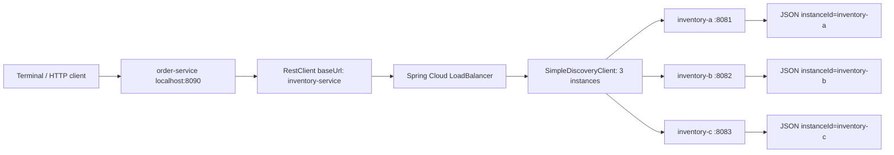
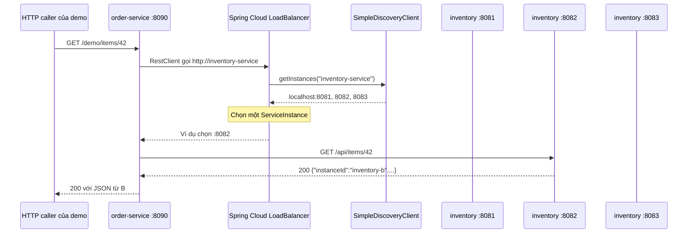

# Dựng bên gọi và ba bản sao trả về định danh riêng

Một cách học Spring Cloud LoadBalancer hiệu quả là **tự chạy một bên gọi (caller) và ba bản sao (replica) của cùng dịch vụ đích**, sau đó quan sát request được chuyển đến bản sao nào. Nếu chỉ gửi request tới một địa chỉ `localhost:8081` rồi nhận `200 OK`, ta mới chứng minh HTTP hoạt động; ta **chưa chứng minh client-side load balancing thực sự chọn được nhiều `ServiceInstance` theo service ID**.

Trong bài thực hành này, chúng ta dựng `inventory-service` với ba process riêng, mỗi process phản hồi cùng API nhưng trả về `instanceId` khác nhau: `inventory-a`, `inventory-b` và `inventory-c`. Một ứng dụng `order-service` sử dụng `@LoadBalanced RestClient.Builder`, gọi URI logic `http://inventory-service`, và Spring Cloud LoadBalancer sẽ chọn host/port cụ thể từ danh sách instance được cấu hình sẵn.

Bài học thuộc chương **Thực hành tổng hợp** của module `SPRING_CLOUD_SERVICE_COMMUNICATION_LOAD_BALANCING`. Đây là nền tảng cho các bài thực hành tiếp theo về discovery, health check, zone/hint routing, WebClient, OpenFeign, retry/timeout và quan sát lỗi. Đích đến của bài này là **chạy được một topology có thể nhìn thấy kết quả**, không phải triển khai registry hoặc resilience production ngay từ đầu.

## 1. Mục tiêu và tiêu chí hoàn thành

Sau bài này, bạn cần làm được:

1. Tạo một Spring Boot HTTP API duy nhất, chạy thành **ba process độc lập** trên ba cổng và trả về đúng định danh mỗi process.
2. Tạo một ứng dụng caller khác, gọi theo **service ID**, không hard-code cổng replica trong business code.
3. Đăng ký ba `ServiceInstance` thử nghiệm bằng `SimpleDiscoveryClient`, để Spring Cloud LoadBalancer lấy danh sách theo `inventory-service`.
4. Gọi nhiều lần và chứng minh các response mang `instanceId` khác nhau; so sánh thêm log từ từng process server.
5. Phân biệt việc LoadBalancer **chọn instance thành công** với việc HTTP transport **thực sự kết nối/nhận response thành công**.
6. Thử tắt một replica và giải thích vì sao còn hai replica chạy **chưa đủ** để tự bảo đảm mọi request đều thành công khi discovery chưa cập nhật/health filtering chưa được bật.

**Tiêu chí nghiệm thu chính:** ba endpoint trực tiếp trả ba ID khác nhau; caller gọi `http://localhost:8090/demo/items/42` nhiều lần cho thấy cả A/B/C được dùng trong điều kiện cấu hình round robin mặc định và danh sách instance ổn định. Tất cả request thử nghiệm phải đi qua service ID `inventory-service` ở caller.

## 2. Kiến trúc thực hành



| Vai trò | Ứng dụng | Port | Cấu hình định danh |
|---|---|---:|---|
| Caller | `order-service` | 8090 | `spring.application.name=order-service` |
| Replica A | `inventory-service` | 8081 | `app.instance-id=inventory-a` |
| Replica B | `inventory-service` | 8082 | `app.instance-id=inventory-b` |
| Replica C | `inventory-service` | 8083 | `app.instance-id=inventory-c` |

Ba replica dùng **cùng mã nguồn và cùng artifact JAR**. Khác nhau duy nhất trong ví dụ là **giá trị cấu hình runtime** (cổng và instance ID). Đây là mô hình rất gần với việc một image/container được triển khai thành nhiều Pod: một ứng dụng logic, nhiều process độc lập.

Lưu ý: `app.instance-id` là **định danh do bài thực hành tự đặt để server trả về**. Nó không tự động bằng `ServiceInstance.getInstanceId()` của discovery provider. Phải phân biệt ID trong JSON response với ID mà LoadBalancer lưu trong danh sách instance; trong các bài observability nâng cao, có thể chủ động đồng bộ chúng theo hợp đồng triển khai.

## 3. Công cụ và phiên bản

Bạn cần JDK 17+, Maven, terminal và công cụ gọi HTTP như `curl` hoặc PowerShell `Invoke-RestMethod`. Ví dụ mã sử dụng Spring Boot 3.x, Spring Cloud LoadBalancer và `RestClient` (có từ Spring Framework 6.1).

Để các đoạn `pom.xml` có cặp version cụ thể, bài này minh họa với:

| Thành phần | Phiên bản minh họa |
|---|---|
| Java | 17 |
| Spring Boot | 3.4.3 |
| Spring Cloud release train | 2024.0.1 |
| Build tool | Maven 3.9.x hoặc tương thích |

Đây là **một cặp phiên bản lịch sử dùng để tái hiện bài học**, không phải tuyên bố phiên bản mới nhất hiện tại. Nếu dự án của bạn chọn Spring Boot/Spring Cloud release train khác, hãy dùng **BOM tương thích** và kiểm tra lại các API/cấu hình; không nâng một bên độc lập vì có thể gây lỗi compatibility.

### Cấu trúc workspace

Tạo hai dự án Maven độc lập:

```text
loadbalancer-lab/
├── inventory-replica/
│   ├── pom.xml
│   └── src/main/
│       ├── java/com/example/inventory/
│       │   ├── InventoryApplication.java
│       │   └── InventoryController.java
│       └── resources/application.yml
└── order-caller/
    ├── pom.xml
    └── src/main/
        ├── java/com/example/order/
        │   ├── OrderApplication.java
        │   ├── InventoryClientConfiguration.java
        │   ├── InventoryReply.java
        │   └── OrderController.java
        └── resources/application.yml
```

Mỗi đoạn code bên dưới ghi rõ **file cần tạo trong bài thực hành**. Chúng là file của dự án mẫu mà người học tự tạo, không phải yêu cầu sửa source của module đang chứa bài Markdown.

## 4. Dựng ứng dụng đích: inventory-replica

### Bước 4.1 — Maven pom.xml của inventory-replica

Tạo `inventory-replica/pom.xml`:

```xml
<?xml version="1.0" encoding="UTF-8"?>
<project xmlns="http://maven.apache.org/POM/4.0.0"
         xmlns:xsi="http://www.w3.org/2001/XMLSchema-instance"
         xsi:schemaLocation="http://maven.apache.org/POM/4.0.0
         https://maven.apache.org/xsd/maven-4.0.0.xsd">
    <modelVersion>4.0.0</modelVersion>

    <parent>
        <groupId>org.springframework.boot</groupId>
        <artifactId>spring-boot-starter-parent</artifactId>
        <version>3.4.3</version>
        <relativePath/>
    </parent>

    <groupId>com.example</groupId>
    <artifactId>inventory-replica</artifactId>
    <version>0.0.1-SNAPSHOT</version>
    <name>inventory-replica</name>

    <properties>
        <java.version>17</java.version>
    </properties>

    <dependencies>
        <dependency>
            <groupId>org.springframework.boot</groupId>
            <artifactId>spring-boot-starter-web</artifactId>
        </dependency>
        <dependency>
            <groupId>org.springframework.boot</groupId>
            <artifactId>spring-boot-starter-actuator</artifactId>
        </dependency>
    </dependencies>

    <build>
        <plugins>
            <plugin>
                <groupId>org.springframework.boot</groupId>
                <artifactId>spring-boot-maven-plugin</artifactId>
            </plugin>
        </plugins>
    </build>
</project>
```

`spring-boot-starter-web` cung cấp HTTP server/REST controller. `spring-boot-starter-actuator` được thêm để có endpoint health phục vụ các thí nghiệm sau; **chỉ thêm Actuator không đồng nghĩa LoadBalancer của caller đã bật client-side health check**.

### Bước 4.2 — Lớp khởi động

Tạo `src/main/java/com/example/inventory/InventoryApplication.java`:

```java
package com.example.inventory;

import org.springframework.boot.SpringApplication;
import org.springframework.boot.autoconfigure.SpringBootApplication;

@SpringBootApplication
public class InventoryApplication {

    public static void main(String[] args) {
        SpringApplication.run(InventoryApplication.class, args);
    }
}
```

### Bước 4.3 — Controller trả về instanceId

Tạo `src/main/java/com/example/inventory/InventoryController.java`:

```java
package com.example.inventory;

import org.slf4j.Logger;
import org.slf4j.LoggerFactory;
import org.springframework.beans.factory.annotation.Value;
import org.springframework.web.bind.annotation.GetMapping;
import org.springframework.web.bind.annotation.PathVariable;
import org.springframework.web.bind.annotation.RestController;

@RestController
public class InventoryController {

    private static final Logger log =
        LoggerFactory.getLogger(InventoryController.class);

    private final String instanceId;

    public InventoryController(
            @Value("${app.instance-id}") String instanceId) {
        this.instanceId = instanceId;
    }

    @GetMapping("/api/items/{itemId}")
    public InventoryReply getItem(
            @PathVariable String itemId) {

        log.info("event=inventory_request instanceId={} operation={}",
            instanceId, "GET /api/items/{itemId}");

        return new InventoryReply(itemId, 17, instanceId);
    }

    public record InventoryReply(
        String itemId,
        int stock,
        String instanceId
    ) {}
}
```

Controller trả một đối tượng Java `record`; Spring MVC/Jackson serialize nó thành JSON. `stock=17` là dữ liệu minh họa và được giữ **giống nhau ở cả ba replica** để bài tập chỉ tập trung quan sát cân bằng tải. Log ghi `instanceId` do runtime cung cấp, không log nội dung nhạy cảm từ request.

Kết quả mong đợi từ replica A:

```json
{
  "itemId": "42",
  "stock": 17,
  "instanceId": "inventory-a"
}
```

### Bước 4.4 — application.yml của inventory

Tạo `src/main/resources/application.yml`:

```yaml
spring:
  application:
    name: inventory-service

server:
  port: 8081

app:
  instance-id: inventory-a

management:
  endpoints:
    web:
      exposure:
        include: health,info
```

Giá trị trong YAML là **mặc định khi chạy một replica**. Khi chạy JAR với tham số `--server.port` và `--app.instance-id`, Spring Boot ưu tiên giá trị truyền từ command line cho process tương ứng, giúp chạy ba bản sao từ cùng mã nguồn.

Không nhầm `spring.application.name=inventory-service` (tên ứng dụng logic) với `app.instance-id=inventory-a` (ID riêng để quan sát của một process).

## 5. Build một lần và chạy ba bản sao

Ở thư mục `inventory-replica`, build ứng dụng:

```bash
mvn -DskipTests package
```

Artifact tạo ra trong ví dụ:

```text
inventory-replica/target/inventory-replica-0.0.1-SNAPSHOT.jar
```

Mở **ba terminal độc lập**, đều đứng trong thư mục `inventory-replica`, rồi chạy từng lệnh dưới đây ở **một terminal khác nhau**.

Terminal A:

```bash
java -jar target/inventory-replica-0.0.1-SNAPSHOT.jar \
  --server.port=8081 \
  --app.instance-id=inventory-a
```

Terminal B:

```bash
java -jar target/inventory-replica-0.0.1-SNAPSHOT.jar \
  --server.port=8082 \
  --app.instance-id=inventory-b
```

Terminal C:

```bash
java -jar target/inventory-replica-0.0.1-SNAPSHOT.jar \
  --server.port=8083 \
  --app.instance-id=inventory-c
```

Các lệnh dùng ký tự `\` để nối dòng **theo Bash/sh**. Trên Windows PowerShell, đặt từng lệnh `java -jar ... --server.port=... --app.instance-id=...` trên **một dòng** trong ba cửa sổ terminal, không copy nguyên cú pháp nối dòng Bash.

### Bước kiểm tra trước khi dựng caller

Gọi trực tiếp ba replica:

```bash
curl -i http://localhost:8081/api/items/42
curl -i http://localhost:8082/api/items/42
curl -i http://localhost:8083/api/items/42
```

Kỳ vọng:

| Gọi trực tiếp | HTTP | Giá trị `instanceId` |
|---|---|---|
| `localhost:8081/api/items/42` | 200 | `inventory-a` |
| `localhost:8082/api/items/42` | 200 | `inventory-b` |
| `localhost:8083/api/items/42` | 200 | `inventory-c` |

Bạn cũng có thể kiểm tra `GET /actuator/health` trên từng port. Nếu cả ba endpoint nghiệp vụ chưa trả đúng ID, **chưa chuyển sang bước caller**: LoadBalancer không thể sửa một replica chạy sai cổng, sai cấu hình hoặc chưa khởi động.

## 6. Dựng ứng dụng bên gọi: order-caller

Khác với ba replica inventory, `order-service` là **một Spring Boot application riêng**, không có controller xử lý tồn kho. Nó đóng vai bên gọi, sử dụng `RestClient` với service ID để truy cập các replica inventory.

### Bước 6.1 — Maven pom.xml của order-caller

Tạo `order-caller/pom.xml`:

```xml
<?xml version="1.0" encoding="UTF-8"?>
<project xmlns="http://maven.apache.org/POM/4.0.0"
         xmlns:xsi="http://www.w3.org/2001/XMLSchema-instance"
         xsi:schemaLocation="http://maven.apache.org/POM/4.0.0
         https://maven.apache.org/xsd/maven-4.0.0.xsd">
    <modelVersion>4.0.0</modelVersion>

    <parent>
        <groupId>org.springframework.boot</groupId>
        <artifactId>spring-boot-starter-parent</artifactId>
        <version>3.4.3</version>
        <relativePath/>
    </parent>

    <groupId>com.example</groupId>
    <artifactId>order-caller</artifactId>
    <version>0.0.1-SNAPSHOT</version>
    <name>order-caller</name>

    <properties>
        <java.version>17</java.version>
        <spring-cloud.version>2024.0.1</spring-cloud.version>
    </properties>

    <dependencyManagement>
        <dependencies>
            <dependency>
                <groupId>org.springframework.cloud</groupId>
                <artifactId>spring-cloud-dependencies</artifactId>
                <version>${spring-cloud.version}</version>
                <type>pom</type>
                <scope>import</scope>
            </dependency>
        </dependencies>
    </dependencyManagement>

    <dependencies>
        <dependency>
            <groupId>org.springframework.boot</groupId>
            <artifactId>spring-boot-starter-web</artifactId>
        </dependency>
        <dependency>
            <groupId>org.springframework.cloud</groupId>
            <artifactId>spring-cloud-starter-loadbalancer</artifactId>
        </dependency>
    </dependencies>

    <build>
        <plugins>
            <plugin>
                <groupId>org.springframework.boot</groupId>
                <artifactId>spring-boot-maven-plugin</artifactId>
            </plugin>
        </plugins>
    </build>
</project>
```

`spring-cloud-starter-loadbalancer` cung cấp phần client-side LB; Spring Cloud Commons cũng cung cấp cơ chế `SimpleDiscoveryClient` dùng danh sách cấu hình tĩnh cho bài lab. **Không cần** khởi động Eureka Server/Consul/Kubernetes để chạy ví dụ. Đổi sang discovery registry thật ở các bài sau chỉ thay **nguồn danh sách `ServiceInstance`**, không phải thay toàn bộ logic gọi HTTP.

### Bước 6.2 — application.yml: ba instance của cùng service ID

Tạo `order-caller/src/main/resources/application.yml`:

```yaml
spring:
  application:
    name: order-service
  cloud:
    discovery:
      client:
        simple:
          instances:
            inventory-service:
              - uri: http://localhost:8081
              - uri: http://localhost:8082
              - uri: http://localhost:8083

server:
  port: 8090
```

Nội dung này nói với `SimpleDiscoveryClient` rằng service ID `inventory-service` hiện có ba địa chỉ ứng viên. Khi Spring Cloud LoadBalancer cần gọi `inventory-service`, nó lấy danh sách từ discovery client và chọn một instance theo thuật toán đã cấu hình.

**Lưu ý về topology:** `localhost` chỉ phù hợp khi caller và ba replica chạy trên **cùng máy/host network** trong bài lab. Nếu chạy mỗi ứng dụng trong container khác, `localhost` ở container caller trỏ lại **container caller**, không phải replica. Khi chuyển sang Docker Compose/Kubernetes, phải dùng hostname/network và discovery phù hợp.

### Bước 6.3 — Lớp khởi động của caller

Tạo `src/main/java/com/example/order/OrderApplication.java`:

```java
package com.example.order;

import org.springframework.boot.SpringApplication;
import org.springframework.boot.autoconfigure.SpringBootApplication;

@SpringBootApplication
public class OrderApplication {

    public static void main(String[] args) {
        SpringApplication.run(OrderApplication.class, args);
    }
}
```

### Bước 6.4 — Cấu hình RestClient đi qua LoadBalancer

Tạo `src/main/java/com/example/order/InventoryClientConfiguration.java`:

```java
package com.example.order;

import org.springframework.cloud.client.loadbalancer.LoadBalanced;
import org.springframework.context.annotation.Bean;
import org.springframework.context.annotation.Configuration;
import org.springframework.web.client.RestClient;

@Configuration
public class InventoryClientConfiguration {

    @Bean
    @LoadBalanced
    RestClient.Builder loadBalancedRestClientBuilder() {
        return RestClient.builder();
    }

    @Bean
    RestClient inventoryRestClient(
            @LoadBalanced RestClient.Builder builder) {

        return builder.clone()
            .baseUrl("http://inventory-service")
            .build();
    }
}
```

**Hai điểm quyết định:**

1. `@LoadBalanced` đánh dấu builder để Spring Cloud đưa cơ chế chọn `ServiceInstance` vào quá trình thực hiện HTTP request.
2. `baseUrl("http://inventory-service")` dùng **tên logic** — không chứa port của replica A/B/C.

Nếu thay bằng `http://localhost:8081`, bạn đã **bỏ qua mục tiêu của bài học**: request sẽ tới A mà không cần cân bằng tải theo service ID. Nếu bỏ `@LoadBalanced` hoặc thiếu starter tương ứng, HTTP transport có thể cố phân giải `inventory-service` như tên DNS thường rồi báo lỗi, tùy cấu hình môi trường.

Dùng `builder.clone()` để tránh việc một bean client chỉnh sửa builder chung đang được các bean khác tái sử dụng.

### Bước 6.5 — DTO phản hồi ở phía caller

Tạo `src/main/java/com/example/order/InventoryReply.java`:

```java
package com.example.order;

public record InventoryReply(
    String itemId,
    int stock,
    String instanceId
) {}
```

DTO ở caller không cần dùng chung Java class với service đích. Điều quan trọng là **hợp đồng JSON tương thích**. Trong production, hai dịch vụ có thể độc lập về source code và phát hành phiên bản riêng.

### Bước 6.6 — Endpoint demo gọi inventory qua service ID

Tạo `src/main/java/com/example/order/OrderController.java`:

```java
package com.example.order;

import java.util.concurrent.TimeUnit;
import org.slf4j.Logger;
import org.slf4j.LoggerFactory;
import org.springframework.web.bind.annotation.GetMapping;
import org.springframework.web.bind.annotation.PathVariable;
import org.springframework.web.bind.annotation.RestController;
import org.springframework.web.client.RestClient;

@RestController
public class OrderController {

    private static final Logger log =
        LoggerFactory.getLogger(OrderController.class);

    private final RestClient inventoryRestClient;

    public OrderController(RestClient inventoryRestClient) {
        this.inventoryRestClient = inventoryRestClient;
    }

    @GetMapping("/demo/items/{itemId}")
    public InventoryReply getItem(@PathVariable String itemId) {
        long started = System.nanoTime();

        InventoryReply reply = inventoryRestClient.get()
            .uri("/api/items/{id}", itemId)
            .retrieve()
            .body(InventoryReply.class);

        long durationMs = TimeUnit.NANOSECONDS.toMillis(
            System.nanoTime() - started);

        if (reply == null) {
            throw new IllegalStateException(
                "inventory-service returned an empty body");
        }

        log.info(
            "event=inventory_call_completed targetService={} " +
            "reportedReplica={} durationMs={}",
            "inventory-service", reply.instanceId(), durationMs);

        return reply;
    }
}
```

Ở đây `reportedReplica` là **ID do upstream trả trong JSON**, không phải dữ liệu được lấy trực tiếp từ kết quả `LoadBalancer.choose(...)`. Điều này đủ để quan sát các bản sao trong bài lab. Trong ứng dụng thực tế, dữ liệu ID trả từ server không được dùng để quyết định quyền truy cập, và không nên expose topology nội bộ qua API công khai.

Đoạn controller minh họa đường gọi thành công; chưa bao gồm timeout, retry, `@ControllerAdvice` hay chuẩn lỗi production. Khi có lỗi HTTP/transport, `RestClient` có thể ném exception theo hành vi mặc định. Chúng ta sẽ dùng điều đó có chủ đích để học phân biệt lỗi, thay vì che mọi lỗi bằng fallback ngay từ đầu.

## 7. Chạy caller và nhìn ba replica xuất hiện

Sau khi cả ba inventory processes ở các cổng `8081`, `8082`, `8083` đã chạy, mở terminal thứ tư trong thư mục `order-caller`:

```bash
mvn -DskipTests package
java -jar target/order-caller-0.0.1-SNAPSHOT.jar
```

Caller chạy trên port `8090`. Gửi một request:

```bash
curl -i http://localhost:8090/demo/items/42
```

Response có thể là:

```json
{"itemId":"42","stock":17,"instanceId":"inventory-b"}
```

Giá trị `instanceId` ở lần gọi đầu **không bắt buộc là A**. Thuật toán round robin mặc định thường luân phiên lựa chọn trên tập instance đã biết, nhưng vị trí khởi tạo bộ đếm và những request khác có thể ảnh hưởng lựa chọn đầu tiên.

### Gọi liên tiếp để quan sát phân bố

Trên Bash:

```bash
for i in $(seq 1 12); do
  curl -s http://localhost:8090/demo/items/42
  echo
done
```

Trên PowerShell:

```powershell
1..12 | ForEach-Object {
    (Invoke-RestMethod "http://localhost:8090/demo/items/42").instanceId
} | Group-Object | Select-Object Name, Count
```

Ví dụ kết quả PowerShell trong môi trường **ổn định và chỉ một client gọi tuần tự**:

```text
Name         Count
----         -----
inventory-a      4
inventory-b      4
inventory-c      4
```

Đây là một **kết quả minh họa**, không phải cam kết mọi lần chạy đúng 4–4–4. Nếu chọn round robin trên danh sách cố định và không có lời gọi khác chen vào, phân bố theo số request thường cân bằng; nhưng retry, health filtering, thuật toán khác hoặc concurrency có thể thay đổi số đếm.

**Điểm cần kiểm chứng không phải thứ tự A → B → C tuyệt đối**, mà là caller đã chọn được từ **cả ba instance** thông qua service ID. Mở ba terminal inventory để thấy mỗi process in log `event=inventory_request` khi được gọi.

## 8. Cơ chế phía sau: Spring Cloud LoadBalancer đã làm gì?

Một request từ `OrderController` có các bước logic:



Spring Cloud LoadBalancer có thể dùng cache hoặc `ServiceInstanceListSupplier` bên trong, vì vậy sơ đồ **mô tả trách nhiệm**, không khẳng định mỗi request luôn gọi lại discovery provider ngay lập tức. Một caller có thể chọn lại theo danh sách được cache; nguồn của danh sách trong lab là cấu hình tĩnh của `SimpleDiscoveryClient`.

| Thành phần | Trách nhiệm trong lab |
|---|---|
| `OrderController` | Tiếp nhận request demo và gọi RestClient. |
| `@LoadBalanced RestClient.Builder` | Cho phép xử lý URI logic theo Spring Cloud LB. |
| `SimpleDiscoveryClient` | Cung cấp danh sách các URI của service ID. |
| `ServiceInstanceListSupplier` | Làm nguồn/cung cấp danh sách ứng viên cho LoadBalancer. |
| `RoundRobinLoadBalancer` (mặc định thông dụng) | Chọn một instance từ danh sách đang có. |
| HTTP transport của RestClient | Thiết lập/tái sử dụng kết nối tới host/port đã chọn. |
| `InventoryController` | Trả JSON với ID của process thực sự nhận request. |

**Chú ý:** Spring Cloud LoadBalancer là **client-side load balancer** trong ứng dụng caller. Không có một HTTP server “LoadBalancer” độc lập đang lắng nghe tại `inventory-service:80` trong topology này. Nó chọn đích trong quá trình thực thi HTTP client.

## 9. Phân biệt năm định danh dễ nhầm

| Định danh | Ví dụ | Dùng để làm gì? |
|---|---|---|
| `spring.application.name` của inventory | `inventory-service` | Tên logic ứng dụng đích; ở production thường tham gia đăng ký discovery. |
| Service ID mà caller dùng | `inventory-service` | Key dùng tìm danh sách `ServiceInstance`. |
| URI/host:port của instance | `http://localhost:8082` | Địa chỉ transport để gửi TCP/HTTP. |
| `app.instance-id` ở inventory | `inventory-b` | Dữ liệu ứng dụng tự trả để người học nhận ra replica. |
| `ServiceInstance.getInstanceId()` | Provider-specific hoặc được tạo từ cấu hình. | Định danh instance trong model của Spring Cloud; có thể khác `app.instance-id`. |

Nếu bạn thay `app.instance-id=inventory-b` thành `app.instance-id=inventory-x` mà không đổi port, `SimpleDiscoveryClient` vẫn có thể chọn `localhost:8082`; chỉ **dấu hiệu JSON từ server** thay đổi. Nếu bạn đổi URI trong discovery sang một port không có server, LoadBalancer có thể chọn instance theo cấu hình nhưng HTTP transport sẽ gặp lỗi.

Đó là lý do trong bài thực hành cần phân biệt:

```text
LoadBalancer đã CHỌN một ServiceInstance
    ≠
HTTP client đã KẾT NỐI THÀNH CÔNG
    ≠
Upstream đã XỬ LÝ xong nghiệp vụ
    ≠
Caller đã NHẬN VÀ GIẢI MÃ xong response
```

## 10. Bài thử lỗi thứ nhất: tắt một replica nhưng giữ discovery tĩnh

Khi cả ba replica đang chạy, dừng **terminal B** (process trên `8082`). Đừng thay `order-caller/application.yml` và đừng restart caller ngay.

Gửi lại nhiều request vào:

```bash
curl -i http://localhost:8090/demo/items/42
```

Tình huống có thể xảy ra:

- Lần chọn A hoặc C vẫn trả JSON thành công.
- Lần chọn B, nếu danh sách instance vẫn chứa `localhost:8082`, HTTP client có thể gặp connection refused hoặc lỗi transport.
- Một số integration có retry nếu được cấu hình; **bài lab mặc định không giả định đã bật retry/failover**.

**Giải thích:** `SimpleDiscoveryClient` của bài lab là danh sách **tĩnh**. Nó không tự kiểm tra liveness của mỗi URI theo nghĩa “nếu một process tắt thì xóa ngay khỏi danh sách”. `@LoadBalanced` cũng **không tự động bật HealthCheckServiceInstanceListSupplier** chỉ vì inventory có endpoint `/actuator/health`.

Một số phiên bản/thành phần HTTP client có cách ánh xạ lỗi và timeout khác nhau. Điều cần ghi nhận là **lỗi xảy ra sau khi một instance không còn lắng nghe**, không mặc nhiên quy cho HTTP `503` thực sự được server B gửi — vì server B đã dừng, có thể chẳng trả HTTP response nào.

Để phục hồi lab, khởi động lại B:

```bash
java -jar target/inventory-replica-0.0.1-SNAPSHOT.jar \
  --server.port=8082 \
  --app.instance-id=inventory-b
```

Nếu muốn caller **loại bỏ B chủ động**, có thể chỉnh danh sách cấu hình tĩnh rồi restart caller để nhận cấu hình mới. Ở bài nâng cao, thay SimpleDiscoveryClient bằng registry động + cache/health suppliers, cấu hình thời gian cập nhật và kiểm tra failover có ngân sách.

## 11. Bài thử lỗi thứ hai: không còn instance phù hợp

**Không có instance** khác với **có instance nhưng server ngừng chạy**.

Thử riêng: dừng `order-service`, tạm thời bỏ mục `inventory-service` khỏi `spring.cloud.discovery.client.simple.instances` hoặc cấu hình một service ID mới không có entry tương ứng; sau đó khởi động lại caller. Khi RestClient gọi một service ID không có bất kỳ `ServiceInstance` hợp lệ nào, LoadBalancer không thể chọn đích.

Đừng suy rằng dừng cả ba process inventory sẽ tạo trường hợp “discovery rỗng”: danh sách tĩnh vẫn có ba URI, dù không có process nào đang lắng nghe.

| Tình huống | Kết quả chọn instance | HTTP transport |
|---|---|---|
| Danh sách tĩnh có A/B/C, cả ba đang chạy | Có thể chọn A/B/C. | Gửi HTTP được nếu kết nối hoạt động. |
| Danh sách tĩnh có B, nhưng process B đã dừng | Vẫn có thể **chọn B**. | Connection refused/reset hoặc lỗi phù hợp. |
| Không có entry cho service ID | Không có instance để chọn. | Không có TCP call tới một replica hợp lệ. |
| B trả response `503` từ controller/stub đang chạy | Đã chọn và kết nối được B. | Nhận **HTTP 503 thật** từ upstream. |

Tùy integration và phiên bản, no-instance có thể được biến thành exception hoặc một status mô phỏng ở lớp client. Trong log/metric, nên phân biệt **`no_eligible_instance`** với **`upstream_http_503`**; hai sự cố có cách xử lý khác nhau.

Sau bài thử, **khôi phục YAML của caller** với đúng ba URI ban đầu rồi restart để tiếp tục.

## 12. Bài thử lỗi thứ ba: một replica cố ý trả HTTP 503

Để tạo lỗi HTTP thực nhưng chỉ ảnh hưởng một replica, có thể thêm endpoint test trong `InventoryController`:

```java
@GetMapping("/api/demo/status")
public ResponseEntity<String> demoStatus() {
    if ("inventory-b".equals(instanceId)) {
        return ResponseEntity.status(503)
            .body("inventory-b unavailable for demo");
    }
    return ResponseEntity.ok(instanceId + " is healthy");
}
```

Đây là **đoạn mã mở rộng**, không nằm trong code controller bắt buộc ở mục 4. Nó yêu cầu import `org.springframework.http.ResponseEntity` và build/run lại cả ba JAR; chỉ sử dụng trong môi trường thực hành.

Nếu caller thêm một endpoint gọi `/api/demo/status` qua RestClient, các lần chọn A/C nhận `200`, lần chọn B nhận **HTTP `503`**. Với `retrieve()`, RestClient có thể ném exception cho 5xx theo status handling mặc định. So sánh kết quả với mục 10:

- B **đang chạy và trả `503`**: có HTTP status thật từ B.
- B **đã dừng**: không có HTTP response từ B, chỉ có thể có lỗi kết nối/transport.
- Không có instance nào eligible: LoadBalancer không chọn được đích, khác cả hai trường hợp trên.

Chỉ sau khi phân biệt rõ các lỗi mới nên thêm retry, timeout, circuit breaker hoặc health check. Retry mù quáng có thể tăng tải và không tự bảo đảm lần sau chọn replica khác.

## 13. Kiểm tra log: request đã đi đến process nào?

Khi gọi liên tục qua order, ta có thể thấy ba loại log:

```text
inventory-a:
event=inventory_request instanceId=inventory-a operation=GET /api/items/{itemId}

inventory-b:
event=inventory_request instanceId=inventory-b operation=GET /api/items/{itemId}

inventory-c:
event=inventory_request instanceId=inventory-c operation=GET /api/items/{itemId}
```

Và log từ order:

```text
event=inventory_call_completed targetService=inventory-service
reportedReplica=inventory-b durationMs=19
```

Mỗi lần gọi trong bài lab, log từ process inventory là bằng chứng **request đã tới server nào**, còn response JSON giúp bạn thấy server đã xử lý và trả kết quả. Nếu cần log **`ServiceInstance` được chọn ở bên caller trước HTTP**, phải instrument tại tầng Spring Cloud LoadBalancer (ví dụ lifecycle/Observation theo phiên bản), vì `reportedReplica` ở `OrderController` chỉ có sau khi decode JSON response.

Trong production, không nên trả ID Pod, hostname nội bộ hoặc metadata nhạy cảm ra API public; việc trả `instanceId` trong bài này là **công cụ học tập**. Với observability thực, nên dùng trace/span ID, service ID, operation template, selected instance ID trong log nội bộ được kiểm soát và không log token/cookie.

## 14. Sử dụng WebClient hoặc OpenFeign sau khi RestClient chạy được

Ba replica inventory và cấu hình nguồn instance **không cần thay đổi** để thử một HTTP client khác. Chỉ cần ứng dụng caller sử dụng đúng integration của Spring Cloud LoadBalancer.

### WebClient reactive

Nếu thêm Spring WebFlux ở caller:

```java
@Bean
@LoadBalanced
WebClient.Builder loadBalancedWebClientBuilder() {
    return WebClient.builder();
}

@Bean
WebClient inventoryWebClient(
        @LoadBalanced WebClient.Builder builder) {
    return builder.clone()
        .baseUrl("http://inventory-service")
        .build();
}
```

Ví dụ reactive endpoint/gateway:

```java
Mono<InventoryReply> item(String id) {
    return inventoryWebClient.get()
        .uri("/api/items/{id}", id)
        .retrieve()
        .bodyToMono(InventoryReply.class);
}
```

WebClient thường chỉ thực hiện HTTP khi có **subscription**. Nếu chỉ tạo `Mono` mà không subscribe, đừng kỳ vọng log ở ba replica xuất hiện. Nếu bổ sung retry, thứ tự các Reactor operators ảnh hưởng phạm vi deadline và số attempts.

### OpenFeign declarative

Khi thêm starter OpenFeign và bật `@EnableFeignClients` cho package chứa interface:

```java
@FeignClient(
    name = "inventory-service",
    contextId = "inventoryRead"
)
interface InventoryReadClient {

    @GetMapping("/api/items/{itemId}")
    InventoryReply getItem(
        @PathVariable("itemId") String itemId);
}
```

Không đặt `url = "http://localhost:8081"` trong `@FeignClient` nếu mục tiêu là test LoadBalancer chọn giữa A/B/C; URL cố định có thể bỏ qua giải quyết service ID bằng discovery. Mọi Feign retryer, timeout và ErrorDecoder phải được cấu hình theo đúng version/Feign context, không mặc nhiên dùng quy tắc của RestClient.

**Phương pháp học hợp lý:** làm cho RestClient hoạt động trên ba replica trước; sau đó thay một yếu tố mỗi lần (WebClient, Feign, retry, health, custom routing) và so sánh xem kết quả/đường đi thay đổi thế nào.

## 15. Không nhầm phân phối request với phân phối tải thực

Trong bài thực hành, ba replica đều trả `stock=17` gần như tức thì. Nếu gọi tuần tự 12 lần và thấy phân bố 4–4–4, điều đó chỉ minh họa số **request selections** được chia đều theo chính sách thử nghiệm.

Trong hệ thống thật:

- Một request có thể mất 20 ms, request khác mất 2 giây.
- Một replica có thể xử lý dữ liệu lớn hơn hoặc CPU yếu hơn.
- Một HTTP attempt thất bại có thể được retry, làm số attempts khác số logical requests.
- Connection pool, HTTP/2 multiplex, health filtering, zone routing và affinity có thể làm tải không phân đều theo số request.
- Một replica có thể healthy khi discovery cung cấp nó nhưng chết ngay trước khi caller kết nối.

Vì thế **chia đều số lượt chọn không đồng nghĩa chia đều CPU, latency hay số kết nối**. Khi mở rộng bài lab, đo thêm latency p95/p99, số request thành công/thất bại, attempts, instance được chọn và connection behavior.

### Có nên thêm Thread.sleep vào controller để “dễ thấy”?

Không cần cho bài lab cơ bản. `Thread.sleep` trên mỗi HTTP request làm giữ servlet thread và có thể khiến test sai lệch vì chính server đang chậm do code giả lập. Nếu cần thí nghiệm timeout/slow replica, hãy tạo một endpoint test chuyên biệt với độ trễ **có kiểm soát**, không vô tình thêm ngủ vào API thông thường.

## 16. Lỗi thường gặp khi chạy bài thực hành

| Triệu chứng | Nguyên nhân có thể | Cách kiểm tra/sửa |
|---|---|---|
| `Address already in use` tại 8081/8082/8083 | Có process khác giữ cổng hoặc quên tắt replica cũ. | Kiểm tra process/port, dừng đúng process hoặc chọn các port khác và cập nhật cả caller. |
| Ba request trực tiếp đều trả `inventory-a` | Chạy ba process với cùng `--app.instance-id` hoặc quên override. | Xem command line/runtime property của từng process. |
| Direct call OK nhưng caller báo unknown host `inventory-service` | Thiếu `@LoadBalanced`, thiếu starter hoặc bean RestClient không dùng builder đúng. | Xem bean config, dependency và `baseUrl` logic. |
| Caller chỉ luôn trả `inventory-a` | Client dùng URL cố định A, chỉ một instance được cấu hình hoặc có policy khác. | Kiểm tra YAML `simple.instances` và source code `baseUrl`. |
| Caller báo connect refused từng lúc | Một replica trong danh sách không còn lắng nghe. | Gọi từng port trực tiếp; phân biệt static discovery với health check động. |
| Caller startup thất bại vì Cloud compatibility | Spring Boot và Spring Cloud BOM không phù hợp. | Chọn lại release train tương thích; không chỉ tắt compatibility verifier để che lỗi. |
| JSON deserialize lỗi | DTO caller không khớp field JSON hoặc response không đúng content type. | Kiểm tra JSON trực tiếp và Java record/constructor. |
| Caller chạy trong Docker không gọi được localhost của host | `localhost` trong container là container đó. | Dùng network hostname/port hoặc discovery của môi trường container. |
| Kết quả không đúng A→B→C tuyệt đối | Bộ đếm khởi tạo, request khác, concurrency hoặc policy khác. | Quan sát tập instance và số lượt nhận, không hard-code thứ tự đầu tiên. |
| Dừng replica nhưng caller vẫn chọn nó | `SimpleDiscoveryClient` cung cấp danh sách tĩnh. | Dùng discovery/health cập nhật hoặc sửa danh sách và restart caller trong lab. |
| Health endpoint báo UP nhưng request nghiệp vụ vẫn lỗi | Health signal không bảo đảm mọi endpoint hoạt động. | Kiểm tra đường gọi nghiệp vụ, timeout, readiness và policy. |
| `No servers available` | Service ID không khớp hoặc danh sách được lọc thành rỗng. | Kiểm tra `inventory-service` ở URI client và YAML, tách khỏi connect refused. |

## 17. Nhiệm vụ mở rộng

Sau khi đáp ứng tiêu chí nghiệm thu cơ bản, thực hiện thêm theo thứ tự:

1. **Thêm replica D:** chạy cùng JAR ở port 8084 với `app.instance-id=inventory-d`, thêm URI vào SimpleDiscoveryClient của caller và restart caller. Kiểm chứng cả bốn ID xuất hiện.
2. **Thay đổi stock theo instance:** thêm property `app.stock` để quan sát response đến từ từng process nhưng không dùng dữ liệu không nhất quán này để mô phỏng tồn kho production.
3. **Ghi thời gian gọi:** caller log `durationMs`; cố ý làm một replica chậm rồi quan sát round robin không tự cân bằng theo thời gian xử lý.
4. **Bật timeout rõ ràng:** cấu hình HTTP transport của RestClient và kiểm tra phản hồi khi một replica chậm; phân biệt connect/read timeout và deadline tổng.
5. **Thêm retry có giới hạn:** thử cùng/khác instance với lỗi kết nối, giữ idempotency cho thao tác ghi và quan sát attempts.
6. **Health check:** dùng Actuator `/actuator/health`, cấu hình supplier health check phù hợp rồi chứng minh instance không khỏe bị loại theo chu kỳ cập nhật.
7. **Zone routing:** thêm metadata vùng cho instance, dùng supplier/algorithm để ưu tiên zone; phân biệt soft preference và hard region constraint.
8. **Viết integration test:** thay ba process thật bằng nhiều MockWebServer hoặc WireMock trên port động, xác minh số request mà mỗi server nhận.
9. **Quan sát chọn instance:** cấu hình LoadBalancer lifecycle/observability trong caller để ghi `targetService`, `selectedInstanceId`, HTTP status, no-instance và retry outcome.

Mỗi nhiệm vụ mở rộng nên thay đổi **một yếu tố mỗi lần**. Giữ lại baseline “ba process, một caller, service ID logic” để so sánh; nếu vừa bật retry, vừa thêm zone, vừa đổi HTTP client thì rất khó biết chính xác yếu tố nào gây ra kết quả mới.

## 18. Checklist và báo cáo kết quả bài lab

Trước khi kết luận, kiểm tra:

- Đã build `inventory-replica` thành **một JAR duy nhất** và chạy ba process thật ở 8081, 8082, 8083.
- Ba process có cùng `spring.application.name=inventory-service` nhưng khác `app.instance-id`.
- Gọi trực tiếp từng port trả `200`, `stock=17` và đúng một trong ba ID A/B/C.
- Caller chạy riêng trên port 8090, dùng `@LoadBalanced RestClient.Builder`.
- Trong business code caller **không hard-code** `localhost:8081/8082/8083`.
- `SimpleDiscoveryClient` ở caller có đúng ba URI dưới cùng key `inventory-service`.
- Gọi `/demo/items/42` liên tiếp cho thấy cả ba replica nhận request khi dùng chính sách phù hợp.
- Log `inventory_request` của từng server xác minh request đã tới process đó.
- Biết phân biệt `app.instance-id` trong JSON với `ServiceInstance.getInstanceId()` của discovery.
- Thử dừng một replica và giải thích tại sao discovery tĩnh có thể vẫn chọn port vừa dừng.
- Phân biệt no-instance, connection refused, upstream HTTP 503 và decode error.
- Không ngộ nhận LoadBalancer tự cấu hình retry, health check hoặc cân bằng theo CPU.
- Đã ghi nhận cặp version Spring Boot/Cloud đang chạy và lỗi tương thích nếu có.

Một bảng báo cáo ngắn:

| Bài thử | Cách thực hiện | Kết quả mong đợi |
|---|---|---|
| Direct A | GET `:8081/api/items/42` | `instanceId=inventory-a` |
| Direct B | GET `:8082/api/items/42` | `instanceId=inventory-b` |
| Direct C | GET `:8083/api/items/42` | `instanceId=inventory-c` |
| Caller | 12 lần GET `:8090/demo/items/42` | Nhìn thấy A/B/C qua service ID. |
| Tắt B | Dừng process `:8082`, gọi lại caller. | Có thể lỗi khi LB vẫn chọn B từ danh sách tĩnh; A/C vẫn có thể hoạt động. |
| No-instance | Xóa cấu hình instance cho service ID trong bài test riêng. | Không chọn được đích; khác transport error. |
| Khôi phục | Chạy lại B và YAML ban đầu. | Các request qua caller có thể tới cả ba replica như baseline. |

**Ghi nhớ:** **ba process cùng chạy một ứng dụng không tự tạo client-side load balancing**. Để bên gọi phân phối request, cần có **service ID**, một **nguồn `ServiceInstance`**, một **HTTP client được tích hợp Spring Cloud LoadBalancer** và nhiều endpoint thực sự nhận request. Ở bài lab này, `SimpleDiscoveryClient` cung cấp ba URI, `@LoadBalanced RestClient` gọi `http://inventory-service`, còn mỗi replica trả `instanceId` riêng để nhìn thấy lựa chọn. Sau khi baseline hoạt động, bạn mới có điểm tựa để thử discovery động, health check, zone routing, WebClient, OpenFeign, retry/timeout và observability một cách có kiểm soát.
