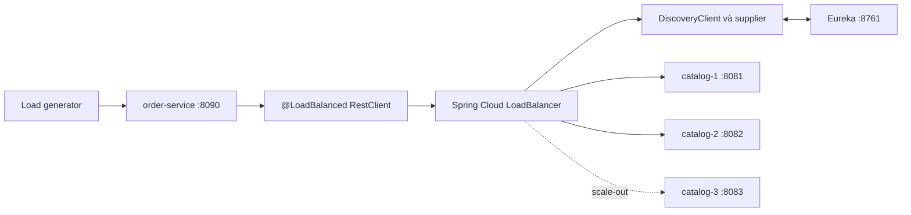
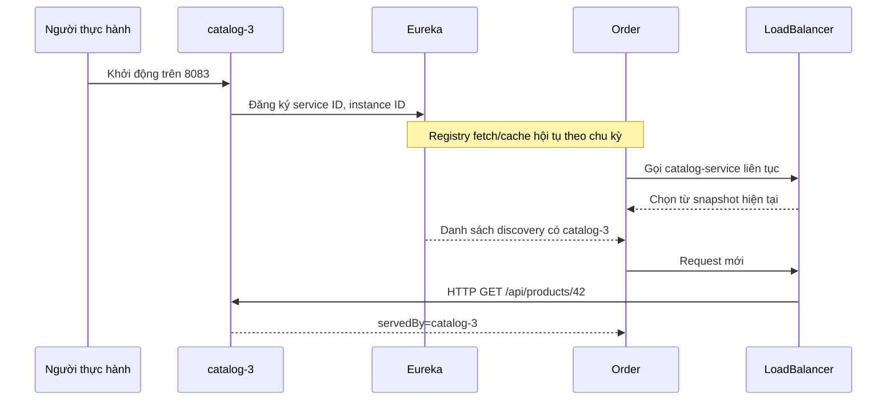
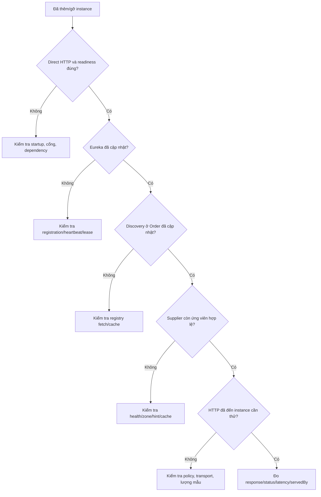

# Thêm và gỡ bản sao trong khi hệ thống đang nhận tải

Khi triển khai hệ thống microservices, số bản sao của một dịch vụ thay đổi theo lưu lượng, lịch phát hành và khả năng phục vụ. Ví dụ, `catalog-service` có thể tăng từ hai lên ba instance trong giờ cao điểm, rồi giảm còn hai khi tải thấp. Trong suốt quá trình đó, `order-service` vẫn cần gọi Catalog thông qua **service ID** và Spring Cloud LoadBalancer.

Việc thấy thêm một instance trên dashboard service discovery chưa chứng minh rằng caller đã bắt đầu sử dụng instance đó. Ngược lại, một instance đã dừng có thể vẫn còn trong snapshot của registry hoặc cache ở caller, làm một số HTTP request thất bại. Bài thực hành tổng hợp này giúp phân biệt **trạng thái đăng ký**, **danh sách ứng viên của LoadBalancer**, **instance thực nhận request** và **kết quả HTTP** khi cụm thay đổi liên tục.

Lab sử dụng Eureka Server, nhiều process Catalog cùng source code và một Order service dùng `@LoadBalanced RestClient.Builder`. Bạn sẽ tạo tải trong lúc thêm/gỡ instance, thu timestamp, HTTP status, độ trễ và `servedBy`. Những nguyên lý tương tự áp dụng được cho `WebClient` và OpenFeign, dù cách cấu hình timeout, retry và instrumentation khác nhau.

> **Giới hạn:** Các lệnh và cổng là ví dụ chạy local. Chọn Spring Boot và Spring Cloud BOM **tương thích** với dự án; không coi cấu hình này là cấu hình production.

## 1. Mục tiêu và tiêu chí hoàn thành

Hoàn tất bài học khi bạn có thể:

1. Chạy hai bản sao Catalog đăng ký dưới cùng service ID nhưng có instance ID và cổng khác nhau.
2. Gọi `http://catalog-service` từ Order mà không gắn cứng `localhost:8081` trong client.
3. Tạo traffic liên tục, ghi được `servedBy`, status, độ trễ và thời điểm request.
4. Thêm `catalog-3` khi tải vẫn chạy và đo từ lúc instance ready/đăng ký đến lần đầu nhận request qua Order.
5. Dừng `catalog-2` theo cách graceful, quan sát thời điểm ngừng được chọn và các lỗi chuyển tiếp.
6. Thử một lần dừng **đột ngột** trong lab rồi phân tích registry lease, cache, lỗi kết nối và quá trình phục hồi.
7. Phân biệt vấn đề discovery, health/readiness, LoadBalancer, TCP và ứng dụng đích.

Không nên dùng tiêu chí "các request phải luôn theo thứ tự 1–2–3" vì chính sách chọn, counter, retry và snapshot ở từng client có thể khác. Kết quả tốt là **thay đổi topology được hội tụ, lỗi có giới hạn và đo được nguyên nhân**.

## 2. Kiến trúc lab



Một request thông thường:

- Client gọi `GET http://localhost:8090/api/orders/check/42`.
- Order gọi URL logic `http://catalog-service/api/products/42`.
- Spring Cloud LoadBalancer lấy danh sách `ServiceInstance` từ discovery/supplier, sau đó chọn một instance hợp lệ theo policy.
- Catalog trả JSON chứa ID sản phẩm, `servedBy` và timestamp.
- Order chuyển response đó về caller; kết quả giúp xác nhận **bản sao nào thật sự phục vụ**.

| Ứng dụng | Cổng | Vai trò |
|---|---:|---|
| Eureka Server | `8761` | Service registry |
| Order | `8090` | Caller dùng LoadBalancer |
| Catalog số 1 | `8081` | Bản sao ban đầu |
| Catalog số 2 | `8082` | Bản sao ban đầu, sẽ được gỡ |
| Catalog số 3 | `8083` | Bản sao sẽ thêm dưới tải |

Lab giả định cả ba Catalog instance cung cấp **cùng hợp đồng API**, có thể thay thế nhau. Nếu các instance chạy API v1/v2 không tương thích, phải thiết kế policy phiên bản/fail-closed riêng trước khi chia traffic.

## 3. Dependency và môi trường

Có thể tạo ba dự án Spring Boot độc lập hoặc ba Maven module:

```text
loadbalancer-live-lab/
|-- eureka-server/
|-- catalog-service/
|-- order-service/
```

| Dự án | Dependency starter |
|---|---|
| Eureka Server | `spring-boot-starter`, `spring-cloud-starter-netflix-eureka-server` |
| Catalog | `spring-boot-starter-web`, `spring-boot-starter-actuator`, `spring-cloud-starter-netflix-eureka-client` |
| Order | `spring-boot-starter-web`, `spring-boot-starter-actuator`, `spring-cloud-starter-netflix-eureka-client`, `spring-cloud-starter-loadbalancer` |

Nếu dùng Maven và tự quản lý BOM, import `spring-cloud-dependencies` tương thích với Spring Boot parent; không đặt version ngẫu nhiên ở từng starter. Ví dụ phần cấu hình dependency management:

```xml
<dependencyManagement>
  <dependencies>
    <dependency>
      <groupId>org.springframework.cloud</groupId>
      <artifactId>spring-cloud-dependencies</artifactId>
      <version>${spring-cloud.version}</version>
      <type>pom</type>
      <scope>import</scope>
    </dependency>
  </dependencies>
</dependencyManagement>
```

Property `spring-cloud.version` cần được khai báo theo release train đang dùng. Chuẩn bị các cổng `8761`, `8090`, `8081`, `8082` và `8083` chưa bị chiếm, Java và công cụ build tương thích, cùng nhiều terminal để chạy các process riêng.

## 4. Eureka Server

Class khởi động:

```java
package com.example.discovery;

import org.springframework.boot.SpringApplication;
import org.springframework.boot.autoconfigure.SpringBootApplication;
import org.springframework.cloud.netflix.eureka.server.EnableEurekaServer;

@SpringBootApplication
@EnableEurekaServer
public class EurekaServerApplication {
    public static void main(String[] args) {
        SpringApplication.run(EurekaServerApplication.class, args);
    }
}
```

`application.yml`:

```yaml
server:
  port: 8761

spring:
  application:
    name: eureka-server

eureka:
  client:
    register-with-eureka: false
    fetch-registry: false
```

Sau khi khởi chạy, dashboard thường ở `http://localhost:8761/`. Ban đầu chưa có Catalog instance; sau khi Catalog đăng ký, Eureka bắt đầu hiển thị chúng.

**Lưu ý:** registry và các client thường đồng bộ theo chu kỳ. Dashboard được cập nhật không có nghĩa Order nhận được snapshot mới tức thì. Eureka còn có heartbeat/lease, eviction và cơ chế self-preservation có thể ảnh hưởng quá trình loại bỏ instance dừng đột ngột.

## 5. Xây dựng Catalog để trả instance ID

Mỗi Catalog process chạy **cùng mã** nhưng dùng port/instance ID riêng, để response cho biết backend đã xử lý request.

DTO:

```java
package com.example.catalog;

public record ProductResponse(
        String id,
        String name,
        String servedBy,
        long serverTimeEpochMs) { }
```

Controller:

```java
package com.example.catalog;

import org.springframework.beans.factory.annotation.Value;
import org.springframework.web.bind.annotation.GetMapping;
import org.springframework.web.bind.annotation.PathVariable;
import org.springframework.web.bind.annotation.RequestMapping;
import org.springframework.web.bind.annotation.RestController;

@RestController
@RequestMapping("/api/products")
public class CatalogController {

    private final String instanceId;
    private final long delayMs;

    public CatalogController(
            @Value("${eureka.instance.instance-id}") String instanceId,
            @Value("${lab.delay-ms:0}") long delayMs) {
        this.instanceId = instanceId;
        this.delayMs = delayMs;
    }

    @GetMapping("/{id}")
    public ProductResponse getProduct(@PathVariable String id)
            throws InterruptedException {

        // Độ trễ nhân tạo chỉ dành cho thí nghiệm.
        if (delayMs > 0) {
            Thread.sleep(delayMs);
        }

        return new ProductResponse(id, "Keyboard " + id,
                instanceId, System.currentTimeMillis());
    }
}
```

`Thread.sleep(...)` là cách tạo một backend chậm trong **Spring MVC lab**, không nên dùng trong handler production hoặc trong event loop reactive. Application entrypoint:

```java
package com.example.catalog;

import org.springframework.boot.SpringApplication;
import org.springframework.boot.autoconfigure.SpringBootApplication;

@SpringBootApplication
public class CatalogApplication {
    public static void main(String[] args) {
        SpringApplication.run(CatalogApplication.class, args);
    }
}
```

Cấu hình `application.yml` của Catalog:

```yaml
server:
  port: 8081
  shutdown: graceful

spring:
  application:
    name: catalog-service
  lifecycle:
    timeout-per-shutdown-phase: 20s

eureka:
  client:
    service-url:
      defaultZone: http://localhost:8761/eureka/
  instance:
    instance-id: catalog-local
    prefer-ip-address: true

management:
  endpoint:
    health:
      probes:
        enabled: true
  endpoints:
    web:
      exposure:
        include: health,info,metrics

lab:
  delay-ms: 0
```

`catalog-local` chỉ là ID mặc định. **Mỗi process phải ghi đè thành `catalog-1`, `catalog-2` hoặc `catalog-3`**. Nếu nhiều process đăng ký trùng instance ID, registry có thể gộp hoặc ghi đè dữ liệu, làm bài thử sai ngay từ đầu.

Response minh họa:

```json
{
  "id": "42",
  "name": "Keyboard 42",
  "servedBy": "catalog-2",
  "serverTimeEpochMs": 1790000000000
}
```

Timestamp chỉ minh họa; giá trị thật từ `System.currentTimeMillis()`. Với Actuator, có thể thử `/actuator/health`, `/actuator/health/liveness` và `/actuator/health/readiness`. **Eureka không mặc định tự lọc theo mọi Actuator readiness group**: có đăng ký không đồng nghĩa đang phục vụ API tốt.

## 6. Xây dựng Order và RestClient cân bằng tải

Bean RestClient có LoadBalancer và timeout:

```java
package com.example.orders;

import org.springframework.cloud.client.loadbalancer.LoadBalanced;
import org.springframework.context.annotation.Bean;
import org.springframework.context.annotation.Configuration;
import org.springframework.http.client.SimpleClientHttpRequestFactory;
import org.springframework.web.client.RestClient;

@Configuration(proxyBeanMethods = false)
public class CatalogHttpConfiguration {

    @Bean
    @LoadBalanced
    RestClient.Builder loadBalancedRestClientBuilder() {
        SimpleClientHttpRequestFactory factory =
                new SimpleClientHttpRequestFactory();

        factory.setConnectTimeout(1_000);
        factory.setReadTimeout(3_000);

        return RestClient.builder().requestFactory(factory);
    }
}
```

DTO để Order decode JSON:

```java
package com.example.orders;

public record ProductResponse(
        String id,
        String name,
        String servedBy,
        long serverTimeEpochMs) { }
```

Controller Order:

```java
package com.example.orders;

import org.springframework.beans.factory.annotation.Qualifier;
import org.springframework.web.bind.annotation.GetMapping;
import org.springframework.web.bind.annotation.PathVariable;
import org.springframework.web.bind.annotation.RequestMapping;
import org.springframework.web.bind.annotation.RestController;
import org.springframework.web.client.RestClient;

@RestController
@RequestMapping("/api/orders")
public class OrderController {

    private final RestClient catalogClient;

    public OrderController(
            @Qualifier("loadBalancedRestClientBuilder")
            RestClient.Builder builder) {
        this.catalogClient = builder
                .baseUrl("http://catalog-service")
                .build();
    }

    @GetMapping("/check/{productId}")
    public ProductResponse checkProduct(
            @PathVariable String productId) {
        return catalogClient.get()
                .uri("/api/products/{id}", productId)
                .retrieve()
                .body(ProductResponse.class);
    }
}
```

Spring Boot entrypoint:

```java
package com.example.orders;

import org.springframework.boot.SpringApplication;
import org.springframework.boot.autoconfigure.SpringBootApplication;

@SpringBootApplication
public class OrderApplication {
    public static void main(String[] args) {
        SpringApplication.run(OrderApplication.class, args);
    }
}
```

`application.yml` của Order:

```yaml
server:
  port: 8090

spring:
  application:
    name: order-service
  cloud:
    loadbalancer:
      cache:
        enabled: false

eureka:
  client:
    service-url:
      defaultZone: http://localhost:8761/eureka/
    registry-fetch-interval-seconds: 5

management:
  endpoints:
    web:
      exposure:
        include: health,info,metrics
```

Các lưu ý:

- `catalog-service` là **service ID**, không phải IP/hostname cố định cần DNS tự phân giải.
- `@LoadBalanced` và dependency LoadBalancer cho phép chọn `ServiceInstance` từ nguồn discovery hiện có.
- Tắt `spring.cloud.loadbalancer.cache` chỉ để lab dễ quan sát; **không tắt cache và chu kỳ registry fetch của Eureka client**.
- Giảm `registry-fetch-interval-seconds` giúp thử nhanh hơn, **không bảo đảm hội tụ sau đúng năm giây**.
- Timeout của request factory không bao phủ mặc định toàn bộ discovery, queue và retry. Mặc định lab chưa tự bật retry.
- Nếu không có ứng viên, HTTP integration có thể trả lỗi/exception tùy phiên bản; không quy lỗi này thành "sản phẩm không tồn tại".

## 7. Khởi động hai bản sao đầu tiên

Đóng gói ba ứng dụng bằng Maven/Gradle hoặc chạy từ IDE với arguments riêng. Các lệnh giả định JAR đã được build và terminal đang ở thư mục `loadbalancer-live-lab`; **điều chỉnh tên JAR cho đúng artifact thật**.

**Terminal 1 — Eureka:**

```powershell
$eurekaJar = "eureka-server/target/eureka-server-0.0.1-SNAPSHOT.jar"
java -jar $eurekaJar
```

**Terminal 2 — Catalog 1:**

```powershell
$catalogJar = "catalog-service/target/catalog-service-0.0.1-SNAPSHOT.jar"
java -jar $catalogJar --server.port=8081 --eureka.instance.instance-id=catalog-1
```

**Terminal 3 — Catalog 2:**

```powershell
$catalogJar = "catalog-service/target/catalog-service-0.0.1-SNAPSHOT.jar"
java -jar $catalogJar --server.port=8082 --eureka.instance.instance-id=catalog-2
```

**Terminal 4 — Order:**

```powershell
$orderJar = "order-service/target/order-service-0.0.1-SNAPSHOT.jar"
java -jar $orderJar
```

Mỗi terminal chạy một process độc lập. Kiểm tra trực tiếp hai backend:

```powershell
Invoke-RestMethod "http://localhost:8081/api/products/42"
Invoke-RestMethod "http://localhost:8082/api/products/42"
```

Kỳ vọng `servedBy` lần lượt là `catalog-1` và `catalog-2`. Kiểm tra dashboard `http://localhost:8761/` và xác minh hai instance ID cùng nằm dưới service ID `catalog-service`. Nếu chỉ thấy một, kiểm tra trùng ID, cổng và log đăng ký; **đừng tiếp tục thử tải khi chưa nhận diện được hai bản sao**.

## 8. Đo baseline trước khi scale

Gọi thông qua Order, không gọi trực tiếp Catalog:

```powershell
1..12 | ForEach-Object {
    $response = Invoke-RestMethod "http://localhost:8090/api/orders/check/42"
    "{0}: {1}" -f $_, $response.servedBy
}
```

Sau khi discovery tại Order hội tụ, kết quả có thể chứa cả `catalog-1` và `catalog-2`. Round-robin thường có xu hướng phân phối lượt chọn giữa các instance sẵn sàng, nhưng **không phải cam kết thứ tự 1–2–1–2 tuyệt đối** ở mọi cấu hình/cửa sổ đo.

Nên lưu baseline:

| Quan sát | Nội dung |
|---|---|
| Eureka | Hai instance đã đăng ký |
| HTTP trực tiếp | Cả hai trả 200 và `servedBy` đúng |
| HTTP qua Order | Gọi theo service ID, status và `servedBy` |
| Discovery ở Order | Danh sách instance nhìn thấy nếu có instrumentation |
| Hiệu năng | Throughput, lỗi, p50/p95 khi tải thử |
| Log/trace | Timestamp đủ để nối các sự kiện |

Ba câu hỏi khác nhau: **registry thấy gì, LoadBalancer có ứng viên nào, HTTP thực sự đến bản sao nào?** Chỉ trường `servedBy` từ HTTP response thành công chứng minh instance đã xử lý một request cụ thể.

## 9. Giữ tải liên tục và thu dữ liệu CSV

Chạy đoạn PowerShell sau trong một terminal khác, để chạy liên tục trong lúc bạn thêm/gỡ Catalog:

```powershell
$endpoint = "http://localhost:8090/api/orders/check/42"
$csv = Join-Path $env:TEMP "loadbalancer-live-lab.csv"
"timestamp,latency_ms,status,served_by" | Set-Content -Path $csv -Encoding UTF8

while ($true) {
    $timer = [System.Diagnostics.Stopwatch]::StartNew()
    $status = "200"
    $servedBy = "-"

    try {
        $response = Invoke-RestMethod -Uri $endpoint -TimeoutSec 4 -ErrorAction Stop
        $servedBy = [string]$response.servedBy
    }
    catch {
        if ($null -ne $_.Exception.Response) {
            $status = [string][int]$_.Exception.Response.StatusCode
        }
        else {
            $status = "transport_or_timeout"
        }
    }

    $timer.Stop()
    $timestamp = (Get-Date).ToString("o")
    $row = "{0},{1},{2},{3}" -f $timestamp, $timer.ElapsedMilliseconds, $status, $servedBy
    Add-Content -Path $csv -Value $row -Encoding UTF8
    Write-Host $row
    Start-Sleep -Milliseconds 100
}
```

Mỗi dòng ghi timestamp, thời lượng, status hoặc lỗi transport và instance phục vụ nếu có response thành công. Ví dụ định dạng **giả định**:

```csv
timestamp,latency_ms,status,served_by
2026-11-17T21:10:00.0000000+07:00,34,200,catalog-1
2026-11-17T21:10:00.1500000+07:00,41,200,catalog-2
2026-11-17T21:10:00.3000000+07:00,9,503,-
```

Nhấn `Ctrl+C` để dừng. Đây là vòng lặp **tuần tự**, mỗi lần một request rồi nghỉ 100 ms; nó hữu ích để nhìn quá trình hội tụ nhưng **không** đại diện cho throughput tối đa hoặc tải đồng thời lớn.

Nếu đã cài `hey`, có thể đo riêng với nhiều kết nối:

```powershell
hey -z 60s -c 20 http://localhost:8090/api/orders/check/42
```

`hey` thường trả thống kê thời lượng, RPS và status; cần thêm sampling/log nếu muốn biết bản sao nào phục vụ. Không tăng concurrency quá mức trên máy local khiến chính Eureka, Order và Catalog đồng thời bị nghẽn, làm khó khoanh vùng lỗi.

## 10. Thí nghiệm A — Thêm `catalog-3` trong lúc có tải

Giữ vòng lặp tải ở phần 9 chạy, mở terminal mới:

```powershell
$catalogJar = "catalog-service/target/catalog-service-0.0.1-SNAPSHOT.jar"
java -jar $catalogJar --server.port=8083 --eureka.instance.instance-id=catalog-3
```

Ghi các mốc:

| Mốc | Quan sát |
|---|---|
| T0 | Khởi động `catalog-3` |
| T1 | Port 8083 đã trả direct HTTP và readiness phù hợp |
| T2 | Eureka dashboard công bố `catalog-3` |
| T3 | Order DiscoveryClient/supplier nhìn thấy instance mới, nếu có instrumentation |
| T4 | CSV lần đầu ghi `served_by=catalog-3` |



Khoảng `T4−T2` gồm độ trễ registry fetch/cache **và** thời gian chờ một lượt chọn thực sự đến `catalog-3`, không đồng nhất với một cache TTL duy nhất. Sau khi hội tụ, các dòng CSV có thể chứa cả ba ID.

### 10.1. Tổng hợp sau khi dừng tải

```powershell
$csv = Join-Path $env:TEMP "loadbalancer-live-lab.csv"
$rows = @(Import-Csv $csv)

$rows |
    Where-Object { $_.status -eq "200" } |
    Group-Object served_by |
    Sort-Object Name |
    Select-Object Name, Count

$rows | Group-Object status | Select-Object Name, Count

$rows |
    Where-Object { $_.served_by -eq "catalog-3" } |
    Select-Object -First 1
```

Kết quả tổng hợp toàn file gồm cả giai đoạn **trước scale-out**, nên `catalog-3` có thể ít request hơn mặc dù tỉ lệ sau T4 tương đối đều. Muốn so các giai đoạn, lọc CSV theo mốc thời gian hoặc dùng file riêng cho từng phase.

## 11. Thí nghiệm B — Gỡ `catalog-2` theo graceful shutdown

Đợi cả ba Catalog đều sẵn sàng, tiếp tục giữ traffic rồi nhấn `Ctrl+C` ở terminal `catalog-2`. Spring Boot đã cấu hình:

```yaml
server:
  shutdown: graceful

spring:
  lifecycle:
    timeout-per-shutdown-phase: 20s
```

Spring Boot với server hỗ trợ cố ngừng nhận request mới và để request đang chạy hoàn tất trong giới hạn shutdown. Eureka client thường thực hiện deregister khi application context đóng bình thường. **Điều đó không phải thay đổi nguyên tử ở toàn bộ client**:

- Eureka có thể chưa kịp bỏ bản ghi.
- Order có thể đang giữ discovery snapshot cũ.
- Một request đã chọn `catalog-2` từ trước có thể hoàn thành muộn.
- Request vừa chọn instance cũ sau khi listener ngừng nhận kết nối có thể lỗi.
- Các Catalog còn lại vẫn phục vụ request mới.

Ghi S0 = thời điểm bắt đầu dừng, S1 = ngừng nhận traffic mới, S2 = Eureka bỏ instance, S3 = candidate list của Order không còn nó, S4 = response thành công cuối cùng ghi `catalog-2`, S5 = traffic ổn định trên hai instance còn lại.

**S4 có thể muộn hơn S2** nếu request đang in-flight. Với lỗi transport, CSV có thể không ghi `servedBy` dù LoadBalancer đã chọn một host; cần xem log/trace để xác định đích của attempt lỗi.

Trong production, nên phối hợp **readiness/no-new-traffic → cập nhật registry/routing → chờ hội tụ → drain request đang chạy → dừng process**. `server.shutdown=graceful` không tự bảo đảm toàn bộ chuỗi này trên mọi registry/orchestrator.

## 12. Thí nghiệm C — Dừng đột ngột để thấy stale instance

Sau B, giả sử còn `catalog-1` và `catalog-3`. Giữ tải và cố ý kết thúc ngay process `catalog-1` trong môi trường thử nghiệm, không dùng graceful shutdown.

**Chỉ thực hiện với PID đã xác minh của process lab.** Trên Windows có thể dùng Task Manager; không hủy mọi process Java. Không thử dừng cưỡng bức trong production hoặc môi trường chia sẻ.

Dự kiến:

1. Process không kịp deregister.
2. Eureka có thể giữ bản ghi đến khi heartbeat/lease và eviction xử lý; self-preservation còn có thể làm việc loại bỏ chậm.
3. Discovery/cache tại Order có thể tiếp tục cung cấp instance đã chết.
4. LoadBalancer có thể chọn host:port không còn phục vụ.
5. HTTP client nhận connection refused/reset/timeout hoặc lỗi khác.
6. Sau khi các snapshot hội tụ, traffic thành công còn lại đi đến `catalog-3`.

Ghi thời điểm kết thúc, lần lỗi đầu, số lỗi, lần cuối Order chọn `catalog-1` (nếu có trace) và thời điểm phục hồi. Không mặc định mọi lỗi trả một HTTP status: `503` có thể do không chọn được server hoặc do upstream, còn connection refused thường xảy ra sau khi đã chọn đích.

Sau thí nghiệm, có thể khởi động lại `catalog-1` để quan sát registration và scale-out lần nữa.

## 13. Chẩn đoán khi scale nhưng traffic chưa thay đổi



| Triệu chứng | Nguyên nhân khả dĩ | Nơi cần xem |
|---|---|---|
| Catalog mới không xuất hiện trong Eureka | Sai service name, URL registry, instance ID trùng | Log registration, dashboard |
| Registry có ba, Order chỉ gọi hai | Eureka client fetch hoặc LB cache/supplier chưa đổi | Snapshot ngay tại Order |
| Đã registered nhưng chưa phục vụ | Readiness không đồng nghĩa membership | Actuator và readiness/routing policy |
| Graceful shutdown vẫn có lỗi | Cửa sổ stale hoặc request đã chọn từ trước | Timeline S0–S5, trace |
| Abrupt stop gây lỗi kéo dài | Lease/eviction/self-preservation/cache | Eureka, DiscoveryClient, supplier |
| Tỉ lệ lượt chọn lệch | Cửa sổ ngắn, sticky/zone/weight/seed | Policy và thống kê từng phase |
| p95 tăng sau scale-out | Instance warm-up chậm, backend hoặc DB pool nghẽn | Metrics từng backend |

**Hai lớp cache khác nhau:** Eureka client có registry snapshot; Spring Cloud LoadBalancer có thể dùng caching supplier riêng. Tắt cache LoadBalancer không tắt Eureka client cache. Thay đổi một TTL không bảo đảm lập tức làm mới lớp còn lại.

**Health filter không tự bật:** `HealthCheckServiceInstanceListSupplier` có thể loại instance không khỏe nếu được cấu hình, với probe path, timeout và chu kỳ cập nhật phù hợp. Lab cơ bản chưa bật supplier này để thấy rõ ảnh hưởng registry/cache.

## 14. Timeout, retry và tải sau khi gỡ bản sao

Trong lúc một instance vừa biến mất, retry có thể giúp một lời gọi đọc dữ liệu vượt qua lỗi kết nối tạm thời, nhưng cũng có nguy cơ gây **retry storm** khi cả cụm đang giảm công suất.

| Cơ chế | Phạm vi |
|---|---|
| Connect timeout | Chờ mở kết nối đến host:port của instance đã chọn |
| Read/response timeout | Chờ dữ liệu HTTP theo semantics của request factory |
| LoadBalancer | Chọn instance từ danh sách ứng viên hiện thấy |
| Retry | Quyết định lỗi nào được thử lại, số attempt và backoff |
| Total deadline | Giới hạn tổng thời gian của logical request nếu được cấu hình |

Lab cơ bản **không bật retry** để dễ đối chiếu mỗi request nghiệp vụ với lần chọn instance. Khi mở rộng:

- Chỉ retry lỗi có khả năng hết theo thời gian, với **số lần thử hữu hạn** và backoff/jitter có kiểm soát.
- Ghi cả **logical request** và **HTTP attempt**; một request có thể được gửi nhiều lần.
- Không mặc định retry chọn một instance khác. Policy, sticky session và danh sách discovery stale có thể khiến instance cũ được chọn lại.
- Với `POST` tạo đơn hàng hoặc thao tác thay đổi trạng thái, chỉ retry nếu hợp đồng có cơ chế idempotency phù hợp.
- Cần tính tổng thời gian queue, connect, read và retry vào ngân sách latency của caller.

**Capacity giảm khi scale-in.** Giả sử ba instance mỗi cái xử lý an toàn khoảng 30 request đồng thời trong điều kiện đã đo; gỡ một instance làm tổng năng lực tham khảo giảm từ khoảng 90 còn 60. Đây chỉ là phép tính minh họa khi các instance đồng nhất. Nếu vẫn gửi 80 request đồng thời, tăng timeout hoặc retry không tạo thêm năng lực xử lý.

### 14.1. So sánh có và không có health-aware supplier

Khi registry vẫn quảng bá một địa chỉ chết, có thể cấu hình `HealthCheckServiceInstanceListSupplier` để probe và lọc instance ở phía caller. Nếu làm thí nghiệm này, cần lưu ý:

1. Health supplier **không tự được bật** chỉ vì đã có Actuator.
2. Probe có path/interval/timeout riêng, có độ trễ cập nhật và có thể thất bại do mạng hoặc authorization.
3. Probe readiness `UP` không chứng minh mọi nghiệp vụ HTTP đều thành công.
4. Health supplier thay đổi tập ứng viên **của caller sử dụng nó**, không trực tiếp sửa bản ghi Eureka.
5. Thử lần lượt baseline **không health filter**, rồi **có health filter**, giữ cùng tải để so khoảng lỗi và chi phí probe.

Không nên vừa thay nhiều thuộc tính lease, registry fetch, health interval, retry và cache cùng lúc, vì sẽ khó xác định thay đổi nào thực sự cải thiện việc hội tụ.

## 15. Phân tích CSV và lập báo cáo thực nghiệm

Sau khi dừng vòng lặp tải, đọc CSV bằng PowerShell:

```powershell
$csv = Join-Path $env:TEMP "loadbalancer-live-lab.csv"
$rows = @(Import-Csv $csv)

# Phân phối response thành công theo instance.
$rows |
    Where-Object { $_.status -eq "200" } |
    Group-Object served_by |
    Sort-Object Name |
    Select-Object Name, Count

# Tỷ lệ các status/nhóm lỗi.
$rows |
    Group-Object status |
    Sort-Object Name |
    Select-Object Name, Count
```

Tính p95 gần đúng bằng **nearest-rank**:

```powershell
$latencies = @(
    $rows |
        ForEach-Object { [double]$_.latency_ms } |
        Sort-Object
)

if ($latencies.Count -gt 0) {
    $index = [Math]::Ceiling(0.95 * $latencies.Count) - 1
    $p95 = $latencies[[int]$index]
    "Approximate p95: $p95 ms"
}
```

Đây là p95 trên **mẫu đã ghi**, không nhất thiết trùng phép tính histogram của Prometheus hoặc `hey`. Vì vòng lặp gửi request tuần tự và chờ response mới tạo request tiếp theo, nó còn có thể bỏ sót ảnh hưởng của thời gian chậm tới lưu lượng đến (*coordinated omission*). Với bài toán capacity/SLO, dùng load generator và mô hình arrival/concurrency phù hợp.

### 15.1. Chia phase trước khi tổng hợp

Dùng timestamp của thời điểm thêm/gỡ instance để tách giai đoạn. Ví dụ PowerShell:

```powershell
$phaseStart = [DateTimeOffset]::Parse("2026-11-17T21:15:00+07:00")
$phaseEnd   = [DateTimeOffset]::Parse("2026-11-17T21:20:00+07:00")

$phaseRows = @(
    $rows | Where-Object {
        $t = [DateTimeOffset]::Parse($_.timestamp)
        $t -ge $phaseStart -and $t -lt $phaseEnd
    }
)

$phaseRows |
    Group-Object served_by |
    Select-Object Name, Count
```

Ngày/giờ chỉ minh họa; phải thay bằng **mốc thực tế** của lab. Không dùng toàn bộ file từ lúc chỉ có hai instance để suy ra tỉ lệ phân phối sau khi thêm bản sao thứ ba.

Bảng báo cáo:

| Chỉ số | Baseline | Scale-out | Graceful scale-in | Abrupt stop |
|---|---:|---:|---:|---:|
| Số instance hoạt động | 2 | 3 | 2 | 1 |
| Tổng HTTP request quan sát | ... | ... | ... | ... |
| Tỉ lệ response 2xx | ... | ... | ... | ... |
| Số lỗi transport/timeout | ... | ... | ... | ... |
| p95 latency | ... | ... | ... | ... |
| Thời gian từ registry thay đổi đến request theo snapshot mới | – | ... | ... | ... |
| Request cuối tới instance đã gỡ | – | – | ... | ... |

**Không điền số liệu giả thành kết quả đo.** Nếu chỉ có response `servedBy`, chưa thể xác định instance được chọn ở các request lỗi; muốn đo mốc chọn cuối, bổ sung log/trace cho bước LoadBalancer hoặc HTTP client.

## 16. Tự động hóa kiểm tra tập ứng viên

Bài lab chạy process thật giúp xác minh discovery, HTTP và shutdown, nhưng một số thuộc tính thuật toán nên được kiểm thử **độc lập** bằng supplier giả thay vì chờ registry.

Ví dụ chuẩn bị snapshot có hai rồi ba instance:

```java
List<ServiceInstance> initial = List.of(
        new DefaultServiceInstance(
                "catalog-1", "catalog-service",
                "127.0.0.1", 8081, false),
        new DefaultServiceInstance(
                "catalog-2", "catalog-service",
                "127.0.0.1", 8082, false));

List<ServiceInstance> afterScaleOut = List.of(
        initial.get(0),
        initial.get(1),
        new DefaultServiceInstance(
                "catalog-3", "catalog-service",
                "127.0.0.1", 8083, false));
```

Khi test custom `ServiceInstanceListSupplier`, có thể lưu snapshot bằng `AtomicReference<List<ServiceInstance>>` rồi cập nhật nguyên tử để mô phỏng topology. Kiểm tra:

1. Snapshot hai instance: bộ chọn chỉ trả một ID thuộc `{catalog-1, catalog-2}`.
2. Snapshot ba instance: `catalog-3` nằm trong tập ứng viên và có thể được chọn theo chính sách.
3. Snapshot bỏ `catalog-2`: không còn lựa chọn nó từ **snapshot mới**.
4. Snapshot rỗng: tầng LoadBalancer trả kết quả `Response.hasServer() == false`, không chia cho zero hoặc giữ một địa chỉ cũ tùy tiện.
5. Nhiều request đồng thời trong lúc thay snapshot: không có race, lỗi index hoặc state leak.
6. Với request-based hint/zone/sticky, bảo đảm supplier nhận `get(request)` và policy không làm mất ngữ cảnh.

Test này không chứng minh Eureka, TCP, TTL hay graceful shutdown đã hội tụ. Để xác minh request HTTP thật, vẫn cần integration test với một hoặc nhiều backend mock có port thực, hoặc chính bài lab chạy process ở trên.

Nếu dùng `WebClient`, có thể kiểm tra tín hiệu reactive bằng `StepVerifier`; `withVirtualTime` chỉ phù hợp cho logic Reactor timeout/retry/delay, không giúp “tăng tốc” kết nối TCP, DNS hay lịch heartbeat/eviction thật của Eureka.

## 17. Các lỗi vận hành thường gặp

| Sai lầm | Hậu quả | Cách phòng |
|---|---|---|
| Ba process có cùng `eureka.instance.instance-id` | Registry không thấy đủ số bản sao hoặc ghi đè | Đặt ID riêng, xác nhận ngay trong dashboard |
| Gọi `localhost:8081` để kết luận LoadBalancer chạy | Không qua service discovery/LoadBalancer | Gọi qua Order bằng service ID |
| Chỉ xem Eureka dashboard | Bỏ qua cache/DiscoveryClient tại caller | Quan sát registry, supplier và `servedBy` |
| Kỳ vọng instance mới nhận tải ngay | Bỏ qua registry fetch/cache/selection | Ghi T1–T4 |
| Nghĩ graceful shutdown bảo đảm không có lỗi | Vẫn có cửa sổ stale và in-flight | Thực hiện drain từng giai đoạn |
| Kill đột ngột rồi chờ deregister tức thì | Lease/eviction/self-preservation cần thời gian | Đo hội tụ, kiểm tra cơ chế discovery |
| Bật retry trước baseline | Nhầm logical request với HTTP attempts | Thử không retry trước, bật có kiểm soát sau |
| Tăng tải quá lớn trên laptop | Eureka, Order và Catalog cùng nghẽn | Bắt đầu tải nhẹ, tăng từng bước |
| Yêu cầu round-robin phải hoàn toàn đều trong 10 request | Kết luận sai vì ít mẫu và seed/policy | Thu đủ mẫu, đối chiếu thuật toán |
| Tắt LB cache rồi kết luận không còn dữ liệu stale | Eureka client vẫn có registry cache | Đo từng lớp discovery/supplier |
| Dừng nhầm Java process | Ảnh hưởng ứng dụng khác trên máy | Xác minh PID và cổng trước thao tác |
| Mở endpoint quản trị ra Internet | Rủi ro an toàn | Giữ môi trường lab nội bộ và bảo vệ Actuator |

## 18. Checklist nghiệm thu và dọn môi trường

- [ ] Eureka hiển thị đúng service ID `catalog-service` và hai bản sao ban đầu.
- [ ] Hai instance Catalog trả đúng `servedBy` khi gọi trực tiếp.
- [ ] Order gọi `http://catalog-service` qua `@LoadBalanced RestClient.Builder`.
- [ ] Có dữ liệu request liên tục trong khi thêm/gỡ bản sao.
- [ ] Đã ghi thời điểm `catalog-3` ready, đăng ký và lần đầu phục vụ request qua Order.
- [ ] Đã gỡ `catalog-2` bằng shutdown bình thường, ghi lỗi và thời gian ngừng chọn.
- [ ] Đã thử dừng đột ngột **chỉ trong lab** và phân biệt lỗi registry stale với HTTP transport.
- [ ] Có bảng status, `servedBy`, độ trễ và các mốc hội tụ; đã nêu rõ giới hạn của mẫu.
- [ ] Không coi LoadBalancer round-robin, readiness hoặc retry là cam kết không bao giờ lỗi.
- [ ] Đã dừng load generator và toàn bộ process lab còn lại.

Để dọn dẹp, nhấn `Ctrl+C` ở vòng lặp tải, dừng Order, các process Catalog còn chạy, rồi Eureka. Nếu dùng hủy cưỡng bức trong môi trường thử nghiệm, chỉ kết thúc **PID đã kiểm tra**, không kết thúc hàng loạt process Java. File CSV ở thư mục tạm có thể được giữ làm bằng chứng lab hoặc xóa theo chính sách của môi trường thực hành.

## 19. Mở rộng lab cho WebClient, OpenFeign và chính sách nâng cao

Có thể giữ nguyên Eureka và ba Catalog instance, chỉ thay caller:

- **WebClient:** dùng `@LoadBalanced WebClient.Builder`, trả `Mono<ProductResponse>`, quan sát cancellation và pool Reactor Netty. Tách logical request khỏi HTTP attempt khi retry.
- **OpenFeign:** dùng `@FeignClient(name = "catalog-service")`, kiểm tra encoder/decoder, connect/read timeout và retryer theo cấu hình thực tế.
- **Health-aware supplier:** bật `HealthCheckServiceInstanceListSupplier` và so cửa sổ lỗi sau dừng đột ngột. Đừng nhầm health filter ở caller với thay đổi registry.
- **Zone/hint:** gắn metadata cho `catalog-3` rồi kiểm tra hành vi ưu tiên zone/canary; khi API không tương thích, tránh fallback phiên bản sai.
- **Request-based sticky:** gửi cookie ưu tiên instance; gỡ instance đó rồi kiểm chứng fallback và chính sách lưu trữ session độc lập.
- **Retry/circuit breaker:** tăng resilience có giới hạn và đo xem lỗi cuối giảm bao nhiêu, tổng attempt tăng bao nhiêu.
- **Tracing/metrics:** ghi `serviceId`, instance được chọn, attempt, latency và status; giữ ID request/instance trong log/trace phù hợp, tránh nhãn metric có cardinality cao.

Mỗi lần chỉ thay **một yếu tố**, giữ lại baseline và timeline, tránh vừa bật retry, đổi cache TTL và thay thuật toán trong cùng một lượt thử.

## 20. Tổng kết

**Scale-out** không chỉ là khởi động thêm process: instance mới cần sẵn sàng, đăng ký đúng service ID và dần xuất hiện trong candidate list của caller. **Scale-in** không chỉ là dừng process: client cần ngừng chọn instance cũ, request đang xử lý cần được drain, và mọi tầng registry/cache có thời gian hội tụ riêng. **Dừng đột ngột** là một kịch bản khác, khi lease/eviction và lỗi kết nối trở thành yếu tố nổi bật.

Với Spring Cloud LoadBalancer, `DiscoveryClient` và `ServiceInstanceListSupplier` quyết định **những instance nào có thể được chọn tại thời điểm đó**; RestClient, WebClient và OpenFeign gửi HTTP đến instance đã chọn. Để chứng minh một hệ thống chịu được việc thêm/gỡ bản sao trong khi có tải, hãy đo đồng thời **registry, danh sách ứng viên ở caller và kết quả HTTP thực tế**. Timeline, error rate và latency có bằng chứng hữu ích hơn việc chỉ nhìn thấy nhiều instance trên dashboard.


