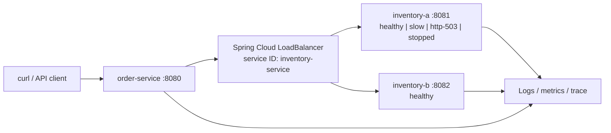
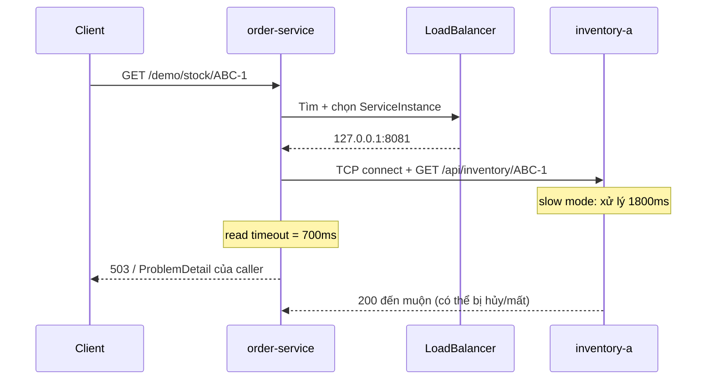

# Mô phỏng một bản sao chậm, lỗi hoặc ngừng kết nối

## 1. Mục tiêu và kết quả cần bàn giao

Trong chương **Thực hành tổng hợp** của module `SPRING_CLOUD_SERVICE_COMMUNICATION_LOAD_BALANCING`, chúng ta xây dựng một tình huống gần vận hành thật: `order-service` gọi `inventory-service` qua **Spring Cloud LoadBalancer**, nhưng một trong các bản sao bị chậm, trả lỗi hoặc ngừng lắng nghe kết nối. Bài thực hành kết hợp chọn `ServiceInstance` theo service ID, discovery, health check, chính sách định tuyến, `RestClient`/`WebClient`/OpenFeign, timeout, retry và observability.

**Bối cảnh nghiệp vụ:** API `GET /demo/stock/{sku}` của `order-service` hỏi tồn kho. Hai tiến trình cùng đăng ký với service ID `inventory-service`: `inventory-a` ở cổng 8081 và `inventory-b` ở cổng 8082. Mỗi replica trả về `instanceId` để xác nhận request thực sự tới đâu.

Bài lab trả lời được các câu hỏi:

1. Khi A phản hồi trong 1.800 ms, nhưng client đọc tối đa 700 ms, ta thấy loại lỗi nào?
2. Khi A trả HTTP 503 ngay lập tức, liệu nó có khác connect/read timeout?
3. Khi A dừng hẳn, vì sao caller vẫn có thể thử gửi tới địa chỉ A trong `SimpleDiscoveryClient`?
4. Nếu B khỏe, tại sao không thể khẳng định mọi request tiếp theo luôn chuyển sang B?
5. Retry, health supplier và circuit breaker can thiệp ở lớp nào; khi nào chúng **không** tự động hoạt động?
6. Những log, trace và metrics nào chứng minh một lần chọn instance, một HTTP attempt, số retry và kết quả cuối?
7. Làm thế nào để kiểm thử tự động mà không phụ thuộc thứ tự Round Robin ban đầu hoặc thời gian chờ ngẫu nhiên?

### Đầu ra mong đợi

- Hai replica `inventory-service` chạy độc lập và có thể khởi động lại ở ba chế độ `healthy`, `slow`, `http-503`.
- Một `order-service` gọi bằng service ID `inventory-service` qua Spring Cloud LoadBalancer, không hardcode một replica vào client.
- Phép thử thứ tư: **dừng** tiến trình A để tạo tình huống connection refused.
- Bảng kết quả phân biệt HTTP 200, HTTP 503 từ upstream, read timeout, connect failure và no-instance.
- Nhật ký có logical request ID và replica ID, bảng số attempts, kết quả và latency do người học tự thu thập.
- Phần mở rộng thử retry có giới hạn, health filtering và quan sát lỗi sau khi đã có baseline.

**Phạm vi an toàn:** chỉ gây lỗi trong local lab/test environment; không mở fault-toggle endpoint public, không chặn mạng của hệ thống thật và không bật retry không giới hạn trong production. Các giá trị timeout/port/delay bên dưới phục vụ học tập, **không phải cấu hình khuyến nghị áp dụng nguyên xi**.

## 2. Kiến trúc và các tình huống lỗi



**Một logical request** là yêu cầu của client tới `order-service`. **Một HTTP attempt** là một lần caller thực sự gửi request tới một replica. Nếu retry bật, một logical request có thể có nhiều attempts, thậm chí tới hai replica khác nhau.

| Chế độ A | Diễn biến trên đường gọi A | Quan sát chủ yếu | Điều chưa được phép kết luận |
|---|---|---|---|
| `healthy` | Trả JSON HTTP 200 nhanh | `instanceId=inventory-a`, latency thấp | Hai bản sao có công suất ngang nhau |
| `slow` | Ngủ 1.800 ms trước khi trả HTTP 200 | Với read timeout 700 ms, caller có thể nhận `ResourceAccessException` do read timeout | Server chắc chắn không xử lý sau khi caller timeout |
| `http-503` | Trả HTTP 503 kèm body lỗi | `RestClientResponseException` / status 503 | LoadBalancer đã tự loại A khỏi registry |
| `stopped` | Không có tiến trình lắng nghe port 8081 | Connect refused / lỗi I/O; có thể xảy ra nhanh hơn connect timeout | A tự biến mất khỏi `SimpleDiscoveryClient` |
| Không có instance nào trong danh sách | LoadBalancer không chọn được server | Không có HTTP exchange tới A/B | Tương đương connect refused hay 503 do server trả |

Các cột trên mô tả **kỳ vọng kỹ thuật**, chưa phải số liệu thực đo. Lỗi cụ thể và ngoại lệ có thể khác theo HTTP transport, hệ điều hành và Spring Cloud Release Train.

### 2.1. Phân biệt bốn lớp thời gian



- **Discovery/list latency:** thời gian danh sách `ServiceInstance` được tra/cập nhật, kể cả khi có registry thực, cache, health supplier.
- **Choose latency:** thời gian thuật toán chọn một phần tử từ tập instance đã cho.
- **Connect timeout:** giới hạn khi thiết lập kết nối TCP tới địa chỉ đã chọn. `ECONNREFUSED` có thể xảy ra tức thì, không cần đợi hết timeout.
- **Read/response timeout:** giới hạn chờ dữ liệu phản hồi trên connection; không tự bao discovery, retry backoff và mọi bước của logical request.
- **End-to-end deadline:** tổng thời gian chấp nhận được cho **toàn** logical request, kể cả retry, delay và fallback.

Không cộng p95 của từng giai đoạn để suy ra p95 tổng; cần đo thời gian end-to-end thực tế của từng request.

## 3. Điều kiện trước khi thực hành

### 3.1. Stack tham chiếu

Bài minh họa dựa trên API **Spring Boot 3.x / Spring Framework 6.x**, Java 17+ và Spring Cloud Release Train **tương thích với phiên bản Boot mà project chọn**. Ví dụ dùng `RestClient` có hỗ trợ Spring Cloud LoadBalancer; nếu bạn dùng Boot 4 / Commons 5.x, cần đối chiếu tên class, dependency, behavior retry/observability và configuration metadata của đúng phiên bản.

Phần phụ thuộc gợi ý:

| Ứng dụng | Dependency cần thiết | Mục đích |
|---|---|---|
| `inventory-service` | `spring-boot-starter-web` | Tạo endpoint test HTTP và ba fault modes |
| `inventory-service` (tùy chọn) | `spring-boot-starter-actuator` | Health/metrics khi thử extension |
| `order-service` | `spring-boot-starter-web` | Endpoint nhận request của người dùng |
| `order-service` | `spring-cloud-starter-loadbalancer` | `@LoadBalanced RestClient.Builder` và chọn instance |
| `order-service` (tùy chọn) | `spring-boot-starter-actuator` | Health và quan sát metrics |
| `order-service` (tùy chọn) | `spring-retry` | Dành cho một số cơ chế retry **blocking**, tùy version/integration |
| `order-service` (tùy chọn) | `spring-boot-starter-webflux` | Thực hành `WebClient` reactive |
| `order-service` (tùy chọn) | `spring-cloud-starter-openfeign` | Thực hành OpenFeign |

Để tránh một bài lab phụ thuộc vào registry bên ngoài, chúng ta dùng **`SimpleDiscoveryClient`** với danh sách instance tĩnh. Sau khi nắm bản chất, có thể thay bằng Eureka, Consul, Kubernetes DiscoveryClient hoặc test container của dự án.

### 3.2. Gợi ý cấu trúc project học tập

```text
load-balancer-fault-lab/
├── inventory-service/
│   └── src/main/java/.../
│       ├── InventoryApplication.java
│       └── InventoryFaultController.java
└── order-service/
    └── src/main/java/.../
        ├── OrderApplication.java
        ├── LoadBalancedClientConfig.java
        └── StockProxyController.java
```

Đây là **sơ đồ cấu trúc tham khảo**, không phải yêu cầu worker tự tạo các file trên. Nếu project dùng Maven đa module hoặc Gradle, đặt code vào module tương ứng và để Spring Boot/Spring Cloud BOM quản lý phiên bản; **không chọn thủ công các artifact có major version xung đột**.

Ví dụ phần dependencies cốt lõi ở module inventory:

```xml
<dependencies>
  <dependency>
    <groupId>org.springframework.boot</groupId>
    <artifactId>spring-boot-starter-web</artifactId>
  </dependency>
  <dependency>
    <groupId>org.springframework.boot</groupId>
    <artifactId>spring-boot-starter-actuator</artifactId>
  </dependency>
</dependencies>
```

Và module order:

```xml
<dependencies>
  <dependency>
    <groupId>org.springframework.boot</groupId>
    <artifactId>spring-boot-starter-web</artifactId>
  </dependency>
  <dependency>
    <groupId>org.springframework.cloud</groupId>
    <artifactId>spring-cloud-starter-loadbalancer</artifactId>
  </dependency>
  <dependency>
    <groupId>org.springframework.boot</groupId>
    <artifactId>spring-boot-starter-actuator</artifactId>
  </dependency>
</dependencies>
```

Trong Maven parent/BOM, import `spring-cloud-dependencies` đúng Release Train đã chọn. Không khai báo version ngẫu nhiên của riêng `spring-cloud-starter-loadbalancer` rồi bỏ qua BOM; sự không tương thích có thể khiến lỗi startup bị nhầm là lỗi của thuật toán.

## 4. Tạo inventory-service với các chế độ mô phỏng

### 4.1. Spring Boot application

```java
@SpringBootApplication
public class InventoryApplication {

    public static void main(String[] args) {
        SpringApplication.run(InventoryApplication.class, args);
    }
}
```

Một bản JAR được chạy hai lần với `server.port` và `app.instance-id` khác nhau. Bản A sẽ đổi chế độ qua property startup; bản B luôn khỏe trong các phép thử ban đầu.

### 4.2. Controller fault injection

```java
@RestController
@RequestMapping("/api/inventory")
class InventoryFaultController {

    private static final Logger log =
            LoggerFactory.getLogger(InventoryFaultController.class);

    @Value("${app.instance-id:inventory-unknown}")
    private String instanceId;

    @Value("${app.fault.mode:healthy}")
    private String mode;

    @Value("${app.fault.delay-ms:1800}")
    private long delayMs;

    @GetMapping("/{sku}")
    ResponseEntity<Map<String, Object>> get(
            @PathVariable String sku,
            @RequestHeader(name = "X-Lab-Request-Id",
                           defaultValue = "-") String requestId) {

        long start = System.nanoTime();
        log.info("inventory.start requestId={} instance={} mode={} sku={}",
                requestId, instanceId, mode, sku);

        if ("http-503".equalsIgnoreCase(mode)) {
            log.warn("inventory.reject requestId={} instance={}",
                    requestId, instanceId);
            return ResponseEntity.status(HttpStatus.SERVICE_UNAVAILABLE)
                    .header(HttpHeaders.RETRY_AFTER, "1")
                    .body(Map.of(
                            "instanceId", instanceId,
                            "error", "LAB_UNAVAILABLE"));
        }

        if ("slow".equalsIgnoreCase(mode)) {
            try {
                Thread.sleep(Math.max(0L, delayMs));
            }
            catch (InterruptedException ex) {
                Thread.currentThread().interrupt();
                return ResponseEntity.status(
                                HttpStatus.SERVICE_UNAVAILABLE)
                        .body(Map.of(
                                "instanceId", instanceId,
                                "error", "LAB_INTERRUPTED"));
            }
        }

        long elapsedMs = TimeUnit.NANOSECONDS.toMillis(
                System.nanoTime() - start);
        log.info("inventory.done requestId={} instance={} ms={}",
                requestId, instanceId, elapsedMs);

        return ResponseEntity.ok(Map.of(
                "sku", sku,
                "available", 12,
                "instanceId", instanceId));
    }
}
```

Import cần dùng (IDE có thể tự thêm): `org.springframework.web.bind.annotation.*`, `org.springframework.http.*`, `org.springframework.beans.factory.annotation.Value`, `org.slf4j.*`, `java.util.Map` và `java.util.concurrent.TimeUnit`.

**Không đặt code tạo lỗi này vào production.** `Thread.sleep` là cách đơn giản để tạo độ trễ trong **Spring MVC test server**, không dùng trên WebFlux event loop. Với dữ liệu thật, không log SKU nếu đó là PII/sensitive resource ID; ở lab này `ABC-1` chỉ là giá trị giả.

### 4.3. Properties riêng từng tiến trình

`inventory-service/src/main/resources/application.yml` có thể chứa:

```yaml
spring:
  application:
    name: inventory-service

server:
  port: 8081

app:
  instance-id: inventory-a
  fault:
    mode: healthy
    delay-ms: 1800

management:
  endpoints:
    web:
      exposure:
        include: health,info
```

Dùng command-line arguments để ghi đè `server.port`, `app.instance-id` và `app.fault.mode` khi mở tiến trình B hoặc gây lỗi ở A.

Chú ý rằng `http-503` là mã lỗi của **endpoint nghiệp vụ** trong lab. Nếu `/actuator/health` vẫn trả UP, health probe thông thường có thể tiếp tục coi replica A là healthy. Đây là tình huống thực tế: một instance có thể sẵn sàng kết nối nhưng API nghiệp vụ lại lỗi hoặc chậm.

## 5. Cấu hình order-service để chọn instance qua service ID

`order-service` sử dụng `SimpleDiscoveryClient` thay cho registry thật. Cả A và B đều có cùng **service ID** `inventory-service` nhưng `instanceId` và địa chỉ khác nhau:

```yaml
spring:
  application:
    name: order-service
  cloud:
    discovery:
      client:
        simple:
          instances:
            inventory-service:
              - uri: http://127.0.0.1:8081
                instance-id: inventory-a
              - uri: http://127.0.0.1:8082
                instance-id: inventory-b
    loadbalancer:
      cache:
        enabled: false
      retry:
        enabled: false

server:
  port: 8080

management:
  endpoints:
    web:
      exposure:
        include: health,info,metrics
```

**Giải thích:**

- `http://inventory-service` là tên logic mà client dùng, không phải DNS hostname vật lý.
- `SimpleDiscoveryClient` trả hai địa chỉ cấu hình tĩnh; nó **không tự xóa A** nếu tiến trình A đã dừng.
- `cache.enabled=false` giúp baseline ít biến số hơn; bản thân cấu hình SimpleDiscovery vẫn là **danh sách tĩnh**, không có nghĩa health/discovery tự refresh theo trạng thái thực.
- `retry.enabled=false` giúp đếm **một lần gửi HTTP** cho một logical request ở baseline, nếu không có retry tại tầng HTTP/gateway khác.
- Nếu chạy trong Docker/Kubernetes, `127.0.0.1` trỏ tới container/pod của **chính caller**, không trỏ sang replica khác. Hãy dùng hostname/URI mà order-service truy cập được.

### 5.1. Khi nào danh sách được cập nhật?

Ở cấu hình tĩnh, restart A không thay đổi tập hai URI mà caller biết. Nếu muốn mô phỏng **scale-in thật**, dùng dynamic discovery hoặc một supplier test cho phép thay danh sách. Việc A bị mất kết nối và việc A bị **loại khỏi registry** là hai kịch bản khác nhau cần kiểm thử độc lập.

Đừng suy rằng `HealthCheckServiceInstanceListSupplier` đã tự bật chỉ vì class có trong dependency. Cần cấu hình supplier/filter rõ ràng; các cập nhật health có độ trễ và còn chịu chính sách fallback.

## 6. Tạo RestClient có LoadBalancer và timeout rõ ràng

Trong Spring Boot 3.x, `RestClient.Builder` có thể được Spring Boot customize cho converters/observation; bean `@LoadBalanced` cần giữ các customizers đó và được Spring Cloud LoadBalancer áp interceptor phù hợp.

```java
@Configuration(proxyBeanMethods = false)
class LoadBalancedClientConfig {

    @Bean
    @LoadBalanced
    RestClient.Builder loadBalancedRestClientBuilder(
            RestClientBuilderConfigurer configurer) {
        return configurer.configure(RestClient.builder());
    }
}
```

`RestClientBuilderConfigurer` thuộc cấu hình Spring Boot 3.x; cách tạo builder/annotation có thể khác giữa các Release Train. Không thêm hai bean cùng qualifier `@LoadBalanced` rồi trông chờ Spring tự chọn đúng khi inject. Trong project có sẵn builder đã được Boot customize và phù hợp LoadBalancer, có thể tái sử dụng builder thay vì tạo một bean khác.

### 6.1. Đặt connect timeout và read timeout

```java
@RestController
@RequestMapping("/demo")
class StockProxyController {

    private static final Logger log =
            LoggerFactory.getLogger(StockProxyController.class);

    private final RestClient inventoryClient;

    StockProxyController(
            @LoadBalanced RestClient.Builder builder) {

        SimpleClientHttpRequestFactory transport =
                new SimpleClientHttpRequestFactory();

        // Đơn vị millisecond trong overload int.
        transport.setConnectTimeout(300);
        transport.setReadTimeout(700);

        this.inventoryClient = builder.clone()
                .baseUrl("http://inventory-service")
                .requestFactory(transport)
                .build();
    }

    @GetMapping("/stock/{sku}")
    ResponseEntity<?> get(@PathVariable String sku) {
        String requestId = UUID.randomUUID().toString();
        long start = System.nanoTime();

        log.info("caller.start requestId={} sku={}", requestId, sku);
        try {
            InventoryStock stock = inventoryClient.get()
                    .uri("/api/inventory/{sku}", sku)
                    .header("X-Lab-Request-Id", requestId)
                    .retrieve()
                    .body(InventoryStock.class);

            if (stock == null || stock.available() == null
                    || stock.available() < 0
                    || !sku.equals(stock.sku())) {
                return error(HttpStatus.BAD_GATEWAY,
                        "INVALID_INVENTORY_RESPONSE");
            }

            log.info(
                    "caller.success requestId={} instance={} ms={}",
                    requestId, stock.instanceId(),
                    elapsedMs(start));
            return ResponseEntity.ok(stock);
        }
        catch (RestClientResponseException ex) {
            log.warn(
                    "caller.http-error requestId={} status={} ms={}",
                    requestId, ex.getStatusCode().value(),
                    elapsedMs(start));

            HttpStatus result =
                    ex.getStatusCode().value() == 503
                            ? HttpStatus.SERVICE_UNAVAILABLE
                            : HttpStatus.BAD_GATEWAY;

            return error(result, "INVENTORY_UPSTREAM_HTTP_ERROR");
        }
        catch (ResourceAccessException ex) {
            log.warn(
                    "caller.io-error requestId={} cause={} ms={}",
                    requestId, ex.getClass().getSimpleName(),
                    elapsedMs(start));

            return error(HttpStatus.SERVICE_UNAVAILABLE,
                    "INVENTORY_TRANSPORT_UNAVAILABLE");
        }
    }

    private static long elapsedMs(long start) {
        return TimeUnit.NANOSECONDS.toMillis(
                System.nanoTime() - start);
    }

    private static ResponseEntity<ProblemDetail> error(
            HttpStatus status, String code) {

        ProblemDetail problem = ProblemDetail.forStatus(status);
        problem.setTitle("Không thể xác minh tồn kho");
        problem.setDetail("Dependency inventory tạm thời không khả dụng");
        problem.setProperty("code", code);
        return ResponseEntity.status(status).body(problem);
    }
}

record InventoryStock(
        String sku, Integer available, String instanceId) {}
```

Import cần có: `org.springframework.web.bind.annotation.*`, `org.springframework.http.*`, `org.springframework.web.client.RestClient`, `RestClientResponseException`, `ResourceAccessException`, `org.springframework.http.client.SimpleClientHttpRequestFactory`, `org.slf4j.*`, `java.util.UUID` và `java.util.concurrent.TimeUnit`.

**Đây là HTTP error mapping của lab**: nó giữ đường phân biệt giữa lỗi HTTP upstream và lỗi transport. Production phải có hợp đồng cụ thể cho 400/401/403/404/409/429, trace/correlation và bảo mật thông tin lỗi; không chuyển mọi status về 502/503 một cách mù quáng.

### 6.2. Tại sao dùng Integer thay int?

`Integer available` có thể là `null` nếu response JSON thiếu field. `int available` dễ bị gán mặc định 0 trong một số đường deserialize, khiến “response thiếu số lượng” bị hiểu nhầm thành “hết hàng”. Bài thực hành phải **validate** schema trước khi dùng số liệu.

### 6.3. Lưu ý về lỗi trước HTTP

Khi không có `ServiceInstance` trong discovery, hành vi exception/status có thể khác theo Spring Cloud/HTTP client version. Code ví dụ ở trên tập trung vào **HTTP 503 từ server** và **lỗi network I/O**; kịch bản no-instance cần được test riêng và bổ sung adapter/error handling theo actual version, không khẳng định mọi failure luôn rơi vào hai catch blocks đó.

## 7. Khởi chạy baseline A/B khỏe

Sau khi project được build bằng Maven/Gradle theo cách sẵn có, mở **ba terminal độc lập**. Giả sử đã có JAR thích hợp trong `target`:

**Terminal A:**

```bash
java -jar inventory-service/target/inventory-service.jar \
  --server.port=8081 \
  --app.instance-id=inventory-a \
  --app.fault.mode=healthy
```

**Terminal B:**

```bash
java -jar inventory-service/target/inventory-service.jar \
  --server.port=8082 \
  --app.instance-id=inventory-b \
  --app.fault.mode=healthy
```

**Terminal caller:**

```bash
java -jar order-service/target/order-service.jar \
  --server.port=8080
```

Dấu `\` dùng để nối dòng theo kiểu shell Unix; trên Windows PowerShell hãy **viết mỗi lệnh trên một dòng** hoặc dùng cú pháp nối dòng phù hợp của PowerShell. Tên JAR chỉ minh họa và phải thay bằng artifact thực tế của dự án. Worker biên soạn tài liệu **không chạy lệnh build/test**, phần kết quả chỉ là kỳ vọng để người học thực hành.

Kiểm tra trực tiếp từng replica:

```bash
curl -i http://127.0.0.1:8081/api/inventory/ABC-1
curl -i http://127.0.0.1:8082/api/inventory/ABC-1
```

Kết quả dự kiến: đều HTTP 200; A có `instanceId=inventory-a`, B có `instanceId=inventory-b`.

Sau đó kiểm tra thông qua caller:

```bash
curl -i http://127.0.0.1:8080/demo/stock/ABC-1
curl -i http://127.0.0.1:8080/demo/stock/ABC-1
curl -i http://127.0.0.1:8080/demo/stock/ABC-1
curl -i http://127.0.0.1:8080/demo/stock/ABC-1
```

Với Round Robin mặc định và hai instance ổn định, các lượt chọn thường luân phiên A/B; nhưng **không khẳng định request đầu là A** nếu seed/child context/request nền chưa được kiểm soát. Mục tiêu baseline là chứng minh **cả hai instance có thể nhận HTTP thật**, mỗi request thành công nhận đúng JSON của replica đã xử lý.

Trong PowerShell trên Windows, dùng `curl.exe` thay cho alias `curl` nếu muốn cú pháp giống lệnh trên.

## 8. Kịch bản 1 — Một replica phản hồi chậm

### 8.1. Thiết lập

Dừng A bằng Ctrl+C, giữ B khỏe, rồi chạy lại A ở chế độ `slow`:

```bash
java -jar inventory-service/target/inventory-service.jar \
  --server.port=8081 \
  --app.instance-id=inventory-a \
  --app.fault.mode=slow \
  --app.fault.delay-ms=1800
```

Khi gọi trực tiếp A, HTTP server đợi khoảng 1.800 ms trước khi trả 200. Nhưng `order-service` có `readTimeout=700ms` nên lời gọi đến A thường phát read timeout trước khi A trả xong.

Khi gọi trực tiếp B, response vẫn nhanh. Điều này cô lập đúng một replica bị chậm, thay vì làm toàn bộ service ID mất kết nối.

### 8.2. Tiến hành

```bash
curl -i http://127.0.0.1:8081/api/inventory/ABC-1
curl -i http://127.0.0.1:8082/api/inventory/ABC-1

curl -i http://127.0.0.1:8080/demo/stock/ABC-1
curl -i http://127.0.0.1:8080/demo/stock/ABC-1
curl -i http://127.0.0.1:8080/demo/stock/ABC-1
curl -i http://127.0.0.1:8080/demo/stock/ABC-1
```

**Quan sát mong đợi:**

| Nếu LoadBalancer chọn | Upstream behavior | Caller behavior với timeout cấu hình |
|---|---|---|
| A | HTTP 200 sau ~1.800 ms | Có thể ném `ResourceAccessException` (root cause read timeout) rồi caller trả 503 |
| B | HTTP 200 gần như ngay | Caller trả 200 với `instanceId=inventory-b` |

Nếu A vẫn thấy log `inventory.done` sau khi caller đã timeout, đó **không phải bằng chứng timeout sai**. Server có thể hoàn tất xử lý dù socket phía caller đã đóng hoặc bỏ kết quả. Cũng không thể dùng timeout của một thao tác ghi để kết luận transaction chưa commit.

### 8.3. Cần đo gì?

- Caller: `requestId`, elapsed time, root exception class/cause, số HTTP attempts.
- A: `inventory.start` và `inventory.done` với cùng request ID; elapsed ~1.800 ms.
- B: số request nhận được và elapsed.
- Nếu có tracing: server span của A có thể còn hoàn thành muộn; caller span có thể kết thúc timeout sớm hơn.
- Nếu có metrics: phân biệt `http.client.requests`, `http.server.requests` và metrics riêng của LoadBalancer theo version; không coi chúng tự có cùng label/định nghĩa.

**Không lấy một kết quả 200 rồi khẳng định không xảy ra timeout**: request đó có thể chỉ được chọn đến B.

## 9. Kịch bản 2 — Một replica trả HTTP 503

### 9.1. Thiết lập

Giữ B healthy, restart A:

```bash
java -jar inventory-service/target/inventory-service.jar \
  --server.port=8081 \
  --app.instance-id=inventory-a \
  --app.fault.mode=http-503
```

A trả `503 Service Unavailable` ngay ở HTTP application layer. Đây không phải connection refused, không phải read timeout và cũng không có nghĩa registry đã loại A.

### 9.2. Gọi trực tiếp rồi qua LoadBalancer

```bash
curl -i http://127.0.0.1:8081/api/inventory/ABC-1
curl -i http://127.0.0.1:8082/api/inventory/ABC-1

curl -i http://127.0.0.1:8080/demo/stock/ABC-1
curl -i http://127.0.0.1:8080/demo/stock/ABC-1
curl -i http://127.0.0.1:8080/demo/stock/ABC-1
```

Kết quả kỳ vọng:

- Request trúng A: kết nối thành công, nhận HTTP 503 từ inventory, `RestClient.retrieve()` ném `RestClientResponseException`, caller lab trả `503 ProblemDetail` với `code=INVENTORY_UPSTREAM_HTTP_ERROR`.
- Request trúng B: nhận HTTP 200, trả body `inventory-b`.
- Với retry tắt và snapshot tĩnh, **một HTTP failure không tự bảo đảm chọn B lần tiếp theo**. Round Robin vẫn quay theo counter; Random có thể chọn lại A nhiều lần.
- Header `Retry-After: 1` từ A chỉ là thông tin HTTP; đoạn client lab **không tự đọc header để lên lịch retry**, vì retry đang tắt.

**Phân biệt nguồn 503:** 503 ở response của caller có thể do **upstream A trả**, do **LoadBalancer không có instance** hoặc do **caller tự map lỗi timeout thành 503**. Cần log nguyên nhân và sự tồn tại của HTTP attempt, không chỉ nhìn status.

## 10. Kịch bản 3 — Một replica ngừng kết nối

### 10.1. Thiết lập

B giữ healthy. Dừng A bằng Ctrl+C, **không** sửa `SimpleDiscoveryClient` ở caller.

Kiểm tra:

```bash
curl -i http://127.0.0.1:8081/api/inventory/ABC-1
curl -i http://127.0.0.1:8082/api/inventory/ABC-1
```

A thường bị `Connection refused` vì không có process lắng nghe port 8081; B vẫn trả 200. Tùy host/OS/network firewall, thao tác kết nối có thể timeout thay vì refused. **Không gọi đây là read timeout** nếu TCP connection còn chưa được tạo.

### 10.2. Gọi qua caller

```bash
curl -i http://127.0.0.1:8080/demo/stock/ABC-1
curl -i http://127.0.0.1:8080/demo/stock/ABC-1
curl -i http://127.0.0.1:8080/demo/stock/ABC-1
curl -i http://127.0.0.1:8080/demo/stock/ABC-1
```

Nếu LoadBalancer chọn A, HTTP client sẽ gặp lỗi kết nối. Nếu chọn B, request thành công. `SimpleDiscoveryClient` vẫn trả cả hai địa chỉ vì danh sách nằm trong cấu hình tĩnh; **instance ngừng chạy** khác với **instance đã được registry loại bỏ**.

### 10.3. Connect refused khác network blackhole

| Mô phỏng | Kỳ vọng tầng transport | Giới hạn của bài lab |
|---|---|---|
| Dừng process A, port không còn listener | Thường `ECONNREFUSED` rất nhanh | Không chứng minh connect timeout 300 ms được sử dụng |
| Chặn/rơi TCP packets tới A bằng network fault proxy | Có thể chờ đến connect timeout | Cần công cụ như Toxiproxy hoặc network controls **chỉ trong test** |
| A mở TCP nhưng không gửi response | Read/response timeout | Có thể mô phỏng bằng `slow` hoặc proxy delay |
| Server chủ động reset connection | Connection reset / I/O error | Không đồng nghĩa HTTP 503 |

Không sửa firewall hay route trên máy làm việc chung/production để tạo “blackhole”. Nếu dùng Toxiproxy/test container, cấu hình proxy **riêng cho test** và reset sau bài.

## 11. Kịch bản 4 — Không còn một instance nào

Để thấy khác biệt với stopped A, hãy dùng **một cấu hình test riêng**: xóa mọi URI của `inventory-service` trong `SimpleDiscoveryClient` rồi restart caller, hoặc cung cấp một `ServiceInstanceListSupplier` fake trả danh sách rỗng.

Trạng thái này không giống cả hai instance dừng nhưng vẫn nằm trong discovery. Khi tập rỗng, LoadBalancer không có server để chọn:

```text
ServiceInstanceListSupplier: []
         |
         v
LoadBalancer.choose(): no server
         |
         v
Không có HTTP exchange tới inventory-a/b
```

Ở reactive client, tùy version/filter, no-instance có thể tạo HTTP response 503 tổng hợp tại caller; ở blocking client có thể phát exception/được map status khác. Đừng hardcode một exception duy nhất nếu chưa kiểm tra version.

**Câu hỏi kiểm chứng:** log nào chứng minh đã có request đến backend? Với no-instance đúng nghĩa, A/B sẽ **không** thấy `inventory.start` cho request đó; không nên có network connect tới port của hai replica.

## 12. Ghi bảng kết quả thực nghiệm

Không chỉ kiểm tra HTTP status; cần biết LoadBalancer chọn ai, request có tới server không và lỗi xảy ra ở giai đoạn nào. Bảng dưới để **người học tự điền**, không phải kết quả đã được chạy:

| Test | Trạng thái A | Trạng thái B | Instance được chọn | HTTP attempt đến server? | Caller status | Lỗi/giai đoạn | Duration ms |
|---|---|---|---|---|---|---|---|
| B01 | healthy | healthy | A/B | Có | 200 | — | ... |
| S01 | slow 1800ms | healthy | A/B | Có | 200/503 | Read timeout nếu A | ... |
| E01 | http-503 | healthy | A/B | Có | 200/503 | Upstream 503 nếu A | ... |
| D01 | stopped | healthy | A/B | Không nếu trúng A | 200/503 | Connect refused nếu A | ... |
| N01 | no-instance | healthy | Không có | Không | Tùy adapter | No-instance | ... |
| R01 | http-503 | healthy | A rồi có thể B | Một hoặc nhiều | Theo retry | Attempts/backoff | ... |
| H01 | unhealthy theo health probe | healthy | Theo filtered list | Theo probe policy | Theo kết quả | Health filtering | ... |

Mỗi kết quả cần **kèm bằng chứng**: `X-Lab-Request-Id`, log caller, log A/B, số requests ở backend, timestamp và configuration của lượt test. Chạy nhiều lần để xuất hiện cả A/B; một request đơn lẻ không chứng minh thuật toán đã cân tải.

### 12.1. Hai khái niệm tỷ lệ dễ nhầm

```text
logical_requests_total = số lần người dùng gọi /demo/stock
http_attempts_total    = tổng số GET thật gửi tới inventory replicas
retry_attempts_total   = max(0, attempts - 1) trên từng logical request
```

Nếu retry tắt, hai số đầu thường bằng nhau **trừ tình huống không có instance, lỗi trước HTTP hoặc request bị hủy**. Nếu retry bật, `http_attempts_total` có thể lớn hơn `logical_requests_total`; đó là tải tăng thật xuống downstream.

## 13. Mở rộng 1 — Bật retry có giới hạn và kiểm tra hiệu quả

### 13.1. Vì sao chưa bật ngay từ đầu?

Retry có thể làm request đầu lỗi ở A nhưng lần tiếp theo thành công ở B. Điều này tốt cho user, nhưng che mất việc A đang lỗi nếu ta chỉ nhìn HTTP 200 cuối cùng. Để quan sát trực tiếp nguyên nhân, hoàn tất baseline **retry tắt** trước.

### 13.2. Ví dụ policy muốn thử một instance khác

Một nhóm property tham khảo trong Spring Cloud Commons 4.3:

```yaml
spring:
  cloud:
    loadbalancer:
      retry:
        enabled: true
        retry-on-all-operations: false
        retry-on-all-exceptions: false
        max-retries-on-same-service-instance: 0
        max-retries-on-next-service-instance: 1
        retryable-status-codes:
          - 503
        avoid-previous-instance: true
```

**Quan trọng:** các property trên biểu thị **ý định retry**, nhưng việc có retry thực sự phụ thuộc HTTP client, tích hợp LoadBalancer, `spring-retry` đối với một số nhánh blocking và phiên bản Spring Cloud. Không suy rằng bật property là `RestClient`/OpenFeign lập tức retry y hệt nhau. Hãy xác minh **HTTP attempt count thực tế** trong log backend. Ở Spring Cloud OpenFeign, `Retryer.NEVER_RETRY` là mặc định riêng của Feign; không nhầm với retry chính sách của các stack khác.

Ví dụ giới hạn cho đường đọc GET:

- Retry tối đa một lần tới next instance, không retry vô hạn.
- Chỉ retry lỗi đã phân loại như 503 hoặc connect/read failure **nếu request an toàn** và còn ngân sách thời gian.
- Đừng mặc định retry POST thanh toán/đặt giữ hàng khi chưa có idempotency và deduplication.
- Tránh retry cả ở gateway, LoadBalancer, HTTP client và service layer cùng lúc; attempts có thể nhân lên.

### 13.3. Retry-aware selection không đảm bảo luôn đổi replica

`avoid-previous-instance=true` có thể khiến supplier retry cố tránh instance đã thất bại **khi còn ứng viên phù hợp**. Nếu chỉ có A, cache stale, health/zone filter hạn chế ứng viên hoặc context không đủ thông tin, lựa chọn thứ hai có thể không khác. Test phải ghi `instanceId` của **từng attempt**, không assert “attempt 2 luôn B” cho mọi topology.

### 13.4. Tổng deadline quan trọng hơn timeout mỗi attempt

Giả sử hai attempts đều có thể chờ 700 ms và backoff 150 ms:

```text
Attempt 1      700 ms
Backoff        150 ms
Attempt 2      700 ms
Overhead        50 ms
--------------------
Tổng         1600 ms
```

Nếu API của `order-service` có SLO 1.000 ms, thiết kế này vượt ngân sách dù **mỗi attempt** có read timeout 700 ms. Cần đặt end-to-end deadline ở tầng logical request hoặc tự tính remaining budget trước retry, nhất là khi dùng reactive `retryWhen`.

Với Spring Cloud LoadBalancer **reactive retry**, property `spring.cloud.loadbalancer.retry.backoff.enabled` và `min-backoff`/`max-backoff`/`jitter` liên quan Reactor retry; **không mặc định áp dụng cùng cách vào RestClient blocking**. Tránh copy policy reactive sang mọi HTTP stack rồi cho rằng đã có exponential backoff.

## 14. Mở rộng 2 — Health check và loại instance

### 14.1. Readiness khác HTTP business success

Actuator `/actuator/health` có thể vẫn trả UP trong khi `GET /api/inventory/{sku}` trả 503 vì fault mode. Nếu health probe **không phản ánh** lỗi business, một health-based supplier có thể tiếp tục coi A healthy.

Để thử health filtering:

1. Bổ sung health/readiness indicator phù hợp để trả DOWN hoặc 503 khi fault mode cần được coi là unavailable.
2. Đăng ký `HealthCheckServiceInstanceListSupplier` cho **service ID inventory-service** theo đúng Spring Cloud version.
3. Chọn health probe URL đúng trên từng instance, chẳng hạn `/actuator/health` hoặc một path dành riêng.
4. Chờ supplier chạy probe và cập nhật danh sách (có thể có interval/refetch/cache).
5. Kiểm tra **tập eligible instances**, không chỉ xem một lần Round Robin chọn B.
6. Khi A phục hồi, quan sát lúc A trở lại danh sách.

### 14.2. Cách gắn supplier cho một service ID

Một cấu hình minh họa theo Spring Cloud Commons 4.3:

```java
@LoadBalancerClient(
        name = "inventory-service",
        configuration = InventoryLoadBalancerConfiguration.class)
@SpringBootApplication
public class OrderApplication {

    public static void main(String[] args) {
        SpringApplication.run(OrderApplication.class, args);
    }
}

class InventoryLoadBalancerConfiguration {

    @Bean
    ServiceInstanceListSupplier instanceSupplier(
            ConfigurableApplicationContext context) {
        return ServiceInstanceListSupplier.builder()
                .withDiscoveryClient()
                .withBlockingHealthChecks()
                .build(context);
    }
}
```

Đặt class cấu hình LoadBalancer riêng **ngoài component scan của root application context** hoặc bảo đảm chỉ nó được đăng ký trong child context dành cho `inventory-service`; tránh vô tình áp dụng supplier đó toàn cục. Code là ví dụ phụ thuộc version; `withBlockingHealthChecks()` thích hợp cho nhánh blocking, còn reactive có lựa chọn tương ứng.

### 14.3. Những giới hạn cần hiểu

- Probe chạy theo lịch; loại A **không tức thì** sau một HTTP failure.
- `HealthCheckServiceInstanceListSupplier` có thể **fallback trả toàn bộ instance** nếu không tìm thấy instance nào healthy (theo implementation/version/config). Do đó health check không phải cam kết fail-closed tuyệt đối.
- Filter health không thay thế connect/read timeout; instance vừa chuyển xấu giữa hai probes vẫn có thể được chọn.
- `SimpleDiscoveryClient` vẫn giữ URI tĩnh; health supplier có thể lọc trong pipeline, nhưng không thật sự xóa dòng cấu hình ở registry.
- Nếu dùng Kubernetes, readiness probe và cập nhật EndpointSlice/service discovery cũng có độ trễ; không coi readiness green/red là trạng thái tức thời tuyệt đối.

## 15. Mở rộng 3 — WebClient reactive

Nếu caller dùng WebFlux/WebClient, vẫn nên giữ cùng hai replica và cùng một fault mode để so sánh. Khác biệt chính: HTTP exchange được thực hiện khi `Mono` **được subscribe**, không phải lúc tạo publisher.

Cấu hình client connector Reactor Netty minh họa:

```java
@Bean
@LoadBalanced
WebClient.Builder loadBalancedWebClientBuilder(
        ObjectProvider<WebClientCustomizer> customizers) {

    HttpClient httpClient = HttpClient.create()
            .option(ChannelOption.CONNECT_TIMEOUT_MILLIS, 300)
            .responseTimeout(Duration.ofMillis(700));

    WebClient.Builder builder = WebClient.builder()
            .clientConnector(
                    new ReactorClientHttpConnector(httpClient));

    customizers.orderedStream()
            .forEach(customizer -> customizer.customize(builder));

    return builder;
}
```

Builder trên minh họa việc giữ Spring Boot `WebClientCustomizer` (bao gồm observation khi đã được cấu hình) và gắn `@LoadBalanced`. Import class tương ứng từ Reactor Netty, Netty, Spring WebFlux và Spring Boot; cần dependency WebFlux/Reactor Netty hợp lệ. Trong một project đã có builder instrumented, tránh áp hai lần customizers/observation filters gây span trùng.

Một lời gọi:

```java
Mono<InventoryStock> readStock(
        WebClient inventoryClient, String sku) {

    return inventoryClient.get()
            .uri("/api/inventory/{sku}", sku)
            .retrieve()
            .bodyToMono(InventoryStock.class)
            .switchIfEmpty(Mono.error(
                    new IllegalStateException("Empty inventory body")));
}
```

`inventoryClient` phải được tạo từ builder đã `@LoadBalanced` với `baseUrl("http://inventory-service")`. Dùng `StepVerifier` hoặc trả `Mono` từ controller; không gọi `block()` trên WebFlux event loop.

### 15.1. Phân biệt timeout và retry ở reactive pipeline

```java
return inventoryClient.get()
        .uri("/api/inventory/{sku}", sku)
        .retrieve()
        .bodyToMono(InventoryStock.class)
        .retryWhen(Retry.backoff(1, Duration.ofMillis(100))
                .maxBackoff(Duration.ofMillis(300))
                .jitter(0.5)
                .filter(this::isTransientFailure))
        .timeout(Duration.ofSeconds(1));
```

`isTransientFailure` là predicate ứng dụng **phải định nghĩa đúng**; `Retry.backoff(1, ...)` cho phép tối đa **một retry**, tức hai attempts. Đặt `timeout` ngoài `retryWhen` nhằm giới hạn tổng publisher gồm attempts/backoff, trong khi `responseTimeout` của Reactor Netty chỉ bảo vệ transport response. Không bật đồng thời LoadBalancer retry và `retryWhen` của service layer trong phép thử nếu không chủ định đo sự nhân attempts.

`timeout` có thể phát cancellation đến client, nhưng không bảo đảm HTTP server đã nhận request phải dừng tác vụ blocking hoặc rollback transaction.

## 16. Mở rộng 4 — OpenFeign

Khi thực hành OpenFeign, API theo service ID vẫn tương tự:

```java
@FeignClient(name = "inventory-service")
interface InventoryFeignClient {

    @GetMapping("/api/inventory/{sku}")
    InventoryStock read(@PathVariable("sku") String sku);
}
```

Cấu hình timeout **riêng cho Feign**, ví dụ Spring Cloud OpenFeign:

```yaml
spring:
  cloud:
    openfeign:
      client:
        config:
          inventory-service:
            connectTimeout: 300
            readTimeout: 700
```

Giá trị trên theo millisecond trong các bản OpenFeign hỗ trợ property này; phải đối chiếu version và transport được chọn. Spring Cloud OpenFeign mặc định có `Retryer.NEVER_RETRY`, nên kết quả timeout/503 ở một lượt không mặc nhiên được retry bởi Feign. Nếu thêm `Retryer`/ErrorDecoder, cần xác định lỗi HTTP 503 có được chuyển thành retryable hay không và đếm attempts thật.

Đừng so trực tiếp tên exception giữa Feign, RestClient và WebClient: Feign có `FeignException`, WebClient có `WebClientResponseException` và `WebClientRequestException`, RestClient có `RestClientResponseException`/`ResourceAccessException`. Hãy quy đổi về **nhóm lỗi nghiệp vụ ổn định** ở adapter và giữ nguyên nguyên nhân cho observability.

## 17. Quan sát lỗi: log, metrics và tracing

### 17.1. Một request ID không thay thế distributed trace

Bài lab dùng `X-Lab-Request-Id` để nối log caller và server. Header này **không** thay thế W3C `traceparent`. Khi có Micrometer Tracing và các HTTP client/server đã instrument, cần quan sát:

- `traceId` chung cho các span thuộc cùng logical request, nếu context được propagate đúng.
- Mỗi HTTP client/server attempt có thể có `spanId` khác nhau; điều đó bình thường.
- Retry có thể sinh nhiều HTTP client spans cho cùng logical request.
- Khi không có instance được chọn, không nên mong có inventory server span vì **không có HTTP gửi đến inventory**.
- Sampling/exporter có thể khiến span vắng mặt trên UI dù HTTP propagation vẫn đúng; đừng nhầm với mất context.

### 17.2. Metric nào đo được?

| Loại | Mục đích | Giới hạn |
|---|---|---|
| `http.server.requests`/timer theo version | Độ trễ và status ở caller/replica | Có thể khác tên/label trong Boot/OTel stack |
| HTTP client metrics | Độ trễ gọi inventory theo URI template/status/exception | Phải dùng instrumented builder |
| `loadbalancer.requests.*` | Thành công/thất bại/discard theo lifecycle LB khi bật integration | Không tự bằng tổng HTTP attempts hoặc số lỗi nghiệp vụ |
| `logical_requests_total` (custom) | Số yêu cầu do người dùng gửi | Không nhân lên khi retry |
| `inventory_http_attempts_total` (custom) | Số HTTP exchanges tới inventory | Gắn instance/reason có giới hạn cardinality |
| `inventory_failures_total` (custom) | Connect/read timeout, upstream 503, no-instance | Giữ riêng source/cause |
| `retry_attempts_total` (custom) | Số lần thử sau initial attempt | Không lẫn với số request thành công |
| `end_to_end_latency` p50/p95/p99 | Thời gian từ caller inbound tới response | Đo trên **cùng logical request** |

Các metric “custom” là **đề xuất**, không phải Spring Cloud tự tạo đúng tên đó. `spring.cloud.loadbalancer.stats.micrometer.enabled=true` có thể bật lifecycle metrics khi dependency phù hợp; tránh nhầm `loadbalancer.requests.failed` với toàn bộ lỗi HTTP của client trong mọi trường hợp.

### 17.3. Tránh cardinality và rò dữ liệu

Không dùng `sku`, user ID, bearer token, raw path có ID hoặc `requestId` làm **metric tag**. Những thông tin chi tiết phù hợp hơn với log/trace có kiểm soát quyền, masking và retention. Với hai instance lab, `instanceId` có cardinality nhỏ; production có hàng chục nghìn pod thay đổi thì cân nhắc label explosion.

## 18. Thiết kế kiểm thử tự động có thể tái hiện

Chạy thủ công giúp hiểu hiện tượng; kiểm thử CI phải cô lập sự phụ thuộc vào timing, random seed và cổng máy.

### 18.1. Unit test thuật toán chọn instance

Tạo fake `ServiceInstanceListSupplier` trả `[A,B]` ổn định, rồi test:

- Danh sách rỗng ⇒ `hasServer()==false`.
- Chỉ B ⇒ luôn chọn B.
- Hai instance ⇒ mọi lựa chọn nằm trong `{A,B}`.
- Round Robin với seed cố định và subscription tuần tự ⇒ có thể test exact cycle khi biết implementation.
- Random ⇒ test membership, không khẳng định lượt đầu luôn A.

Đây là **unit selection**, không cần thực sự khởi chạy inventory.

### 18.2. Integration test với hai mock servers

Dùng WireMock/MockWebServer hoặc test HTTP servers, khởi động A/B trên dynamic ports và cấp URI qua `@DynamicPropertySource`. Bắt đầu với hai instance khỏe rồi thay behavior của **chính A** thành:

1. Trả HTTP 200 sau delay > read timeout.
2. Trả HTTP 503 tức thì.
3. Stop server A để connection refused.
4. Restart A để hồi phục.

Mỗi case phải giữ B khỏe, tắt retry ở baseline, ghi server request count và caller elapsed time. Không hardcode 8081/8082 vào CI chạy song song.

### 18.3. Tránh flaky assertion

Test sai:

```java
// SAI: không kiểm soát seed, số lựa chọn trước đó hoặc scheduling.
assertThat(firstResponse.instanceId()).isEqualTo("inventory-a");
Thread.sleep(500);
assertThat(secondResponse.instanceId()).isEqualTo("inventory-b");
```

Test tốt:

```java
// Gợi ý assertion khi mọi response đều thành công:
assertThat(actualIds)
        .allSatisfy(id -> assertThat(id)
                .isIn("inventory-a", "inventory-b"));

// Với một replica chậm: assert theo server request log
// và trạng thái backend, không gán kết quả vào thứ tự may rủi.
```

Nếu cần **ép** attempt đầu đến A để kiểm tra timeout, dùng supplier chỉ trả A trong test riêng hoặc một policy test-specific do bạn kiểm soát. Sau đó test B phục hồi bằng snapshot `[B]`; không trông chờ seed ngẫu nhiên và retry tình cờ chọn đúng B.

### 18.4. Test timeout nên có biên an toàn

Nếu dùng server delay 1.800 ms và client timeout 700 ms, khoảng cách đủ lớn để nhận diện read timeout trong đa số môi trường lab. Nhưng CI có thể chịu scheduling/GC/network latency khác; test cần **chờ điều kiện có deadline**, kiểm tra root exception/HTTP attempt log và không assert elapsed đúng chính xác 700 ms.

Khi cần test Reactor backoff, dùng `StepVerifier.withVirtualTime` cho pipeline dùng scheduler tương ứng; virtual time không tự tua TCP timeout hoặc health probes thực.

## 19. Ma trận chấp nhận và rubric

| Mã | Bài thử | Đạt khi |
|---|---|---|
| F01 | A/B đều healthy | Caller truy cập được cả hai qua service ID, trả JSON hợp lệ |
| F02 | A slow 1800 ms, read timeout 700 ms | Request thực sự tới A bị cắt ở caller; request tới B vẫn thành công |
| F03 | A http-503, B healthy | Phân biệt được upstream HTTP 503 với HTTP 200 từ B |
| F04 | A stopped, B healthy | Nhận ra connect error khi trúng A, không nhầm thành 503 do A trả |
| F05 | No-instance | Không có HTTP request đến A/B; lỗi được phát ở caller |
| F06 | Caller restart nhưng A vẫn stopped | Danh sách SimpleDiscovery tĩnh vẫn chứa A, nếu chưa sửa cấu hình |
| F07 | A phục hồi | Request tới A trở lại 200, không cần sửa API URL logic |
| F08 | Health filtering được bật đúng | Danh sách eligible thay đổi theo probe/policy, có độ trễ hợp lý |
| F09 | Retry có giới hạn | Số attempts không vượt policy; ghi instance từng attempt |
| F10 | Chỉ có một instance | Không khẳng định retry luôn đổi sang node khác |
| F11 | Cả hai instance lỗi | Không tạo retry storm, caller kết thúc theo attempts/deadline |
| F12 | 404 domain | Không nhầm với no-instance hoặc tự retry vô điều kiện |
| F13 | WebClient variant | Cùng failure modes nhưng phân biệt reactive timeout/exception |
| F14 | OpenFeign variant | Connect/read timeout và Feign Retryer đúng cấu hình |
| F15 | Observability | Có request ID, latency/exception/status và evidence theo replica |
| F16 | Unit/integration CI | Không dựa seed ngẫu nhiên hoặc sleep cố định |

**Rubric gợi ý (100 điểm):**

| Hạng mục | Điểm |
|---|---:|
| Topology hai replica và gọi qua service ID | 20 |
| Mô phỏng slow/503/stopped và phân loại lỗi chính xác | 25 |
| Phân biệt timeout/HTTP status/no-instance, không sai semantics | 20 |
| Retry/health behavior có bằng chứng, attempts và deadline rõ | 15 |
| Logging/metrics/tracing, báo cáo có timestamp và instance ID | 10 |
| Test cô lập, tái hiện được, không flaky | 10 |

Điểm chỉ là gợi ý cho giảng viên; không phải metadata của module. Không chấm chỉ bằng “bao nhiêu request HTTP 200” vì fallback, retry hoặc request rơi vào B có thể che sự cố A.

## 20. Những lỗi cấu hình thường gặp

| Triệu chứng | Nguyên nhân khả dĩ | Cách kiểm tra/sửa |
|---|---|---|
| Caller báo `UnknownHostException: inventory-service` | HTTP client chưa được `@LoadBalanced` | Kiểm tra builder/bean/filter, dùng URL logic đúng |
| Caller luôn vào A | Có một instance trong SimpleDiscovery, seed/snapshot, hoặc client baseUrl vật lý | Kiểm tra discovery list và request logs A/B |
| A đã tắt nhưng caller vẫn thử kết nối A | Static discovery vẫn chứa URI | Đây là baseline đúng; cần dynamic discovery/health filtering riêng |
| A trả 503 nhưng /actuator/health vẫn UP | Fault ở endpoint business, health không phản ánh lỗi | Dùng readiness policy phù hợp |
| Slow request vẫn trả 200 qua caller | Request trúng B hoặc transport timeout chưa áp | Đọc `instanceId` và kiểm tra requestFactory |
| Read timeout đến muộn hơn 700 ms | Có connection/queue/network/GC hoặc nhiều attempts | Đo stages/overhead và retry layers |
| Retry bật nhưng không có attempt thứ hai | Thiếu retry dependency/adapter, exception không retryable, deadline hết | Kiểm tra wiring/version và server request count |
| Retry ba lần dù cấu hình một lần | Retry ở nhiều layers | Chỉ định một retry owner |
| Một lần chọn B mà cho rằng A đã bị loại | Round Robin/Random có thể chọn B tình cờ | Kiểm tra supplier eligible list và health state |
| No-instance trả 503, nhầm với upstream 503 | Response tạo ở caller trước HTTP | Kiểm tra A/B request log và lifecycle |
| Mất trace khi đổi instance | HTTP client không instrumented/propagate context | Kiểm tra Boot builder, W3C traceparent, span relation |
| Curl trực tiếp A chậm nhưng caller không chậm | Caller trúng B hoặc timeout sớm | Log instance ID và elapsed |
| A trả 200 sau caller timeout | Server tiếp tục xử lý dù client bỏ chờ | Không suy “request chưa có side effect” |
| `localhost` thất bại trong Docker | Loopback mỗi container khác nhau | Dùng hostname/port có thể truy cập |
| CI fail chỉ trên runner khác | Cổng cố định bị chiếm, sleep/race, nguồn random | Dynamic ports, fake supplier, await condition |

## 21. Câu hỏi phân tích và bài tập mở rộng

### Bài 1 — Vì sao một nửa request thất bại?

Với hai replica A/B, Round Robin và retry tắt, A luôn trả 503, B trả 200. Sau nhiều lượt chọn trong một snapshot ổn định, giải thích vì sao tỷ lệ thành công có thể gần 50% nhưng **không** được dự đoán chính xác 50% từ một mẫu nhỏ hoặc khi concurrent request/retry can thiệp.

### Bài 2 — Read timeout hay connect failure?

Cho A chạy `slow` 1.800 ms rồi stop A. So sánh exception root cause, elapsed time và log `inventory.start`. Giải thích vì sao stop A thường lỗi nhanh hơn thời gian `connectTimeout=300ms`.

### Bài 3 — 503 từ đâu?

Tạo ba case: A trả 503, caller không có instance và caller tự map read timeout thành 503. Viết log/error codes phân biệt ba nguyên nhân mà không lộ stack trace/địa chỉ nội bộ trong public response.

### Bài 4 — Retry có lợi và hại

Bật một retry cho GET sau khi đã kiểm soát initial attempt đến A lỗi. Đo attempts đến A/B và total latency. Sau đó cấu hình cả A/B lỗi, chứng minh retry không vô hạn. Giải thích tác động của retry storm nếu 100 caller đồng loạt retry.

### Bài 5 — Health check không phải oracle

Cho `/actuator/health` UP nhưng endpoint inventory 503. Quan sát health supplier có loại A không. Sau đó cập nhật health probe phù hợp và đo thời gian lọc/cập nhật. Khi tất cả unhealthy, kiểm tra policy fallback thay vì giả định empty.

### Bài 6 — Scale-in thật

Thay SimpleDiscovery bằng fake `ServiceInstanceListSupplier` có thể phát `[A,B]` rồi `[B]`. Test sau khi supplier update, LoadBalancer không chọn A nữa trong snapshot mới. So sánh với việc chỉ stop A nhưng vẫn giữ `[A,B]`.

### Bài 7 — Deadline 1.000 ms

Giữ read timeout 700 ms, cho phép một retry và backoff 150 ms. Tính trường hợp cả hai attempts mất 700 ms (chưa tính overhead). Đề xuất end-to-end deadline và quy tắc không retry nếu remaining budget quá nhỏ.

### Bài 8 — Fault injection cho giao dịch ghi

Thiết kế `POST /reservations` giả định server A commit DB rồi response bị mất. Giải thích vì sao retry sang B có thể ghi trùng nếu hai replica không chia sẻ idempotency key/dedup state. Đề xuất contract và test chống double reservation.

### Bài 9 — So sánh RestClient/WebClient/OpenFeign

Chạy cùng topologies và fault modes, thống kê exception type, timeout behavior và attempt count ở ba client. Trình bày phần khác nhau do **client transport/retry wiring**, không gán cho thuật toán Round Robin.

### Bài 10 — Tạo báo cáo vận hành

Viết báo cáo gồm tổng logical requests, số attempts, số lỗi upstream HTTP 503, lỗi read/connect, tỷ lệ thành công, p95 end-to-end, số lần vào từng instance, trace sample và đề xuất: timeout/retry/health phù hợp hay phải sửa business readiness.

### Checklist hoàn thành

- [ ] Hai inventory replicas độc lập và trả `instanceId` riêng.
- [ ] Caller dùng service ID qua Spring Cloud LoadBalancer, không hardcode replica vật lý.
- [ ] Có baseline retry tắt trước khi thử resilience.
- [ ] Mô phỏng đúng `slow`, `http-503` và `stopped`.
- [ ] Phân biệt connect refused, connect timeout, read timeout, upstream 503, no-instance.
- [ ] Biết stopped A không tự xóa URI khỏi SimpleDiscovery.
- [ ] Không coi readiness UP là bảo đảm mọi endpoint hoạt động.
- [ ] Không khẳng định lượt đầu Round Robin luôn vào A.
- [ ] Đếm HTTP attempts ở server, không chỉ log final status caller.
- [ ] Khi bật retry, đã tính attempts và deadline toàn logical request.
- [ ] Không bật retry POST thiếu idempotency.
- [ ] Có request ID/trace, status, latency và instance ID trong kết quả đo.
- [ ] Test CI có dynamic ports/fake supplier, không phụ thuộc sleep/race.
- [ ] Đã thử no-instance và all-unhealthy theo behavior phiên bản thật.
- [ ] Đã dọn các tiến trình fault injection và khôi phục môi trường lab.

## Nguồn tham khảo chính thức

- [Spring Cloud Commons 4.3 — Spring Cloud LoadBalancer](https://docs.spring.io/spring-cloud-commons/reference/4.3/spring-cloud-commons/loadbalancer.html): `ServiceInstance`, `ServiceInstanceListSupplier`, Round Robin, discovery, health check, retry và các lựa chọn theo service ID.
- [Spring Cloud Commons 4.3 — Configuration Properties](https://docs.spring.io/spring-cloud-commons/reference/4.3/configprops.html): thuộc tính `spring.cloud.loadbalancer.*`, retry, caching và health-check timing.
- [Spring Framework — REST Clients](https://docs.spring.io/spring-framework/reference/integration/rest-clients.html): `RestClient`, HTTP exception handling, timeout và request factories.
- [Spring Framework — WebClient](https://docs.spring.io/spring-framework/reference/web/webflux-webclient.html): reactive requests, error handling, connector và cancellation.
- [Spring Cloud OpenFeign](https://docs.spring.io/spring-cloud-openfeign/reference/spring-cloud-openfeign.html): Feign client configuration, connect/read timeout và retry behavior.
- [Spring Boot — Actuator Health](https://docs.spring.io/spring-boot/reference/actuator/endpoints.html): health/readiness endpoints, exposure và status HTTP mapping.
- [Project Reactor — Testing](https://projectreactor.io/docs/core/release/reference/testing.html): `StepVerifier` và virtual-time testing.
- [Spring Cloud — Release Train](https://spring.io/projects/spring-cloud/): tra compatibility giữa Spring Boot và Spring Cloud trước khi chạy code.

**Kết luận:** một bản sao chậm, trả HTTP 503 và ngừng kết nối tạo ra **ba kiểu tín hiệu lỗi khác nhau**. Spring Cloud LoadBalancer có nhiệm vụ chọn `ServiceInstance` từ danh sách hiện biết; nó không mặc định xóa instance sau một HTTP failure. Chỉ bằng cách thực hành **theo từng lớp** — discovery, selection, transport timeout, HTTP status, retry, health và observability — ta mới chứng minh được hệ thống phục hồi ra sao, có che lỗi hay khuếch đại tải không và lựa chọn cải tiến nào thật sự phù hợp nghiệp vụ.
