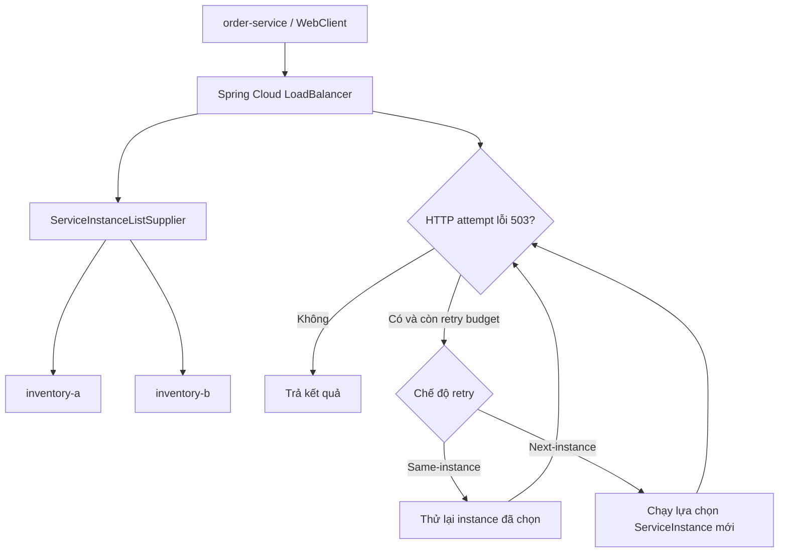
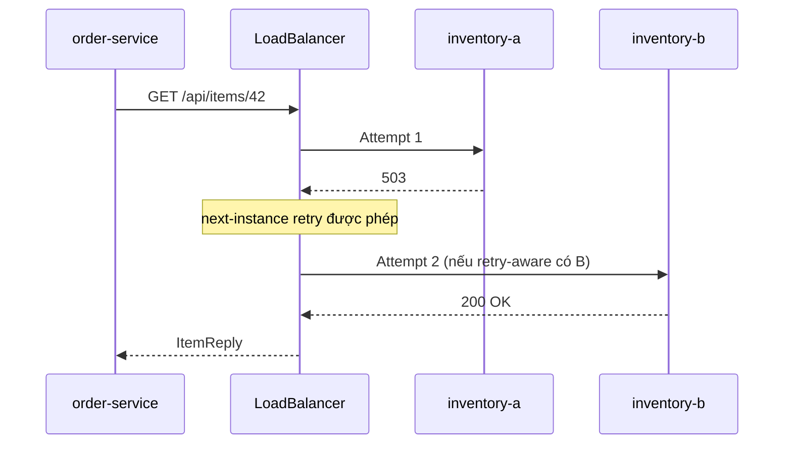
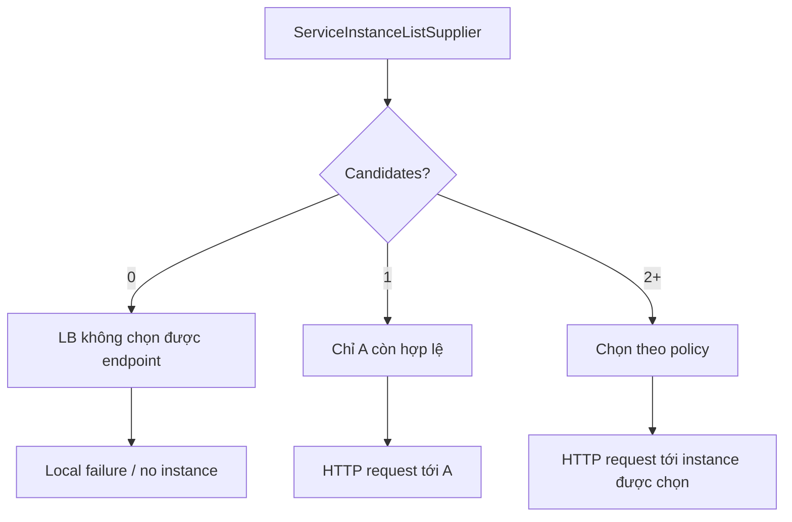
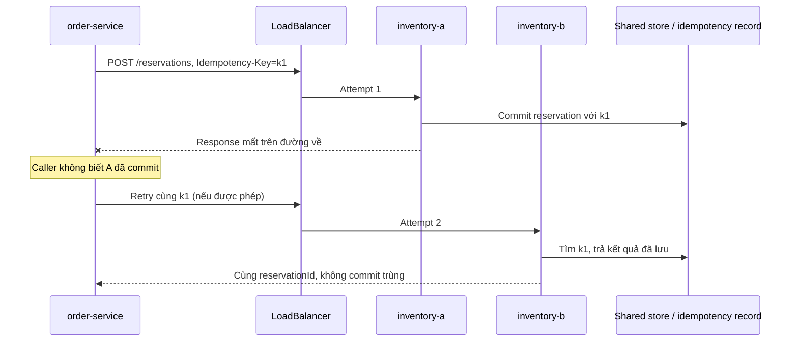

# So sánh retry cùng bản sao và chuyển bản sao

Trong Spring Cloud LoadBalancer, khi gọi `http://inventory-service/api/items/42`, ứng dụng không phải biết IP của backend: LoadBalancer tìm danh sách `ServiceInstance`, chọn một bản sao và gửi HTTP request đến host/port của nó. Khi request thất bại, **retry** có thể gửi lại tới **chính bản sao vừa lỗi** hoặc yêu cầu LoadBalancer **chọn bản sao khác**. Hai lựa chọn trông giống nhau ở góc độ “thử lại” nhưng khác nhau về tải, xác suất phục hồi, độ trễ và độ an toàn nghiệp vụ.

Bài thực hành tổng hợp này thuộc chương **Thực hành tổng hợp** của module **Spring Cloud Service Communication Load Balancing**. Người học sẽ dựng một `order-service` gọi `inventory-service` có hai bản sao, cấu hình hai kiểu retry, cấy lỗi HTTP `503`/timeout, thu thập request journal và tự chứng minh những gì thực sự xảy ra. Các ví dụ dựa trên `WebClient` + Spring Cloud LoadBalancer để dễ quan sát cơ chế reactive; phần sau chỉ rõ cách áp dụng với `RestTemplate`, `RestClient` và OpenFeign mà **không** mặc định mọi client có cùng đường retry.

> **Mục tiêu kiểm chứng:** không chỉ nhận response cuối cùng thành công hay lỗi, mà phải biết **bao nhiêu outbound attempts được gửi, mỗi attempt đến instance nào, vì sao được retry, tổng thời gian và tác dụng phụ nghiệp vụ là gì**.

## 1. Sau bài này cần làm được gì?

Hoàn thành bài thực hành, bạn có thể:

1. Tạo hai HTTP stub instances dưới cùng service ID bằng `SimpleDiscoveryClient` và cổng động.
2. Phân biệt `max-retries-on-same-service-instance` với `max-retries-on-next-service-instance`.
3. Đọc đúng request journal để xác nhận retry trên một bản sao hay chuyển qua một bản sao khác.
4. Biết khi nào `RetryAwareServiceInstanceListSupplier` có thể loại instance vừa thử, và khi nào **không bảo đảm** chọn được IP khác.
5. Thử lỗi HTTP status, kết nối và phản hồi chậm; không gộp mọi lỗi thành một loại.
6. Đặt ngân sách attempt, backoff, timeout và deadline, tránh retry storm.
7. Giữ nguyên ràng buộc zone/tenant/API version khi retry; tránh duplicate side effects của `POST`.
8. Đo metrics, khoanh vùng lỗi của ứng dụng và xây dựng test tự động đủ ổn định cho CI.

Phạm vi bài học là **client-side load balancing**, không phải hướng dẫn cấu hình Kubernetes Service, server-side proxy load balancing hoặc thuật toán phân phối trọng số nâng cao.

## 2. Topology thực hành và hai đường retry

Giả sử caller `order-service` nhìn thấy hai bản sao của `inventory-service`:

| service ID | instance ID | Địa chỉ test | Chức năng |
|---|---|---|---|
| `inventory-service` | `inventory-a` | `127.0.0.1:18081` | Trả trạng thái hàng tồn |
| `inventory-service` | `inventory-b` | `127.0.0.1:18082` | Cùng API/hợp đồng |

Các cổng trên chỉ để dễ minh họa. Trong integration test chính, ta dùng **dynamic ports** để tránh xung đột trên CI.



### 2.1. Retry cùng bản sao

Nếu attempt đầu đến A và chính sách cho phép **một retry trên cùng instance**, chuỗi mong đợi là:

```text
Logical request: GET /api/items/42
  Attempt 1: inventory-a -> HTTP 503
  Attempt 2: inventory-a -> HTTP 503 hoặc 200
```

Ưu điểm: không phải chọn lại instance và có thể phục hồi khi lỗi là transient cục bộ (ví dụ một connection reset thoáng qua, một tài nguyên tạm bận rồi giải phóng). Nhược điểm: nếu A đang quá tải, lỗi lặp lại có thể **đổ thêm tải vào A** mà không cải thiện kết quả.

### 2.2. Retry sang lượt chọn instance tiếp theo

Nếu attempt đầu đến A và cấu hình có một retry **next-instance**, chuỗi *mong muốn trong phòng lab có hai replica khỏe và retry-aware supplier hoạt động* là:

```text
Logical request: GET /api/items/42
  Attempt 1: inventory-a -> HTTP 503
  Attempt 2: inventory-b -> HTTP 503 hoặc 200
```

Ưu điểm: có cơ hội vượt qua lỗi chỉ ảnh hưởng A. Nhược điểm: chọn lại instance không đồng nghĩa luôn tìm được một replica tốt hơn; nếu **cả A và B cùng quá tải**, attempt thứ hai chỉ kéo dài request và gia tăng tải.

**Điều cần nhớ:** thuộc tính `max-retries-on-next-service-instance` có nghĩa **chọn lại `ServiceInstance` trước retry**, không bảo đảm instance mới phải khác. `RetryAwareServiceInstanceListSupplier` có thể ưu tiên tránh instance trước nếu có ứng viên khác hợp lệ; cần kiểm tra supplier, cấu hình và số instance thực có.

## 3. Chính sách retry của Spring Cloud LoadBalancer

Các tên thuộc tính kebab-case thường dùng:

```yaml
spring:
  cloud:
    loadbalancer:
      retry:
        enabled: true
        max-retries-on-same-service-instance: 0
        max-retries-on-next-service-instance: 1
        avoid-previous-instance: true
        retry-on-all-operations: false
        retry-on-all-exceptions: false
        retryable-status-codes:
          - 503
```

| Property | Ý nghĩa và điểm cần kiểm tra |
|---|---|
| `retry.enabled` | Cho phép logic LoadBalancer retry khi **đúng client integration và dependency** có mặt |
| `max-retries-on-same-service-instance` | Số retry thêm trên **mỗi instance được chọn** |
| `max-retries-on-next-service-instance` | Số lượt retry thêm có **bước chọn lại instance** |
| `avoid-previous-instance` | Cho phép retry-aware supplier ưu tiên không đưa instance trước vào lần chọn lại khi có thể |
| `retry-on-all-operations` | Có cho phép retry ngoài `GET` không; mặc định `false` |
| `retry-on-all-exceptions` | Có thử mọi exception không; mặc định `false`, thường không nên bật |
| `retryable-status-codes` | Chỉ định HTTP status có thể kích hoạt retry, ví dụ `503` |
| `retryable-exceptions` | Danh sách exception được cho phép; phải kiểm tra cách HTTP client chuyển exception |
| `backoff.enabled` | Cờ dùng backoff Reactor retry; phải kiểm thử hành vi theo release train |

Trong bảng configuration properties Spring Cloud Commons hiện hành, các giá trị mặc định đáng chú ý là **same = 0, next = 1, avoid previous = true, retry-on-all-operations = false, retry-on-all-exceptions = false** và `retryable-status-codes` **rỗng**. `retry.enabled` có mặc định cấu hình là `true`, **nhưng điều này không có nghĩa mọi HTTP client đã thực sự retry**; còn phụ thuộc integration và classpath.

### 3.1. Số attempts khác số retries

Các properties đếm **retry bổ sung**, không phải tổng attempts. Trong mô hình retry của Spring Cloud khi cùng-instance retries được cấp cho từng selected instance:

\[
N_{\text{max, lý thuyết}}
\le (R_{\text{next}}+1)\times(R_{\text{same}}+1)
\]

Với `R_same` là `max-retries-on-same-service-instance`, `R_next` là `max-retries-on-next-service-instance`:

| Same | Next | Tổng attempts tối đa trong mô hình | Chuỗi có thể có |
|---:|---:|---:|---|
| 0 | 0 | 1 | `A` |
| 1 | 0 | 2 | `A → A` |
| 0 | 1 | 2 | `A → B` nếu có B phù hợp |
| 2 | 0 | 3 | `A → A → A` |
| 0 | 2 | 3 | `A → B → ...` |
| 1 | 1 | 4 | `A → A → B → B` nếu chọn được B |

**Đây là cận trên mô hình để lập ngân sách**, không phải cam kết một phiên bản luôn thực hiện đủ từng bước. Retry có thể dừng sớm vì thành công, lỗi không retryable, deadline, circuit breaker, cancellation hoặc không còn instance. Khi có retry ở Feign, Reactor, gateway hay service mesh, số attempts toàn hệ thống còn có thể bị **nhân thêm**.

### 3.2. Same-instance retry được tính lại cho mỗi instance mới

Khi `same=1, next=1`, một cách diễn giải không chính xác là “toàn bộ request chỉ có đúng một lần retry cùng instance và một lần retry sang next, tổng ba attempts”. Tài liệu Spring Cloud chỉ rõ **same-instance retries được đếm riêng cho từng instance đã chọn**, nên một nhánh triển khai có thể cho tối đa bốn attempts như bảng trên.

Không dùng công thức đó để tạo alert mặc định nếu chưa đo implementation hiện tại; hãy **đếm outbound HTTP attempts thực** trong lab.

## 4. Điều kiện thực sự bật retry: blocking và reactive khác nhau

Spring Cloud Commons mô tả hai đường chính:

| HTTP client | Kiểu gọi | Điều kiện cần lưu ý |
|---|---|---|
| `RestTemplate` load-balanced | Blocking | Cần `spring-retry` trên classpath để có retry integration theo tài liệu |
| `WebClient` load-balanced | Reactive | Cần reactive LoadBalancer filter và retry được bật/cấu hình phù hợp |
| `RestClient` load-balanced | Blocking | Kiểm tra support/wiring theo Spring Cloud release train; không suy rằng tự động giống `RestTemplate` |
| Spring Cloud OpenFeign | Blocking | Có `Retryer.NEVER_RETRY` mặc định ở tầng Feign; retry ở tầng khác phải được kiểm chứng |
| Spring HTTP Interface | Phụ thuộc adapter | Phụ thuộc `RestClient`/`WebClient` bên dưới, không tự retry chỉ vì có `@HttpExchange` |

Vì bài cần **so sánh hai kiểu lựa chọn instance trong cùng mô hình**, phần lab chính dùng `WebClient`, cấu hình từng test context để bật một trong hai. Khi chuyển sang blocking/Feign ở phần sau, ta tập trung vào kiểm chứng **số attempts và instance thực nhận**, không giả sử cùng một YAML điều khiển tất cả tầng retry như nhau.

### 4.1. Dependency cơ bản cho thực hành

Ví dụ Maven (version do Spring Boot/Spring Cloud BOM tương thích quản lý):

```xml
<dependencies>
    <dependency>
        <groupId>org.springframework.boot</groupId>
        <artifactId>spring-boot-starter-webflux</artifactId>
    </dependency>

    <dependency>
        <groupId>org.springframework.cloud</groupId>
        <artifactId>spring-cloud-starter-loadbalancer</artifactId>
    </dependency>

    <dependency>
        <groupId>org.springframework.boot</groupId>
        <artifactId>spring-boot-starter-test</artifactId>
        <scope>test</scope>
    </dependency>

    <dependency>
        <groupId>io.projectreactor</groupId>
        <artifactId>reactor-test</artifactId>
        <scope>test</scope>
    </dependency>

    <dependency>
        <groupId>org.wiremock</groupId>
        <artifactId>wiremock</artifactId>
        <scope>test</scope>
    </dependency>
</dependencies>
```

Chọn bản WireMock 3 phù hợp JDK, Spring Boot/JUnit đang dùng. Với project Spring Cloud blocking retry cần thêm `org.springframework.retry:spring-retry`; không nhất thiết phải dùng nó chỉ để viết WebClient reactive test, nhưng release train có thể yêu cầu nó cho một số cơ chế `RetryAwareServiceInstanceListSupplier`. **Kiểm tra dependency tree và supplier thật** khi dùng `avoid-previous-instance`, thay vì đoán theo tên property.

Nếu muốn quan sát metrics:

```xml
<dependency>
    <groupId>org.springframework.boot</groupId>
    <artifactId>spring-boot-starter-actuator</artifactId>
</dependency>
```

Trong các project thực tế, cấu trúc Maven có thể là BOM ở `dependencyManagement`. Không tự gắn phiên bản starter Spring Cloud bất kỳ vào một ứng dụng Boot khác release train.

## 5. Lắp ghép ứng dụng mẫu order-service

Cấu trúc gợi ý cho bài lab (đây là **cấu trúc minh họa**, không yêu cầu tạo thêm file trong module kiến thức):

```text
src/main/java/.../
  OrderApplication.java
  InventoryGateway.java
  InventoryDto.java

src/test/java/.../
  RetryLabClientConfig.java
  SameInstanceRetryIT.java
  NextInstanceRetryIT.java

src/test/resources/
  application-retry-same.yml       (hoặc @SpringBootTest properties)
  application-retry-next.yml
```

Trong ví dụ, `inventory-service` chỉ được giả lập bằng hai WireMock servers, không cần chạy Eureka/Kubernetes. Ứng dụng tối thiểu:

```java
@SpringBootApplication
public class OrderApplication {
    public static void main(String[] args) {
        SpringApplication.run(OrderApplication.class, args);
    }
}
```

### 5.1. Tạo WebClient builder đã qua LoadBalancer

```java
import org.springframework.boot.test.context.TestConfiguration;
import org.springframework.cloud.client.loadbalancer.LoadBalanced;
import org.springframework.context.annotation.Bean;
import org.springframework.web.reactive.function.client.WebClient;

@TestConfiguration(proxyBeanMethods = false)
public class RetryLabClientConfig {

    @Bean
    @LoadBalanced
    WebClient.Builder retryLabBuilder() {
        return WebClient.builder();
    }

    @Bean("inventoryLabClient")
    WebClient inventoryLabClient(
            @LoadBalanced WebClient.Builder builder) {
        return builder
                .baseUrl("http://inventory-service")
                .build();
    }
}
```

`RetryLabClientConfig` là một `@TestConfiguration` để bài test kiểm soát client. Dùng `@Import(RetryLabClientConfig.class)` trên test context. Một ứng dụng đã có nhiều `WebClient.Builder` có thể cần `@Qualifier` riêng bên cạnh `@LoadBalanced` để tránh inject nhầm.

`@LoadBalanced` trên **builder** mới yêu cầu Spring Cloud chọn đích theo `service ID`. Chỉ đặt base URL `http://inventory-service` trên một `WebClient.builder()` thông thường có thể khiến client truy vấn DNS trực tiếp thay vì dùng Spring Cloud LoadBalancer.

### 5.2. Gateway dùng client đúng service ID

```java
@Service
class InventoryGateway {

    private final WebClient client;

    InventoryGateway(
            @Qualifier("inventoryLabClient") WebClient client) {
        this.client = client;
    }

    Mono<String> readItem(long id) {
        return client.get()
                .uri("/api/items/{id}", id)
                .retrieve()
                .bodyToMono(String.class);
    }
}
```

Trước khi có subscription, `Mono<String>` thường chưa thực hiện request mạng. Trong **JUnit test method**, có thể gọi `.block(Duration.ofSeconds(5))` để quan sát kết quả đồng bộ; **không** làm vậy trong handler WebFlux/event-loop của ứng dụng.

Không thêm `.retryWhen(...)` trong `InventoryGateway` ở bài đo LoadBalancer retry, vì nó tạo thêm một tầng retries và làm sai số attempts.

## 6. Dùng hai WireMock server có cổng động

Ta muốn giữ nguyên danh sách hai ứng viên cho tất cả phép đo, nhưng làm từng instance **luôn trả 503** trong hai test so sánh cơ bản. Đây là kỹ thuật hay hơn việc để A lỗi, B thành công ngay từ đầu, vì test sẽ phân biệt được **đường đi** dù round-robin bắt đầu ở A hay B.

### 6.1. Fixture JUnit khởi tạo trước Spring context

```java
import com.github.tomakehurst.wiremock.WireMockServer;
import org.springframework.test.context.DynamicPropertyRegistry;
import org.springframework.test.context.DynamicPropertySource;

import static com.github.tomakehurst.wiremock.core.WireMockConfiguration.wireMockConfig;
import static com.github.tomakehurst.wiremock.client.WireMock.*;

class TwoInstanceTestSupport {

    static final WireMockServer A =
            new WireMockServer(wireMockConfig().dynamicPort());
    static final WireMockServer B =
            new WireMockServer(wireMockConfig().dynamicPort());

    static {
        A.start();
        B.start();
    }

    @DynamicPropertySource
    static void registerDiscovery(DynamicPropertyRegistry registry) {
        registry.add(
            "spring.cloud.discovery.client.simple.instances.inventory-service[0].uri",
            A::baseUrl);
        registry.add(
            "spring.cloud.discovery.client.simple.instances.inventory-service[1].uri",
            B::baseUrl);
    }

    static void resetAndStub503() {
        A.resetAll();
        B.resetAll();

        A.stubFor(get(urlEqualTo("/api/items/42"))
                .willReturn(aResponse()
                        .withStatus(503)
                        .withBody("inventory-a busy")));

        B.stubFor(get(urlEqualTo("/api/items/42"))
                .willReturn(aResponse()
                        .withStatus(503)
                        .withBody("inventory-b busy")));
    }

    static int hits(WireMockServer server) {
        return server.findAll(
                getRequestedFor(urlEqualTo("/api/items/42"))).size();
    }
}
```

**Đây là fixture rút gọn**: nếu dùng chung static fixture giữa **nhiều test classes**, cần thiết kế rõ người sở hữu lifecycle, dừng server sau khi **toàn bộ suite** hoàn tất và tránh một class dừng khi class khác vẫn dùng. Một cách đơn giản hơn là **mỗi test class có hai servers và dừng bằng `@AfterAll` riêng**; copy phần fixture vào từng class để không chia sẻ state giữa hai test contexts. Không nên để các static servers chạy lâu dài trong một build nhiều test suites.

- `dynamicPort()` tránh phụ thuộc cổng `18081/18082` trên CI.
- `@DynamicPropertySource` cần cung cấp URI trước khi `ApplicationContext` xây dựng nguồn instance.
- `SimpleDiscoveryClient` phải thực sự là nguồn danh sách được dùng; nếu thêm Eureka/Consul vào test runtime, cần xác minh supplier/DiscoveryClient thực tế.
- `resetAll()` xóa mappings và request journal. Không gọi reset **trong lúc** một request của test khác còn chạy.
- Đừng dùng fixture trong hai test classes chạy song song nếu chúng cùng thay mappings và request journal.

Một điểm thực tế: các lớp `@SpringBootTest` có thể cache parent/child contexts và LoadBalancer contexts riêng. Để so sánh cấu hình khác nhau, dùng **hai test contexts cô lập**, không sửa properties trong runtime rồi giả định một filter retry đã được tạo sẽ tự đổi policy.

## 7. Test A: retry lại cùng bản sao

### 7.1. Profile cấu hình “same”

Giữ retry on, chỉ thêm một retry trên **cùng instance**, không retry sang next:

```yaml
spring:
  cloud:
    loadbalancer:
      retry:
        enabled: true
        max-retries-on-same-service-instance: 1
        max-retries-on-next-service-instance: 0
        retry-on-all-operations: false
        retry-on-all-exceptions: false
        retryable-status-codes:
          - 503
        avoid-previous-instance: true
```

Tên file gợi ý `application-retry-same.yml`. Không áp dụng đồng thời với profile `retry-next`. Hoặc dùng `@SpringBootTest(properties = {...})` để các test không cần thêm YAML nếu tổ chức test yêu cầu.

**Kỳ vọng:** khi request duy nhất gặp 503, tối đa **hai attempts** và **cả hai đến cùng instance**. Bất kể round-robin ban đầu chọn A hay B, dạng phân bố là:

| `hits(A)` | `hits(B)` | Ý nghĩa |
|---:|---:|---|
| 2 | 0 | Chọn A đầu tiên, retry lại A |
| 0 | 2 | Chọn B đầu tiên, retry lại B |
| 1 | 1 | **Không** phải đường same-only mong đợi; xem cấu hình khác hoặc route bị chọn lại |
| 1 | 0 | Chưa có retry hoặc attempt thứ hai chưa được gửi |
| 0 | 1 | Chưa có retry hoặc attempt thứ hai chưa được gửi |

### 7.2. JUnit integration test minh họa

```java
@SpringBootTest(properties = {
    "spring.cloud.loadbalancer.retry.enabled=true",
    "spring.cloud.loadbalancer.retry.max-retries-on-same-service-instance=1",
    "spring.cloud.loadbalancer.retry.max-retries-on-next-service-instance=0",
    "spring.cloud.loadbalancer.retry.retryable-status-codes[0]=503",
    "spring.cloud.loadbalancer.retry.retry-on-all-operations=false"
})
@Import(RetryLabClientConfig.class)
class SameInstanceRetryIT extends TwoInstanceTestSupport {

    @Autowired
    InventoryGateway gateway;

    @BeforeEach
    void configureServer() {
        resetAndStub503();
    }

    @Test
    void retriesOnTheSameInstance() {
        StepVerifier.create(gateway.readItem(42L))
                .expectErrorMatches(error ->
                    error instanceof WebClientResponseException ex
                    && ex.getStatusCode().value() == 503)
                .verify(Duration.ofSeconds(5));

        await().atMost(Duration.ofSeconds(2))
                .untilAsserted(() -> {
                    int a = hits(A);
                    int b = hits(B);
                    assertEquals(2, a + b);
                    assertTrue((a == 2 && b == 0)
                            || (a == 0 && b == 2));
                });
    }
}
```

Imports JUnit 5, Spring Boot Test, Reactor Test `StepVerifier`, Awaitility `await` và các static assertions đã được lược bớt. `await()` yêu cầu dependency test `org.awaitility:awaitility` khi dự án chưa có. Nếu dùng abstract fixture ở mục 6, cần bổ sung **lifecycle cleanup chung** được test infrastructure quản lý; nếu muốn một class hoàn chỉnh độc lập, đưa A/B cùng `@DynamicPropertySource` vào class này và dừng chúng trong `@AfterAll`.

**Không có guarantee** test sẽ pass chỉ từ YAML nếu application đã cấu hình custom `WebClient` không có retry filter, hoặc có retry `.retryWhen` ở nơi khác. Test tồn tại chính để phát hiện wiring sai.

### 7.3. Chứng minh bằng request journal

Sau test, đếm tổng attempt:

\[
N_{\text{received}} = \text{hits(A)} + \text{hits(B)}
\]

Khi cả hai server đều trả response HTTP hợp lệ 503, và request thực sự đã tới WireMock, `N_received` phải bằng **2** với profile same trong môi trường cô lập. Không lấy số lần Java method `readItem(...)` được gọi làm attempt count, vì một lần gọi có thể sinh hai HTTP requests.

Request journal không ghi nhận một attempt **chưa kết nối được**; các thí nghiệm connect timeout cần có metrics/trace từ caller để đếm attempts chưa tới server.

## 8. Test B: chọn lại bản sao sau lỗi

### 8.1. Profile cấu hình “next”

Đặt same = 0, next = 1:

```yaml
spring:
  cloud:
    loadbalancer:
      retry:
        enabled: true
        max-retries-on-same-service-instance: 0
        max-retries-on-next-service-instance: 1
        avoid-previous-instance: true
        retry-on-all-operations: false
        retry-on-all-exceptions: false
        retryable-status-codes:
          - 503
```

**Kỳ vọng trong lab:** tổng hai attempts; với danh sách đúng hai instance, không có filter khác, retry context được truyền đến `RetryAwareServiceInstanceListSupplier` và `avoid-previous-instance` hoạt động, lần thử thứ hai **đến instance còn lại**.

```text
Nếu attempt 1 chọn A:
    A = 503 -> retry aware loại A khỏi candidate list -> chọn B
    hits(A)=1, hits(B)=1

Nếu attempt 1 chọn B:
    B = 503 -> retry aware loại B khỏi candidate list -> chọn A
    hits(A)=1, hits(B)=1
```

Điểm nổi bật là kết quả **không phụ thuộc instance nào được chọn đầu tiên**.

### 8.2. JUnit code với properties của test class khác

```java
@SpringBootTest(properties = {
    "spring.cloud.loadbalancer.retry.enabled=true",
    "spring.cloud.loadbalancer.retry.max-retries-on-same-service-instance=0",
    "spring.cloud.loadbalancer.retry.max-retries-on-next-service-instance=1",
    "spring.cloud.loadbalancer.retry.avoid-previous-instance=true",
    "spring.cloud.loadbalancer.retry.retryable-status-codes[0]=503"
})
@Import(RetryLabClientConfig.class)
class NextInstanceRetryIT extends TwoInstanceTestSupport {

    @Autowired
    InventoryGateway gateway;

    @BeforeEach
    void configureServer() {
        resetAndStub503();
    }

    @Test
    void retriesAfterSelectingAnotherInstance() {
        StepVerifier.create(gateway.readItem(42L))
                .expectErrorMatches(error ->
                    error instanceof WebClientResponseException ex
                    && ex.getStatusCode().value() == 503)
                .verify(Duration.ofSeconds(5));

        await().atMost(Duration.ofSeconds(2))
                .untilAsserted(() -> {
                    assertEquals(1, hits(A));
                    assertEquals(1, hits(B));
                });
    }
}
```

Phép assert **1/1** ở đây là **tiêu chí kiểm tra** rằng retry-aware routing đang hoạt động trong topology lab, không phải lời hứa về mọi deployment. Nếu test trả `2/0` hoặc `0/2` mặc dù next=1:

1. Xác nhận có đúng hai candidates ở supplier sau các filter.
2. Xác nhận bean `RetryAwareServiceInstanceListSupplier` đang được dùng trên đường retry hiện tại và phiên bản/classpath đáp ứng điều kiện.
3. Xác nhận `avoid-previous-instance` có hiệu lực và retry context truyền previous instance.
4. Kiểm tra ứng dụng có custom `ReactorServiceInstanceLoadBalancer` hoặc policy cố định instance không.
5. Xác minh instance ID và `ServiceInstance` metadata phân biệt đúng; không tạo hai records cùng endpoint/identity.
6. Kiểm tra HTTP attempts có do một tầng retry khác tạo nên không.

**Vấn đề lifecycle:** hai class `SameInstanceRetryIT` và `NextInstanceRetryIT` trong ví dụ **không được chạy song song cùng một static fixture**. Trong test suite thật, cô lập fixture servers cho mỗi class hoặc cấu hình resource lock và cleanup ở cấp suite; không tắt A/B sau khi class thứ nhất kết thúc rồi để class thứ hai tiếp tục dùng server đã dừng.

## 9. Bảng kết quả so sánh trực tiếp

Cả hai server cùng trả 503, không có backoff đáng kể và không có retry ở tầng khác:

| Tiêu chí | Retry same-only | Retry next-only |
|---|---|---|
| `same` | `1` | `0` |
| `next` | `0` | `1` |
| Logical requests | 1 | 1 |
| Outbound HTTP attempts kỳ vọng | 2 | 2 |
| Đếm WireMock requests | `2/0` hoặc `0/2` | `1/1` **khi retry-aware routing hoạt động** |
| Kết quả cuối | 503 | 503 |
| Có thêm bước chọn instance? | Không ở retry cùng instance | Có |
| Có bảo đảm phục hồi? | Không | Không |
| Tải vào một instance | Có thể tập trung nhiều hơn | Có thể phân tán |
| Cần supplier retry-aware để ưu tiên khác instance? | Không | Có nếu muốn tránh previous |
| Phù hợp nhất | Lỗi transient tại kết nối/đích đang được phục hồi, còn năng lực | Lỗi khu trú một instance, có bản sao khác khỏe |

Lý do cả hai cuối cùng đều **503** là **chủ đích thí nghiệm**: chúng ta đo routing và attempt count độc lập với kết quả thành công. Chỉ sau khi chứng minh đường đi, mới đổi A thành lỗi/B thành khỏe để đánh giá lợi ích failover.

### 9.1. Số liệu thực tế nên ghi vào bảng

| Lần chạy | Mode | First instance | Attempts A | Attempts B | HTTP result | p95/p99 | Ghi chú |
|---|---|---|---:|---:|---|---|---|
| 1 | same | Đo thực tế | Đo | Đo | Đo | Đo | Đủ điều kiện retry? |
| 2 | next | Đo thực tế | Đo | Đo | Đo | Đo | Có tránh previous? |
| 3 | same | Đo thực tế | Đo | Đo | Đo | Đo | A chậm/B khỏe |
| 4 | next | Đo thực tế | Đo | Đo | Đo | Đo | A chậm/B khỏe |
| 5 | next | Đo thực tế | Đo | Đo | Đo | Đo | Chỉ còn một instance |

Không điền số liệu giả vào cột “đo thực tế”. Các con số `2/0`, `1/1` trong phần trước là **kỳ vọng khi cấu hình và giả định đều đúng**, không phải kết quả thực đã được chạy trong tài liệu này.

## 10. Khi A lỗi còn B khỏe: liệu next-instance tốt hơn?

Đây là tình huống hữu ích nhất của next-instance retry:



Nếu A **luôn trả 503** còn B **luôn trả 200**, next-instance retry có thể cứu một request bắt đầu ở A. Same-instance retry gửi tiếp tới A sẽ tiếp tục lỗi; nhưng nếu initial request bắt đầu ở B, **cả hai mode đều thành công ở attempt đầu**, không phải retry đã cứu request.

### 10.1. Làm test A-first quyết định được

Đừng hard-code rằng round-robin đầu tiên là A. Có thể:

- Cung cấp một test `ServiceInstanceListSupplier` / test LoadBalancer có thứ tự chọn cố định; **kiểm tra** mọi custom filter vẫn giữ ràng buộc từ request.
- Chạy **một test context chỉ có A** để xác nhận policy same-instance và một test context A+B với supplier cố định selection để xác nhận next-instance.
- Thêm một test-only switch trong nguồn stub/discovery hoặc một custom deterministic `ReactorServiceInstanceLoadBalancer` dùng **chỉ trong test**, sau đó tắt khi kiểm thử production routing.

Nếu chọn cách cuối, cần bảo đảm rằng test không vô tình **thay luôn logic retry** mà bạn muốn kiểm chứng. Nên dùng một test fake chỉ điều khiển *lựa chọn ban đầu*, còn đường retry dùng integration framework như production.

### 10.2. Tình huống dữ liệu không đồng bộ giữa bản sao

Ngay cả B khỏe hơn A, request sang B chưa chắc đúng nghiệp vụ nếu hai bản sao có state chưa đồng bộ. Ví dụ:

- A vừa nhận một bản ghi nhưng B đọc từ cache stale.
- Một upload session nằm trong RAM A nên B không biết.
- B ở region khác không có quyền xử lý tenant đang gọi.
- API version trên B không tương thích caller.

Khi đó không được hy sinh consistency/authorization chỉ để trả HTTP 200. Service discovery, retry-aware supplier và custom metadata filters phải cùng giữ **hard constraints** về tenant, region, version và data residency.

## 11. Khi mọi bản sao đều chậm: next-instance có thể tệ hơn

Đặt cả hai WireMock stub trả 200 **sau 1.500 ms**, trong khi client có response timeout 500 ms. Khi retry được bật, một logical request có thể chờ gần hai lần timeout cộng backoff trước khi lỗi.

```java
A.stubFor(get(urlEqualTo("/api/items/42"))
        .willReturn(aResponse()
                .withStatus(200)
                .withFixedDelay(1500)));

B.stubFor(get(urlEqualTo("/api/items/42"))
        .willReturn(aResponse()
                .withStatus(200)
                .withFixedDelay(1500)));
```

Nếu đang dùng Reactor Netty, thiết lập response timeout trong transport tương ứng:

```java
HttpClient http = HttpClient.create()
        .option(ChannelOption.CONNECT_TIMEOUT_MILLIS, 300)
        .responseTimeout(Duration.ofMillis(500));

WebClient.Builder builder = WebClient.builder()
        .clientConnector(new ReactorClientHttpConnector(http));
```

Đoạn này chỉ cấu hình **transport timeout**, chưa có `@LoadBalanced`. Khi đưa vào bài test thực tế, phải gắn connector này vào **bean `@LoadBalanced WebClient.Builder`** đã xây dựng ở phần 5, thay vì tạo client direct ngoài Spring context.

**Dự kiến hành vi:** cùng-instance retry giữ tải ở instance vừa timeout; next-instance retry dời một lần thử đến instance khác nhưng instance đó cũng đang chậm. Nếu **cả hai** luôn chậm, hai attempts đều có thể hết timeout, làm response của caller chậm hơn và số outbound requests tăng gấp đôi.

### 11.1. Phân biệt timeout của transport và tổng deadline

- `connectTimeout` giới hạn việc thiết lập một TCP connection mới.
- `responseTimeout` giới hạn chờ response theo semantics Reactor Netty.
- `Mono.timeout` đặt **sau** retry operator (nếu dùng) có thể giới hạn một chuỗi publisher.
- `pendingAcquireTimeout` giới hạn đợi connection rảnh, là một giai đoạn khác.
- Tổng deadline của gateway/request nghiệp vụ có thể ngắn hơn tổng các timeout cục bộ.

Đừng mặc định hai attempts × 500 ms luôn chính xác 1.000 ms; còn thời gian chọn instance, kết nối, scheduler, backoff và overhead.

### 11.2. Bật backoff nhưng không tạo retry storm

Một cấu hình kiểm soát thời gian chờ reactive:

```yaml
spring:
  cloud:
    loadbalancer:
      retry:
        enabled: true
        max-retries-on-same-service-instance: 0
        max-retries-on-next-service-instance: 1
        retryable-status-codes: [503]
        backoff:
          enabled: true
          min-backoff: 100ms
          max-backoff: 1s
          jitter: 0.5
```

Property `backoff.enabled` theo bảng configuration properties kiểm soát việc áp dụng **Reactor retry backoff**; mặc định là `false`. Tài liệu prose của một số release train có câu mô tả dễ nhầm về giá trị bật/tắt; nên đọc bảng properties của phiên bản thực tế và **đo khoảng chờ giữa requests** trong integration test. Với blocking retry/Spring Retry, backoff thường được cung cấp bằng `LoadBalancedRetryFactory`/`BackOffPolicy`, không lấy YAML Reactor backoff này thay thế.

Jitter chỉ giúp phân tán thời điểm retry; nó không tạo năng lực cho backend đang quá tải. Khi mọi bản sao đều chậm, có thể cần **giảm retry budget**, bulkhead và circuit breaker hơn là tăng số retries.

## 12. Trường hợp có một bản sao duy nhất

Nếu discovery chỉ trả A:

```text
ServiceInstanceListSupplier:
  [inventory-a]
```

`max-retries-on-next-service-instance=1` **không có bảo đảm chọn được B**, vì B không tồn tại. Cơ chế retry-aware có thể không lọc A khi không còn ứng viên khác, hoặc request có thể lỗi tùy chính sách/version. Do vậy, một attempt “next” có thể vẫn tới **A**, nếu framework chọn lại A từ danh sách một phần tử.

### 12.1. Tiêu chí test hợp lý

Đối với test một instance:

1. Xác nhận chỉ có A trong danh sách nguồn.
2. Gọi một logical request đủ điều kiện retry.
3. Đếm tổng attempts **không vượt policy**.
4. Không assert phải có hai host/port khác nhau.
5. Kiểm tra cuối cùng là success/error theo endpoint và budget.

Nếu hệ thống chỉ có một replica nhưng policy yêu cầu “chỉ retry khi có instance khác”, cần tự xây dựng policy hoặc supplier phù hợp; không suy từ tên `max-retries-on-next-service-instance` rằng request tự động bị cấm retry A.

## 13. Khi không có instance: khác cả same lẫn next retry

Nếu nguồn discovery trả **danh sách rỗng**, không có TCP connection nào được mở tới inventory stub. Lỗi ở giai đoạn chọn `ServiceInstance`, không phải socket reset sau khi gửi request.



Bài test nên chứng minh:

- Error/response từ caller theo contract của client integration.
- `hits(A)=0` và `hits(B)=0`, nếu vẫn giữ hai WireMock servers chạy nhưng supplier trả rỗng.
- Chỉ số `loadbalancer.requests.discard` có thể tăng khi đã bật lifecycle metrics.
- Không có giả định “max-retries-on-next-instance=1 nghĩa là sẽ tìm được instance mới”.

Tách unit test supplier trả `Flux.just(List.of())` khỏi suite A/B: không thay đổi discovery chung trong lúc test khác đang thực thi.

## 14. Retry theo HTTP status và theo exception

Trong thí nghiệm cơ bản, cả A/B đều trả HTTP `503`. Đây là **HTTP response hợp lệ**, khác với:

- `Connection refused`: host:port không có listener.
- TCP reset sau connect: mất kết nối ở transport.
- Read timeout: server nhận request nhưng không kịp phản hồi.
- No instance: chưa có đích để gửi socket.
- `404`: server phản hồi không tìm thấy tài nguyên.

### 14.1. Test status 503 riêng

```yaml
spring:
  cloud:
    loadbalancer:
      retry:
        retryable-status-codes:
          - 503
```

Sau đó xác minh attempt count. Đừng mặc định mọi HTTP 5xx đều retry nếu `retryable-status-codes` đang rỗng. Tài liệu cũng có default retryable exceptions như `IOException`, `TimeoutException` và `RetryableStatusCodeException` theo đường integration; loại exception thực sự được client đưa vào retry policy có thể khác nhau.

### 14.2. Test 404 là lỗi không retryable

Cả hai stub trả 404:

```java
A.stubFor(get(urlEqualTo("/api/items/42"))
        .willReturn(aResponse().withStatus(404)));
B.stubFor(get(urlEqualTo("/api/items/42"))
        .willReturn(aResponse().withStatus(404)));
```

Nếu policy chỉ cho phép `503` và không bật `retry-on-all-exceptions`, một logical request cần dừng ở attempt đầu. `WebClient.retrieve()` thường chuyển HTTP 404 thành `WebClientResponseException.NotFound`, nhưng riêng operator/filter LB có thể quan sát raw response trước `retrieve()`. Chỉ assert một backend received request sau khi đã đảm bảo không có retry khác ở ngoài phạm vi.

### 14.3. Test reset/timeout là bài khác

WireMock có thể cấy lỗi `Fault.EMPTY_RESPONSE` hoặc `Fault.CONNECTION_RESET_BY_PEER` nhưng exception còn tùy OS và HTTP transport. Không ép test phải trả đúng chuỗi `"Connection reset by peer"`; phân biệt **transport failure** với HTTP status response là đủ cho phần lớn test portable.

Quan trọng hơn, khi connect timeout xảy ra **trước khi backend nhận request**, cả A/B request journals có thể là **0**, dù client đã thử kết nối. Muốn đếm attempts bao gồm cả thất bại trước HTTP, cần thêm transport/LB metrics hoặc test proxy packet capture.

## 15. Same/next không nên là cơ chế retry cho mọi phương thức HTTP

Trong Spring Cloud LoadBalancer, `retry-on-all-operations=false` là giá trị mặc định và logic retry được thiết kế bảo thủ cho `GET`. Bật nó thành `true` **không** làm `POST` tự idempotent.

| Operation | Rủi ro retry | Điều kiện để cân nhắc |
|---|---|---|
| `GET /items/42` | Ít side effect nếu API đúng semantics | Lỗi transient, timeout và budget hợp lý |
| `PUT /items/42` | Phụ thuộc version/điều kiện cập nhật | Cùng thao tác phải idempotent, ETag/If-Match khi cần |
| `DELETE /items/42` | Có thể cần xử lý kết quả đã xóa | Hợp đồng rõ về 404/success sau retry |
| `POST /reservations` | Có thể giữ chỗ hai lần | Idempotency key và dedup bền vững |
| `POST /payments` | Có thể giao dịch trùng | Idempotency từ provider, transaction/reconciliation |
| `POST /upload` streaming | Body không luôn replay được | Upload ID/chunk hash, request body phát lại an toàn |

### 15.1. Tình huống sau commit nhưng mất response



Server phải lưu `Idempotency-Key` **nguyên tử với tác dụng phụ** và kiểm tra fingerprint, tenant, thời hạn lưu, trạng thái `IN_PROGRESS`/`COMPLETED`. Chỉ thêm header ở caller mà hai replica không chia sẻ deduplication **không làm retry an toàn**.

### 15.2. Bài test chống double commit

1. Gửi `POST` có key `k1` qua A; stub/service test ghi state chung và cắt response **sau** commit.
2. Cho retry (theo policy chỉ định) tới A hoặc B.
3. Assert số bản ghi reservation trong shared store là **1**.
4. Assert cả hai attempts với cùng key nhận được **cùng reservation ID** khi server có thể trả response.
5. Đổi body nhưng giữ cùng key: server phải phát hiện conflict theo hợp đồng.
6. Không mở retry cho POST trong production trước khi bài test này và test concurrency được thông qua.

**Không dùng WireMock request journal đơn thuần làm bằng chứng “không double commit”**: journal chỉ biết số HTTP requests đã đến, không kiểm soát trạng thái transaction của ứng dụng. Cần test một mock store có semantics atomic hoặc backend test thực sự.

## 16. Thực hành với RestTemplate, RestClient và OpenFeign

### 16.1. Blocking RestTemplate + Spring Retry

Spring Cloud Commons tài liệu hóa retry cho `RestTemplate` load-balanced bằng Spring Retry trên classpath:

```xml
<dependency>
    <groupId>org.springframework.retry</groupId>
    <artifactId>spring-retry</artifactId>
</dependency>
```

Định nghĩa client:

```java
@Configuration(proxyBeanMethods = false)
class BlockingClientConfiguration {

    @Bean
    @LoadBalanced
    RestTemplate loadBalancedRestTemplate() {
        return new RestTemplate();
    }
}
```

Dùng service ID:

```java
String item = restTemplate.getForObject(
        "http://inventory-service/api/items/{id}",
        String.class, 42L);
```

**Điều cần so sánh:** cùng config `max-retries-on-same-service-instance`/`max-retries-on-next-service-instance`, nhưng hãy đo attempts trước khi kết luận semantics cùng với `WebClient`. Blocking retry dùng Spring Retry và có thể có `BackOffPolicy` riêng qua `LoadBalancedRetryFactory`.

### 16.2. RestClient + Spring Cloud LoadBalancer

`RestClient` dùng `@LoadBalanced RestClient.Builder`:

```java
@Bean
@LoadBalanced
RestClient.Builder loadBalancedRestClientBuilder() {
    return RestClient.builder();
}

@Bean
RestClient inventoryRestClient(
        @LoadBalanced RestClient.Builder builder) {
    return builder.baseUrl("http://inventory-service").build();
}
```

**Không** tự khẳng định đường retry của `RestClient` luôn giống `RestTemplate` ở mọi Spring Cloud release train. Cần kiểm tra auto-configured interceptor/HTTP request factory và chạy cùng bài test request-journal A/B. Nếu đường blocking của ứng dụng không có LoadBalancer retry integration ở version đang dùng, có thể dùng chính sách retry ở tầng khác **một cách chủ đích**, nhưng phải ngăn chồng retry ở nhiều lớp.

### 16.3. OpenFeign có retry riêng

```java
@FeignClient(name = "inventory-service")
interface InventoryFeignClient {

    @GetMapping("/api/items/{id}")
    ItemReply read(@PathVariable("id") long id);
}
```

Spring Cloud OpenFeign tạo `Retryer.NEVER_RETRY` mặc định ở tầng Feign, khác default của Feign lõi. Tuy nhiên, khi cần tìm số attempts **thực**, còn phải kiểm tra LoadBalancer, transport, gateway và Feign retryer tùy chỉnh.

Đối với bài lab, giữ một tầng retry rõ ràng. Nếu dùng một `Retryer` tùy chỉnh ở Feign, so sánh “same”/“next” phải chứng minh tầng đó có hay không **gọi lại LoadBalancer để chọn instance**, thay vì mặc định tên thuộc tính Spring Cloud LoadBalancer áp dụng y hệt.

### 16.4. Spring HTTP Interface không tự có retry

`@HttpExchange`/`@GetExchange` khai báo hợp đồng, không định nghĩa policy retry. Proxy dùng `RestClientAdapter` hoặc `WebClientAdapter` và kế thừa đặc điểm runtime từ client phía dưới. Nếu chuyển một `@FeignClient` sang HTTP Interface, cần chạy lại test attempts, timeout, exception mapping, LB routing; không chỉ kiểm tra DTO JSON giống nhau.

## 17. Deadline và backoff: hai attempts chưa chắc tốt hơn một

Giả sử mỗi attempt tối đa 800 ms, backoff 200 ms:

\[
T_{\text{logical}} \lesssim
T_{\text{attempt 1}} +
T_{\text{backoff}} +
T_{\text{attempt 2}} +
T_{\text{other}}
\]

Nếu cả hai cùng hết timeout, thời gian có thể gần `800 + 200 + 800 = 1.800 ms` cộng overhead. Nếu SLA của caller chỉ 1 giây, cố thực hiện đủ attempts có thể vi phạm ngân sách. Cần **tổng deadline** ở một ranh giới nghiệp vụ phù hợp, và từ chối retry khi không còn đủ thời gian.

| Trường hợp | Same-instance | Next-instance |
|---|---|---|
| Lỗi network ngắn ở một socket | Có thể phục hồi | Có thể phục hồi, thêm bước chọn đích |
| Một replica quá tải, replica khác khỏe | Dễ thất bại tiếp | Có cơ hội phục hồi |
| Tất cả replica quá tải | Tăng tải vào cùng đích | Tăng tải phân tán nhưng không chữa nguyên nhân |
| Chỉ có một replica | Thử lại A | Có thể vẫn chọn A |
| Yêu cầu sticky/local state | Có thể tăng tính locality tạm thời | Có nguy cơ thiếu state nếu thiết kế chưa shared |
| Hard constraint zone/tenant | Không đổi đích | Bắt buộc giữ filter và quyền truy cập |

### 17.1. Retry amplification khi nhiều tầng cùng bật

Nếu gateway có tối đa hai attempts và WebClient/LoadBalancer cũng có tối đa hai attempts, một logical request có thể sinh tối đa:

\[
N_{\text{outbound}} \le 2 \times 2 = 4
\]

Đây là cận trên minh họa khi các tầng đều thử hết ngân sách. Nếu có thêm Feign retryer hoặc service mesh, tổng số calls còn có thể tăng. Retry làm p99 tốt hơn trong lỗi khu trú nhưng **xấu hơn** trong outage diện rộng. Theo dõi `outbound_attempts / logical_requests` thay vì chỉ success rate.

### 17.2. Giới hạn concurrency cùng retry

Có thể dùng bulkhead (semaphore), circuit breaker, connection pool limits và rate limiting để bảo vệ caller/downstream. Khi `503` là dấu hiệu quá tải, retry dày đặc lập tức có thể làm trạng thái nghiêm trọng hơn. Với `429/503` và `Retry-After`, client cần chính sách tôn trọng thông tin này khi hợp đồng hỗ trợ, không đặt backoff thấp hơn bất kể downstream hướng dẫn.

## 18. Quan sát đúng ba loại số liệu

Để chứng minh hai mode, cần phân biệt:

1. **Logical requests**: caller gọi `readItem(42)` mấy lần.
2. **Outbound attempts**: HTTP client thử gửi mấy lần, kể cả lỗi **trước khi server nhận**.
3. **Backend received requests**: A/B nhận HTTP request mấy lần (WireMock journal).

```text
Một logical GET:
  Attempt 1: connect timeout trước khi server nhận
  Attempt 2: đến B, HTTP 200

Logical requests = 1
Outbound attempts = 2
Backend received requests = 1
```

Không đòi luôn có `backendReceived == outboundAttempts`.

### 18.1. Micrometer metrics của LoadBalancer

Để quan sát LoadBalancer lifecycle:

```yaml
spring:
  cloud:
    loadbalancer:
      stats:
        micrometer:
          enabled: true
        include-path: false
```

Với `MeterRegistry` và integration tương ứng, Spring Cloud LoadBalancer có meters như:

| Meter | Nội dung | Lưu ý |
|---|---|---|
| `loadbalancer.requests.success` | Load-balanced exchange có response được chuyển về client layer | Không đồng nghĩa HTTP 2xx |
| `loadbalancer.requests.failed` | Lỗi/exception theo lifecycle | Phụ thuộc đường instrumentation |
| `loadbalancer.requests.discard` | Không chọn được instance | Khác với 503 từ backend |
| `loadbalancer.requests.active` | Requests đang active | Không trực tiếp là số thread/connection |

Đừng chỉ dùng `success` để khẳng định retry đã thành công ở nghĩa nghiệp vụ. Có thể có **hai 503 responses** mà LB lifecycle vẫn ghi nhận các response đã đến. So sánh với `http.client.requests`, response status và server journals.

### 18.2. Tracing và log theo attempt

Khi test tích hợp tracing, mỗi outbound attempt có thể được ghi span/event tùy vị trí instrumentation. Gắn một `X-Lab-Request-Id` duy nhất cho logical request và một attempt index từ tầng retry có kiểm soát (nếu cần), để thấy:

```text
requestId=lab-001, attempt=1, serviceId=inventory-service,
selected=inventory-a, status=503

requestId=lab-001, attempt=2, serviceId=inventory-service,
selected=inventory-b, status=200
```

Không mặc định một `WebClient` filter đặt ở ngoài retry sẽ được gọi lại đúng một lần mỗi attempt; vị trí trong filter chain và retry operator quyết định điều này. **Server request journal** và LoadBalancer lifecycle là các bằng chứng bổ sung quan trọng.

Không đưa raw request ID, token, user ID hoặc đường dẫn chứa tài nguyên cụ thể vào low-cardinality metric labels.

## 19. Khắc phục các tình huống bất thường của bài lab

| Hiện tượng | Khả năng nguyên nhân | Cách kiểm tra |
|---|---|---|
| `same=1` nhưng tổng chỉ một attempt | Retry integration chưa bật, không có status retryable, client direct | Kiểm tra bean `@LoadBalanced`, filter, properties và WireMock status |
| `next=1` nhưng vẫn `2/0` | Retry-aware supplier không có hiệu lực hoặc chỉ một candidate | Kiểm tra supplier chain, `avoid-previous-instance`, version/classpath và filters |
| Cả hai mode đều `1/1` | Có retry ngoài LB hoặc luôn chọn lại instance | Tắt `retryWhen`/retryer/gateway, kiểm tra lifecycle |
| Đếm 3–4 attempts dù cấu hình same=1/next=0 | Có retry nhiều tầng hoặc config override | Đếm attempt ở cả caller/proxy/stub, xem properties merge |
| Cả hai endpoints bị chọn nhưng kết quả vẫn 503 | Cả hai backend đều lỗi | Đây chính là case baseline, không phải thất bại test |
| Test A lỗi, B khỏe nhưng đôi khi không retry | Request đầu chọn B trả 200 | Cố định initial selection trong test phù hợp |
| Chỉ có một instance mà next retry vẫn đến A | Không có alternative, policy fallback | Không coi đó là vi phạm nếu contract không yêu cầu distinct |
| `503` không retry nhưng IO error lại retry | `retryable-status-codes` chưa cấu hình hoặc exception mapping khác | Tách test status và test transport |
| Test fail trên CI nhưng chạy local | Cổng, shared context, parallel execution, race trong journal | Dynamic port, isolate context, await có giới hạn |
| Sau đổi YAML kết quả không đổi | Context/LB child context đã cache properties/bean | Tạo test context mới hoặc rebuild test |
| Retry sang instance không cùng zone | Supplier filter/hint bị bỏ qua trong retry context | Kiểm tra request-scoped hard constraints |
| Retry sau POST tạo trùng reservation | Thiếu shared idempotency | Test server-side dedup, dừng retry unsafe |

### 19.1. Supplier chain có vị trí quan trọng

Với discovery và các filters:

```text
Discovery source
    -> (cache hoặc health theo kiến trúc phù hợp)
    -> zone/metadata/request filters
    -> retry-awareness theo cấu hình
    -> selected ServiceInstance
```

Đây là sơ đồ **khái niệm**: thứ tự decorator thực tế phụ thuộc cách xây `ServiceInstanceListSupplier` và version. Spring Cloud thường đề nghị caching/health nằm gần nguồn discovery, trước request-sensitive filters. Khi retry-aware supplier cần previous instance, nó phải nhận **request context** chứa thông tin retry; tự viết `get()` không truyền request có thể làm mất dữ liệu cần thiết.

**Không** thiết kế retry bypass các hard filters về zone cứng, tenant hoặc API version. Nếu kết quả lọc chỉ còn một candidate, ưu tiên đúng dữ liệu và phân quyền hơn việc bằng mọi giá chọn một IP khác.

## 20. Làm test ổn định và có thể chạy lặp trên CI

1. **Dynamic ports:** dùng WireMock `dynamicPort()` hoặc `WireMockExtension`.
2. **Config per test class:** same/next là hai Spring contexts khác nhau; không mutate `application.yml` runtime rồi kỳ vọng filter thay đổi.
3. **Cô lập source và LB context:** nếu class này có custom LoadBalancer child context, bảo đảm context khác không dùng chung state ảnh hưởng kết quả.
4. **Reset stubs và request journal:** làm trước mỗi case, không chạy song song trên cùng WireMock servers.
5. **Không giả định A luôn đầu tiên:** case both-503 cho phép test same/next không phụ thuộc thứ tự.
6. **Không assert timing tuyệt đối quá sát:** chọn delay/timeout đủ cách biệt; test deadline rộng hơn timeout HTTP.
7. **Đếm attempts thay vì method calls:** xác minh tại backend và instrumentation trước network.
8. **Không chạy GET và health probes cùng một path:** health checks có thể gửi request riêng và làm nhiễu journal.
9. **Giữ URI template ổn định:** `/api/items/42` trong test, tránh bị intercept bởi một client khác dùng cùng bean.
10. **Không để background scheduled retries sau test:** reactive publisher phải terminal/cancel đúng, HTTP pool cleanup sau suite.
11. **Isolate destructive scenarios:** dừng server, rút instance và network blackhole ở test context khác; tránh ảnh hưởng case kế tiếp.
12. **Traceability:** khi test failure, in các request journals/selected instance IDs nhưng lọc token/PII.

### 20.1. Tránh false positive của test “một response thành công”

Một test như:

```java
assertEquals("OK", gateway.readItem(42).block());
```

**không chứng minh failover**, vì có thể request đầu đã chọn replica khỏe. Phải tạo điều kiện cho **một attempt lỗi đã được chứng minh**, rồi quan sát attempt tiếp theo. Trong bài này, cả A/B trả 503 ở phần đo đường đi, nên ta biết chắc có lỗi trước mỗi retry.

### 20.2. Đừng dùng virtual time để thay đổi HTTP time

`StepVerifier.withVirtualTime` có thể điều khiển Reactor schedulers/operators khi đúng cách, hữu ích cho retry backoff **ở unit test**. Nó không biến WireMock network latency, TCP connect hay read timeout thành đồng hồ ảo. Với integration test HTTP thật, dùng clock thật và deadlines rộng; tách các phép kiểm backoff exact bằng virtual-time test riêng nếu cần.

## 21. Các vòng thực hành nâng cao

Sau khi hai test cơ bản đạt:

### Vòng A — tăng số lần same-instance

Đặt `same=2, next=0` với cả A/B trả 503. Xác minh ba attempts đều đến cùng một instance. Sau đó đổi `same=1, next=1`, quan sát tối đa bốn attempts và kiểm tra cách framework thực sự nhóm chúng theo instance. Nếu kết quả khác cận trên, phân tích vì sao dừng sớm hoặc cấu hình/implementation khác.

### Vòng B — lỗi chỉ có ở một bản sao

Cho A trả 503, B trả 200. Cố định initial selection A **chỉ trong test** rồi so sánh:

- same-only: hai attempts vào A có thể đều 503.
- next-only + retry-aware: attempt 2 có thể sang B và 200.

Đo chênh lệch success rate, latency và attempts; không suy từ một response đầu chọn B.

### Vòng C — cả hai chậm

A/B delay 1.500 ms, transport timeout 500 ms. So sánh:

- không retry;
- same-only một lần;
- next-only một lần;
- next-only có backoff/jitter.

Ghi `p95/p99`, outbound RPS, số requests vẫn inflight, active connection pool và tổng deadline. Mục tiêu là nhận ra **retry không làm mọi instance nhanh hơn**.

### Vòng D — mất một instance

Đang chạy traffic thì dừng A, cập nhật discovery/supplier hoặc để A còn trong snapshot tùy scenario. So sánh:

- Chậm do discovery/cache stale.
- Connection refused khi chọn A.
- Next-instance retry có sang B không.
- Health check có loại A trước lựa chọn mới không.
- Khi chỉ còn B, next retry có còn đổi IP không.

Không coi cache TTL, health check và TCP keep-alive là một cơ chế.

### Vòng E — POST và idempotency

Dùng `POST /reservations`, server mock có shared state. Cho attempt đầu commit rồi response lost, thử cùng/next với idempotency key. Assert bản ghi chỉ được tạo một lần, mọi replica có thể truy vấn cùng key. Sau đó tắt dedup để thấy test phát hiện side effect trùng.

## 22. Tiêu chí nghiệm thu bài thực hành

| Tiêu chí | Đạt khi |
|---|---|
| Discovery | Có hai instance dưới một service ID và caller đi qua Spring Cloud LoadBalancer |
| Same-only | Hai HTTP attempts vào đúng **một** endpoint trong case 503, single logical request |
| Next-only | Hai attempts đến **hai** endpoint khác nhau khi retry-aware supplier/candidates đáp ứng giả định lab |
| Baseline | Khi retry off, GET 503 chỉ tạo một HTTP attempt |
| Error mapping | 404, 503, reset/timeout được kiểm tra như các tình huống khác nhau |
| Retry budget | Attempts không vượt giới hạn của lớp đang test và không nhân ngoài ý muốn |
| Deadline | Caller dừng trong ngân sách ngay cả khi các bản sao cùng chậm |
| Idempotency | POST không tạo side effect trùng nếu server có dedup, hoặc retry bị cấm nếu chưa an toàn |
| State | Nếu chỉ một hoặc không có instance, test không giả định next luôn có đích khác |
| Quan sát | Có logical request ID, selected instance, backend journals và metrics khi cần |
| Test isolation | CI không phụ thuộc fixed ports, round-robin starting index và shared mutable state |

## 23. Câu hỏi tự kiểm tra

**Câu 1.** `same=1, next=0`, cả A/B luôn trả 503, test chỉ thấy một backend request. Điều đó có chứng minh retry được bật không?

*Không.* Có khả năng chỉ có attempt đầu; kiểm tra retryable status code, wiring, lớp retry và request journal. Cần hai attempts cùng instance để chứng minh case này.

**Câu 2.** `same=0, next=1` nghĩa là chắc chắn lần retry đi tới IP mới?

*Không.* Nó yêu cầu chọn lại, nhưng candidate set, retry-aware supplier và constraints quyết định. Nếu chỉ có một instance, không thể chọn IP khác.

**Câu 3.** Một POST đã ghi dữ liệu nhưng response mất, next-instance retry có an toàn hơn same-instance retry không?

*Không tự động.* Bất kể retry đến instance nào, server có thể tạo tác dụng phụ trùng. Cần idempotency được thực thi ở shared state hoặc không tự retry.

**Câu 4.** Nếu cả hai instance cùng chậm, next-instance retry có giảm p99 không?

*Không có bảo đảm.* Nó có thể khiến request chờ thêm một timeout/backoff, làm p99 và tải backend tệ hơn.

**Câu 5.** Tại sao test both-503 giúp kiểm thử same-vs-next tốt hơn việc chỉ A-503/B-200?

*Vì cả hai đường đều phải trải qua điều kiện lỗi để kích hoạt retry,* bất kể initial round-robin chọn A hay B. Test đếm đường đi mà không phụ thuộc thành công cuối cùng.

## 24. Checklist trước khi kết thúc

- [ ] Có đúng hai `ServiceInstance` khác nhau với cùng service ID và đúng host/port.
- [ ] Đã bật `@LoadBalanced` cho HTTP client sử dụng trong test.
- [ ] Có test baseline `retry.enabled=false` và không còn retry tầng khác.
- [ ] Đã định nghĩa HTTP lỗi nào được retry; `503` được khai báo rõ.
- [ ] Đã thử same-only `same=1,next=0`, đếm đủ hai attempts cùng đích.
- [ ] Đã thử next-only `same=0,next=1`, chứng minh chọn đích theo retry context.
- [ ] Không giả định round-robin luôn bắt đầu ở A.
- [ ] Đã thử chỉ một instance và danh sách rỗng để kiểm tra giới hạn policy.
- [ ] Đã thử lỗi socket/read timeout và phân biệt với HTTP 503.
- [ ] Có tổng deadline, backoff và retry budget không vượt SLO.
- [ ] Có test retry POST an toàn/idempotent hoặc tắt retry operations khác GET.
- [ ] Có metrics/log đủ để so sánh logical requests, outbound attempts và backend requests.
- [ ] Có tài liệu ghi rõ Spring Boot/Spring Cloud release train và client/transport đã thử.
- [ ] Các test contexts, WireMock journals và tài nguyên test được cleanup, không chạy song song trên cùng state.
- [ ] Hiểu rằng nội dung bài là **hướng dẫn thực hành**, không phải bằng chứng repo đã chạy build/tests.

**Kết luận:** retry **cùng bản sao** chủ yếu cho một đích thêm cơ hội vượt qua lỗi tạm thời; retry **chuyển bản sao** cho phép LoadBalancer chọn lại đích và có cơ hội phục hồi khi sự cố chỉ xảy ra ở một replica. Tuy nhiên, **next-instance không đồng nghĩa luôn chọn được IP khác**, và hai mode đều có thể làm tình hình tệ hơn khi toàn bộ backend quá tải hoặc request không idempotent. Muốn so sánh đúng, hãy tạo cùng điều kiện lỗi ở A/B, cấu hình tách biệt, **đếm outbound attempts bằng request journals**, rồi mở rộng sang timeout, health, retry-aware supplier, deadlines và idempotency. Chỉ bật policy đã được chứng minh bằng số liệu thực tế.

## Tài liệu tham khảo

- [Spring Cloud Commons — Common Abstractions: Retrying Failed Requests](https://docs.spring.io/spring-cloud-commons/reference/spring-cloud-commons/common-abstractions.html): `maxRetriesOnSameServiceInstance`, `maxRetriesOnNextServiceInstance`, reactive/blocking retry và `RetryAwareServiceInstanceListSupplier`.
- [Spring Cloud Commons — Configuration Properties](https://docs.spring.io/spring-cloud-commons/reference/configprops.html): defaults của `spring.cloud.loadbalancer.retry.*` và `avoid-previous-instance`.
- [Spring Cloud Commons — Spring Cloud LoadBalancer](https://docs.spring.io/spring-cloud-commons/reference/spring-cloud-commons/loadbalancer.html): `ServiceInstanceListSupplier`, health, cache, request context, lifecycle và metrics.
- [WireMock — JUnit Jupiter](https://wiremock.org/docs/junit-jupiter/): dynamic port, nhiều instances và reset test state.
- [WireMock — Verifying Requests](https://wiremock.org/docs/verifying/): request journal và cách đếm requests backend nhận.
- [WireMock — Stateful Behaviour](https://wiremock.org/docs/stateful-behaviour/): kịch bản response thay đổi theo state, dùng cho retry/after-commit case.
- [WireMock — Simulating Faults](https://wiremock.org/docs/simulating-faults/): delayed responses, socket faults và hạn chế môi trường.
- [Project Reactor — Testing](https://projectreactor.io/docs/core/release/reference/testing.html): `StepVerifier`, virtual time và test reactive flows.
- [Spring Cloud OpenFeign — Features](https://docs.spring.io/spring-cloud-openfeign/reference/spring-cloud-openfeign.html): retryer, timeout và tích hợp Feign.
