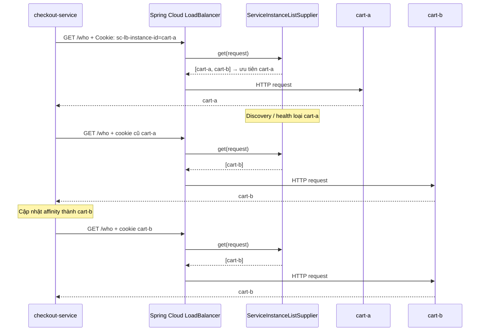

# Thử sticky session khi bản sao được ưu tiên bị mất

## 1. Mục tiêu và bài toán thực hành

Trong một hệ thống microservice, `checkout-service` gọi `cart-service` qua **service ID**. Để tận dụng cache cục bộ hoặc giảm chi phí làm nóng kết nối, ta muốn những lời gọi kế tiếp của một phiên **ưu tiên cùng một bản sao**. Tuy nhiên, nếu bản sao đó bị loại khỏi danh sách instance khả dụng, request phải được định tuyến sang bản sao còn lại. Việc bám mãi vào instance cũ sẽ biến sticky session thành một điểm lỗi.

Bài thuộc chương **Thực hành tổng hợp** của module `SPRING_CLOUD_SERVICE_COMMUNICATION_LOAD_BALANCING`. Module bao gồm cơ chế chọn `ServiceInstance` theo service ID, discovery, health check, chính sách định tuyến, `RestClient`/`WebClient`/OpenFeign, timeout/retry và quan sát lỗi. Bài tập này kết hợp nhiều cơ chế để trả lời câu hỏi thực tế: **Khi instance được ưu tiên biến mất, phiên làm việc còn được phục vụ không, và request kế tiếp ưu tiên instance nào?**

Sau bài này, bạn có thể:

1. Phân biệt **request-based sticky session** với **same-instance preference** và hiểu giới hạn của mỗi cơ chế.
2. Cấu hình `RequestBasedStickySessionServiceInstanceListSupplier` cho một service ID.
3. Dùng `WebClient` và cookie `sc-lb-instance-id` để kiểm thử ưu tiên instance.
4. Loại instance đang được ưu tiên khỏi danh sách ứng viên, quan sát chuyển đích và cập nhật affinity ở phía caller.
5. Phân biệt **discovery đã loại instance** với **instance chết nhưng discovery/cache vẫn giữ entry cũ**.
6. Viết phép thử tự động có hai HTTP stub cổng động, không cần Eureka/Consul/Docker và không dựa vào `Thread.sleep`.

**Tiêu chí hoàn thành:** Khi A/B đều khả dụng, các request mang cookie ưu tiên A đều tới A; khi A biến mất khỏi danh sách, request mang cookie **cũ** vẫn tới B; sau khi caller cập nhật cookie thành B, request vẫn tới B kể cả khi A quay lại. Không có instance nào thì bài test phải phát hiện lỗi rõ ràng.

## 2. Sticky session thực chất là một lựa chọn ưu tiên



Có **hai** cơ chế của Spring Cloud LoadBalancer dễ bị gọi chung là “sticky”:

| Cơ chế | Dựa vào điều gì? | Phạm vi ưu tiên | Khi instance ưu tiên không còn |
| --- | --- | --- | --- |
| `SameInstancePreferenceServiceInstanceListSupplier` | Instance **đã được LoadBalancer chọn trước đó** | Trạng thái lựa chọn của supplier; không nhận diện độc lập từng phiên người dùng | Ưu tiên instance khác còn trong danh sách |
| `RequestBasedStickySessionServiceInstanceListSupplier` | `instanceId` trong cookie của **request hiện tại** | Theo giá trị cookie mà caller đưa vào từng request | Không ép chọn instance đã bị loại; chọn từ ứng viên hiện có |

Trong bài này, ta chọn **request-based sticky session** vì tình huống yêu cầu mô phỏng **một phiên cụ thể**. Nếu dùng `SameInstancePreferenceServiceInstanceListSupplier`, các request từ nhiều người dùng đi qua cùng một supplier có thể chia sẻ trạng thái “instance vừa chọn”, nên không thể suy ra đó là sticky session cho từng người dùng.

**Sticky là preference, không phải bảo đảm:** Nếu instance mang ID trong cookie chưa bị xóa khỏi danh sách nhưng không còn trả lời mạng, bộ chọn có thể vẫn chọn nó. Lúc đó request nhận lỗi kết nối hoặc timeout. Muốn hệ thống phục hồi cần discovery/health check cập nhật danh sách, hoặc một chính sách retry phù hợp ở tầng HTTP/LoadBalancer.

### 2.1. Hợp đồng chọn đích cần giữ

Luồng chọn đích được mô tả như sau:

```text
HTTP request (Cookie / request context)
    -> RequestBasedStickySessionServiceInstanceListSupplier
    -> Danh sách ServiceInstance còn khả dụng
    -> ReactorServiceInstanceLoadBalancer.choose(Request)
    -> Response<ServiceInstance> hoặc EmptyResponse
    -> Gửi HTTP đến instance được chọn
```

Kết quả quan trọng là **instance được chọn phải thuộc danh sách do supplier trả về**. Một cookie mang ID cũ không phải quyền buộc LoadBalancer tiếp tục dùng instance đó. Trong môi trường thật, danh sách ứng viên có thể do discovery, cache và health check tạo ra; trong bài lab, ta chủ động thay đổi danh sách bằng một nguồn giả để có kết quả kiểm thử xác định.

## 3. Kịch bản thử nghiệm

Chạy hai bản sao của `cart-service` trong cùng tiến trình test, mỗi bản sao dùng một HTTP server của JDK:

| Bản sao | `instanceId` | Endpoint | Phản hồi |
| --- | --- | --- | --- |
| A | `cart-a` | `GET /who` | Text `cart-a` |
| B | `cart-b` | `GET /who` | Text `cart-b` |

Hai server mở **cổng động** bằng cách bind port `0`; chúng không phụ thuộc vào Docker, DNS hoặc một service registry bên ngoài. `checkout-service` dùng `@LoadBalanced WebClient.Builder` gọi `http://cart-service/who`. Một supplier giả trong child context của `cart-service` chứa danh sách instance hiện tại, có thể đổi từ `[A, B]` sang `[B]`, rồi `[A, B]` hoặc `[]`.

| Pha | Danh sách instance | Cookie caller gửi | Kết quả cần đạt |
| --- | --- | --- | --- |
| A: Bình thường | `[A, B]` | `cart-a` | Chọn A ổn định |
| B: A mất khỏi discovery | `[B]` | Cookie **cũ** `cart-a` | Chọn B, không gửi HTTP tới A |
| C: Caller chuyển affinity | `[B]` | `cart-b` | Vẫn chọn B |
| D: A quay lại | `[A, B]` | `cart-b` | Tiếp tục ưu tiên B |
| E: Không có đích | `[]` | `cart-b` | Lỗi no-instance; không có request tới A/B |
| F: Kiểm tra stale cookie | `[A, B]` | `cart-a` | Có thể lại ưu tiên A, vì A đã xuất hiện |

Pha F giúp phát hiện ứng dụng **quên thay cookie sau failover**. Khi A quay lại, cookie cũ có thể đưa phiên về A, dù trước đó phiên đã chuyển sang B. Với ứng dụng có state cục bộ, đây là một nguy cơ nhất quán dữ liệu.

## 4. Chuẩn bị môi trường

Dùng Java 17+, JUnit 5, Spring Boot và phiên bản Spring Cloud tương thích. Maven dependencies trong ứng dụng/test:

```xml
<dependencies>
    <dependency>
        <groupId>org.springframework.boot</groupId>
        <artifactId>spring-boot-starter-webflux</artifactId>
    </dependency>
    <dependency>
        <groupId>org.springframework.cloud</groupId>
        <artifactId>spring-cloud-starter-loadbalancer</artifactId>
    </dependency>
    <dependency>
        <groupId>org.springframework.boot</groupId>
        <artifactId>spring-boot-starter-test</artifactId>
        <scope>test</scope>
    </dependency>
</dependencies>
```

Quản lý version bằng **Spring Boot BOM + Spring Cloud BOM tương thích** với dự án. Mẫu code bên dưới dùng API của những bản Spring Cloud LoadBalancer hỗ trợ `ServiceInstanceListSupplier.builder().withBase(...).withRequestBasedStickySession()`. Đừng lấy riêng version `spring-cloud-loadbalancer` từ dòng khác rồi ghép với Boot hiện tại.

Trong lab, đặt thuộc tính test:

```properties
spring.cloud.loadbalancer.retry.enabled=false
spring.cloud.loadbalancer.cache.enabled=false
spring.cloud.loadbalancer.sticky-session.add-service-instance-cookie=true
```

Hai cờ đầu giúp cô lập hành vi sticky: ta không cần đoán một request HTTP đã bị retry bao nhiêu lần hoặc cache chưa hết TTL. Cờ thứ ba cho phép tầng WebClient LoadBalancer **cập nhật cookie về instance mới được chọn trên request gửi về downstream**. Nó không mặc nhiên tạo cookie `Set-Cookie` trả về trình duyệt; muốn caller lưu affinity mới phải có cơ chế riêng.

Theo tài liệu Spring Cloud, request-based sticky session hoạt động khi dữ liệu HTTP request được truyền tới LoadBalancer, chẳng hạn qua `ClientRequestContext` của tích hợp `WebClient`. Không dùng một `Request` trống hoặc một HTTP client không truyền cookie trong ngữ cảnh rồi mong supplier tự biết ID của phiên.

## 5. Cấu hình LoadBalancer theo service ID

Trong sản phẩm thật, bạn có thể cấu hình:

```yaml
spring:
  cloud:
    loadbalancer:
      configurations: request-based-sticky-session
      sticky-session:
        add-service-instance-cookie: true
```

Lựa chọn `configurations: request-based-sticky-session` áp dụng theo cấu hình LoadBalancer cho các client phù hợp; nếu chỉ muốn áp dụng cho `cart-service`, hãy đăng ký cấu hình riêng bằng `@LoadBalancerClient` như sau:

```java
import org.springframework.cloud.loadbalancer.annotation.LoadBalancerClient;
import org.springframework.context.annotation.Configuration;

@Configuration(proxyBeanMethods = false)
@LoadBalancerClient(
    name = "cart-service",
    configuration = CartStickyLoadBalancerConfig.class
)
public class CartStickyRegistration {}
```

Lớp chứa `@Bean ServiceInstanceListSupplier` cho child context:

```java
import org.springframework.cloud.loadbalancer.core.ServiceInstanceListSupplier;
import org.springframework.context.ConfigurableApplicationContext;
import org.springframework.context.annotation.Bean;

// Không để class này bị component scan như @Configuration toàn cục.
public class CartStickyLoadBalancerConfig {
    @Bean
    ServiceInstanceListSupplier cartSupplier(
            ConfigurableApplicationContext context) {
        return ServiceInstanceListSupplier.builder()
                .withDiscoveryClient()
                .withCaching()
                .withRequestBasedStickySession()
                .build(context);
    }
}
```

Ở môi trường production, `withDiscoveryClient()` cần `ReactiveDiscoveryClient` tương ứng; nếu chỉ có `DiscoveryClient` blocking, chọn `withBlockingDiscoveryClient()`. Đặt cache ngay sau lớp discovery trước khi lọc theo request để tránh cache kết quả đã dính cookie của phiên trước. Nếu dùng `HealthCheckServiceInstanceListSupplier`, thường đặt nó ngay sau nguồn discovery và tránh bọc thêm cache không cần thiết vì health supplier có cơ chế replay của riêng nó.

**Trong integration test dưới đây**, thay nguồn discovery thật bằng một `ServiceInstanceListSupplier` mutable và dùng `withBase(...)`. Cách này cho phép test chính xác thời điểm A rời danh sách, đồng thời vẫn sử dụng **wrapper sticky chính thức của Spring Cloud**, không viết thuật toán sticky giả rồi test lại chính thuật toán đó.

## 6. Mã kiểm thử tích hợp đầy đủ

Tạo một file `src/test/java/example/loadbalancer/StickyFailoverLabTest.java` trong ứng dụng Spring Boot của bạn. Code tự mở hai HTTP server, xây dựng child context của `cart-service`, gọi qua `WebClient` có LoadBalancer, sau đó thay danh sách instance để kiểm tra cả vòng đời failover.

### 6.1. Test: A ưu tiên, A biến mất, B nhận traffic

```java
package example.loadbalancer;

import com.sun.net.httpserver.HttpServer;
import java.io.IOException;
import java.net.InetSocketAddress;
import java.nio.charset.StandardCharsets;
import java.time.Duration;
import java.util.List;
import java.util.concurrent.atomic.AtomicInteger;
import java.util.concurrent.atomic.AtomicReference;

import org.junit.jupiter.api.Test;
import org.springframework.beans.factory.annotation.Autowired;
import org.springframework.boot.SpringBootConfiguration;
import org.springframework.boot.autoconfigure.EnableAutoConfiguration;
import org.springframework.boot.test.context.SpringBootTest;
import org.springframework.cloud.client.DefaultServiceInstance;
import org.springframework.cloud.client.ServiceInstance;
import org.springframework.cloud.client.loadbalancer.LoadBalanced;
import org.springframework.cloud.loadbalancer.annotation.LoadBalancerClient;
import org.springframework.cloud.loadbalancer.core.ServiceInstanceListSupplier;
import org.springframework.context.ConfigurableApplicationContext;
import org.springframework.context.annotation.Bean;
import org.springframework.web.reactive.function.client.WebClient;
import reactor.core.publisher.Flux;

import static org.junit.jupiter.api.Assertions.*;

@SpringBootTest(
    classes = StickyFailoverLabTest.LabApp.class,
    webEnvironment = SpringBootTest.WebEnvironment.NONE,
    properties = {
        "spring.cloud.loadbalancer.retry.enabled=false",
        "spring.cloud.loadbalancer.cache.enabled=false",
        "spring.cloud.loadbalancer.sticky-session.add-service-instance-cookie=true"
    }
)
class StickyFailoverLabTest {
    private static final Duration WAIT = Duration.ofSeconds(5);
    private static final String COOKIE_NAME = "sc-lb-instance-id";

    @Autowired
    LabInstances cluster;

    @Autowired
    @LoadBalanced
    WebClient.Builder clientBuilder;

    @Test
    void switchesFromPreferredAtoBWhenADisappears() {
        // Không gắn port của instance vào URL: đây là service ID.
        WebClient client = clientBuilder.build();
        cluster.showBoth();

        // Pha A: một phiên ưu tiên cart-a.
        for (int i = 0; i < 5; i++) {
            assertEquals("cart-a", call(client, "cart-a"));
        }
        assertEquals(5, cluster.hitsA.get());
        assertEquals(0, cluster.hitsB.get());

        // Pha B: giả lập discovery/health loại A.
        cluster.showOnlyB();
        assertEquals("cart-b", call(client, "cart-a")); // Cookie cũ!
        assertEquals(5, cluster.hitsA.get()); // Không gửi thêm tới A.
        assertEquals(1, cluster.hitsB.get());

        // Pha C: caller nhận biết instance mới, chuyển affinity sang B.
        String currentAffinity = "cart-b";
        for (int i = 0; i < 3; i++) {
            assertEquals("cart-b", call(client, currentAffinity));
        }

        // Pha D: A trở lại; cookie B phải tiếp tục ưu tiên B.
        cluster.showBoth();
        for (int i = 0; i < 3; i++) {
            assertEquals("cart-b", call(client, currentAffinity));
        }
        assertEquals(5, cluster.hitsA.get());
        assertEquals(7, cluster.hitsB.get());

        // Pha E: không có ServiceInstance.
        cluster.showNone();
        int beforeA = cluster.hitsA.get();
        int beforeB = cluster.hitsB.get();
        assertThrows(RuntimeException.class,
                () -> call(client, currentAffinity));
        assertEquals(beforeA, cluster.hitsA.get());
        assertEquals(beforeB, cluster.hitsB.get());

        // Pha F: nếu giữ cookie cũ A, khi A quay lại ta có thể quay về A.
        cluster.showBoth();
        assertEquals("cart-a", call(client, "cart-a"));
        assertEquals(beforeA + 1, cluster.hitsA.get());
    }

    private String call(WebClient client, String preferredInstanceId) {
        return client.get()
                .uri("http://cart-service/who")
                .cookie(COOKIE_NAME, preferredInstanceId)
                .retrieve()
                .bodyToMono(String.class)
                .block(WAIT);
    }

    // Parent test application; không cần start HTTP server của Spring.
    @SpringBootConfiguration(proxyBeanMethods = false)
    @EnableAutoConfiguration
    @LoadBalancerClient(
        name = "cart-service",
        configuration = StickySupplierConfig.class
    )
    static class LabApp {
        @Bean
        @LoadBalanced
        WebClient.Builder lbWebClientBuilder() {
            return WebClient.builder();
        }

        @Bean(destroyMethod = "close")
        LabInstances labInstances() {
            return new LabInstances();
        }
    }

    // Bean dành riêng cho child context của service ID "cart-service".
    // Không annotate @Configuration trong component scan của parent.
    static class StickySupplierConfig {
        @Bean
        ServiceInstanceListSupplier cartSupplier(
                LabInstances cluster,
                ConfigurableApplicationContext context) {
            return ServiceInstanceListSupplier.builder()
                    .withBase(new MutableInstances(cluster))
                    .withRequestBasedStickySession()
                    .build(context);
        }
    }

    static final class MutableInstances
            implements ServiceInstanceListSupplier {
        private final LabInstances cluster;

        MutableInstances(LabInstances cluster) {
            this.cluster = cluster;
        }

        @Override
        public String getServiceId() {
            return "cart-service";
        }

        @Override
        public Flux<List<ServiceInstance>> get() {
            // Flux.defer đọc snapshot MỚI ở mỗi subscription.
            return Flux.defer(() -> Flux.just(cluster.available()));
        }
    }

    static final class LabInstances implements AutoCloseable {
        final AtomicInteger hitsA = new AtomicInteger();
        final AtomicInteger hitsB = new AtomicInteger();

        final HttpServer serverA;
        final HttpServer serverB;
        final ServiceInstance instanceA;
        final ServiceInstance instanceB;

        private final AtomicReference<List<ServiceInstance>> visible;

        LabInstances() {
            serverA = startServer("cart-a", hitsA);
            serverB = startServer("cart-b", hitsB);

            instanceA = new DefaultServiceInstance(
                    "cart-a", "cart-service", "127.0.0.1",
                    serverA.getAddress().getPort(), false);
            instanceB = new DefaultServiceInstance(
                    "cart-b", "cart-service", "127.0.0.1",
                    serverB.getAddress().getPort(), false);

            visible = new AtomicReference<>(
                    List.of(instanceA, instanceB));
        }

        List<ServiceInstance> available() {
            return visible.get();
        }

        void showBoth() {
            visible.set(List.of(instanceA, instanceB));
        }

        void showOnlyB() {
            visible.set(List.of(instanceB));
        }

        void showNone() {
            visible.set(List.of());
        }

        private static HttpServer startServer(
                String instanceId, AtomicInteger hits) {
            try {
                HttpServer server = HttpServer.create(
                        new InetSocketAddress("127.0.0.1", 0), 0);

                server.createContext("/who", exchange -> {
                    hits.incrementAndGet();
                    // Ghi lại cookie downstream nhận để có thể debug.
                    String cookie = String.join("; ",
                            exchange.getRequestHeaders()
                                    .getOrDefault("Cookie", List.of()));
                    exchange.getResponseHeaders()
                            .add("X-Observed-Cookie", cookie);

                    byte[] body =
                            instanceId.getBytes(StandardCharsets.UTF_8);
                    exchange.getResponseHeaders().add(
                            "Content-Type", "text/plain; charset=utf-8");
                    try {
                        exchange.sendResponseHeaders(200, body.length);
                        try (var stream = exchange.getResponseBody()) {
                            stream.write(body);
                        }
                    } finally {
                        exchange.close();
                    }
                });
                server.start();
                return server;
            } catch (IOException error) {
                throw new IllegalStateException(
                        "Cannot start " + instanceId, error);
            }
        }

        @Override
        public void close() {
            serverA.stop(0);
            serverB.stop(0);
        }
    }
}
```

**Tại sao ví dụ này test được chính Spring Cloud LoadBalancer?**

- `MutableInstances` chỉ làm nhiệm vụ **cấp danh sách**; phần xác định cookie và ưu tiên instance do `withRequestBasedStickySession()` của Spring Cloud thực hiện. Như vậy, test không tự cài thuật toán sticky rồi chỉ kiểm tra đúng code vừa viết.
- `@LoadBalancerClient(name="cart-service")` tạo cấu hình riêng trong child context của `cart-service`; các service khác không bị thay supplier.
- URL `http://cart-service/who` đi qua `@LoadBalanced WebClient.Builder`. Port thực của A/B do LoadBalancer tìm từ `ServiceInstance`, không nằm trong URL caller.
- `Flux.defer(...)` đọc `AtomicReference` ở thời điểm cần instance. Vì lab cố ý tắt cache, việc `showOnlyB()` có hiệu lực ở lượt gọi kế tiếp mà không phải chờ TTL.
- Server A/B trả ID trong **body thực từ HTTP**, nên assertion kiểm tra request thật đã tới bản sao nào; counter `hitsA`/`hitsB` cho biết số lượt HTTP thực nhận, khác với số logical calls nếu bật retry.
- `WebClient` không tự nhớ cookie giữa các lần gọi: bài test chủ động gửi cookie. Sau khi nhận `cart-b`, test mô phỏng caller cập nhật giá trị affinity sang `cart-b`.

Code giả định các API builder và auto-configuration hiện hành của Spring Cloud tương thích với Spring Boot đã chọn. Trước khi đưa vào dự án, xác minh **BOM**, đồng thời chỉ dùng **một bean `ServiceInstanceListSupplier`** cho context `cart-service` để tránh tranh chấp với supplier mặc định.

### 6.2. Cách chạy và đọc kết quả

Đặt test vào ứng dụng có Maven Wrapper rồi chạy:

```bash
./mvnw -Dtest=StickyFailoverLabTest test
```

Trên Windows PowerShell, sử dụng Maven Wrapper tương ứng:

```powershell
.\mvnw.cmd -Dtest=StickyFailoverLabTest test
```

Test pass khi các assertion về **instance ID**, **số request nhận ở từng server**, **không chọn A sau khi loại khỏi danh sách** và **no-instance** đều đúng. Test cố ý không phụ thuộc cổng tĩnh hoặc thứ tự Round Robin. Nếu ứng dụng đang sử dụng một biến thể Spring Cloud thay đổi cách truyền cookie vào `ClientRequestContext`, hãy xác minh phiên bản đó với tài liệu cùng dòng trước khi điều chỉnh test.

Không nên đổi test thành “đợi vài giây rồi hy vọng A bị loại” vì kết quả sẽ phụ thuộc tốc độ discovery/health. Ở đây ta thay snapshot danh sách **trực tiếp**, nên test tách được hợp đồng sticky khỏi độ trễ cập nhật danh sách.

## 7. Điều gì xảy ra với cookie sau failover?

Spring Cloud hỗ trợ property:

```yaml
spring:
  cloud:
    loadbalancer:
      sticky-session:
        add-service-instance-cookie: true
```

Theo tài liệu, cờ này hỗ trợ **thêm/cập nhật cookie chứa instance ID được chọn trên HTTP request được LoadBalancer chuyển tiếp**. Ví dụ: caller gửi `sc-lb-instance-id=cart-a` nhưng A đã bị loại, request thực gửi tới B nên cookie mà B nhìn thấy có thể được chuyển thành `cart-b`.

**Đừng nhầm cookie này với cookie phiên của trình duyệt:** một `WebClient` gọi downstream không có nghĩa HTTP response của gateway tự chứa `Set-Cookie` cho trình duyệt. Nếu bạn muốn trình duyệt hoặc client bên ngoài tiếp tục dùng B ở request sau, tầng ứng dụng/gateway phải **đọc kết quả định tuyến một cách tin cậy, thiết lập cookie trả về** và kiểm soát domain/path/expiry/security của cookie.

Để xem cookie mà backend nhận, có thể thay phương thức `call(...)` bằng một biến thể quan sát cả response header:

```java
private void inspectForwardedCookie(WebClient client, String preference) {
    var response = client.get()
            .uri("http://cart-service/who")
            .cookie("sc-lb-instance-id", preference)
            .retrieve()
            .toEntity(String.class)
            .block(Duration.ofSeconds(5));

    assertNotNull(response);
    System.out.println("Selected instance: " + response.getBody());
    System.out.println("Downstream saw Cookie: " +
            response.getHeaders().getFirst("X-Observed-Cookie"));
}
```

Phần này là **quan sát bổ sung**, không nên coi header phản chiếu là một API chính thức để ứng dụng production dựa vào. Trong test, nguồn chân lý về instance là `response.getBody()` của từng stub và bộ đếm server. Nếu HTTP request có nhiều cookie hoặc nhiều header `Cookie`, cách hợp nhất header có thể khác theo HTTP transport; hãy kiểm tra thông tin thực tế trước khi assert chuỗi cookie chính xác.

Với tên cookie mặc định `sc-lb-instance-id`, test đã hoạt động mà không cần đổi property tên cookie. Khi tùy biến tên cookie, tra `spring.cloud.loadbalancer.sticky-session.instance-id-cookie-name` trong **configuration properties của đúng phiên bản**; một số đoạn tài liệu mô tả có đường dẫn khác. Không suy đoán tên property rồi chỉ dựa vào việc ứng dụng khởi động thành công.

## 8. Một lỗi thường bị bỏ sót: instance chết nhưng vẫn nằm trong danh sách

Tình huống `showOnlyB()` của lab mô phỏng **discovery hoặc health check đã loại A**. Nó khác tình huống:

```text
ServiceInstanceListSupplier vẫn trả [A, B]
Cookie của caller = cart-a
A thực tế ngừng lắng nghe port / không phản hồi
```

Với dữ liệu như vậy, request-based sticky có thể vẫn ưu tiên A. Nếu không có retry hoặc circuit breaker, client sẽ nhận lỗi kết nối/timeout. Vì thế:

| Tình huống | Danh sách supplier | Kết quả phù hợp |
| --- | --- | --- |
| A không khỏe và supplier đã loại A | `[B]` | Ưu tiên B; cookie A không ép chọn A |
| A dừng nhưng discovery/cache còn A | `[A,B]` | Có thể vẫn chọn A và thất bại |
| A được loại sau TTL hoặc health probe | Chuyển từ `[A,B]` sang `[B]` | Những request **sau khi danh sách cập nhật** mới có thể ổn định trên B |
| A/B đều không khả dụng | `[]` | `EmptyResponse`/no-instance; không có backend để gửi |
| A hoạt động lại | `[A,B]` | Cookie mới B ưu tiên B; cookie cũ A có thể lại chọn A |

Để mở rộng lab, có thể thêm `stopA()` vào `LabInstances`, gọi `serverA.stop(0)` rồi **giữ danh sách `[A,B]`**. Khi gửi cookie A, hãy ghi nhận exception và không mặc định sẽ chuyển sang B. Chỉ sau khi `showOnlyB()` hoặc health/discovery loại A, mới khẳng định request đi tới B. Do JDK `HttpServer` không thể được khởi động lại sau `stop` theo cách dùng ban đầu, hãy tách tình huống này thành **test riêng** với fixture mới.

### 8.1. Cache và health check trong môi trường thật

Một chain production có thể gồm:

```text
DiscoveryClient / ReactiveDiscoveryClient
    -> CachingServiceInstanceListSupplier
    -> RequestBasedStickySessionServiceInstanceListSupplier
    -> RoundRobinLoadBalancer
```

Hoặc với health check được cấu hình phù hợp:

```text
DiscoveryClient / ReactiveDiscoveryClient
    -> HealthCheckServiceInstanceListSupplier
    -> RequestBasedStickySessionServiceInstanceListSupplier
    -> RoundRobinLoadBalancer
```

Cache hoặc health supplier nên đặt **ngay sau nguồn truy xuất instance qua mạng**, trước lớp lọc theo request. Health-check supplier có cơ chế replay/cache riêng, nên thường không cần chồng thêm caching supplier. Nếu bạn bật `spring.cloud.loadbalancer.cache.ttl`, đừng nhầm “TTL hết” với “server được loại ngay lập tức”: lần truy cập kế tiếp mới có thể nạp danh sách mới, và discovery có thể tiếp tục trả entry đã cũ.

Trong integration test có health check, nên đặt hai health endpoint và dùng polling có timeout để xác nhận **snapshot sau probe**, thay vì `Thread.sleep`. Cũng cần xác minh chính sách khi **tất cả instance unhealthy** của đúng version; hành vi fallback hoặc trả danh sách rỗng có thể khác giữa các dòng Spring Cloud.

## 9. Retry và timeout có làm thay đổi kết quả không?

Lab tắt retry để số request nhận được hoàn toàn tương ứng với mỗi lời gọi. Trong production:

1. **Feign** mặc định trong Spring Cloud OpenFeign thường dùng `Retryer.NEVER_RETRY` ở tầng Feign, nhưng LoadBalancer hoặc hạ tầng khác vẫn có retry riêng khi được kích hoạt.
2. **WebClient/RestClient** có cơ chế timeout của HTTP client; retry ở tầng Reactor, LoadBalancer hoặc gateway phải được xem xét riêng.
3. Khi một attempt timeout nhưng A vẫn nằm trong danh sách, retry có thể **lại chọn A** hoặc chuyển instance tùy `RetryAwareServiceInstanceListSupplier`, chính sách retry và ngữ cảnh request.
4. Một lần gọi logic có thể tạo nhiều HTTP attempts. Không lấy số request backend nhận để suy ngay số người dùng hay số phiên.

Thực hành thêm: bật retry có giới hạn cho GET idempotent sau khi kiểm chứng logic cơ bản. Ghi riêng **số lần thử**, **instance được chọn** và **kết quả cuối**. Khi thử với request ghi dữ liệu như POST tạo đơn hàng, phải thiết kế idempotency và tránh nhân đôi tác dụng phụ.

Không nên tăng retry vô hạn nhằm “che” tình trạng sticky session đang trỏ vào instance chết. Hướng xử lý chính vẫn là cập nhật danh sách ứng viên đúng và chọn fallback hợp lệ.

## 10. Quan sát hệ thống sau khi chuyển đích

Một dashboard/trace đủ hữu ích nên thể hiện:

| Dấu hiệu | Cách đo | Ý nghĩa |
| --- | --- | --- |
| Logical calls theo `cart-service` | Timer/counter phía caller | Số lời gọi nghiệp vụ |
| HTTP attempts theo instance | HTTP server metrics/access log A/B | Request thực nhận bởi mỗi bản sao |
| Instance được chọn | Span/log có `service ID`, `instance ID` | Xác minh có đi sang B sau khi loại A |
| No-instance | `loadbalancer.requests.discard` khi bật Micrometer stats | Discovery/health không trả ứng viên |
| Timeout và lỗi kết nối | HTTP client observation + error logs | Phân biệt instance chết với no-instance |
| Retry accepted/attempts | Metric của retry policy/transport | Xác định tải bổ sung sau failover |
| Cookie affinity cũ/mới | Log thử nghiệm đã ẩn thông tin phiên nhạy cảm | Phát hiện caller không cập nhật preferred ID |

Để bật thống kê LoadBalancer:

```yaml
spring:
  cloud:
    loadbalancer:
      stats:
        micrometer:
          enabled: true
management:
  endpoints:
    web:
      exposure:
        include: health,metrics,prometheus
```

Khi có Actuator + `MeterRegistry`/Prometheus registry tương ứng, quan sát `loadbalancer.requests.active`, `loadbalancer.requests.success`, `loadbalancer.requests.failed` và `loadbalancer.requests.discard`. **Cẩn thận:** `loadbalancer.requests.success` nghĩa lời gọi LoadBalancer kết thúc bằng một response được chuyển tiếp, không tự động là HTTP 2xx; hãy đối chiếu với HTTP client outcome.

Với tracing/log, không cần đưa session ID, token hay cookie nguyên vẹn vào metric labels. Chỉ log giá trị instance ID có kiểm soát và gắn correlation ID ở trace/log; một cookie phiên thực tế có thể là dữ liệu nhạy cảm.

## 11. Kiểm thử bổ sung để phát hiện lỗi vận hành

| Test case | Đầu vào/thiết lập | Expected behavior |
| --- | --- | --- |
| Sticky bình thường | `[A,B]`, cookie A | A nhận tất cả lượt gọi trong cùng điều kiện |
| Cookie không có trong danh sách | `[B]`, cookie A | B nhận request |
| Không gửi cookie | `[A,B]` | Chính sách LoadBalancer mặc định chọn một ứng viên; **không** mặc nhiên per-user stickiness |
| Cookie không hợp lệ | `[A,B]`, cookie `unknown` | Fallback theo danh sách còn lại |
| A mất nhưng cache còn A | Cache `[A,B]`, cookie A | Có thể nhận lỗi mạng đến A; test TTL/cache |
| A bị health check loại | Danh sách đã thành `[B]` | Request mới tới B |
| Client cập nhật cookie B | `[A,B]`, cookie B | B tiếp tục được ưu tiên dù A hồi phục |
| Client không cập nhật cookie | `[A,B]`, cookie A | Có thể quay lại A |
| Mọi instance biến mất | `[]` | Lỗi no-instance rõ ràng, không attempt backend |
| B chậm hơn timeout | `[B]`, cookie A | Timeout do HTTP layer; không đánh đồng với chọn sai instance |
| Retry được bật | `[A,B]` và lỗi retryable | Đếm số attempts thực nhận; chính sách retry có thể đổi instance |
| Nhiều phiên cùng lúc | Cookie A và B ở các request xen kẽ | Hai phiên ưu tiên độc lập khi request context được chuyển đúng |

Các test xen kẽ là thiết yếu. Một test chỉ có **một caller gửi cookie A** không phát hiện được việc bạn vô tình thay request-based sticky bằng state “previously selected” toàn cục.

### 11.1. Mẫu test hai phiên

Thêm vào test class ở mục 6 khi cả A/B đều sẵn sàng:

```java
@Test
void independentCookiesSelectIndependentInstances() {
    cluster.showBoth();
    WebClient client = clientBuilder.build();

    for (int i = 0; i < 10; i++) {
        assertEquals("cart-a", call(client, "cart-a"));
        assertEquals("cart-b", call(client, "cart-b"));
    }
}
```

Nếu test này fail xen kẽ nhưng bài test một phiên pass, hãy kiểm tra request cookie có thật sự đi vào `RequestBasedStickySessionServiceInstanceListSupplier.get(Request)` hay không; đồng thời kiểm tra cache có vô tình được đặt **sau** lớp lọc theo request.

## 12. Câu hỏi tự đánh giá

1. Với danh sách `[A, B]` và cookie A, nếu A dừng socket nhưng discovery vẫn trả A, có thể bảo đảm lời gọi tự chuyển sang B không? Cần thêm điều kiện gì?
2. Khi supplier chỉ trả `[B]` nhưng cookie vẫn mang A, vì sao supplier không được ép chọn A?
3. Sau failover, nếu A phục hồi và cookie cũ không đổi, request tiếp theo có thể đi tới đâu? Điều này ảnh hưởng thế nào tới dữ liệu session lưu cục bộ?
4. Vì sao `SameInstancePreferenceServiceInstanceListSupplier` không thay thế hoàn toàn request-based sticky theo từng người dùng?
5. `add-service-instance-cookie=true` thay đổi điều gì ở HTTP request chuyển xuống backend? Nó có tự tạo `Set-Cookie` trả về browser không?
6. Bạn sẽ chứng minh sticky routing đúng bằng **response body của bản sao**, **access count** và **trace** như thế nào mà không chỉ nhìn HTTP 200?
7. Đề xuất một chính sách phối hợp giữa health check, cache TTL, retry và timeout để khi A lỗi, người dùng chuyển sang B trong thời gian phù hợp với SLO.

## 13. Tiêu chí nghiệm thu bài thực hành

Hoàn thành bài khi có bằng chứng sau:

- Cấu hình `@LoadBalanced WebClient.Builder` gọi bằng **service ID `cart-service`** và chạy với `RequestBasedStickySessionServiceInstanceListSupplier`.
- Hai bản sao trả instance ID riêng và có bộ đếm HTTP requests.
- Với cookie A, request ban đầu tới A ổn định.
- Khi A rời danh sách khả dụng, request mang cookie A vẫn tới B; số request A **không tăng**.
- Khi cập nhật affinity sang B, B tiếp tục được chọn sau khi A trở lại.
- Khi danh sách rỗng, client nhận lỗi/no-instance và không có backend nào nhận request.
- Có giải thích riêng cho trường hợp **A đã chết nhưng danh sách/cache chưa cập nhật**.
- Đã kiểm tra rằng một request-based cookie không bị chia sẻ thành state “instance trước đó” giữa nhiều phiên.

### Tài liệu tham khảo

- [Spring Cloud Commons – Spring Cloud LoadBalancer](https://docs.spring.io/spring-cloud-commons/reference/spring-cloud-commons/loadbalancer.html): request-based sticky session, same-instance preference, supplier builder, cache/health check và tích hợp WebClient.
- [Spring Cloud Commons – Configuration Properties](https://docs.spring.io/spring-cloud-commons/reference/configprops.html): `sticky-session.add-service-instance-cookie`, tên cookie và các thuộc tính cache/retry.
- [Spring Cloud Commons – LoadBalancerClientConfiguration](https://github.com/spring-cloud/spring-cloud-commons/blob/main/spring-cloud-loadbalancer/src/main/java/org/springframework/cloud/loadbalancer/annotation/LoadBalancerClientConfiguration.java): cách framework tạo supplier cho từng lựa chọn và per-service context.
- [Spring Cloud Commons – RoundRobinLoadBalancer](https://github.com/spring-cloud/spring-cloud-commons/blob/main/spring-cloud-loadbalancer/src/main/java/org/springframework/cloud/loadbalancer/core/RoundRobinLoadBalancer.java): `choose(Request)` và xử lý tập ứng viên.

**Điểm cần giữ lại:** Sticky session giúp **ưu tiên** một instance theo cookie/request context, nhưng chỉ những instance **được supplier cung cấp** mới là đích hợp lệ. Chuyển đích sau khi A mất phụ thuộc vào discovery/cache/health cập nhật danh sách; để giữ phiên trên B sau failover, caller phải duy trì affinity mới. Test bằng HTTP thật và server-side counters là cách chắc chắn để tách lỗi định tuyến khỏi timeout, retry và danh sách instance lỗi thời.
