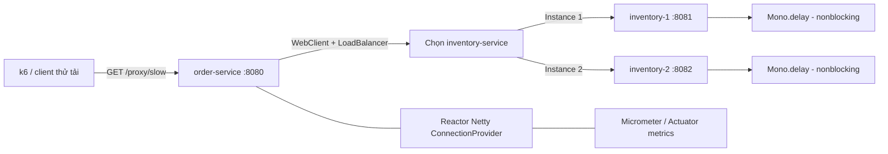
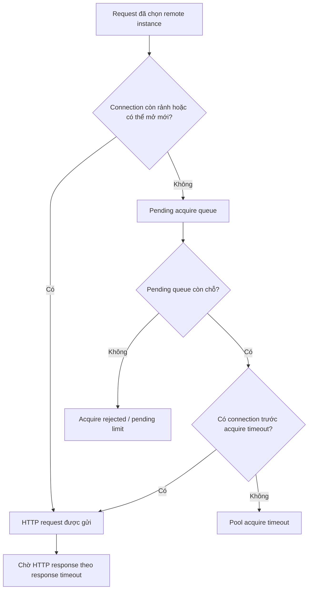
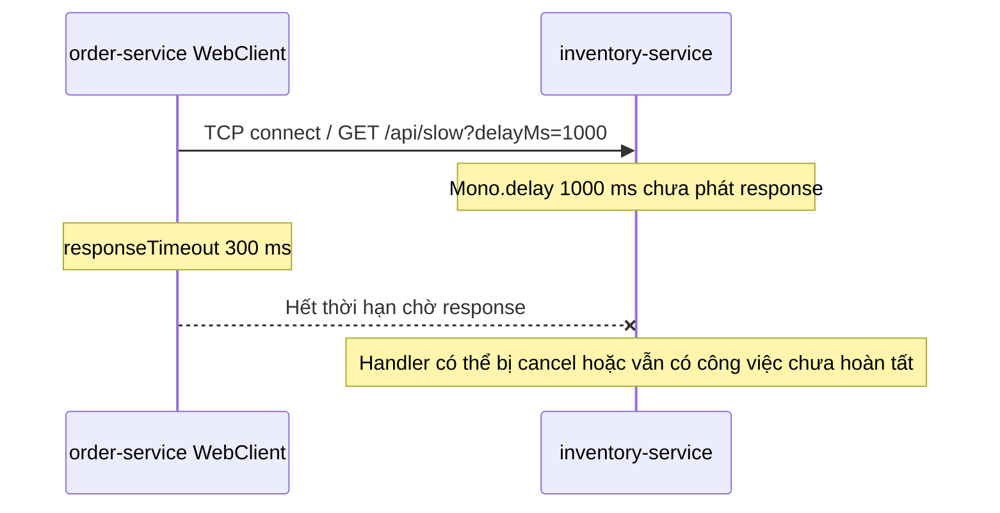

# Đo tác động của timeout và giới hạn pool

Trong một hệ thống microservice, giảm `readTimeout` từ 3 giây xuống 500 ms có thể làm request lỗi nhanh hơn, nhưng không làm backend nhanh hơn. Tăng `maxConnections` từ 4 lên 100 có thể giảm thời gian chờ lấy socket ở bên gọi, nhưng cũng có thể khiến dịch vụ đích và database nhận quá nhiều request cùng lúc. Với Spring Cloud LoadBalancer, một service ID như `inventory-service` còn có thể trỏ tới **nhiều `ServiceInstance`**, mỗi địa chỉ remote có khả năng hình thành một connection pool riêng.

Bài **Thực hành tổng hợp** này xây dựng một lab nhỏ để **đo**, thay vì phỏng đoán, ảnh hưởng của **connect timeout, response timeout, overall deadline, connection pool size và pending acquisition timeout** đối với throughput, p95/p99 latency, tỷ lệ lỗi và phân phối lưu lượng qua các instance.

Ta dùng `WebClient` và Reactor Netty để dễ điều khiển connection pool/metrics; phương pháp thí nghiệm áp dụng tương tự cho `RestClient` và `OpenFeign`, nhưng tên API cấu hình pool và loại exception có thể khác. Spring Cloud LoadBalancer đảm nhiệm chọn `ServiceInstance` theo service ID; HTTP connector đảm nhiệm TCP, pool và timeout.

> Mọi URI, port, kích thước pool và ngưỡng timeout dưới đây dành cho **máy local/lab**, không phải giá trị mặc định nên dùng trong production. Các kết quả đo sẽ do người học tự thu thập; bài không bịa số liệu benchmark.

## 1. Mục tiêu và tiêu chí hoàn thành

Sau bài lab, bạn cần làm được:

1. Khởi chạy **hai instance `inventory-service`** và một caller `order-service` dùng `@LoadBalanced WebClient.Builder`.
2. Chứng minh request đi qua service ID `http://inventory-service`, không gọi URL `localhost` cố định tại gateway.
3. Điều chỉnh `ConnectionProvider.maxConnections`, `pendingAcquireMaxCount`, `pendingAcquireTimeout`, TCP connect timeout và Reactor Netty `responseTimeout`.
4. Phân biệt request **chờ pool**, **không thiết lập TCP được**, **đợi response quá lâu** và **vượt overall deadline**.
5. Đo requests/s, p50/p95/p99, lỗi, số HTTP attempts và pool active/idle/pending trong cùng workload.
6. Giải thích tại sao tăng pool có thể chỉ chuyển bottleneck sang backend, và tại sao timeout quá ngắn gây lỗi dù instance vẫn khỏe.
7. Lập bảng kết quả, đưa ra quyết định tuning có bằng chứng và thử lại với một instance chậm hơn instance còn lại.

**Tiêu chí đạt:** có cấu hình lab chạy được trong môi trường Spring Boot/Spring Cloud tương thích, bằng chứng từ HTTP response/metrics/log rằng hai instance được chọn, bảng so sánh các kịch bản theo cùng tải, và kết luận dựa trên **số liệu thực**, không chỉ suy diễn từ cấu hình.

## 2. Kiến trúc lab



| Thành phần | Vai trò | Điều muốn quan sát |
|---|---|---|
| `order-service` | Nhận request của máy tạo tải, chọn instance, gọi HTTP downstream. | Thời gian end-to-end, lỗi, pool pending và timeout. |
| `inventory-1` | Trả response JSON sau độ trễ mô phỏng. | Request count, instance ID, thời gian xử lý. |
| `inventory-2` | Cùng API, có thể thêm delay riêng để tạo skew. | Tỷ lệ request và latency khi hai instance khác năng lực. |
| `SimpleDiscoveryClient` | Cung cấp hai `ServiceInstance` tĩnh cho service ID. | Không cần dựng registry riêng, dễ lặp lại phép đo. |
| Reactor Netty `ConnectionProvider` | Quản lý pool theo remote address của HTTP transport. | Active/idle/pending và thời gian chờ acquire. |
| `k6` | Tạo một mức concurrency được kiểm soát, đo latency/tỷ lệ lỗi. | p50/p95/p99, throughput, HTTP status, phân phối theo instance. |

Lab dùng **HTTP/1.1 qua loopback** để tránh TLS/proxy làm tăng biến số; về sau có thể thêm HTTPS, proxy và discovery động như bài tập mở rộng. Trong môi trường Docker/Kubernetes, `localhost` của container không trỏ đến container khác; thay URI bằng DNS/địa chỉ reachable phù hợp với topology thật.

### Một logical operation đi qua những pha nào?

```text
k6
  -> order-service nhận GET /proxy/slow
     -> WebClient hỏi Spring Cloud LoadBalancer
        -> chọn ServiceInstance host:port
        -> xin connection từ pool cho remote đó
           -> TCP connect mới hoặc reuse socket
           -> gửi HTTP GET /api/slow
              -> inventory-service giữ response trong khoảng delay
              -> trả JSON
        -> WebClient đọc và giải mã response
     -> order-service trả kết quả cho k6
```

**Lưu ý phân loại:** Phần chờ pool xảy ra **trước** khi HTTP request được gửi. `connectTimeout` thường giới hạn mở TCP socket mới, không giới hạn pending acquire. `responseTimeout` của Reactor Netty liên quan thời gian chờ dữ liệu trong response, **không tự là deadline tuyệt đối** cho toàn logical operation; ta sẽ bổ sung Reactor `Mono.timeout(...)` để đo deadline tổng.

## 3. Chuẩn bị môi trường và phiên bản

Cần Java **17+**, Maven, IDE/editor, công cụ HTTP như `curl` và công cụ thử tải `k6`. Một cặp tham khảo cho API trong bài là **Spring Boot 3.3.x** cùng **Spring Cloud 2023.0.x** theo compatibility matrix của Spring Cloud; khi tạo project mới nên chọn cặp phiên bản còn được hỗ trợ và được tổ chức phê duyệt. Không ghép ngẫu nhiên Spring Boot, Spring Cloud, Reactor Netty và Spring Framework.

Tạo **hai Maven projects** độc lập:

```text
loadbalancer-pool-lab/
  inventory-service/
    pom.xml
    src/main/java/lab/inventory/InventoryApplication.java
    src/main/resources/application.yml
  order-service/
    pom.xml
    src/main/java/lab/order/OrderApplication.java
    src/main/resources/application.yml
  load.js
```

Mỗi Maven project dùng Spring Boot parent/BOM đã chọn. Các dependencies tối thiểu:

| Project | Dependencies chính |
|---|---|
| `inventory-service` | `spring-boot-starter-webflux`, `spring-boot-starter-actuator`. |
| `order-service` | `spring-boot-starter-webflux`, `spring-cloud-starter-loadbalancer`, `spring-boot-starter-actuator`, `micrometer-registry-prometheus` (nếu muốn scrape Prometheus). |

Đối với `order-service`, import BOM Spring Cloud tương thích. Ví dụ cấu trúc Maven tối thiểu sau **dùng rõ Spring Boot 3.3.8 và Spring Cloud 2023.0.5 để minh họa**; khi xây project mới, chọn bản vá và release train được hỗ trợ, kiểm tra compatibility matrix thay vì mặc định dùng mãi cặp phiên bản cũ:

```xml
<project xmlns="http://maven.apache.org/POM/4.0.0"
         xmlns:xsi="http://www.w3.org/2001/XMLSchema-instance"
         xsi:schemaLocation="http://maven.apache.org/POM/4.0.0 https://maven.apache.org/xsd/maven-4.0.0.xsd">
    <modelVersion>4.0.0</modelVersion>
    <parent>
        <groupId>org.springframework.boot</groupId>
        <artifactId>spring-boot-starter-parent</artifactId>
        <version>3.3.8</version>
        <relativePath/>
    </parent>
    <groupId>lab</groupId>
    <artifactId>order-service</artifactId>
    <version>1.0-SNAPSHOT</version>
    <properties>
        <java.version>17</java.version>
        <spring-cloud.version>2023.0.5</spring-cloud.version>
    </properties>
    <dependencyManagement>
        <dependencies>
            <dependency>
                <groupId>org.springframework.cloud</groupId>
                <artifactId>spring-cloud-dependencies</artifactId>
                <version>${spring-cloud.version}</version>
                <type>pom</type>
                <scope>import</scope>
            </dependency>
        </dependencies>
    </dependencyManagement>
    <dependencies>
        <dependency>
            <groupId>org.springframework.boot</groupId>
            <artifactId>spring-boot-starter-webflux</artifactId>
        </dependency>
        <dependency>
            <groupId>org.springframework.cloud</groupId>
            <artifactId>spring-cloud-starter-loadbalancer</artifactId>
        </dependency>
        <dependency>
            <groupId>org.springframework.boot</groupId>
            <artifactId>spring-boot-starter-actuator</artifactId>
        </dependency>
        <dependency>
            <groupId>io.micrometer</groupId>
            <artifactId>micrometer-registry-prometheus</artifactId>
        </dependency>
    </dependencies>
    <build>
        <plugins>
            <plugin>
                <groupId>org.springframework.boot</groupId>
                <artifactId>spring-boot-maven-plugin</artifactId>
            </plugin>
        </plugins>
    </build>
</project>
```

Ví dụ trên dùng một cặp version **tham khảo về mặt tương thích**, không khẳng định đây là bản vá bảo mật mới nhất ở thời điểm triển khai. Đối với `inventory-service`, có thể dùng cùng Boot parent, group/version/plugin, thay artifact ID thành `inventory-service`, bỏ Spring Cloud BOM và dependency LoadBalancer, giữ WebFlux + Actuator.

**Kiểm soát biến:** lần đầu chạy thử không bật retry bổ sung, không thêm circuit breaker, không thêm service registry thật, không chạy proxy/TLS và không giả lập database. Sau khi hiểu ảnh hưởng của timeout/pool, mới lần lượt bổ sung chúng.

## 4. Dựng inventory-service: backend chậm có kiểm soát

File `inventory-service/src/main/resources/application.yml`:

```yaml
spring:
  application:
    name: inventory-service
server:
  port: ${SERVER_PORT:8081}
lab:
  instance-id: ${LAB_INSTANCE_ID:inventory-1}
  extra-delay-ms: ${LAB_EXTRA_DELAY_MS:0}
management:
  endpoints:
    web:
      exposure:
        include: health,info,metrics
```

File `inventory-service/src/main/java/lab/inventory/InventoryApplication.java`:

```java
package lab.inventory;

import java.time.Duration;
import java.util.concurrent.atomic.AtomicLong;

import org.springframework.beans.factory.annotation.Value;
import org.springframework.boot.SpringApplication;
import org.springframework.boot.autoconfigure.SpringBootApplication;
import org.springframework.web.bind.annotation.GetMapping;
import org.springframework.web.bind.annotation.RequestHeader;
import org.springframework.web.bind.annotation.RequestParam;
import org.springframework.web.bind.annotation.RestController;
import reactor.core.publisher.Mono;

@SpringBootApplication
public class InventoryApplication {
    public static void main(String[] args) {
        SpringApplication.run(InventoryApplication.class, args);
    }
}

@RestController
class InventoryController {
    private final String instanceId;
    private final long extraDelayMs;
    private final AtomicLong counter = new AtomicLong();

    InventoryController(
            @Value("${lab.instance-id}") String instanceId,
            @Value("${lab.extra-delay-ms:0}") long extraDelayMs) {
        this.instanceId = instanceId;
        this.extraDelayMs = extraDelayMs;
    }

    @GetMapping("/api/slow")
    Mono<InventoryReply> slow(
            @RequestParam(defaultValue = "200") long delayMs,
            @RequestHeader(value = "X-Lab-Request-Id", defaultValue = "manual")
                    String requestId) {

        long requested = Math.max(0, Math.min(delayMs, 10_000));
        long actualDelay = Math.min(10_000,
                Math.max(0, requested + extraDelayMs));

        return Mono.delay(Duration.ofMillis(actualDelay))
                .map(tick -> new InventoryReply(
                        instanceId, requestId, actualDelay,
                        counter.incrementAndGet()));
    }
}

record InventoryReply(
        String instance, String requestId, long delayMs, long sequence) {}
```

### Vì sao dùng Mono.delay?

`Mono.delay` mô phỏng server **chưa gửi response body** trong một khoảng thời gian mà **không block Netty event-loop**. Với một response JSON nhỏ, connection tới backend thường bị giữ cho tới khi response hoàn tất, phù hợp để quan sát HTTP/1.1 connection pool occupancy ở caller.

Đây là **mô hình service time chậm**, không phải mô hình CPU/DB pool bị bão hòa. Trong production, thêm connection không thể loại bỏ hạn mức CPU, database hoặc thread; bài mở rộng sẽ kiểm tra bottleneck đó bằng cách khác.

`sequence` là bộ đếm request **đã hoàn tất handler** trên mỗi instance, không phải số TCP connections. Khi client timeout/cancel, server-side work và cách ghi nhận counter phụ thuộc cancellation; không dùng riêng `sequence` để suy số request đã nhận. Với cần đếm chính xác attempts, thêm inbound request counter/HTTP server metric riêng.

## 5. Dựng order-service: LoadBalancer, pool và ba giới hạn thời gian

File `order-service/src/main/resources/application.yml`:

```yaml
spring:
  application:
    name: order-service
  cloud:
    discovery:
      client:
        simple:
          instances:
            inventory-service:
              - uri: http://localhost:8081
              - uri: http://localhost:8082
    loadbalancer:
      retry:
        enabled: false

server:
  port: 8080

lab:
  pool:
    max-connections: ${LAB_POOL_MAX_CONNECTIONS:4}
    pending-acquire-max-count: ${LAB_POOL_PENDING_MAX_COUNT:16}
    pending-acquire-timeout-ms: ${LAB_POOL_ACQUIRE_TIMEOUT_MS:300}
  http:
    connect-timeout-ms: ${LAB_HTTP_CONNECT_TIMEOUT_MS:500}
    response-timeout-ms: ${LAB_HTTP_RESPONSE_TIMEOUT_MS:1500}
    overall-timeout-ms: ${LAB_HTTP_OVERALL_TIMEOUT_MS:2500}

management:
  endpoints:
    web:
      exposure:
        include: health,info,metrics,prometheus
  metrics:
    tags:
      application: order-service
```

Giá trị ví dụ ban đầu áp dụng **mỗi remote pool** đối với Reactor Netty, không có nghĩa toàn `order-service` chỉ mở được tối đa bốn TCP connections khi có hai backend.

File `order-service/src/main/java/lab/order/OrderApplication.java`:

```java
package lab.order;

import java.time.Duration;
import java.util.UUID;

import io.netty.channel.ChannelOption;
import org.slf4j.Logger;
import org.slf4j.LoggerFactory;
import org.springframework.beans.factory.annotation.Value;
import org.springframework.boot.SpringApplication;
import org.springframework.boot.autoconfigure.SpringBootApplication;
import org.springframework.cloud.client.loadbalancer.LoadBalanced;
import org.springframework.context.annotation.Bean;
import org.springframework.context.annotation.Configuration;
import org.springframework.http.client.reactive.ReactorClientHttpConnector;
import org.springframework.stereotype.Service;
import org.springframework.web.bind.annotation.GetMapping;
import org.springframework.web.bind.annotation.RequestHeader;
import org.springframework.web.bind.annotation.RequestParam;
import org.springframework.web.bind.annotation.RestController;
import org.springframework.web.reactive.function.client.WebClient;
import reactor.core.publisher.Mono;
import reactor.netty.http.client.HttpClient;
import reactor.netty.resources.ConnectionProvider;

@SpringBootApplication
public class OrderApplication {
    public static void main(String[] args) {
        SpringApplication.run(OrderApplication.class, args);
    }
}

@Configuration(proxyBeanMethods = false)
class InventoryHttpConfiguration {

    @Bean(destroyMethod = "dispose")
    ConnectionProvider inventoryPool(
            @Value("${lab.pool.max-connections}") int maxConnections,
            @Value("${lab.pool.pending-acquire-max-count}") int pendingMax,
            @Value("${lab.pool.pending-acquire-timeout-ms}") long acquireMs) {

        return ConnectionProvider.builder("inventory-lab-pool")
                .maxConnections(maxConnections)
                .pendingAcquireMaxCount(pendingMax)
                .pendingAcquireTimeout(Duration.ofMillis(acquireMs))
                .maxIdleTime(Duration.ofSeconds(20))
                .metrics(true)
                .build();
    }

    @Bean
    @LoadBalanced
    WebClient.Builder inventoryLoadBalancedBuilder(
            ConnectionProvider inventoryPool,
            @Value("${lab.http.connect-timeout-ms}") int connectMs,
            @Value("${lab.http.response-timeout-ms}") long responseMs) {

        HttpClient transport = HttpClient.create(inventoryPool)
                .option(ChannelOption.CONNECT_TIMEOUT_MILLIS, connectMs)
                .responseTimeout(Duration.ofMillis(responseMs));

        return WebClient.builder()
                .clientConnector(new ReactorClientHttpConnector(transport));
    }
}

@Service
class InventoryGateway {
    private final WebClient client;
    private final Duration overallDeadline;

    InventoryGateway(
            @LoadBalanced WebClient.Builder inventoryLoadBalancedBuilder,
            @Value("${lab.http.overall-timeout-ms}") long overallMs) {

        this.client = inventoryLoadBalancedBuilder
                .baseUrl("http://inventory-service")
                .build();
        this.overallDeadline = Duration.ofMillis(overallMs);
    }

    Mono<InventoryReply> fetch(long delayMs, String requestId) {
        return client.get()
                .uri(builder -> builder.path("/api/slow")
                        .queryParam("delayMs", delayMs)
                        .build())
                .header("X-Lab-Request-Id", requestId)
                .retrieve()
                .bodyToMono(InventoryReply.class)
                .timeout(overallDeadline);
    }
}

@RestController
class ProxyController {
    private static final Logger log =
            LoggerFactory.getLogger(ProxyController.class);
    private final InventoryGateway gateway;

    ProxyController(InventoryGateway gateway) {
        this.gateway = gateway;
    }

    @GetMapping("/proxy/slow")
    Mono<InventoryReply> slow(
            @RequestParam(defaultValue = "200") long delayMs,
            @RequestHeader(value = "X-Lab-Request-Id", required = false)
                    String incomingRequestId) {

        String requestId = incomingRequestId == null
                || incomingRequestId.isBlank()
                ? UUID.randomUUID().toString()
                : incomingRequestId;

        return gateway.fetch(delayMs, requestId)
                .doOnError(error -> log.warn(
                        "requestId={} downstreamFailure={} message={}",
                        requestId,
                        error.getClass().getSimpleName(),
                        error.getMessage()));
    }
}

record InventoryReply(
        String instance, String requestId, long delayMs, long sequence) {}
```

### Giải thích các giới hạn thời gian trong cấu hình

| Cấu hình | Mặc định của lab | Nơi áp dụng | Khi nào thường phát huy tác dụng? |
|---|---:|---|---|
| `pendingAcquireTimeout` | 300 ms | `ConnectionProvider`. | Pool của remote đã bão hòa và request phải chờ connection. |
| `CONNECT_TIMEOUT_MILLIS` | 500 ms | Netty TCP connect. | Phải mở socket mới nhưng TCP connection không thiết lập được đúng hạn. |
| `responseTimeout` | 1.500 ms | Reactor Netty HTTP response. | Không nhận được dữ liệu response trong thời hạn theo transport, ví dụ backend chậm trả byte đầu. |
| `Mono.timeout(overallDeadline)` | 2.500 ms | Pipeline WebClient trong gateway. | Tổng thời gian từ lúc subscription tới kết quả vượt deadline, kể cả chờ pool và chọn instance trong pipeline đó. |

**Phân biệt thêm:** `pendingAcquireMaxCount=16` là số requests có thể đang chờ để lấy connection theo remote pool, **không phải 16 TCP connections**. Nếu pending queue đầy, lỗi từ chối có thể xảy ra trước khi chờ đủ 300 ms. `maxIdleTime=20s` giới hạn tuổi idle của connection để pool xem xét dọn; nó không làm request đang chờ response tự timeout sau 20 giây.

### Tại sao phải tắt retry trước khi đo?

Một logical operation có thể tạo nhiều HTTP attempts nếu Spring Cloud LoadBalancer, Reactor pipeline hoặc transport tự retry. Khi đó k6 ghi một logical HTTP request tới `order-service` nhưng inventory lại nhận nhiều attempts. Để cô lập tác động pool và timeout, ta đặt `spring.cloud.loadbalancer.retry.enabled=false`, không khai báo `retryWhen` và không bật retry tại tầng nghiệp vụ. Tuy vậy, **HTTP transport có thể vẫn thực hiện một số phục hồi nội bộ**; khi điều tra failure count nên kiểm tra server/proxy access logs.

### Ranh giới trách nhiệm

- `Spring Cloud LoadBalancer` chọn `inventory-1` hoặc `inventory-2` theo service ID.
- `ConnectionProvider` cấp/reuse socket cho remote endpoint.
- Reactor Netty áp dụng connect và response timeout.
- Reactor `timeout` áp overall deadline ở phía caller.
- `inventory-service` chỉ mô phỏng một thời gian phục vụ; nó không biết `order-service` có bao nhiêu pending requests trong pool.

Đoạn code dùng `WebClient.builder()` để minh họa rõ connector và pool. Trong ứng dụng production, cần xem các `WebClientCustomizer`/observation/SSL customization của Spring Boot để tránh mất instrumentation khi thay builder; không coi snippet này là cấu hình production-ready.

## 6. Khởi động ba tiến trình và xác minh service ID

Các lệnh sau là thao tác người học **tự thực hiện**. Mỗi project cần một terminal riêng; khởi động hai instance trước để tránh caller gặp connection refused trong lúc warm-up.

Ví dụ trên Windows PowerShell:

```powershell
# Terminal 1, tại inventory-service/
$env:SERVER_PORT = "8081"
$env:LAB_INSTANCE_ID = "inventory-1"
$env:LAB_EXTRA_DELAY_MS = "0"
mvn spring-boot:run
```

```powershell
# Terminal 2, tại inventory-service/
$env:SERVER_PORT = "8082"
$env:LAB_INSTANCE_ID = "inventory-2"
$env:LAB_EXTRA_DELAY_MS = "0"
mvn spring-boot:run
```

```powershell
# Terminal 3, tại order-service/
mvn spring-boot:run
```

Khi sử dụng macOS/Linux, đặt biến môi trường tương đương trước khi chạy `mvn spring-boot:run`; khi dùng Maven Wrapper, thay `mvn` bằng lệnh wrapper phù hợp hệ điều hành.

Kiểm tra endpoint backend trực tiếp:

```bash
curl -H "X-Lab-Request-Id: manual-a" \
  "http://localhost:8081/api/slow?delayMs=100"

curl -H "X-Lab-Request-Id: manual-b" \
  "http://localhost:8082/api/slow?delayMs=100"
```

Expected body có thể ở dạng:

```json
{
  "instance": "inventory-1",
  "requestId": "manual-a",
  "delayMs": 100,
  "sequence": 1
}
```

Giá trị `sequence` phụ thuộc số request đã thực hiện; JSON trên chỉ minh họa, không dùng làm fixture phải khớp số đếm.

Sau đó gọi **qua caller/LoadBalancer**:

```bash
curl -H "X-Lab-Request-Id: via-lb-001" \
  "http://localhost:8080/proxy/slow?delayMs=250"
```

Gọi nhiều lần để nhìn response `instance`. Trong điều kiện hai server khỏe và mặc định thuật toán round robin, thường thấy cả hai instance được dùng. Không bắt buộc assert cứng thứ tự `1-2-1-2` nếu có concurrent calls, khởi tạo counter/supplier khác hoặc custom LoadBalancer.

**Nếu request tới `http://inventory-service` gây `UnknownHostException`**, kiểm tra bean `@LoadBalanced WebClient.Builder`, Spring Cloud LoadBalancer starter và danh sách `SimpleDiscoveryClient`. Không sửa bằng cách đổi base URL gateway thành `http://localhost:8081`: làm vậy có thể “chạy được” nhưng sẽ bỏ qua mục tiêu học về service ID.

## 7. Tạo lưu lượng có kiểm soát với k6

Lưu script dưới tên `load.js` **trong thư mục lab của người học**:

```javascript
import http from 'k6/http';
import { check } from 'k6';
import { Counter } from 'k6/metrics';

const instanceResponses = new Counter('lab_instance_responses');
const non200 = new Counter('lab_non200_responses');

export const options = {
  scenarios: {
    constant_concurrency: {
      executor: 'constant-vus',
      vus: Number(__ENV.VUS || 16),
      duration: __ENV.DURATION || '30s',
    },
  },
};

export default function () {
  const base = __ENV.BASE_URL || 'http://localhost:8080';
  const delayMs = Number(__ENV.DELAY_MS || 500);
  const requestId = 'k6-' + __VU + '-' + __ITER;
  const url = base + '/proxy/slow?delayMs=' + delayMs;

  const response = http.get(url, {
    timeout: '10s',
    headers: { 'X-Lab-Request-Id': requestId },
  });

  if (response.status === 200) {
    const body = response.json();
    const valid = check(body, {
      'instance and correlation returned': item =>
        ['inventory-1', 'inventory-2'].includes(item.instance)
        && item.requestId === requestId,
    });
    if (valid) {
      instanceResponses.add(1, { instance: body.instance });
    }
  } else {
    non200.add(1, { status: String(response.status) });
  }
}
```

Ví dụ gọi `k6`:

```bash
k6 run -e BASE_URL=http://localhost:8080 \
  -e VUS=16 -e DURATION=30s -e DELAY_MS=500 load.js
```

Trong PowerShell, đặt lệnh một dòng hoặc dùng backtick PowerShell để xuống dòng; dấu `\` ở lệnh bash chỉ dùng cho shell kiểu Unix.

**Điểm cần hiểu về k6:**

- `constant-vus` giữ một số virtual users liên tục gửi request; **mỗi VU thường có tối đa một HTTP request đang thực thi ở thời điểm đó trong script này**, nên mức concurrent requests vào caller gần số VUs.
- `http_req_duration` đo giai đoạn request HTTP từ phía k6, **không phải** riêng duration của `inventory-service`; dùng cùng backend metrics để phân biệt.
- `http_req_failed` cho biết tỷ lệ HTTP requests k6 coi là lỗi theo expected response policy; mặc định non-2xx thường được xem là không thành công. `lab_non200_responses` đếm status khác 200, kể cả trường hợp cần điều tra.
- `lab_instance_responses` phân nhóm response đã nhận và parse được theo hai instance cố định. Đây là hai nhãn trong lab; production phải kiểm soát metric cardinality khi instance thay đổi liên tục.
- Request bị timeout ở k6 (10 giây) là **timeout của công cụ tạo tải**, phải để đủ dài để quan sát timeout phía `order-service`; nếu không sẽ nhầm hai nguồn timeout.

Để ghi đầy đủ benchmark, lưu riêng output JSON/CSV hoặc Prometheus và chỉ so sánh **cùng cấu hình load generator, cùng hardware, cùng duration và cùng số instance**. Thử làm ấm ứng dụng trước mỗi lần đo để hạn chế JIT, DNS và TCP cold-start ảnh hưởng kết luận.

## 8. Đo metrics tại caller và backend

Không chỉ dựa vào output k6 để kết luận nguyên nhân. k6 quan sát **cả đường** `k6 → order-service → inventory-service`; còn pool đang nằm bên trong process `order-service`.

### 8.1. Metric từ k6

Các chỉ số cần ghi cho từng lần chạy:

| Chỉ số | Ý nghĩa | Vì sao quan trọng? |
|---|---|---|
| `http_reqs` rate | Lưu lượng HTTP thực từ k6 vào caller (requests/s). | Đo throughput ở ranh giới test. |
| `http_req_duration` p50/p95/p99 | Phân phối latency HTTP từ góc nhìn k6. | Quan sát tail latency toàn đường đi. |
| `http_req_failed` | Tỷ lệ responses không mong đợi hoặc lỗi mạng theo chính sách k6. | Nhận biết tuning gây quá nhiều lỗi. |
| `lab_non200_responses` | Count theo status khác 200. | Tách success khỏi responses lỗi; không thay thế HTTP error classifier ở caller. |
| `lab_instance_responses` | Số response thành công theo backend instance. | Xem kết quả định tuyến ở những request đã trả thành công. |
| `iterations` | Số lượt chạy k6 script. | Trong lab một iteration bằng một logical request tới caller. |

Để k6 hiển thị p99 trong summary, thêm vào `options` của `load.js`:

```javascript
export const options = {
  summaryTrendStats: [
    'avg', 'min', 'med', 'p(90)', 'p(95)', 'p(99)', 'max',
  ],
  scenarios: {
    constant_concurrency: {
      executor: 'constant-vus',
      vus: Number(__ENV.VUS || 16),
      duration: __ENV.DURATION || '30s',
    },
  },
};
```

Đây là **phần thay thế** object `options` ở ví dụ trước, không khai báo hai lần trong cùng script. Khi báo cáo p99, phải nêu rõ đây là p99 của **mọi HTTP requests được k6 ghi nhận**, bao gồm cả requests lỗi nếu có. Để đo tail latency của **successful operations** riêng, có thể khai báo một custom `Trend` và chỉ thêm duration khi status/body hợp lệ. Tránh chỉ đo successes mà bỏ qua tỷ lệ lỗi tăng cao.

### 8.2. Metric connection pool ở order-service

Với `ConnectionProvider.metrics(true)` và Micrometer registry tương thích, Reactor Netty có thể xuất metrics của provider như **active**, **idle** và **pending connections**, cùng thông tin phân nhóm theo remote/pool tùy version. Không hard-code tên meter trong dashboard khi chưa kiểm tra chính xác các meter đã được đăng ký.

Trên môi trường lab, truy vấn:

```bash
curl "http://localhost:8080/actuator/metrics"
curl "http://localhost:8080/actuator/prometheus"
```

Tìm các meter có tên bắt đầu với `reactor.netty.connection.provider` (nếu đã được instrumentation hỗ trợ), ví dụ dạng:

```text
reactor.netty.connection.provider.active.connections
reactor.netty.connection.provider.idle.connections
reactor.netty.connection.provider.pending.connections
```

Danh sách này là **tên metric thường gặp theo dòng Reactor Netty**, cần đối chiếu meter thực được xuất ra tại phiên bản đang chạy. Nếu không có, kiểm tra `micrometer-registry-prometheus`, auto-configuration, pool metrics enabled, có traffic thật chưa, đã đúng `ConnectionProvider` chưa và connector thực tế có đúng Reactor Netty hay không.

Nếu có Prometheus/Grafana, scrape mỗi 1–5 giây trong lab hoặc lưu samples cùng thời gian k6 chạy; `active/idle/pending` là **gauge tại thời điểm lấy mẫu**, không được cộng đơn giản như số request. Khi hệ thống vừa scale hoặc chỉ có burst vài mili giây, sampling thưa có thể bỏ lỡ đỉnh pending; đo thêm counter/timeouts qua logs/traces.

### 8.3. Metric backend

Kiểm tra `inventory-service` ở cả hai port:

```bash
curl "http://localhost:8081/actuator/metrics"
curl "http://localhost:8082/actuator/metrics"
```

Một số thứ cần đối chiếu:

- HTTP server request count và duration của `/api/slow`.
- Số requests đang xử lý, response errors và thời gian chậm được mô phỏng.
- CPU/GC của từng JVM để biết lỗi đến từ lab generator hay ứng dụng.
- Network/sockets theo process khi cần xác minh connection reuse.

Chỉ số `sequence` trong JSON giúp nhận diện instance và các responses thành công; nó không phải thống kê đầy đủ cho requests bị hủy. Muốn biết server **đã nhận** bao nhiêu attempts kể cả khi client cancel, hãy instrument request entry trước xử lý chậm.

### 8.4. Correlation để phân biệt request và attempt

`order-service` chuyển `X-Lab-Request-Id` từ k6 xuống backend. Ghi cùng ID ở caller, load-balancing logs (nếu có instrumentation) và HTTP server. Khi retry được bật, nhiều attempts có thể dùng cùng operation ID; cần thêm `attempt` riêng để phân biệt các lần gọi.

**Không log credential thật, token, query nhạy cảm hoặc toàn bộ HTTP body.** Actuator và Prometheus trong ví dụ chỉ nên expose trên loopback hoặc mạng quản trị; không public endpoint chẩn đoán ra Internet.

## 9. Tính toán sức chứa trước khi chạy phép đo

Giả sử trong lab:

- Hai `ServiceInstance` cùng phục vụ HTTP/1.1.
- `maxConnections = 2` cho mỗi remote pool.
- Mỗi HTTP response giữ connection **khoảng 800 ms**.
- Các requests có kích thước nhỏ, không có proxy hoặc HTTP/2 multiplexing.

Khi đó có thể hình dung **tối đa khoảng bốn kết nối active tới hai remote pools**. Năng lực phục vụ lý tưởng bị chặn bởi:

```text
2 instances × 2 connections/instance ≈ 4 active connections
4 / 0,8 giây ≈ 5 HTTP responses/giây (ước lượng lý tưởng)
```

Đây chỉ là **ước lượng để hình thành giả thuyết**, không phải benchmark thực tế. Kết quả còn phụ thuộc overhead client/server, connection reuse, scheduling, network, request/response size, phân bố instance và chính sách HTTP connector. Nếu có HTTP/2 multiplexing, một TCP connection có thể xử lý nhiều stream và phép chia trên **không còn mô tả đúng request concurrency**.

### Little's Law

Trong trạng thái tương đối ổn định:

```text
L ≈ λ × W

L: số operations trung bình trong hệ thống đang xét
λ: số operations hoàn tất/đến trung bình mỗi giây
W: thời gian trung bình một operation ở trong hệ thống (giây)
```

Ví dụ nếu `λ = 10 requests/s` và `W = 0,5 s`, ta kỳ vọng khoảng `L = 5` operations in-flight trung bình **ở cùng phạm vi đo**. Không dùng công thức này để suy ra `maxConnections` tối ưu từ p99: nó mô tả **trung bình** trong điều kiện tương đối ổn định, không bao trùm bursts, queue tail, lỗi, retry và đa remote pools.

### Tại sao tăng pool có thể làm backend chậm hơn?

Khi pool nhỏ, caller giới hạn số attempts đồng thời gửi xuống backend; một phần requests chờ hoặc thất bại sớm ở pool. Khi mở lớn pool, nhiều requests đến backend cùng lúc. Nếu backend có DB pool 10 connections hoặc CPU quota cố định, bottleneck chuyển sang server queue/DB, p99 tăng mặc dù pool pending ở caller giảm. Vì vậy **giảm pending không nhất thiết làm latency end-to-end tốt hơn**.

## 10. Ma trận thí nghiệm có kiểm soát

Thiết kế các kịch bản độc lập. Mỗi lần chạy:

1. Dừng `order-service` và thay **các biến môi trường** tương ứng.
2. Khởi động lại caller để tạo `ConnectionProvider` mới với cấu hình có hiệu lực.
3. Đảm bảo hai backend đã sẵn sàng và delay per-instance đúng scenario.
4. Warm up với tải nhỏ, sau đó chạy benchmark cùng thời lượng.
5. Lưu k6 summary, metrics caller/backend, số lỗi và thông tin instance.
6. Reset môi trường về baseline trước scenario tiếp theo nếu cần.

| Mã | Max connections / remote | Pending max | Acquire timeout | Response timeout | Overall deadline | VUs | Backend delay | Mục tiêu |
|---|---:|---:|---:|---:|---:|---:|---:|---|
| **A – Baseline** | 16 | 32 | 2000 ms | 3000 ms | 5000 ms | 8 | 250 ms | Có khoảng trống capacity, latency nền. |
| **B – Pool nhỏ, fail fast** | 2 | 8 | 150 ms | 3000 ms | 5000 ms | 32 | 800 ms | Quan sát pending và acquire timeout/reject. |
| **C – Pool nhỏ, cho chờ** | 2 | 64 | 3000 ms | 3000 ms | 6000 ms | 16 | 300 ms | Xem queue làm p95/p99 tăng, có thể giảm lỗi so với B. |
| **D – Response timeout ngắn** | 16 | 32 | 2000 ms | 300 ms | 5000 ms | 8 | 1000 ms | Tách response timeout khỏi pool. |
| **E – Overall deadline ngắn** | 16 | 32 | 2000 ms | 3000 ms | 400 ms | 8 | 1000 ms | Thấy Reactor deadline kết thúc trước response timeout. |
| **F – Pool rộng, backend chậm** | 32 | 64 | 2000 ms | 3000 ms | 5000 ms | 32 | 800 ms | So throughput/latency với pool nhỏ, kiểm tra backend load. |

Các con số là **thiết lập để thử**, không phải kết quả mong đợi chính xác. Ngay cả A cũng có thể chịu cold-start, GC hoặc môi trường máy yếu. Nếu metrics không khớp giả thuyết, điều tra **effective configuration**, công cụ tạo tải và HTTP protocol trước khi kết luận Spring Cloud LoadBalancer sai.

### Ví dụ thiết lập scenario B trên PowerShell

Trong terminal của `order-service`, dừng ứng dụng rồi khởi động lại:

```powershell
$env:LAB_POOL_MAX_CONNECTIONS = "2"
$env:LAB_POOL_PENDING_MAX_COUNT = "8"
$env:LAB_POOL_ACQUIRE_TIMEOUT_MS = "150"
$env:LAB_HTTP_CONNECT_TIMEOUT_MS = "500"
$env:LAB_HTTP_RESPONSE_TIMEOUT_MS = "3000"
$env:LAB_HTTP_OVERALL_TIMEOUT_MS = "5000"
mvn spring-boot:run
```

Sau đó ở terminal tạo tải:

```powershell
k6 run -e VUS=32 -e DURATION=30s -e DELAY_MS=800 load.js
```

Đặt giá trị biến môi trường đúng từng cột của các scenario còn lại; nếu không restart caller, bean `ConnectionProvider` cũ vẫn dùng cấu hình trước và kết quả so sánh không hợp lệ.

### Quy tắc chạy lặp

Để bớt nhiễu, đo ít nhất vài lần trong điều kiện tương đương, khởi động lại/warm up theo cùng quy trình, thử đảo thứ tự A–B–A hoặc luân phiên cases, ghi CPU/GC/đĩa và trạng thái k6 load generator. Không dùng một lần chạy 3 giây để kết luận p99. Mẫu p99 cần đủ quan sát; nếu tổng số requests quá nhỏ, giá trị p99 kém ổn định và dễ bị một sự kiện đơn lẻ chi phối.

## 11. Phân tích scenario A: tìm baseline trước khi tuning

**Thiết lập:** pool 16 per remote, pending 32, acquire timeout 2 giây, response timeout 3 giây, overall deadline 5 giây, 8 VUs, backend delay 250 ms.

### Các bước

1. Start hai backend với extra delay bằng 0.
2. Khởi động caller với các biến của scenario A.
3. Gọi endpoint qua `order-service` vài lần để warm up và xác nhận hai `instance` khác nhau.
4. Chạy k6 8 VUs trong 30–60 giây.
5. Ghi số requests/s, p50/p95/p99, HTTP error rate và pool active/pending theo remote.

### Giả thuyết trước khi đo

Ở mức tải nhỏ, hai remote pools có khả năng cấp connection sẵn có, **pending gần 0 trong phần lớn thời gian**; response khoảng vài trăm mili giây cộng overhead; tỷ lệ lỗi có thể rất thấp. Nếu thực tế trái ngược, đừng tiếp tục sang scenario B ngay: kiểm tra backend port, discovery, memory/CPU và thời gian tạo connection của môi trường.

### Câu hỏi cần trả lời

- Có thật cả `inventory-1` và `inventory-2` nhận request không?
- Có connection reuse không hay mỗi lượt đều mở socket mới?
- p99 có bất thường từ những lượt đầu cold-start không?
- `http_reqs` của k6 có tương ứng với logical requests đến caller không?
- Mọi metric có cùng khoảng thời gian quan sát không?

Baseline là mốc tham chiếu của **cấu hình và hardware cụ thể**, không phải chuẩn chung cho mọi máy.

## 12. Scenario B và C: pool bão hòa, fail fast hay cho chờ?

Với maxConnections nhỏ và nhiều VUs, request có thể không nhận được connection ngay. Cần phân biệt ba kết quả:



### Scenario B — Pool nhỏ, thời gian chờ ngắn

Khi `maxConnections=2` mỗi remote, pending max 8 và acquire timeout 150 ms, một đợt 32 concurrent requests với delay 800 ms có thể gây áp lực mạnh hơn capacity ban đầu.

**Quan sát kỳ vọng nếu giả thuyết đúng:**

- Active connections mỗi remote tiến gần 2 trong thời gian có tải.
- Pending connections tăng và có lúc gần giới hạn.
- Có requests bị từ chối hoặc hết acquisition timeout **trước khi request HTTP đến inventory**.
- K6 thấy errors; server-side request count có thể ít hơn số attempts/logical requests từ caller.
- p95 của **toàn bộ requests** thậm chí có thể trông thấp hơn nếu nhiều requests lỗi rất sớm — đây không phải cải thiện SLO.

Không mặc định một request lỗi acquisition có HTTP status 504; ở ví dụ controller, exception không được map tùy chỉnh và Spring Boot có thể trả `500`/error response từ caller. Muốn phân loại, xem **exception/cause** và pool metrics, không suy từ status k6 một mình.

### Scenario C — Giữ pending queue lâu hơn

Đặt max connections vẫn bằng 2 mỗi remote, tăng pending queue và acquire timeout. Một số request có thể xếp hàng, đợi connection được trả lại rồi thành công. Tỷ lệ lỗi do acquisition có thể giảm nhưng **latency p95/p99 tăng** vì thời gian chờ tại caller.

Đây là trade-off:

| Chính sách | Điểm mạnh | Rủi ro |
|---|---|---|
| Fail fast khi pool bão hòa | Từ chối sớm, hạn chế số operations đang chờ, giảm tài nguyên hàng đợi. | Tăng tỷ lệ lỗi nếu caller không có fallback/rate limiting. |
| Cho pending queue lớn và chờ lâu | Có thêm cơ hội hoàn tất khi tải chỉ tăng ngắn hạn. | Tăng tail latency và bộ nhớ; có thể vượt deadline nghiệp vụ. |
| Tăng max connections | Giảm chờ pool nếu backend còn capacity. | Đẩy nhiều requests đồng thời xuống backend, có thể làm downstream nghẽn. |

### Muốn biết tăng thông số nào có tác dụng, hãy thử **từng biến**

Ma trận A–F ở phần trước là nhóm tình huống minh họa, **không phải thiết kế đối chứng một-biến hoàn hảo**. Để kết luận nhân quả:

1. Giữ `VUS=32`, `delayMs=800`, cùng hai instances và tất cả timeout khác.
2. Chạy B, sau đó **chỉ tăng** `pendingAcquireTimeout` từ 150 lên 3000 ms, giữ pending max 8. Phân biệt acquire timeout với queue-full rejection.
3. Reset về B, sau đó **chỉ tăng** `pendingAcquireMaxCount` từ 8 lên 64. Quan sát số operations được phép chờ và p99, không kỳ vọng queue rộng tự tăng capacity.
4. Reset về B, sau đó **chỉ tăng** `maxConnections` từ 2 lên 16. Quan sát active connections, throughput, backend in-flight và lỗi.
5. Lặp lại theo thứ tự đảo và ghi baseline xen kẽ để giảm nhiễu.

**Không lấy B và C (vốn khác cả VUs, delay lẫn nhiều tham số) làm bằng chứng rằng chỉ một thông số đã tạo khác biệt.**

## 13. Scenario D: response timeout nhỏ hơn thời gian backend trả dữ liệu

Với `responseTimeout=300 ms`, backend giữ response khoảng 1000 ms, còn pool đủ rộng, có thể xuất hiện lỗi **chờ response**.



### Cách đọc kết quả

- Pool active có thể còn chỗ trống; pending không nhất thiết cao.
- TCP connect có thể thành công trước timeout.
- Server đã nhận request, nhưng chưa kịp trả response.
- Client có thể báo `ReadTimeoutException` hoặc wrapper `WebClientRequestException` tùy Reactor Netty/Spring version.
- K6 nhận error từ `order-service`, có thể khác với HTTP status do `inventory-service` phát ra (ở đây server không chủ động trả 504).

Để kiểm tra nguyên nhân bằng **một biến duy nhất**, giữ workload và mọi giá trị khác, tăng `responseTimeout` từ 300 lên 1500 ms. Nếu request thành công nhiều hơn và server vẫn trả sau khoảng 1000 ms, bằng chứng ủng hộ response timeout là ngưỡng cắt; **không có nghĩa service nhanh hơn**.

### TTFB khác total duration

Endpoint của lab gửi một JSON nhỏ sau khi delay; timeout chờ byte đầu dễ quan sát. Với SSE/stream trả chunk mỗi vài giây, Reactor Netty response timeout thường liên quan **khoảng không nhận dữ liệu giữa các thao tác đọc**, không phải deadline tổng. Vì thế cần dùng `Mono.timeout` hoặc deadline orchestration riêng khi API phải hoàn tất trong thời gian cố định.

## 14. Scenario E: deadline tổng cắt trước response timeout

Đặt:

```text
responseTimeout = 3000 ms
overallDeadline = 400 ms
backendDelay    = 1000 ms
```

Với pool đủ rộng và request tới backend bình thường, `Mono.timeout(Duration.ofMillis(400))` có thể kết thúc publisher trước khi Reactor Netty response timeout 3 giây xảy ra.

**Kết quả cần kiểm tra:**

1. K6 thấy lỗi sớm hơn thời gian backend delay.
2. Caller có `java.util.concurrent.TimeoutException` từ Reactor operator hoặc exception được xử lý/bao bọc theo pipeline.
3. HTTP connector có thể nhận cancellation; connection behavior phụ thuộc transport và giai đoạn I/O.
4. Backend **có thể đã nhận request** dù caller từ bỏ chờ. Với request ghi, cancellation không đảm bảo transaction rollback.

So sánh với một phép thử **chỉ tăng overall deadline** từ 400 lên 2000 ms, giữ response timeout 3000 ms và backend delay 1000 ms. Nếu request thành công, bạn đã chứng minh deadline ảnh hưởng outcome, không chứng minh CPU/DB đã được cải thiện.

### Deadline tính từ đâu?

Trong code lab, `timeout(overallDeadline)` áp lên publisher trả bởi `WebClient` và bắt đầu khi publisher được subscribe. Nó bao trùm những bước nằm trong publisher đó như LoadBalancer resolution/pool acquisition/HTTP response, **nhưng không tự bao gồm** thời gian request k6 xếp hàng trước khi controller được thực thi, hoặc những thao tác nghiệp vụ đặt ở ngoài publisher này.

Đối với workflow nhiều service, overall deadline phải được đặt ở biên nghiệp vụ phù hợp và truyền ngân sách còn lại xuống các hop; không mặc định một `Mono.timeout` trong gateway chính là deadline từ đầu đến cuối của cả HTTP request người dùng.

## 15. Scenario F: tăng pool so với giới hạn phục vụ của backend

Scenario F sử dụng 32 VUs, 800 ms delay và max 32 connections per remote. Trong lab `Mono.delay` không blocking, backend có thể phục vụ nhiều requests đồng thời khá dễ dàng. Vì vậy, **pool rộng có thể tăng throughput và giảm queue trong lab này**.

Điều đó **không chứng minh** pool 32 là lựa chọn tốt trong production. Dịch vụ thật còn có:

- Servlet/executor hoặc Reactor event-loop work.
- Database connections và transaction locks.
- Cache/Redis/HTTP downstream tiếp theo.
- CPU/memory/GC, disk I/O và network bandwidth.
- Rate limiting, circuit breaker, admission control và queue.

Nếu backend có DB pool chỉ 10 connections, tăng caller pool từ 2 lên 32 có thể dời hàng chờ từ client sang DB, khiến backend p99 tăng hoặc trả 503. Đó là lý do phải đo **backend saturation** cùng pool metrics.

### Làm thế nào để bổ sung giới hạn năng lực backend?

Có thể mở rộng endpoint giả lập với một semaphore hoặc nonblocking concurrency limiter số slots cố định, và trả `503` khi không còn slot. Ví dụ logic khái niệm:

```text
Nếu backend in-flight < maxBackendOperations:
    cấp slot
    thực hiện Mono.delay(...)
    trả response và giải phóng slot ở doFinally
Ngược lại:
    từ chối có kiểm soát bằng HTTP 503
```

Nếu thực hiện, bảo đảm bộ đếm/permit thread-safe, được giải phóng cả khi cancel/error và **không block Netty event loop** bằng `Semaphore.acquire()`. Đây là **bài mở rộng**, không phải thay đổi bắt buộc cho code `inventory-service` ở phần 4.

Khi có backend limiter, chạy phép thử đối chứng cùng VUs/delay/timeout với pool nhỏ rồi pool lớn: nếu tăng pool làm server rejection tăng, bạn đã quan sát được **chuyển bottleneck**, thay vì chỉ đọc throughput từ k6.

## 16. Hai instance không đồng đều: thuật toán chia lượt khác với capacity

Thí nghiệm này minh họa vì sao cân bằng tải không chỉ là đếm số lần chọn instance.

Giữ `inventory-1` với `LAB_EXTRA_DELAY_MS=0`. Khởi động lại `inventory-2` với:

```powershell
# Terminal inventory-2
$env:SERVER_PORT = "8082"
$env:LAB_INSTANCE_ID = "inventory-2"
$env:LAB_EXTRA_DELAY_MS = "800"
mvn spring-boot:run
```

Chạy cùng `delayMs=300` từ caller:

```text
inventory-1: khoảng 300 ms mô phỏng ở backend
inventory-2: khoảng 1100 ms mô phỏng ở backend
```

### Câu hỏi điều tra

- Request count đến hai backend có tương đối gần nhau khi dùng round robin không?
- p95/p99 của logical requests thay đổi như thế nào khi một instance chậm hơn?
- Pool active của remote nào có xu hướng cao hơn dù request count gần tương đương?
- Nếu giảm `responseTimeout` xuống 700 ms, các errors có tập trung ở requests chọn `inventory-2` không?
- Health endpoint của cả hai instance có vẫn trả UP không, và điều đó có đủ để tuyên bố cả hai đáp ứng SLO không?

**Giải thích:** Round robin cố gắng phân phối **lượt chọn**, không tự cân bằng số requests **đang xử lý**, CPU, DB pool hay độ trễ theo instance. Backend chậm hơn giữ HTTP connection lâu hơn, vì vậy remote pool tương ứng có thể có nhiều active connections/pending acquisition hơn.

Khi chỉ đếm **responses thành công** theo instance từ k6, số lượt có thể lệch do instance chậm bị timeout; điều đó không nhất thiết chứng minh LoadBalancer đã chọn ít lượt hơn. Muốn đo phân phối lựa chọn, cần thêm logs/traces ở tầng chọn `ServiceInstance` hoặc inbound attempt counter ở mỗi backend.

### Mối liên hệ với health check và discovery

`SimpleDiscoveryClient` trong lab trả danh sách tĩnh. Nó không tự loại `inventory-2` chỉ vì instance này chậm 800 ms. Một health check đơn giản có thể vẫn báo UP; chuyển đích chỉ vì latency chậm cần chính sách phù hợp và hiểu nguy cơ health flapping. Khi autoscaling, instance bị rút khỏi discovery có thể còn socket idle trong HTTP pool cho tới khi được dọn; **vòng đời discovery không đồng nghĩa vòng đời TCP**.

## 17. Tình huống một instance biến mất: đừng nhầm connect timeout

Dừng `inventory-2` nhưng giữ URI `http://localhost:8082` trong `SimpleDiscoveryClient`, sau đó gửi vài request GET qua caller.

Một phần attempts có thể chọn URI đã chết, phần còn lại tới `inventory-1`. Lỗi thường gặp khi host có thể reach nhưng **không có listener** tại port là `Connection refused`, có thể đến gần như tức thời. Đây **không phải bằng chứng** TCP connect timeout 500 ms đã xảy ra.

| Tình huống | Kết quả thường gặp | Điều cần kiểm chứng |
|---|---|---|
| URI vẫn trong supplier, port không có listener | Connect refused hoặc transport exception. | Client đã chọn instance chết; discovery stale. |
| Network drop gói SYN tại một proxy lab | TCP connect có thể treo tới connect timeout. | Network fault thực, khác refused. |
| Supplier rỗng hoàn toàn | Lỗi no-instance trước khi tạo TCP request. | Service ID/supplier/health state, không phải connect timeout. |
| Còn một instance khỏe và retry-aware LB được bật | Có thể retry sang instance khác tùy policy. | Số attempts thực, idempotency, selected instance. |

**Muốn tái hiện connect timeout thật**, hãy dùng một fault-injection proxy hoặc network namespace **thuộc quyền kiểm soát trong lab** để làm mất gói kết nối đến một backend. Không dùng IP Internet tùy ý hoặc thay firewall production.

Trước khi mở retry, xác minh baseline chỉ có một attempt theo cấu hình. Nếu chính sách retry sang instance khác được bật, caller có thể hoàn thành sau lỗi ở instance chết, nhưng tổng latency và số HTTP attempts vẫn có thể tăng. Không xem một response cuối `200` là bằng chứng tất cả attempts đã thành công.

## 18. Thử lại với retry: tác động kép lên timeout và pool

Lab chính cố ý **tắt retry** để thấy rõ ảnh hưởng một attempt. Khi muốn học sự tương tác, có thể mở một nhánh thử nghiệm dành riêng cho **GET idempotent**. Đoạn sau cần thêm import `org.springframework.web.reactive.function.client.WebClientResponseException`:

```java
// Mẫu ý tưởng trong InventoryGateway, không dùng chung với
// phương án không retry khi lập bảng baseline.
Mono<InventoryReply> result = client.get()
        .uri(builder -> builder.path("/api/slow")
                .queryParam("delayMs", delayMs)
                .build())
        .header("X-Lab-Request-Id", requestId)
        .retrieve()
        .bodyToMono(InventoryReply.class)
        .retryWhen(reactor.util.retry.Retry
                .backoff(1, Duration.ofMillis(100))
                .filter(error -> error instanceof WebClientResponseException response
                        && response.getStatusCode().value() == 503))
        .timeout(overallDeadline);
```

**Đây là một biến thể thay thế** code của `InventoryGateway.fetch`, không dán hai định nghĩa method cùng lúc. Nó chỉ retry tối đa **một lần thêm** đối với `503`, và `Mono.timeout` nằm **ngoài retry** để giới hạn toàn bộ attempts + backoff. Để test thực sự xảy ra `503`, cần thêm một endpoint/fault fixture backend trả `503` có kiểm soát: `/api/slow` ở phiên bản gốc chỉ trả `200` khi thành công, không tự phát `503`.

**Chú ý:** Cấu hình retry ở Spring Cloud LoadBalancer và HTTP transport vẫn có thể tương tác với Reactor retry. Đừng bật đồng thời nhiều tầng mà không đo attempt count. Khi thêm retry sau khi backend đã quá tải, hệ thống có thể chuyển từ “lỗi sớm tại pool” thành “tăng số attempts, giữ connection lâu hơn, p99 xấu hơn”.

### So sánh ba con số

1. **Logical requests/s:** số lần k6 gọi `order-service`.
2. **HTTP attempts/s tới inventory:** số lần backend thật nhận request, kể cả retry.
3. **Success-after-retry rate:** số logical operations thành công nhờ attempt thứ hai.

Nếu số attempts tăng gấp đôi mà success-after-retry thấp và backend p99 tăng, retry đang tiêu thụ thêm capacity mà ít cải thiện kết quả. Với `POST`/thao tác ghi, chỉ thử lại khi đã thiết kế idempotency key/deduplication phía server; read timeout không chứng minh request chưa commit.

## 19. Tách closed-loop test khỏi fixed-arrival-rate test

`constant-vus` là một **closed-loop workload**: mỗi VU thường chỉ gửi request mới khi request hiện tại kết thúc. Khi hệ thống chậm hơn, VUs bị giữ lâu và **tốc độ phát requests có thể tự giảm**. Vì vậy nó phù hợp để quan sát hành vi dưới mức concurrency cố định, nhưng không đủ để kết luận hệ thống chịu được một **arrival rate cố định**.

Để thử áp lực cố định 20 requests/s, có thể thay object `options` trong `load.js` bằng:

```javascript
export const options = {
  summaryTrendStats: [
    'avg', 'min', 'med', 'p(90)', 'p(95)', 'p(99)', 'max',
  ],
  scenarios: {
    fixed_arrival: {
      executor: 'constant-arrival-rate',
      rate: Number(__ENV.RATE || 20),
      timeUnit: '1s',
      duration: __ENV.DURATION || '60s',
      preAllocatedVUs: 64,
      maxVUs: 256,
    },
  },
};
```

```bash
k6 run -e RATE=20 -e DURATION=60s \
  -e DELAY_MS=800 load.js
```

Lúc này hãy quan sát thêm `dropped_iterations`: nếu k6 không thể bắt đầu đủ iterations theo lịch, **chính load generator** có thể không duy trì được arrival rate do thiếu VUs hoặc thiếu resources. Đừng vội quy toàn bộ thiếu hụt RPS cho `order-service`. Dùng máy tạo tải có đủ CPU/network, đồng thời ghi lại max VUs thực và dropped iterations.

**Phương pháp so sánh:** Dùng cùng loại workload cho một nhóm thí nghiệm. Không so p99 của một lần `constant-vus` với p99 của lần `constant-arrival-rate` rồi quy khác biệt hoàn toàn cho pool size, vì tải đầu vào có bản chất khác nhau.

## 20. Ghi kết quả vào bảng trước khi đưa ra kết luận

Sau mỗi lần đo, điền **số thực tế** và ghi error type từ logs/metrics. Không sử dụng các con số trong giả thuyết như thể là số benchmark.

| Scenario | Measured RPS | p50 (ms) | p95 (ms) | p99 (ms) | Error rate | Active / remote | Pending / remote | Lỗi chủ yếu |
|---|---:|---:|---:|---:|---:|---:|---|---|
| A – Baseline | … | … | … | … | … | … | … | … |
| B – Pool nhỏ, fail fast | … | … | … | … | … | … | … | … |
| C – Pool nhỏ, queue lớn | … | … | … | … | … | … | … | … |
| D – Response timeout ngắn | … | … | … | … | … | … | … | … |
| E – Overall deadline ngắn | … | … | … | … | … | … | … | … |
| F – Pool rộng | … | … | … | … | … | … | … | … |

Với `active/pending`, ghi **giá trị quan sát (ví dụ max hoặc p95 gauge theo thời gian)** và khoảng lấy mẫu; không ghi “8” mơ hồ nếu đó là tổng qua hai pools. Khi metric thiếu, ghi **không đo được** thay vì điền 0.

### Thêm bảng đối chứng một biến

| Cặp | Những yếu tố giữ nguyên | Biến duy nhất thay đổi | Câu hỏi muốn trả lời |
|---|---|---|---|
| B vs B1 | VUs, delay, max connections, pending max, response/overall timeout. | Acquire timeout 150 → 3000 ms. | Request lỗi do hết giờ chờ hay queue đầy? |
| B vs B2 | VUs, delay, max connections, acquire/response/overall timeout. | Pending max 8 → 64. | Cho phép chờ thêm có giảm rejection nhưng tăng p99 không? |
| B vs B3 | VUs, delay, pending max, các timeout. | Max connections 2 → 16. | Pool capacity có phải bottleneck chính? |
| D vs D1 | VUs, delay, pool, overall deadline. | Response timeout 300 → 1500 ms. | Request đã lỗi vì ngưỡng phản hồi quá ngắn? |
| E vs E1 | VUs, delay, pool, response timeout. | Overall deadline 400 → 2000 ms. | Deadline tổng có đang kết thúc thao tác quá sớm? |

Trong bảng này, các mũi tên biểu thị **thay đổi cấu hình dự định**, không phải một con số đo được. Khi ghi kết quả hãy điền thêm success rate, CPU/GC và backend p99 để tránh tối ưu “chuyển hàng chờ” mà không thấy tác động cuối.

### Đánh giá theo SLO, không chọn “cấu hình có RPS cao nhất”

Một cấu hình chỉ đáng chọn nếu nó đồng thời đạt:

- Throughput **successful logical operations/s** theo mục tiêu.
- p95/p99 dưới ngân sách latency đã thống nhất.
- Error rate trong giới hạn cho phép khi tải hợp lệ.
- Caller pool pending/connection churn và backend resources có headroom.
- Không tạo retry storm hoặc lỗi dữ liệu vì deadline quá ngắn/too many attempts.

Nếu cấu hình X trả 1.000 RPS nhưng 20% errors còn cấu hình Y trả 850 RPS với gần như toàn bộ success và p99 thấp hơn, **không tự động chọn X** chỉ vì raw RPS cao. Quyết định phải gắn với SLO, giá trị nghiệp vụ và chi phí tài nguyên.

## 21. Playbook: phân biệt từng loại lỗi theo dấu hiệu đo được

Một lỗi HTTP từ `order-service` không đủ để biết request đã đến `inventory-service` hay chưa. Bảng sau là điểm bắt đầu:

| Dấu hiệu | Tầng nghi vấn | Bằng chứng cần thu thập | Không nên kết luận vội |
|---|---|---|---|
| Pool active gần max, pending tăng, acquire timeout/reject | **Caller connection pool**. | Reactor Netty pool gauges, error cause, server inbound attempts. | “Inventory xử lý chậm” chỉ từ 500 bên caller. |
| Pending gần 0, TCP connect timeout tăng | **Network/TCP connect**. | Remote address, SYN/retransmission, proxy, network policy. | “Cần tăng response timeout”. |
| Connection refused khi dừng instance | **Remote port không lắng nghe**, có thể discovery stale. | Selected instance, URI, listener/port. | “Connect timeout” nếu kết nối bị từ chối ngay. |
| Pool ổn, TCP connect thành công, read/response timeout | **Response chậm hoặc network đọc dữ liệu**. | Server handler spans, TTFB, transport read-timeout cause. | “Mạng lỗi” nếu server delay là nguyên nhân. |
| Reactor `TimeoutException` từ `Mono.timeout` | **Deadline tổng** của publisher. | Timeline operation, các attempts và queue time. | “Downstream trả HTTP 504” nếu chỉ có client-side exception. |
| Một instance p99 cao, instance kia bình thường | **Instance skew / route pool**. | Selected instance, backend handler/DB metrics và per-remote pool. | “Thuật toán chia không đều” nếu chỉ nhìn success count. |
| HTTP `503` từ backend/gateway | **Service/gateway quá tải hoặc unavailable**. | Error response source, proxy/server logs, backend concurrency. | “TCP connect timeout”. |
| HTTP `504` từ gateway/proxy | **Upstream response timeout của gateway** có thể do backend chậm. | Gateway upstream timings, trace IDs, backend metrics. | “`Mono.timeout` mặc định trả 504”. |
| HTTP 500 tăng sau khi chỉnh timeout | **Unhandled exception ở caller** là một khả năng. | `ProxyController` error log, cause chain, k6 output. | “Inventory trả 500” khi backend chưa nhận HTTP. |

Trong code lab, `ProxyController` chỉ log lỗi rồi để Spring WebFlux xử lý exception mặc định. Vì vậy k6 có thể thấy `500` trong các scenario pool/timeout, **nhưng mã HTTP mà k6 thấy không được dùng để suy chính xác nguyên nhân**. Nếu muốn trả `503`/`504` từ caller, cần viết một error handler có policy, sau đó **ghi rõ status đó do caller ánh xạ**, không phải do backend sinh ra.

### Root cause có thể nằm dưới wrapper exception

`WebClientRequestException` hoặc một exception khác đôi khi **bọc** lỗi từ Reactor Netty, như kết nối bị đóng hoặc pool acquire timeout. Khi phân loại, kiểm tra causal chain có giới hạn và stack/log correlation, không chỉ `error.getClass().getSimpleName()`. Đồng thời, tránh ghi hàng nghìn stack traces mỗi giây trong benchmark: logging quá nhiều sẽ làm CPU/disk của caller bị bão hòa và tạo một nút thắt nhân tạo.

## 22. Mở rộng lab sang RestClient và OpenFeign

Thí nghiệm dùng WebClient vì Reactor Netty công khai `ConnectionProvider` và các ngưỡng dễ minh họa. Về **phương pháp đo**, `RestClient` và `OpenFeign` cũng cần cùng bốn câu hỏi: service ID chọn đúng instance không, request có chờ pool không, connect/read timeout ở đâu, và caller/backend chịu tải bao nhiêu?

| Client | Nơi cấu hình timeout | Nơi quản lý pool | Ghi chú kiểm thử |
|---|---|---|---|
| `RestClient` | `ClientHttpRequestFactory` theo HTTP engine; có factory hỗ trợ connect/read timeout. | Apache HC5 connection manager, JDK client hoặc transport được chọn. | `@LoadBalanced RestClient.Builder`; xác minh factory thực sự. |
| `OpenFeign` | `spring.cloud.openfeign.client.config.<client>.connectTimeout`, `readTimeout` và transport settings theo phiên bản. | `feign-hc5`/Apache HC5 hoặc OkHttp nếu được chọn. | `@FeignClient(name="inventory-service")`; kiểm tra `FeignBlockingLoadBalancerClient` wrapper/delegate. |
| `WebClient` | Connector connect/response timeout và Reactor `timeout`. | Reactor Netty `ConnectionProvider` hoặc pool của connector khác. | `@LoadBalanced WebClient.Builder`; không dùng Netty metrics nếu đang dùng JDK/Jetty connector. |
| `RestTemplate` (hệ thống legacy) | `ClientHttpRequestFactory`. | Theo request factory/HTTP engine. | `@LoadBalanced RestTemplate`; không tự suy có pooled transport. |

Với Apache HC5, cần phân biệt **max total** và **max per route**, cùng **connection request timeout** khi chờ pool. Không copy giá trị `maxConnections` của Reactor Netty sang HC5 mà không đọc đúng ngữ nghĩa của mỗi transport. Với OkHttp, connection pool và dispatcher có API quản lý khác; không mặc định “2 per-route” tồn tại như HC5.

Để so sánh công bằng giữa HTTP clients:

1. Giữ nguyên two-instance topology, endpoint, response size, delay và k6 workload.
2. Chọn transport/connection-pool config tương đương về **khả năng concurrency thực tế**, không chỉ tên tham số.
3. Giữ cùng timeouts/deadline và tắt retry không cần thiết.
4. Đo cùng métrics logical latency, throughput, errors, backend in-flight và connection churn.
5. Ghi rõ protocol HTTP/1.1 hay HTTP/2; HTTP/2 multiplexing có thể thay đổi quan hệ giữa số socket và số requests.

**Không kết luận thư viện nào “nhanh nhất” chỉ từ một máy local.** Kết quả phụ thuộc HTTP engine, TLS/proxy, JVM, CPU, connection reuse, request sizes, instance count và workload. Mục tiêu lab chính là hiểu **cơ chế giới hạn**, không bình chọn thư viện theo con số thiếu ngữ cảnh.

## 23. Những sai lầm đo đạc phổ biến

### Sai lầm 1 — Tăng pool rồi thấy pending giảm là coi đã tối ưu

Pool pending giảm có thể là nhờ đẩy thêm concurrency xuống backend. Nếu server DB wait, CPU hoặc error rate tăng, tối ưu ở caller đã chuyển nghẽn chứ chưa giải quyết. Phải quan sát **end-to-end SLO** và resources hai phía.

### Sai lầm 2 — Timeout ngắn làm p99 thấp hơn nên gọi là cải thiện

Nếu nhiều requests lỗi sớm, p99 toàn bộ requests có thể thấp hơn dù người dùng nhận ít kết quả thành công hơn. Báo cáo **success rate**, **p99 successful requests** và **latency/error outcome của requests thất bại** cạnh nhau.

### Sai lầm 3 — Dùng một maxConnections cho toàn service ID

Với Reactor Netty trong cấu hình HTTP/1.1 của lab, connection pool thường gắn với **remote address**. Hai instances có thể có hai pools, mỗi pool có hạn mức riêng. Cần đo per-remote, không cộng một giá trị giả định thành max toàn ứng dụng.

### Sai lầm 4 — Chỉ tăng read/response timeout khi thấy lỗi pool

Nếu request chưa lấy được connection, `responseTimeout` thường chưa bắt đầu đo giai đoạn chờ dữ liệu response. Hãy đo pending acquire và connection request timeout riêng.

### Sai lầm 5 — Coi connect timeout là lỗi server trả chậm

Connect timeout xảy ra khi không thiết lập TCP connection mới đúng hạn. Server đã nhận HTTP request nhưng không trả byte đầu thường liên quan read/response timeout, không phải TCP connect.

### Sai lầm 6 — Đổi đồng thời VUs, delay, pool và timeout

Không xác định được biến gây thay đổi. Muốn suy nhân quả, giữ các yếu tố khác cố định; chạy lặp, đổi thứ tự và kiểm soát warm-up.

### Sai lầm 7 — Đếm responses thành công làm phân phối lựa chọn instance

Instance chậm có thể bị timeout trước khi trả response. Đếm only-success theo instance không phản ánh đủ số lần LoadBalancer **chọn** từng instance. Cần trace chọn đích hoặc backend inbound attempt counters.

### Sai lầm 8 — So sánh các percentiles như phép cộng

Không cộng `p99(pool wait) + p99(connect) + p99(server)` để tuyên bố `p99(total)`: các p99 có thể thuộc **những requests khác nhau** và một số pha trùng nhau hoặc được skip nhờ connection reuse. Phân tích trace critical path và histogram end-to-end của cùng tập operations.

### Sai lầm 9 — Không phân biệt load generator và application bottleneck

k6 cũng sử dụng CPU/network/VUs. Nếu `dropped_iterations` tăng trong fixed-arrival-rate test, phải xác định có phải máy tạo tải không đủ khả năng tạo requests. Một VM quá yếu có thể làm kết quả giả lệch trước khi caller bị bão hòa.

### Sai lầm 10 — Kết luận từ một khoảng đo quá ngắn

JIT warm-up, GC, DNS cache, connection warm-up và system noise có thể làm p99 biến động. Thu đủ mẫu, lặp nhiều lần, kiểm tra xu hướng và ghi confidence/độ biến thiên nếu cần.

## 24. Bài tập thực hành mở rộng

**Bài tập A — Pool sizing theo SLA:** Đặt mục tiêu đo được, ví dụ tỷ lệ thành công ≥99% và p95 dưới một ngân sách xác định ở `VUS=16`, `delayMs=300`. Thử maxConnections 2, 4, 8, 16 trong cùng tải. Tìm mức nhỏ nhất đáp ứng SLA với headroom hợp lý, giải thích vì sao không mặc định chọn 16.

**Bài tập B — Timeout sensitivity:** Giữ backend delay cố định, thử response timeout 200, 400, 800, 1500 ms và overall deadline lớn hơn. Vẽ quan hệ giữa timeout, success rate và p99; phân biệt error nhanh với hiệu năng tốt.

**Bài tập C — Queue budget:** Giữ pool 2 per remote, thử `pendingAcquireTimeout` 100/500/2000 ms trong cùng arrival rate. Đo tỷ lệ lỗi do pending queue đầy và lỗi do acquisition timeout, giải thích vì sao không phải lỗi nào cũng chờ hết timeout.

**Bài tập D — Instance skew:** Tăng extra delay của `inventory-2` rồi so sánh selected-instance count, successful-response count và per-remote active/pending. Kết luận round robin có hay không cân bằng số requests đang xử lý.

**Bài tập E — Chèn proxy hoặc TLS:** Chạy một test proxy thuộc quyền quản lý, bật HTTPS đúng certificate và so cold vs warm connect/TLS. Không tắt certificate verification để có benchmark nhanh hơn. Coi đường mạng mới là một biến thay đổi, không so trực tiếp với kết quả loopback HTTP cũ.

**Bài tập F — Retry budget:** Bật một lượt retry cho GET trả 503 có kiểm soát, đo HTTP attempts thực và tổng deadline. Chứng minh retry có thể cải thiện success một số trường hợp nhưng cũng nhân tải khi backend quá chậm.

**Bài tập G — Tự động hóa một phép thử:** Viết JUnit integration test dùng hai HTTP servers giả lập và `@DynamicPropertySource`, kiểm tra service ID resolution, một trường hợp response timeout và một trường hợp pending acquire timeout. Với timeout, dùng threshold cách biệt rõ, deadline hữu hạn và không assert chính xác từng mili giây.

## 25. Checklist trước khi kết luận và đưa cấu hình vào production

- [ ] Xác nhận `@LoadBalanced WebClient.Builder` và discovery supplier đang chọn **hai ServiceInstance thật trong lab**.
- [ ] Chỉ ra service ID logic và remote host:port đã được chọn, không vô tình gọi URL cố định.
- [ ] Đo HTTP/1.1 hay HTTP/2; không áp lý thuyết một socket/một request active cho HTTP/2 multiplexing.
- [ ] Hiểu `maxConnections` của Reactor Netty theo remote pool và phân biệt max pending queue.
- [ ] Có connect timeout, pending acquire timeout, response timeout và overall deadline riêng.
- [ ] Phân biệt lỗi pool-acquire, TCP connect refused/timeout, response timeout và Reactor overall timeout.
- [ ] Tắt/kiểm soát retry trước baseline; nếu bật retry, ghi cả HTTP attempts thực ở downstream.
- [ ] Warm-up/khởi động lại có kiểm soát, đo cùng workload và đủ mẫu p95/p99.
- [ ] Thu k6 throughput, latency distributions và error rate; kiểm tra khả năng của load generator.
- [ ] Thu Reactor Netty pool active/idle/pending per remote, cùng metrics caller CPU/GC và backend.
- [ ] Không coi pending gauge bằng 0 là bằng chứng không có queue burst nếu sampling quá thưa.
- [ ] Đánh giá successful operations/s và tỷ lệ lỗi, không tối ưu raw HTTP attempts/s.
- [ ] Dùng các cặp phép thử chỉ thay **một biến** để kết luận nguyên nhân.
- [ ] Khi tăng pool, kiểm tra backend in-flight, database/executor capacity và p99.
- [ ] Với instance skew, tách số lần chọn instance khỏi số responses thành công.
- [ ] Khi dừng backend, phân biệt discovery stale với response timeout hoặc connect refused.
- [ ] Không dùng IP lạ hoặc firewall production để tạo TCP connect timeout.
- [ ] Giới hạn concurrency/retry, theo dõi deadline tổng và tránh retry storm.
- [ ] Không để lộ Actuator/Prometheus trên Internet hoặc ghi token, bí mật vào trace/log.
- [ ] Khi tuning production, thử canary và rollback, đo trước/sau dưới traffic thật trong phạm vi an toàn.
- [ ] Ghi rõ Java/Boot/Cloud/Reactor Netty version, hardware, OS, instance count, VUs/arrival rate và test duration.

## 26. Tổng kết

Qua lab hai backend và một `@LoadBalanced WebClient`, có thể nhận diện ba cơ chế thường bị đánh đồng:

1. **Giới hạn connection pool** quyết định số HTTP connections/requests có thể hoạt động đồng thời theo remote pool và mức pending queue ở caller. Pool nhỏ quá tạo acquisition wait/rejection; pool lớn quá có thể đẩy nghẽn xuống backend.
2. **Connect và response timeout** giới hạn những giai đoạn I/O khác nhau. TCP không kết nối được và backend đã nhận request nhưng trả dữ liệu chậm là hai tình huống khác; cấu hình sai ngưỡng tạo lỗi dù service vẫn đang xử lý hợp lệ.
3. **Overall deadline** giới hạn toàn bộ publisher/operation trong phạm vi được bao bọc, bao gồm các pha phía caller và retry nếu được đặt bên ngoài. Nó không tự rollback công việc đã được backend thực hiện.

Spring Cloud LoadBalancer bổ sung **lựa chọn `ServiceInstance`** cho service ID logic, còn Reactor Netty sở hữu pool/TCP/response timeout. Vì vậy, cách tuning đúng là **đặt giả thuyết → đo theo pha và per remote → thay một biến → đo lại success rate, p95/p99, throughput và tải backend**. Không chọn cấu hình chỉ dựa vào việc mọi request “chạy được” hay raw RPS cao nhất; hãy chọn giới hạn phù hợp SLO, ngân sách tài nguyên và khả năng phục hồi của cả hệ thống.
