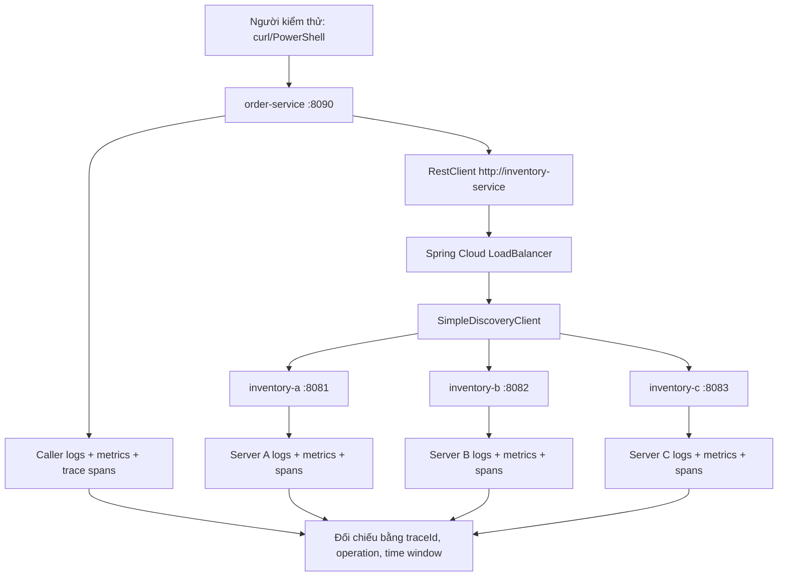
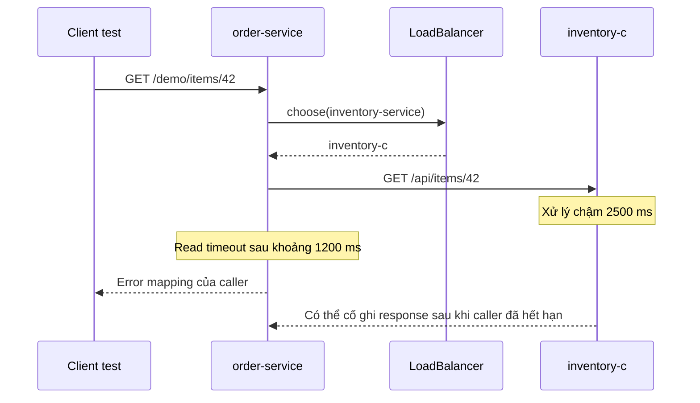
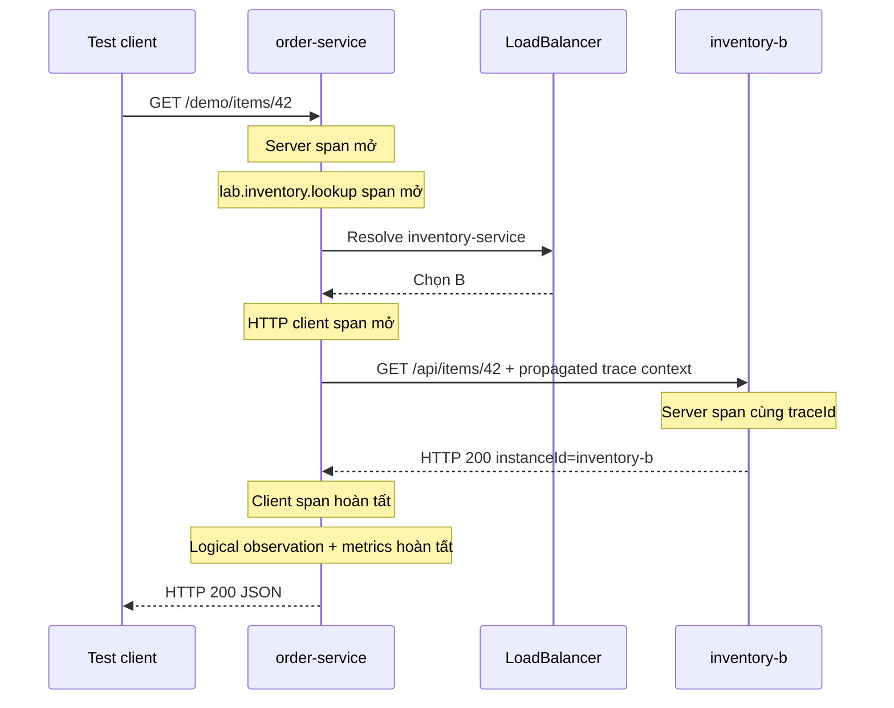

# Tổng hợp log, metrics, trace và đối chiếu kết quả thực nghiệm

Trong một hệ thống microservice, câu hỏi “vì sao người dùng thấy request chậm?” hiếm khi trả lời được bằng **một** dòng log, **một** biểu đồ hoặc **một** trace. Ví dụ, `order-service` gọi `inventory-service` bằng Spring Cloud LoadBalancer: lần đầu chọn replica A, lần thứ hai có thể chọn B, và một replica chậm có thể khiến caller timeout ngay cả khi server đã xử lý xong request. Nếu chỉ thấy HTTP `200` ở lần cuối, ta không biết đã có bao nhiêu attempts; nếu chỉ thấy metrics `5xx`, ta không biết instance nào gây lỗi; nếu chỉ thấy trace, ta có thể bỏ qua hàng nghìn request khác đang cùng gặp vấn đề.

Bài thực hành này hướng dẫn **tổng hợp log, metrics và distributed trace để đối chiếu bằng chứng**, thay vì đoán nguyên nhân từ một tín hiệu đơn lẻ. Chúng ta sử dụng một bên gọi `order-service`, ba bản sao `inventory-service`, danh sách `ServiceInstance` tĩnh từ `SimpleDiscoveryClient` và HTTP client `RestClient` được gắn `@LoadBalanced`. Các kịch bản có kiểm soát gồm đường đi bình thường, replica trả `503`, timeout, replica đã dừng, không còn instance hợp lệ và retry ở giai đoạn mở rộng.

Đây là bài thuộc chương **Thực hành tổng hợp** của module `SPRING_CLOUD_SERVICE_COMMUNICATION_LOAD_BALANCING`, với phạm vi Spring Cloud LoadBalancer chọn instance theo service ID, discovery, health check, định tuyến và giao tiếp bằng RestClient, WebClient, OpenFeign. `SPECIAL_NOTE` không có ràng buộc bổ sung. Các con số, tên instance và cấu hình trong bài là **dữ liệu học tập có chủ đích**, không phải thông số production mặc định.

## 1. Mục tiêu và sản phẩm cần bàn giao

Sau bài thực hành, bạn cần chứng minh được:

1. **Logs:** tìm được một lượt gọi từ `order-service` đến `inventory-service`, biết kết quả logic, status/exception và replica **báo cáo đã xử lý** nếu có response.
2. **Metrics:** đo được số logical calls, tỷ lệ thành công/lỗi, thời gian gọi, HTTP server requests và ảnh hưởng của các kịch bản lỗi, **không sử dụng request ID làm metric label**.
3. **Traces:** nối được inbound request đến `order-service`, client call ra inventory và inbound request tại replica thực sự nhận lời gọi bằng trace ID/parent-child spans khi tracing được cấu hình.
4. **Đối chiếu:** phân biệt `LoadBalancer không tìm thấy ServiceInstance`, `chọn được instance nhưng không kết nối được`, `upstream thật sự trả 503` và `decode/timeout ở client`.
5. **Thực nghiệm:** lập bảng giả thuyết → thao tác → bằng chứng trong cả ba nguồn → kết luận, kèm các giới hạn chưa thể suy ra.

Đầu ra tối thiểu:

- Ba replica inventory ở cổng `8081`, `8082`, `8083` và một caller ở `8090`.
- Một bộ log có `service`/`instanceId`, `operation`, `outcome`, `durationMs`, `traceId` nếu tracing bật.
- Snapshot metrics từ `/actuator/metrics` hoặc `/actuator/prometheus` ở caller và các replica.
- Ít nhất một trace hợp lệ có nhiều service spans khi OTLP collector/tracing backend đang hoạt động.
- Bảng kết quả của **ít nhất bốn kịch bản**, trong đó phải có một lỗi HTTP thực và một lỗi không có upstream response.

## 2. Kiến trúc: ba nguồn bằng chứng, một logical request



**Ba thuật ngữ bắt buộc phân biệt:**

| Khái niệm | Ý nghĩa | Ví dụ |
|---|---|---|
| **Logical call** | Một ý định nghiệp vụ gọi inventory từ caller. | Lấy tồn kho item `42` một lần. |
| **LoadBalancer selection** | Một lần chọn `ServiceInstance` từ danh sách ứng viên. | Chọn `localhost:8082`. |
| **HTTP attempt** | Một lượt cố gắng gửi/nhận HTTP qua transport. | Connect tới `:8082` rồi đọc response. |

Trong cấu hình cơ bản **không retry ở các tầng**, một logical call thường tương ứng một invocation từ gateway và một HTTP attempt. Khi bật retry ở gateway, OpenFeign, WebClient, Spring Cloud LoadBalancer hoặc proxy, các con số **có thể khác**. Không được dùng một counter đặt ở lớp business để khẳng định số attempts vật lý nếu transport còn retry bên dưới.

## 3. Logs, metrics và traces trả lời những câu hỏi khác nhau

| Nguồn | Đơn vị quan sát | Mạnh nhất ở đâu? | Không tự chứng minh |
|---|---|---|---|
| **Logs** | Sự kiện rời rạc có timestamp/context. | Chi tiết exception, service ID, replica ID, quyết định failover. | Xu hướng chung của toàn hệ thống nếu log bị sampling/thất lạc. |
| **Metrics** | Chuỗi thời gian tổng hợp (counter, timer, gauge...). | Tỷ lệ lỗi, phân bố latency, tốc độ retry, mức tải. | Một request cụ thể đi qua instance nào nếu không có trace/log. |
| **Distributed traces** | Một trace gồm nhiều spans có quan hệ. | Quan hệ caller → downstream và độ trễ tại từng hop. | Toàn bộ traffic khi sampling nhỏ hơn 100%; không thay thế metric. |

Một cách đọc hợp lý khi thấy p95 latency tăng: **metrics chỉ ra khi nào/tầm ảnh hưởng**, **trace chỉ ra hop chậm**, **log giúp giải thích trạng thái hoặc lỗi cụ thể**.

Chúng có thể mâu thuẫn bề ngoài mà vẫn đúng: inventory đã ghi “đã gửi 200”, nhưng order nhận timeout vì response đến sau deadline. Cần đối chiếu **thời điểm, ranh giới đo và vòng đời request**, không mặc định một nguồn sai.

## 4. Chuẩn hóa danh tính và schema trước khi chạy thử

Trong bài lab:

| Trường | Ví dụ | Lấy ở đâu? | Độ tin cậy |
|---|---|---|---|
| `callerService` | `order-service` | `spring.application.name` của caller. | Cấu hình runtime ứng dụng. |
| `targetService` | `inventory-service` | Service ID trong `RestClient.baseUrl`. | Ý định gọi, chưa chứng minh instance. |
| `instanceId` trên server | `inventory-b` | `app.instance-id` khi khởi chạy replica. | Do server cấu hình, hữu ích trong lab. |
| `selectedInstanceId` | Nếu có từ LB lifecycle. | `ServiceInstance` sau khi chọn. | Bằng chứng selection, không đồng nghĩa request đã tới server. |
| `reportedReplica` | `inventory-b` | Header/JSON response trả từ server. | Bằng chứng phía server tự khai; chỉ có nếu có response phù hợp. |
| `traceId` | 32 ký tự hex (thường gặp). | Tracing instrumentation. | Dùng để ghép spans/logs, không phải token xác thực. |
| `spanId` | 16 ký tự hex (thường gặp). | Tracing instrumentation. | Phân biệt span; khác nhau giữa caller/server. |
| `operation` | `GET /api/items/{id}` | Route template do code xác định. | Nhãn có cardinality thấp. |
| `outcome` | `success`, `http_status_error`, `transport_error`. | Phân loại tại điểm quan sát. | Phải kèm giai đoạn để không gây hiểu sai. |

**Không gắn raw URL, item ID, user ID, bearer token, cookie, traceId hoặc ephemeral Pod IP vào metric labels**. Những thông tin chi tiết này có thể làm tăng cardinality hoặc lộ dữ liệu. Dùng trace/log có quyền truy cập phù hợp cho truy vết request, metric aggregate dùng tập giá trị hữu hạn.

Một schema log mẫu:

```json
{
  "event": "logical_call_finished",
  "callerService": "order-service",
  "targetService": "inventory-service",
  "operation": "GET /api/items/{id}",
  "outcome": "success",
  "reportedReplica": "inventory-b",
  "durationMs": 41,
  "clientInvocations": 1,
  "traceId": "4bf92f3577b34da6a3ce929d0e0e4736"
}
```

Giá trị là **minh họa**, không phải một dòng bắt buộc được Spring Boot sinh tự động. Một ứng dụng có thể log thông điệp có cấu trúc và để logging framework thêm `timestamp`, `traceId`, `spanId` từ MDC.

## 5. Chuẩn bị công cụ và dự án

Bài có thể thực hiện trên máy cá nhân với JDK 17+, Maven, bốn terminal, `curl` hoặc PowerShell. Để minh họa API nhất quán, ta dùng cặp phiên bản Spring Boot **3.4.3** và Spring Cloud **2024.0.1**. Đây là **cặp phiên bản tái hiện ví dụ**, không có nghĩa là phiên bản mới nhất; khi áp dụng dự án thật, phải chọn Boot/Cloud BOM tương thích.

Mỗi ứng dụng cần:

- `spring-boot-starter-web`: controller HTTP Spring MVC.
- `spring-boot-starter-actuator`: endpoint metrics/health và nền tảng Micrometer Observation.
- `micrometer-registry-prometheus`: xuất metrics định dạng Prometheus tại `/actuator/prometheus`.
- `micrometer-tracing-bridge-otel` và `opentelemetry-exporter-otlp`: chuyển observations thành OpenTelemetry spans và xuất qua OTLP khi receiver có sẵn.
- Riêng **order-service** thêm `spring-cloud-starter-loadbalancer` và Spring Cloud BOM.

Tracing backend như Jaeger/Tempo/OTel Collector là **tùy chọn để xem trace trên UI**, nhưng cần một OTLP receiver để thu thập spans ngoài process. Nếu chỉ có ứng dụng mà chưa có backend, bạn vẫn có thể quan sát log MDC và metrics; đừng tuyên bố “đã xuất trace thành công” khi collector chưa nhận spans.

### Cấu trúc hai ứng dụng

```text
observability-lab/
├── inventory-replica/
│   ├── pom.xml
│   └── src/main/
│       ├── java/com/example/inventory/
│       │   ├── InventoryApplication.java
│       │   └── InventoryController.java
│       └── resources/application.yml
└── order-caller/
    ├── pom.xml
    └── src/main/
        ├── java/com/example/order/
        │   ├── OrderApplication.java
        │   ├── InventoryClientConfig.java
        │   ├── InventoryReply.java
        │   ├── InventoryGateway.java
        │   ├── DemoController.java
        │   └── DownstreamErrorAdvice.java
        └── resources/application.yml
```

Đây là **các file dự án mẫu để người học tự tạo**, không phải yêu cầu tạo thêm file trong module kiến thức đang chứa bài học này.

## 6. Thêm dependencies quan sát vào inventory-replica

Tạo `inventory-replica/pom.xml`:

```xml
<?xml version="1.0" encoding="UTF-8"?>
<project xmlns="http://maven.apache.org/POM/4.0.0"
         xmlns:xsi="http://www.w3.org/2001/XMLSchema-instance"
         xsi:schemaLocation="http://maven.apache.org/POM/4.0.0
         https://maven.apache.org/xsd/maven-4.0.0.xsd">
    <modelVersion>4.0.0</modelVersion>

    <parent>
        <groupId>org.springframework.boot</groupId>
        <artifactId>spring-boot-starter-parent</artifactId>
        <version>3.4.3</version>
        <relativePath/>
    </parent>

    <groupId>com.example</groupId>
    <artifactId>inventory-replica</artifactId>
    <version>0.0.1-SNAPSHOT</version>

    <properties>
        <java.version>17</java.version>
    </properties>

    <dependencies>
        <dependency>
            <groupId>org.springframework.boot</groupId>
            <artifactId>spring-boot-starter-web</artifactId>
        </dependency>
        <dependency>
            <groupId>org.springframework.boot</groupId>
            <artifactId>spring-boot-starter-actuator</artifactId>
        </dependency>
        <dependency>
            <groupId>io.micrometer</groupId>
            <artifactId>micrometer-registry-prometheus</artifactId>
        </dependency>
        <dependency>
            <groupId>io.micrometer</groupId>
            <artifactId>micrometer-tracing-bridge-otel</artifactId>
        </dependency>
        <dependency>
            <groupId>io.opentelemetry</groupId>
            <artifactId>opentelemetry-exporter-otlp</artifactId>
        </dependency>
    </dependencies>

    <build>
        <plugins>
            <plugin>
                <groupId>org.springframework.boot</groupId>
                <artifactId>spring-boot-maven-plugin</artifactId>
            </plugin>
        </plugins>
    </build>
</project>
```

Boot dependency management cung cấp versions tương thích cho các dependencies không ghi version ở trên. Nếu sử dụng tracing bridge khác (Brave thay cho OpenTelemetry), không thêm đồng thời nhiều bridge mà không có lý do rõ ràng; propagation và exporter cần nhất quán trong bài lab.

### Lớp khởi động inventory

`src/main/java/com/example/inventory/InventoryApplication.java`:

```java
package com.example.inventory;

import org.springframework.boot.SpringApplication;
import org.springframework.boot.autoconfigure.SpringBootApplication;

@SpringBootApplication
public class InventoryApplication {

    public static void main(String[] args) {
        SpringApplication.run(InventoryApplication.class, args);
    }
}
```

### Controller trả ID và có chế độ fault injection

`src/main/java/com/example/inventory/InventoryController.java`:

```java
package com.example.inventory;

import org.slf4j.Logger;
import org.slf4j.LoggerFactory;
import org.springframework.beans.factory.annotation.Value;
import org.springframework.http.ResponseEntity;
import org.springframework.web.bind.annotation.GetMapping;
import org.springframework.web.bind.annotation.PathVariable;
import org.springframework.web.bind.annotation.RestController;

@RestController
public class InventoryController {

    private static final Logger log =
        LoggerFactory.getLogger(InventoryController.class);

    private final String instanceId;
    private final String faultMode;

    public InventoryController(
            @Value("${app.instance-id}") String instanceId,
            @Value("${app.fault-mode:none}") String faultMode) {
        this.instanceId = instanceId;
        this.faultMode = faultMode;
    }

    @GetMapping("/api/items/{itemId}")
    public ResponseEntity<InventoryReply> findItem(
            @PathVariable String itemId) {

        log.info(
            "event=inbound_inventory_call instanceId={} operation={} faultMode={}",
            instanceId, "GET /api/items/{id}", faultMode);

        if ("slow".equals(faultMode)) {
            try {
                Thread.sleep(2500);
            } catch (InterruptedException ex) {
                Thread.currentThread().interrupt();
                throw new IllegalStateException(
                    "Interrupted during test delay", ex);
            }
        }

        if ("http503".equals(faultMode)) {
            log.warn(
                "event=inventory_response instanceId={} httpStatus=503",
                instanceId);
            return ResponseEntity.status(503)
                .header("X-Lab-Instance", instanceId)
                .body(new InventoryReply(itemId, 0, instanceId));
        }

        log.info(
            "event=inventory_response instanceId={} httpStatus=200",
            instanceId);
        return ResponseEntity.ok()
            .header("X-Lab-Instance", instanceId)
            .body(new InventoryReply(itemId, 17, instanceId));
    }

    public record InventoryReply(
        String itemId, int stock, String instanceId) {}
}
```

`Thread.sleep(2500)` chỉ dùng trong **fault injection trên Spring MVC test service**; không đưa sleep cố ý vào luồng production hoặc Reactor Netty event loop. `X-Lab-Instance` được server trả để hỗ trợ đối chiếu trong môi trường nội bộ; **không đưa ID Pod/host hoặc topology chi tiết ra API công khai**.

Ba process có thể chạy cùng artifact JAR nhưng mang `app.instance-id`/`app.fault-mode` khác nhau. Trong baseline cả ba dùng `fault-mode=none`.

## 7. Cấu hình Actuator, tracing và structured logging ở inventory

Tạo `inventory-replica/src/main/resources/application.yml`:

```yaml
spring:
  application:
    name: inventory-service

server:
  port: 8081

app:
  instance-id: inventory-a
  fault-mode: none

management:
  endpoints:
    web:
      exposure:
        include: health,info,metrics,prometheus
  tracing:
    sampling:
      probability: 1.0
  otlp:
    tracing:
      endpoint: http://localhost:4318/v1/traces

logging:
  structured:
    format:
      console: logstash
```

Trong ví dụ Spring Boot 3.4.x, structured console logging giúp mỗi event trở thành log JSON; khi tracing integration hoạt động, MDC có thể chứa `traceId`/`spanId`. **Kiểm tra log thực tế**: nếu không thấy ID, chưa chắc propagation đã được bật hoặc các logging customizers đang giữ nguyên context.

`management.tracing.sampling.probability=1.0` chỉ dành cho **môi trường test có lưu lượng nhỏ** để dễ đối chiếu traces. Production thường không thu 100% traces vì chi phí, dữ liệu nhạy cảm và cardinality. Endpoint OTLP giả định một receiver lắng nghe tại `localhost:4318` trên cùng host; cần thay URI theo topology nếu ứng dụng và collector nằm trong containers khác nhau.

Trong bài lab, Actuator metrics và `/actuator/prometheus` chỉ nên truy cập từ loopback/mạng kiểm soát. Đừng expose toàn bộ management endpoints ra Internet chỉ để thu thập bằng chứng.

## 8. Dựng order-caller: RestClient có observation và metrics riêng

### Maven POM của caller

Tạo `order-caller/pom.xml`:

```xml
<?xml version="1.0" encoding="UTF-8"?>
<project xmlns="http://maven.apache.org/POM/4.0.0"
         xmlns:xsi="http://www.w3.org/2001/XMLSchema-instance"
         xsi:schemaLocation="http://maven.apache.org/POM/4.0.0
         https://maven.apache.org/xsd/maven-4.0.0.xsd">
    <modelVersion>4.0.0</modelVersion>

    <parent>
        <groupId>org.springframework.boot</groupId>
        <artifactId>spring-boot-starter-parent</artifactId>
        <version>3.4.3</version>
        <relativePath/>
    </parent>

    <groupId>com.example</groupId>
    <artifactId>order-caller</artifactId>
    <version>0.0.1-SNAPSHOT</version>

    <properties>
        <java.version>17</java.version>
        <spring-cloud.version>2024.0.1</spring-cloud.version>
    </properties>

    <dependencyManagement>
        <dependencies>
            <dependency>
                <groupId>org.springframework.cloud</groupId>
                <artifactId>spring-cloud-dependencies</artifactId>
                <version>${spring-cloud.version}</version>
                <type>pom</type>
                <scope>import</scope>
            </dependency>
        </dependencies>
    </dependencyManagement>

    <dependencies>
        <dependency>
            <groupId>org.springframework.boot</groupId>
            <artifactId>spring-boot-starter-web</artifactId>
        </dependency>
        <dependency>
            <groupId>org.springframework.boot</groupId>
            <artifactId>spring-boot-starter-actuator</artifactId>
        </dependency>
        <dependency>
            <groupId>org.springframework.cloud</groupId>
            <artifactId>spring-cloud-starter-loadbalancer</artifactId>
        </dependency>
        <dependency>
            <groupId>io.micrometer</groupId>
            <artifactId>micrometer-registry-prometheus</artifactId>
        </dependency>
        <dependency>
            <groupId>io.micrometer</groupId>
            <artifactId>micrometer-tracing-bridge-otel</artifactId>
        </dependency>
        <dependency>
            <groupId>io.opentelemetry</groupId>
            <artifactId>opentelemetry-exporter-otlp</artifactId>
        </dependency>
    </dependencies>

    <build>
        <plugins>
            <plugin>
                <groupId>org.springframework.boot</groupId>
                <artifactId>spring-boot-maven-plugin</artifactId>
            </plugin>
        </plugins>
    </build>
</project>
```

### Lớp khởi động

`order-caller/src/main/java/com/example/order/OrderApplication.java`:

```java
package com.example.order;

import org.springframework.boot.SpringApplication;
import org.springframework.boot.autoconfigure.SpringBootApplication;

@SpringBootApplication
public class OrderApplication {

    public static void main(String[] args) {
        SpringApplication.run(OrderApplication.class, args);
    }
}
```

### Cấu hình SimpleDiscoveryClient và tracing

`order-caller/src/main/resources/application.yml`:

```yaml
spring:
  application:
    name: order-service
  cloud:
    discovery:
      client:
        simple:
          instances:
            inventory-service:
              - uri: http://localhost:8081
              - uri: http://localhost:8082
              - uri: http://localhost:8083

server:
  port: 8090

management:
  endpoints:
    web:
      exposure:
        include: health,info,metrics,prometheus
  tracing:
    sampling:
      probability: 1.0
  otlp:
    tracing:
      endpoint: http://localhost:4318/v1/traces

logging:
  structured:
    format:
      console: logstash
```

`SimpleDiscoveryClient` trong lab cung cấp ba URI tĩnh cho **cùng service ID**. Nó không tự loại instance vừa tắt nếu không có health supplier/refresh được cấu hình. Đừng coi danh sách YAML là dữ liệu khám phá động giống Eureka, Consul hay Kubernetes.

### Bean RestClient và ObservationRegistry

Tạo `order-caller/src/main/java/com/example/order/InventoryClientConfig.java`:

```java
package com.example.order;

import io.micrometer.observation.ObservationRegistry;
import org.springframework.cloud.client.loadbalancer.LoadBalanced;
import org.springframework.context.annotation.Bean;
import org.springframework.context.annotation.Configuration;
import org.springframework.http.client.SimpleClientHttpRequestFactory;
import org.springframework.web.client.RestClient;

@Configuration
public class InventoryClientConfig {

    @Bean
    @LoadBalanced
    RestClient.Builder loadBalancedRestClientBuilder(
            ObservationRegistry observationRegistry) {
        return RestClient.builder()
            .observationRegistry(observationRegistry);
    }

    @Bean
    RestClient inventoryRestClient(
            @LoadBalanced RestClient.Builder builder) {

        SimpleClientHttpRequestFactory requestFactory =
            new SimpleClientHttpRequestFactory();
        requestFactory.setConnectTimeout(800);
        requestFactory.setReadTimeout(1200);

        return builder.clone()
            .baseUrl("http://inventory-service")
            .requestFactory(requestFactory)
            .build();
    }
}
```

Ở đây, `@LoadBalanced` tích hợp việc chọn `ServiceInstance`. `ObservationRegistry` gắn HTTP client observations để có thể sinh metrics/tracing khi các handlers tương ứng hoạt động. Tạo `RestClient.builder()` thuần túy mà không có observation registry/customizer cần thiết có thể làm thiếu client instrumentation. Trong dự án thật, nên dùng cấu hình tự động của Spring Boot phù hợp hoặc đảm bảo builder tùy chỉnh giữ Observation instrumentation.

`SimpleClientHttpRequestFactory` chỉ phù hợp để **minh họa timeout** trong lab, không phải khuyến nghị HTTP pool cho production. `connectTimeout`/`readTimeout` là giới hạn ở transport; chúng không mặc nhiên giới hạn tổng thời gian logical request nếu thêm retry/backoff.

## 9. Viết gateway ghi logical outcome và custom metrics

Tạo DTO `order-caller/src/main/java/com/example/order/InventoryReply.java`:

```java
package com.example.order;

public record InventoryReply(
    String itemId, int stock, String instanceId) {}
```

Tạo `order-caller/src/main/java/com/example/order/InventoryGateway.java`:

```java
package com.example.order;

import java.util.concurrent.TimeUnit;
import io.micrometer.core.instrument.MeterRegistry;
import io.micrometer.core.instrument.Timer;
import io.micrometer.observation.Observation;
import io.micrometer.observation.ObservationRegistry;
import org.slf4j.Logger;
import org.slf4j.LoggerFactory;
import org.springframework.stereotype.Service;
import org.springframework.web.client.ResourceAccessException;
import org.springframework.web.client.RestClient;
import org.springframework.web.client.RestClientResponseException;

@Service
public class InventoryGateway {

    private static final Logger log =
        LoggerFactory.getLogger(InventoryGateway.class);

    private static final String TARGET = "inventory-service";

    private final RestClient client;
    private final MeterRegistry meters;
    private final ObservationRegistry observations;

    public InventoryGateway(
            RestClient inventoryRestClient,
            MeterRegistry meters,
            ObservationRegistry observations) {
        this.client = inventoryRestClient;
        this.meters = meters;
        this.observations = observations;
    }

    public InventoryReply findItem(String id) {
        long started = System.nanoTime();
        String outcome = "success";

        Observation observation =
            Observation.createNotStarted(
                "lab.inventory.lookup", observations)
                .lowCardinalityKeyValue("target.service", TARGET)
                .start();

        try (Observation.Scope ignored = observation.openScope()) {
            // Đếm lời gọi vào RestClient tại gateway này.
            // Không mặc nhiên đồng nhất với HTTP attempts vật lý.
            meters.counter(
                "lab.outbound.client.invocations",
                "target.service", TARGET).increment();

            InventoryReply reply = client.get()
                .uri("/api/items/{id}", id)
                .retrieve()
                .body(InventoryReply.class);

            if (reply == null) {
                throw new IllegalStateException(
                    "Inventory response body is empty");
            }

            log.info(
                "event=logical_call_finished targetService={} " +
                "operation={} outcome=success reportedReplica={} durationMs={}",
                TARGET, "GET /api/items/{id}",
                reply.instanceId(), elapsedMs(started));

            return reply;
        } catch (RestClientResponseException ex) {
            outcome = "http_status_error";
            observation.error(ex);
            log.warn(
                "event=logical_call_finished targetService={} " +
                "outcome={} clientStatus={} durationMs={}",
                TARGET, outcome, ex.getStatusCode().value(),
                elapsedMs(started));
            throw ex;
        } catch (ResourceAccessException ex) {
            outcome = "transport_error";
            observation.error(ex);
            log.warn(
                "event=logical_call_finished targetService={} " +
                "outcome={} exceptionType={} durationMs={}",
                TARGET, outcome, ex.getClass().getSimpleName(),
                elapsedMs(started));
            throw ex;
        } catch (RuntimeException ex) {
            outcome = "other_error";
            observation.error(ex);
            log.warn(
                "event=logical_call_finished targetService={} " +
                "outcome={} exceptionType={} durationMs={}",
                TARGET, outcome, ex.getClass().getSimpleName(),
                elapsedMs(started));
            throw ex;
        } finally {
            observation.lowCardinalityKeyValue("outcome", outcome);
            observation.stop();

            meters.counter(
                "lab.outbound.logical.calls",
                "target.service", TARGET,
                "outcome", outcome).increment();

            Timer.builder("lab.outbound.logical.duration")
                .tag("target.service", TARGET)
                .tag("outcome", outcome)
                .register(meters)
                .record(System.nanoTime() - started,
                    TimeUnit.NANOSECONDS);
        }
    }

    private static long elapsedMs(long started) {
        return TimeUnit.NANOSECONDS.toMillis(
            System.nanoTime() - started);
    }
}
```

Đoạn mã cố ý tách:

- `lab.outbound.client.invocations`: số lần gateway gọi vào RestClient, **không nhất thiết** số HTTP attempts nếu tầng thấp tự retry.
- `lab.outbound.logical.calls`: số lượt kết thúc logical call được ghi ở `finally`, phân theo `outcome`.
- `lab.outbound.logical.duration`: thời gian của lời gọi từ góc nhìn gateway, bao gồm bước chọn instance, HTTP I/O và decode cho lời gọi ở đây.
- `lab.inventory.lookup`: một custom Observation bao quanh logical call; có thể được xuất thành span khi tracing bridge hoạt động.

Các tên `lab.*` là **metric/observation do ứng dụng tạo**, khác các tên metric HTTP tự động của Spring Boot. Không đưa `itemId`, instance ID hoặc trace ID vào tags. Trong trường hợp `RestClientResponseException` mang status `503`, ví dụ này ghi `clientStatus=503` nhưng **chưa chứng minh status đó do upstream thật phát ra**: integration LoadBalancer cũng có thể tạo lỗi tương đương khi không chọn được instance. Muốn xác nhận nguồn, đối chiếu server log/trace và instrument tại bước selection.

## 10. Expose endpoint demo và phản hồi lỗi rõ nghĩa

`order-caller/src/main/java/com/example/order/DemoController.java`:

```java
package com.example.order;

import org.springframework.web.bind.annotation.GetMapping;
import org.springframework.web.bind.annotation.PathVariable;
import org.springframework.web.bind.annotation.RestController;

@RestController
public class DemoController {

    private final InventoryGateway inventoryGateway;

    public DemoController(InventoryGateway inventoryGateway) {
        this.inventoryGateway = inventoryGateway;
    }

    @GetMapping("/demo/items/{itemId}")
    public InventoryReply item(@PathVariable String itemId) {
        return inventoryGateway.findItem(itemId);
    }
}
```

Nếu exception từ RestClient không được xử lý, caller có thể trả lỗi mặc định không hữu ích. Để bài lab không rò URL/stack trace cho client ngoài, thêm một response mapping đơn giản:

`order-caller/src/main/java/com/example/order/DownstreamErrorAdvice.java`:

```java
package com.example.order;

import org.springframework.http.HttpStatus;
import org.springframework.http.ProblemDetail;
import org.springframework.http.ResponseEntity;
import org.springframework.web.bind.annotation.ExceptionHandler;
import org.springframework.web.bind.annotation.RestControllerAdvice;
import org.springframework.web.client.RestClientException;

@RestControllerAdvice
public class DownstreamErrorAdvice {

    @ExceptionHandler(RestClientException.class)
    ResponseEntity<ProblemDetail> dependencyUnavailable(
            RestClientException ignored) {

        ProblemDetail detail = ProblemDetail.forStatusAndDetail(
            HttpStatus.BAD_GATEWAY,
            "Inventory dependency call did not complete.");
        return ResponseEntity.status(HttpStatus.BAD_GATEWAY)
            .body(detail);
    }
}
```

Caller trả `502 Bad Gateway` để biểu thị không thể hoàn thành phụ thuộc trong **hợp đồng API minh họa**. Điều này **không có nghĩa upstream đã trả 502**; upstream có thể trả 503, caller timeout, hoặc gặp lỗi ở bước LoadBalancer. Để biết nguyên nhân thật, nhìn **gateway log/metric/traces và log server**. Một ứng dụng production nên phân loại chi tiết hơn và tuân thủ error contract của nó; không dùng `502` cho mọi loại lỗi nghiệp vụ.

## 11. Khởi chạy tracing backend (tùy chọn) và bốn ứng dụng

Để quan sát trace trên giao diện, dùng một backend nhận **OTLP HTTP** và có UI tìm trace, ví dụ Jaeger hoặc Tempo đi kèm trace viewer. Nếu chọn Jaeger all-in-one phiên bản 1.x có OTLP support, một lệnh minh họa:

```bash
docker run --rm --name lb-lab-jaeger \
  -e COLLECTOR_OTLP_ENABLED=true \
  -p 16686:16686 \
  -p 4318:4318 \
  jaegertracing/all-in-one:1.62.0
```

Lệnh trên **chỉ là cấu hình thực hành**: cần bảo đảm image/tag và cổng được hỗ trợ ở môi trường Docker của bạn. Không chạy nhiều collectors tranh cùng cổng `4318`. Nếu đã có OpenTelemetry Collector/Tempo, có thể giữ backend hiện tại và đổi `management.otlp.tracing.endpoint` cho phù hợp. Nếu không có backend, bỏ qua bước xem UI; vẫn làm được phép đối chiếu logs và metrics.

Trong hai thư mục Maven tương ứng, build:

```bash
mvn -DskipTests package
```

Đứng tại thư mục `inventory-replica`, mở ba terminal riêng:

**Replica A:**

```bash
java -jar target/inventory-replica-0.0.1-SNAPSHOT.jar \
  --server.port=8081 \
  --app.instance-id=inventory-a \
  --app.fault-mode=none
```

**Replica B:**

```bash
java -jar target/inventory-replica-0.0.1-SNAPSHOT.jar \
  --server.port=8082 \
  --app.instance-id=inventory-b \
  --app.fault-mode=none
```

**Replica C:**

```bash
java -jar target/inventory-replica-0.0.1-SNAPSHOT.jar \
  --server.port=8083 \
  --app.instance-id=inventory-c \
  --app.fault-mode=none
```

Đứng tại `order-caller`, mở terminal thứ tư:

```bash
java -jar target/order-caller-0.0.1-SNAPSHOT.jar
```

Cú pháp nối dòng `\` ở trên dành cho Bash/sh. Trên Windows PowerShell, dùng lệnh `java -jar ... --server.port=... --app.instance-id=...` trên **một dòng** trong mỗi terminal. `localhost` chỉ đúng khi bốn process chạy trên cùng host/network; trong Docker, `localhost` của container caller không trỏ tới container inventory.

Xác minh nhanh:

```bash
curl -i http://localhost:8081/api/items/42
curl -i http://localhost:8082/api/items/42
curl -i http://localhost:8083/api/items/42
curl -i http://localhost:8090/actuator/health
```

Trước khi bấm chạy thí nghiệm, cả ba inventory endpoints phải trả `instanceId` đúng và caller phải đang chạy. Nếu trace backend có sẵn, kiểm tra thêm receiver/UI không báo lỗi export; nếu không có backend, **không xem lỗi export là kết quả của LoadBalancer**.

## 12. Bài thử 1 — Baseline: ba replica đều khỏe

Gửi 12 lời gọi **tuần tự** qua caller:

```bash
for i in $(seq 1 12); do
  curl -sS -w ' callerStatus=%{http_code}\n' \
    http://localhost:8090/demo/items/42
done
```

PowerShell:

```powershell
1..12 | ForEach-Object {
    (Invoke-RestMethod "http://localhost:8090/demo/items/42").instanceId
} | Group-Object | Select-Object Name, Count
```

Khi danh sách instance ổn định, chỉ có một caller và đang dùng round robin mặc định, bạn thường thấy cả A/B/C được chọn; một phân bố 4–4–4 là **kết quả minh họa**, không phải lời hứa về thứ tự vòng đầu hay sự cân bằng CPU thực tế.

### Đối chiếu ba nguồn bằng chứng

**Logs:** tại order, tìm `event=logical_call_finished`, `targetService=inventory-service`, `outcome=success`, `reportedReplica=inventory-a/b/c` và thời gian. Tại inventory, tìm `event=inbound_inventory_call`/`inventory_response` tương ứng.

**Metrics:** kiểm tra số lượt thành công của custom counter:

```bash
curl -s http://localhost:8090/actuator/metrics/lab.outbound.logical.calls
curl -s http://localhost:8090/actuator/metrics/lab.outbound.logical.duration
curl -s http://localhost:8090/actuator/metrics/http.client.requests
curl -s http://localhost:8090/actuator/metrics/http.server.requests
```

Thử các metrics phía inventory:

```bash
curl -s http://localhost:8081/actuator/metrics/http.server.requests
curl -s http://localhost:8082/actuator/metrics/http.server.requests
curl -s http://localhost:8083/actuator/metrics/http.server.requests
```

`/actuator/metrics/<name>` hiển thị meter cụ thể đã được đăng ký sau khi có traffic; `/actuator/prometheus` xuất các time series với cách chuyển tên/nhãn theo Prometheus. Tên metric HTTP phụ thuộc phiên bản và instrumentation đang thực sự có; nếu `http.client.requests` không xuất hiện, kiểm tra ObservationRegistry/builder/Actuator thay vì tự tạo dữ liệu giả.

**Traces:** tìm service `order-service` trong tracing UI, chọn một trace của `GET /demo/items/{id}`. Nếu instrumentation/propagation hoạt động, trace có thể chứa:

```text
order-service: HTTP SERVER  GET /demo/items/{id}
  └── order-service: lab.inventory.lookup
        └── order-service: HTTP CLIENT GET inventory-service
              └── inventory-service: HTTP SERVER GET /api/items/{id}
```

Tên span cụ thể có thể khác theo instrumentation/version. Điều quan trọng là **trace ID xuyên hai service**, quan hệ parent-child hợp lý và duration của các spans; `spanId` của client/server khác nhau là bình thường.

### Cách diễn giải baseline

Nếu order có 12 custom logical calls thành công nhưng tổng metrics `http.server.requests` ở ba inventory replica lớn hơn 12, kiểm tra có requests trực tiếp để test health, probes, thao tác kiểm tra khác hoặc retry bị bật ngầm. Đừng kết luận LoadBalancer gửi trùng request chỉ từ aggregate counters chưa lọc đúng route/time window.

## 13. Bài thử 2 — Bản sao B trả HTTP 503 thật

Dừng **chỉ** process B và chạy lại cùng port `8082` với:

```bash
java -jar target/inventory-replica-0.0.1-SNAPSHOT.jar \
  --server.port=8082 \
  --app.instance-id=inventory-b \
  --app.fault-mode=http503
```

A và C vẫn ở `fault-mode=none`. Gửi nhiều request đến caller và quan sát một phần request có thể lỗi khi LoadBalancer chọn B; các request vào A/C có thể thành công. Không bật retry để dễ diễn giải baseline.

| Nguồn | Bằng chứng cần thấy | Điều không nên suy ra |
|---|---|---|
| **Order logs** | `clientStatus=503` và `outcome=http_status_error` ở một số logical calls. | Không chỉ từ status mà khẳng định mọi `503` đều do upstream B. |
| **Inventory B logs** | `event=inventory_response`, `instanceId=inventory-b`, `httpStatus=503`. | Không phải no-instance: B đã chạy và trả response. |
| **Inventory B metrics** | HTTP server requests cho route với `status=503` tăng. | Tổng metric có thể chứa traffic từ các lần thử khác. |
| **Trace** | Có đường client → server B nếu trace được sample/export; upstream span có kết quả lỗi/status theo instrumentation. | Span error flag không phải lúc nào cũng có cùng mapping với HTTP 503. |

Caller có thể trả **HTTP 502** bởi `DownstreamErrorAdvice`, trong khi **upstream B trả 503**. Hai status này thuộc **hai HTTP hops khác nhau**, không mâu thuẫn.

Đây là bằng chứng mạnh hơn việc chỉ thấy `order-service 502`: phía server B thực sự có access/request log và metric 503 trùng thời gian/trace.

## 14. Bài thử 3 — Replica C phản hồi chậm hơn read timeout

Dừng và khởi động lại C với `--app.fault-mode=slow`:

```bash
java -jar target/inventory-replica-0.0.1-SNAPSHOT.jar \
  --server.port=8083 \
  --app.instance-id=inventory-c \
  --app.fault-mode=slow
```

Controller C sleep khoảng 2.500 ms, trong khi caller đã đặt `readTimeout=1.200ms`. Khi LoadBalancer chọn C, caller có thể gặp timeout/transport error **trước khi C trả response**.



Những điều cần kiểm chứng:

- **Logs caller:** outcome `transport_error` (hoặc loại exception cụ thể mà HTTP engine trả), duration gần timeout cộng overhead; có thể không có upstream HTTP status.
- **Logs server C:** request đã đến C; server có thể ghi tiếp `inventory_response 200` sau khi caller timeout, hoặc gặp lỗi khi ghi response xuống socket đã đóng.
- **Metrics:** thời gian client/logic tăng; lỗi ở caller, trong khi server metric có thể báo status/latency khác do đo ở ranh giới khác.
- **Trace:** client span có thể kết thúc trước server span; trace viewer có thể hiển thị sự chồng lắp hoặc span server hoàn thành muộn.

**Kết luận quan trọng:** “caller timeout” không có nghĩa “upstream chưa xử lý request”. Đặc biệt với `POST`/`PATCH` có side effect, retry phải có idempotency/dedup phù hợp.

Không nên giải quyết bài toán này chỉ bằng việc tăng mọi timeout. Cần xem năng lực downstream, deadline nghiệp vụ, giới hạn đồng thời, pooling và chính sách retry.

## 15. Bài thử 4 — Chọn instance tồn tại nhưng process đã dừng

Dừng B hoàn toàn, giữ `SimpleDiscoveryClient` của caller không đổi, không restart order. Lúc này source tĩnh vẫn có URI `http://localhost:8082`.

Khi thuật toán chọn B:

1. **LoadBalancer có thể chọn B thành công** vì B vẫn nằm trong danh sách.
2. **HTTP transport có thể không kết nối được** và ném connection refused/reset.
3. **Không có inventory B inbound request log mới** vì B không chạy.
4. **Caller có lỗi** và có thể trả 502 theo ErrorAdvice; điều đó **không** chứng minh upstream B trả status 502/503.

So sánh với bài thử 2:

| Bài thử | Có process B lắng nghe? | Có HTTP response từ B? | Evidence chính |
|---|---|---|---|
| B trả `503` | Có. | Có, status 503. | Server B logs/metrics/traces. |
| B bị dừng | Không. | Thường không có. | Client connection error, không có server request mới. |

Nếu caller dùng connection pool, một socket giữ lâu có thể tạo lỗi reset thay vì connection refused; vẫn là **lỗi transport**. Discovery tĩnh không tự loại một URI theo health dù server có `/actuator/health`; cần bật/config health filtering hoặc registry động ở bài mở rộng.

## 16. Bài thử 5 — Không có ServiceInstance hợp lệ

Để phân biệt với process đã dừng, tạo một tình huống riêng trong môi trường test: tạm thời xóa cả ba entries dưới `spring.cloud.discovery.client.simple.instances.inventory-service` của caller rồi restart order, hoặc dùng một bean supplier test trả `List.of()` cho service ID.

Với danh sách rỗng:

- LoadBalancer không thể chọn `ServiceInstance`.
- Không có HTTP request thực tới A/B/C từ lời gọi này.
- Adapter có thể trả exception hoặc response/status tổng hợp, tùy phiên bản. **Một status 503 nhìn thấy ở client không tự chứng minh server inventory nào đã trả 503**.
- Server metrics và logs của các replica **không tăng** từ lần gọi này.

Nên instrument LoadBalancer lifecycle/Observation ở **đúng phiên bản đang chạy** để ghi `selection_failed`/`no_eligible_instance` và `targetService`. Không gán bừa `selectedInstanceId=inventory-a` khi chưa chọn được instance. Nếu ứng dụng chưa có hook này, có thể kết luận từ danh sách supplier rỗng + không request nào đến server, nhưng chưa thể khẳng định trace đã ghi đầy đủ giai đoạn selection.

Sau khi hoàn tất, **khôi phục đủ ba URI** và restart caller. Không để cấu hình thử lỗi thành giá trị mặc định của nhóm.

## 17. Bài thử 6 — Bật retry rồi đo amplification

Trong các kịch bản trước, gateway thực hiện một `RestClient` invocation. Để kiểm tra retry, hãy thêm một policy **có chủ sở hữu rõ** ở tầng gọi (ví dụ một wrapper Spring Retry/Resilience4j) chỉ áp dụng cho GET an toàn và lỗi tạm thời; giới hạn tối đa **ba HTTP attempts** gồm lần đầu và hai retry, có backoff+jitter và **deadline tổng**. Không retry mọi `4xx`, `413`, lỗi phân quyền hoặc lỗi decode không thể tự phục hồi.

Ví dụ logic thiết kế (pseudocode, **không phải đoạn Java chạy độc lập**):

```text
logicalId = một ID ổn định của thao tác GET
deadline = now + 2s

for attemptNumber in 1..3:
    if deadline expired: stop
    record attempt_started
    try:
        RestClient GET via inventory-service
        record actual outcome and selected instance if known
        return result
    catch retryable transport/selected HTTP errors:
        if attemptNumber == 3: stop
        bounded exponential backoff + jitter
        continue

record logical_call_finished
```

Nếu triển khai retry **bên trong** HTTP client hoặc LoadBalancer, phải chuyển bộ đếm attempts và log sang chính tầng đó; `lab.outbound.client.invocations` ở `InventoryGateway` **không đủ** để biết số HTTP attempts dưới transport. Nếu retry wrapper nằm **ngoài** `InventoryGateway`, gateway có thể bị gọi nhiều lần cho một logical operation cao hơn, nên cách đếm logical request cũng phải dời ra ngoài wrapper.

### Đối chiếu dữ liệu khi retry

| Chỉ số | Không retry | Có retry |
|---|---|---|
| Logical requests | Số thao tác nghiệp vụ. | Phải giữ nguyên ở cùng traffic test. |
| Client invocations | Gần bằng số logical calls ở baseline. | Tăng nếu retry đặt ngoài gateway; có thể không tăng nếu retry nằm bên trong. |
| HTTP attempts thật | Thường một mỗi logical call trong baseline không có retry. | Có thể nhiều lần cho mỗi logical call. |
| Selected instances | Một lựa chọn khi không retry và không route khác. | Có thể chọn lại **cùng** hoặc **khác** instance. |
| Latency p95/p99 | Không có thêm backoff. | Có thể tăng do attempts/backoff. |
| Tải downstream | Traffic gốc. | Có thể tăng; đo request counts tại replica. |

Nếu retry cải thiện tỷ lệ thành công nhưng làm tăng p99 và requests/second ở upstream đến mức mất ổn định, không thể gọi đó là “cải thiện toàn diện”. Cần cân nhắc retry budget, circuit breaker, bulkhead và yêu cầu idempotency.

## 18. Thực hiện đối chiếu từng request bằng traceId

Trong cấu hình có Micrometer Tracing/OTLP:

1. Tìm một log inbound tại order và lấy `traceId` (nếu logging/tracing hoạt động).
2. Lọc log `event=logical_call_finished` của order theo cùng `traceId`.
3. Tìm log `event=inbound_inventory_call` tại đúng process A/B/C với cùng trace ID khi propagation thành công.
4. Mở trace viewer, tìm trace ID và đối chiếu các spans của `order-service` và `inventory-service`.
5. So sánh duration của logical observation, HTTP client span và server span. Chúng có thể khác do discovery, connection pool wait, encode/decode, network và overlap.
6. Xác nhận `reportedReplica` trong successful response trùng với process inventory thực sự ghi inbound log.

Một trace lý tưởng cho đường thành công:



**Không có trace không có nghĩa request không tồn tại.** Có thể collector chưa nhận, sampling bỏ qua, truyền trace context lỗi hoặc log thiếu field. Cần xác minh sampling/export/propagation trước khi dùng “không thấy span” làm bằng chứng rằng một request đã không tới upstream.

### Selected instance và reported replica không hoàn toàn giống nhau

`reportedReplica` chỉ có khi response chứa thông tin lab. Nếu kết nối tới B lỗi trước khi server trả response, sẽ không có `reportedReplica` từ JSON; selected `ServiceInstance` vẫn **có thể** đã là B.

Để ghi selection chính xác, dùng cơ chế lifecycle/Observation ở Spring Cloud LoadBalancer theo phiên bản. Không mặc định `ClientHttpRequestInterceptor` bất kỳ sẽ nhìn thấy URI đã được đổi thành host/port thật; thứ tự interceptor và retry có thể khác.

## 19. Tạo dashboard tối thiểu, không cần hệ thống monitoring lớn

Ngay cả khi chưa dựng Prometheus/Grafana, Actuator vẫn cung cấp dữ liệu đủ để học. Một bảng dashboard cơ bản gồm:

| Widget / phép tính | Nguồn | Ý nghĩa |
|---|---|---|
| Logical calls theo outcome | `lab.outbound.logical.calls` | Bao nhiêu thao tác thành công/thất bại. |
| Logical call latency | `lab.outbound.logical.duration` | Tổng thời gian caller chờ upstream. |
| HTTP client requests | `http.client.requests` khi instrumented. | Phân bố client HTTP outcome/status/latency. |
| Inventory inbound HTTP status | `http.server.requests` từng replica. | Replica nào trả response 200/503. |
| Số lần chọn instance | LoadBalancer lifecycle custom event/metric nếu có. | Thuật toán chọn đích thế nào theo service ID. |
| Retry attempts | Retry owner/HTTP transport instrumentation. | Khuếch đại request khi recovery. |
| Timeouts / no-instance | Log/metric custom theo error stage. | Phân biệt discovery, transport và server status. |

Với Prometheus scraper, cấu hình scrape nhiều targets riêng biệt thay vì chỉ một endpoint tổng hợp:

```yaml
scrape_configs:
  - job_name: order-caller
    static_configs:
      - targets: ["localhost:8090"]
    metrics_path: /actuator/prometheus

  - job_name: inventory-replicas
    static_configs:
      - targets:
          - "localhost:8081"
          - "localhost:8082"
          - "localhost:8083"
    metrics_path: /actuator/prometheus
```

Đây là ví dụ cho Prometheus chạy **cùng network namespace với các ứng dụng**. Nếu Prometheus chạy trong container, `localhost` trong cấu hình là container Prometheus; phải dùng tên host/service/host gateway phù hợp. Không đưa nguyên bản scrape config vào production khi chưa có authentication, service discovery, network policy và quyền truy cập management endpoints.

### Tránh kết luận từ số counter tuyệt đối

Counter có thể tồn tại từ những lần thử trước, tăng vì lệnh curl trực tiếp, health probes, Actuator requests hoặc chạy nhiều phiên bản test. Hãy:

1. Lấy snapshot **trước** thí nghiệm.
2. Gửi chính xác một lượng request có kiểm soát.
3. Lấy snapshot **sau**.
4. So sánh **delta** theo operation/outcome/status và khoảng thời gian.

Nếu sử dụng Prometheus, dùng `rate(...)`/`increase(...)` với cửa sổ thời gian hợp lý thay vì lấy trực tiếp giá trị counter tại một mốc rồi gọi đó là RPS. Với histogram/percentile, cần đủ mẫu và xác định cấu hình histogram/SLO buckets; một lần gọi duy nhất không có p99 đáng tin.

## 20. Bảng đối chiếu các kết quả thực nghiệm

Ghi một bảng tổng kết (giá trị **ví dụ phải thay bằng số đo thật**):

| Kịch bản | Log caller | Metrics | Trace / server log | Kết luận được phép |
|---|---|---|---|---|
| **Baseline 12 GET** | 12 `success`; thấy A/B/C ở response. | 12 logical calls thành công nếu chỉ test này tạo traffic. | Server A/B/C có inbound; traces chia theo request. | LB chọn được nhiều replica và HTTP hoạt động. |
| **B trả 503** | Một số `http_status_error` với status 503; caller có thể trả 502. | Logical error tăng; B server 503 tăng. | B có log inbound/503 và server span nếu sampled. | Upstream B **thực sự** trả HTTP 503. |
| **C phản hồi chậm** | `transport_error`/timeout khi chọn C. | Caller latency/errors tăng. | C có thể có log inbound và hoàn tất muộn. | Timeout tại caller không chứng minh server chưa xử lý. |
| **B dừng, registry tĩnh** | Connection refused/reset khi B vẫn được chọn. | Lỗi caller tăng, B không nhận request mới. | Có thể không có B server span mới. | Instance được liệt kê nhưng transport không kết nối được. |
| **Không có instance** | No eligible instance nếu có selection instrumentation. | Không tăng inbound inventory do request đó. | Không có server request tương ứng. | Lỗi discovery/filter/selection, không phải upstream HTTP 503. |
| **Retry bật có giới hạn** | Logical outcome có thể thành công sau nhiều attempts. | Attempts/traffic tăng; có thể p99 tăng. | Nhiều client attempts/spans, có thể đổi instance. | Recovery có chi phí và cần retry budget. |

Không lấp các ô “không có trace” bằng kết luận “không có request” nếu sampling/export chưa được kiểm soát. Không suy việc thuật toán chọn A từ JSON của B ở một lần gọi khác. Mỗi phép kết luận phải dựa vào **cùng logical request/trace ID hoặc cùng time window đã kiểm soát**.

### Mẫu biên bản thí nghiệm

```text
Experiment ID: LB-OBS-03
Hypothesis: inventory-c slow sẽ làm caller timeout trước server hoàn tất.
Traffic: 12 GET tuần tự qua order-service, không bật retry.
Topology: inventory A/B none, C slow; SimpleDiscoveryClient A/B/C.
Client timeout: readTimeout=1200ms.

Log evidence:
  - Caller event/outcome + duration (ghi traceId nếu có).
  - Inventory C inbound và response events.
Metrics evidence:
  - Delta lab.outbound.logical.calls theo outcome.
  - Delta http.server.requests ở C.
Trace evidence:
  - Caller client span vs C server span / tình trạng export.

Observation:
  - Số request thật, tỷ lệ lỗi, duration, thiếu/đủ trace.
Conclusion:
  - Kết luận được hỗ trợ trực tiếp bởi bằng chứng.
Limitations:
  - Sampling, concurrent test traffic, HTTP client/pool, cache.
```

## 21. Các mâu thuẫn thường gặp khi so sánh ba tín hiệu

| Mâu thuẫn quan sát | Giải thích có thể xảy ra | Cách xác minh |
|---|---|---|
| Caller timeout nhưng inventory log `200` | Server xong sau deadline; response bị mất; lớp đo khác nhau. | So timestamp, trace spans, lỗi ghi socket và client deadline. |
| Caller có `status=503` nhưng B không log 503 | Adapter tạo response tổng hợp/no-instance; status đến từ proxy khác. | Kiểm tra selection log, outbound server spans, access logs proxy. |
| Metrics client count cao hơn logical call count | Retry nhiều attempts, health calls, instrumented layer khác. | Rà soát retry owner, time window, URI template và custom counters. |
| Có log từ inventory A nhưng không thấy server span | Sampling/exporter không hoạt động, propagation thiếu hoặc collector lỗi. | Kiểm tra trace ID, backend collector, sampling và exporter logs. |
| Trace server C dài hơn client span | Client timeout/cancel trước khi C hoàn tất. | Đo cả caller latency và server processing time. |
| Sau scale-in vẫn có request tới B | SimpleDiscoveryClient/cache còn dữ liệu cũ; connection reuse. | Kiểm tra danh sách eligible/refresh, selected instance và HTTP transport. |
| Metric tổng vẫn tăng dù test đã dừng | Scraping, health probes, traffic khác, exporter/process lâu sống. | Lọc route/instance, lấy delta ở cửa sổ cụ thể. |
| Tracing UI chỉ thấy một số lời gọi | Sampling thấp, exporter drop hoặc service name khác. | Trong lab đặt sample 1.0, xác minh receiver và query theo ID. |

Giải thích là **giả thuyết**, không phải nguyên nhân chắc chắn. Kết luận cuối phải được xác minh bằng ít nhất một bằng chứng độc lập.

## 22. Lưu ý khi chuyển sang WebClient và OpenFeign

Ba replica inventory và phần thu thập tín hiệu vẫn dùng được. Điều cần thay là HTTP client và cách instrument:

| Vấn đề | RestClient | WebClient | OpenFeign |
|---|---|---|---|
| Khởi tạo client qua LB | `@LoadBalanced RestClient.Builder`. | `@LoadBalanced WebClient.Builder`. | `@FeignClient(name="inventory-service")` và integration phù hợp, không URL cố định. |
| Vòng đời lời gọi | Blocking invocation. | Reactive subscription; `Mono` chưa subscribe chưa gửi request. | Declarative, thường blocking. |
| Log kết quả | Wrapper/interceptor, phân biệt header response và decode. | `doOnError/doFinally`, `exchangeToMono`, scope operator. | Wrapper/Feign Logger/ErrorDecoder. |
| Trace propagation | Observation-instrumented HTTP client. | Reactor Context và Micrometer Context Propagation/tracing. | Feign Micrometer integration/tracing theo dependency, version. |
| Retry | Spring Retry/Resilience4j hoặc LB integration. | `retryWhen`/resilience operator. | `Retryer`, LB retry, resilience wrapper. |
| Cạm bẫy | Thread/pool blocked vì timeout. | Lỗi MDC khi đổi scheduler; cancellation. | `Retryer`/Feign config bean lan sang client khác. |

Đặc biệt với WebClient, không lấy `MDC.put(...)` trong một thread rồi kết luận context sẽ tự đi theo mọi reactive callback; cần Reactor Context/propagation thích hợp. Với Feign, không bật `Logger.Level.FULL` trên production chỉ để xem trace, vì có thể log token/cookie/body nhạy cảm.

## 23. An toàn vận hành và chi phí quan sát

**Trong bài lab:**

- Chỉ chạy fault injection trên máy/cluster test; không gửi tải phá hủy hoặc ngắt dịch vụ dùng chung.
- Dùng dữ liệu item giả, token giả nếu cần xác thực; không đưa bí mật vào log, trace attributes hoặc metric labels.
- Sampling tracing 100% chỉ hợp lý khi lưu lượng rất nhỏ và được kiểm soát.
- Không expose Actuator/Prometheus endpoint công khai; bảo vệ bằng network policy/auth khi có hệ thống thật.
- Không log raw URI chứa query bí mật, `Authorization`, cookie, request/response body tài chính hoặc PII.
- Tránh một log event cho mỗi byte/record; logging quá nhiều có thể gây thêm I/O, giảm performance và làm sai lệch thí nghiệm.
- Khi mô phỏng retry, giới hạn số attempts, backoff+jitter, deadline và kiểm tra idempotency. Retry không dùng để vượt ràng buộc zone/region/tenant.

Trong production, metrics cardinality và retention là ngân sách thực. `targetService`, `operation` và `outcome` có giá trị nhãn được kiểm soát thường an toàn hơn `selectedInstanceId`, IP động hoặc `traceId`. Chi tiết instance hữu ích trong logs/traces có sampling và quyền truy cập phù hợp.

## 24. Checklist nghiệm thu

- Có một `order-service` và ba `inventory-service` processes trả ba `instanceId` riêng.
- Caller dùng `http://inventory-service` qua `@LoadBalanced RestClient.Builder`, không hard-code port trong gateway.
- `SimpleDiscoveryClient` có ba URI và các thử nghiệm nêu rõ khi nào danh sách tĩnh không phản ánh sức khỏe runtime.
- Structured log ghi service ID, operation, outcome, duration và replica **được báo cáo** khi có response.
- Tracing instrumentation được cấu hình trên cả caller và inventory; nếu có OTLP receiver thì trace ID ghép được giữa các service.
- Actuator trả custom `lab.outbound.logical.calls` và `lab.outbound.logical.duration` sau khi có traffic, nếu MeterRegistry hoạt động.
- Có dữ liệu `http.server.requests` tại từng inventory process; hiểu nguồn và giới hạn của `http.client.requests`.
- Trong baseline, cả A/B/C nhận request trong điều kiện selection phù hợp; không ép thứ tự round robin bắt đầu tại A.
- Trong HTTP 503 scenario, có bằng chứng **server B thật** trả 503; phân biệt với status caller mapping.
- Trong timeout scenario, chỉ kết luận ở **ranh giới caller**, không khẳng định server chưa xử lý.
- Trong stopped-replica scenario, nhận diện **stale instance → transport error**.
- Trong no-instance scenario, không gán replica giả hoặc nhầm với upstream 503.
- Khi có retry, phân biệt logical calls, client invocations, HTTP attempts và LB selections; đo amplification.
- Mọi so sánh metrics dùng delta/time window, tránh nhiễu từ health probes và các lệnh curl khác.
- Có bảng giả thuyết, thao tác, log evidence, metric evidence, trace evidence, kết luận và giới hạn của ít nhất bốn kịch bản.

**Kết luận:** Spring Cloud LoadBalancer giải quyết câu hỏi **“chọn `ServiceInstance` nào cho service ID?”**, còn HTTP client/server quyết định request có được gửi, nhận và giải mã thành công hay không. **Logs** cho chi tiết từng sự kiện, **metrics** cho xu hướng/tỷ lệ trên nhiều request và **traces** nối các hop của cùng một thao tác. Bài thực hành chỉ hoàn tất khi ba nguồn này được **đối chiếu theo ranh giới đo lường**, đặc biệt ở các trường hợp `503` thật, timeout, stale instance, no-instance và retry. Khi hiểu bằng chứng nào hỗ trợ được kết luận nào, bạn có thể điều chỉnh discovery, health check, routing, timeout và resilience dựa trên thực nghiệm thay vì suy đoán.
