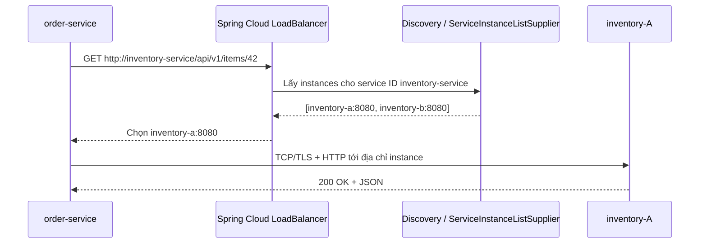
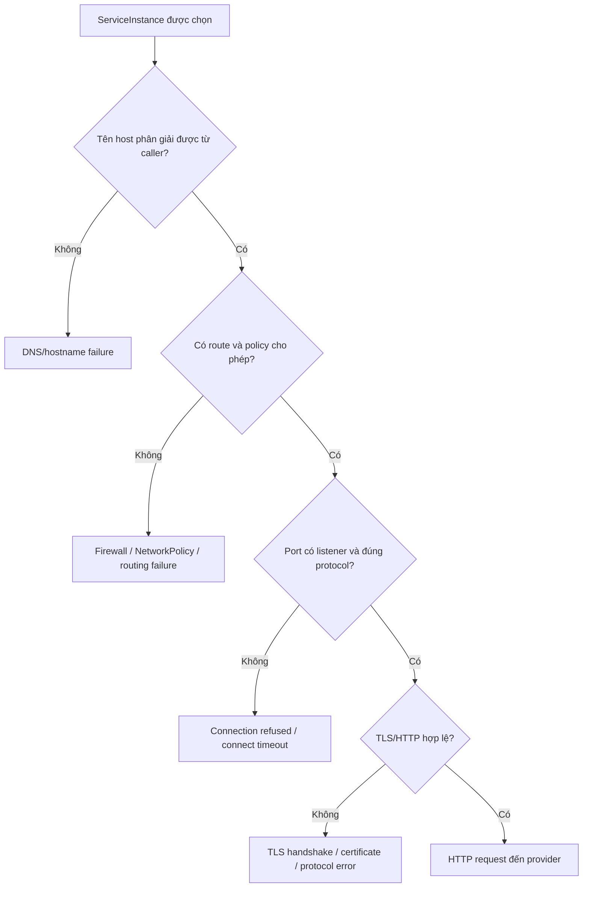
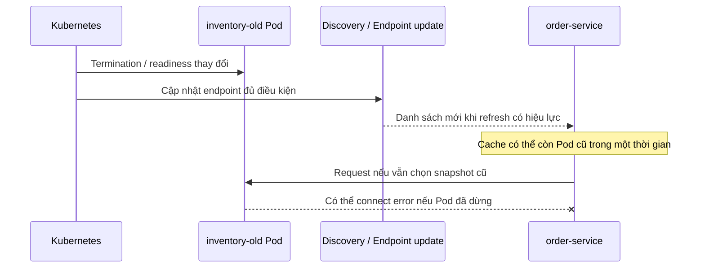
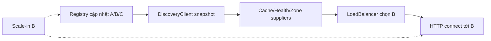

# Địa chỉ quảng bá và địa chỉ kết nối được trong từng môi trường

Trong ứng dụng Spring Cloud LoadBalancer, câu lệnh gọi `http://inventory-service/api/v1/items/42` thường **không gửi HTTP trực tiếp tới hostname** `inventory-service`. Khi HTTP client đã tích hợp LoadBalancer, tên đó là **service ID**: Spring Cloud lấy danh sách `ServiceInstance` từ discovery hoặc nguồn tĩnh, chọn một bản sao và kết nối tới `host:port` được công bố cho bản sao đó. Nếu địa chỉ được công bố không truy cập được từ **mạng nơi caller đang chạy**, cơ chế Round Robin hay retry tốt đến đâu cũng không biến request thành công.

Ví dụ, `inventory-service` chạy trong Docker và lắng nghe `0.0.0.0:8080`. Container khác phải kết nối tới một địa chỉ như `http://inventory-a:8080` trên cùng mạng Docker; ứng dụng chạy trực tiếp trên máy host có thể dùng cổng đã publish `http://localhost:18091`; còn một Pod trong Kubernetes lại cần một địa chỉ khả dụng **bên trong cluster**. Cùng một tiến trình nhưng **địa chỉ lắng nghe, địa chỉ quảng bá và địa chỉ client dùng để kết nối có thể khác nhau**.

Bài thuộc chương **Triển khai** của module `SPRING_CLOUD_SERVICE_COMMUNICATION_LOAD_BALANCING`. Mục tiêu là hiểu đúng ba loại địa chỉ, cách kiểm tra định tuyến theo service ID/`ServiceInstance`, ví dụ local, Docker Compose, Kubernetes và VM/NAT; đồng thời vận dụng với `RestClient`, `WebClient`, OpenFeign, health check, TLS, retry/timeout và observability để giao tiếp giữa các dịch vụ ổn định khi triển khai thật.

## 1. Ba khái niệm địa chỉ phải tách riêng

| Khái niệm | Câu hỏi cần trả lời | Ví dụ |
|---|---|---|
| **Bind/listen address** | Tiến trình server lắng nghe trên interface và cổng nào? | `0.0.0.0:8080` |
| **Advertised/registered address** | Discovery hoặc cấu hình `ServiceInstance` công bố địa chỉ nào? | `inventory-a:8080` |
| **Reachable destination** | Client thật sự có thể gửi TCP/TLS/HTTP tới đâu **từ mạng của nó**? | Container B → `inventory-a:8080`; host → `localhost:18091` |

Một địa chỉ được gọi là *reachable* phải được kiểm tra từ **vị trí của caller**, không phải chỉ từ chính provider. Ping hoặc curl trên provider không chứng minh container, Pod, VM hay vùng mạng khác cũng truy cập được cùng địa chỉ.

### 1.1. Bind 0.0.0.0 không phải địa chỉ để quảng bá

`0.0.0.0` trong cấu hình server IPv4 thường có nghĩa **lắng nghe trên mọi interface IPv4 phù hợp**. Nó là địa chỉ wildcard của socket bind, **không phải tên máy đích ổn định** cho các client. Với IPv6, `::` có vai trò wildcard tương tự trong những cấu hình tương ứng.

```yaml
server:
  address: 0.0.0.0
  port: 8080
```

Cấu hình trên có thể phù hợp khi container cần nhận kết nối từ container khác. Nhưng đăng ký một `ServiceInstance` với `host=0.0.0.0` là lỗi thiết kế: địa chỉ wildcard **không chỉ định một máy đích cụ thể để client tìm đến**. Bên cạnh đó, lắng nghe mọi interface có thể làm tăng bề mặt truy cập; cần firewall, network policy, ingress và authentication đúng môi trường.

### 1.2. Localhost luôn được hiểu theo tiến trình caller

`127.0.0.1`/`localhost` là loopback của **network namespace nơi client chạy**. Chúng không mặc nhiên chỉ vào máy provider:

- App A và B đều chạy trực tiếp trên cùng máy: `localhost` có thể đúng.
- App A ở container, B ở **container khác**: `localhost` từ A là **container A**, không phải B.
- App A ở Kubernetes Pod A, B ở Pod B: `localhost` ở A chỉ vào **network namespace của Pod A**.
- VM A gọi VM B: `localhost` ở A không trỏ tới VM B.

Một ngoại lệ có chủ đích: các container **trong cùng Kubernetes Pod** thường chia sẻ network namespace, vì vậy chúng có thể giao tiếp qua loopback nếu port không xung đột. Không suy rộng điều này cho các Pod khác nhau.

### 1.3. Một sơ đồ định tuyến end-to-end



Sơ đồ khái niệm giả định Spring Cloud LoadBalancer được gắn vào HTTP client và nguồn discovery trả các địa chỉ **có thể kết nối được từ `order-service`**. Nếu `inventory-a` không được DNS của caller phân giải, port không mở, network policy chặn hoặc TLS hostname không khớp, lỗi xuất hiện **sau bước chọn instance**.

## 2. Service ID không đồng nghĩa DNS hostname

Trong một ứng dụng có `@LoadBalanced RestClient.Builder`, URL `http://inventory-service` được tích hợp với LoadBalancer: phần host của URL được sử dụng làm **service ID**. LoadBalancer chọn instance theo supplier, rồi HTTP client kết nối đến host/port của instance được chọn.

Ngược lại:

```java
// URL logic: cần RestClient đã được cấu hình @LoadBalanced.
loadBalancedRestClient.get()
        .uri("http://inventory-service/api/v1/items/42")
        .retrieve()
        .body(String.class);

// Bare client: thường phân giải inventory-service theo DNS trực tiếp,
// không tự dùng ServiceInstanceListSupplier của Spring Cloud.
RestClient.create()
        .get()
        .uri("http://inventory-service/api/v1/items/42")
        .retrieve()
        .body(String.class);
```

Hai đoạn gọi có thể trông giống nhau nhưng **đường đi khác nhau**. Nếu DNS Docker/Kubernetes cũng có hostname `inventory-service`, bare client có thể hoạt động nhờ DNS, khiến người học **tưởng rằng** code đã dùng Spring Cloud LoadBalancer. Muốn kiểm tra LoadBalancer thật, phải quan sát instance được chọn và adapter/filter đã gắn vào HTTP client.

### 2.1. Cấu trúc ServiceInstance

Một `ServiceInstance` điển hình cung cấp:

- `getServiceId()`: tên logic mà client yêu cầu.
- `getInstanceId()`: ID của bản sao (nếu nguồn discovery cung cấp).
- `getHost()` và `getPort()`: địa chỉ/cổng mà HTTP client dự kiến sử dụng.
- `isSecure()` hoặc URI scheme: thông tin về kết nối bảo mật của instance.
- `getMetadata()`: zone, region, version hoặc thông tin phục vụ định tuyến tùy nguồn.
- `getUri()`: URI được trình bày theo thông tin của instance.

Đăng ký đúng service ID nhưng `host` hoặc `port` sai vẫn làm request thất bại. Tương tự, `ServiceInstance` có metadata `zone=vn-a` không tạo ra đường mạng đến địa chỉ đó; network routing và TLS phải hoạt động độc lập.

### 2.2. DNS discovery và instance-level discovery là hai chiến lược khác nhau

| Chiến lược | Client sử dụng địa chỉ nào? | Ai thường cân bằng tải? |
|---|---|---|
| **DNS/virtual service** | Một tên Service như `inventory.default.svc.cluster.local` | Kubernetes Service/kube-proxy/eBPF hoặc proxy/mesh |
| **Spring Cloud instance-level LoadBalancer** | `ServiceInstance` của từng bản sao/endpoint | Spring Cloud LoadBalancer chọn instance phía client |
| **Kết hợp cả hai** | Instance có thể lại trỏ tới virtual IP/Service | Có nguy cơ thêm tầng cân bằng tải khó quan sát |

Trong Kubernetes, gọi trực tiếp Service DNS có thể **không cần** Spring Cloud LoadBalancer. Nếu đã dùng Spring Cloud discovery để lấy **từng Pod/endpoint**, client-side lựa chọn theo Pod lại có ý nghĩa riêng. Cần chọn có chủ đích, tránh triển khai đồng thời nhiều cơ chế mà không biết nơi thực sự quyết định instance.

## 3. Điều kiện để một địa chỉ quảng bá thực sự kết nối được

Không chỉ `host:port` tồn tại; có nhiều bước phải đúng:



| Kiểm tra | Điều cần xác minh |
|---|---|
| **Tên/IP** | Caller có DNS/routing cho hostname/IP được công bố không? |
| **Port** | Là container port, host-published port, Service port hay backend port? |
| **Interface bind** | Provider có đang lắng nghe trên interface mà request đến không? |
| **Routing/NAT** | Đường đi giữa namespace/VPC/subnet/vùng và mapping NAT có đúng không? |
| **Network policy** | Firewall/Security Group/Kubernetes NetworkPolicy có cho phép luồng TCP không? |
| **Scheme/TLS** | `http`/`https` và chứng chỉ có khớp hostname/audience? |
| **Readiness** | Ứng dụng có sẵn sàng nhận request nghiệp vụ không? |
| **Registry freshness** | Endpoint đã scale-in/đổi IP có được rút khỏi danh sách chưa? |

**Quan trọng:** kết nối TCP được **không đảm bảo** API sẵn sàng. Provider vẫn có thể trả HTTP 503 vì dependency lỗi, 404 do sai path hoặc 401 vì yêu cầu xác thực. Ngược lại, discovery rỗng khiến client không thử TCP tới provider nào, và một số HTTP integration có thể tạo 503 tổng hợp ở phía LoadBalancer.

## 4. Ma trận địa chỉ theo môi trường triển khai

Giả sử inventory nghe trên container/service port `8080`. Bảng sau mô tả **một số cấu hình thường gặp**, không phải địa chỉ bắt buộc:

| Môi trường caller → provider | Địa chỉ client có thể dùng | Điều kiện |
|---|---|---|
| Hai JVM trên **cùng máy** | `http://localhost:8091`, `http://localhost:8092` | Mỗi JVM lắng nghe đúng cổng trên host |
| JVM chạy trên host → container có publish | `http://localhost:18091` | Docker publish `18091:8080` trên host |
| Container A → container B trong cùng Docker network | `http://inventory-a:8080` | DNS service/container name truy cập được trong network |
| Container A → dịch vụ chạy trên host | Host gateway phù hợp với nền tảng, ví dụ `host.docker.internal` nơi được hỗ trợ | Không mặc định hoạt động trong mọi Linux/Docker setup |
| Pod A → Pod B trong Kubernetes | Pod IP:container port, **nếu** có policy/route | Instance-level discovery cung cấp Pod IP thật và được phép truy cập |
| Pod A → Kubernetes Service | `http://inventory.default.svc.cluster.local:8080` | Kubernetes Service/DNS định tuyến tới Pod ready |
| Client ngoài cluster → workload Kubernetes | Ingress/Gateway/LoadBalancer endpoint được công bố | Không lấy trực tiếp ClusterIP/PodIP nội bộ |
| VM A → VM B trong VPC | `http://inventory-01.internal:8080` | Private DNS, subnet route và firewall phù hợp |
| Client ngoài VPC → VM private | Reverse proxy/LB/public endpoint được bảo vệ | Không quảng bá IP private chưa có đường đi |
| Multi-region/private network | Địa chỉ private DNS được route hoặc gateway đã phê duyệt | Kiểm soát region policy, latency, TLS và sự phân đoạn mạng |

Không dùng `host.docker.internal` làm hostname mặc định cho mọi Linux CI server hay cluster. Không dùng Pod IP hoặc ClusterIP như thể chúng luôn truy cập được từ browser công khai. **Địa chỉ hợp lệ luôn phụ thuộc vị trí của caller và kiến trúc mạng thực tế.**

## 5. Môi trường local: hai JVM trên cùng máy

Trong lab đơn giản, chạy hai provider với cổng riêng:

```bash
java -jar inventory-service.jar --server.port=8091
java -jar inventory-service.jar --server.port=8092
```

Ở client `order-service`, cấu hình nguồn discovery tĩnh dành riêng cho local:

```yaml
# application-local.yml, order-service
spring:
  cloud:
    discovery:
      client:
        simple:
          instances:
            inventory-service:
              - uri: http://127.0.0.1:8091
              - uri: http://127.0.0.1:8092
```

Chạy client **trực tiếp trên cùng hệ điều hành** thì cả hai địa chỉ loopback có thể kết nối được. `SimpleDiscoveryClient` giúp mô phỏng hai `ServiceInstance` mà không cần Eureka/Consul/Kubernetes registry. Danh sách này tĩnh, nên khi instance dừng, **client vẫn có thể chọn cổng đã chết**; muốn tránh phải thay danh sách, thêm health check hoặc discovery động phù hợp.

### 5.1. Bind chỉ trên loopback có thể đúng cho bài lab

Provider có thể chọn:

```yaml
# application-local.yml, inventory-service
server:
  address: 127.0.0.1
  port: 8091
```

Khi chỉ muốn ứng dụng nhận request từ chính host, bind loopback giúp giảm bề mặt truy cập. Nhưng nếu đưa cấu hình này vào Docker rồi yêu cầu container khác kết nối, listener chỉ nằm trên loopback **của container provider**, và container khác có thể không truy cập được.

**Không sao chép máy móc `server.address: 0.0.0.0` vào mọi môi trường**: giá trị phù hợp phụ thuộc nhu cầu nhận traffic, network policy và chính sách bảo mật.

## 6. Docker Compose: phân biệt container port và published host port

Đây là môi trường rất dễ mắc lỗi địa chỉ vì **cùng một provider có ít nhất hai góc nhìn**:

```text
Máy host                   Docker network
-------------------       --------------------------------
localhost:18091  --------> inventory-a:8080 (container A)
localhost:18092  --------> inventory-b:8080 (container B)
                            ^
                            |
                    order-service container
                    gọi inventory-a:8080 / inventory-b:8080
```

Giả sử image của ứng dụng đã được build với tag dùng cho lab. Ví dụ `compose.yml`:

```yaml
services:
  inventory-a:
    image: inventory-service:lab
    environment:
      SERVER_PORT: "8080"
    ports:
      - "127.0.0.1:18091:8080"

  inventory-b:
    image: inventory-service:lab
    environment:
      SERVER_PORT: "8080"
    ports:
      - "127.0.0.1:18092:8080"

  order-service:
    image: order-service:lab
    environment:
      SERVER_PORT: "8080"
      SPRING_PROFILES_ACTIVE: compose
    ports:
      - "127.0.0.1:18080:8080"
    depends_on:
      - inventory-a
      - inventory-b
```

Trong mạng mặc định của Compose project, các service thường phân giải được tên **`inventory-a`** và **`inventory-b`**. Vì vậy ở `order-service` chạy trong container, cấu hình Spring Cloud LoadBalancer như sau:

```yaml
# application-compose.yml, nằm trong image/config của order-service
spring:
  cloud:
    discovery:
      client:
        simple:
          instances:
            inventory-service:
              - uri: http://inventory-a:8080
              - uri: http://inventory-b:8080
```

Hai URI trên là **địa chỉ quảng bá phù hợp cho client trong cùng Compose network**. Chúng không phải cổng published trên host.

| Caller | Địa chỉ inventory-A nên sử dụng trong ví dụ |
|---|---|
| `order-service` **container** | `http://inventory-a:8080` |
| `curl` chạy trên **máy host** | `http://127.0.0.1:18091` |
| Browser trên host gọi `order-service` | `http://127.0.0.1:18080` |
| Container ở network khác không được nối | Không tự truy cập được `inventory-a`; cần network/routing phù hợp |

**Sai lầm điển hình:** đặt `http://localhost:18091` vào `application-compose.yml` trong container `order-service`. Khi ấy `localhost` trỏ vào container `order-service`, không phải host và cũng không phải `inventory-a`. Tương tự, đặt `http://inventory-a:18091` thường sai vì 18091 là **host-published port**, không phải port mà container A nghe trong Docker network.

### 6.1. Published port không bắt buộc cho giao tiếp container-to-container

Trong Compose network, container A có thể nhận request từ container B trên `8080` **ngay cả khi không khai báo `ports`**, miễn là dịch vụ lắng nghe trên interface mạng phù hợp và network policy cho phép. `ports` trong ví dụ chỉ để developer gọi từ host nhằm debug. Binding published port vào `127.0.0.1` giúp tránh phơi bày cổng lab trên mọi interface của host, nhưng **không thay thế kiểm soát mạng nội bộ**.

### 6.2. Container name, DNS và startup không đồng nghĩa readiness

- Compose thường cung cấp DNS theo **service name** trên cùng network; không mặc định một tên ngẫu nhiên trong `ServiceInstance` được DNS phân giải.
- `depends_on` ở dạng cơ bản điều phối thứ tự khởi động container, **không bảo đảm ứng dụng Java đã sẵn sàng phục vụ API**. Với healthcheck và điều kiện phù hợp, có thể kiểm soát thời điểm sẵn sàng tốt hơn.
- Khi container được recreate, **IP container có thể đổi**. Ưu tiên tên DNS service ổn định so với hardcode container IP; nếu dùng Spring Cloud instance list tĩnh, cần hiểu caching/DNS và việc refresh endpoint.
- Nếu Compose scale một service thành nhiều container dưới cùng service name, một tên DNS có thể trả nhiều địa chỉ, nhưng **không mặc nhiên có nghĩa** Spring Cloud `SimpleDiscoveryClient` đã nhận được từng replica như từng `ServiceInstance` độc lập.

Không phụ thuộc tuyệt đối vào container IP được in từ một lần `docker inspect` để tạo cấu hình deploy dài hạn; đó là thông tin tại một thời điểm.

## 7. Kubernetes: Pod IP, ClusterIP/Service DNS và Ingress là ba tầng khác nhau

Kubernetes mang đến hai đường gọi nội bộ phổ biến:

1. **Gọi Kubernetes Service DNS** (ví dụ `http://inventory.default.svc.cluster.local:8080`). Kubernetes Service cung cấp virtual endpoint ổn định và phân phối tới các Pod đủ điều kiện. Đường này **không yêu cầu** Spring Cloud LoadBalancer chọn từng Pod.
2. **Gọi qua Spring Cloud LoadBalancer với Pod/endpoint discovery**. Nguồn discovery cung cấp danh sách `ServiceInstance` tương ứng các Pod/endpoint mà caller có thể truy cập. Spring Cloud chọn một `ServiceInstance` cụ thể trước HTTP.

Không nên vô tình dùng cả hai tầng nhưng tưởng rằng client đang phân phối theo Pod: nếu supplier của Spring Cloud trả **một instance là Kubernetes Service DNS/ClusterIP**, Spring Cloud chỉ chọn virtual endpoint đó; việc chọn Pod nằm ở Kubernetes/proxy layer.

### 7.1. Ví dụ workload và Service cho giao tiếp qua DNS

Manifest minh họa, giả sử image đã được publish vào registry riêng và ứng dụng có `spring-boot-starter-actuator` với readiness probe bật trên cùng port 8080:

```yaml
apiVersion: apps/v1
kind: Deployment
metadata:
  name: inventory
spec:
  replicas: 2
  selector:
    matchLabels:
      app: inventory
  template:
    metadata:
      labels:
        app: inventory
    spec:
      terminationGracePeriodSeconds: 30
      containers:
        - name: inventory
          image: registry.example.test/inventory-service:1.0.0
          ports:
            - name: http
              containerPort: 8080
          readinessProbe:
            httpGet:
              path: /actuator/health/readiness
              port: http
            periodSeconds: 5
            timeoutSeconds: 2
---
apiVersion: v1
kind: Service
metadata:
  name: inventory
spec:
  type: ClusterIP
  selector:
    app: inventory
  ports:
    - name: http
      port: 8080
      targetPort: http
```

Trong cùng namespace `default`, một Pod khác có thể gọi `http://inventory:8080`; tên FQDN minh họa thường là `inventory.default.svc.cluster.local` (cluster domain **có thể khác** `cluster.local` tùy môi trường). Đây là **địa chỉ Service**, không phải địa chỉ từng Pod.

`ClusterIP` và Pod IP thường chỉ dành cho mạng nội bộ cluster và những mạng được định tuyến cụ thể. Không đăng ký chúng như đích cho một ứng dụng chạy trên laptop ngoài cluster rồi kỳ vọng truy cập trực tiếp. Client ngoài cluster cần Ingress, Gateway, LoadBalancer Service hoặc đường kết nối được quản lý riêng.

### 7.2. Nếu sử dụng Spring Cloud LoadBalancer ở cấp Pod

Trong kiến trúc yêu cầu policy zone/metadata ở client, nguồn discovery của Spring Cloud có thể lấy **những endpoint riêng biệt** từ Kubernetes qua một discovery integration phù hợp. Khi đó cần xác minh:

- `ServiceInstance.getHost()` là Pod IP hoặc hostname **Pod/endpoint thực sự truy cập được từ caller**.
- `getPort()` là port Pod đang lắng nghe, **không phải NodePort/Ingress public port**.
- List có đúng các bản sao đủ điều kiện và cập nhật khi Pod bị thay thế, scale out/in hoặc đổi readiness.
- Ứng dụng/discovery integration có quyền truy cập Kubernetes API hoặc endpoint nguồn theo RBAC/ServiceAccount được cấu hình hợp lý.
- NetworkPolicy, service mesh và mTLS có cho phép gọi trực tiếp Pod IP hay bắt buộc đi qua một proxy đã quản lý.
- Retry và health cache không tiếp tục chọn Pod đã terminate quá lâu.

Không mặc định mọi thư viện Spring Cloud Kubernetes sẽ cung cấp Pod IP trực tiếp trong cùng một cách cấu hình: một số phương thức discovery dùng Service và EndpointSlice/Endpoints, một số dùng cơ chế proxy; phải xem **instance được trả thực tế**.

### 7.3. Vì sao không quảng bá Pod IP ra ngoài cluster?

Pod IP thường **thay đổi khi Pod được tái tạo** và chịu phạm vi routing của CNI/cluster. Một client ở VM khác hoặc Internet không nhất thiết có route tới địa chỉ đó. Việc publish Pod IP vào một registry phục vụ client ngoài cluster có thể tạo hàng loạt connect timeout dù mọi Pod đều UP trong Kubernetes.

Nếu caller ở ngoài cluster nhưng inventory chạy trong cluster, đăng ký một **Ingress/Gateway endpoint** phù hợp với caller có thể đúng hơn; tuy nhiên lúc đó Spring Cloud LoadBalancer đang chọn giữa **các gateway/endpoint đã quảng bá**, không trực tiếp chọn từng Pod. Cần làm rõ tầng chịu trách nhiệm phân phối request.

### 7.4. Readiness và rolling update

Trong quá trình rolling update:



Readiness, graceful shutdown, preStop/termination grace period (khi cần), cập nhật EndpointSlice và cache/health ở client cần phối hợp. **Không có bảo đảm race-free tuyệt đối** giữa chọn instance và Pod terminate; timeout/retry an toàn cho các operation idempotent và khả năng ngừng nhận traffic đúng cách vẫn quan trọng.

## 8. VM, private network và registry: thông tin đăng ký phải đúng góc nhìn caller

Với VM hoặc bare-metal, service thường đăng ký hostname/IP vào Eureka, Consul hoặc registry khác. Một địa chỉ `inventory-01.internal.example:8080` có thể đúng cho các máy trong VPC nhưng sai đối với client ở Internet, subnet không có route hoặc VPC khác chưa cấu hình peering.

Ví dụ provider có private DNS ổn định:

```yaml
# application-vm.yml, inventory-service
spring:
  application:
    name: inventory-service

server:
  address: 0.0.0.0
  port: 8080

# Ví dụ với Spring Cloud Netflix Eureka, nếu dự án dùng Eureka.
eureka:
  client:
    service-url:
      defaultZone: http://eureka.internal.example:8761/eureka/
  instance:
    hostname: inventory-01.internal.example
    prefer-ip-address: false
    non-secure-port: 8080
```

Đây là **cấu hình Eureka minh họa**, chỉ có ý nghĩa khi dự án đã cài dependency và cấu hình Eureka phù hợp. Production cần bảo vệ registry bằng network/auth/TLS; URL `http` trên chỉ dùng để mô tả mô hình mạng nội bộ được kiểm soát, không phải khuyến nghị truyền traffic registry không mã hóa trong mọi hệ thống.

Trong nhiều cấu hình Eureka, `prefer-ip-address: true` sẽ ưu tiên quảng bá IP thay vì hostname. Nhưng **IP được chọn vẫn phải là IP reachable từ client**. Nếu máy có nhiều NIC, VPN, mạng container hoặc địa chỉ public/private, không nên bật tùy chọn này rồi giả định Spring tự chọn đúng interface cho mọi người gọi.

### 8.1. Nếu có NAT hoặc reverse proxy

Giả sử provider lắng nghe `10.0.2.15:8080`, nhưng một caller bên ngoài chỉ thấy `api.internal-gateway.example:443` qua proxy. Quảng bá `10.0.2.15:8080` tới caller đó là sai nếu mạng không route được. Nhưng quảng bá gateway:443 cho **tất cả** callers nội bộ cũng có thể dẫn tới hairpin NAT hoặc đi ra tuyến không cần thiết.

Một sơ đồ thường gặp:

```text
Client trong VPC ------> inventory-01.internal:8080

Client ở mạng khác ---> gateway.internal.example:443
                         |
                         +--TLS/proxy--> inventory-01.internal:8080
```

**Một service ID có thể cần cấu hình discovery khác nhau theo môi trường hoặc nhóm callers.** Registry không tự bảo đảm “một advertised endpoint phục vụ được mọi mạng”. Cần chọn kiến trúc DNS/network hoặc proxy nhất quán và có policy rõ thay vì sửa từng lỗi bằng cách hardcode IP vào client.

### 8.2. Tránh đăng ký IP tạm thời của VM/container

Với auto-scaling hoặc rolling deployment, IP có thể thay đổi. Nên quản lý lifecycle đăng ký/hủy đăng ký, TTL/heartbeat, health/readiness và thời gian cache. Nếu registry vẫn chứa endpoint cũ, LoadBalancer có thể chọn địa chỉ không còn tồn tại. Đây là **stale service discovery**, khác với danh sách rỗng.

Nếu dùng IP thay hostname vì hiệu năng, cần cân nhắc DNS TTL, IP churn, certificate TLS và kỹ thuật failover; **không phải lúc nào IP cố định cũng đáng tin hơn DNS được quản lý**.

## 9. HTTPS, mTLS và sự tương thích giữa scheme, host, port

Một địa chỉ **kết nối TCP được** vẫn có thể không **giao tiếp HTTPS hợp lệ**. Ví dụ client gọi `https://inventory.internal.example:8443`, nhưng provider chỉ phục vụ HTTP trên port 8080, hoặc chứng chỉ TLS không chứa hostname `inventory.internal.example`. Lúc đó Spring Cloud LoadBalancer có thể chọn instance hoàn toàn đúng mà HTTP client vẫn thất bại.

Các trường cần cùng mô tả **một đường kết nối có thật**:

| Thành phần | Điều cần khớp |
|---|---|
| Scheme `http`/`https` | Bên nhận tại địa chỉ/port có nói đúng protocol không? |
| `ServiceInstance.isSecure()` / URI | Thông tin secure có nhất quán với endpoint thực không? |
| Hostname | DNS phân giải được từ caller và đúng chứng chỉ ở điểm kết thúc TLS? |
| Port | Port có listener TLS/HTTP thật, không nhầm host-published/Pod/Service port? |
| Truststore | Caller tin CA đã ký chứng chỉ server không? |
| mTLS | Client có chứng chỉ phù hợp và server xác thực đúng danh tính client không? |
| Proxy/mesh | TLS terminate ở đâu, liệu HTTP giữa proxy và backend đã được bảo vệ theo policy chưa? |

Với danh sách tĩnh, một ví dụ có endpoint HTTPS:

```yaml
spring:
  cloud:
    discovery:
      client:
        simple:
          instances:
            inventory-service:
              - uri: https://inventory-a.internal.example:8443
              - uri: https://inventory-b.internal.example:8443
```

**Không** thay URI thành `http://...:8443` chỉ vì test đang lỗi handshake, cũng không vô hiệu hóa hostname verification/trust checks để “sửa nhanh”. Hãy xác định cổng đang nói HTTP hay TLS và chứng chỉ có SAN phù hợp với hostname thực được sử dụng.

### 9.1. Chú ý khi LoadBalancer chọn IP nhưng chứng chỉ phát hành cho DNS name

Nếu discovery trả `host=10.0.2.15` nhưng certificate chỉ có SAN `inventory.internal.example`, client kết nối HTTPS đến **IP** có thể gặp lỗi xác minh hostname. Việc gửi HTTP header `Host: inventory.internal.example` riêng **không tự sửa** kiểm tra TLS hoặc SNI theo cách an toàn.

Các giải pháp đúng có thể gồm dùng DNS hostname phù hợp chứng chỉ, cấu hình identity cho service mesh, hoặc thiết kế TLS endpoint/CA theo địa chỉ mà client thực sự gọi. Không hardcode `Host` để “ép” thành một hostname khác rồi giả định đã an toàn.

### 9.2. Không tin hoàn toàn vào metadata discovery

Metadata `secure`, `zone`, `region` hoặc `version` là dữ liệu hỗ trợ lựa chọn, **không thay thế chứng thực của endpoint**. Một instance khai báo `isSecure=true` không đủ để đảm bảo peer được xác thực nếu HTTP client bị cấu hình bỏ kiểm tra chứng chỉ.

Với các operation nhạy cảm, ràng buộc trust, audience và authorization phải được xác thực ở tầng TLS và ứng dụng, không chỉ dựa vào service ID hoặc nhãn metadata.

## 10. Spring Cloud LoadBalancer: code client không đổi, cấu hình địa chỉ thay theo môi trường

Một mục tiêu triển khai tốt là **không hardcode host/port của provider trong business code**. Code luôn gọi service ID logic; cấu hình/discovery tại môi trường quyết định danh sách endpoint reachable.

### 10.1. RestClient tích hợp LoadBalancer

Ví dụ Spring Framework 6.1+ với Spring Cloud tương thích:

```java
import org.springframework.cloud.client.loadbalancer.LoadBalanced;
import org.springframework.context.annotation.Bean;
import org.springframework.context.annotation.Configuration;
import org.springframework.web.client.RestClient;

@Configuration
class InventoryClientConfiguration {

    @Bean
    @LoadBalanced
    RestClient.Builder loadBalancedRestClientBuilder() {
        return RestClient.builder();
    }
}
```

```java
import org.springframework.beans.factory.annotation.Qualifier;
import org.springframework.stereotype.Service;
import org.springframework.web.client.RestClient;

record ItemDto(String id, String servedBy) {
}

@Service
class InventoryGateway {

    private final RestClient client;

    InventoryGateway(
            @Qualifier("loadBalancedRestClientBuilder")
            RestClient.Builder builder) {
        this.client = builder
                .baseUrl("http://inventory-service")
                .build();
    }

    ItemDto getItem(String id) {
        return client.get()
                .uri("/api/v1/items/{id}", id)
                .retrieve()
                .body(ItemDto.class);
    }
}
```

Ứng dụng cần `spring-cloud-starter-loadbalancer` cùng HTTP starter và BOM Spring Cloud tương thích với Spring Boot. `InventoryGateway` chỉ biết `inventory-service`; trên local, Compose hay VM, `ServiceInstanceListSupplier` sẽ cung cấp host/port thích hợp cho caller. **Nếu không dùng bean builder được gắn `@LoadBalanced`**, RestClient có thể cố phân giải `inventory-service` qua DNS và bỏ qua Spring Cloud supplier.

### 10.2. WebClient tích hợp LoadBalancer

```java
import org.springframework.cloud.client.loadbalancer.LoadBalanced;
import org.springframework.context.annotation.Bean;
import org.springframework.context.annotation.Configuration;
import org.springframework.web.reactive.function.client.WebClient;

@Configuration
class ReactiveClientConfiguration {

    @Bean
    @LoadBalanced
    WebClient.Builder loadBalancedWebClientBuilder() {
        return WebClient.builder();
    }
}
```

```java
import org.springframework.beans.factory.annotation.Qualifier;
import org.springframework.stereotype.Service;
import org.springframework.web.reactive.function.client.WebClient;
import reactor.core.publisher.Mono;

@Service
class ReactiveInventoryGateway {

    private final WebClient client;

    ReactiveInventoryGateway(
            @Qualifier("loadBalancedWebClientBuilder")
            WebClient.Builder builder) {
        this.client = builder
                .baseUrl("http://inventory-service")
                .build();
    }

    Mono<ItemDto> getItem(String id) {
        return client.get()
                .uri("/api/v1/items/{id}", id)
                .retrieve()
                .bodyToMono(ItemDto.class);
    }
}
```

`WebClient` thường thực thi khi publisher có subscription. Việc lựa chọn instance, connect và response có thể xảy ra trong pipeline bất đồng bộ; một cấu hình timeout ở tầng HTTP client hoặc `Mono.timeout(...)` cần có deadline phù hợp. Không dùng `block()` trên event loop chỉ để debug.

### 10.3. OpenFeign dùng service ID

```java
import org.springframework.cloud.openfeign.FeignClient;
import org.springframework.web.bind.annotation.GetMapping;
import org.springframework.web.bind.annotation.PathVariable;

@FeignClient(name = "inventory-service")
public interface InventoryFeignClient {

    @GetMapping("/api/v1/items/{id}")
    ItemDto getItem(@PathVariable("id") String id);
}
```

Feign client cần `spring-cloud-starter-openfeign`, cấu hình `@EnableFeignClients` (hoặc scan Feign phù hợp) cùng tích hợp LoadBalancer. Nếu định nghĩa `@FeignClient(url = "...")` cố định cho một client, đường này **có thể bypass service-name load balancing**; hãy kiểm tra rõ bạn muốn gọi **một URL** hay **một service ID**.

Với `RestTemplate`, tương tự phải dùng `@LoadBalanced RestTemplate`, không phải một instance được tạo bare không có interceptor. Dù sử dụng HTTP client nào, **địa chỉ thực sự kết nối tới** vẫn cần reachable từ network namespace của caller.

## 11. Health, discovery cache và rollout ảnh hưởng tới địa chỉ đang được chọn

Một địa chỉ quảng bá đúng hôm nay có thể không còn đúng sau khi scale-in, restart container, đổi IP Pod hoặc VM bị thay thế. Hệ thống có ít nhất ba ảnh chụp thời gian:

1. **Registry/source:** endpoint nào đang được công bố.
2. **ServiceInstanceListSupplier/cache:** client đang nhìn thấy danh sách nào.
3. **HTTP request đã chọn instance:** request đang mở kết nối tới đích đã chọn ở thời điểm nào.



Nếu B đã bị terminate giữa bước chọn và bước kết nối, HTTP client có thể nhận connection refused/reset. Tăng timeout thường **không sửa được** địa chỉ đã chết; cần cơ chế deregistration, readiness, refresh và retry hợp lý.

### 11.1. Health check phải dùng địa chỉ thật của instance

`HealthCheckServiceInstanceListSupplier` có thể probe một endpoint như `/actuator/health/readiness` trên từng instance. Đường probe phải reachable từ **môi trường của LoadBalancer client**, và status của readiness phải phản ánh khả năng phục vụ theo policy.

Nếu service dùng management port khác với application port, không được tự giả định health supplier biết port đó. Phải cấu hình/thiết kế probe đúng địa chỉ, hoặc sử dụng readiness do orchestration/registry quản lý. Chỉ bật các thuộc tính health-check cũng **không đảm bảo** supplier tương ứng đã được thêm vào chuỗi.

Một điểm cần biết: một số phiên bản/hành vi mặc định của `HealthCheckServiceInstanceListSupplier` **fallback về danh sách nguồn** khi không có instance nào qua probe khỏe nhưng discovery vẫn có dữ liệu. Điều này có thể tăng availability khi probe lỗi giả, nhưng **không tương đương fail-closed**. Nếu policy cấm gửi tới instance unhealthy, phải kiểm tra và thiết kế riêng.

### 11.2. Retry chỉ có ích nếu lỗi có khả năng phục hồi

| Loại lỗi | Có thể thử lại? | Điều kiện |
|---|---|---|
| Không tìm thấy instance | Chỉ khi discovery có khả năng cập nhật trong deadline | Không retry vô hạn trên cùng snapshot rỗng |
| Chọn instance với port không lắng nghe | Có thể với GET idempotent | Snapshot mới hoặc instance khác có thể reachable |
| DNS chưa cập nhật | Có thể sau khi resolver/cache làm mới | Backoff và overall deadline |
| TLS certificate sai hostname | Thường **không** | Sửa certificate/advertised hostname thay vì retry |
| NetworkPolicy/firewall chặn tất cả | Không sửa được bằng retry | Sửa policy/routing |
| Provider trả 503 tạm thời | Có thể với GET/idempotent | Health/circuit breaker, backoff và deadline |
| POST đã gửi rồi read timeout | **Không retry mù quáng** | Có idempotency key và cơ chế chống ghi trùng |

Phân biệt lỗi **chọn instance** với lỗi **kết nối tới instance đã chọn** giúp tránh tăng mọi connect/read timeout. Một `503` tổng hợp vì danh sách rỗng không chứng minh provider đã trả 503; một `Connection refused` sau chọn đích không chứng minh discovery không có instance.

## 12. Chọn địa chỉ theo locality mà không phá vỡ ranh giới an toàn

Với nhiều zone/region, một service ID có thể có các bản sao ở các vùng mạng khác nhau. Có thể dùng metadata để ưu tiên instance gần caller, nhưng chỉ khi địa chỉ thật sự route được và policy dữ liệu cho phép.

| Tiêu chí | Ví dụ | Cách xử lý |
|---|---|---|
| Hard constraint: data residency | Dữ liệu chỉ được xử lý ở `region=vn` | Không fallback sang vùng khác chỉ vì còn instance |
| Hard constraint: network policy | Caller không được truy cập subnet X | Đừng chọn endpoint X dù registry có đăng ký |
| Soft preference: zone | Ưu tiên `zone-a` để giảm độ trễ | Có thể fallback sang zone khác **trong tập hợp lệ** |
| Soft preference: weight | Ưu tiên một version khi rollout | Không chọn version sai API contract |
| TLS identity | Chỉ tin service identity được cấp | Không bỏ xác minh hostname khi lựa chọn thay đổi |

Một danh sách discovery **có phần tử** chưa chắc có **ứng viên kết nối được và được phép**. Khi không còn endpoint hợp lệ, một custom supplier nên trả danh sách rỗng/`EmptyResponse` có chủ đích, không lấy “mọi instance” làm fallback rồi vượt ràng buộc bảo mật.

Nếu service mesh đã xử lý locality/failover, phải xác định Spring Cloud LoadBalancer có còn cần policy locality riêng không. Hai chính sách độc lập có thể khiến traffic phân phối khác dự kiến hoặc làm khó việc giải thích khi có lỗi.

## 13. Chẩn đoán từ chính nơi caller chạy

Nguyên tắc vận hành quan trọng nhất của bài: **không kiểm tra connectivity chỉ từ máy provider**. Nếu `order-service` đang chạy trong container, Pod hoặc VM, cần kiểm tra từ môi trường đó — nơi DNS, routing, firewall, service mesh và truststore thực sự áp dụng.

### 13.1. Kiểm tra địa chỉ và HTTP response

Với môi trường Linux có sẵn các tiện ích:

```bash
# Kiểm tra hostname quảng bá có phân giải từ caller không.
getent hosts inventory-a

# Xem lỗi TCP, thời gian và mã HTTP từ chính caller.
curl --verbose --connect-timeout 2 --max-time 5 \
  'http://inventory-a:8080/api/v1/items/42'

# Kiểm tra readiness trên instance thực nếu được phép.
curl --silent --show-error --include --max-time 5 \
  'http://inventory-a:8080/actuator/health/readiness'
```

`getent`/`curl` không luôn tồn tại trong image tối giản hoặc distroless. Nếu image ứng dụng không có shell/công cụ debug, hãy dùng một **debug container/Pod có quyền và đường mạng tương đương**, thay vì thay đổi image production chỉ để cài curl.

Trên Windows PowerShell, kiểm tra hostname và TCP:

```powershell
Resolve-DnsName inventory-01.internal.example
Test-NetConnection inventory-01.internal.example -Port 8080
Invoke-WebRequest -Uri 'http://inventory-01.internal.example:8080/api/v1/items/42'
```

`Test-NetConnection` thành công chỉ chứng minh kết nối tới một port được, **không xác minh API contract, token hay khả năng đọc response JSON**. Với HTTPS phải kiểm tra chứng chỉ và protocol trong HTTP client thực tế.

### 13.2. Docker Compose: kiểm tra DNS nội bộ, không phải host DNS

```bash
# Nếu container order-service có shell + curl:
docker compose exec order-service sh -c \
  "curl -sv --max-time 5 http://inventory-a:8080/api/v1/items/42"

# Từ host, kiểm tra cổng đã publish.
curl -sv --max-time 5 \
  'http://127.0.0.1:18091/api/v1/items/42'
```

Nếu lệnh `docker compose exec ... sh` không chạy vì image distroless, đó **chưa chứng minh network hỏng**. Hãy thực hiện phép thử tương đương từ một debug container được nối vào **đúng Compose network**.

Điểm cần ghi nhận là: địa chỉ `inventory-a:8080` từ container và `127.0.0.1:18091` từ host có thể cùng dẫn đến một provider, nhưng **không phải hai URL có thể hoán đổi tự do trong mọi caller**.

### 13.3. Kubernetes: đối chiếu Service và Pod/endpoint

Một số lệnh đọc trạng thái (cần quyền Kubernetes phù hợp):

```bash
kubectl get pods -n default -l app=inventory -o wide
kubectl get service -n default inventory -o wide
kubectl get endpointslices -n default \
  -l kubernetes.io/service-name=inventory
```

Sau đó kiểm tra từ một Pod/debug Pod **cùng chính sách mạng** với `order-service`:

```bash
# Chỉ chạy nếu image order-service có curl:
kubectl exec -n default deploy/order-service -- \
  curl -sv --max-time 5 \
  'http://inventory.default.svc.cluster.local:8080/api/v1/items/42'
```

Nếu gặp `Forbidden` từ `kubectl exec`, đó là vấn đề **RBAC cho thao tác debug**, không trực tiếp chứng minh application không kết nối được inventory. Nếu Service DNS phân giải nhưng request lỗi, cần xem EndpointSlice, readiness, targetPort, NetworkPolicy và proxy/mesh.

Khi dùng Spring Cloud instance-level discovery, hãy đối chiếu **`ServiceInstance.getHost()/getPort()` đang chọn** với Pod IP/endpoint thực tế. Nếu chỉ có một `ServiceInstance` trỏ về ClusterIP, phép kiểm tra Pod-level Round Robin phía Spring Cloud không có ý nghĩa.

### 13.4. Bảng quyết định từ dấu hiệu lỗi

| Dấu hiệu nhìn từ caller | Nguồn lỗi cần kiểm tra trước |
|---|---|
| Không có `ServiceInstance` | Sai service ID, discovery registry, supplier/filter/cache |
| Chọn instance `0.0.0.0` | Quảng bá wildcard bind address, không phải đích định tuyến |
| Chọn `127.0.0.1` từ container/Pod khác | Địa chỉ loopback sai network namespace |
| `UnknownHostException` / unresolved host | Tên advertised không tồn tại trong DNS của caller |
| `ConnectException: Connection refused` | Host reachable nhưng port không có listener hoặc chủ động từ chối |
| Connect timeout | Route, firewall/network policy, host không phản hồi hoặc network congestion |
| TLS handshake/hostname mismatch | Sai scheme, certificate, truststore, SNI hoặc port TLS |
| HTTP 404 từ provider | Route/contract nghiệp vụ; không phải tự động lỗi selection |
| HTTP 503 **không có provider trace** | Có thể từ LoadBalancer, gateway hoặc proxy |
| Provider trả 503 **có access log** | Backend nhận request nhưng không phục vụ tại thời điểm đó |
| Một lúc được, một lúc connect refused | Registry stale, rolling update, một số replica sai advertised address |
| Host truy cập được nhưng container không | Port publish/namespace/network khác nhau; cấu hình client sai |

Khi test kết nối tới instance trực tiếp hoạt động nhưng gọi qua service ID thất bại, so sánh **URL cuối mà HTTP client dùng** với `ServiceInstance` được chọn. Nếu chúng khác nhau, kiểm tra LoadBalancer adapter, URI reconstruction, scheme và proxy. Khi test thẳng provider cũng lỗi, trước tiên sửa DNS/TCP/TLS/HTTP của môi trường đó.

## 14. Lab Spring Boot: kiểm chứng địa chỉ được chọn trên local

Lab này minh họa **đường đi thật** qua LoadBalancer, không chỉ một lệnh curl gọi thẳng provider. Dùng hai provider có response ghi dấu nơi xử lý và một client dùng URL logic.

### 14.1. Provider trả ID theo cổng

Trong dự án `inventory-service` với Spring Boot Web:

```java
import org.springframework.beans.factory.annotation.Value;
import org.springframework.web.bind.annotation.GetMapping;
import org.springframework.web.bind.annotation.PathVariable;
import org.springframework.web.bind.annotation.RestController;

record ItemDto(String id, String servedBy) {
}

@RestController
class InventoryDemoController {

    private final int port;

    InventoryDemoController(@Value("${server.port}") int port) {
        this.port = port;
    }

    @GetMapping("/api/v1/items/{id}")
    ItemDto getItem(@PathVariable String id) {
        return new ItemDto(id, "inventory-port-" + port);
    }
}
```

Khởi động:

```bash
# Terminal A
java -jar inventory-service.jar --server.port=8091

# Terminal B
java -jar inventory-service.jar --server.port=8092
```

Kiểm tra trực tiếp từ host:

```bash
curl -i http://127.0.0.1:8091/api/v1/items/42
curl -i http://127.0.0.1:8092/api/v1/items/42
```

Kỳ vọng lần lượt có `servedBy=inventory-port-8091` và `inventory-port-8092`. Nếu một provider lỗi ngay tại bước này, chưa nên kiểm tra thuật toán LoadBalancer.

### 14.2. Client gọi service ID, không gọi host/port cứng

Trong `order-service`, dùng `InventoryClientConfiguration` và `InventoryGateway` từ mục 10. Thêm controller:

```java
import org.springframework.web.bind.annotation.GetMapping;
import org.springframework.web.bind.annotation.PathVariable;
import org.springframework.web.bind.annotation.RestController;

@RestController
class OrderDemoController {

    private final InventoryGateway inventory;

    OrderDemoController(InventoryGateway inventory) {
        this.inventory = inventory;
    }

    @GetMapping("/test/items/{id}")
    ItemDto item(@PathVariable String id) {
        return inventory.getItem(id);
    }
}
```

Dùng `application-local.yml` ở mục 5 và đặt port client khác hai provider:

```bash
java -jar order-service.jar \
  --spring.profiles.active=local \
  --server.port=8080
```

Gọi qua client nhiều lần:

```bash
curl -sS 'http://127.0.0.1:8080/test/items/42'
curl -sS 'http://127.0.0.1:8080/test/items/42'
curl -sS 'http://127.0.0.1:8080/test/items/42'
curl -sS 'http://127.0.0.1:8080/test/items/42'
```

Với danh sách hai instance không đổi, cả hai khỏe và `RoundRobinLoadBalancer` mặc định, một chuỗi các lời gọi tuần tự thường sẽ quan sát được cả hai giá trị `servedBy`. **Không gắn cứng request đầu tiên phải tới 8091**: bộ đếm Round Robin có thể bắt đầu ở vị trí khác hoặc đã được dùng bởi lời gọi trước.

Mục tiêu của lab là chứng minh client vẫn gọi một URL logic nhưng actual destination thay đổi theo `ServiceInstance` được chọn.

### 14.3. Chuyển từ local sang Compose mà không đổi business code

Giữ `InventoryGateway` như cũ; chỉ thay cấu hình discovery bằng `application-compose.yml`:

```text
Local profile:
  inventory-service -> 127.0.0.1:8091, 127.0.0.1:8092

Compose profile:
  inventory-service -> inventory-a:8080, inventory-b:8080

Business code:
  baseUrl("http://inventory-service")  // không đổi
```

Nếu đem nguyên `application-local.yml` vào container `order-service`, lỗi connect tới loopback là **bài kiểm tra cấu hình môi trường**, không phải bằng chứng Round Robin sai.

### 14.4. Hai phép thử lỗi có giá trị

**Sai advertised port:** trong profile thử nghiệm, đăng ký `http://127.0.0.1:8999` mà không chạy server trên 8999. LoadBalancer vẫn chọn instance, nhưng HTTP client báo connect refused/timeout. Hãy ghi nhận **đã có `ServiceInstance` được chọn**, để không gọi nhầm đó là lỗi discovery.

**Sai service ID:** đổi URL logic sang `http://unknown-inventory` trong một test riêng, không thêm service ID tương ứng vào `SimpleDiscoveryClient`. Lúc này LoadBalancer có thể trả no-instance/503 tổng hợp **trước khi kết nối tới provider**. Một bare client không có `@LoadBalanced` có thể chỉ báo DNS failure; đó là phép thử khác.

Đừng cố tình tắt backend trong môi trường production hoặc ghi đè danh sách discovery của ứng dụng thật để thực hiện hai phép thử này.

## 15. Integration test: đích được công bố phải kết nối được từ client

Unit test `RoundRobinLoadBalancer` có thể chứng minh nó chọn đúng một `ServiceInstance` trong list, nhưng **không chứng minh địa chỉ đó reachable**. Một integration test nên mở HTTP server thật trên **cổng động**, đăng ký các URI đó cho client và gửi request qua `@LoadBalanced` builder.

### 15.1. Test dùng HttpServer của JDK và @DynamicPropertySource

Ví dụ dưới đây dành cho một dự án test Spring Boot đã có `InventoryGateway`/`InventoryClientConfiguration` như mục 10, `spring-cloud-starter-loadbalancer` và test starter. Thay main configuration/test scan theo dự án cụ thể:

```java
import static org.junit.jupiter.api.Assertions.assertEquals;

import java.io.IOException;
import java.io.OutputStream;
import java.net.InetSocketAddress;
import java.nio.charset.StandardCharsets;
import java.util.HashSet;
import java.util.Set;

import com.sun.net.httpserver.HttpServer;
import org.junit.jupiter.api.AfterAll;
import org.junit.jupiter.api.Test;
import org.springframework.beans.factory.annotation.Autowired;
import org.springframework.boot.test.context.SpringBootTest;
import org.springframework.test.annotation.DirtiesContext;
import org.springframework.test.context.DynamicPropertyRegistry;
import org.springframework.test.context.DynamicPropertySource;

@SpringBootTest(webEnvironment = SpringBootTest.WebEnvironment.NONE)
@DirtiesContext(classMode = DirtiesContext.ClassMode.AFTER_CLASS)
class LoadBalancedAddressIntegrationTest {

    private static final HttpServer A = startServer("A");
    private static final HttpServer B = startServer("B");

    private static HttpServer startServer(String label) {
        try {
            HttpServer server = HttpServer.create(
                    new InetSocketAddress("127.0.0.1", 0), 0);
            server.createContext("/api/v1/items/42", exchange -> {
                String json = "{\"id\":\"42\",\"servedBy\":\""
                        + label + "\"}";
                byte[] body = json.getBytes(StandardCharsets.UTF_8);
                exchange.getResponseHeaders()
                        .set("Content-Type", "application/json");
                exchange.sendResponseHeaders(200, body.length);
                try (OutputStream output = exchange.getResponseBody()) {
                    output.write(body);
                }
            });
            server.start();
            return server;
        } catch (IOException error) {
            throw new IllegalStateException(
                    "Cannot open HTTP test server", error);
        }
    }

    @DynamicPropertySource
    static void advertisedAddresses(DynamicPropertyRegistry registry) {
        registry.add(
                "spring.cloud.discovery.client.simple.instances."
                        + "inventory-service[0].uri",
                () -> "http://127.0.0.1:" + A.getAddress().getPort());
        registry.add(
                "spring.cloud.discovery.client.simple.instances."
                        + "inventory-service[1].uri",
                () -> "http://127.0.0.1:" + B.getAddress().getPort());
        registry.add(
                "spring.cloud.loadbalancer.cache.enabled",
                () -> "false");
    }

    @Autowired
    InventoryGateway inventoryGateway;

    @Test
    void bothAdvertisedInstancesAreActuallyReachable() {
        Set<String> observed = new HashSet<>();

        for (int i = 0; i < 12; i++) {
            observed.add(inventoryGateway.getItem("42").servedBy());
        }

        // Không phụ thuộc request đầu tiên chọn A hay B.
        assertEquals(Set.of("A", "B"), observed);
    }

    @AfterAll
    static void stopServers() {
        A.stop(0);
        B.stop(0);
    }
}
```

Lưu ý khi sử dụng ví dụ:

- `HttpServer` thuộc module JDK `jdk.httpserver`. Với cấu hình module path đặc biệt, test cần được phép sử dụng module này.
- `InetSocketAddress("127.0.0.1", 0)` để **hệ điều hành cấp cổng rảnh**, không đặt cứng 8091/8092 gây xung đột khi test chạy song song.
- `@DynamicPropertySource` đăng ký URI **trước khi Spring context tạo discovery client**; không sửa system properties toàn JVM.
- Test giả định application context đang chạy có `@LoadBalanced RestClient.Builder` được inject vào `InventoryGateway`. Nếu dự án có test profile, custom supplier hoặc discovery client khác, phải loại xung đột để sử dụng đúng danh sách này.
- Disable LoadBalancer cache **trong phạm vi test** để tránh nhiễu bởi TTL. Nếu test chủ động thêm `CachingServiceInstanceListSupplier` khác, phải kiểm tra chain thực tế chứ không chỉ dựa vào property.
- `@DirtiesContext(AFTER_CLASS)` giúp tránh tái sử dụng một context vẫn giữ URI trỏ tới HTTP server đã đóng. Những test khác chạy song song vẫn cần context/fixture riêng.
- Kết quả kiểm chứng là **hai địa chỉ advertised thực sự trả HTTP response đúng DTO**. Nó không chứng minh tự động rằng địa chỉ trong Docker/Kubernetes/VM cũng reachable; mỗi môi trường cần kiểm tra riêng đường mạng.

### 15.2. Kiểm thử thêm các cấu hình sai

| Test | Cấu hình tạo lỗi | Kết quả cần khẳng định |
|---|---|---|
| No instance | Không khai báo `inventory-service` | Không có đích được chọn; không có provider request |
| Wrong loopback | Container client đăng ký `127.0.0.1:8091` của host | Không kết nối được provider ở namespace khác |
| Wrong port | Instance trỏ vào port không có listener | Có chọn instance, lỗi transport |
| Wrong scheme | `https://` vào HTTP-only port | TLS/protocol failure |
| Wrong certificate identity | HTTPS endpoint trả cert không khớp host | Bị từ chối theo TLS verification |
| Stale instance | Registry giữ Pod/VM đã dừng | Chọn đích cũ có thể gây connect error |
| Healthy replacement | Registry/health cập nhật sang endpoint mới | Request mới eventually chọn endpoint mới |
| Restricted region | Discovery chỉ còn endpoint ngoài vùng cho phép | Không gọi endpoint vi phạm hard constraint |

Không nên tạo certificate không hợp lệ hoặc chặn network trên môi trường production để học; những phép thử này thuộc môi trường local, CI, staging hoặc chaos test đã được phê duyệt.

## 16. Observability: biết client đã chọn và kết nối tới địa chỉ nào

Khi service ID đúng nhưng request vẫn lỗi, chỉ ghi log `"inventory-service unavailable"` là chưa đủ. Một trace cần phân biệt ít nhất **lựa chọn đích**, **kết nối**, **HTTP response** và **nguyên nhân timeout**.

| Trường nên quan sát | Vai trò chẩn đoán |
|---|---|
| `serviceId` | Tên dịch vụ logic được gọi |
| `instanceId` | Bản sao được LoadBalancer chọn |
| `advertisedHost` / `advertisedPort` | Giá trị lấy từ `ServiceInstance` |
| `resolvedIp` | IP mà resolver/transport thực sự sử dụng (nếu instrument được) |
| `uriScheme` | HTTP hay HTTPS; tránh ghi credentials/query nhạy cảm |
| `discoveredCount` / `eligibleCount` | Có instance hay bộ lọc làm rỗng danh sách? |
| `zone` / `region` | Đích có đúng locality và hard constraints? |
| `connectDuration` / `tlsDuration` | Chậm ở network hay handshake? |
| `httpStatus` và `responseOrigin` | Provider trả lỗi hay gateway/LoadBalancer tạo status? |
| `exceptionClass` / `errorPhase` | DNS, connect, TLS, pool, read, decode hay business? |
| `retryAttempt` / `retryReason` | Retry đã chọn lại đích hay vẫn dùng đích cũ? |
| `traceId` / `spanId` | Kết nối client span với provider/gateway |
| `snapshotAge` / `discoveryRefresh` | Địa chỉ có thể đã stale bao lâu? |

Đây là **tên trường đề xuất cho instrumentation**, không phải tất cả đều là metric Spring Cloud LoadBalancer có sẵn. Có thể kết hợp Micrometer Observation/OpenTelemetry, log chọn `ServiceInstance` và telemetry của HTTP transport. Không mặc định TCP resolved IP đã được framework cung cấp; nếu cần phải lấy từ resolver/client hoặc tầng mạng.

### 16.1. Không tạo metric cardinality không giới hạn

`serviceId`, loại lỗi và bucket duration thường phù hợp làm nhãn metric. `traceId`, request ID, URI có path parameter, user ID và token **không** nên dùng làm label metric. Với `instanceId`, `host`, `region` hoặc `zone`, cần đánh giá số lượng biến thể và churn trong môi trường auto-scaling.

Không ghi Bearer token, cookie, thông tin cá nhân hoặc nguyên `baggage` vào log chỉ để điều tra một lỗi kết nối. Có thể ghi hostname/port cần thiết trong logs có quyền truy cập phù hợp, nhưng phải cân nhắc việc tiết lộ cấu trúc mạng nội bộ ra public error response.

### 16.2. Lỗi 503 có thể phát sinh trước khi có kết nối

Một số HTTP client integration trả HTTP `503` tổng hợp khi LoadBalancer không tìm được instance. Khi đó:

```text
serviceId = inventory-service
selectedInstance = none
providerRequestCount = 0
observedStatus = 503
```

khác hoàn toàn với:

```text
serviceId = inventory-service
selectedInstance = inventory-A
providerRequestCount = 1
observedStatus = 503
responseOrigin = provider
```

Các trường trên là **mô hình log mong muốn**, không phải output được Spring Cloud tự động in ra với đúng tên. Phân loại sai nguồn 503 có thể khiến đội vận hành chỉ tăng timeout của provider trong khi lỗi thật là cấu hình advertised address/discovery.

### 16.3. SLO và dấu hiệu mất reachability

Một số tín hiệu hữu ích sau deploy:

- **Selection failures** tăng: kiểm tra discovery trống, supplier/filter, service ID.
- **Connect failures theo instance** tăng: kiểm tra IP/host/port được quảng bá, Pod/VM termination, firewall, routing.
- **TLS failures** tăng sau đổi chứng chỉ/route: kiểm tra scheme và certificate identity.
- **Read timeout** tăng nhưng connect bình thường: kiểm tra backend latency, pool, retries và upstream processing.
- **Fallback sang zone khác** tăng: kiểm tra zone ưu tiên, health, policy và độ trễ liên vùng.
- **Tỷ lệ retries** tăng sau rollout: kiểm tra registry/cache stale và graceful shutdown.

Một thao tác được retry thành công vẫn có thể che nhiều HTTP attempts thất bại ở các instance sai địa chỉ. Theo dõi **attempt-level telemetry** bên cạnh tỷ lệ thành công của logical request để không bỏ sót vấn đề triển khai.

## 17. Runbook triển khai: từ địa chỉ lắng nghe đến đường gọi thực

Khi đưa `inventory-service` sang một môi trường mới, có thể kiểm tra theo thứ tự sau để tránh việc “dịch vụ UP nhưng client không gọi được”.

### Bước 1 — Xác định caller đang ở đâu

Ghi rõ caller:

- JVM chạy trên cùng host hay một host khác?
- Docker container thuộc Compose network nào?
- Kubernetes Pod thuộc namespace, cluster và network policy nào?
- VM có private route/VPC peering/VPN tới backend không?
- Traffic có đi qua API gateway, reverse proxy hoặc service mesh không?

Không bắt đầu bằng “provider đang nghe port 8080” mà chưa biết **caller có thể tiếp cận network namespace đó không**.

### Bước 2 — Chọn nguồn discovery và mức cân bằng tải

Xác định một trong các mô hình:

| Mô hình | Nguồn đích mà caller dùng |
|---|---|
| Static lab | `SimpleDiscoveryClient` cung cấp những URI phù hợp environment |
| Service registry | Eureka/Consul/registry cung cấp hostname/port per instance |
| Kubernetes Service DNS | Caller dùng Service DNS, cân bằng tải chủ yếu ở Kubernetes/proxy |
| Kubernetes Pod discovery | Spring Cloud lấy từng endpoint có thể gọi trực tiếp |
| Gateway/mesh | Caller gọi endpoint đã được proxy/mesh công bố, không tự giả định Pod IP |

Không thay đổi qua lại giữa các mô hình chỉ để chữa một lỗi DNS đơn lẻ. Ví dụ, nếu chọn Pod-level discovery, phải đảm bảo các caller thật sự có đường mạng tới Pod IP.

### Bước 3 — Kiểm tra provider bind và advertised values

Trên provider xác nhận:

1. Port đang lắng nghe thật.
2. Bind interface phù hợp nơi request sẽ đến.
3. Registry/supplier công bố **hostname/IP và port đúng**.
4. Scheme HTTP/HTTPS tương ứng với listener/proxy.
5. Metadata region/zone/version không làm client chọn địa chỉ không được phép.

Một container lắng nghe `0.0.0.0:8080` mà registry quảng bá `localhost:8080` cho VM bên ngoài vẫn sai ở **bước advertised address**, dù bind đúng.

### Bước 4 — Kiểm tra từ network của caller

Trước hết phân giải DNS, sau đó thử TCP/TLS, cuối cùng gọi một endpoint HTTP:

```text
service ID inventory-service
      |
      v
ServiceInstance host/port đúng?
      |
      v
Caller DNS/routing tới host đó đúng?
      |
      v
Connect + TLS đúng?
      |
      v
HTTP request và auth/contract đúng?
```

Đừng lấy phép thử từ host developer làm bằng chứng cho Pod trong cluster nếu hai môi trường có DNS và firewall khác nhau. Phép thử trực tiếp vào instance có thể tách lỗi network khỏi lỗi Spring Cloud LoadBalancer.

### Bước 5 — Kiểm tra lifecycle/health và tránh stale address

Thử rolling restart/scale down trong staging:

- Instance mới chỉ vào tập ứng viên khi **ready** theo policy.
- Instance sắp dừng được rút khỏi discovery/endpoint có thời gian phù hợp.
- Client refresh cache/discovery/health theo thời gian đo được.
- Các request đang thực hiện có cơ hội kết thúc hoặc được retry an toàn khi backend dừng.
- Sau quá trình rollout, không còn lưu lượng kéo dài tới IP/port cũ.

Nếu ứng dụng vẫn quảng bá địa chỉ cũ nhiều phút sau scale-in, cần sửa registry/TTL/lifecycle thay vì cho phép client retry nhiều lần cho cùng operation.

### Bước 6 — Kiểm chứng các trường hợp lỗi có chủ đích

Ở staging, kiểm tra tối thiểu:

- Sai service ID → không chọn được instance, không có provider request.
- Sai host/port quảng bá → đã chọn instance nhưng connect lỗi.
- HTTP/HTTPS sai scheme → lỗi transport/TLS, không che bằng `404` hoặc `200` giả.
- Một replica bị xóa khỏi discovery → lựa chọn dần chuyển sang replica còn lại theo refresh policy.
- Readiness all-down → hiểu rõ supplier fail-open/fail-closed đang dùng.
- Proxy/gateway xuất hiện → xác định endpoint nào thực sự terminate TLS và nơi chọn backend.

Không tự động “fallback sang tất cả host có trong registry” nếu bản sao đó thuộc region không được phép hoặc không đạt contract version.

## 18. Những lỗi cấu hình thường gặp

| Sai lầm | Hậu quả điển hình | Cách sửa |
|---|---|---|
| Quảng bá `0.0.0.0` như hostname | Client không có định danh máy đích hợp lệ | Dùng hostname/IP reachable thực |
| Quảng bá `localhost` cho client ở container/VM/Pod khác | Client tự gọi chính nó | Dùng địa chỉ theo network của caller |
| Dùng host-published port để container khác kết nối | `inventory-a:18091` không có listener | Dùng **container port** trên Docker network |
| Dùng container port từ host mà không có publish | Host không có endpoint tương ứng | Dùng port đã publish hoặc đường network phù hợp |
| Đưa Pod IP/ClusterIP cho client ngoài cluster | Không có route, timeout | Dùng Ingress/Gateway/LB endpoint đã cho phép |
| Dùng bare RestClient/WebClient và nghĩ có LoadBalancer | DNS trực tiếp, bỏ qua service ID supplier | Dùng đúng `@LoadBalanced` builder hoặc chủ đích gọi DNS |
| Đăng ký một Service DNS như từng Pod | Spring Cloud không thực sự chọn replica | Xác định DNS-level hay instance-level balancing |
| Bật `prefer-ip-address` khi máy nhiều NIC/NAT | Registry có thể quảng bá IP không reachable | Chọn network interface/address theo deployment |
| Đổi HTTP sang HTTPS nhưng port/cert không đổi | TLS handshake/hostname mismatch | Đồng bộ scheme, port, cert và trust |
| Tắt TLS hostname verification | Tăng nguy cơ kết nối sai peer | Sửa advertised hostname/chứng chỉ, không bypass |
| Chỉ nhìn container status `running` | App có thể chưa ready | Readiness probe, health và lifecycle đúng |
| Chỉ dùng `depends_on` rồi kỳ vọng API đã sẵn sàng | Startup race, connect refused | Dùng readiness/health hoặc retry có giới hạn |
| Test connectivity từ provider, không từ client | Kết luận sai về DNS/firewall | Kiểm tra tại namespace của caller |
| Tăng read timeout khi connect refused | Không chữa sai host/port | Sửa advertised instance/route/listener |
| Hardcode cổng 8091 trong code business | Phải sửa code khi chuyển môi trường | URL logic theo service ID + environment discovery |
| Cache stale khiến vẫn chọn Pod đã chết | Lỗi ngắt kết nối khi rollout | Kiểm tra TTL, refresh, readiness, graceful termination |
| Retry POST sau timeout không có idempotency | Có thể tạo side effect trùng | Dùng logical operation key và deduplication đúng |
| Chỉ thấy HTTP 503 rồi khẳng định provider lỗi | Bỏ sót 503 tổng hợp do không có instance | Quan sát selected instance và response origin |
| Dùng metadata zone như chứng cứ endpoint reachable | Chọn host ở subnet không có route | Kiểm chứng network policy/routing và hard constraints |

## 19. Checklist trước khi chuyển môi trường

- [ ] Có sơ đồ **caller → DNS/registry → LoadBalancer/Service → HTTP endpoint** cho từng môi trường.
- [ ] Phân biệt rõ **bind address**, **advertised host/port** và **reachable endpoint từ caller**.
- [ ] Không đăng ký `0.0.0.0` làm địa chỉ đích hoặc quảng bá `localhost` cho caller ở namespace khác.
- [ ] Đã xác nhận cổng container, cổng host publish, Kubernetes Service port và Pod port **không bị nhầm nhau**.
- [ ] Đã chọn rõ chiến lược **Spring Cloud instance-level load balancing** hay **DNS/Service-level balancing**.
- [ ] URI logic trong RestClient/WebClient/OpenFeign dùng service ID khi thật sự muốn qua Spring Cloud LoadBalancer.
- [ ] Bean `@LoadBalanced`/Feign integration đã được cấu hình, dependency và Spring Boot/Spring Cloud BOM tương thích.
- [ ] Discovery/supplier trả `ServiceInstance` có host, port, scheme và metadata đúng môi trường.
- [ ] DNS của caller giải được hostname advertised và network route/firewall/NetworkPolicy cho phép kết nối.
- [ ] HTTPS/mTLS có chứng chỉ, truststore và hostname identity hợp lệ; không bypass certificate checks.
- [ ] Health/readiness được quan sát ở đúng địa chỉ, cổng và lifecycle ứng dụng.
- [ ] Có cơ chế cập nhật endpoint khi scale out/in, rollout, IP thay đổi hoặc instance ngừng hoạt động.
- [ ] Hiểu cache TTL, health refetch và hành vi fallback khi all-unhealthy.
- [ ] Không fallback ngoài ranh giới dữ liệu, zone/region/version bắt buộc hoặc network trust policy.
- [ ] Timeout/retry có tổng ngân sách; thao tác ghi có idempotency phù hợp.
- [ ] Có kiểm tra kết nối từ **chính container/Pod/VM caller** chứ không chỉ từ laptop/provider.
- [ ] Có test chứng minh lựa chọn instance **và** request HTTP thực tới những endpoint được quảng bá.
- [ ] Theo dõi `serviceId`, `instanceId`, host/port, transport error, provider status và số attempts.
- [ ] Có runbook phân biệt discovery-empty, connect refused, TLS error, provider 503 và DNS resolution failure.

## 20. Tổng kết

**Địa chỉ lắng nghe không tự động là địa chỉ nên công bố trong discovery.** `0.0.0.0` giúp server bind trên interface phù hợp, `localhost` chỉ có ý nghĩa trong network namespace của caller, host-published port của Docker khác container port, còn Kubernetes Pod IP/ClusterIP khác endpoint public qua Ingress/Gateway. Với VM hoặc cloud private network, hostname/IP quảng bá phải phù hợp routing và quyền truy cập thực tế của nhóm client.

Spring Cloud LoadBalancer chỉ chọn từ những `ServiceInstance` đã được cung cấp. Nó **không tự sửa DNS, NAT, firewall, scheme TLS hay hostname sai**. Vì vậy, muốn giao tiếp ổn định, hãy dùng URL logic theo service ID trong business code, quản lý advertised endpoints theo môi trường, kiểm tra từ chính nơi caller chạy, phối hợp readiness/discovery refresh và theo dõi instance được chọn cùng lỗi transport. Đó là nền tảng để các chiến lược Round Robin, health-aware routing, retry và timeout hoạt động đúng khi hệ thống scale hoặc chuyển hạ tầng.

### Tài liệu tham khảo

- [Spring Cloud Commons — Spring Cloud LoadBalancer](https://docs.spring.io/spring-cloud-commons/reference/spring-cloud-commons/loadbalancer.html): `ServiceInstanceListSupplier`, health check, caching và tích hợp HTTP client.
- [Spring Cloud Commons — Discovery Client](https://docs.spring.io/spring-cloud-commons/reference/spring-cloud-commons/common-abstractions.html): `DiscoveryClient` và `SimpleDiscoveryClient`.
- [Spring Framework — REST Clients](https://docs.spring.io/spring-framework/reference/integration/rest-clients.html): `RestClient`, `RestTemplate` và `WebClient`.
- [Spring Cloud OpenFeign](https://docs.spring.io/spring-cloud-openfeign/reference/spring-cloud-openfeign.html): `@FeignClient`, service name và lựa chọn URL.
- [Docker Compose — Networking](https://docs.docker.com/compose/how-tos/networking/): service names, container ports và published ports.
- [Kubernetes — Services, Load Balancing, and Networking](https://kubernetes.io/docs/concepts/services-networking/): Service DNS, ClusterIP, EndpointSlice và ingress/gateway.
- [Kubernetes — Configure Liveness, Readiness and Startup Probes](https://kubernetes.io/docs/tasks/configure-pod-container/configure-liveness-readiness-startup-probes/): lifecycle và readiness.
- [Spring Cloud Netflix Eureka Client](https://docs.spring.io/spring-cloud-netflix/reference/spring-cloud-netflix.html): đăng ký hostname/IP và cấu hình Eureka instance.
