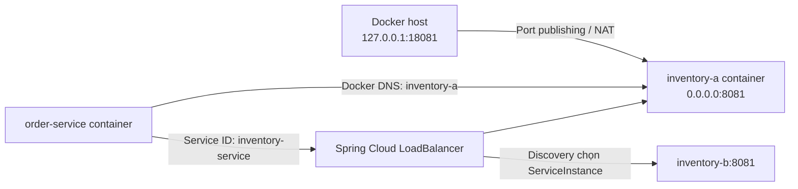
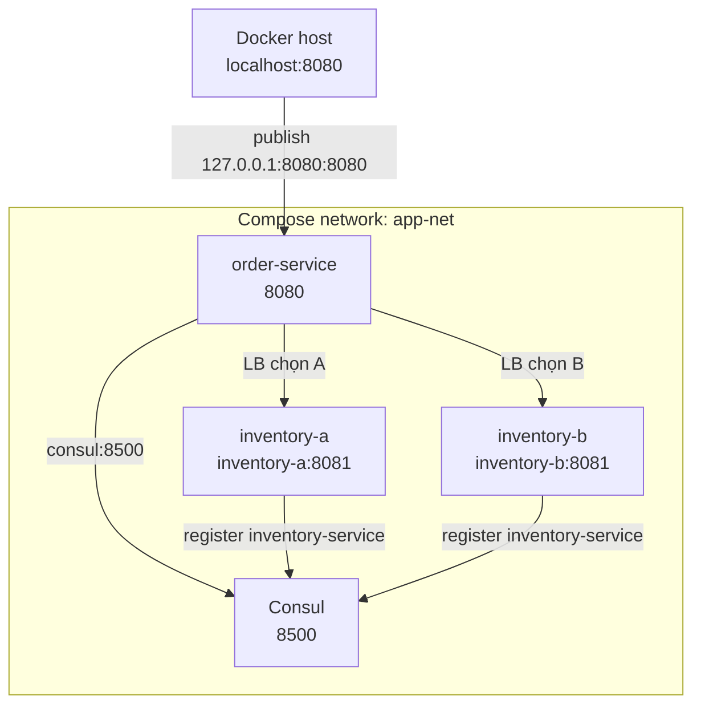

# Container hostname, cổng nội bộ và cổng ánh xạ ra máy chủ

Khi chạy microservices bằng Docker hoặc Docker Compose, rất nhiều lỗi “Spring Cloud LoadBalancer không tìm thấy service”, “Connection refused” hoặc “No instances available” thực chất xuất phát từ việc **dùng sai hostname hoặc cổng của container**. Một ứng dụng chạy trên máy chủ có thể gọi `localhost:18081` thành công, nhưng ứng dụng chạy trong container bên cạnh lại phải kết nối tới `inventory-a:8081`. Nếu đăng ký `127.0.0.1:18081` vào service registry cho một caller ở container khác, LoadBalancer có thể chọn đúng `ServiceInstance` mà HTTP request vẫn đến sai nơi.

Bài thuộc chương **Triển khai** của module `SPRING_CLOUD_SERVICE_COMMUNICATION_LOAD_BALANCING`. Ta sẽ phân biệt **hostname của container, tên DNS trên Docker network, service ID của Spring Cloud, cổng ứng dụng lắng nghe, cổng publish trên Docker host**, rồi áp dụng vào RestClient/WebClient/OpenFeign, Consul discovery, health checks, Docker Compose, Kubernetes, timeout/retry và kiểm thử thực tế.

> **Nguyên tắc:** Địa chỉ của một `ServiceInstance` phải **có thể truy cập từ môi trường mạng của client sử dụng registry đó**. Với hai container trên cùng Docker Compose network, địa chỉ thường là tên service/alias nội bộ và **cổng container**; cổng được publish trên Docker host chủ yếu dành cho client ở ngoài mạng container.

## 1. Một ví dụ dễ nhầm nhất

Giả sử máy developer có container inventory chạy ứng dụng Spring Boot ở cổng `8081`:

```shell
docker run --rm \
  --name inventory-a \
  -p 127.0.0.1:18081:8081 \
  example/inventory-service:dev
```

Ba địa chỉ có ý nghĩa **khác nhau**:

| Địa chỉ | Dùng ở đâu? | Kết quả mong đợi |
|---|---|---|
| `http://localhost:18081` | Trên Docker host | Docker chuyển tiếp đến container, port 8081 |
| `http://inventory-a:8081` | Từ container **cùng Docker network có thể phân giải `inventory-a`** | Kết nối trực tiếp cổng nội bộ |
| `http://localhost:18081` | Từ một container khác | `localhost` là **container caller**, thường sai |
| `http://inventory-a:18081` | Từ container bên cạnh | Sai nếu inventory chỉ lắng nghe `8081` |
| `http://0.0.0.0:8081` | Dùng làm URL đích | Sai ý nghĩa: `0.0.0.0` là địa chỉ **bind**, không phải hostname service |

Lệnh `docker run` ở trên chưa tạo user-defined network dùng chung; vì thế **không được mặc định** tên `inventory-a` đã phân giải được từ mọi container. Với Docker Compose, các service cùng network được cung cấp DNS theo service name; phần sau sẽ dùng cách này để tránh phụ thuộc IP.

## 2. Bốn lớp địa chỉ phải tách biệt



| Lớp | Ví dụ | Ai quản lý? | Vai trò |
|---|---|---|---|
| **Service ID** | `inventory-service` | Spring Cloud/registry | Tên logic để tìm nhiều `ServiceInstance` |
| **Docker DNS name** | `inventory-a` | Docker network/Compose | Phân giải host nội bộ thành địa chỉ container |
| **Container port** | `8081` | Ứng dụng trong container | TCP port ứng dụng thực sự lắng nghe |
| **Host published port** | `18081` | Docker port publishing | Port trên máy chủ được chuyển tiếp vào container |
| **Bind address** | `0.0.0.0` | Ứng dụng/OS trong container | Giao diện mạng mà server chấp nhận kết nối |
| **Container IP** | `172.19.0.5` (minh họa) | Docker network | Địa chỉ có thể thay đổi khi recreate/scale |
| **External DNS** | `api.example.com` | DNS/ingress | Endpoint công khai hoặc truy cập từ mạng bên ngoài |

Một service ID như `inventory-service` không tự động là hostname DNS mà OS sẽ resolve. Khi client được cấu hình `@LoadBalanced`, Spring Cloud xử lý hostname logic đó, tìm instance rồi tạo địa chỉ vật lý. Nếu dùng HTTP client thông thường và Docker Compose có một service DNS cùng tên, client có thể kết nối nhờ **Docker DNS**, nhưng điều đó **không chứng minh** Spring Cloud LoadBalancer đã chọn `ServiceInstance`.

## 3. “localhost” bên trong container luôn cần xét lại

Mỗi container trong chế độ bridge networking thông thường có **network namespace riêng**. Bởi vậy:

```text
Docker host:
  localhost:18081 -> published port của inventory-a

order-service container:
  localhost:8080 -> chính order-service
  localhost:18081 -> chính order-service, không phải Docker host
  inventory-a:8081 -> inventory-a qua Docker network

inventory-a container:
  localhost:8081 -> chính inventory-a
  consul:8500 -> Consul container nếu cùng network
```

Dùng `localhost` đúng khi nói tới **chính tiến trình/container đang chạy câu lệnh**. Nó trở thành sai khi copy nguyên cấu hình ứng dụng từ môi trường chạy trực tiếp trên laptop vào Docker:

```yaml
# Thường SAI khi cấu hình nằm trong order-service container:
spring:
  cloud:
    consul:
      host: localhost
      port: 8500
```

Nếu Consul chạy trong container khác cùng Compose network, cấu hình nên là:

```yaml
spring:
  cloud:
    consul:
      host: consul
      port: 8500
```

Không cần publish cổng `8500` lên host chỉ để các container cùng network gọi Consul.

### 3.1. host.docker.internal không phải đáp án mặc định

`host.docker.internal` có thể hữu ích khi **container cần kết nối tới một tiến trình trên Docker host**. Cơ chế hỗ trợ thay đổi theo Docker Desktop, Linux Engine và cấu hình `host-gateway`. Nó không thay thế DNS service name giữa các container.

Với microservices cùng Docker Compose network, nên dùng `inventory-a:8081`/`consul:8500` và discovery phù hợp, không đẩy mọi traffic qua host gateway chỉ vì từng chạy `localhost` trên laptop.

## 4. Container phải lắng nghe ở địa chỉ có thể truy cập

Ứng dụng Spring Boot có thể cấu hình:

```yaml
server:
  address: 0.0.0.0
  port: 8081
```

Hoặc qua environment variables:

```yaml
environment:
  SERVER_ADDRESS: "0.0.0.0"
  SERVER_PORT: "8081"
```

`server.port=8081` xác định **cổng bên trong container**. `server.address=0.0.0.0` cho phép process bind trên các interface IPv4 của container; container khác có thể kết nối qua địa chỉ bridge được route tới.

Nếu đặt:

```yaml
server:
  address: 127.0.0.1
  port: 8081
```

ứng dụng chỉ lắng nghe loopback **bên trong inventory container**. Nó có thể trả `200` khi test từ chính container, nhưng container order-service và Docker port forwarding thường **không thể tới endpoint qua container interface**.

**Không dùng `0.0.0.0` làm tên đăng ký trong Consul**. Đó là bind address, không phải địa chỉ client nên kết nối. Registry cần hostname/IP có thể route và resolve được từ các caller.

### 4.1. Phân biệt lắng nghe và công bố

| Cấu hình | Ví dụ | Ý nghĩa |
|---|---|---|
| `server.address` | `0.0.0.0` | Interface server bind |
| `server.port` | `8081` | Port process lắng nghe |
| Consul `Address` hoặc discovery hostname | `inventory-a` | Địa chỉ client gọi được |
| Consul `Port` | `8081` | Port client gọi trong topology này |
| Compose `ports` | `127.0.0.1:18081:8081` | Publish host 18081 → container 8081 |

Thay đổi `server.port` không tự sửa mapping cũ. Nếu app chuyển từ `8081` sang `9091` nhưng Compose vẫn publish `18081:8081`, host sẽ forward đến nơi không có process lắng nghe.

## 5. Dockerfile EXPOSE, Compose expose và Compose ports

Đây là ba cấu hình có tên giống nhau nhưng ý nghĩa khác nhau.

### 5.1. EXPOSE trong Dockerfile

```dockerfile
FROM eclipse-temurin:21-jre
WORKDIR /app
COPY app.jar /app/app.jar
EXPOSE 8081
ENTRYPOINT ["java", "-jar", "/app/app.jar"]
```

`EXPOSE 8081` mô tả cổng dự kiến của image. Nó **không** làm Spring Boot tự đổi `server.port` và **không** tự publish port ra máy chủ. Lệnh `docker run -P` có thể publish các cổng đã khai báo vào host ports động; đó là hành vi khác.

### 5.2. expose trong Docker Compose

```yaml
services:
  inventory-a:
    image: example/inventory-service:dev
    expose:
      - "8081"
```

`expose` mô tả cổng container, **không tạo host port mapping**. Trên một Docker user-defined bridge network thông thường, các container cùng network có thể giao tiếp qua cổng mà ứng dụng lắng nghe **kể cả khi không khai báo `expose`**. `expose` không phải firewall hay ranh giới bảo mật.

### 5.3. ports trong Docker Compose

```yaml
services:
  inventory-a:
    image: example/inventory-service:dev
    ports:
      - "127.0.0.1:18081:8081"
```

Cú pháp:

```text
HOST_IP : HOST_PORT : CONTAINER_PORT
127.0.0.1 : 18081 : 8081
```

Khi Docker host nhận request đến `127.0.0.1:18081`, Docker chuyển tiếp đến container trên port `8081`. Đây **không phải** lời yêu cầu Spring Boot mở thêm port 18081 trong container.

**Bảo mật:** Nếu bỏ `127.0.0.1` và dùng `"18081:8081"`, Docker thường publish trên tất cả host interfaces; cổng có thể bị truy cập từ các mạng khác tùy firewall/routing. Chỉ publish những port cần phục vụ người dùng/gateway, kiểm soát TLS, authentication và network policies.

## 6. Bảng quyết định địa chỉ theo nơi caller chạy

Giả sử A/B đều chạy HTTP port nội bộ `8081`; máy chủ tùy chọn publish A/B tại `18081`/`18082` cho việc debug.

| Caller đang chạy ở đâu? | Địa chỉ phù hợp | Địa chỉ dễ dùng sai |
|---|---|---|
| Cùng inventory-a container | `http://localhost:8081` | `localhost:18081` |
| order-service cùng Compose network | `http://inventory-a:8081` hoặc service ID qua LB | `http://localhost:18081` |
| Consul agent cùng Compose network khi HTTP health check | `http://inventory-a:8081/actuator/health` | `http://localhost:8081/actuator/health` |
| Docker host | `http://127.0.0.1:18081` nếu A publish | `http://inventory-a:8081` khi host không có DNS/routing đó |
| Máy khác ngoài Docker host | DNS/IP **có thể truy cập từ máy đó** và host-published port, qua firewall phù hợp | `127.0.0.1:18081` trỏ về chính máy caller |
| App trong Kubernetes cùng namespace | DNS của Kubernetes Service hoặc Pod endpoint theo kiến trúc | Docker Compose service DNS |
| Spring Cloud LB client | `http://inventory-service/...` với `@LoadBalanced` và registry phù hợp | Host/port vật lý hard-code |

Khi một lời gọi có lỗi, **trước hết hãy hỏi “caller nằm trong network namespace nào?”**, sau đó mới kiểm tra registry, retry hoặc thuật toán round robin.

## 7. Thiết kế Docker Compose cho hai instance và discovery thật

Để kiểm chứng Spring Cloud LoadBalancer, ví dụ dùng bốn thành phần:

- `consul`: service registry chạy trên cùng Compose network.
- `inventory-a` và `inventory-b`: hai container cùng ứng dụng inventory, **cùng internal port `8081`**.
- `order-service`: client gọi `inventory-service` qua `@LoadBalanced RestClient`.

Hai inventory service đăng ký **cùng Consul service name `inventory-service`** nhưng có `instance-id` và hostname khác nhau.



Không cần publish `8081` của inventory-a hoặc inventory-b lên Docker host vì **order-service và Consul cùng mạng nội bộ**.

## 8. Cấu hình docker-compose.yml thực hành

Ví dụ dưới đây cần hai image Java ứng dụng đã build sẵn: `example/order-service:dev` và `example/inventory-service:dev`. Chúng là **tên image minh họa**, không phải image public bảo đảm có sẵn. Order có `GET /probe/inventory`, inventory có `GET /whoami` và `/actuator/health` như mã ở mục 9–10.

```yaml
services:
  consul:
    image: hashicorp/consul:1.22.7
    command: ["agent", "-dev", "-client=0.0.0.0"]
    healthcheck:
      test: ["CMD", "consul", "info"]
      interval: 5s
      timeout: 3s
      retries: 12
    networks:
      - app-net

  inventory-a:
    image: example/inventory-service:dev
    environment:
      SPRING_APPLICATION_NAME: inventory-service
      SERVER_ADDRESS: "0.0.0.0"
      SERVER_PORT: "8081"
      SPRING_CLOUD_CONSUL_HOST: consul
      SPRING_CLOUD_CONSUL_PORT: "8500"
      SPRING_CLOUD_CONSUL_DISCOVERY_HOSTNAME: inventory-a
      SPRING_CLOUD_CONSUL_DISCOVERY_INSTANCE_ID: inventory-a
      SPRING_CLOUD_CONSUL_DISCOVERY_PORT: "8081"
      SPRING_CLOUD_CONSUL_DISCOVERY_PREFER_IP_ADDRESS: "false"
      SPRING_CLOUD_CONSUL_DISCOVERY_HEALTH_CHECK_PATH: /actuator/health
      SPRING_CLOUD_CONSUL_DISCOVERY_HEALTH_CHECK_INTERVAL: 5s
    expose:
      - "8081"
    depends_on:
      consul:
        condition: service_healthy
    networks:
      - app-net

  inventory-b:
    image: example/inventory-service:dev
    environment:
      SPRING_APPLICATION_NAME: inventory-service
      SERVER_ADDRESS: "0.0.0.0"
      SERVER_PORT: "8081"
      SPRING_CLOUD_CONSUL_HOST: consul
      SPRING_CLOUD_CONSUL_PORT: "8500"
      SPRING_CLOUD_CONSUL_DISCOVERY_HOSTNAME: inventory-b
      SPRING_CLOUD_CONSUL_DISCOVERY_INSTANCE_ID: inventory-b
      SPRING_CLOUD_CONSUL_DISCOVERY_PORT: "8081"
      SPRING_CLOUD_CONSUL_DISCOVERY_PREFER_IP_ADDRESS: "false"
      SPRING_CLOUD_CONSUL_DISCOVERY_HEALTH_CHECK_PATH: /actuator/health
      SPRING_CLOUD_CONSUL_DISCOVERY_HEALTH_CHECK_INTERVAL: 5s
    expose:
      - "8081"
    depends_on:
      consul:
        condition: service_healthy
    networks:
      - app-net

  order-service:
    image: example/order-service:dev
    environment:
      SPRING_APPLICATION_NAME: order-service
      SERVER_ADDRESS: "0.0.0.0"
      SERVER_PORT: "8080"
      SPRING_CLOUD_CONSUL_HOST: consul
      SPRING_CLOUD_CONSUL_PORT: "8500"
      SPRING_CLOUD_CONSUL_DISCOVERY_REGISTER: "false"
      SPRING_CLOUD_CONSUL_DISCOVERY_QUERY_PASSING: "true"
      SPRING_CLOUD_LOADBALANCER_RETRY_ENABLED: "false"
    ports:
      - "127.0.0.1:8080:8080"
    depends_on:
      consul:
        condition: service_healthy
    networks:
      - app-net

networks:
  app-net:
    driver: bridge
```

**Giải thích các lựa chọn quan trọng:**

1. `consul` là tên DNS nội bộ được các container dùng để kết nối Consul ở cổng `8500`.
2. Hai instance cùng đăng ký tên `inventory-service`, vì `SPRING_APPLICATION_NAME` đều là `inventory-service`.
3. `SPRING_CLOUD_CONSUL_DISCOVERY_HOSTNAME` được đặt theo **tên DNS mà các client cùng network resolve được**: `inventory-a`/`inventory-b`.
4. `SPRING_CLOUD_CONSUL_DISCOVERY_INSTANCE_ID` khác nhau, tránh hai registration ghi đè lên nhau trong agent.
5. `SPRING_CLOUD_CONSUL_DISCOVERY_PORT` bằng **server port 8081**, không phải host published port.
6. Hai instance không có `ports` vì không cần nhận traffic từ Docker host.
7. `order-service` publish `127.0.0.1:8080:8080` để test API từ **máy host**, không publish Consul hoặc inventory ra Internet.
8. `query-passing=true` giúp caller chỉ nhận registration có Consul health check ở trạng thái `passing` theo cấu hình này.
9. Retry tắt ở baseline để phép đo instance selection không bị nhiễu bởi nhiều HTTP attempts.
10. `depends_on: condition: service_healthy` chờ **Consul container** khỏe. Nó **không** đảm bảo inventory-a/B đã hoàn tất đăng ký và health check; client vẫn cần xử lý giai đoạn startup/eventual consistency.

Consul `agent -dev` phù hợp cho **lab cục bộ**, không sử dụng nguyên cấu hình này cho production. Image tag cần được kiểm tra khả dụng với registry và kiến trúc CPU của môi trường; CI nên pin image digest được tổ chức kiểm duyệt.

### 8.1. Vì sao không cần hostname:?

Docker Compose cung cấp **service name DNS** trên network của project. Container `order-service` có thể phân giải tên `inventory-a` và `inventory-b` khi các container cùng mạng. Không cần đặt `hostname: inventory-a` chỉ để có service-name DNS này.

`hostname` chủ yếu đặt hostname ở cấp container; `container_name` chỉ định tên container cụ thể và làm việc scale trở nên khó khăn. **Tránh dựa vào IP hoặc container_name cố định** làm cơ chế chính khi triển khai nhiều replicas.

### 8.2. Vì sao không gán hai container cùng một host port?

Nếu cả hai đều khai báo:

```yaml
ports:
  - "18081:8081"
```

trên cùng Docker host, Docker không thể bind một TCP host port theo cùng địa chỉ cho hai container độc lập. Có thể publish `18081:8081` cho A và `18082:8081` cho B, nhưng **service-to-service traffic cùng network vẫn dùng `8081`**.

Ví dụ thật về cấu hình không cần thiết cho traffic nội bộ:

```yaml
inventory-a:
  ports:
    - "127.0.0.1:18081:8081"

inventory-b:
  ports:
    - "127.0.0.1:18082:8081"
```

Chỉ dùng khi cần debug từ host, có kiểm soát truy cập. **Không đăng ký `inventory-a:18081` hoặc `inventory-b:18082`** vào Consul cho caller container trong cấu hình ở mục 8.

## 9. Ứng dụng inventory-service: bind và trả instance marker

Ứng dụng inventory có thể triển khai một endpoint giúp quan sát instance:

```java
package com.example.inventory;

import org.springframework.beans.factory.annotation.Value;
import org.springframework.boot.SpringApplication;
import org.springframework.boot.autoconfigure.SpringBootApplication;
import org.springframework.web.bind.annotation.GetMapping;
import org.springframework.web.bind.annotation.RestController;

@SpringBootApplication
@RestController
public class InventoryApplication {

    @Value("${spring.cloud.consul.discovery.instance-id}")
    private String instanceId;

    public static void main(String[] args) {
        SpringApplication.run(InventoryApplication.class, args);
    }

    @GetMapping("/whoami")
    public String whoAmI() {
        return instanceId;
    }
}
```

`instance-id` được cấp là `inventory-a` hoặc `inventory-b` qua environment trong Compose. Controller trả marker để xác định bản sao đã xử lý request.

Inventory cần các dependency phù hợp:

```xml
<dependencies>
    <dependency>
        <groupId>org.springframework.boot</groupId>
        <artifactId>spring-boot-starter-web</artifactId>
    </dependency>
    <dependency>
        <groupId>org.springframework.boot</groupId>
        <artifactId>spring-boot-starter-actuator</artifactId>
    </dependency>
    <dependency>
        <groupId>org.springframework.cloud</groupId>
        <artifactId>spring-cloud-starter-consul-discovery</artifactId>
    </dependency>
</dependencies>
```

Đã import Spring Cloud BOM tương thích với Spring Boot. Nếu không có Actuator, Consul mặc định kiểm tra `/actuator/health` sẽ nhận 404 và có thể đánh dấu instance `critical`. Khi tách management port ra khỏi application port, kiểm tra Consul health-check URL, port và security riêng.

### 9.1. Health check có thực sự truy cập được không?

Trong ví dụ:

```text
consul container -> inventory-a:8081/actuator/health
consul container -> inventory-b:8081/actuator/health
```

Consul nằm cùng Compose network, nên nó có thể phân giải các tên đó. Health check phát hiện lỗi kết nối nếu inventory server bind sai `127.0.0.1` hoặc chưa mở port 8081. Tuy nhiên endpoint health trả 200 không chứng minh mọi API nghiệp vụ đều khỏe; cần hiểu readiness semantics và health group thực tế khi triển khai production.

## 10. Ứng dụng order-service: @LoadBalanced RestClient

Ứng dụng order cần Spring Web, Spring Cloud LoadBalancer và Spring Cloud Consul Discovery. Ví dụ:

```xml
<dependencies>
    <dependency>
        <groupId>org.springframework.boot</groupId>
        <artifactId>spring-boot-starter-web</artifactId>
    </dependency>
    <dependency>
        <groupId>org.springframework.cloud</groupId>
        <artifactId>spring-cloud-starter-loadbalancer</artifactId>
    </dependency>
    <dependency>
        <groupId>org.springframework.cloud</groupId>
        <artifactId>spring-cloud-starter-consul-discovery</artifactId>
    </dependency>
</dependencies>
```

Tạo builder được Spring Cloud xử lý:

```java
package com.example.order;

import org.springframework.cloud.client.loadbalancer.LoadBalanced;
import org.springframework.context.annotation.Bean;
import org.springframework.context.annotation.Configuration;
import org.springframework.web.client.RestClient;

@Configuration(proxyBeanMethods = false)
class ClientConfiguration {

    @Bean("inventoryLoadBalancedBuilder")
    @LoadBalanced
    RestClient.Builder inventoryLoadBalancedBuilder() {
        return RestClient.builder();
    }
}
```

Gateway:

```java
package com.example.order;

import org.springframework.beans.factory.annotation.Qualifier;
import org.springframework.stereotype.Service;
import org.springframework.web.client.RestClient;

@Service
public class InventoryGateway {

    private final RestClient inventory;

    public InventoryGateway(
            @Qualifier("inventoryLoadBalancedBuilder")
            RestClient.Builder builder) {
        this.inventory = builder.clone()
                .baseUrl("http://inventory-service")
                .build();
    }

    public String selectedInstance() {
        return inventory.get()
                .uri("/whoami")
                .retrieve()
                .body(String.class);
    }
}
```

Controller đầu vào:

```java
package com.example.order;

import org.springframework.web.bind.annotation.GetMapping;
import org.springframework.web.bind.annotation.RestController;

@RestController
class DeploymentProbeController {

    private final InventoryGateway inventory;

    DeploymentProbeController(InventoryGateway inventory) {
        this.inventory = inventory;
    }

    @GetMapping("/probe/inventory")
    String inventory() {
        return inventory.selectedInstance();
    }
}
```

Đường đi một request:

```text
Host: GET http://127.0.0.1:8080/probe/inventory
  |
  | Docker publish 8080:8080
  v
order-service container: GET /probe/inventory
  |
  | @LoadBalanced RestClient
  | GET http://inventory-service/whoami
  v
Spring Cloud ConsulDiscoveryClient:
  ServiceInstance { serviceId=inventory-service,
                    host=inventory-a, port=8081 }
  hoặc
  ServiceInstance { serviceId=inventory-service,
                    host=inventory-b, port=8081 }
  |
  v
HTTP transport: GET http://inventory-a:8081/whoami
             hoặc http://inventory-b:8081/whoami
  |
  v
Response body: inventory-a / inventory-b
```

**Tại sao không ghi `http://inventory-service:18081`?** Vì `18081` là host-published port dùng từ Docker host trong ví dụ khác. Trong ví dụ Compose này, Consul công bố port `8081`. Client nên dùng **service ID không hard-code port vật lý**; LoadBalancer lấy host/port thực từ `ServiceInstance` được chọn.

### 10.1. Lưu ý về auto-configuration và instrumentation

`RestClient.builder()` trực tiếp trong bean tập trung minh họa việc gắn `@LoadBalanced`. Trong ứng dụng production có Spring Boot auto-customizers (observation, tracing, SSL, request factory, connection pooling), hãy dùng cấu hình builder phù hợp phiên bản để bảo toàn những customizations đó. Không tạo RestClient tùy ý ngoài bean đã được Spring Cloud gắn interceptor rồi kết luận lỗi discovery.

## 11. Chạy và kiểm chứng bằng Docker Compose

Sau khi đã build hai application images với đúng tên trong Compose, chạy:

```shell
docker compose config
docker compose up -d
docker compose ps
```

`docker compose config` giúp phát hiện lỗi cú pháp/interpolation; nó không kiểm chứng endpoint HTTP có sẵn. `docker compose ps` cho biết container và host-published ports.

Kiểm tra log:

```shell
docker compose logs --tail 100 consul
docker compose logs --tail 100 inventory-a inventory-b
docker compose logs --tail 100 order-service
```

Kiểm tra danh sách service Consul qua CLI trong container:

```shell
docker compose exec consul consul catalog services
```

Khi inventory A/B đã đăng ký và checks được chuyển sang `passing`, từ Docker host:

```shell
curl -i http://127.0.0.1:8080/probe/inventory
curl -i http://127.0.0.1:8080/probe/inventory
curl -i http://127.0.0.1:8080/probe/inventory
```

Response body minh họa:

```text
inventory-a
inventory-b
inventory-a
```

Thứ tự thực tế phụ thuộc trạng thái round robin, candidate ordering, các request khác, cache, retry và custom policy; không bắt buộc request đầu luôn tới A. Quan trọng là **mỗi response thuộc tập A/B** và khi cả hai candidate khỏe, nhiều request tuần tự có thể quan sát cả hai dưới chính sách round robin mặc định.

### 11.1. Kiểm tra đích từ đúng network namespace

Nếu inventory-a không truy cập được từ order-service, cần kiểm tra kết nối **từ một container trên cùng network**, không chỉ từ Docker host. Nếu image ứng dụng có sẵn `curl`:

```shell
docker compose exec order-service \
  curl -fsS http://inventory-a:8081/actuator/health
```

Image Java nhỏ có thể không có `curl`; đừng cài công cụ debug vào production image chỉ để chạy test. Dùng container debug tạm nối cùng Compose network, hoặc kiểm tra bằng HTTP client test được cung cấp riêng.

Thử:

```shell
docker compose exec order-service \
  curl -fsS http://127.0.0.1:8081/actuator/health
```

thường sẽ thất bại nếu order-service không có ứng dụng nào lắng nghe port 8081. Đây là bằng chứng rằng `127.0.0.1` trong container **không** trỏ sang inventory-a.

### 11.2. Tại sao đôi lúc lần gọi đầu gặp 503?

`depends_on` chỉ giúp sắp thứ tự khởi động theo điều kiện đã khai báo. Khi order-service đã chạy, hai inventory instances có thể vẫn đang:

1. Khởi động JVM/Spring context.
2. Mở cổng `8081`.
3. Đăng ký vào Consul.
4. Chờ lần HTTP health check đầu tiên trở thành `passing`.
5. Được caller discovery query và LoadBalancer nhìn thấy.

Trong khoảng trống đó, `inventory-service` có thể chưa có candidate đủ điều kiện. Test nên poll có deadline hoặc readiness gate rõ ràng; production nên dùng startup/readiness checks và retry có giới hạn/idempotency đúng tầng, không dùng `Thread.sleep(100)` cố định.

## 12. Phân biệt Docker DNS với Spring Cloud LoadBalancer

Giả sử Compose có một service:

```yaml
services:
  inventory-service:
    image: example/inventory-service:dev
    expose:
      - "8081"
```

Các container cùng network có thể truy cập `http://inventory-service:8081` qua Docker DNS. Khi scale service này lên nhiều replicas (không dùng `container_name` hay fixed host port), Compose có thể trả nhiều container addresses tương ứng trong DNS.

**Tuy nhiên:**

- DNS resolution/connection behavior của một HTTP client **không đồng nghĩa** với `RoundRobinLoadBalancer` của Spring Cloud.
- Client chỉ biết một hostname DNS không mặc định tạo `ServiceInstanceListSupplier` từ mọi A record.
- Docker DNS không tự biến thành Consul/Eureka registrations.
- Docker DNS thường không cung cấp đầy đủ lifecycle/health metadata/zone/hint cho Spring Cloud LoadBalancer.
- DNS caching và HTTP connection reuse có thể khiến traffic không đều ngay cả khi DNS trả nhiều IPs.

Nếu mục tiêu là **server-side/native network load balancing** qua một endpoint ổn định, Docker/Kubernetes/service proxy có thể đáp ứng mà không nhất thiết cần Spring Cloud client-side selection. Nếu mục tiêu là **Spring Cloud LoadBalancer chọn từng ServiceInstance**, cần DiscoveryClient hoặc supplier phù hợp trả đúng các instances.

Trong ví dụ mục 8, Compose cố ý đặt tên hai container là `inventory-a`/`inventory-b`, **không** có DNS service `inventory-service`. Do đó việc `http://inventory-service` hoạt động qua order-service là một phép kiểm chứng tốt rằng client thực sự đang resolve **service ID từ Consul**.

## 13. Scale: tại sao không nên gắn cố định container_name và host port?

Mẫu Compose với hai services tách biệt A/B dễ hiểu cho lab. Khi scale production, thường dùng một service definition có nhiều replicas, mỗi instance tự đăng ký unique ID/hostname/IP hợp lệ.

Các sai lầm thường gặp:

```yaml
services:
  inventory-service:
    image: example/inventory-service:dev
    container_name: inventory-service
    ports:
      - "18081:8081"
```

Nếu chạy:

```shell
docker compose up -d --scale inventory-service=3
```

thì một `container_name` cố định không thể dùng cho ba container, và cùng một fixed host port `18081` cũng không thể được cả ba bind đồng thời trên cùng địa chỉ host.

Cách thiết kế khác:

- Không đặt `container_name` cố định cho replicas.
- Không publish host port cho internal-only microservices.
- Mỗi instance có định danh registration **duy nhất**.
- Mỗi instance có host/IP và internal port mà caller cùng network truy cập được.
- Dùng cơ chế discovery phù hợp môi trường container/orchestrator.
- Khi recreate, không dựa vào container IP cũ; discovery/health cần phản ánh sự thay đổi.

Ví dụ một service có thể scale, bỏ fixed host port:

```yaml
services:
  inventory-service:
    image: example/inventory-service:dev
    environment:
      SERVER_PORT: "8081"
    expose:
      - "8081"
    networks:
      - app-net

networks:
  app-net:
    driver: bridge
```

Đây chỉ là **mẫu networking**, chưa phải cấu hình registration Consul đầy đủ cho nhiều replicas. Nếu bổ sung Consul, mỗi replica phải đăng ký `instance-id` khác nhau và một địa chỉ **phân biệt đúng replica**: ví dụ container IP/hostname do nền tảng inject mà các caller có thể route đến. **Không** cố định tất cả registration cùng `instance-id=inventory-a` hoặc cùng một Compose service DNS hostname nếu mục tiêu là chọn từng replica vật lý.

### 13.1. Host published port động

Docker Compose hỗ trợ publish container port mà không cố định host port, chẳng hạn:

```yaml
ports:
  - "8081"
```

Docker sẽ cấp host port động cho mỗi replica. Có thể xem mapping bằng:

```shell
docker compose port --index=1 inventory-service 8081
docker compose port --index=2 inventory-service 8081
```

Cổng đó giúp **caller từ host hoặc mạng được cho phép** truy cập replica; nó **không** thay đổi `server.port=8081` trong container. Nếu không có nhu cầu external access cho từng replica, không cần publish tất cả.

## 14. Hai topology và cách đăng ký ServiceInstance đúng

### 14.1. Topology A — Caller và backend cùng Docker network

```text
order-service container          inventory-a container
       |                               ^
       |---- http://inventory-a:8081 --|
       |
       +---- http://inventory-b:8081 --> inventory-b
```

Consul registry nên công bố:

| Instance | Advertised host | Advertised port |
|---|---|---:|
| A | `inventory-a` | 8081 |
| B | `inventory-b` | 8081 |

Không cần host port mappings cho A/B. Registry cũng cần chính xác **service name**, health trạng thái và scheme. Đây là topology của ví dụ Compose.

### 14.2. Topology B — Caller nằm ngoài Docker bridge network

```text
External caller
    |
    +---- host.example:18081 -> inventory-a:8081
    |
    +---- host.example:18082 -> inventory-b:8081
```

Nếu caller ở máy khác và **không** có route/DNS đến `inventory-a`/`inventory-b`, nó không thể dùng các hostname nội bộ từ topology A.

Nếu thực sự muốn direct per-instance external routing, discovery dành cho caller ngoài mạng phải công bố **địa chỉ host có thể tới** và **published ports**:

| Instance | Advertised host | Advertised port |
|---|---|---:|
| A | `host.example` | 18081 |
| B | `host.example` | 18082 |

Phải mở firewall/TLS phù hợp, tránh public một dịch vụ nội bộ không cần thiết. Không tự suy rằng một registry chứa địa chỉ `inventory-a:8081` sẽ phục vụ đồng thời container clients và external clients. Có thể cần **tách registry/view**, một gateway/ingress hoặc một lớp định tuyến phù hợp với từng nhóm caller.

**Không sử dụng `127.0.0.1` làm advertised host cho một caller ở máy khác**: loopback của caller không phải Docker host.

## 15. Kubernetes: ánh xạ khái niệm, không áp nguyên Docker ports

Khi chuyển sang Kubernetes, các lớp tương tự nhưng cách triển khai khác:

| Docker Compose | Kubernetes tương đương về ý nghĩa |
|---|---|
| Container app listen `8081` | Process container listen `8081`; `containerPort` là khai báo metadata |
| Compose service name DNS | Kubernetes Service DNS theo namespace |
| `ports: HOST:CONTAINER` | Tùy nhu cầu, `Service`, `NodePort`, `LoadBalancer` hoặc Ingress/Gateway |
| Container IP thay đổi | Pod IP có thể thay đổi sau reschedule |
| Consul registration | Kubernetes Endpoints/EndpointSlices hoặc external registry |
| Compose bridge network | Cluster networking/CNI và NetworkPolicy |
| Instance health | Readiness/liveness/startup probes |

Ví dụ Deployment có container ứng dụng lắng nghe port 8081 và Service nội bộ expose port 80:

```yaml
apiVersion: apps/v1
kind: Deployment
metadata:
  name: inventory
spec:
  replicas: 2
  selector:
    matchLabels:
      app: inventory
  template:
    metadata:
      labels:
        app: inventory
    spec:
      containers:
        - name: inventory
          image: example/inventory-service:dev
          ports:
            - containerPort: 8081
          env:
            - name: SERVER_PORT
              value: "8081"
            - name: SERVER_ADDRESS
              value: "0.0.0.0"
---
apiVersion: v1
kind: Service
metadata:
  name: inventory-service
spec:
  type: ClusterIP
  selector:
    app: inventory
  ports:
    - name: http
      port: 80
      targetPort: 8081
```

Từ Pod order-service trong cùng namespace, `http://inventory-service:80` dùng **Kubernetes Service DNS/IP và cơ chế load distribution của nền tảng**. Nó **không mặc nhiên** dùng Spring Cloud LoadBalancer per-Pod. Nếu muốn Spring Cloud chọn từng Pod, cần `Spring Cloud Kubernetes DiscoveryClient`/supplier tương ứng, quyền RBAC phù hợp và danh sách `ServiceInstance` thể hiện các endpoint/Pod mà caller truy cập được.

**Phân biệt ba port:**

- `containerPort: 8081`: metadata của container; ứng dụng thật vẫn phải bind `8081`.
- `Service.port: 80`: port mà **Service virtual IP** tiếp nhận.
- `Service.targetPort: 8081`: port trên backend Pod để chuyển tiếp.

`NodePort`, external `LoadBalancer` và Ingress/Gateway chỉ cần khi có nhu cầu truy cập từ ngoài cluster; chúng không phải `server.port` của ứng dụng.

## 16. Hostname, TLS và bảo mật khi đổi đích sau LoadBalancer

Nếu request đi qua HTTPS:

```text
https://inventory-service/api/v1/items
         |
         | Spring Cloud LoadBalancer chọn instance
         v
https://inventory-a.internal.example:8443
```

HTTP transport thường xác minh certificate theo danh tính host thực tế được dùng để kết nối. Nếu registry công bố **IP** nhưng certificate chỉ có DNS SAN, hostname verification có thể thất bại. Nếu đăng ký hostname container `inventory-a`, chứng chỉ cũng cần được thiết kế cho tên TLS được xác minh, hoặc TLS được kết thúc tại gateway/mesh có danh tính rõ ràng.

Điểm cần nhớ:

1. Service ID logic, Docker hostname và TLS SAN là ba khái niệm liên quan nhưng **không nhất thiết trùng nhau**.
2. Đăng ký `0.0.0.0` hoặc `127.0.0.1` cho caller ở container khác thường sai về tính định tuyến.
3. Không tắt hostname verification, không dùng trust-all để “sửa” lỗi do sai advertised host.
4. Không publish Consul, Actuator, management API hoặc admin endpoints ra Internet nếu không có kiểm soát truy cập.
5. Với mTLS, xem lại client identity khi retry chuyển sang instance khác; tất cả backend cần chính sách trust tương thích.
6. Khi thay DNS hoặc certificate trong rolling deployment, chờ readiness và trust propagation trước khi đưa instance vào pool.

## 17. Ảnh hưởng tới timeout, retry và connection pooling

Một địa chỉ đăng ký sai có thể gây **lỗi rất giống timeout** nhưng không thể được sửa bằng việc tăng số retries.

| Sai cấu hình | Biểu hiện | Retry có giải quyết gốc không? |
|---|---|---|
| Registry công bố `127.0.0.1` | Client kết nối tới chính nó, connection refused/timeout | Không |
| Registry công bố host port `18081` cho container peer | Peer kết nối sai port | Không |
| App bind `127.0.0.1:8081` trong container | Container khác không truy cập được | Không |
| Instance B bị gỡ nhưng cache chưa cập nhật | Có thể vẫn chọn B | Retry có thể giảm triệu chứng, cần sửa freshness |
| Health endpoint trả critical | Candidate bị loại khi health filtering bật | Retry không tự làm instance khỏe |
| B chỉ hỗ trợ HTTP nhưng registry đánh dấu HTTPS | TLS handshake fail | Không |
| Một instance chậm thoáng qua | Read/response timeout | Retry bounded có thể hữu ích khi request an toàn |
| Pool kết nối tới instance cũ bị reset sau recreate | Connection reset trên request dùng pool | Retry có thể phục hồi, cần connection lifecycle đúng |

**Đừng dùng retry để che một registry công bố host/port sai.** Sửa advertised address, endpoint health và network trước. Retry cùng instance sẽ lặp lại lỗi; retry sang instance khác cũng có thể thất bại nếu tất cả instances cùng đăng ký sai.

### 17.1. Connection pool theo host/port vật lý

Một `@LoadBalanced WebClient` dùng Reactor Netty hoặc `RestClient` dùng HTTP transport pooling thường tái sử dụng connection theo **đích thực tế**, không phải chỉ theo service ID logic. Khi LoadBalancer chọn A rồi B, transport có thể dùng hai nhóm connection khác nhau.

Khi container recreate:

- Container IP cũ có thể biến mất.
- Kết nối đang mở tới container cũ bị cắt.
- Docker DNS/Consul có thể cập nhật ở tốc độ khác nhau.
- Pool có thể giữ connection cũ cho tới khi phát hiện lỗi hoặc hết idle timeout.
- Retry đúng ngân sách/idempotency có thể hỗ trợ recovery, nhưng không thay thế health/discovery freshness.

Cần quan sát connect timeout, pool active/pending, instance selection, HTTP status, retries và final outcome để phân biệt lỗi topology với lỗi tải.

## 18. Kiểm thử tự động: xác minh registry → instance → HTTP response

Một bài kiểm thử triển khai nên đánh giá **từng tầng** thay vì chỉ gọi từ Docker host và thấy HTTP 200.

### 18.1. Ma trận kiểm chứng

| Test | Bằng chứng kỳ vọng |
|---|---|
| Cả A/B chạy và healthy | Consul có hai registrations cùng service name, ID riêng |
| Docker DNS | Từ order-service có thể resolve/connect tới `inventory-a:8081` và `inventory-b:8081` |
| Service discovery | Spring `DiscoveryClient.getInstances("inventory-service")` trả đúng host/port |
| LoadBalancer | Call `http://inventory-service/whoami` nhận marker A hoặc B |
| Round robin | Nhiều calls tuần tự trong bối cảnh kiểm soát thấy cả A và B |
| Một instance critical | Health query lọc instance đó theo chính sách |
| B bị dừng | Health/deregistration hội tụ; requests mới không còn chọn B |
| Sai internal port | Phát hiện connection refused dù Consul registration có thể vẫn tồn tại |
| Sai published port | Test từ host thất bại, nhưng đường gọi nội bộ có thể vẫn đúng |
| Không có instance | LB trả lỗi lựa chọn phù hợp, không dùng IP đoán hoặc fallback không kiểm soát |
| Retry off | Một logical request không bị gửi lặp do LB retry |
| Scale/recreate | Không phụ thuộc IP cũ; service được phát hiện lại sau hội tụ |

### 18.2. JUnit smoke test qua host-published API

Giả sử Compose đã được chạy trong một **integration test job** riêng và `order-service` publish cổng 8080. Có thể dùng Java `HttpClient` gửi nhiều lời gọi để xem marker:

```java
import java.net.URI;
import java.net.http.HttpClient;
import java.net.http.HttpRequest;
import java.net.http.HttpResponse;
import java.util.HashSet;
import java.util.Set;

import org.junit.jupiter.api.Test;

import static org.junit.jupiter.api.Assertions.*;

class ComposeDeploymentSmokeIT {

    @Test
    void callsInventoryInstancesThroughOrderService()
            throws Exception {

        HttpClient http = HttpClient.newHttpClient();
        Set<String> seen = new HashSet<>();

        for (int n = 0; n < 8; n++) {
            HttpRequest request = HttpRequest.newBuilder()
                    .uri(URI.create(
                            "http://127.0.0.1:8080/probe/inventory"))
                    .GET()
                    .build();

            HttpResponse<String> response = http.send(
                    request,
                    HttpResponse.BodyHandlers.ofString());

            assertEquals(200, response.statusCode());

            String instance = response.body().trim();
            assertTrue(
                    Set.of("inventory-a", "inventory-b")
                            .contains(instance));

            seen.add(instance);
        }

        assertEquals(
                Set.of("inventory-a", "inventory-b"),
                seen);
    }
}
```

Điều kiện áp dụng:

- Test chạy trên **Docker host** hoặc môi trường có route tới published port `8080`.
- Compose stack đã khởi động và **hai inventory registrations đã passing**.
- Thuật toán mặc định là `RoundRobinLoadBalancer`, không có hint/zone filter giữ client vào một instance.
- Các lời gọi tuần tự, không có retry hoặc request nền làm nhiễu giả định cần kiểm chứng.

Đây là smoke test **sau triển khai**, không thay thế test thật về service registry hoặc unit test algorithm. Không nên bắt buộc marker A/B đều xuất hiện sau tám lần nếu chọn thuật toán Random/sticky hoặc chỉ một instance đang eligible.

### 18.3. Kiểm tra registration trực tiếp trong Spring

Một integration test trong order-service có thể kiểm tra:

```java
@Autowired
DiscoveryClient discoveryClient;

@Test
void registeredPortsAreInternalApplicationPorts() {
    var instances =
            discoveryClient.getInstances("inventory-service");

    assertEquals(2, instances.size());

    assertTrue(instances.stream()
            .allMatch(instance ->
                    instance.getPort() == 8081));

    assertEquals(
            Set.of("inventory-a", "inventory-b"),
            instances.stream()
                    .map(ServiceInstance::getHost)
                    .collect(java.util.stream.Collectors.toSet()));
}
```

Phép đo này yêu cầu **Consul thật đã có hai registrations healthy** và ứng dụng test dùng đúng registry; nó không tự phù hợp một unit test cô lập bằng mock. Nếu hạ tầng quảng bá IP thay hostname hoặc dùng Kubernetes/Service port khác, sửa assertions để khớp topology đã thiết kế — không ép mọi hệ thống phải dùng port 8081.

## 19. Runbook: điều tra lỗi theo đúng thứ tự

Nếu `order-service` báo `ResourceAccessException`, `ConnectException`, `UnknownHostException` hoặc `503`:

1. **Client URL**: ghi URI logic, xác nhận dùng `http://inventory-service/...` và builder `@LoadBalanced`.
2. **Instance list**: query `DiscoveryClient`/Consul, ghi service ID, host, port, secure flag, metadata, health.
3. **Địa chỉ được chọn**: ghi selected instance thực tế, phân biệt lỗi không có instance với lỗi có instance nhưng không kết nối được.
4. **Network namespace**: kiểm tra caller chạy trên host, Compose container, container network khác hay Kubernetes Pod.
5. **DNS**: từ chính namespace caller, phân giải hostname **được registry công bố**.
6. **TCP**: thử đúng internal port hoặc published port theo topology, không trộn hai loại.
7. **Bind**: xác minh Spring Boot lắng nghe `0.0.0.0:8081` hoặc interface hợp lệ.
8. **Health**: kiểm tra Consul health check URL từ namespace Consul, không chỉ từ host.
9. **Scheme/TLS**: đối chiếu `http/https`, port thực, certificate SAN/truststore.
10. **Cache/Retry/Pool**: chỉ sau khi địa chỉ và endpoint đúng, kiểm tra cache stale, connection reuse và retry budget.
11. **Final outcome**: dùng trace/log để kết nối logical call, instance được chọn, HTTP attempt và lỗi cuối.

### 19.1. Bảng triệu chứng nhanh

| Triệu chứng | Khả năng cao | Cách xác minh |
|---|---|---|
| Host gọi `localhost:18081` được, order container không gọi `localhost:18081` được | Nhầm loopback namespace | Gọi `inventory-a:8081` trong cùng Docker network |
| `UnknownHostException: inventory-a` | Không chung network hoặc DNS alias không tồn tại | `docker compose ps` và network membership |
| `UnknownHostException: inventory-service` | Client chưa `@LoadBalanced` hoặc service DNS không tồn tại | Kiểm tra HTTP builder và Consul |
| `Connection refused` tới `inventory-a:8081` | Server chưa listen hoặc bind loopback/sai port | Kiểm tra `server.address`, `server.port`, server logs |
| `No instances available` | Discovery không có candidate eligible | Kiểm tra Consul registrations/health/filter |
| Consul thấy A/B nhưng health critical | Endpoint `/actuator/health` không erreichbar hoặc sai path/port | Kiểm tra health từ Consul network |
| Gọi được A nhưng B lỗi | B sai hostname/port/TLS/health | Kiểm tra từng instance riêng |
| `docker compose up --scale` lỗi | Fixed `container_name` hoặc fixed host port | Loại bỏ cố định không cần thiết |
| Host port 18081 bận | Trùng published port với process khác | Đổi host port; giữ internal port nếu app vẫn nghe 8081 |
| Docker host gọi được nhưng máy ngoài host không gọi được | Publish bind `127.0.0.1` hoặc firewall | Xác định mục đích exposure và policy trước khi mở |
| Máy ngoài gọi `inventory-a:8081` lỗi | Hostname nội bộ không resolve/route từ ngoài | Dùng gateway/ingress hoặc external advertised address |
| Sau recreate vẫn gọi IP cũ | Cache/discovery stale hoặc hard-code IP | Đo propagation, không đăng ký IP cố định |
| HTTPS lỗi hostname | SAN không khớp host sau selection | Kiểm tra certificate/SNI, không tắt verification |
| Timeout tăng khi scale | Pool, discovery churn, health convergence hoặc downstream overload | Đo active/pending connections, attempts, latency |

## 20. Observability và đo tác động khi triển khai

Cần thu các tín hiệu:

| Metric/log | Ý nghĩa |
|---|---|
| `serviceId` | Tên logic caller yêu cầu |
| `selectedInstanceId` | Bản sao được chọn cho attempt |
| `selectedHost`/`selectedPort` | Địa chỉ vật lý mà client sẽ kết nối |
| `advertisedScheme` | `http` hoặc `https` theo registry |
| `discoveredInstanceCount` | Số bản sao registry trả về |
| `eligibleInstanceCount` | Số bản sao sau health/zone/metadata filter |
| `connectionFailureCategory` | DNS, connect, TLS, response timeout, pool acquire |
| `retryAttemptCount` | Số lần gửi lại theo logical call |
| `finalOutcome` | Thành công, HTTP error hoặc transport failure |
| `discoveryConvergenceLatency` | Độ trễ từ register/deregister tới client thấy thay đổi |

Các tên trường là **ví dụ instrumentation**, không phải toàn bộ metric mặc định Spring Cloud tự cung cấp. Với Micrometer, dùng nhãn có cardinality giới hạn như service ID, outcome category và zone. Tránh đưa IP/container ID động, raw URL hoặc request ID vào metrics labels không giới hạn; chi tiết per-request phù hợp log/trace có kiểm soát hơn.

### 20.1. Khi một instance bị recreate

So sánh trước/sau:

```text
T0: inventory-a được chọn -> HTTP 200
T1: inventory-a container bị recreate, IP thay đổi
T2: Consul health chuyển trạng thái / registration được cập nhật
T3: DiscoveryClient + supplier nhận danh sách mới
T4: LoadBalancer ngừng chọn endpoint cũ
T5: HTTP requests trở lại bình thường
```

Nếu giữa T1 và T4 có lỗi, đánh giá liệu latency hội tụ của discovery/cache và connection pool có nằm trong ngân sách phục hồi dự kiến. Tránh giải thích mọi lỗi trong cửa sổ này là “round robin chọn sai” hoặc “Docker port mapping lỗi”.

## 21. Checklist cấu hình trước khi triển khai

- [ ] Đã phân biệt **service ID**, Docker DNS hostname, container hostname/IP và public DNS.
- [ ] Spring Boot bind một interface có thể truy cập, ví dụ `0.0.0.0`.
- [ ] `server.port` khớp **container port** mà ứng dụng thực sự lắng nghe.
- [ ] Mapping `HOST_PORT:CONTAINER_PORT` chỉ dùng ở nơi cần external access.
- [ ] Các container cần gọi nhau cùng network và phân giải đúng service name/alias.
- [ ] Không dùng `localhost` của caller container để trỏ nhầm container khác.
- [ ] Không đưa `0.0.0.0` vào registry làm advertised hostname.
- [ ] Consul/Eureka nhận đúng service ID, instance ID, host/IP, port, scheme.
- [ ] Health endpoint thực sự truy cập được từ network của health checker.
- [ ] Không giả định `EXPOSE` hoặc Compose `expose` tự tạo host port mapping.
- [ ] Không publish registry/Actuator/admin endpoints nếu không cần.
- [ ] Hai inventory instances có IDs khác nhau; mỗi instance được route tới đúng host/port.
- [ ] Client dùng builder `@LoadBalanced` và URI hostname logic nếu cần Spring Cloud selection.
- [ ] Không nhầm Docker DNS round robin với Spring Cloud `ServiceInstanceListSupplier`.
- [ ] Không dùng `container_name` và fixed host port khi muốn scale nhiều replicas.
- [ ] Không hard-code container IP vì có thể đổi sau recreate.
- [ ] Với external caller, advertised address phải truy cập được **từ ngoài Docker network**, hoặc đi qua gateway/ingress.
- [ ] HTTPS truststore và SAN khớp hostname thực sau LoadBalancer.
- [ ] Cấu hình timeout/retry, cache/health và pool được kiểm chứng riêng.
- [ ] Có smoke test từ Docker host và kiểm tra DNS/TCP từ chính caller network.
- [ ] Có log/trace thể hiện service ID, selected instance, host/port và lỗi cuối.
- [ ] Cơ chế rollback và readiness/draining phù hợp khi rolling deployment.

## 22. Câu hỏi tự kiểm tra

**1. `ports: ["18081:8081"]` có khiến Spring Boot lắng nghe port 18081 không?** Không. Nó publish host port 18081 và chuyển tiếp đến container port 8081. Process vẫn phải listen 8081.

**2. Vì sao `curl http://localhost:18081` thành công trên host nhưng thất bại từ order-service container?** Vì `localhost` trong order-service là network namespace của chính container order-service, không phải Docker host.

**3. Vì sao không nên đăng ký `inventory-a:18081` vào Consul cho caller cùng Compose network?** Vì 18081 là host-published port, trong khi container inventory-a lắng nghe 8081. Caller nội bộ phải dùng `inventory-a:8081`.

**4. Có cần `ports` để order-service gọi inventory-a trên cùng Compose network không?** Không; nếu cùng network và server lắng nghe trên interface/port thích hợp, có thể gọi bằng DNS service name và internal port.

**5. `EXPOSE 8081` có mở port ra ngoài không?** Không. Đó chủ yếu là metadata; publish cần `ports` hoặc `docker run -p`.

**6. Khi gọi `http://inventory-service` qua `@LoadBalanced RestClient`, ai cung cấp host/port?** `ServiceInstanceListSupplier`/discovery trả danh sách instances, LoadBalancer chọn một instance và dựng URI vật lý cho HTTP client.

**7. Nếu Docker DNS resolve `inventory-service`, đã chứng minh Spring Cloud LoadBalancer hoạt động chưa?** Chưa. Đó có thể chỉ là Docker DNS + HTTP client thông thường; cần instrument và kiểm tra bean `@LoadBalanced`/selected instance.

**8. Vì sao `spring.cloud.consul.discovery.instance-id` phải khác nhau ở hai replicas?** Để registrations không ghi đè nhau trong Consul và từng bản sao được nhận diện riêng.

**9. Với Kubernetes Service port 80, targetPort 8081, ứng dụng cần bind port nào?** Port 8081 trên Pod/container; Kubernetes Service nhận traffic tại port 80 và chuyển tiếp tới 8081.

**10. Tăng retry có sửa được registry công bố `127.0.0.1:8081` cho caller ở container khác không?** Không. Phải sửa advertised host/port trước.

## 23. Tổng kết

Khi triển khai Spring Cloud LoadBalancer trong Docker hoặc Kubernetes, **hostname và port phải được hiểu theo network namespace của caller**. `server.port` là cổng ứng dụng lắng nghe trong container; Compose `ports` ánh xạ **host port → container port** để phục vụ các caller ở ngoài mạng đó. `EXPOSE`/`expose` không tạo mapping và không phải tường lửa. `localhost` trong container trỏ về chính container, còn tên service/alias Docker giúp các container cùng network gọi nhau mà không cần publish port ra host.

Với Spring Cloud LoadBalancer, `inventory-service` là **service ID logic**, còn `inventory-a:8081` hoặc `inventory-b:8081` là địa chỉ của `ServiceInstance` được discovery công bố. Trong ví dụ Consul + Compose, hai bản sao cùng đăng ký `inventory-service` nhưng có hostname/instance ID riêng, caller dùng `@LoadBalanced RestClient` và URI logic để Spring Cloud thực hiện selection. Host-published ports chỉ cần cho ingress/debug từ máy chủ, không phải để các container nội bộ liên lạc.

Một cấu hình triển khai đúng phải khớp **DNS, bind address, instance registration, internal port, health check, TLS và quyền truy cập mạng**. Sau đó mới tinh chỉnh cache, retry, timeout, connection pool và thuật toán lựa chọn. Luôn kiểm chứng từ **đúng vị trí caller**, đối chiếu registry → selected instance → HTTP responder để tránh nhầm lỗi topology thành lỗi cân bằng tải.

### Tài liệu tham khảo

- [Docker Docs — Networking in Compose](https://docs.docker.com/compose/how-tos/networking/) — DNS theo service name, container port/host port, recreate, port mappings và scale.
- [Docker Docs — Port Publishing and Mapping](https://docs.docker.com/engine/network/port-publishing/) — cú pháp host/container ports, NAT, bind address và bảo mật.
- [Docker Docs — Publishing and Exposing Ports](https://docs.docker.com/get-started/docker-concepts/running-containers/publishing-ports/) — `EXPOSE` và `-p`.
- [Spring Cloud Consul — Service Discovery](https://docs.spring.io/spring-cloud-consul/reference/discovery.html) — registration, hostname/port/instance ID, health checks và `DiscoveryClient`.
- [Spring Cloud Commons — Common Abstractions](https://docs.spring.io/spring-cloud-commons/reference/spring-cloud-commons/common-abstractions.html) — `@LoadBalanced RestClient.Builder` và service ID.
- [Spring Cloud Commons — Spring Cloud LoadBalancer](https://docs.spring.io/spring-cloud-commons/reference/spring-cloud-commons/loadbalancer.html) — supplier, cache, retry và chọn `ServiceInstance`.
- [Kubernetes — Service](https://kubernetes.io/docs/concepts/services-networking/service/) — Service port/targetPort, ClusterIP và routing tới Pods.

