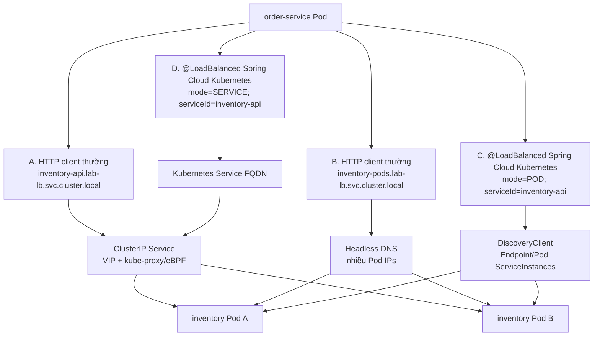
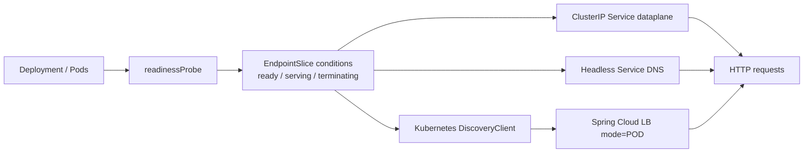
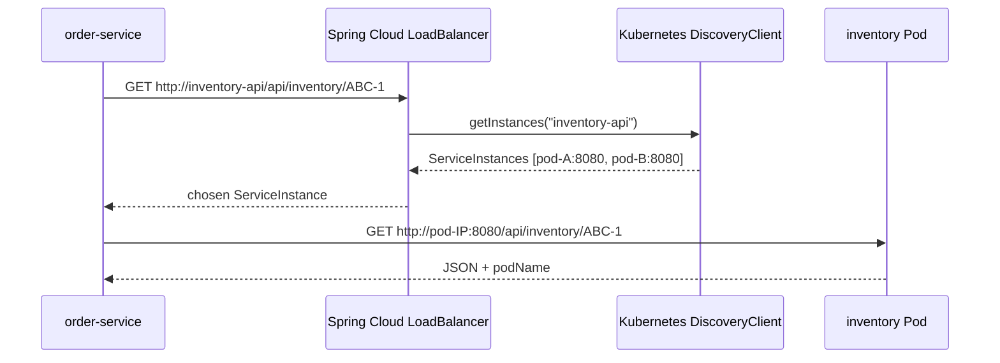

# Kubernetes Service, headless Service và lựa chọn điểm cân bằng tải

## 1. Bài toán triển khai: ai thực sự quyết định Pod nhận request?

Trong chương **Triển khai** của module `SPRING_CLOUD_SERVICE_COMMUNICATION_LOAD_BALANCING`, `order-service` gọi `inventory-service` theo service ID. Ở môi trường phát triển, Spring Cloud LoadBalancer có thể đọc danh sách `ServiceInstance` từ discovery rồi chọn bằng Round Robin, Random, health check hoặc chính sách định tuyến. Khi triển khai trên Kubernetes, một cơ chế khác xuất hiện: **Kubernetes Service** có thể đã cung cấp địa chỉ ổn định và phân phối lưu lượng tới các Pod.

Câu hỏi cốt lõi không phải “làm sao bật nhiều bộ cân bằng tải”, mà là:

> Với một HTTP request từ `order-service`, **Spring Cloud LoadBalancer**, **Kubernetes Service dataplane**, **DNS resolver/HTTP connection pool** hay **service mesh** sẽ chọn Pod nhận request?

Nếu chọn không rõ, ta có thể cấu hình hai lớp LoadBalancer nối tiếp nhau, rồi nhầm tưởng thuật toán zone, sticky hoặc health tại Spring đang điều khiển **Pod đích** trong khi Spring chỉ chọn một **ClusterIP Service**. Ở chiều ngược lại, gọi headless DNS không có nghĩa ứng dụng đã có thuật toán Round Robin per request.

### Mục tiêu học tập

Sau bài học, bạn có thể:

1. Giải thích sự khác nhau giữa `Service.type=ClusterIP` mặc định và `clusterIP: None` (headless).
2. Mô tả đường đi DNS → ClusterIP/VIP → service proxy/eBPF → Pod và đường DNS headless → Pod IP.
3. Phân biệt **server-side/network-level load balancing** với **client-side load balancing** của Spring Cloud.
4. Hiểu hai chế độ `POD` / `SERVICE` của **Spring Cloud Kubernetes LoadBalancer** và nơi `ServiceInstance` được chọn.
5. Chọn khi nào nên dùng một `RestClient`/`WebClient` thông thường đến Kubernetes Service, khi nào dùng `@LoadBalanced` đến tập Pod.
6. Đọc manifest Deployment, Service, EndpointSlice, readiness/liveness và xác định Pod nào có thể nhận traffic.
7. Xây một lab so sánh ClusterIP, headless DNS, Spring Cloud Kubernetes `POD`/`SERVICE`, kết nối giữ sống, timeout/retry và rolling update.
8. Kiểm tra lựa chọn thực sự qua Pod ID, số HTTP attempts, trace và các chỉ số có ý nghĩa.
9. Nhận diện bẫy double balancing, Service namespace, TTL/cache, headless không có endpoint ready và định tuyến theo zone.
10. Thiết kế triển khai an toàn có RBAC tối thiểu, network policy, TLS/mTLS và quy trình rollback.

**Phạm vi phiên bản:** ví dụ Java dùng Spring Boot 3.x hoặc stack tương thích tùy Spring Cloud BOM; phần `spring.cloud.kubernetes.loadbalancer.mode` dựa trên tài liệu Spring Cloud Kubernetes hiện hành có hai chế độ `POD` và `SERVICE` (5.0.x; cũng có ở một số Release Train 3.x). **Không** suy từ phiên bản tên file rằng project đang chạy đúng version đó; luôn đối chiếu dependency đã resolve.

## 2. Sơ đồ bốn tuyến gọi dễ bị nhầm



Sơ đồ mô tả **cấu hình mặc định theo ý định**. Nếu ở tuyến D service được chọn là **headless** thay vì ClusterIP, FQDN đó sẽ trả IP của Pod, **không đi qua VIP**. Nếu có service mesh, proxy sidecar có thể thêm một lớp chọn upstream khác; đừng xem sơ đồ như bảo đảm một packet đi chính xác qua kube-proxy trên mọi CNI.

| Cách gọi | Caller dùng gì? | Ai quyết định backend? | Nguồn dữ liệu | Có cần Kubernetes API/RBAC ở chính caller? |
|---|---|---|---|---|
| **A. ClusterIP** | HTTP client thường, Service DNS | Kube-proxy/IPVS/iptables hoặc eBPF/service dataplane; có thể kèm mesh | Service + EndpointSlice của Kubernetes | **Không**, DNS và mạng đủ nếu policy cho phép |
| **B. Headless** | HTTP client thường, headless DNS | DNS resolution, logic của HTTP client, connection pool; **không có Service VIP load balancer** | DNS A/AAAA của Pod endpoints | **Không** để chỉ phân giải tên qua DNS |
| **C. Spring `POD`** | `@LoadBalanced` client và `DiscoveryClient` | Spring Cloud LoadBalancer chọn `ServiceInstance` ứng với endpoint Pod | Spring Cloud Kubernetes DiscoveryClient/Endpoints | **Thường có**, tùy Fabric8/Kubernetes client hoặc DiscoveryServer được chọn |
| **D. Spring `SERVICE`** | `@LoadBalanced` client | Spring chọn **Kubernetes Service**; Kubernetes tiếp tục chọn Pod nếu Service là ClusterIP | Kubernetes Service objects + DNS | **Thường có** đối với implementation dùng Kubernetes API; tùy deployment |

**Quy tắc quyết định:** không dùng `@LoadBalanced` chỉ vì Kubernetes đã có Service. Hãy chọn nó khi bạn **cần chính sách lựa chọn ở phía ứng dụng** hoặc cần tích hợp Spring Cloud ecosystem; nếu chỉ cần phân phối ổn định tới các ready Pods qua service name, **ClusterIP + client HTTP thông thường** là điểm khởi đầu đơn giản hơn.

## 3. Kubernetes Service loại ClusterIP

Khi tạo Service bình thường:

```yaml
apiVersion: v1
kind: Service
metadata:
  name: inventory-api
  namespace: lab-lb
spec:
  type: ClusterIP
  selector:
    app: inventory
  ports:
    - name: http
      port: 80
      targetPort: http
```

Kubernetes cấp cho Service một **ClusterIP** ổn định trong thời gian Service tồn tại. DNS trong cluster thường phân giải:

```text
inventory-api.lab-lb.svc.cluster.local
    -> 10.x.y.z  (một ClusterIP minh họa, không phải Pod IP)
```

Một caller dùng `http://inventory-api.lab-lb.svc.cluster.local:80` kết nối tới IP Service ảo. Service dataplane chọn một backend trong tập EndpointSlice phù hợp và chuyển tiếp lưu lượng tới Pod IP/targetPort.

### 3.1. Cân bằng ở lớp kết nối, không nhất thiết mỗi HTTP request

Với những triển khai kube-proxy phổ biến, lựa chọn backend diễn ra **theo kết nối TCP mới**. Một HTTP/1.1 keep-alive connection có thể tái sử dụng cho nhiều request và tiếp tục gắn với **cùng Pod**. HTTP/2 multiplexing cũng có thể gửi nhiều streams trên một kết nối. Vì vậy:

- `100` GET qua một pool ít kết nối **không bảo đảm** số request chia đều giữa hai Pod.
- Round Robin ở phía Spring không cần xuất hiện thì Kubernetes Service vẫn có phân phối ở tầng dataplane.
- `sessionAffinity: ClientIP`, `internalTrafficPolicy`, topology-aware routing, mesh hoặc CNI khác có thể thay đổi cách backend được chọn.
- Không kiểm chứng algorithm chỉ bằng một dãy `curl` mà không biết client có tái sử dụng kết nối hay không.

**Kubernetes Service không mặc định là HTTP L7 load balancer.** Nó không đọc JSON business, scope JWT hay status 503 để tự retry sang replica khỏe. Hành vi L7 có thể do Ingress/Gateway API, service mesh hoặc client application đảm nhiệm.

### 3.2. Điểm mạnh và giới hạn

**Phù hợp khi:** ứng dụng chỉ cần gọi một tên ổn định và để Kubernetes cập nhật tập ready endpoints theo thời gian. Lớp code đơn giản, không phải gọi Kubernetes API từ mỗi ứng dụng.

**Giới hạn:** application không trực tiếp quyết định Pod theo metadata zone/weight/custom policy trong `ServiceInstanceListSupplier`. Khi một Pod trả 503 nhưng readiness vẫn `Ready`, service dataplane có thể tiếp tục gửi kết nối mới tới nó. Kubernetes không hiểu “HTTP 503 riêng của nghiệp vụ inventory” nếu probe không phản ánh lỗi đó.

## 4. Headless Service: `clusterIP: None` nghĩa là gì?

Headless Service được tạo bằng giá trị **chuỗi đặc biệt** `None`:

```yaml
apiVersion: v1
kind: Service
metadata:
  name: inventory-pods
  namespace: lab-lb
spec:
  clusterIP: None
  selector:
    app: inventory
  ports:
    - name: http
      port: 8080
      targetPort: http
```

Với **headless Service có selector**, Kubernetes tạo EndpointSlices cho các Pod khớp selector; cluster DNS có thể trả **nhiều bản ghi A/AAAA** trỏ tới IP của các Pod đủ điều kiện.

```text
inventory-pods.lab-lb.svc.cluster.local
    -> 10.244.1.21
    -> 10.244.2.15
    -> 10.244.3.09
```

Đây chỉ là các IP ví dụ. Headless **không có ClusterIP được cấp**, không có cân bằng tải/proxy Service VIP do nền tảng cung cấp. DNS giúp **khám phá địa chỉ Pod**, nhưng client cần chọn IP và quản lý kết nối.

### 4.1. DNS trả nhiều IP không tự thành Round Robin của Spring

Giả sử Java HTTP client gọi:

```java
RestClient client = RestClient.create(
        "http://inventory-pods.lab-lb.svc.cluster.local:8080");
```

Đây là `RestClient` thông thường. Nó **không** tự dùng `RoundRobinLoadBalancer` và **không** gọi `ServiceInstanceListSupplier` chỉ vì DNS trả nhiều IP. JVM/HTTP library quyết định tra DNS, thử địa chỉ nào, giữ kết nối bao lâu và khi nào resolve lại.

Mọi giả định như “mỗi request chuyển Pod”, “A lỗi thì retry sang B” hoặc “danh sách DNS cập nhật là client thấy ngay” phải **kiểm thử với transport và resolver thật**. Caching DNS, connection pooling, keep-alive, stale sockets và thứ tự A/AAAA có thể làm phân phối khác mong đợi.

### 4.2. Headless không bắt buộc để Spring chọn Pod

Một điểm đặc biệt dễ nhầm:

> Spring Cloud Kubernetes `mode=POD` có thể dùng **Kubernetes DiscoveryClient để tìm endpoints của một Service ClusterIP thông thường**. Không cần đổi Service thành headless chỉ để cho `@LoadBalanced` chọn Pod.

Ngược lại, tạo headless Service cũng **không tự kích hoạt** Spring Cloud LoadBalancer trong `RestClient`/`WebClient`. Hai việc độc lập: **cách Kubernetes công bố endpoint** và **cách ứng dụng chọn endpoint**.

### 4.3. Headless phù hợp StatefulSet như thế nào?

Với StatefulSet có `spec.serviceName: inventory-pods` và cách cấu hình hostname/subdomain thích hợp, có thể có địa chỉ Pod ổn định dạng:

```text
inventory-0.inventory-pods.lab-lb.svc.cluster.local
inventory-1.inventory-pods.lab-lb.svc.cluster.local
```

Đây là trường hợp cần **định danh từng replica**, ví dụ hệ thống cơ sở dữ liệu phân vai primary/replica hoặc cụm phân mảnh. **Không** tự suy Deployment Pod có những tên ổn định như StatefulSet. Headless phục vụ discovery/identity của thành viên, không có nghĩa tất cả replicas là interchangeable hoặc có thể dùng Random cho mọi thao tác ghi.

## 5. EndpointSlice và readiness: từ Pod đến danh sách đủ điều kiện

Kubernetes dùng **EndpointSlice** để công bố địa chỉ/port và điều kiện của endpoints thuộc Service. Với Service có selector, các controller liên quan đồng bộ Pod membership vào EndpointSlices.



Các trường trạng thái quan trọng:

| Điều kiện | Ý nghĩa | Hậu quả thực tế |
|---|---|---|
| `ready` | Endpoint được xem là sẵn sàng phục vụ theo điều kiện EndpointSlice | Thông thường dùng để chọn endpoint; còn phụ thuộc policy/proxy |
| `serving` | Endpoint có thể tiếp tục phục vụ, kể cả trong một số giai đoạn terminating | Hữu ích cho draining/termination |
| `terminating` | Pod đang được xóa/đóng, cần xử lý kết nối đang có | Proxy thường tránh endpoint terminating, nhưng có ngoại lệ khi không còn backend khác |

**Không đồng nhất `Ready=true` với mọi HTTP operation đều thành công.** Readiness probe chỉ quan sát điều kiện nó được cấu hình để kiểm tra. Nếu Pod trả HTTP 503 cho API tồn kho nhưng `/actuator/health/readiness` vẫn UP, Service vẫn có thể đưa Pod đó vào tập backend.

### 5.1. Độ trễ cập nhật

Khi readiness thay đổi hoặc rollout scale Pod:

```text
Pod state/readiness đổi
  -> EndpointSlice được cập nhật
  -> kube-proxy/eBPF hoặc cluster DNS cập nhật danh sách đích
  -> Spring Cloud Kubernetes discovery cache/watch (nếu dùng) cập nhật
  -> HTTP client connection pool / DNS cache điều chỉnh
```

Đây là **chuỗi cập nhật bất đồng bộ**, không có bảo đảm mọi client thấy chính xác cùng một thời điểm. Một kết nối đang mở có thể vẫn đang xử lý request; khi endpoint vừa bị loại, những requests mới đôi khi vẫn gặp lỗi trong cửa sổ chuyển trạng thái. Cần timeout, retry có giới hạn và graceful shutdown thích hợp.

### 5.2. Không phải mọi Service đều có selector

Headless Service **có selector** thường để Kubernetes tạo EndpointSlices tự động. Với Service **không có selector**, nguồn endpoint có thể do người vận hành/controller khác quản lý; không áp dụng máy móc giả định “Kubernetes luôn tự lấy mọi Pod IP cùng nhãn”. Phải kiểm tra đối tượng EndpointSlice thực tế và cấu hình service discovery được dùng.

`publishNotReadyAddresses: true` có thể khiến endpoint chưa Ready vẫn được công bố, hữu ích cho một số quy trình bootstrap cụm stateful nhưng **nguy hiểm** nếu consumer nhầm đó là danh sách backend phục vụ người dùng. Không bật property này chỉ để “sửa lỗi DNS thiếu địa chỉ”.

## 6. Tạo một môi trường lab có cả ClusterIP và headless

Mục tiêu: hai Service khác tên nhưng **cùng selector `app: inventory`**, để có thể so sánh đúng sự khác nhau của địa chỉ Service mà không đổi tập Pod.

### 6.1. Manifest Deployment và Service

Ví dụ tệp `inventory-k8s.yaml` mà người học có thể tạo trong lab:

```yaml
apiVersion: v1
kind: Namespace
metadata:
  name: lab-lb
---
apiVersion: apps/v1
kind: Deployment
metadata:
  name: inventory
  namespace: lab-lb
spec:
  replicas: 3
  selector:
    matchLabels:
      app: inventory
  template:
    metadata:
      labels:
        app: inventory
    spec:
      terminationGracePeriodSeconds: 30
      containers:
        - name: inventory
          image: ghcr.io/example/inventory:lab
          imagePullPolicy: IfNotPresent
          ports:
            - name: http
              containerPort: 8080
          env:
            - name: POD_NAME
              valueFrom:
                fieldRef:
                  fieldPath: metadata.name
            - name: MANAGEMENT_ENDPOINT_HEALTH_PROBES_ENABLED
              value: "true"
          readinessProbe:
            httpGet:
              path: /actuator/health/readiness
              port: http
            initialDelaySeconds: 3
            periodSeconds: 5
            timeoutSeconds: 2
            failureThreshold: 2
          livenessProbe:
            httpGet:
              path: /actuator/health/liveness
              port: http
            initialDelaySeconds: 10
            periodSeconds: 10
            timeoutSeconds: 2
          resources:
            requests:
              cpu: 100m
              memory: 128Mi
            limits:
              cpu: 500m
              memory: 512Mi
---
apiVersion: v1
kind: Service
metadata:
  name: inventory-api
  namespace: lab-lb
spec:
  type: ClusterIP
  selector:
    app: inventory
  ports:
    - name: http
      port: 8080
      targetPort: http
---
apiVersion: v1
kind: Service
metadata:
  name: inventory-pods
  namespace: lab-lb
spec:
  clusterIP: None
  selector:
    app: inventory
  ports:
    - name: http
      port: 8080
      targetPort: http
```

**Chú ý:** image `ghcr.io/example/inventory:lab` là **placeholder**, không phải image đã được tạo hay có thể pull chắc chắn. Người học cần build/push image Spring Boot thật có endpoint `/api/inventory/{sku}` và Actuator probes, rồi sửa tên image. Nếu image không tồn tại, Pod ở `ImagePullBackOff` và bài test DNS/route **không thể kết luận gì về cân bằng tải**.

Cả hai Service cùng selector nên tập endpoint phía sau về cơ bản là cùng ba Pod, nhưng **đường tới Pod khác nhau**: ClusterIP qua VIP/dataplane, headless qua DNS Pod IPs.

### 6.2. Endpoint Java minh họa định danh Pod

Trong ứng dụng inventory (Spring MVC), có thể tạo:

```java
@RestController
@RequestMapping("/api/inventory")
class InventoryController {

    @Value("${POD_NAME:local}")
    private String podName;

    @GetMapping("/{sku}")
    Map<String, Object> get(@PathVariable String sku) {
        return Map.of(
                "sku", sku,
                "available", 12,
                "podName", podName);
    }
}
```

Giá trị `POD_NAME` được đưa từ Downward API qua manifest, giúp kiểm tra **Pod thực sự xử lý**, không suy đoán từ DNS result hay metadata instance được chọn. Ứng dụng cần `spring-boot-starter-web` và `spring-boot-starter-actuator`; phải expose readiness/liveness qua Actuator theo cấu hình đã chọn.

### 6.3. Áp manifest và xác nhận trạng thái

```bash
kubectl apply -f inventory-k8s.yaml

kubectl rollout status deployment/inventory -n lab-lb
kubectl get pods -n lab-lb -l app=inventory -o wide
kubectl get svc -n lab-lb
kubectl get endpointslices -n lab-lb \
  -l kubernetes.io/service-name=inventory-api -o wide
kubectl get endpointslices -n lab-lb \
  -l kubernetes.io/service-name=inventory-pods -o wide
```

Không giả định cluster có `kubectl`/quyền tạo Namespace hoặc image có sẵn. Các lệnh trên là **hướng dẫn người học thực hành**, không phải lệnh đã được chạy khi soạn tài liệu.

Kỳ vọng: `inventory-api` có một ClusterIP, `inventory-pods` có `CLUSTER-IP=None`, cả hai có ready endpoints trỏ đến các Pod được chọn. Khi có nhiều EndpointSlices, hãy kiểm tra tất cả slices theo label, không chỉ lấy phần tử đầu.

## 7. Kiểm tra DNS và backend thực sự nhận HTTP

### 7.1. So sánh record DNS

Từ một Pod debug trong namespace `lab-lb` (image cần có `nslookup`):

```bash
kubectl run -n lab-lb dns-check \
  --image=busybox:1.36 \
  --restart=Never --rm -i -- \
  nslookup inventory-api.lab-lb.svc.cluster.local

kubectl run -n lab-lb dns-headless \
  --image=busybox:1.36 \
  --restart=Never --rm -i -- \
  nslookup inventory-pods.lab-lb.svc.cluster.local
```

Kỳ vọng **khái niệm**:

- `inventory-api`: DNS cung cấp IP của **Service ClusterIP**.
- `inventory-pods`: DNS cung cấp địa chỉ **Pod endpoints** (nhiều A/AAAA nếu có nhiều ready Pods và IPv4/IPv6 phù hợp).

Lệnh `nslookup` có thể in kèm địa chỉ DNS server, nhiều bản ghi hoặc định dạng khác theo image/CoreDNS; **đừng** hardcode một số dòng output để test pass.

### 7.2. Gửi request và đọc `podName`

```bash
kubectl run -n lab-lb curl-probe \
  --image=curlimages/curl:8.12.1 \
  --restart=Never --rm -i -- \
  sh -c 'for i in 1 2 3 4 5 6 7 8; do
    curl -fsS http://inventory-api.lab-lb.svc.cluster.local:8080/api/inventory/ABC-1;
    echo;
  done'
```

Lệnh trên tạo nhiều process `curl` trong một shell để dễ nhìn kết quả. Nó **không phải benchmark distribution**, không bảo đảm traffic chia đều vì selection có thể phụ thuộc connection pooling, source IP, session affinity, topology và dataplane.

Thử thay DNS name thành headless:

```bash
kubectl run -n lab-lb curl-headless \
  --image=curlimages/curl:8.12.1 \
  --restart=Never --rm -i -- \
  sh -c 'for i in 1 2 3 4 5 6 7 8; do
    curl -fsS http://inventory-pods.lab-lb.svc.cluster.local:8080/api/inventory/ABC-1;
    echo;
  done'
```

Nếu phần lớn request headless cùng vào một Pod, **đừng** kết luận DNS hoặc Kubernetes bị hỏng; điều đó có thể phản ánh resolver/address order và lựa chọn kết nối của client. Lặp lại từ nhiều Pods debug, kiểm tra DNS answers và HTTP connection behavior trước khi so sánh.

## 8. Phương án A — Chỉ dùng Kubernetes ClusterIP, không dùng Spring LB

Cho những service nội bộ chỉ cần gọi API tương đương ở mọi Pod, đây thường là cấu hình đơn giản nhất.

```java
@Configuration(proxyBeanMethods = false)
class InventoryClientConfiguration {

    @Bean
    RestClient inventoryHttpClient(RestClient.Builder bootBuilder) {
        return bootBuilder.clone()
                .baseUrl(
                    "http://inventory-api.lab-lb.svc.cluster.local:8080")
                .build();
    }
}
```

`RestClient.Builder` ở đây là builder được **Spring Boot auto-configure**, không phải `@LoadBalanced`. Nếu project khai báo nhiều builder, hãy dùng qualifier đúng để tránh inject nhầm bean có LoadBalancer interceptor.

```java
@Service
class InventoryGateway {

    private final RestClient inventoryHttpClient;

    InventoryGateway(RestClient inventoryHttpClient) {
        this.inventoryHttpClient = inventoryHttpClient;
    }

    InventoryStock read(String sku) {
        return inventoryHttpClient.get()
                .uri("/api/inventory/{sku}", sku)
                .retrieve()
                .body(InventoryStock.class);
    }
}

record InventoryStock(
        String sku, Integer available, String podName) {}
```

**Đường đi:** `inventory-api.lab-lb.svc.cluster.local` → DNS nhận ClusterIP → Kubernetes dataplane chọn ready Pod → HTTP server trả body.

**Không có Spring `ReactorLoadBalancer.choose()` cho request này**. Dù `spring-cloud-starter-loadbalancer` có mặt trong classpath, HTTP client không mang LoadBalancer interceptor/filter thì Spring không tự chọn `ServiceInstance`.

**Ưu điểm:** ít cấu hình, không cần RBAC Kubernetes API trong `order-service` chỉ để resolve một Service name. Nếu có micrometer/observability, dùng builder Boot-configured để giữ HTTP client spans/metrics; việc không dùng Spring LB **không** có nghĩa mất khả năng tracing.

### 8.1. Khi nào không nên chọn kiểu này?

Nếu bắt buộc định tuyến theo **metadata riêng của từng Pod** ở tầng application, ví dụ version canary cứng, tenant isolation, custom weights hoặc zone preference có kiểm soát, chỉ có ClusterIP thông thường chưa bảo đảm chính sách đó. Có thể dùng Kubernetes Service/label selectors để **tách tập backend**, hoặc Spring Cloud LoadBalancer `POD` với custom supplier, hoặc mesh/Gateway policy thích hợp.

Không dùng `sessionAffinity: ClientIP` như thay thế cho một contract phân vùng tenant hay authorization. Affinity là cơ chế chọn backend, không phải hàng rào an ninh.

## 9. Phương án B — Headless DNS với HTTP client thường

```java
RestClient headlessClient = RestClient.create(
        "http://inventory-pods.lab-lb.svc.cluster.local:8080");
```

**Đường đi:** DNS trả Pod IPs → resolver/HTTP library chọn địa chỉ → TCP trực tiếp tới Pod IP:8080, đúng cổng ứng dụng Spring Boot đang lắng nghe trong lab.

### 9.1. Bẫy port mapping của headless

Với ClusterIP, cấu hình `port: 80`, `targetPort: 8080` cho phép client kết nối Service VIP tại port 80, còn dataplane chuyển tới Pod:8080. Nhưng headless **không có VIP/NAT Service** để chuyển port 80 thành 8080 cho một kết nối trực tiếp tới Pod IP.

Vì vậy, **manifest ở mục 6 đã đặt cả hai Service ở `port: 8080` với `targetPort: http` trỏ tới containerPort 8080**. Khi gọi headless phải chỉ rõ cổng 8080:

```text
http://inventory-pods.lab-lb.svc.cluster.local:8080/api/inventory/ABC-1
```

Người học có thể chủ động tạo một **biến thể lỗi**: đổi riêng headless Service thành `port: 80` khi Pod vẫn chỉ nghe 8080, rồi thử kết nối `:80`. Nếu DNS trả đúng Pod IP nhưng TCP sai cổng, đừng kết luận headless DNS bị lỗi. Sau phép thử cần khôi phục port 8080. Bảng sau là **cấu hình mặc định đúng của lab**:

| Service | DNS kết quả | `spec.ports[].port` | Pod thực lắng nghe | Client URL |
|---|---|---:|---:|---|
| `inventory-api` ClusterIP | VIP | 8080 | 8080 | `http://inventory-api...:8080` |
| `inventory-pods` headless | Pod IP | 8080 | 8080 | `http://inventory-pods...:8080` |

Điểm này quan trọng vì một lab headless sai port dễ làm người học tưởng “headless DNS hỏng” trong khi **DNS đã trả Pod IP đúng** nhưng TCP tới port không lắng nghe.

### 9.2. Headless vẫn không phải một Spring policy

Ngay cả khi DNS trả cả A/B/C, `RestClient.create(...)` không biết metadata zone/weight/health policy của `ServiceInstanceListSupplier`. Kiểm thử timeout, retry, connection reuse và DNS TTL riêng. Nếu cần chọn từng Pod một cách minh bạch và đo selection, phương án Spring `POD` ở mục sau phù hợp hơn.

## 10. Phương án C — Spring Cloud Kubernetes `mode=POD`

Tài liệu Spring Cloud Kubernetes hiện hành cung cấp hai implementation LoadBalancer (chọn **một** backend client):

```xml
<!-- Chọn Fabric8 hoặc Kubernetes Java Client, KHÔNG dùng đồng thời cả hai. -->
<dependency>
  <groupId>org.springframework.cloud</groupId>
  <artifactId>spring-cloud-starter-kubernetes-fabric8-loadbalancer</artifactId>
</dependency>
```

Hoặc:

```xml
<dependency>
  <groupId>org.springframework.cloud</groupId>
  <artifactId>spring-cloud-starter-kubernetes-client-loadbalancer</artifactId>
</dependency>
```

Chỉ một trong hai dependency được chọn, dùng Spring Cloud BOM tương thích với Spring Boot và Spring Cloud Kubernetes version đang chạy. Nếu project không chạy trong Kubernetes, cần cấu hình giả lập discovery hoặc môi trường test thay vì mong client Kubernetes hoạt động qua `localhost`.

### 10.1. Chọn POD mode

```yaml
spring:
  application:
    name: order-service
  cloud:
    kubernetes:
      loadbalancer:
        mode: POD
      discovery:
        namespaces:
          - lab-lb
```

Trong mode `POD`, `@LoadBalanced` client gọi tên logic `inventory-api`. Spring Cloud Kubernetes dùng `DiscoveryClient.getInstances("inventory-api")` để lấy danh sách endpoint instances và Spring Cloud LoadBalancer chọn một phần tử.



Ở đây **Service tên `inventory-api` có thể vẫn là ClusterIP**. DiscoveryClient lấy thông tin các endpoints của Service; ứng dụng gửi trực tiếp tới endpoint Pod. Không bắt buộc dùng headless Service để có lựa chọn ở client.

### 10.2. Tạo RestClient có @LoadBalanced

Một pattern cho Spring Boot 3.x:

```java
@Configuration(proxyBeanMethods = false)
class LoadBalancedInventoryConfiguration {

    @Bean
    @LoadBalanced
    RestClient.Builder loadBalancedRestClientBuilder(
            RestClientBuilderConfigurer configurer) {
        return configurer.configure(RestClient.builder());
    }

    @Bean
    RestClient inventoryByPod(
            @LoadBalanced RestClient.Builder builder) {
        return builder.clone()
                .baseUrl("http://inventory-api")
                .build();
    }
}
```

`RestClientBuilderConfigurer` thuộc auto-configuration của Spring Boot 3.x. Nó giúp không làm mất các customizers cần thiết khi tự tạo builder; với Boot 4 hoặc cấu trúc bean khác cần đối chiếu API thật và tránh apply observation hai lần.

Sự khác nhau so với phương án A:

- A gọi URL **DNS có thật** `inventory-api.lab-lb.svc.cluster.local` qua client thường.
- C gọi URL **service ID logic** `http://inventory-api` qua `@LoadBalanced` client.
- DNS và Spring LoadBalancer **không đồng nghĩa**, dù service ID và tên DNS có vẻ giống nhau.
- Nếu vô tình tạo `RestClient.create("http://inventory-api")` không có LoadBalancer, DNS short name có thể resolve tới Service VIP và đi theo **phương án A**, khiến test “đang dùng Spring LB” xanh giả.

### 10.3. Kiểm tra đúng tập ServiceInstances

Trong lab có thể inject Spring `DiscoveryClient` để xem danh sách:

```java
@Component
class InstanceLogger {

    private final DiscoveryClient discovery;

    InstanceLogger(DiscoveryClient discovery) {
        this.discovery = discovery;
    }

    void logInventoryInstances() {
        for (ServiceInstance si :
                discovery.getInstances("inventory-api")) {
            System.out.printf(
                    "id=%s host=%s port=%d metadata=%s%n",
                    si.getInstanceId(),
                    si.getHost(),
                    si.getPort(),
                    si.getMetadata());
        }
    }
}
```

Mã này dành cho **diagnostic lab**, không log toàn bộ metadata nhạy cảm trong production. Nếu kết quả chỉ có **một VIP** thay vì IP của từng Pod, thực tế hệ thống đang dùng một implementation/mode khác hoặc cấu hình discovery chưa phù hợp. **Đừng** suy từ annotation `@LoadBalanced` rằng client chắc chắn đang chọn từng Pod.

## 11. Phương án D — Spring Cloud Kubernetes `mode=SERVICE`

Khi đặt:

```yaml
spring:
  cloud:
    kubernetes:
      loadbalancer:
        mode: SERVICE
      discovery:
        namespaces:
          - lab-lb
```

Spring Cloud Kubernetes chọn Kubernetes Service object phù hợp tên logic và namespace, rồi xây target URI dạng:

```text
inventory-api.lab-lb.svc.cluster.local:8080
```

Với **`inventory-api` loại ClusterIP**, traffic tiếp tục tới VIP và Kubernetes service dataplane chọn Pod. Spring Cloud LoadBalancer chỉ đang chọn một **địa chỉ Service**, không thể từ đó suy rằng Round Robin bên Spring đang quay trực tiếp giữa các Pod.

Tài liệu hiện hành cho `SERVICE` mode mô tả lookup theo tên `metadata.name` mặc định hoặc theo labels với cơ chế matching riêng, và cách chọn Service port theo `portName` (mặc định thường là `http`). Nếu Service có nhiều ports không có tên phù hợp, việc chọn “port đầu” có thể không deterministic. **Đặt tên port tường minh** trong manifest và kiểm tra port thực tế trên URI đầu ra.

### 11.1. Có thể xảy ra hai tầng lựa chọn

```text
Spring LoadBalancer:
    chọn Kubernetes Service (inventory-api)
            |
            v
Kubernetes DNS/VIP:
    chọn endpoint Pod tùy dataplane/policy
            |
            v
HTTP connection:
    request tới inventory Pod
```

Vì vậy, bật Spring Round Robin ở `SERVICE` mode không có nghĩa HTTP requests đến A/B/C theo chính sách Round Robin của Spring. Nếu chỉ có **một** Service object tên `inventory-api`, Spring thực tế không có ba Pod candidates để chia bằng thuật toán.

**Ngoại lệ quan trọng:** nếu `SERVICE` mode chọn một **headless** Service object, DNS name của nó sẽ trả Pod IPs và sự chọn Pod rơi vào resolver/HTTP client; vẫn **không** có VIP của headless Service. Vị trí chọn cuối cùng phải được xác minh bằng DNS result và network trace, không dựa vào tên mode.

### 11.2. Khi nào SERVICE mode có ích?

Khi ứng dụng cần tích hợp một số chức năng của Spring Cloud nhưng muốn **giữ Kubernetes Service như ranh giới đích**, hoặc có nhiều Service objects cần matching theo policy được kiểm soát. Nếu mọi consumer chỉ dùng một ClusterIP service có sẵn, cân nhắc bỏ hẳn `@LoadBalanced` thay vì thêm một tầng chọn Service mà không tạo lợi ích tương ứng.

### 11.3. OpenFeign: service ID hay URL cố định?

Với Spring Cloud OpenFeign, **có hay không khai báo `url`** cũng quyết định có đi qua Spring Cloud LoadBalancer:

```java
// Feign theo service ID; khi có LB/discovery phù hợp,
// mode=POD hoặc SERVICE quyết định tập ứng viên.
@FeignClient(name = "inventory-api")
interface InventoryFeignByDiscovery {
    @GetMapping("/api/inventory/{sku}")
    InventoryStock read(@PathVariable("sku") String sku);
}

// Feign theo URL trực tiếp; không dựa vào LB để resolve host.
// Chỉ dùng trong cấu hình THAY THẾ, không đăng ký cả hai
// interface có cùng client name/contextId rồi trông chờ tự chọn.
@FeignClient(
    name = "inventory-direct",
    url = "http://inventory-api.lab-lb.svc.cluster.local:8080")
interface InventoryFeignDirect {
    @GetMapping("/api/inventory/{sku}")
    InventoryStock read(@PathVariable("sku") String sku);
}
```

- `InventoryFeignByDiscovery`: tên `inventory-api` là service ID; khi có `Spring Cloud LoadBalancer` và Spring Cloud Kubernetes tích hợp phù hợp, nó được resolve theo `mode=POD` hoặc `mode=SERVICE`.
- `InventoryFeignDirect`: URL đã chỉ rõ Kubernetes Service DNS, vì vậy không có bước chọn một `ServiceInstance` từ Spring cho lời gọi đó; nếu Service là ClusterIP, Kubernetes chọn Pod.
- Feign có timeout, exception mapping và retry policy riêng; Spring Cloud OpenFeign mặc định dùng `Retryer.NEVER_RETRY`. Không suy rằng client sẽ tự thử Pod khác khi gặp 503.
- Hai interface chỉ để **so sánh hai lựa chọn cấu hình**. Ứng dụng thật nên chọn một hợp đồng/bean rõ ràng và kiểm tra request thực đến Pod nào, thay vì vô tình nhân đôi client/retry layers.

## 12. Tránh double balancing và sai mục tiêu chính sách

### 12.1. Các kiểu cấu hình sai phổ biến

| Cấu hình | Có thể xảy ra | Cách sửa |
|---|---|---|
| `@LoadBalanced` client + supplier chỉ trả một ClusterIP URI | Spring “chọn” một ứng viên; K8s mới chọn Pod | Không tuyên bố Spring phân phối pod-level |
| `mode=POD` nhưng code tạo client thường `RestClient.create(...)` | Request đi DNS/service VIP, không gọi LB chooser | Tạo client từ `@LoadBalanced` builder |
| `mode=SERVICE` và áp zone preference theo Pod metadata | Supplier trả Services, không phải từng Pod | Muốn per-Pod zone policy dùng POD mode/hard filtering khác |
| Dùng headless DNS và tin rằng Spring Random được bật | DNS/client pool quyết định địa chỉ | Tách lựa chọn rõ ràng hoặc instrument thật |
| Spring chọn Pod IP trực tiếp nhưng nhóm tưởng đang dùng Kubernetes VIP | Session affinity/service traffic policy không áp như kỳ vọng | Kiểm tra destination IP thực và policy tương đương |
| Có mesh và Spring retry cùng lúc | Hai tầng retry/timeout làm tăng attempts | Chỉ định retry owner, đếm actual attempts |
| `http://inventory-api` short hostname resolve được cả với client thường | Test không phát hiện thiếu annotation `@LoadBalanced` | Assert supplier/chooser được gọi và destination Pod IP |
| Gọi Service FQDN qua `@LoadBalanced` không có matching service ID | Có thể no-instance dù DNS resolve được | Dùng client thường với FQDN hoặc service ID đúng |

### 12.2. Double balancing có luôn sai không?

Không hẳn: một tổ chức có thể cố ý chọn **service/cluster/zone** ở application rồi để Kubernetes chọn Pod phía trong. Nhưng phải xác định rõ:

- Mỗi tầng có tập candidates nào?
- Metadata/zone ở tầng nào?
- Health filtering ở tầng nào?
- Retry ở tầng nào và có idempotency không?
- Timeout/deadline tổng của logical request?
- Observability phân biệt **Service được chọn** với **Pod thực nhận**?

Nếu không trả lời được, layering dễ làm sai giả định về phân phối, session stickiness và loại instance lỗi.

## 13. Readiness, health check và rolling update

### 13.1. Readiness là tín hiệu nhận traffic, liveness là tín hiệu restart

| Probe | Nhiệm vụ | Lỗi sử dụng phổ biến |
|---|---|---|
| `startupProbe` | Bảo vệ ứng dụng khởi động chậm khỏi liveness/readiness quá sớm | Không dùng dù app cần warmup lâu |
| `readinessProbe` | Cho biết Pod nên nhận traffic mới hay không | Probe chỉ trả UP nhưng API nghiệp vụ 503 |
| `livenessProbe` | Phát hiện process cần restart | Buộc liveness phụ thuộc DB/remote service rồi gây restart storm |

Trong Spring Boot Actuator, `/actuator/health/readiness` và `/actuator/health/liveness` hỗ trợ kiểm tra availability khi probes được bật/cấu hình. **Không đưa phụ thuộc bên ngoài vào liveness một cách thiếu cân nhắc**; một outage downstream chung có thể khiến toàn bộ replica khởi động lại vô ích.

### 13.2. Khi Pod bị xóa

Một rollout/scale-down điển hình:

```text
Pod nhận deletionTimestamp
  -> EndpointSlice ready/terminating thay đổi
  -> service proxy/DNS/discovery dần ngừng chọn Pod
  -> ứng dụng nhận SIGTERM, xử lý drain trong grace period
  -> kết nối đang mở có thể hoàn tất hoặc bị đóng tùy cấu hình
```

Cần cấu hình `terminationGracePeriodSeconds`, graceful shutdown của Spring Boot và readiness draining phù hợp. Việc Service ngừng chọn endpoint cho **kết nối mới** không bảo đảm các kết nối TCP đã mở tự di chuyển sang Pod khác; HTTP client phải xử lý broken connection, retry an toàn và timeout.

### 13.3. Đừng nhầm readiness Pod với HealthCheckServiceInstanceListSupplier

- Kubernetes readiness điều khiển membership của endpoint từ Kubernetes.
- `HealthCheckServiceInstanceListSupplier` (nếu bật) phát health probes riêng từ Spring Cloud qua HTTP tới các instances đã phát hiện.
- Với Spring Cloud Kubernetes POD discovery, readiness thường đã ảnh hưởng tập endpoints; thêm Spring health checks có thể tăng tải và độ trễ, hoặc có fallback riêng khi tất cả unhealthy.
- Health supplier trong Spring Cloud Commons có thể fallback sang **tất cả instances đã biết** khi không có healthy instance trong một số version; không xem nó như hard fail-closed barrier.

Chỉ thêm tầng health riêng khi có lợi ích được đo và cần policy cụ thể; không bật đồng thời mọi loại probe chỉ để “an toàn hơn”.

## 14. DNS, cache và connection pooling khi scale Pod

Bốn bộ nhớ trạng thái khác nhau có thể cùng tồn tại:

1. **Kubernetes API/EndpointSlice**: danh sách Pod endpoints và điều kiện readiness.
2. **DNS/CoreDNS**: bản ghi cho Service/headless, có TTL riêng.
3. **Spring DiscoveryClient/LoadBalancer supplier cache**: giữ snapshot instances theo cơ chế/version/config.
4. **JVM/HTTP client**: DNS cache, connection pool, persistent sockets và retry policy.

Khi Pod A bị xóa:

- ClusterIP Service dataplane cập nhật endpoints sau khi nhận tín hiệu; connection cũ có thể chưa biến mất.
- Headless DNS có thể không trả A trong truy vấn mới, nhưng client **đang cache** A hoặc giữ socket đến A vẫn có thể thử lại.
- Spring `mode=POD` có thể còn snapshot cũ một khoảng ngắn và chọn A; cần xem cache/watch/refresh hiện tại.
- Nếu network connection hỏng, caller phải giới hạn timeout và retry theo nghiệp vụ, không suy rằng discovery “sai vĩnh viễn”.

### 14.1. Kiểm thử DNS caching đúng cách

Đừng chỉ chạy `nslookup` trong busybox rồi kết luận **JVM RestClient** đã thấy danh sách mới. DNS resolver trong BusyBox, glibc, Netty và JVM có thể cache và sắp xếp khác nhau. Muốn chứng minh:

- Ghi **Pod ID thực xử lý** trên server.
- Ghi địa chỉ remote/socket khi có thể.
- Tạo kiểm thử với reuse connection và không reuse connection.
- Quan sát thời điểm EndpointSlice đổi, DNS answers đổi và client lựa chọn đổi.
- Không đặt TTL `0` toàn cục chỉ để chữa một lỗi nếu làm tăng tải DNS và không giải quyết stale HTTP sockets.

### 14.2. Phiên bản ứng dụng và rolling compatibility

Một Service có thể tạm trỏ đến cả Pods chạy API v1/v2 trong rolling update. Cả Kubernetes và Spring LoadBalancer có thể chọn một trong hai; **chúng không kiểm chứng JSON contract**. Producer v2 phải tương thích với consumer v1 trong cửa sổ rollout, hoặc cần service ID/selector/version routing cứng để không gửi request đến version sai.

Cùng một `Service` không đồng nghĩa cùng hợp đồng API; retry có thể chuyển request sang Pod có version khác.

## 15. Retry, timeout, fallback và circuit breaker

Khi một Pod lỗi ngay sau khi bị chọn, caller cần chính sách phục hồi. Nhưng cơ chế không giống nhau giữa ClusterIP và POD mode.

| Cơ chế | ClusterIP + HTTP client thường | Spring `mode=POD` |
|---|---|---|
| Đổi Pod giữa hai HTTP attempts | Service dataplane có thể chọn endpoint khác trên connection mới | Spring có thể chọn `ServiceInstance` khác nếu supplier/policy cho phép |
| Retry HTTP 503 | **Không tự có** chỉ vì Kubernetes Service tồn tại | **Không tự có** chỉ vì @LoadBalanced; phụ thuộc retry config/stack |
| Connect/read timeout | Do HTTP transport/client quy định | Vẫn do HTTP transport/client quy định |
| Health filtering | Kubernetes readiness/EndpointSlice | Kubernetes discovery readiness + optional Spring supplier |
| Circuit breaker | Ứng dụng/mesh cần tích hợp | Ứng dụng/mesh cần tích hợp |
| Fallback domain | Ứng dụng quyết định | Ứng dụng quyết định |
| Chọn theo tenant/zone metadata Pod | Không tự có ở RestClient | Có thể xây supplier/policy theo metadata phù hợp |

### 15.1. Một retry owner và deadline tổng

```text
logical request: order-service -> inventory-api
  attempt 1: Pod A, connect timeout 300 ms / response timeout 700 ms
  backoff:   100 ms + jitter (nếu retryable)
  attempt 2: Pod B hoặc Pod A tùy policy và danh sách hiện tại
  final:     success hoặc lỗi được phân loại/fallback hợp lệ
```

Một `responseTimeout=700 ms` không bao toàn logical request khi có nhiều attempts, queue hoặc discovery. Đặt end-to-end deadline và không retry nếu remaining budget không đủ.

Với `POST` giữ hàng/thanh toán, timeout **không chứng minh** server chưa commit. Chỉ retry khi có `Idempotency-Key`/dedup hoặc hợp đồng đảm bảo an toàn. Không biến lỗi inventory thành `available=0`; đó là **UNKNOWN**, không phải hết hàng.

### 15.2. Session affinity và sticky behavior

- `sessionAffinity: ClientIP` ở Kubernetes Service có thể giữ một source IP gắn với backend; với NAT/mesh/proxy, nhiều user có thể chia sẻ một source IP.
- `SameInstancePreferenceServiceInstanceListSupplier` ở Spring **ưu tiên** instance trước, không mặc nhiên bảo đảm persistence của session.
- Headless DNS + connection pool có thể vô tình “dính” một Pod, nhưng đó **không phải** contract lưu session.
- Nếu hệ thống cần state dùng chung, dùng external storage/session hoặc khóa/cơ chế dữ liệu phù hợp; đừng yêu cầu sticky LB giải quyết consistency.

## 16. Bảo mật và RBAC khi để application truy vấn Kubernetes API

### 16.1. DNS-only thường không cần quyền đọc API

Một Pod chạy `RestClient` thông thường tới `inventory-api.lab-lb.svc.cluster.local` thường chỉ cần network path và DNS. Nó **không** cần quyền list Pods, Services và EndpointSlices trong Kubernetes API chỉ để gọi một ClusterIP Service.

Trái lại, ứng dụng dùng Spring Cloud Kubernetes DiscoveryClient trực tiếp qua Fabric8/Kubernetes Java Client thường cần quyền đọc namespace/resources phù hợp. Hãy cấp **ServiceAccount + Role/RoleBinding tối thiểu**, không cấp ClusterRole rộng cho mọi namespace nếu không có yêu cầu.

### 16.2. RBAC mẫu để hiểu nguyên tắc

```yaml
apiVersion: v1
kind: ServiceAccount
metadata:
  name: order-discovery
  namespace: lab-lb
---
apiVersion: rbac.authorization.k8s.io/v1
kind: Role
metadata:
  name: order-discovery-read
  namespace: lab-lb
rules:
  - apiGroups: [""]
    resources: ["services", "endpoints", "pods"]
    verbs: ["get", "list", "watch"]
  - apiGroups: ["discovery.k8s.io"]
    resources: ["endpointslices"]
    verbs: ["get", "list", "watch"]
---
apiVersion: rbac.authorization.k8s.io/v1
kind: RoleBinding
metadata:
  name: order-discovery-read
  namespace: lab-lb
subjects:
  - kind: ServiceAccount
    name: order-discovery
    namespace: lab-lb
roleRef:
  kind: Role
  name: order-discovery-read
  apiGroup: rbac.authorization.k8s.io
```

Đây là **khung RBAC lab**, chưa chắc là tập permissions tối thiểu duy nhất cho từng Spring Cloud Kubernetes version, implementation và namespace strategy. Kiểm tra logs khi thiếu quyền; siết resources/verbs dựa trên API operations thực tế, và **đặt `serviceAccountName: order-discovery` ở Pod spec của order-service** nếu dùng ServiceAccount này. Khi discovery từ nhiều namespaces, RoleBindings phải được thiết kế riêng; không bật `all-namespaces=true` rồi cấp global list/watch chỉ để tiện thử.

### 16.3. NetworkPolicy và mTLS vẫn cần

- Service ID, ClusterIP và Pod IP **không phải** danh tính an ninh.
- Khi mode=POD gửi trực tiếp Pod IP, đảm bảo network policy, mesh interception và policy bảo mật vẫn áp theo luồng thực tế.
- TLS hostname/SAN cần khớp với đích và mô hình certificate. Gọi HTTPS trực tiếp đến Pod IP có thể lỗi hostname verification nếu certificate chỉ chứa Service DNS; **không tắt xác minh TLS**.
- mTLS/service mesh có thể xác thực workload, nhưng API vẫn phải kiểm tra bearer token/audience và quyền nghiệp vụ khi cần.
- Không gắn bearer token cho một URL/Pod IP từ discovery chưa đáng tin nếu registry hoặc Kubernetes API permissions có khả năng bị lạm dụng.

## 17. Observability: xác minh Spring chọn gì và Pod nào xử lý

### 17.1. Theo dõi cả lựa chọn và HTTP exchange

| Quan sát | Chứng minh | Không chứng minh |
|---|---|---|
| `DiscoveryClient.getInstances("inventory-api")` | Danh sách endpoints Spring nhìn thấy ở thời điểm gọi | Request thực sự gửi đến tất cả endpoints |
| Log `ServiceInstance.getHost()/getInstanceId()` | Instance mà Spring chọn | Pod thực xử lý nếu sau đó đi qua một VIP/proxy |
| Body `podName` từ server | Pod đã xử lý request thực tế | Quy luật phân phối dài hạn |
| DNS `nslookup inventory-api` | ClusterIP DNS answer | HTTP client thực đang dùng VIP hay bypass |
| DNS `nslookup inventory-pods` | Địa chỉ Pod được công bố qua headless DNS | Client sẽ chọn từng IP theo Round Robin |
| EndpointSlice `ready/serving/terminating` | Điều kiện backend theo Kubernetes API | Không có stale cache hoặc connection cũ |
| HTTP client spans/`traceparent` | Correlation request giữa services | LoadBalancer đang chọn Pod-level hay Service-level |
| `loadbalancer.requests.*` | Spring LB lifecycle nếu instrumentation có bật | Tổng requests qua Kubernetes VIP khi Spring LB không tham gia |

### 17.2. Phân biệt các số đếm

```text
logical_requests_total
    = số request đến order-service
http_attempts_total
    = số lần HTTP client thực gửi đến upstream
pod_requests_total{podName}
    = số request từng Pod inventory nhận
spring_lb_choose_total
    = số lần Spring LB thực chọn ServiceInstance
```

Bốn số này không nhất thiết bằng nhau. Nếu chỉ có ClusterIP + client thường, `spring_lb_choose_total` có thể bằng 0 dù `pod_requests_total` tăng. Nếu retry bật, HTTP attempts có thể lớn hơn logical requests. Nếu no-instance, có thể có choose thất bại nhưng **không HTTP attempt** tới inventory.

Không đưa raw `sku`, user ID, trace ID hoặc bearer token vào **metric labels** vì cardinality/bảo mật. Pod ID cũng có thể tạo cardinality cao trong cluster lớn; giới hạn cách sử dụng metrics theo nhu cầu vận hành.

## 18. Bài lab thay đổi số Pod và điểm đứt

### 18.1. Scale từ 3 lên 5 và xuống 1

```bash
kubectl scale deployment/inventory -n lab-lb --replicas=5
kubectl rollout status deployment/inventory -n lab-lb
kubectl get pods -n lab-lb -l app=inventory -o wide
kubectl get endpointslices -n lab-lb \
  -l kubernetes.io/service-name=inventory-api -o yaml

kubectl scale deployment/inventory -n lab-lb --replicas=1
kubectl rollout status deployment/inventory -n lab-lb
```

Đo từng mốc: Pod Ready time, EndpointSlice change time, DNS answers và `DiscoveryClient` snapshot time. Nếu vẫn thấy request tới Pod đã bị xóa ngay sau scale-in, điều tra **stale connection/discovery/cache** trước khi kết luận policy sai.

### 18.2. Làm một Pod unread y hoặc lỗi HTTP

Trong lab, có thể đưa một Pod vào trạng thái **NotReady** bằng cơ chế fault injection đã chuẩn bị trong ứng dụng test, hoặc dùng môi trường test cho phép patch readiness. Khi Pod NotReady:

- ClusterIP service thường ngừng xem Pod đó là backend cho kết nối mới sau khi cập nhật.
- Headless DNS thường loại Pod không ready khỏi kết quả mới (trừ các policy công bố not-ready).
- Spring Kubernetes `POD` discovery thông thường không bao gồm not-ready endpoints theo default; property `spring.cloud.kubernetes.discovery.include-not-ready-addresses=true` thay đổi điều đó khi dùng cho mục đích riêng.
- Một Pod có thể **trả HTTP 503 nhưng vẫn Ready**: Kubernetes không tự suy từ 503 nghiệp vụ nếu readiness probe không phản ánh lỗi.

Tránh cố ý làm một Pod production NotReady hoặc tắt các endpoint đang phục vụ người dùng thật. Mọi fault injection cần chạy trong namespace/cluster thử nghiệm và được rollback.

### 18.3. Thử làm toàn bộ Pods NotReady

Quan sát:

| Cách gọi | Kết quả có thể gặp | Điều cần xác minh |
|---|---|---|
| ClusterIP | VIP tồn tại nhưng thiếu ready backends; connect fail/timeout tùy dataplane | Có Service DNS nhưng không có endpoint nhận HTTP |
| Headless DNS | Không có Pod addresses ready theo chính sách; DNS trả rỗng/không trả địa chỉ | Không nhầm với DNS server chết |
| Spring `POD` | DiscoveryClient có thể trả list rỗng hoặc snapshot stale tùy cache | Có/no-instance hay stale attempt |
| Spring `SERVICE` | Service object còn tồn tại; tiếp tục resolve VIP dù backend rỗng | Spring chọn Service không đồng nghĩa có ready Pod |
| Có HealthCheck supplier | Có thể fallback danh sách cũ theo implementation | Kiểm tra behavior từng version, không giả fail-closed |

Đây là **ma trận kỳ vọng theo cơ chế**, không phải các phép đo đã thực hiện. Với terminating endpoints, Kubernetes có ngoại lệ và behavior phụ thuộc data plane; cần quan sát thực tế cluster.

## 19. Ma trận kiểm thử để chọn kiến trúc

| Mã | Setup | Assertion có ý nghĩa |
|---|---|---|
| K01 | ClusterIP với 3 Pods Ready | DNS trả Service IP, HTTP nhận `podName` từ một Pod Ready |
| K02 | Headless với 3 Pods Ready | DNS trả Pod IPs; không có ClusterIP |
| K03 | Plain RestClient → ClusterIP | Không phát Spring LB choose event |
| K04 | Plain RestClient → headless | HTTP tới Pod IP, kết quả có thể phụ thuộc DNS/cache |
| K05 | Spring `POD` + `inventory-api` | `DiscoveryClient` thấy endpoint ServiceInstances, Spring chọn Pod endpoint |
| K06 | Spring `SERVICE` + `inventory-api` | URI được chọn là Service DNS/port, K8s chọn Pod |
| K07 | Một Pod NotReady | EndpointSlice thay đổi, quan sát membership và độ trễ propagation |
| K08 | Một Pod trả 503 nhưng readiness UP | Có thể vẫn nhận request; client phải xử lý lỗi HTTP |
| K09 | Scale 3→5 | Kết quả HTTP vẫn hợp lệ; đo lúc 2 Pods mới tham gia |
| K10 | Scale 5→1 | Theo dõi connections cũ, stop routing sau drain |
| K11 | Toàn bộ Pods NotReady | Phân biệt Service tồn tại, DNS/headless không có endpoint và Spring no-instance |
| K12 | Spring POD mode thiếu RBAC | Discovery lỗi/không đủ instances, không “tự rơi về DNS” |
| K13 | Port sai ở headless | DNS đúng nhưng TCP không kết nối; kiểm tra container port |
| K14 | Client dùng keep-alive lâu | Không kỳ vọng từng HTTP request đổi Pod |
| K15 | Một Pod chậm, retry có giới hạn | Đếm actual attempts và total deadline |
| K16 | Canary v1/v2 Pods | Client nhận contract tương thích hoặc được route cứng |
| K17 | TLS SAN chỉ có Service FQDN | Gọi Pod IP HTTPS trực tiếp có thể fail hostname; không tắt verify |
| K18 | Namespace trùng service name | Route vào đúng namespace, không lẫn cùng tên giữa namespaces |
| K19 | NetworkPolicy chỉ cho caller được phép | DNS resolution không đồng nghĩa được phép kết nối |
| K20 | Service mesh đang bật | Quan sát proxy/mesh policy, không kết luận chỉ từ Spring selector |

**Không** assert “100 requests phải chia đều 33/33/34” trong mọi mode: connection reuse, startup, policy và sampling khiến phân phối thay đổi. Khi muốn kiểm thử thuật toán Round Robin thuần, dùng fake `ServiceInstanceListSupplier` với seed và snapshot cố định, tách khỏi traffic Kubernetes thật.

## 20. Checklist chọn nơi cân bằng tải

Trước khi quyết định cấu hình, trả lời:

- [ ] **Cần Kubernetes Service VIP không?** Nếu có, `ClusterIP + HTTP client thường` thường đủ.
- [ ] **Cần nhận biết từng Pod/metadata Pod không?** Nếu có, cân nhắc Spring Cloud Kubernetes `POD`.
- [ ] **Cần FQDN trực tiếp của từng Pod/StatefulSet không?** Nếu có, headless DNS phù hợp cho discovery, nhưng không tự cho Round Robin.
- [ ] **Đã kiểm tra URL logical vs DNS physical chưa?** `http://inventory-api` có thể được xử lý khác nhau tùy HTTP client.
- [ ] **Đã kiểm tra mode thực tế chưa?** `POD`/`SERVICE` khác cả candidate set lẫn nơi chọn Pod.
- [ ] **Có double balancing không?** Nếu có, mỗi tầng chọn gì và metric nào chứng minh?
- [ ] **EndpointSlice và readiness có đúng không?** Không đoán từ Pod Running.
- [ ] **Đã xác nhận port/targetPort của headless direct Pod IP chưa?** Không phụ thuộc VIP NAT.
- [ ] **Đã đo DNS/cache/keep-alive khi scale-in/out chưa?** Không suy từ một lần nslookup.
- [ ] **Có ràng buộc zone/tenant/region cứng không?** Preference supplier hoặc Service DNS thông thường có thể không đủ.
- [ ] **Có RBAC tối thiểu cho Spring DiscoveryClient không?** Không cấp cluster-wide list/watch vô lý.
- [ ] **Có TLS/mTLS/network policy/authorization thích hợp không?** Service ID không là danh tính bảo mật.
- [ ] **Đã tính timeout và tổng retry deadline chưa?** Không nhân retries giữa app và mesh.
- [ ] **Ứng dụng có contract tương thích khi rolling không?** Kubernetes không kiểm tra JSON semantics.
- [ ] **Đã biết Pod thực xử lý từ server log/body chưa?** Không suy từ chọn ServiceInstance duy nhất.
- [ ] **Đã test no-ready-endpoints và graceful termination chưa?** Không giả Service tồn tại luôn có backend.
- [ ] **Nếu dùng Headless đã xem DNS client behavior chưa?** DNS nhiều IP không bằng per-request balancing.

## 21. Câu hỏi và bài tập vận dụng

### Bài 1 — Phân loại bốn đường đi

Vẽ lại bốn phương án A/B/C/D. Với mỗi phương án, ghi **thành phần trả danh sách đích**, **thành phần quyết định Pod** và **thời điểm chọn** (DNS resolution, TCP connection, Spring choose, mesh upstream). Giải thích vì sao `mode=SERVICE` không tự chứng minh Spring chọn Pod.

### Bài 2 — Headless port mismatch

Manifest có headless Service `port: 80` nhưng Pod chỉ nghe 8080. DNS trả đúng ba Pod IP, nhưng HTTP tới `:80` lỗi. Giải thích vì sao và sửa manifest/headless URL thành cổng phù hợp. Đừng xóa readiness chỉ để “cho DNS trả nhiều IP hơn”.

### Bài 3 — Triển khai cùng selector

Tạo Namespace `lab-lb`, Deployment ba replicas, Service `inventory-api` ClusterIP và `inventory-pods` headless như mục 6 (sửa port headless theo mục 9). Chứng minh cùng EndpointSlices/Pods phía sau nhưng **DNS response khác nhau**.

### Bài 4 — POD mode không cần headless

Giữ `inventory-api` là ClusterIP, cấu hình Spring Cloud Kubernetes `POD` và `@LoadBalanced RestClient` gọi `http://inventory-api`. In `DiscoveryClient.getInstances`, so host/port với Pod endpoints và đo `podName`. Nếu chỉ thấy một Service VIP, tìm lại implementation/mode.

### Bài 5 — Thử SERVICE mode

Chuyển `spring.cloud.kubernetes.loadbalancer.mode=SERVICE`, dùng cùng service ID. Đo URI được chọn và `podName` thực nhận. Giải thích vì sao Spring chỉ chọn Service URI mà Kubernetes mới chọn endpoint Pod.

### Bài 6 — Rolling update và độ trễ readiness

Scale lên 5 rồi xuống 1. Ghi lại thời điểm mỗi Pod Ready/Terminating, EndpointSlice cập nhật, DNS đổi và HTTP client không còn dùng connection cũ. Không khẳng định tất cả chuyển đổi tức thì.

### Bài 7 — Một Pod lỗi nhưng vẫn Ready

Cho một replica trả HTTP 503 trên `/api/inventory` trong khi readiness UP. Quan sát ClusterIP vẫn có thể gửi đến Pod đó. Thử một policy readiness phản ánh lỗi thật và xem độ trễ trước khi endpoint được loại.

### Bài 8 — Zone, hard routing và tính bảo mật

Giả sử một tenant chỉ được phục vụ từ region-a. So sánh Kubernetes Service selector riêng theo region, Spring `mode=POD` + hard region filter và zone preference có fallback. Giải thích vì sao một **preference** có fallback không là rào cản dữ liệu cư trú hay phân quyền.

### Bài 9 — Retry và idempotency

Một `POST /reserve` vào Pod A timeout nhưng đã commit. Retry qua Pod B với ClusterIP hoặc Spring POD mode có thể tạo hai reservations. Thiết kế `Idempotency-Key`, dedup store dùng chung và trạng thái unknown/pending; không giải quyết bằng sticky Pod.

### Bài 10 — Kiểm tra RBAC và network policy

Chạy hai phiên bản caller: plain HTTP → ClusterIP không đọc API, Spring `POD` có service account được phép list/read endpoints. Thu hẹp Role tới namespace test; chứng minh không có quyền Kubernetes API khác với việc DNS/HTTP vẫn có thể hoạt động. Sau đó áp network policy để xác minh DNS resolve không đồng nghĩa được phép kết nối.

## Nguồn tham khảo chính thức

- [Kubernetes — Service](https://kubernetes.io/docs/concepts/services-networking/service/): ClusterIP, Service proxy, headless Service, selectors, `clusterIP: None` và DNS.
- [Kubernetes — DNS for Services and Pods](https://kubernetes.io/docs/concepts/services-networking/dns-pod-service/): Service DNS records, headless A/AAAA và hostname/subdomain.
- [Kubernetes — EndpointSlices](https://kubernetes.io/docs/concepts/services-networking/endpoint-slices/): conditions `ready`, `serving`, `terminating` và cập nhật endpoint.
- [Kubernetes — Configure Liveness, Readiness and Startup Probes](https://kubernetes.io/docs/tasks/configure-pod-container/configure-liveness-readiness-startup-probes/): probes, tác động đến readiness và lifecycle.
- [Spring Cloud Kubernetes — LoadBalancer for Kubernetes](https://docs.spring.io/spring-cloud-kubernetes/reference/load-balancer.html): starter Fabric8/Kubernetes client, `mode=POD` và `mode=SERVICE`, Service matching/ports.
- [Spring Cloud Kubernetes — DiscoveryClient](https://docs.spring.io/spring-cloud-kubernetes/reference/discovery-client.html): `getInstances`, namespaces, endpoint metadata, `include-not-ready-addresses`.
- [Spring Cloud Kubernetes — Starters](https://docs.spring.io/spring-cloud-kubernetes/reference/getting-started.html): chọn một implementation client và không trộn Fabric8 với Kubernetes Java Client.
- [Spring Cloud Commons — Spring Cloud LoadBalancer](https://docs.spring.io/spring-cloud-commons/reference/spring-cloud-commons/loadbalancer.html): `ServiceInstanceListSupplier`, Round Robin/Random, caching/health, retry, observation lifecycle.
- [Spring Framework — REST Clients](https://docs.spring.io/spring-framework/reference/integration/rest-clients.html): `RestClient`, `WebClient`, HTTP client transport và error handling.
- [Spring Boot — Kubernetes deployment](https://docs.spring.io/spring-boot/reference/deployment/cloud/kubernetes.html): Actuator health probes, graceful shutdown và Kubernetes deployment.
- [Kubernetes — RBAC Good Practices](https://kubernetes.io/docs/concepts/security/rbac-good-practices/): least privilege cho ServiceAccount và API access.

**Kết luận:** `ClusterIP Service` cung cấp một điểm đến ổn định và để **Kubernetes dataplane** chọn Pod; `headless Service` công bố Pod IP qua **DNS** nhưng không tự cân bằng tải bằng Service proxy; Spring Cloud Kubernetes `mode=POD` cho phép **Spring Cloud LoadBalancer** chọn `ServiceInstance` endpoint Pod; còn `mode=SERVICE` để Spring chọn một **Kubernetes Service** và có thể thêm bước chọn Pod ở dataplane. Thiết kế đúng bắt đầu từ câu hỏi **“ai chọn Pod và dựa trên tập ứng viên nào?”**, sau đó mới đặt health, cache, retry, timeout, security và observability đúng tầng.
