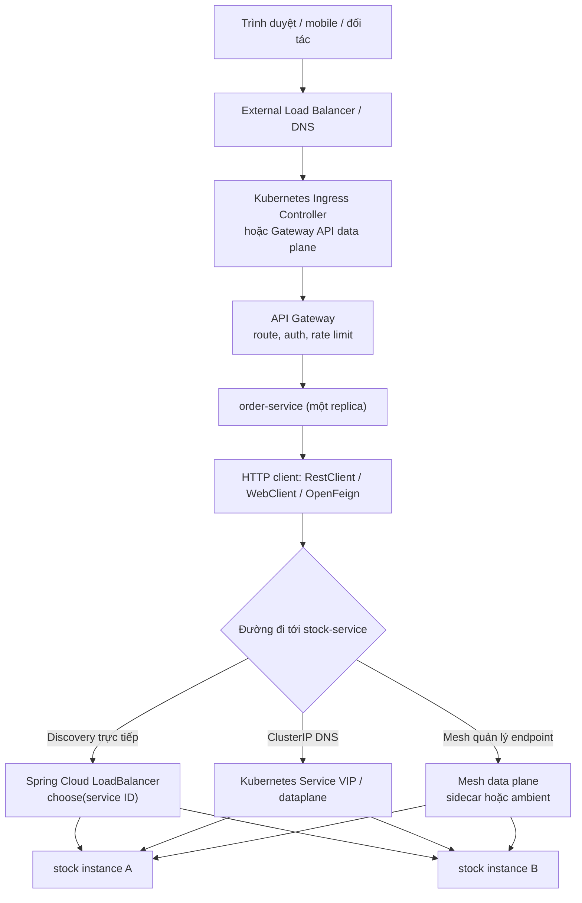
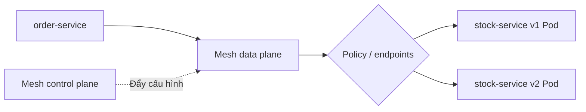
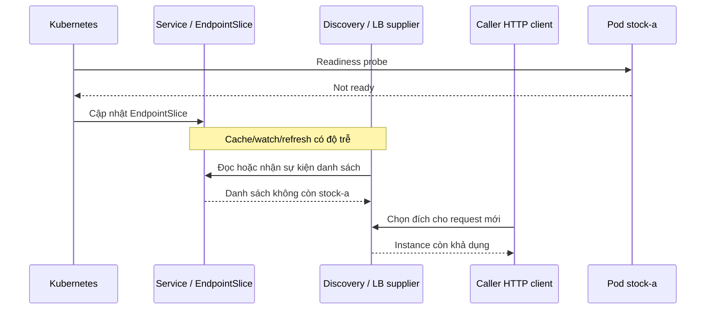

# Gateway, ingress, service mesh và vai trò của LoadBalancer bên gọi

## 1. Mục tiêu và bối cảnh triển khai

Một hệ thống microservice có thể chứa **nhiều bộ cân bằng tải**, cùng xuất hiện trên đường đi của một request nhưng thực hiện những nhiệm vụ khác nhau. Khi người dùng gọi API qua ingress, `api-gateway` chuyển tiếp vào `order-service`; sau đó `order-service` gọi `stock-service`. Việc ingress đã cân bằng tải cho `order-service` **không tự động quyết định** `order-service` sẽ gọi bản sao nào của `stock-service`.

Bài thuộc chương **Triển khai** của module `SPRING_CLOUD_SERVICE_COMMUNICATION_LOAD_BALANCING`. Phạm vi module là cân bằng tải phía client bằng service ID, discovery, health check và chính sách chọn `ServiceInstance`; tích hợp `RestClient`, `WebClient`, OpenFeign, retry/timeout và quan sát lỗi. Khi triển khai, cần hiểu sự khác nhau giữa **Gateway**, **Kubernetes Ingress/Gateway API**, **Kubernetes Service**, **service mesh** và **Spring Cloud LoadBalancer tại bên gọi** để đặt chức năng đúng tầng.

Sau bài này, bạn có thể:

1. Vẽ luồng request từ Internet đến các backend và chỉ rõ tầng nào chọn đích ở mỗi chặng.
2. Phân biệt điều phối **north–south** (ngoài cụm ↔ trong cụm) và **east–west** (dịch vụ ↔ dịch vụ).
3. Giải thích khi nào Spring Cloud LoadBalancer chọn trực tiếp `ServiceInstance`, khi nào Kubernetes Service hoặc service mesh đảm nhận chọn pod.
4. Cấu hình ví dụ `Spring Cloud Gateway` với `lb://service-id`, `@LoadBalanced RestClient.Builder` và một Service Kubernetes.
5. Nhận ra các vấn đề **cân bằng tải hai lần**, timeout/retry chồng tầng, lỗi discovery, readiness, TLS/mTLS và khả năng quan sát.
6. Lập checklist triển khai và kiểm chứng failover bằng metrics, access log và distributed tracing.

> **Nguyên tắc xuyên suốt:** Mỗi lần gọi mạng cần xác định **ai chịu trách nhiệm chọn đích cuối cùng**. Các tầng có thể cùng tồn tại, nhưng phải hiểu từng lần chọn dùng **danh sách backend nào**, áp dụng chính sách gì và được quan sát ở đâu.

## 2. Sơ đồ toàn tuyến: chọn đích ở nhiều chặng



Các mũi tên sau nút **Đường đi tới stock-service** là **ba kiến trúc có thể lựa chọn**, không phải bắt buộc một request đi qua cả ba theo đúng thứ tự đó. Trong cụm thực tế, proxy mesh và Kubernetes Service networking có thể cùng hiện diện trên đường đi vật lý; **logic quyết định backend** phụ thuộc cấu hình mesh, DNS/địa chỉ đích và cơ chế chuyển tiếp của cluster.

### 2.1. Phân biệt phạm vi bằng câu hỏi

| Thành phần | Bài toán chính | Ví dụ quyết định | Có tự quản lý cuộc gọi của `order-service` đến `stock-service` không? |
| --- | --- | --- | --- |
| External LB (L4/L7) | Đưa traffic ngoài Internet vào cụm | Chọn node/ingress endpoint | Thông thường **không** |
| Kubernetes Ingress | Định tuyến HTTP/HTTPS từ ngoài vào Service | `api.example.com/orders` → `order-service` | Không; chỉ xử lý tuyến đi qua ingress |
| Kubernetes Gateway API | Khai báo listeners và HTTPRoute/TCPRoute... cho gateway controller | Host/path/header → Service | Chỉ với traffic đi qua gateway tương ứng |
| Spring Cloud Gateway | Gateway ở tầng ứng dụng | `/api/orders/**` → `lb://order-service` | Có thể cân bằng tải **trong chính gateway** cho route của nó, không tự cấu hình client của `order-service` |
| Kubernetes Service `ClusterIP` | Địa chỉ ổn định và cân bằng tải ở lớp networking của cluster | VIP:8080 → một trong các Pod endpoint | **Có** nếu caller gọi Service VIP |
| Spring Cloud LoadBalancer | Chọn `ServiceInstance` ở phía caller | `stock-service` → `stock-a:8080` | **Có** nếu HTTP client tích hợp LoadBalancer và danh sách instance phù hợp |
| Service mesh | Chính sách giao tiếp giữa workload; tùy data plane có L4/L7 routing, mTLS, telemetry | Envoy/waypoint chọn endpoint hoặc subset | **Có thể có**, khi request đi qua policy/data plane đó |

Không nên gom tất cả thành từ “gateway”: **Ingress** là tài nguyên API Kubernetes cần một controller triển khai; **Gateway API** cũng cần controller; **Spring Cloud Gateway** là một ứng dụng gateway chạy độc lập. Chúng có thể được triển khai cùng nhau nhưng khác vòng đời và phạm vi cấu hình.

## 3. North–south và east–west: ingress không thay thế caller LoadBalancer

Traffic **north–south** thường từ khách hàng bên ngoài đến API công khai:

```text
Client -> Cloud Load Balancer -> Ingress/Gateway -> order-service
```

Ingress thường xử lý host, path, TLS termination, redirect hoặc chuyển request tới Kubernetes Service. Spring Cloud Gateway có thể thêm xác thực, kiểm soát lưu lượng, filter và route `lb://` tới một service ID nội bộ.

Traffic **east–west** là lời gọi giữa các ứng dụng:

```text
order-service -> stock-service -> database
order-service -> payment-service
```

Ở đây, `order-service` cần một đích mạng cụ thể cho `stock-service`. Đích có thể đến từ:

1. **Kubernetes Service DNS**: caller gửi tới `stock-service.default.svc.cluster.local`; Kubernetes networking và/hoặc mesh chọn endpoint.
2. **Service discovery ở tầng ứng dụng**: `DiscoveryClient` hoặc `ReactiveDiscoveryClient` trả `ServiceInstance`, Spring Cloud LoadBalancer chọn một instance, rồi client gửi request trực tiếp tới địa chỉ đã chọn.
3. **Service mesh**: workload gọi host dịch vụ, proxy/data plane bắt traffic và áp dụng policy chọn backend, subset, timeout, retry và mTLS khi được cấu hình.

Vì vậy, thêm Ingress ở phía trước **không xóa** nhu cầu thiết kế lời gọi east–west. Ngược lại, chạy Spring Cloud LoadBalancer bên trong `order-service` cũng **không tự làm ứng dụng có thể truy cập từ Internet**.

## 4. Spring Cloud Gateway: gateway cũng có thể là một caller

Spring Cloud Gateway có thể định tuyến đến một URI `lb://order-service`. Khi route được xử lý, gateway sử dụng tích hợp Spring Cloud LoadBalancer để chọn instance cho **đích của route đó**, miễn là có dependency LoadBalancer và nguồn discovery phù hợp.

Ví dụ với **Spring Cloud Gateway Server WebFlux 5.x**:

```yaml
spring:
  application:
    name: api-gateway
  cloud:
    gateway:
      server:
        webflux:
          routes:
            - id: orders
              uri: lb://order-service
              predicates:
                - Path=/api/orders/**
              filters:
                - StripPrefix=1
```

Với cấu hình trên, request `GET /api/orders/42` đi đến `order-service` dưới đường dẫn `/orders/42`. Gateway cần `spring-cloud-starter-loadbalancer` và cơ chế cung cấp instance (Eureka, Consul, Spring Cloud Kubernetes hoặc một cấu hình danh sách instance phù hợp). Nếu discovery trả danh sách rỗng, route `lb://` không thể chọn được đích; **mã lỗi cụ thể** do gateway và cấu hình lỗi quyết định.

**Chú ý phiên bản:** Trong các dòng Spring Cloud Gateway 4.x, ví dụ cấu hình thường nằm ở `spring.cloud.gateway.routes`; ở nhánh Server WebFlux 5.x, tiền tố là `spring.cloud.gateway.server.webflux.routes`. Khi sao chép, tra tài liệu **đúng Spring Cloud release train**. Spring Cloud Gateway Server MVC dùng API/route filter khác với WebFlux; không giả định các starter và property tương đương.

### 4.1. Một gateway khác với toàn bộ ứng dụng caller

Nếu gateway chọn được `order-2`, sau đó `order-2` gọi `stock-service`:

```text
Lượt chọn 1: Gateway  -> order-service -> order-2
Lượt chọn 2: order-2 -> stock-service -> stock-a / stock-b
```

Hai lượt chọn độc lập. Gateway có thể dùng Round Robin giữa các bản sao `order-service`, còn `order-service` dùng policy zone preference để gọi `stock-service`. Không thể kết luận “đã có `lb://order-service` nên không cần LoadBalancer ở `order-service`” nếu `order-service` đang dùng **discovery trực tiếp tới stock pods**.

### 4.2. Tránh bọc hai bộ chọn trong gateway

Gateway tự có cơ chế chọn đích của route `lb://`/load-balancer filter. Đặc biệt trong Spring Cloud Gateway **Server MVC**, không đưa `@LoadBalanced RestClient` vào đường gọi proxy nội bộ của gateway: nếu bị intercept thêm một lần, request có thể đi qua service discovery không đúng lúc và gây lỗi lựa chọn instance.

Chỉ dùng `@LoadBalanced RestClient.Builder` cho **những lời gọi do code ứng dụng của bạn chủ động tạo**, còn gateway route thì để filter `lb()` hoặc URI `lb://` đảm nhiệm. Đây là ranh giới cấu hình cần kiểm tra khi ghép gateway vào hệ thống hiện có.

Tham khảo: [Spring Cloud Gateway DiscoveryClient route locator](https://docs.spring.io/spring-cloud-gateway/reference/spring-cloud-gateway-server-webflux/the-discoveryclient-route-definition-locator.html) và [Gateway Server MVC LoadBalancer filter](https://docs.spring.io/spring-cloud-gateway/reference/spring-cloud-gateway-server-webmvc/filters/loadbalancer.html).

## 5. Kubernetes Ingress và Gateway API: lớp định tuyến vào cụm

Trong Kubernetes, `Ingress` là API cho HTTP/HTTPS routing bên ngoài đến Service, thường có hostname, path, TLS termination. Ingress không tự làm việc nếu thiếu **Ingress controller**. Kubernetes cũng cung cấp **Gateway API** với các tài nguyên như `Gateway` và `HTTPRoute`, cho phép tách vai trò quản trị listener với quản trị tuyến.

Ví dụ `HTTPRoute` minh họa hướng traffic `api.example.com/orders` tới `order-service`; giả định một `Gateway` tên `public-gateway` và controller Gateway API đã được cài:

```yaml
apiVersion: gateway.networking.k8s.io/v1
kind: HTTPRoute
metadata:
  name: order-route
  namespace: default
spec:
  parentRefs:
    - name: public-gateway
  hostnames:
    - api.example.com
  rules:
    - matches:
        - path:
            type: PathPrefix
            value: /orders
      backendRefs:
        - name: order-service
          port: 8080
```

Ở ví dụ này, `HTTPRoute` không có rewrite; backend vẫn nhận path có tiền tố `/orders`. Cần kiểm tra controller hỗ trợ resource, `parentRefs`, namespace và listener phù hợp; việc khai báo YAML chưa bảo đảm route được accept hoặc có địa chỉ public.

Với cụm đang dùng Ingress, ví dụ cấu hình tương đương ở mức ý tưởng:

```yaml
apiVersion: networking.k8s.io/v1
kind: Ingress
metadata:
  name: order-ingress
spec:
  ingressClassName: nginx
  rules:
    - host: api.example.com
      http:
        paths:
          - path: /orders
            pathType: Prefix
            backend:
              service:
                name: order-service
                port:
                  number: 8080
```

`ingressClassName: nginx` chỉ hợp lệ nếu cluster có IngressClass/controller tương ứng. Đây là **hai phương án triển khai**, thường không cần công bố hai route public trùng nhau trong cùng môi trường.

Ingress và Gateway API chọn **Service/backend để nhận traffic đi vào**, nhưng không quyết định trực tiếp danh sách `ServiceInstance` mà một Java application dùng để gọi `stock-service`. Nếu ứng dụng gọi qua Kubernetes Service VIP, chính lớp networking phía trong cụm giải quyết bước đó.

Theo tài liệu Kubernetes hiện hành, dự án khuyến nghị **Gateway API** cho các yêu cầu phát triển định tuyến mới; Ingress vẫn ổn định và được hỗ trợ nhưng API đã đóng băng. Hãy chọn theo controller, tính năng và chuẩn vận hành của cluster.

Tham khảo: [Kubernetes Ingress](https://kubernetes.io/docs/concepts/services-networking/ingress/) và [Gateway API HTTP routing](https://gateway-api.sigs.k8s.io/guides/user-guides/http-routing/).

## 6. Kubernetes Service: ClusterIP so với headless

### 6.1. Service thường (`ClusterIP`) chọn endpoint trong cluster

Ví dụ một Service trỏ tới các Pod của `stock-service`:

```yaml
apiVersion: v1
kind: Service
metadata:
  name: stock-service
  namespace: default
spec:
  type: ClusterIP
  selector:
    app: stock-service
  ports:
    - name: http
      port: 8080
      targetPort: http
```

Kubernetes tạo địa chỉ Service ổn định trong cluster. DNS thường phân giải `stock-service.default.svc.cluster.local` về ClusterIP; kube-proxy hoặc cơ chế dataplane tương đương đưa kết nối tới một endpoint phù hợp từ `EndpointSlice`. Phân phối ở tầng này mang ngữ nghĩa **kết nối/luồng mạng**, không đồng nghĩa Round Robin một request HTTP của Spring Cloud.

Ứng dụng có thể gọi thẳng Service DNS bằng một HTTP client **không bật Spring Cloud LoadBalancer**:

```java
import org.springframework.stereotype.Service;
import org.springframework.web.client.RestClient;

@Service
public class StockViaKubernetesService {
    private final RestClient client =
            RestClient.builder()
                    .baseUrl("http://stock-service.default.svc.cluster.local:8080")
                    .build();

    public String findStock(String sku) {
        return client.get()
                .uri("/stocks/{sku}", sku)
                .retrieve()
                .body(String.class);
    }
}
```

Mã trên dựa vào **Kubernetes Service/networking** để đến Pod. Nó không tự dùng `ReactorServiceInstanceLoadBalancer`, không có `choose(Request)` theo service ID ở ứng dụng và không có các meter `loadbalancer.requests.*` của Spring Cloud cho lần gọi này.

### 6.2. Headless Service không cung cấp VIP cân bằng tải

Nếu đặt `spec.clusterIP: None`, Kubernetes tạo **headless Service**. DNS trả các địa chỉ endpoint tương ứng; không có Service VIP/proxy cân bằng tải kiểu ClusterIP.

```yaml
apiVersion: v1
kind: Service
metadata:
  name: stock-headless
spec:
  clusterIP: None
  selector:
    app: stock-service
  ports:
    - port: 8080
      targetPort: http
```

Tuy vậy, **trả nhiều địa chỉ DNS không đồng nghĩa đã có chính sách Spring Cloud LoadBalancer**. Cách chọn địa chỉ phụ thuộc DNS resolver, HTTP transport, connection pooling và cơ chế client bạn dùng. Để cần chính sách instance-aware có chủ đích, hãy dùng discovery phù hợp hoặc một data plane được cấu hình cho việc chọn endpoint.

### 6.3. Deployment/readiness tác động đến danh sách backend

Ví dụ một Pod chỉ nhận traffic sau khi endpoint readiness của Spring Boot báo sẵn sàng:

```yaml
apiVersion: apps/v1
kind: Deployment
metadata:
  name: stock-service
spec:
  replicas: 2
  selector:
    matchLabels:
      app: stock-service
  template:
    metadata:
      labels:
        app: stock-service
    spec:
      containers:
        - name: stock-service
          image: registry.example.com/stock-service:1.0.0
          ports:
            - name: http
              containerPort: 8080
          readinessProbe:
            httpGet:
              path: /actuator/health/readiness
              port: http
            periodSeconds: 5
            timeoutSeconds: 2
```

Đây là cấu hình minh họa: image phải tồn tại, ứng dụng phải bật Actuator/probes và endpoint readiness phải trả status phù hợp. Kubernetes dựa vào readiness để xác định endpoint sẵn sàng cho Service; **liveness** phục vụ mục tiêu khởi động lại container khi cần và không nên coi là tín hiệu định tuyến thay cho readiness.

Khi rollout, Pod mới được đưa vào Service endpoints khi sẵn sàng; Pod mất readiness thường bị loại khỏi các endpoint có thể nhận traffic mới. Sự thay đổi đó có **độ trễ cập nhật** và các kết nối đã thiết lập có thể còn tồn tại. Không coi trạng thái Pod vừa chuyển thành `NotReady` là bảo đảm mọi caller lập tức dừng gửi request.

Tham khảo: [Kubernetes Service](https://kubernetes.io/docs/concepts/services-networking/service/).

## 7. Spring Cloud LoadBalancer bên gọi: khi nào nó thật sự chọn Pod?

Trong ứng dụng Spring, một HTTP client dùng service ID và được instrument bằng Spring Cloud LoadBalancer có luồng:

```text
@LoadBalanced RestClient / WebClient / OpenFeign
  -> service ID "stock-service"
  -> DiscoveryClient / ReactiveDiscoveryClient
  -> ServiceInstanceListSupplier (cache, health, zone, hint nếu cấu hình)
  -> ReactorServiceInstanceLoadBalancer.choose(Request)
  -> ServiceInstance host + port
  -> HTTP transport
```

Ví dụ cấu hình `RestClient`:

```java
import org.springframework.cloud.client.loadbalancer.LoadBalanced;
import org.springframework.context.annotation.Bean;
import org.springframework.context.annotation.Configuration;
import org.springframework.web.client.RestClient;

@Configuration(proxyBeanMethods = false)
public class LoadBalancedClientConfiguration {

    @Bean
    @LoadBalanced
    RestClient.Builder loadBalancedBuilder() {
        return RestClient.builder();
    }
}
```

```java
import org.springframework.cloud.client.loadbalancer.LoadBalanced;
import org.springframework.stereotype.Service;
import org.springframework.web.client.RestClient;

@Service
public class StockViaSpringLoadBalancer {
    private final RestClient client;

    public StockViaSpringLoadBalancer(
            @LoadBalanced RestClient.Builder builder) {
        this.client = builder.build();
    }

    public String findStock(String sku) {
        return client.get()
                .uri("http://stock-service/stocks/{sku}", sku)
                .retrieve()
                .body(String.class);
    }
}
```

Trong ví dụ này, **`stock-service` là service ID**, không phải hostname đã chắc chắn tồn tại trong DNS. Tích hợp LoadBalancer chọn từ `ServiceInstanceListSupplier`; địa chỉ mà client thực sự gọi đến là host/port của instance được chọn.

Tương tự, với OpenFeign:

```java
import org.springframework.cloud.openfeign.FeignClient;
import org.springframework.web.bind.annotation.GetMapping;
import org.springframework.web.bind.annotation.PathVariable;

@FeignClient(name = "stock-service")
public interface StockFeignClient {
    @GetMapping("/stocks/{sku}")
    String getStock(@PathVariable("sku") String sku);
}
```

Khi có `spring-cloud-starter-openfeign`, Spring Cloud LoadBalancer và discovery phù hợp, client có thể giải `stock-service` ra instance. Nếu đặt `@FeignClient(url = "https://stock.example.com")`, lời gọi đi theo URL cố định và thường **không** qua bước chọn instance bằng discovery ở LoadBalancer.

### 7.1. Discovery lấy danh sách gì là vấn đề quyết định

Một `DiscoveryClient` có thể trả:

- **Địa chỉ từng Pod/instance**: Spring Cloud LoadBalancer thực sự chọn A/B/C.
- **Địa chỉ một Kubernetes Service VIP**: Spring Cloud có thể chọn một entry biểu diễn Service; networking Kubernetes sau đó lại chọn Pod.
- **Địa chỉ endpoint của proxy/service mesh**: proxy có thể chọn thêm backend.

Kết quả phụ thuộc **driver/discovery implementation, phiên bản và cấu hình**, đặc biệt với Spring Cloud Kubernetes. Vì thế, khi triển khai cần **kiểm tra danh sách thực** do supplier trả: mỗi `ServiceInstance.getHost()`/`getPort()` trỏ vào đâu? Nếu chỉ trỏ VIP, một thuật toán “weighted pod A/B” ở Spring Cloud không thực sự kiểm soát Pod được chọn.

Đây là lý do không thể trả lời “dùng Kubernetes thì Spring Cloud LoadBalancer thừa” hoặc “dùng Spring Cloud thì chắc chắn đã bỏ qua Kubernetes Service” cho mọi kiến trúc. Hãy xác định **đường đi và danh sách instance cụ thể**.

### 7.2. Tùy biến LoadBalancer khi có yêu cầu chính sách tại caller

Spring Cloud LoadBalancer đặc biệt hữu ích khi:

- Cần chọn **đúng instance** theo metadata zone, hint hoặc trọng số ở phía caller.
- Discovery không nằm hoàn toàn trong Kubernetes, ví dụ service registry như Eureka/Consul hoặc hạ tầng đa môi trường.
- Muốn chỉ chọn instance từ một danh sách đã health-check/cache/lọc theo yêu cầu.
- Cần triển khai `ReactorServiceInstanceLoadBalancer` riêng hoặc chính sách cho từng service ID.

Tuy nhiên, khi mesh đã quản lý routing canary theo subset, caller tự chọn trực tiếp Pod bằng policy khác có thể làm sai lệch tỷ lệ mong đợi. Không nên áp dụng hai thuật toán weighted độc lập nếu yêu cầu là **một chính sách phân phối chung**.

## 8. Service mesh: chính sách giữa các workload

Service mesh cung cấp một **data plane** để điều phối giao tiếp giữa các workload, đồng thời có thể xử lý mTLS, danh tính, telemetry, retry, timeout, circuit breaking hoặc traffic splitting.

Với **Istio sidecar mode**, mỗi Pod ứng dụng có proxy Envoy tham gia đường đi; với **ambient mode**, có `ztunnel` ở mức node cho L4 và có thể thêm **waypoint proxy** để xử lý tính năng L7. Vì vậy, không nên nói mọi service mesh đều có sidecar trong từng Pod, hoặc ambient ztunnel tự cung cấp đầy đủ HTTP retry/traffic splitting.



Ví dụ với Istio:

| Cấp độ | Chức năng thường gặp | Lưu ý |
| --- | --- | --- |
| Envoy sidecar | L4/L7 proxy, service routing, mTLS, retry/timeout, telemetry | Chỉ traffic thuộc phạm vi proxy/capture mới chịu policy |
| Ambient `ztunnel` | L4 secure transport, mTLS, identity, L4 policy | Không mặc nhiên làm HTTP route/retry theo header |
| Ambient waypoint | L7 routing và policy/telemetry theo cấu hình | Phải cài và gắn workload/service đúng cách |
| Mesh control plane | Phân phối cấu hình, discovery, policy | Control plane không trực tiếp proxy từng request |
| Kubernetes Service | Danh tính DNS/VIP và endpoint membership | Vẫn có thể xuất hiện song song với mesh |

Ví dụ `VirtualService` Istio mô tả **định tuyến 90% v1, 10% v2**, chỉ áp dụng nếu các subset được định nghĩa trong `DestinationRule` phù hợp:

```yaml
apiVersion: networking.istio.io/v1
kind: DestinationRule
metadata:
  name: stock-destination
spec:
  host: stock-service
  subsets:
    - name: v1
      labels:
        version: v1
    - name: v2
      labels:
        version: v2
---
apiVersion: networking.istio.io/v1
kind: VirtualService
metadata:
  name: stock-routing
spec:
  hosts:
    - stock-service
  http:
    - route:
        - destination:
            host: stock-service
            subset: v1
          weight: 90
        - destination:
            host: stock-service
            subset: v2
          weight: 10
```

Đây là ví dụ về **Istio sidecar/L7 policy**; trong ambient mode, khả năng hỗ trợ `VirtualService` có thể khác, và nhiều kịch bản L7 cần waypoint cùng tài nguyên Gateway API tương ứng. Cần kiểm tra mode và phiên bản mesh được cài trước khi áp dụng YAML. Nếu ứng dụng tự chọn IP Pod v2 thay vì gọi host `stock-service` qua route do mesh nhận diện, policy routing theo host/subset có thể **không áp dụng như dự kiến**.

Tham khảo: [Istio data plane modes](https://istio.io/latest/docs/overview/dataplane-modes/) và [Istio traffic management](https://istio.io/latest/docs/concepts/traffic-management/).

## 9. Tránh cân bằng tải lồng nhau không chủ đích

### 9.1. Hai lần chọn đích không phải lúc nào cũng sai

Ví dụ:

```text
order-service
  -> Spring Cloud LoadBalancer chọn "stock-service" entry
  -> entry là ClusterIP 10.96.x.y
  -> Kubernetes networking chọn Pod stock-2
```

Nếu chỉ có một Service VIP trong danh sách, lớp Spring Cloud không có nhiều thông tin để cân bằng giữa Pod A/B. Việc cài Round Robin ở caller không tạo tỷ lệ Round Robin theo Pod. Muốn áp dụng zone/hint per Pod, discovery phải trả **Pod endpoints có metadata đúng**.

Ngược lại, khi discovery trả trực tiếp Pod IP, lớp Spring Cloud có thể chủ động chọn một Pod. Nhưng dù vậy, traffic vẫn có thể đi qua sidecar mesh hoặc cơ chế network policy/CNI của Kubernetes.

### 9.2. Các kiểu kết hợp và quyền sở hữu chính sách

| Kiến trúc | Ai nên là người quyết định backend chính? | Cần xác minh |
| --- | --- | --- |
| Spring app → Kubernetes `ClusterIP` | Kubernetes networking hoặc mesh nếu có | Client dùng Service DNS/VIP; không lặp chính sách Pod-level ở app |
| Spring app → Eureka instances | Spring Cloud LoadBalancer | Discovery trả host/port instance thật |
| Spring app → headless DNS | DNS/transport nếu chưa có LB khác; hoặc client-aware LB được cấu hình | Không mặc định việc DNS nhiều A record nghĩa là per-request balancing |
| Spring app → Istio canary v1/v2 | Mesh L7 nếu dùng mesh làm chủ traffic splitting | Caller không cố tình chọn Pod bằng thuật toán mâu thuẫn |
| Gateway `lb://order-service` → order replicas | Gateway + Spring Cloud LoadBalancer theo route | Cấu hình route, discovery của gateway |
| Ingress/Gateway API → Kubernetes Service | Controller/gateway dataplane và Kubernetes endpoint routing | IngressClass/GatewayClass, backend Service, EndpointSlice |

Một thiết kế rõ ràng cần ghi trong tài liệu vận hành: **“stock-service ở môi trường này chọn Pod tại tầng nào?”**. Khi chuyển từ Eureka sang Kubernetes, hoặc từ service DNS sang mesh, phải cập nhật câu trả lời đó và điều chỉnh cấu hình Java client tương ứng.

## 10. Retry, timeout, circuit breaker: tránh khuếch đại traffic

Giả sử một request có thể được retry ở ba nơi:

- Gateway: tối đa **2 attempts**.
- Client `order-service`: tối đa **3 attempts**.
- Mesh: tối đa **2 attempts** cho mỗi lần gọi HTTP mà nó nhận.

Trong một số tình huống lỗi đồng thời, số lượt gửi về downstream **có thể lên tới 2 × 3 × 2 = 12**. Đây là giới hạn minh họa khi các vòng retry lồng nhau và đều thực thi đủ; thời gian thực và số request server nhận phụ thuộc thứ tự lỗi, policy cụ thể và vị trí proxy.

Không thể suy ra số attempts chỉ từ `Retryer.NEVER_RETRY` của OpenFeign: đó là chính sách retry **ở tầng Feign**, còn Spring Cloud LoadBalancer, gateway hoặc mesh có thể có retry riêng tùy classpath/config.

### 10.1. Đặt một ngân sách thời gian end-to-end

Ví dụ yêu cầu API phải hoàn tất trong **3 giây**. Các giới hạn cần phối hợp:

```text
Deadline toàn tuyến (giả định): 3000 ms
  Gateway timeout:            <= 3000 ms
  Business handler/processing: giữ đủ ngân sách cho xử lý nội bộ
  Client connectTimeout:       300 ms (mỗi attempt)
  Client readTimeout:          800 ms (mỗi attempt)
  Retry backoff:               có giới hạn
  Mesh per-try timeout:        nhỏ hơn budget còn lại, nếu dùng
```

Các con số là **minh họa**, không phải cấu hình khuyến nghị chung. `connectTimeout` và `readTimeout` không tự tạo một deadline tuyệt đối 800 ms cho toàn bộ logical call; DNS, lấy connection từ pool, TLS handshake, backoff và retry có thể tiêu thụ thêm thời gian. Khi deadline của gateway ngắn hơn tổng budget downstream, có thể xuất hiện tình huống gateway đã trả lỗi cho người dùng nhưng backend vẫn đang xử lý.

### 10.2. Quy tắc an toàn cho retry

1. Quy định **tầng nào sở hữu retry cho mỗi loại request**; hạn chế retry chồng trên nhiều tầng.
2. Chỉ retry khi lỗi có khả năng tạm thời, giới hạn số attempts và dùng backoff/jitter phù hợp.
3. Với `POST` tạo đơn hàng, thanh toán hoặc ghi dữ liệu, thiết kế **idempotency key** hoặc cơ chế chống lặp trước khi cho retry.
4. Phân biệt retry vì không tìm thấy instance với retry vì HTTP 503, connection reset hoặc read timeout; một timeout không chứng minh server chưa xử lý.
5. Đo logical calls và **HTTP attempts thực nhận** độc lập ở gateway, caller, mesh và downstream.
6. Khi mesh đã có chính sách outlier detection/retry, kiểm tra tác động trước khi bật thêm LoadBalancer retry tại Java client.

**Lưu ý mTLS/TLS:** TLS có thể kết thúc tại edge, gateway hoặc được thiết lập lại tới backend; mesh mTLS bảo vệ đoạn giao tiếp theo danh tính workload trong mesh. Không mặc định “đã có HTTPS ngoài Internet nên mọi hop bên trong đều được mã hóa”. Với request chuyển qua proxy, cần xác định điểm TLS termination/origination và yêu cầu kiểm tra certificate/SNI.

## 11. Health check, readiness và discovery trong lúc rollout

Khi `stock-service` scale từ 2 lên 3 Pod hoặc một Pod bị loại, các tầng cập nhật không nhất thiết đồng bộ ngay:



Nếu dùng Kubernetes Service VIP, Kubernetes networking dựa vào endpoint membership được cập nhật. Nếu Spring Cloud LoadBalancer dùng **Pod discovery**, `ServiceInstanceListSupplier` có thể giữ cache trong thời gian TTL, khiến caller vẫn thấy Pod vừa bị loại. Nếu dùng health-check supplier, cơ chế probe và refresh có thể bổ sung tín hiệu; không nên giả định health checker luôn cần thiết khi discovery đã lọc instance không khỏe.

Đặc biệt:

- **Readiness** biểu thị Pod có sẵn sàng nhận traffic mới.
- **Liveness** cho biết khi nào runtime nên khởi động lại container; không thể thay readiness.
- **Startup probe** có thể bảo vệ giai đoạn khởi động lâu để liveness không restart quá sớm.
- **Graceful shutdown** và `terminationGracePeriodSeconds` giúp hoàn tất request đang xử lý trong giai đoạn drain; endpoint loại bỏ không làm mất ngay mọi kết nối cũ.
- **Cache TTL** kiểm soát độ mới của instance list ở tầng client, nhưng không phải lịch đồng bộ tức thời với EndpointSlice.

Khi thử failover, đo **thời gian thực tế từ Pod hết readiness đến khi request mới không còn tới Pod đó**. Không chỉ nhìn trạng thái `kubectl get pods` rồi kết luận mọi kết nối đã chuyển.

## 12. Quan sát nhiều tầng: biết lỗi xuất hiện ở đâu

Một hệ thống có gateway, LoadBalancer client và mesh cần telemetry nhất quán:

| Nơi đo | Tín hiệu cần có | Câu hỏi trả lời |
| --- | --- | --- |
| Ingress/Gateway | Inbound request count, route ID, HTTP status, p95 | Client có vào đúng route? Gateway có lỗi? |
| `order-service` | Logical call outcome, downstream service ID, latency | Caller cuối cùng nhận kết quả gì? |
| Spring Cloud LoadBalancer | `loadbalancer.requests.active`, `loadbalancer.requests.success`, `loadbalancer.requests.failed`, `loadbalancer.requests.discard` | LoadBalancer có chọn được instance? Có exception ở tầng đó? |
| HTTP transport | HTTP status, connect/read timeout, connection errors | Đã mở được kết nối và nhận response chưa? |
| Mesh data plane | Requests, retry attempts, upstream cluster, outlier ejection (nếu L7) | Proxy đã chọn backend nào và thử lại không? |
| `stock-service` | Access log, server requests, readiness, instance ID | Pod nào thực nhận request, xử lý bao lâu? |
| Distributed tracing | Trace ID, span theo chặng, error attributes | Lần gọi đã đi qua những chặng nào? |

**Không đánh đồng `loadbalancer.requests.success` với HTTP 2xx:** meter này phản ánh lời gọi LoadBalancer có response chuyển về tầng client; HTTP 503 vẫn là một response trong nhiều trường hợp. Để tính error rate nghiệp vụ, cần metric HTTP hoặc logical-call outcome riêng.

Metrics ở mesh L4 và L7 cũng khác nhau: trong Istio ambient **ztunnel đơn thuần** không cung cấp toàn bộ HTTP request-level metrics/tracing như một waypoint/Envoy L7. Cần biết data plane mode trước khi thiết kế dashboard.

Tránh tạo Prometheus labels với `orderId`, `sessionId`, `traceId` hoặc địa chỉ Pod biến đổi liên tục trên mọi metric. Nhóm theo **service ID, route template, status class và policy** với số giá trị có kiểm soát; dùng log/trace cho ID chi tiết.

### 12.1. Dấu hiệu lỗi thường gặp

| Triệu chứng | Vị trí kiểm tra đầu tiên |
| --- | --- |
| Ingress trả 404 | Host/path rule, `IngressClass` hoặc `HTTPRoute` có được controller chấp nhận? |
| Gateway trả lỗi khi route `lb://` | Có `spring-cloud-starter-loadbalancer` và discovery instance cho service ID? |
| Caller báo `No instances available` | `ServiceInstanceListSupplier`, registry/EndpointSlice, cache, zone/health filter |
| Caller kết nối tới IP Pod cũ | Discovery/cache TTL, watch lag, readiness, connection pool |
| Canary mesh không đạt 90/10 | Caller có bypass service hostname để gọi Pod IP? `DestinationRule`/waypoint/subset đúng không? |
| HTTP 503 nhiều nhưng `loadbalancer.requests.success` vẫn tăng | Đã hiểu đúng định nghĩa success của LB? Xem HTTP client status |
| Request downstream nhiều hơn request ingress | Retry gateway, Feign, LoadBalancer, mesh hoặc caller |
| mTLS fail chỉ ở một môi trường | Sidecar/ztunnel capture, `PeerAuthentication`, identity, certificate, port/protocol |
| p95 xấu sau khi thêm proxy | Đo từng span, timeout, retries, connection pooling, proxy overhead |
| Local chạy được, Kubernetes không gọi được service | DNS namespace, NetworkPolicy, Service port/targetPort, readiness, scheme |

## 13. Checklist triển khai và kiểm chứng

Giả sử cụm có namespace `default` với hai replicas `stock-service`, một gateway và `order-service`. Các lệnh **chỉ đọc** sau giúp kiểm chứng kiến trúc thực tế:

```bash
# Service VIP / endpoints thực tế.
kubectl -n default get service stock-service -o wide
kubectl -n default get endpointslices \
  -l kubernetes.io/service-name=stock-service -o wide

# Pod và readiness tại thời điểm kiểm tra.
kubectl -n default get pods -l app=stock-service -o wide

# Chỉ chạy các lệnh dưới nếu cluster có loại resource tương ứng.
kubectl -n default get ingress
kubectl -n default get gateway
kubectl -n default get httproute

# Kiểm tra log của caller/gateway, tùy nhãn ứng dụng thực.
kubectl -n default logs deploy/order-service --tail=100
kubectl -n default logs deploy/api-gateway --tail=100
```

Một số loại resource Gateway API có thể chưa cài CRD, nên lệnh `kubectl get gateway/httproute` báo loại tài nguyên không tồn tại là tín hiệu cluster chưa hỗ trợ loại này, không nhất thiết là lỗi triển khai `order-service`.

Kiểm thử theo thứ tự:

1. **Xác định tuyến ingress:** Gửi một request qua hostname public hoặc trong môi trường test. Xác minh route được match, gateway trả response đúng service, có log/trace tương ứng.
2. **Xác định người chọn đích east–west:** Ứng dụng gọi `stock-service` qua `ClusterIP`, headless DNS, Spring Cloud discovery hay mesh? Đọc cấu hình Java client và danh sách `ServiceInstance` thực tế, không suy từ dependency có mặt.
3. **Xác định endpoint đang có:** Đối chiếu Service, EndpointSlice, readiness và instance list trong cache/supplier hoặc mesh cluster membership.
4. **Đo phân phối:** Gửi nhiều request có correlation ID tới endpoint trả `instanceId` trong môi trường thử. So sánh thống kê theo từng Pod, không đòi kết quả Round Robin tuyệt đối khi HTTP keep-alive/mesh/transport có chính sách riêng.
5. **Kiểm tra failover:** Trong môi trường thử riêng, làm một Pod mất readiness hoặc dừng replica được chọn; ghi thời gian tới khi request mới chuyển sang các Pod còn khỏe. Chú ý graceful shutdown và thời gian cache refresh.
6. **Kiểm tra retry/timeout:** Chủ động gây 503, connection refused hoặc timeout ở một backend; đếm logical calls, retries ở từng tầng và attempts server nhận. Đối chiếu với deadline tổng thể.
7. **Kiểm tra bảo mật:** Xác định TLS termination, mTLS từ workload đến workload và quyền truy cập; kiểm tra header `Forwarded`/`X-Forwarded-*` chỉ được tin từ proxy hợp lệ.
8. **Xác nhận dashboard/traces:** Có đủ service ID, route, instance ID (ở trace/log), lỗi no-instance, duration và retry decision để khoanh vùng sự cố.

Không thực hiện thao tác phá traffic trên môi trường production để “thử failover” nếu chưa có kế hoạch và quyền tương ứng. Trong lab hoặc staging, chủ động cô lập kịch bản để kết quả không bị trộn với traffic thật.

### 13.1. Ma trận kiểm thử nghiệm thu

| Thử nghiệm | Điều kiện | Kết quả cần chứng minh |
| --- | --- | --- |
| Gọi qua Ingress | Rule đúng và backend có Pod Ready | Đúng route, đúng service |
| Gateway `lb://order-service` | Discovery có hai order instances | Gateway chọn được một order instance |
| Caller dùng `ClusterIP` | DNS/Service có EndpointSlice | Caller thành công dù không có `@LoadBalanced` |
| Caller dùng Spring LB | Supplier trả trực tiếp hai stock instances | `choose` chọn trong danh sách đúng service |
| Pod bị loại khỏi readiness | EndpointSlice được cập nhật | Request mới dần ngừng tới Pod không ready |
| Discovery/cache còn IP cũ | Spring LB vẫn thấy instance lỗi | Có thể lỗi mạng; cần đo thời gian refresh |
| No-instance | Không có ứng viên từ supplier | Caller báo lỗi no-instance rõ ràng; không gửi tới backend |
| Mesh canary 90/10 | Policy và L7 waypoint/sidecar tương ứng | Tỷ lệ traffic theo thiết kế ở cửa sổ đủ lớn |
| Retry nhiều tầng | Gateway/client/mesh có policies riêng | Số attempts, latency và idempotency được kiểm soát |
| TLS/mTLS | Chính sách ingress và mesh đã áp dụng | Kênh đúng mức bảo mật, hostname và workload identity |

## 14. Quyết định kiến trúc: chọn cách đơn giản nhất đáp ứng yêu cầu

| Bối cảnh triển khai | Lựa chọn ban đầu thường hợp lý | Khi cần bổ sung Spring Cloud LoadBalancer |
| --- | --- | --- |
| Tất cả workloads trong một cluster Kubernetes, chỉ cần gọi các service thông thường | Gọi Kubernetes `ClusterIP` bằng DNS + readiness; để cluster/mesh xử lý endpoint | Khi cần policy chọn instance dựa vào metadata caller không có ở tầng networking |
| Java microservices có Eureka/Consul hoặc registry ngoài Kubernetes | `@LoadBalanced` HTTP client hoặc OpenFeign theo service ID | Đây là cơ chế chính để chọn instance; cấu hình timeout, health/cache và retry có chủ đích |
| Có Spring Cloud Gateway ở edge | Gateway route và `lb://` cho chính các backend route | Các service bên trong vẫn cần lựa chọn thích hợp cho lời gọi của chúng |
| Có Istio/mesh điều phối canary và mTLS | Dùng service hostname và mesh policy làm nguồn quyết định routing/canary | Chỉ thêm direct instance selection khi đã đánh giá tương tác với proxy, identity, subset policy |
| Cần chính sách zone/hint theo từng request từ caller | Spring Cloud `ServiceInstanceListSupplier` + `ReactorServiceInstanceLoadBalancer` với discovery instance-aware | Khi gateway/Kubernetes networking/mesh không đáp ứng được policy tại điểm phát sinh request |
| Hệ thống lai, multi-cluster, VM và Kubernetes | Thống nhất service naming, endpoint discovery và trách nhiệm routing theo từng môi trường | Nếu caller cần cùng mô hình `service ID → ServiceInstance` xuyên môi trường và đã xác minh tính chính xác của registry |

Đừng chọn công nghệ chỉ vì “đã có starter trong classpath”. Quan trọng là quyết định **hợp đồng định tuyến**: caller nhìn thấy những endpoint nào, tầng nào thực thi failover, ai kiểm soát retries và metric nào chứng minh đã tới đúng đích.

## 15. Câu hỏi tự đánh giá

1. Một request từ trình duyệt đến `order-service` qua Ingress đã được cân bằng tải. Vì sao điều đó chưa giải quyết việc `order-service` chọn `stock-a` hay `stock-b`?
2. Với Kubernetes `ClusterIP`, nếu `order-service` dùng `RestClient.builder()` bình thường gọi `stock-service.default.svc.cluster.local`, ai quyết định Pod? Có nhất thiết cần `spring-cloud-starter-loadbalancer` không?
3. Khi `DiscoveryClient` trả duy nhất một `ServiceInstance` chứa địa chỉ Service VIP, việc dùng `RoundRobinLoadBalancer` có phân phối HTTP request luân phiên chính xác giữa từng Pod không? Vì sao?
4. So sánh `Ingress`, `Gateway API HTTPRoute` và `Spring Cloud Gateway lb://...` về phạm vi định tuyến và điểm chạy.
5. Trong Istio ambient mode chỉ có `ztunnel`, bạn có nên kỳ vọng đầy đủ HTTP retry/traffic splitting theo header như sidecar không? Cần thành phần gì cho L7?
6. Nếu gateway 2 attempts, Feign 3 attempts và mesh 2 attempts, có thể phát sinh tối đa bao nhiêu lượt downstream trong mô hình retry lồng nhau? Làm sao giới hạn?
7. Khi Pod đã `NotReady` nhưng client vẫn gửi request đến IP Pod cũ, bạn sẽ kiểm tra EndpointSlice, cache supplier, proxy và connection pool theo thứ tự nào?
8. Vì sao tỉ lệ `loadbalancer.requests.success` cao không chứng minh HTTP 5xx thấp? Nên thêm metric nào?
9. Nếu request xuyên qua nhiều proxy, làm sao biết hop nào chấm dứt TLS và nơi nào thực thi mTLS?
10. Khi chuyển từ Eureka sang Kubernetes Service DNS, phần nào của code/cấu hình Spring Cloud LoadBalancer phải được đánh giá lại?

## 16. Tài liệu tham khảo

- [Spring Cloud Commons – Spring Cloud LoadBalancer](https://docs.spring.io/spring-cloud-commons/reference/spring-cloud-commons/loadbalancer.html): `@LoadBalanced` HTTP clients, discovery, suppliers, retry, health check và metrics.
- [Spring Cloud Gateway – DiscoveryClient routes](https://docs.spring.io/spring-cloud-gateway/reference/spring-cloud-gateway-server-webflux/the-discoveryclient-route-definition-locator.html): route `lb://service-name` và dependency LoadBalancer.
- [Kubernetes – Service](https://kubernetes.io/docs/concepts/services-networking/service/): `ClusterIP`, `headless Service`, discovery và EndpointSlice.
- [Kubernetes – Ingress](https://kubernetes.io/docs/concepts/services-networking/ingress/): tài nguyên Ingress, controller, phạm vi HTTP/HTTPS.
- [Kubernetes Gateway API – API overview](https://gateway-api.sigs.k8s.io/docs/concepts/api-overview/): `Gateway`, `HTTPRoute` và giao thức hỗ trợ.
- [Istio – Sidecar or ambient?](https://istio.io/latest/docs/overview/dataplane-modes/): data plane, `ztunnel`, waypoint, L4/L7.
- [Istio – Traffic Management](https://istio.io/latest/docs/concepts/traffic-management/): traffic routing, `DestinationRule`, retry, timeout và cân bằng tải.

**Ghi nhớ:** **Ingress/Gateway** giải quyết những chặng traffic đi qua cổng vào hoặc route gateway. **Kubernetes Service** và **service mesh** có thể chọn backend ở tầng networking/proxy. **Spring Cloud LoadBalancer bên gọi** chọn `ServiceInstance` khi HTTP client dùng service ID với discovery tương ứng. Cấu hình đúng là xác định **tầng sở hữu từng lần chọn đích**, giữ health/timeout/retry nhất quán và chứng minh đường đi thực bằng metrics, logs và traces.
