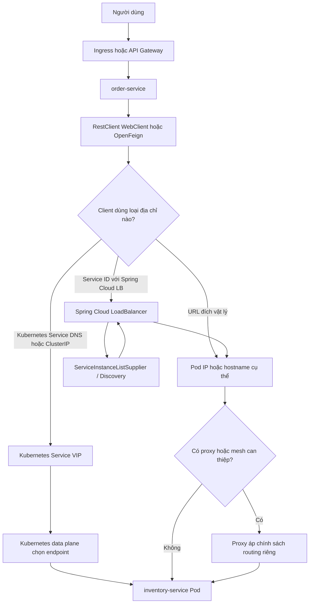
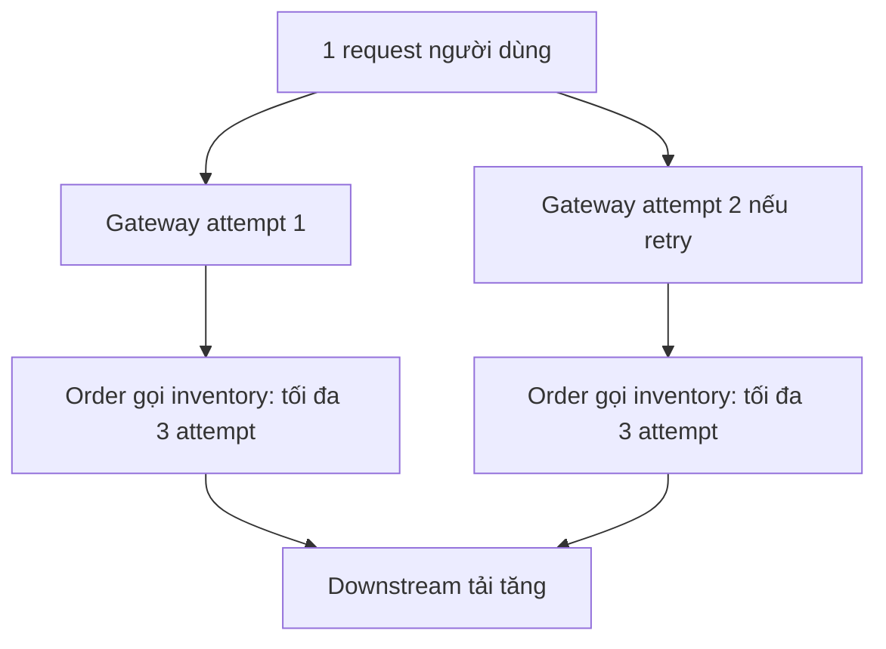

# Tránh cấu hình nhiều lớp cân bằng tải với kỳ vọng sai

Khi triển khai microservices, một lời gọi từ người dùng đến dịch vụ nghiệp vụ thường đi qua nhiều thành phần có khả năng **định tuyến** hoặc **cân bằng tải**: ingress, API gateway, Spring Cloud LoadBalancer, Kubernetes Service, service mesh, DNS và HTTP connection pool. Việc cùng xuất hiện nhiều thành phần không tự nó là sai. Rủi ro phát sinh khi các lớp **cùng đưa ra quyết định trên một chặng mạng mà không thống nhất trách nhiệm**, hoặc khi nhóm vận hành kỳ vọng thuật toán, health check, retry và timeout ở một lớp sẽ tự động điều khiển các lớp còn lại.

Ví dụ, `order-service` gọi `inventory-service` bằng URL logic `http://inventory-service/api/stocks/BOOK-001`. Nếu `@LoadBalanced RestClient.Builder` đã biến service ID thành địa chỉ Pod cụ thể, việc chọn Pod có thể được thực hiện ở phía ứng dụng. Nhưng nếu HTTP client kết nối đến **ClusterIP** của Kubernetes Service, Kubernetes data plane mới có thể chọn endpoint phía sau. Nếu còn sidecar proxy/service mesh, một quyết định định tuyến nữa có thể tham gia tùy cấu hình interception và outbound routing.

Bài học thuộc chương **Triển khai** của module `SPRING_CLOUD_SERVICE_COMMUNICATION_LOAD_BALANCING`, với mục tiêu hiểu cách chọn `ServiceInstance` theo service ID, discovery, health check và chính sách định tuyến; tích hợp RestClient, WebClient, OpenFeign; đồng thời phối hợp retry, timeout và observability để các dịch vụ giao tiếp ổn định. Trọng tâm ở đây là **chọn rõ lớp chịu trách nhiệm cho từng chặng**, không chạy theo giả định “càng nhiều load balancer càng cân bằng hơn”.

> **Nguyên tắc thực hành:** trước khi bật hay tắt một bộ cân bằng tải, hãy xác định request đi đến **service ID, Pod IP, Service VIP, gateway hay sidecar**; lớp nào quyết định endpoint cuối, lớp nào retry, và bằng chứng quan sát nào xác nhận điều đó.

## 1. Nhiều lớp cân bằng tải không đồng nghĩa nhiều lỗi

Một kiến trúc phổ biến có tuyến:

```text
Người dùng
    |
    v
Ingress / API Gateway  --------> chọn một bản sao order-service
    |
    v
order-service
    |
    | RestClient / WebClient / OpenFeign
    v
Spring Cloud LoadBalancer --> chọn inventory-service instance
    |
    v
inventory-service replica
```

Trong sơ đồ này, ingress cân bằng tải **chặng người dùng → order-service**, còn Spring Cloud LoadBalancer cân bằng tải **chặng order-service → inventory-service**. Chúng tác động lên **hai tập backend khác nhau**, nên không phải một trường hợp trùng chức năng.

Một tuyến khác:

```text
order-service
    |
    v
HTTP client gọi Service ClusterIP của inventory-service
    |
    v
Kubernetes Service data plane --> chọn inventory Pod
    |
    v
inventory-service replica
```

Nếu không có Spring Cloud LoadBalancer tham gia chặng này, Kubernetes Service đã đảm nhiệm việc phân phối đến endpoint.

Vấn đề cần làm rõ là **khi Spring Cloud LoadBalancer, Kubernetes Service và service mesh cùng xuất hiện ở chính chặng order → inventory**: chúng có đang chọn cùng một tập endpoint? Quyết định của lớp trước có bị lớp sau thay thế hay không? Lớp nào biết replica cuối cùng đã nhận request?

## 2. Phân biệt routing, service discovery và load balancing

Những từ sau thường bị dùng thay nhau nhưng không tương đương:

| Khái niệm | Câu hỏi chính | Ví dụ |
| --- | --- | --- |
| Service discovery | Dịch vụ có những instance nào? | `DiscoveryClient.getInstances("inventory-service")` |
| Client-side load balancing | Caller chọn instance nào? | Spring Cloud `RoundRobinLoadBalancer` |
| Service VIP load balancing | Một địa chỉ service được chuyển tới backend nào? | Kubernetes Service với ClusterIP |
| Proxy / mesh routing | Proxy chọn upstream cluster/endpoint nào? | Envoy hoặc thành phần dữ liệu của mesh |
| DNS resolution | Tên host tương ứng địa chỉ nào? | `inventory-service.default.svc.cluster.local` |
| Connection pooling | Có tái sử dụng kết nối cũ không? | JDK HTTP Client, Apache HttpClient, Reactor Netty |
| Retry | Có tạo thêm một HTTP attempt không? | Client retry, gateway retry hoặc mesh retry |

Discovery có thể cập nhật danh sách nhưng **không tự tạo request HTTP**. Round Robin chọn từ danh sách instance nhưng **không mặc nhiên đo CPU**. Kubernetes Service chọn backend ở tầng mạng hoặc theo triển khai dataplane nhưng **không tự hiểu toàn bộ kết quả nghiệp vụ của API**. Service mesh có thể có route, timeout, outlier detection riêng, tuy nhiên các khả năng đó chỉ tồn tại khi đã bật và cấu hình đúng.

Vì vậy không nên lập tài liệu triển khai chỉ ghi “LB = on”. Hãy ghi rõ **LB nào, ở đâu, cho chặng nào, nhận danh sách backend từ đâu**.

## 3. Bản đồ các lớp có thể tham gia đường đi



Sơ đồ là **các đường đi thay thế có thể có**, không phải mọi request luôn đi qua tất cả khối. Đặc biệt:

- Kết nối tới **Pod IP** không mặc nhiên phải qua một lần phân phối backend của Kubernetes Service VIP.
- Kết nối tới **Service VIP** thường đi qua cơ chế chọn endpoint của Kubernetes data plane; triển khai cụ thể có thể dùng iptables, IPVS, eBPF hoặc cơ chế khác.
- Service mesh có thể chặn outbound traffic và tự quyết định route dựa trên hostname, địa chỉ đích, policy và sidecar/ambient mode. Không kết luận Pod IP chắc chắn bỏ qua mesh khi chưa kiểm tra cấu hình mesh thực tế.
- Ingress/gateway ở đầu tuyến có thể cân bằng tải chặng khác nên không nhất thiết trùng với cân bằng tải bên trong.

## 4. ServiceInstance là Pod endpoint hay chỉ là một Service VIP?

Trong Spring Cloud LoadBalancer, `ServiceInstanceListSupplier` tạo tập ứng viên. Điều quan trọng nhất là **mỗi ứng viên thực chất đại diện cho điều gì**.

### 4.1. Trường hợp supplier trả Pod endpoint

Ví dụ danh sách được caller nhận:

```text
serviceId=inventory-service
A = 10.42.1.21:8080
B = 10.42.2.34:8080
C = 10.42.3.19:8080
```

Spring Cloud LoadBalancer chọn B. HTTP transport kết nối đến `10.42.2.34:8080`. Nếu không có proxy nào định tuyến lại, B là replica nhận request. Kubernetes Service VIP **không nhất thiết** tham gia chọn endpoint cho chặng này.

Đây là **client-side selection tới endpoint**, hữu ích khi ứng dụng thật sự cần policy theo instance, zone, hint hoặc metadata riêng.

### 4.2. Trường hợp supplier chỉ trả một Service VIP

Ví dụ supplier trả:

```text
serviceId=inventory-service
A = inventory-service.default.svc.cluster.local:80
```

Spring Cloud LoadBalancer chọn “A”, nhưng A thực chất là **địa chỉ service ảo**, không phải một Pod cụ thể. Kubernetes Service mới quyết định Pod thật phía sau.

Trong tình huống này:

- Metric “selected instance A” của Spring Cloud **không cho biết Pod cuối cùng**.
- Chính sách Round Robin phía Spring Cloud với danh sách chỉ có một phần tử **không tạo được phân phối giữa các Pod**.
- Nếu request đến Service VIP rồi mesh/proxy thực hiện chính sách riêng, hiệu quả cuối phải được đo ở lớp đó.
- Retry sang “instance tiếp theo” ở Spring Cloud có thể vẫn quay về **cùng VIP**, sau đó backend do lớp khác chọn.

**Không nhầm số `ServiceInstance` bằng số Pod:** tên `ServiceInstance` là abstraction; giá trị host/port của nó mới cho biết lớp nào thật sự quyết định replica.

## 5. Kubernetes Service không giống Round Robin của Spring Cloud

Kubernetes Service cung cấp địa chỉ ổn định cho tập Pod khớp selector (trong trường hợp Service thông thường). Dataplane và các cơ chế session affinity quyết định kết nối được chuyển tới endpoint nào.

Trong khi đó, Spring Cloud LoadBalancer chọn `ServiceInstance` dựa trên một danh sách cụ thể tại caller.

| Khía cạnh | Spring Cloud LoadBalancer | Kubernetes Service |
| --- | --- | --- |
| Vị trí chính | Trong HTTP client phía ứng dụng | Ở lớp service networking / data plane |
| Dữ liệu ứng viên | `ServiceInstanceListSupplier` | Endpoints/EndpointSlices được điều khiển bởi Kubernetes |
| Địa chỉ logic | Host trong URI service ID | Service DNS / ClusterIP |
| Thuật toán thường gặp | Round Robin hoặc custom implementation | Phụ thuộc dataplane, affinity và policy |
| Nhận biết request context | Có thể hỗ trợ hint/zone/retry context | Không tự biết Spring HTTP client context |
| Điểm quan sát | Lifecycle, supplier, lựa chọn instance | Proxy/dataplane/network/server metrics |
| Quản lý health | Theo discovery/supplier được cấu hình | Readiness và tình trạng endpoint do Kubernetes công bố |

Không nên khẳng định Kubernetes Service “Round Robin từng HTTP request”. Tùy dataplane và protocol, backend có thể được chọn theo **connection/flow**. Một HTTP connection được tái sử dụng có thể phục vụ nhiều request, nhất là khi dùng keep-alive hoặc HTTP/2, khiến phân phối theo request không giống phân phối theo connection.

## 6. Bốn mô hình triển khai và quyền sở hữu lựa chọn

### Mô hình A: Spring Cloud LoadBalancer chọn Pod trực tiếp

```text
order-service
  -> @LoadBalanced RestClient / WebClient hoặc Feign
  -> Spring Cloud LoadBalancer
  -> supplier trả [Pod-A, Pod-B, Pod-C]
  -> kết nối tới Pod-B:8080
```

Phù hợp khi cần routing theo `ServiceInstance` ở phía Java như hint, metadata, zone hoặc chính sách retry-aware và source discovery thực sự cung cấp Pod endpoint.

Điều phải kiểm tra: discovery freshness, Pod IP thay đổi, readiness, mesh interception, network policy và độ mới của cache instance.

### Mô hình B: HTTP client thường gọi Kubernetes Service

```text
order-service
  -> RestClient/WebClient thường
  -> http://inventory-service.default.svc.cluster.local
  -> Service VIP
  -> Kubernetes data plane chọn Pod
```

Phù hợp khi chính sách của Kubernetes Service đáp ứng yêu cầu và ứng dụng không cần chọn Pod theo request context của Spring Cloud.

Điều phải kiểm tra: connection reuse, EndpointSlice/readiness, session affinity, DNS và khả năng quan sát Pod đích. Không cần thêm `@LoadBalanced` chỉ để một hostname Kubernetes Service có thể được phân giải.

### Mô hình C: Service mesh làm chủ routing

```text
order-service
  -> HTTP client / service name
  -> sidecar hoặc data plane của mesh
  -> proxy áp route, locality, policy, timeout tùy cấu hình
  -> inventory-service Pod
```

Phù hợp nếu tổ chức dùng mesh để chuẩn hóa mTLS, routing, traffic splitting, circuit breaking và observability. Cần xác định liệu ứng dụng vẫn chọn Pod hay chỉ đưa service name tới proxy. Không thể suy luận mesh sẽ ghi đè mọi quyết định của Spring Cloud nếu chưa biết chính sách interception.

### Mô hình D: Spring Cloud chọn một nhóm upstream, proxy chọn replica trong nhóm

```text
Spring Cloud chọn nhóm/endpoint A hoặc B
  -> proxy / gateway ở địa chỉ nhóm
  -> proxy chọn một Pod bên trong nhóm
```

Mô hình này có thể hợp lý nếu **hai tầng có nhiệm vụ độc lập**, ví dụ chọn khu vực/cluster rồi chọn replica trong khu vực. Khi ấy phải định nghĩa rõ tiêu chí từng tầng và tránh giả định trọng số của một tầng bằng tỷ lệ traffic cuối cùng tới từng Pod.

**Không có mô hình nào mặc định luôn tốt nhất.** Quyết định phụ thuộc yêu cầu routing, service discovery, mesh, TLS, quy mô, độ phức tạp vận hành và khả năng kiểm chứng bằng số liệu.

## 7. Hai bộ chọn độc lập không “cộng” chính sách như trực giác

Giả sử ứng dụng chọn một nhóm upstream theo tỷ lệ 50% nhóm A và 50% nhóm B. Trong nhóm A, proxy chọn hai Pod theo tỷ lệ 90%/10%; trong nhóm B là 20%/80%.

Nếu các quyết định thực sự độc lập, traffic ổn định và không có retry, phân phối dự kiến trên bốn Pod là:

```text
Nhóm A được chọn: 50%
  A1: 50% × 90% = 45% tổng request
  A2: 50% × 10% =  5% tổng request

Nhóm B được chọn: 50%
  B1: 50% × 20% = 10% tổng request
  B2: 50% × 80% = 40% tổng request
```

Tầng trên chọn đều **giữa nhóm**, nhưng traffic cuối không chia đều giữa **Pod**.

Tương tự, nếu Spring Cloud chọn một endpoint mà mesh sau đó áp outlier detection, retry hoặc policy khác, tỷ lệ Pod cuối cùng có thể khác với tần suất `LoadBalancerLifecycle` báo selected instance.

Các tỷ lệ trên chỉ là **mô hình xác suất để giải thích**. Connection pooling, affinity, endpoint changes, client distribution, sampling window và retry làm số liệu thực tế khác đi.

## 8. Khi nào hai lớp trên cùng chặng thực sự gây trùng công việc?

Cần đặc biệt chú ý những tổ hợp sau:

| Tổ hợp | Điều dễ hiểu sai | Hướng thiết kế |
| --- | --- | --- |
| Spring LB chọn một ClusterIP cố định, rồi Kubernetes chọn Pod | Tưởng Spring LB đã thực hiện cân bằng giữa Pod | Chọn Kubernetes làm chủ endpoint hoặc cung cấp Pod endpoints thực cho Spring LB |
| Spring LB chọn Pod, mesh lại điều phối upstream theo service name | Tưởng instance do Spring chọn chắc chắn là đích cuối | Kiểm tra outbound route và xác định lớp authoritative |
| Gateway retry và ứng dụng cũng retry | Tưởng cấu hình “2 lần” nghĩa tổng chỉ có 2 attempt | Tính số attempt xuyên các tầng; đặt deadline chung |
| Mesh timeout và HTTP client timeout độc lập | Tưởng timeout nào ngắn hơn luôn đủ giới hạn toàn lời gọi | Xem timeout tính từ mốc nào, theo mỗi attempt hay tổng |
| Health supplier và mesh outlier ejection khác nhau | Tưởng mọi lớp luôn có cùng tập backend khỏe | Quan sát danh sách đủ điều kiện tại từng lớp |
| Sticky session ở proxy và zone preference ở client | Tưởng cả hai luôn chọn cùng replica | Xác định ưu tiên affinity, zone và fallback |

**Trùng tầng không nhất thiết là lỗi ngay.** Một hệ thống có thể cố ý giữ proxy ở giữa để triển khai chính sách tập trung. Lỗi xuất hiện khi phạm vi của mỗi lớp không được mô tả, hoặc phép đo ở lớp A bị dùng để khẳng định kết quả ở lớp B.

## 9. Những kỳ vọng sai phổ biến về Round Robin

### Kỳ vọng 1: “Ba replica thì mỗi replica luôn nhận đúng một phần ba request”

Sai trong thực tế. Round Robin ở một client có thể luân phiên lựa chọn khi danh sách ổn định, nhưng:

- Có nhiều instance `order-service`, mỗi bên có trạng thái lựa chọn riêng.
- Supplier có thể lọc khác nhau theo zone, hint hoặc health.
- Danh sách instance thay đổi khi rollout.
- Connection/transport có thể lỗi trước khi request tới server.
- Retry tạo thêm HTTP attempt.
- Mesh/Kubernetes data plane có thể có lựa chọn tiếp theo.

**Đếm selection không bằng đếm server receive**; chỉ so sánh được nếu cả hai phía cùng sử dụng định nghĩa và cửa sổ đo rõ ràng.

### Kỳ vọng 2: “Hai bộ Round Robin nối tiếp sẽ cho phân phối đều hơn”

Không có bảo đảm này. Nếu tầng trước chỉ thấy một VIP, “Round Robin” ở tầng trước gần như không tạo phân phối Pod. Nếu mỗi tầng thấy nhóm endpoint khác nhau, phân phối cuối là kết quả của **cấu trúc hai cấp**, không phải một phép Round Robin toàn cục.

### Kỳ vọng 3: “Một replica chết sẽ được mọi layer loại ngay”

Không đúng. Registry lease, DNS cache, `ServiceInstanceListSupplier` cache, health probe, Kubernetes readiness và proxy outlier detection có **chu kỳ cập nhật khác nhau**. Một lớp có thể vẫn chọn địa chỉ cũ sau khi lớp khác đã bỏ nó.

### Kỳ vọng 4: “Failover sang replica khác luôn làm request thành công”

Không đúng. Replica còn sống có thể quá tải; request ghi dữ liệu có thể không an toàn để retry; hoặc lỗi phát sinh ở shared database khiến mọi Pod cùng thất bại.

## 10. DNS, Service VIP và HTTP connection pool làm sai lệch kỳ vọng

Một tên DNS được phân giải tới một địa chỉ không có nghĩa HTTP request sẽ được phân phối lại mỗi lần.

Ví dụ:

```text
RestClient -> inventory-service.default.svc.cluster.local:80
             -> ClusterIP
             -> một kết nối TCP đến Pod B (qua dataplane)
             -> nhiều HTTP request tái sử dụng kết nối đó
```

Với HTTP/1.1 keep-alive, nhiều request tuần tự có thể đi qua cùng TCP connection. Với HTTP/2, nhiều stream có thể chia sẻ một connection. Nếu backend được chọn theo flow/connection, phân phối request ở một client có thể dồn vào B trong khi nhiều connection khác được phân bố theo cách khác.

Điều cần đo:

1. Số HTTP connection mở và tái sử dụng theo origin.
2. Protocol được dùng (HTTP/1.1 hay HTTP/2).
3. Số request/stream trên mỗi connection.
4. Số Pod thực sự nhận request.
5. Tình trạng session affinity và policy ở tầng service networking.
6. Thời gian tồn tại của connection khi Pod bị drain/termination.

Đừng cố sửa phân phối request bằng cách **tắt keep-alive** như một giải pháp mặc định: làm vậy thường tăng chi phí TCP/TLS handshake và giảm hiệu năng. Chỉ điều chỉnh connection lifetime/pool khi đã có dữ liệu chứng minh bottleneck hoặc yêu cầu cân bằng cần thiết.

## 11. Retry tại nhiều tầng có thể nhân tải theo cấp số nhân

Giả sử API Gateway cho phép tối đa **2 attempt** đến `order-service` và bên trong mỗi attempt, `order-service` cho phép **3 HTTP attempt** đến `inventory-service`.

Trong trường hợp các lỗi xảy ra theo cách kích hoạt toàn bộ lượt retry:

```text
1 request bên ngoài
    × 2 attempt tại gateway
    × 3 attempt của order-service tới inventory-service
    = tối đa 6 HTTP attempt tới inventory-service
```

Nếu mesh cũng retry tối đa 2 attempt cho mỗi HTTP attempt, có thể đạt **12 lượt truyền tới downstream**, phụ thuộc phạm vi áp dụng và cấu hình thực tế. Đây là **cận trên kịch bản lồng nhau**, không phải số attempt chắc chắn xảy ra trong mọi request.



Trong giai đoạn mất replica, retry không kiểm soát có thể tạo vòng lặp:

```text
Mất instance -> ít capacity hơn
  -> latency và timeout tăng
  -> nhiều tầng cùng retry
  -> attempt RPS tăng
  -> instance còn sống càng quá tải
```

### 11.1. Một chính sách retry phải có chủ sở hữu

Với mỗi cạnh gọi dịch vụ, hãy ghi rõ:

- Tầng nào được phép retry (business adapter, Spring Cloud LB, gateway hay mesh)?
- Loại lỗi nào được retry: kết nối tạm thời, một số HTTP `5xx`, hay `429` theo `Retry-After`?
- Tối đa bao nhiêu attempt **tính cả lần đầu**?
- Lần retry có chọn lại instance hay cùng instance?
- Có backoff/jitter và deadline tổng không?
- HTTP method có idempotent hoặc có idempotency key được server thực thi không?

Không mặc định OpenFeign Retryer và Spring Cloud LoadBalancer retry là cùng cơ chế. Không mặc định Reactor `retryWhen(...)` sẽ chia sẻ attempt count với proxy. Cần kiểm thử số lượt thực sự đi tới server.

## 12. Timeout giữa các tầng: tránh deadline bị lồng sai

Ví dụ một business request chỉ có **2.000 ms** end-to-end, nhưng:

- Gateway cho phép timeout **2.000 ms mỗi attempt**.
- `order-service` đặt read timeout **1.500 ms mỗi HTTP attempt**.
- Spring Cloud hoặc mesh có thể chờ backoff trước khi retry.
- Connection pool có hàng đợi chưa được tính vào connect/read timeout.

Khi đó tổng thời gian có thể vượt 2.000 ms nếu không có **deadline tổng** và cơ chế hủy/không retry khi hết thời gian.

Một cách lập ngân sách:

```text
Deadline business request:      2.000 ms
Thời gian đã tiêu thụ:            450 ms
Dự phòng xử lý response:          150 ms
Ngân sách gọi downstream còn:   1.400 ms

Chính sách retry chỉ được tiếp tục nếu:
  remainingBudget > backoff + attemptBudget tối thiểu có ích
```

Trong cùng process, đo elapsed time bằng đồng hồ monotonic. Khi truyền deadline qua nhiều service, định nghĩa rõ định dạng và cách giảm remaining budget qua từng hop. Không tin cậy deadline vô hạn do external client tự gửi.

Timeout ở HTTP transport không thay thế timeout của bước admission/pool/discovery; timeout của mesh cũng không tự giới hạn queue phía caller. Khi có nhiều tầng, phải mô tả **thời gian tính từ mốc nào** và có bao gồm retry/backoff hay không.

## 13. Health check ở nhiều lớp không tự hội tụ cùng thời điểm

Giả sử Pod B vừa lỗi:

| Nguồn dữ liệu | Điều nó có thể đang thấy | Hệ quả |
| --- | --- | --- |
| Kubernetes EndpointSlice | B bị đánh dấu không ready và loại dần khỏi endpoint phục vụ | Service VIP ít hoặc không chuyển kết nối mới tới B |
| Spring Cloud DiscoveryClient | B còn trong danh sách cache | Spring LB vẫn có thể chọn B |
| HealthCheckServiceInstanceListSupplier | B chưa bị loại do probe chưa chạy/kết quả cũ | B có thể tiếp tục là ứng viên |
| Mesh outlier detection | B đã bị eject từ upstream cluster | Proxy tránh B trong khoảng policy |
| HTTP client connection pool | Kết nối cũ tới B vẫn tồn tại hoặc lỗi khi tái sử dụng | Một số request tiếp theo có lỗi transport |

Không có lớp nào trong bảng **tự chia sẻ trạng thái hoàn toàn đồng bộ** với các lớp còn lại. Cần quan sát topology từ mỗi tầng khi xảy ra incident.

Hãy xác định **source of truth cho readiness** và cách các thành phần tiêu thụ trạng thái ấy; không tự cho rằng thêm nhiều probe đồng nghĩa loại instance lỗi nhanh hơn. Probe quá thường xuyên cũng có chi phí và có thể gây flapping nếu ngưỡng không phù hợp.

## 14. Zone, locality và session affinity cũng có thể xung đột

Giả sử caller ở `zone-a`. Spring Cloud LoadBalancer ưu tiên instance cùng zone, nhưng mesh có một chính sách khác ưu tiên endpoint theo locality/weight. Nếu caller đưa request tới một **Service VIP hoặc proxy group**, lựa chọn cùng zone ở tầng Spring Cloud có thể không phản ánh Pod cuối mà mesh chọn.

Một vấn đề khác là sticky session:

- Spring Cloud supplier có thể sử dụng cookie/hint để ưu tiên replica cũ.
- Kubernetes Service có thể dùng session affinity theo client IP trong cấu hình hỗ trợ.
- Proxy có thể dùng cookie/hash để gắn một client với backend.

Ba cơ chế affinity này **không tự chia sẻ cùng khóa hoặc cùng thời hạn**. Nếu cùng bật mà không xác định phạm vi, request có thể bị dồn tới một Pod hoặc không failover như kỳ vọng.

Nếu workload cần state cục bộ, cần thiết kế rõ khả năng chuyển phiên, lưu trữ session ngoài process hoặc chiến lược drain. Không dùng session stickiness làm cách sửa hiệu năng tùy tiện khi nguyên nhân là pool/connection reuse.

## 15. Bảo mật HTTPS và mTLS qua nhiều lớp

Một đường đi có nhiều hop có thể gồm:

```text
Người dùng --HTTPS--> Ingress
Ingress --HTTP hoặc HTTPS--> order-service
order-service --HTTP hoặc HTTPS--> sidecar/proxy
sidecar --mTLS--> inventory-service sidecar
sidecar --HTTP hoặc HTTPS--> inventory application
```

Việc một hop dùng TLS **không chứng minh mọi hop đã mã hóa**. Khi Spring Cloud chọn `ServiceInstance`, thông tin `isSecure()` và scheme cần tương thích endpoint mà HTTP client **thực sự kết nối**; mesh có thể terminate/originate TLS theo kiến trúc riêng.

Không nên:

- Chuyển `https` thành `http` để “sửa” lỗi certificate khi không có yêu cầu rõ.
- Tắt hostname verification hoặc dùng trust-all trong production.
- Dựa vào `isSecure() == true` để thay kiểm tra certificate/SAN.
- Dùng header do caller bên ngoài cấp làm căn cứ cho routing nhạy cảm hoặc phân quyền.
- Ghi token, cookie hoặc private key vào log khi debug TLS.

Khi chọn lớp authoritative cho định tuyến, cần đồng thời ghi rõ **lớp authoritative cho TLS/mTLS và authorization**. Chuyển từ gọi Pod IP trực tiếp sang proxy có thể thay đổi hostname dùng để xác minh certificate hoặc SNI.

## 16. Cách cấu hình chủ đích: chọn một trong hai kiểu client

### 16.1. Phương án Spring Cloud LoadBalancer theo service ID

Với RestClient đồng bộ, tạo bean builder được Spring Cloud tùy biến:

```java
import org.springframework.cloud.client.loadbalancer.LoadBalanced;
import org.springframework.context.annotation.Bean;
import org.springframework.context.annotation.Configuration;
import org.springframework.web.client.RestClient;

@Configuration
class InventoryClientConfiguration {

    @Bean("loadBalancedInventoryBuilder")
    @LoadBalanced
    RestClient.Builder loadBalancedInventoryBuilder() {
        return RestClient.builder();
    }

    @Bean("inventoryLbRestClient")
    RestClient inventoryLbRestClient(
            @org.springframework.beans.factory.annotation.Qualifier(
                    "loadBalancedInventoryBuilder")
            RestClient.Builder builder) {
        return builder
                .baseUrl("http://inventory-service")
                .build();
    }
}
```

Cần dependency Spring Cloud LoadBalancer tương thích với Spring Boot và một `DiscoveryClient`/supplier trả **các instance dự kiến**. Nếu supplier trả Pod IP, Spring Cloud có thể chọn Pod trực tiếp. Nếu supplier chỉ trả Service VIP, chỉ số lựa chọn ở tầng Spring Cloud không thể được xem là lựa chọn Pod.

Mẫu cấu hình này **không tự bật retry**, không tự tạo registry, không tự bảo đảm health check; các chính sách đó phải được cấu hình/kiểm tra riêng.

### 16.2. Phương án gọi Kubernetes Service trực tiếp, không sử dụng LB phía Java

```java
import org.springframework.context.annotation.Bean;
import org.springframework.context.annotation.Configuration;
import org.springframework.web.client.RestClient;

@Configuration
class DirectKubernetesServiceConfiguration {

    @Bean("inventoryKubernetesServiceClient")
    RestClient inventoryKubernetesServiceClient() {
        return RestClient.builder()
                .baseUrl(
                    "http://inventory-service.default.svc.cluster.local")
                .build();
    }
}
```

Client này sử dụng HTTP transport và phân giải DNS thông thường. Nếu chạy trong Kubernetes có cấu hình DNS/networking phù hợp, hostname Service có thể dẫn đến ClusterIP và data plane phân phối kết nối đến Pod.

Không yêu cầu `@LoadBalanced` cho mục tiêu này. Nếu có service mesh, mesh vẫn có thể can thiệp outbound traffic tùy chính sách; nên xem đây là **lựa chọn không dùng Spring Cloud LoadBalancer**, không phải bảo đảm chỉ có đúng một bước chuyển tiếp trên toàn bộ hạ tầng.

### 16.3. Cùng ứng dụng có cả hai builder/client?

Có thể, nhưng cần **qualifier hoặc tên bean rõ ràng** và lựa chọn có chủ ý. Không xây một `RestClient.create()` rời rạc rồi mong nó có interceptor Spring Cloud, cũng không vô ý đưa mọi URL Internet bên ngoài qua builder `@LoadBalanced`.

Với WebClient, phân biệt `@LoadBalanced WebClient.Builder` và builder thường tương tự. Với OpenFeign, `@FeignClient(name = "inventory-service")` thường dùng LoadBalancer khi không có URL cố định và integration thích hợp; thêm `url = "http://..."` có thể chuyển sang gọi đích tường minh, không còn lựa chọn instance theo name.

## 17. Kiểm tra có thật sự đang dùng nhiều lần chọn trên cùng chặng

Không thể biết chỉ từ danh sách dependency. Một dự án có cả Kubernetes và Spring Cloud LoadBalancer chưa chắc request đi qua hai lần chọn. Cần quan sát đường gọi thực tế.

Một thủ tục đơn giản:

1. **In ra URL logic** mà ứng dụng gọi, không kèm token/query nhạy cảm.
2. **Ghi danh sách instance** từ DiscoveryClient và supplier cuối.
3. **Ghi selected instance** từ `LoadBalancerLifecycle` nếu đường gọi có dùng Spring Cloud LoadBalancer.
4. **Xác nhận effective destination** ở HTTP transport (host/port/scheme).
5. **Đối chiếu proxy/mesh logs** nếu có interception.
6. **Ghi Pod/server ID thực tế** từ server-side access log hoặc một response header test an toàn.
7. **So sánh trace ID/attempt ID** qua các lớp.
8. **Lặp khi một Pod bị dừng hoặc khi rollout** để xem fallback thực tế.

Ví dụ ba loại log có thể khác nhau:

```text
caller:
  serviceId=inventory-service lb.selected=inventory-vip:80

mesh:
  upstream_cluster=inventory-service endpoint=10.42.2.34:8080

server:
  pod=inventory-b receivedTraceId=abc123
```

Nếu chỉ nhìn `lb.selected=inventory-vip:80` rồi kết luận Spring Cloud đã chọn `inventory-b` là **sai**. Pod B có thể do mesh hoặc Kubernetes data plane chọn.

Các tên field là ví dụ minh họa; instrumentation của từng hệ thống có thể dùng tên và định nghĩa khác. Đừng ghi raw Authorization header hoặc body để tìm đường đi.

## 18. Ba đại lượng cần tách khi quan sát

| Đại lượng | Điểm đo | Điều chứng minh |
| --- | --- | --- |
| **LB selection count** | `LoadBalancerLifecycle` / algorithm | Một lựa chọn `ServiceInstance` được thực hiện |
| **Outbound HTTP attempt count** | HTTP client/transport | Một attempt thực thi HTTP được tạo, có thể lỗi trước khi server nhận |
| **Server receive count** | Access log/metric của Pod/proxy | Endpoint thực sự nhận request theo scope đo |

Trong một request đơn giản không retry, cả ba có thể gần nhau. Khi có connection refused, retry, sidecar, gateway hoặc mesh, chúng có thể khác.

Thêm metric **business request completion count** để phân biệt một thao tác nghiệp vụ với nhiều HTTP attempt. Đặc biệt:

- HTTP `200` không chứng minh thao tác nghiệp vụ đã thành công nếu body chứa mã lỗi miền.
- `LoadBalancerLifecycle` chọn thành công không chứng minh request đã gửi.
- HTTP server nhận request không chứng minh caller đã nhận response.
- Read timeout không chứng minh server chưa ghi dữ liệu.

Một dashboard phù hợp nên có ít nhất logical-call RPS, attempt RPS, selected instance/zone distribution, success/error rate, p95/p99 latency, retry amplification và số replica đủ điều kiện.

## 19. Rollout từng bước khi chuyển quyền sở hữu cân bằng tải

Giả sử hiện tại `order-service` dùng Spring Cloud LoadBalancer chọn Pod IP, nhóm vận hành muốn chuyển sang Kubernetes Service hoặc mesh làm chủ routing.

Không nên chỉ xóa `@LoadBalanced` ở một nơi mà không rà soát base URL, discovery, timeout, retry và observability.

Một kế hoạch có kiểm soát:

1. **Ghi hiện trạng:** host/port sau lựa chọn, tập instance, retry owner, timeout owner, TLS, trace và metric.
2. **Định nghĩa đích:** chặng nào do Kubernetes/mesh quyết định endpoint; Spring Cloud LB còn hay không.
3. **Chuẩn bị client mới:** builder không có LB và URL Service DNS, hoặc adapter tới proxy phù hợp.
4. **Xác nhận hợp đồng bảo mật:** scheme, truststore/mTLS, SNI, network policy.
5. **Chạy kiểm thử tích hợp:** đảm bảo Pod thực nhận request, không chọn nhầm service hoặc zone.
6. **Canary một phần traffic:** giám sát successful throughput, p95/p99, connection pool, retry amplification.
7. **Chaos test:** dừng Pod, drain, rollout và lỗi TLS; kiểm tra time-to-converge và fallback.
8. **Kiểm tra tải khi mất capacity:** một lớp retry mới không được biến outage thành retry storm.
9. **Điều chỉnh dashboard:** không còn dùng metric selection của Spring LB làm đại diện cho Pod khi lớp đó bị bỏ.
10. **Rollback có kế hoạch:** giữ khả năng quay lại cơ chế cũ nếu policy mới không đạt SLO.

Trong migration, nếu hai đường cùng tồn tại, gắn nhãn cấu hình hoặc feature flag **cho từng client/đường gọi**; tránh toggle toàn ứng dụng nếu những downstream khác dùng cơ chế routing khác.

## 20. Kiểm thử xác nhận kiến trúc trong môi trường lab

Có thể chuẩn bị ba replica `inventory-service` trả một header test như `X-Test-Instance: inventory-a` hoặc body chứa `instanceId` không nhạy cảm. Dùng một service ID/Service DNS phù hợp với môi trường.

| Tình huống | Điều cần chứng minh |
| --- | --- |
| Plain RestClient gọi Service DNS | Không có callback LB phía Java, nhưng một Pod thật nhận request |
| `@LoadBalanced RestClient` gọi service ID với supplier trả Pod IP | Selected instance đúng Pod ứng viên; server nhận theo đường dự kiến |
| Supplier trả một VIP | Spring LB chỉ chọn VIP; Pod nhận do lớp sau quyết định |
| Service mesh intercept | Đối chiếu selected endpoint của proxy và Pod nhận; không suy từ caller |
| Giữ connection reuse | Phân phối HTTP request có thể khác số TCP connection |
| Tắt Pod A | Các lớp cập nhật danh sách theo chu kỳ riêng; đo lỗi và hội tụ |
| Thêm Pod D | Pod mới chỉ nhận traffic khi readiness/discovery/dataplane thích hợp đã cập nhật |
| Retry bật ở client và proxy | Đếm attempt thực tế để phát hiện nhân tải |
| API POST mất response | Xác minh idempotency, không tạo ghi trùng sau retry |
| Lỗi certificate của một Pod | Có log TLS rõ và policy không tự downgrade sang HTTP |
| Route cùng zone vs khác zone | Kiểm chứng locality/zone thực, không suy từ cấu hình |
| Thay đổi HTTP/1.1 sang HTTP/2 | Phân biệt connection distribution và request/stream distribution |

Kiểm thử nên cố định arrival rate và đủ dài để quan sát sau warm-up. Nếu load generator chỉ gửi request tiếp theo khi nhận response, tốc độ phát có thể tự giảm khi backend chậm và che dấu thiếu capacity; cần nêu rõ mô hình đo tải.

## 21. Một incident minh họa: “LB chọn đều mà một Pod vẫn quá tải”

Giả sử `order-service` dùng Spring Cloud LoadBalancer, dashboard hiển thị:

```text
Spring LB selections:
  inventory-service VIP = 100% (một ServiceInstance)

inventory-service server requests:
  Pod A = 70%
  Pod B = 20%
  Pod C = 10%
```

Nhóm phát triển kết luận Round Robin của Spring Cloud hoạt động sai vì Pod A nhận 70%.

**Phân tích đúng hơn:**

1. Spring LB chỉ thấy **một VIP** nên số liệu selection không nói lên phân phối giữa Pod.
2. Backend có thể được Kubernetes data plane, proxy hoặc mesh lựa chọn.
3. HTTP connection pooling/session affinity có thể làm một số kết nối gửi nhiều request tới A.
4. Pod B/C có thể khác readiness hoặc bị proxy health policy loại bớt trong một khoảng thời gian.
5. Có thể có retry từ proxy làm server A nhận thêm attempts.
6. Cần đối chiếu số connection, request, endpoint health và danh sách backend **ở lớp thực sự chọn Pod**.

Các hướng sửa có thể khác nhau tùy nguyên nhân: chỉnh pool/connection rotation theo số liệu, sửa readiness, thay session affinity, điều chỉnh policy của proxy/mesh hoặc chuyển sang mô hình Spring Cloud chọn Pod trực tiếp nếu nghiệp vụ cần policy client-side. Không đổi `RoundRobinLoadBalancer` trước khi xác định nó có thật sự chọn Pod hay không.

## 22. Checklist trước khi đưa cấu hình vào production

### 22.1. Quyền sở hữu routing

- [ ] Đã vẽ tuyến request thực tế từ caller tới replica.
- [ ] Đã phân biệt service ID, Service VIP, DNS hostname, Pod IP và proxy endpoint.
- [ ] Đã chỉ rõ lớp nào quyết định Pod cuối cho **mỗi chặng**.
- [ ] Có lý do rõ nếu hai lớp cùng quyết định theo một request.
- [ ] Có sơ đồ zone/locality/sticky và thứ tự ưu tiên khi policy xung đột.

### 22.2. Độ tin cậy và bảo mật

- [ ] Biết nguồn instance và thời gian hội tụ khi rollout/failure.
- [ ] Readiness, health check, cache và outlier detection đã được kiểm chứng.
- [ ] Timeout có deadline tổng, bao gồm thời gian chờ và backoff cần thiết.
- [ ] Số retry tối đa được tính xuyên các tầng, không chỉ một thư viện.
- [ ] API ghi dữ liệu có idempotency hoặc quy trình xử lý kết quả không chắc chắn.
- [ ] TLS/mTLS/hostname verification đúng theo từng hop.
- [ ] Có admission/load shedding khi công suất giảm; retry không làm quá tải replica sống.

### 22.3. Quan sát và thử nghiệm

- [ ] Có số liệu selection, HTTP attempt và server receive với định nghĩa riêng.
- [ ] Có trace/instance ID để đối chiếu caller, proxy và Pod nhận.
- [ ] Theo dõi p95/p99, error rate, retries, pool và tài nguyên downstream.
- [ ] Đã thử mất Pod, rollout, kết nối tồn tại lâu và hồi phục.
- [ ] Đã kiểm tra rollback trước khi đổi lớp authoritative.
- [ ] Metric và log không chứa dữ liệu nhạy cảm hay label cardinality không kiểm soát.

## 23. Những sai lầm cần tránh

1. **Coi số dependency load-balancing là số lần request được phân phối tới Pod.** Có dependency không có nghĩa code thực sự đi qua integration.
2. **Nhầm Service VIP thành Pod endpoint.** Một `ServiceInstance` có thể biểu diễn địa chỉ service, không phải replica thực.
3. **Nghĩ Kubernetes Service chọn lại backend ở mọi HTTP request.** Kết nối có thể được tái sử dụng.
4. **Nghĩ hai Round Robin nối tiếp sẽ cân bằng tốt hơn.** Chúng có thể chọn hai tập địa chỉ khác nhau.
5. **Nghĩ ingress và Spring Cloud LB luôn trùng lặp.** Chúng thường áp dụng ở hai chặng khác nhau.
6. **Dùng log selection để khẳng định Pod đã nhận request.** Cần xác minh ở transport/proxy/server.
7. **Cho nhiều tầng cùng retry nhưng chỉ kiểm tra một timeout.** Attempt và backoff có thể nhân tải.
8. **Bật health check nhiều nơi và nghĩ chúng cùng biết một trạng thái.** Các lớp có độ trễ hội tụ khác nhau.
9. **Đổi thuật toán để sửa kết nối/pool bị dồn.** Phải đo connection reuse và backend selection thật.
10. **Dùng `@LoadBalanced` với URL Internet trực tiếp mà không kiểm soát builder.** Có thể gặp lỗi phân giải service ID ngoài ý muốn.
11. **Nhầm mTLS trên mesh với HTTPS trên mọi hop.** Kiểm tra vị trí terminate/originate TLS.
12. **Bỏ qua sticky session/zone và tính đúng đắn của dữ liệu khi failover.**
13. **Tăng retry khi thiếu capacity.** Replica còn sống có thể bị quá tải dây chuyền.
14. **Rollout đổi tầng routing mà không đổi dashboard.** Metric cũ có thể không còn đại diện cho đích cuối.
15. **Chọn “một lớp duy nhất” như giáo điều.** Nhiều lớp ở nhiều chặng khác nhau thường là thiết kế hợp lệ; điều cần tránh là trách nhiệm trùng/không rõ.

## 24. Câu hỏi và bài tập tự kiểm tra

1. Khi ingress chọn một Pod của `order-service` và Spring Cloud LB chọn một Pod của `inventory-service`, đây có phải trùng hai lớp cân bằng trên cùng chặng không? Vì sao?
2. Supplier trả một `ServiceInstance` có host là ClusterIP. Lifecycle chọn instance đó thì đã biết Pod cuối cùng chưa?
3. Vì sao dùng DNS của Kubernetes Service với RestClient thường không nhất thiết cần `@LoadBalanced`?
4. Spring Cloud chọn Pod IP trực tiếp có mặc định khiến service mesh không thể can thiệp request không?
5. Khi có HTTP keep-alive, vì sao số request mỗi Pod có thể không tương đương số connection mới?
6. Hai lớp lần lượt chọn nhóm A/B và Pod bên trong nhóm có thể tạo phân phối cuối khác tỷ lệ ở tầng trên như thế nào?
7. Gateway có 2 attempt và ứng dụng có 3 attempt cho mỗi lần gọi. Trong tình huống xấu, số HTTP attempt tới downstream có thể là bao nhiêu?
8. Vì sao một retry sang instance khác vẫn có thể gây duplicate cho `POST`?
9. Khi Spring LB báo chọn đều nhưng server nhận lệch, cần quan sát những thành phần nào trước khi đổi thuật toán?
10. Một Pod đã bị Kubernetes đánh dấu không ready nhưng Spring Cloud vẫn chọn được. Những tầng cache/supplier nào cần điều tra?
11. Vì sao Service VIP, Pod IP và service ID cần được ghi riêng trong sơ đồ triển khai?
12. Nếu mesh dùng mTLS nhưng ứng dụng gọi HTTP nội bộ tới sidecar, có thể khẳng định mọi hop đều HTTPS không?
13. Khi chuyển từ Spring Cloud chọn Pod sang Kubernetes Service chọn Pod, những metric selection nào có thể mất ý nghĩa?
14. Những điều kiện nào cần được kiểm chứng trước khi kết luận hai lớp load balancing đang bổ sung cho nhau thay vì gây tác dụng phụ?

**Kết luận:** triển khai Spring Cloud LoadBalancer đúng không phải là bật thêm mọi lớp cân bằng tải có sẵn, mà là **hiểu một request đang được chọn ở đâu và theo tập backend nào**. Ingress cân bằng tải chặng vào, Spring Cloud có thể chọn `ServiceInstance` ở phía caller, Kubernetes Service có thể chọn Pod đằng sau VIP, và mesh/proxy có thể có chính sách riêng. Khi trách nhiệm từng lớp rõ ràng, retry/timeout không bị chồng ngoài dự kiến, observability liên kết được selection–attempt–server receive và test chứng minh đường đi thực tế, hệ thống mới đạt được khả năng định tuyến ổn định, bảo mật và dễ chẩn đoán.
