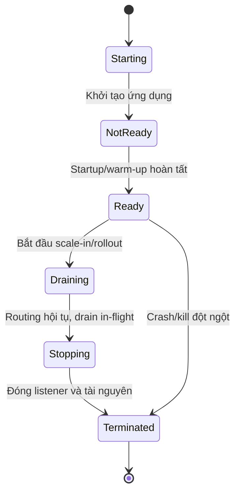
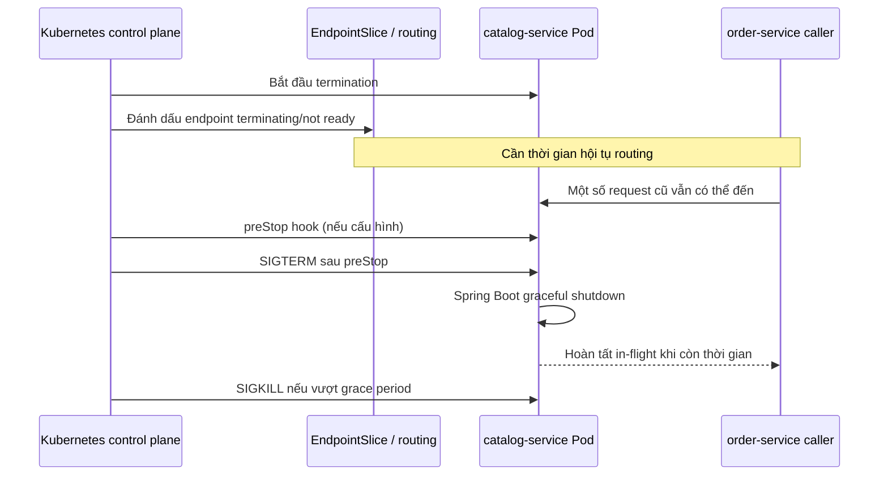
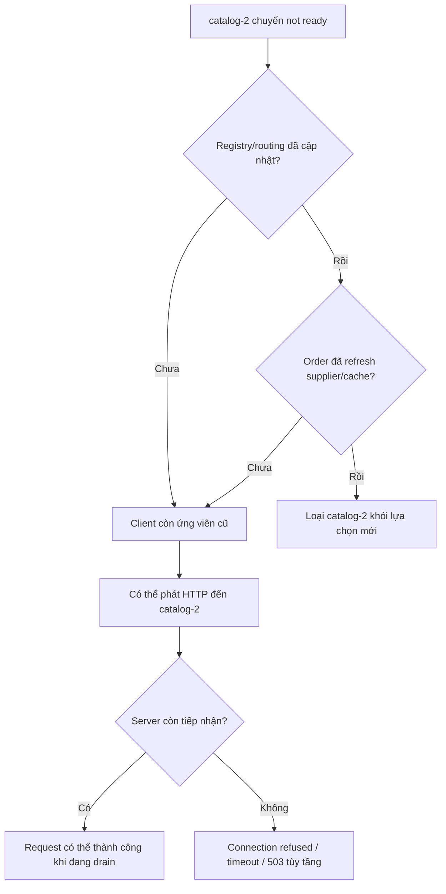

# Readiness, graceful shutdown và ngừng nhận yêu cầu mới

Trong hệ thống nhiều bản sao, một instance không nên nhận lưu lượng ngay khi tiến trình Java vừa được khởi động, cũng không nên bị tắt đột ngột khi đang xử lý request. Nếu `catalog-service` đang được `order-service` gọi qua Spring Cloud LoadBalancer, việc triển khai phiên bản mới hoặc thu hẹp cụm phải phối hợp **readiness**, **ngừng định tuyến request mới**, **drain các request đang chạy** và **graceful shutdown**.

Spring Cloud LoadBalancer chọn một `ServiceInstance` theo service ID, discovery và các supplier/policy đã cấu hình. Nó không tự quyết định được khi nào ứng dụng nghiệp vụ đã warm-up xong, transaction đang chạy có thể bị ngắt hay một instance phải rời khỏi tập ứng viên trước khi dừng process. Đó là trách nhiệm phối hợp giữa **ứng dụng, nền tảng triển khai, registry, LoadBalancer và HTTP client**.

Bài học trong chương **Triển khai** phân tích những ranh giới này, hướng dẫn cấu hình Spring Boot Actuator, graceful shutdown và quy trình drain trên Kubernetes/Eureka, đồng thời đưa ra bài thực hành đo độ trễ hội tụ và lỗi trong thời gian rollout.

## 1. Phân biệt liveness, readiness, đăng ký và khả năng xử lý request

Bốn khái niệm sau có thể mang giá trị khác nhau tại cùng một thời điểm:

| Tín hiệu | Trả lời câu hỏi | Ví dụ |
|---|---|---|
| **Liveness** | Tiến trình có đang ở trạng thái cần được khởi động lại hay không? | JVM/server còn hoạt động, không mắc lỗi không thể phục hồi |
| **Readiness** | Instance có sẵn sàng **nhận request mới** hay không? | Khởi động xong, đã hoàn tất warm-up cần thiết, chưa vào drain |
| **Registry membership** | Discovery có đang **quảng bá** instance này cho client không? | Eureka còn lease, Kubernetes EndpointSlice có endpoint |
| **HTTP reachability và kết quả nghiệp vụ** | Client có kết nối được và API trả kết quả đúng không? | Kết nối TCP thành công, endpoint đáp ứng trong SLA |

Một instance có thể:

- **Alive nhưng not ready:** process đang warm-up, ứng dụng chưa sẵn sàng tiếp nhận lưu lượng.
- **Registered nhưng not ready:** registry chưa được đồng bộ với readiness hoặc health check chưa áp dụng.
- **Ready nhưng API lỗi:** probe quá nông, database/queue có sự cố riêng, hoặc endpoint cụ thể bị lỗi.
- **Đã ngừng đăng ký nhưng còn xử lý request cũ:** quá trình drain đang diễn ra bình thường.
- **Đã chết nhưng còn xuất hiện trong registry/cache:** dừng đột ngột, heartbeat/lease/eviction chưa hội tụ.

**Readiness không phải một lời hứa “mọi request chắc chắn thành công”.** Nó là tín hiệu để hệ thống định tuyến ngừng cấp thêm công việc mới cho instance khi không phù hợp. HTTP client vẫn cần timeout, phân loại lỗi và chính sách retry có giới hạn.

## 2. Vòng đời một instance: từ startup đến termination

Thay vì coi shutdown là một sự kiện đơn lẻ, hãy nhìn một vòng đời đầy đủ:



| Giai đoạn | Readiness mong đợi | Định tuyến request mới | Request đang xử lý |
|---|---|---|---|
| Starting | Không sẵn sàng | Không gửi đến instance mới | Chưa có hoặc chưa phục vụ |
| Ready | Sẵn sàng | Có thể gửi | Xử lý bình thường |
| Draining | Từ chối nhận thêm | Bắt đầu loại khỏi routing | Cố hoàn thành trong thời hạn |
| Stopping | Không sẵn sàng | Không gửi | Chờ/đóng theo graceful timeout |
| Terminated | Không truy cập được | Không còn là ứng viên sau hội tụ | Đã kết thúc hoặc bị cắt khi hết thời hạn |

**Cửa sổ nguy hiểm** nằm giữa lúc một instance bắt đầu drain và lúc tất cả caller/gateway đã ngừng chọn nó. Đây là khoảng thời gian chịu ảnh hưởng của health probes, service discovery, DNS/EndpointSlice, cache và connection reuse.

Không phải mọi môi trường đều chuyển theo đúng thứ tự thời gian tuyệt đối như hình: Kubernetes có thể đánh dấu endpoint terminating trước khi app nhận `SIGTERM`, trong khi Spring Boot thường thay đổi readiness trong quá trình đóng application context. Phải kiểm tra chuỗi sự kiện của **nền tảng đang triển khai**, không giả định một thứ tự chung.

## 3. Readiness trong Spring Boot Actuator

Spring Boot có mô hình `ApplicationAvailability` và các trạng thái:

- `LivenessState.CORRECT` / `BROKEN` để biểu diễn liveness.
- `ReadinessState.ACCEPTING_TRAFFIC` / `REFUSING_TRAFFIC` để biểu diễn readiness.

Actuator có thể xuất health group tương ứng ở:

```text
GET /actuator/health/liveness
GET /actuator/health/readiness
```

Cấu hình minh họa của `catalog-service`:

```yaml
spring:
  application:
    name: catalog-service
  lifecycle:
    timeout-per-shutdown-phase: 30s

management:
  endpoint:
    health:
      probes:
        enabled: true
        add-additional-paths: true

server:
  shutdown: graceful
```

Ở ví dụ này, `management.endpoint.health.probes.enabled` bật các probe cho cả môi trường không tự phát hiện Kubernetes; khi dùng Spring Boot trên Kubernetes, probe có thể được tự bật theo điều kiện của nền tảng. Thuộc tính `add-additional-paths` ở các phiên bản Spring Boot hỗ trợ sẽ mở thêm `/livez` và `/readyz` trên **main server port**.

Có thể kiểm tra:

```powershell
Invoke-WebRequest "http://localhost:8080/readyz"
Invoke-WebRequest "http://localhost:8080/livez"
```

**Phải kiểm chứng version đang dùng:** cấu hình và đường dẫn Actuator có thể thay đổi nếu ứng dụng chỉnh base path, management server port, security hay health group. Chưa nhìn thấy `/readyz` không đồng nghĩa readiness luôn lỗi; có thể endpoint chưa được expose theo cấu hình.

### 3.1. Tại sao nên probe trên cùng cổng phục vụ nghiệp vụ?

Nếu Actuator chạy trên **management port riêng**, health endpoint có thể phản hồi tốt dù main HTTP connector không còn tiếp nhận request. Điều đó gây dương tính giả về readiness.

Trong Kubernetes, ưu tiên kiểm tra probe trên cổng thực của ứng dụng khi có thể, ví dụ `/readyz` trên main server port. Nếu phải dùng cổng quản trị riêng, cần thiết kế additional path/health check xác nhận được listener thực, chứ không chỉ lắng nghe cổng management.

### 3.2. Chọn dependency nào cho readiness?

Theo thiết kế, readiness group không nhất thiết bao gồm toàn bộ health indicator của mọi dependency. Đưa database, Redis hoặc một API thứ ba vào readiness có thể hợp lý **nếu ứng dụng thực sự không thể phục vụ bất kỳ traffic cần thiết nào khi dependency đó lỗi**. Nhưng phụ thuộc quá rộng có thể khiến toàn bộ replica cùng bị loại khi một dịch vụ dùng chung gặp sự cố.

Nguyên tắc:

1. **Liveness** không nên phụ thuộc trực tiếp vào network/database bên ngoài; sự cố DB không nên kích hoạt restart hàng loạt JVM đang khỏe.
2. **Readiness** chỉ nên phản ánh điều kiện tối thiểu để instance nhận traffic mới an toàn.
3. Nếu API vẫn phục vụ được một phần khi dependency hỏng, cân nhắc **degraded mode**, circuit breaker hoặc routing ở mức chức năng thay vì làm mọi instance not ready.
4. Kiểm tra sự khác biệt giữa `/actuator/health` tổng hợp và `/actuator/health/readiness`. Hai endpoint không nhất thiết cùng status.

Ví dụ khi mở rộng readiness group để dùng thêm một health contributor nội bộ tên `criticalWarmup`, cần giữ lại `readinessState`:

```yaml
management:
  endpoint:
    health:
      group:
        readiness:
          include: readinessState,criticalWarmup
```

Cấu hình trên chỉ có ý nghĩa khi contributor `criticalWarmup` đã được đăng ký và đúng tên. Không thêm indicator không tồn tại vào file cấu hình của lab rồi kỳ vọng ứng dụng vẫn chạy.

## 4. Điều khiển readiness khi bắt đầu drain

Spring Boot có thể tự thay đổi availability state trong quá trình startup/shutdown. Khi vận hành cần một **giai đoạn drain chủ động trước shutdown**, ứng dụng cũng có thể phát sự kiện chuyển readiness thành `REFUSING_TRAFFIC`.

Ví dụ một service nội bộ giữ trạng thái drain:

```java
package com.example.catalog.lifecycle;

import java.util.concurrent.atomic.AtomicBoolean;

import org.springframework.boot.availability.AvailabilityChangeEvent;
import org.springframework.boot.availability.ReadinessState;
import org.springframework.context.ApplicationEventPublisher;
import org.springframework.stereotype.Component;

@Component
public class DrainCoordinator {

    private final ApplicationEventPublisher events;
    private final AtomicBoolean draining =
            new AtomicBoolean(false);

    public DrainCoordinator(ApplicationEventPublisher events) {
        this.events = events;
    }

    public void beginDrain() {
        if (draining.compareAndSet(false, true)) {
            AvailabilityChangeEvent.publish(
                    events, ReadinessState.REFUSING_TRAFFIC);
        }
    }

    public boolean isDraining() {
        return draining.get();
    }
}
```

Ý nghĩa: khi một thành phần vận hành **được ủy quyền** gọi `beginDrain()`, readiness chuyển sang trạng thái từ chối nhận thêm lưu lượng. Cơ chế này không tự đóng HTTP server hoặc tự xóa mọi bản ghi service discovery. Orchestrator/LoadBalancer phải **quan sát và phản ứng** với tín hiệu đó.

**Không công khai một endpoint HTTP không xác thực để ai cũng có thể gọi `beginDrain()`.** Nếu cần cơ chế admin để bắt đầu drain, hãy bảo vệ bằng authentication, authorization, network policy và audit; một lifecycle hook nội bộ hay operator được kiểm soát có thể phù hợp hơn.

Một trình tự ứng dụng tự quản lý có thể là:

```text
beginDrain()
  → readiness báo không nhận request mới
  → chờ routing/discovery hội tụ trong một khoảng giới hạn
  → chờ in-flight requests hoàn tất
  → đóng application context / HTTP listener
```

Nếu thay đổi readiness và **đóng server ngay lập tức**, các client đang dùng candidate list cũ vẫn có thể gửi request mới đến instance vừa đóng. Việc có readiness API không tự tạo ra khoảng chờ hội tụ.

## 5. Cấu hình graceful shutdown của Spring Boot

Spring Boot có hỗ trợ graceful shutdown cho các embedded HTTP server được hỗ trợ. Cấu hình điển hình:

```yaml
server:
  shutdown: graceful

spring:
  lifecycle:
    timeout-per-shutdown-phase: 30s
```

Khi ứng dụng được shutdown theo lifecycle bình thường, Spring Boot phối hợp ngừng tiếp nhận request mới và cho request đang xử lý hoàn tất trong thời gian giới hạn.

Cần phân biệt:

- **Stop accepting new requests:** server hạn chế/không tiếp nhận công việc HTTP mới theo cơ chế của container.
- **Draining in-flight:** request đang chạy có cơ hội hoàn thành trước khi tiến trình đóng.
- **Release resources:** các bean có lifecycle, connection pool và các tài nguyên được đóng theo thứ tự/phase của Spring context.
- **Deadline:** `timeout-per-shutdown-phase` là ngân sách cho **từng shutdown phase**, không phải bảo đảm rằng toàn bộ process sẽ dừng đúng 30 giây trong mọi tình huống.

Các server như Tomcat, Jetty, Reactor Netty và Undertow có thể khác nhau về cách từ chối connection/request mới khi shutdown, xử lý keep-alive, kết nối đã mở và các loại stream. Không giả định cùng một hành vi ở mức TCP cho tất cả connector.

### 5.1. Graceful shutdown không xử lý mọi trường hợp

Không thể dựa vào graceful shutdown khi:

- Process bị `SIGKILL` hoặc bị OOM kill.
- Máy/VM/node mất nguồn hoặc đường mạng.
- Termination grace period của orchestrator hết trước khi ứng dụng drain xong.
- Request kéo dài quá deadline hoặc một worker bị treo.
- Các lớp discovery/gateway vẫn gửi traffic mới vì chưa hội tụ.

Do vậy, graceful shutdown là **một lớp bảo vệ**, không phải cam kết “zero downtime” khi cấu hình riêng lẻ.

## 6. Ngừng nhận yêu cầu mới khác với hủy yêu cầu đang chạy

Một instance đang chuyển từ `Ready` sang `Draining` vẫn có thể đang xử lý:

- Request trả kết quả nhanh trong vài chục mili-giây.
- Request gọi database/API bên ngoài trong vài giây.
- Request upload/download nhiều dữ liệu.
- SSE/WebSocket hoặc một streaming response có thể tồn tại rất lâu.
- Một giao dịch ghi dữ liệu đã commit nhưng chưa trả response.

Khi định nghĩa chính sách drain, cần phân biệt:

| Nhóm request | Hướng xử lý thường gặp |
|---|---|
| Request chưa được định tuyến đến instance | Không cấp request mới, chuyển sang instance còn ready |
| Request đã được LoadBalancer chọn nhưng chưa mở connection | Có thể thất bại nếu server đã đóng listener; cần timeout/retry policy |
| Request đã được chấp nhận và đang xử lý | Cho hoàn thành trong graceful timeout nếu có thể |
| Request lâu hơn deadline | Có thể bị hủy; phải tính idempotency và trạng thái nghiệp vụ |
| Stream/connection dài hạn | Cần chính sách reconnect và drain riêng, không giả định stream tự kết thúc |
| Request vừa được nhận trong cửa sổ stale routing | Chọn xử lý tiếp hoặc từ chối có kiểm soát theo admission policy |

**Từ chối ngay mọi request mới bằng HTTP 503** khi vừa đổi readiness không phải lúc nào cũng là cách giảm lỗi tốt nhất. Trong lúc routing chưa hội tụ, các client còn chọn instance cũ có thể nhận nhiều 503 hơn. Một chiến lược thường tốt hơn là **báo không ready, chờ routing ngừng cấp traffic, sau đó mới ngừng listener**. Nếu cần fail-fast ở ứng dụng, phải định nghĩa rõ thời điểm bật và cách caller xử lý 503.

Đối với request ghi dữ liệu, cần xử lý đặc biệt trường hợp server **đã commit** nhưng client bị timeout hoặc mất response. Retry không kèm idempotency key có thể tạo hai lần ghi dù deployment không hỏng dữ liệu nội bộ.

## 7. Kubernetes: readiness, Service và EndpointSlice

Khi chạy trên Kubernetes, `readinessProbe` quyết định Pod có được xem là ready để nhận traffic thông qua Service hay không. Các controller/control plane cập nhật trạng thái endpoint, còn quá trình chuyển thông tin đến kube-proxy, ingress controller hoặc load balancer bên ngoài có thể có độ trễ.

Khi Pod bước vào termination, thông tin EndpointSlice phản ánh trạng thái terminating; các endpoint đang terminating thường có điều kiện `ready=false` để đường định tuyến thông thường không tiếp tục chọn chúng. Nhưng:

- Một số đường đi đã có connection hoặc giữ danh sách endpoint cũ.
- Gateway/ingress/external load balancer có chu kỳ cập nhật hoặc thời gian drain riêng.
- In-flight request vẫn có thể đang chạy.
- Việc EndpointSlice cập nhật không đồng nghĩa mỗi Spring Cloud LoadBalancer client đã đổi snapshot ngay.



Sơ đồ mô tả thứ tự các bước chính, không phải cam kết mọi thành phần mạng đã hội tụ trước `SIGTERM`. Trong termination thông thường, ngân sách `terminationGracePeriodSeconds` **đã bắt đầu** trước khi `preStop` hoàn tất; preStop **tiêu thụ cùng ngân sách** với giai đoạn graceful shutdown. Cần tính thêm thời gian dao động của runtime và hệ thống mạng.

### 7.1. Kube Service DNS không đồng nghĩa Spring Cloud LoadBalancer

Kubernetes Service có thể định tuyến bằng DNS/virtual IP và cơ chế cân bằng tải của cụm, **ngay cả khi ứng dụng không dùng Spring Cloud LoadBalancer**.

Ngược lại, `@LoadBalanced WebClient/RestClient` chỉ có ý nghĩa khi có `ServiceInstanceListSupplier`/discovery phù hợp, ví dụ tích hợp Spring Cloud Kubernetes hoặc nguồn instance khác. Cần xác định rõ ứng dụng đang dùng:

1. Kubernetes Service làm địa chỉ cân bằng tải, hay
2. Spring Cloud LoadBalancer chọn một `ServiceInstance` cụ thể từ discovery.

Nếu cấu hình hai lớp routing, phải biết mỗi lớp nhìn thấy **Pod IP** hay **Service virtual IP**, và readiness/EndpointSlice được áp dụng ở đâu. Không suy từ việc gọi URL `http://catalog-service` thành công mà kết luận Spring Cloud LoadBalancer đang trực tiếp chọn Pod.

## 8. Ví dụ Kubernetes Deployment có readiness và graceful shutdown

Ví dụ minh họa (thay image bằng artifact thực tế và kiểm chứng phiên bản Spring Boot):

```yaml
apiVersion: v1
kind: Service
metadata:
  name: catalog-service
spec:
  selector:
    app: catalog-service
  ports:
    - name: http
      port: 8080
      targetPort: http
---
apiVersion: apps/v1
kind: Deployment
metadata:
  name: catalog-service
spec:
  replicas: 3
  strategy:
    type: RollingUpdate
    rollingUpdate:
      maxSurge: 1
      maxUnavailable: 0
  selector:
    matchLabels:
      app: catalog-service
  template:
    metadata:
      labels:
        app: catalog-service
    spec:
      terminationGracePeriodSeconds: 50
      containers:
        - name: catalog
          image: example.invalid/catalog-service:1.0.0
          ports:
            - name: http
              containerPort: 8080
          env:
            - name: SERVER_PORT
              value: "8080"
            - name: SERVER_SHUTDOWN
              value: graceful
            - name: SPRING_LIFECYCLE_TIMEOUT_PER_SHUTDOWN_PHASE
              value: "30s"
            - name: MANAGEMENT_ENDPOINT_HEALTH_PROBES_ENABLED
              value: "true"
            - name: MANAGEMENT_ENDPOINT_HEALTH_PROBES_ADD_ADDITIONAL_PATHS
              value: "true"
          startupProbe:
            httpGet:
              path: /livez
              port: http
            periodSeconds: 2
            failureThreshold: 30
          readinessProbe:
            httpGet:
              path: /readyz
              port: http
            periodSeconds: 2
            timeoutSeconds: 1
            failureThreshold: 2
            successThreshold: 1
          livenessProbe:
            httpGet:
              path: /livez
              port: http
            periodSeconds: 10
            timeoutSeconds: 1
            failureThreshold: 3
          lifecycle:
            preStop:
              exec:
                command: ["/bin/sh", "-c", "sleep 10"]
```

**Lưu ý về các con số**:

- `terminationGracePeriodSeconds: 50` dành một ngân sách tổng tương đối lớn hơn 10 giây preStop và 30 giây graceful shutdown, để có headroom cho dao động. Không có công thức “10+30=40 là đủ tuyệt đối”; đo thời gian shutdown thật.
- `preStop: sleep 10` chỉ là **thí nghiệm minh họa** để tạo khoảng trống cho routing hội tụ trước SIGTERM. Bản thân `sleep` **không đổi trạng thái readiness bên trong Spring Boot**; việc đánh dấu endpoint terminating trong Kubernetes là cơ chế riêng. Cách này không bảo đảm mọi ingress/client đã ngừng gửi traffic.
- Nếu container dùng ảnh `distroless` không có `/bin/sh`, hook trên sẽ không chạy như mong đợi; dùng hook hoặc cơ chế drain tương thích với image thực.
- `maxUnavailable: 0` và `maxSurge: 1` giúp rollout giữ replica đang sẵn sàng khi có thể, nhưng **không bảo đảm không có lỗi mạng hoặc zero-downtime tuyệt đối**. Nếu bản mới không ready, rollout có thể bị kẹt.
- `example.invalid/catalog-service:1.0.0` là **placeholder**, không phải image có thể pull. Phải thay bằng image từ registry được phép.
- Readiness probe trên **main HTTP port**, giúp giảm trường hợp cổng management vẫn hoạt động trong khi cổng API bị lỗi.

### 8.1. Khi nào cần preStop logic chủ động hơn sleep?

Đối với ứng dụng có quy trình drain riêng, preStop có thể gọi một **admin action bảo mật** để chuyển readiness và chờ hết thời gian hội tụ, rồi mới cho process nhận SIGTERM. Nhưng không được mở endpoint drain công khai hoặc cho phép mọi Pod/tenant điều khiển trạng thái phục vụ của nhau.

Trước khi thêm hook phức tạp, đo xem cơ chế terminating EndpointSlice và graceful shutdown mặc định đã đủ cho SLO chưa. Nhiều lớp drain độc lập đặt thời gian sai có thể khiến process bị `SIGKILL` khi vẫn còn in-flight request.

## 9. Eureka: deregistration không giống readiness

Nếu hệ thống không chạy trên Kubernetes hoặc dùng Eureka làm nguồn instance cho Spring Cloud LoadBalancer, lifecycle khác đi.

Ví dụ Eureka client:

```yaml
spring:
  application:
    name: catalog-service

eureka:
  client:
    service-url:
      defaultZone: http://localhost:8761/eureka/
    healthcheck:
      enabled: true
  instance:
    prefer-ip-address: true
```

Trong các phiên bản Spring Cloud Netflix phù hợp, `eureka.client.healthcheck.enabled` có thể tích hợp health của ứng dụng với status quảng bá lên Eureka. Nhưng **không nên kết luận** nó sẽ tự áp dụng đúng `/actuator/health/readiness` hoặc thực hiện toàn bộ drain trước shutdown: cách map health/status phụ thuộc Eureka client, Spring Boot Actuator và cấu hình được dùng.

Đặc biệt:

- **Eureka status UP** không nhất thiết giống `ReadinessState.ACCEPTING_TRAFFIC`.
- Deregister khi context đóng bình thường cần thời gian đến registry và đến các client đang fetch.
- Khi process chết đột ngột, heartbeat không còn và registry dựa vào lease/eviction; có thể bị trì hoãn bởi self-preservation.
- Một client có thể giữ **registry snapshot cũ** dù Eureka server đã cập nhật.
- Spring Cloud LoadBalancer có thể có **cache ứng viên riêng** sau lớp Eureka client.

Với yêu cầu drain nghiêm ngặt, cần có quy trình vận hành được kiểm chứng để ngừng công bố/đánh dấu instance không đủ điều kiện trước khi dừng listener, hoặc dùng `HealthCheckServiceInstanceListSupplier` ở caller. Cả hai đều có độ trễ hội tụ và không thay thế cơ chế graceful xử lý request đang chạy.

## 10. LoadBalancer có thể vẫn chọn instance đang drain vì sao?

Giả sử `catalog-2` chuyển readiness sang không sẵn sàng tại `T0`. Trước `T0`, Order đã cache:

```text
catalog-service:
  catalog-1: ready
  catalog-2: ready
  catalog-3: ready
```

Trong khoảng ngắn sau `T0`, Order vẫn có thể chọn `catalog-2` khi:

1. Discovery client chưa fetch trạng thái mới.
2. `ServiceInstanceListSupplier` đang dùng snapshot cũ.
3. Cache ở LoadBalancer chưa hết TTL hoặc chưa được làm mới.
4. Health-aware supplier chưa chạy probe tiếp theo.
5. Retry hoặc sticky routing còn mang thông tin instance cũ.
6. Một client khác trong cụm có chu kỳ refresh riêng.



**Lưu ý về cache:** tắt cache Spring Cloud LoadBalancer không đồng nghĩa tắt cache của Eureka hoặc độ trễ cập nhật EndpointSlice/ingress. Tăng tần suất refresh có thể giảm một thành phần trễ nhưng tăng tải lên registry; cần xác định bottleneck qua số liệu.

### 10.1. HealthCheckServiceInstanceListSupplier có giúp gì?

Khi được **cấu hình rõ ràng**, supplier health check có thể probe instance và loại những instance không đạt. Nhưng:

- Nó không tự được bật chỉ vì Catalog có Actuator.
- Endpoint probe/interval/timeout phải đúng ứng dụng và network policy.
- Kiểm tra health cũng có cửa sổ cập nhật, không bảo đảm phát hiện tức thì.
- Nó lọc danh sách **ở caller**, không nhất thiết thay đổi Eureka server hoặc Pod endpoint.
- Không nên trộn lẫn một health probe đơn giản với khả năng hoàn tất tất cả request nghiệp vụ.

Như vậy, readiness của server, membership của registry và health filtering của LoadBalancer có thể **hỗ trợ nhau**, nhưng không phải cùng một cơ chế.

## 11. Ảnh hưởng của HTTP client trong thời gian drain

Trong cùng cửa sổ chuyển đổi, `RestClient`, `WebClient` và OpenFeign đều có thể chọn instance còn trong snapshot rồi gặp lỗi transport.

| Client | Kiểu gọi thông dụng | Rủi ro cần quan sát |
|---|---|---|
| `RestClient` / `RestTemplate` | Blocking | Thread chờ lâu do connect/read timeout, stale address |
| `WebClient` | Reactive, thường non-blocking I/O | Request in-flight, connection pool, cancellation, event loop |
| OpenFeign | Interface declarative, thường blocking | ErrorDecoder/FeignException, retryer và transport timeout |

Ví dụ RestClient gọi service ID:

```java
@LoadBalanced
@Bean
RestClient.Builder loadBalancedRestClientBuilder() {
    return RestClient.builder();
}
```

```java
ProductResponse product = restClient.get()
        .uri("http://catalog-service/api/products/{id}", id)
        .retrieve()
        .body(ProductResponse.class);
```

Ở đây `restClient` phải được tạo từ builder `@LoadBalanced`; `ProductResponse` là DTO của ứng dụng. Nếu instance đã chọn bị đóng listener, lời gọi có thể lỗi **trước khi nhận được HTTP response**; khi đó không nên diễn giải như HTTP `404` của sản phẩm.

### 11.1. Retry trong rollout: chọn lại nhưng không bảo đảm đổi instance

Retry có thể giảm lỗi cuối cùng cho các thao tác đọc an toàn, nhưng có thể:

- Lặp lại cùng instance nếu discovery/cache vẫn stale.
- Chọn instance khác chỉ khi policy và request context phù hợp.
- Tăng lượng request đến những instance còn sống khi vừa scale-in.
- Làm logical request kéo dài hơn deadline.
- Lặp thao tác có tác dụng phụ nếu server đã commit mà response bị mất.

Vì vậy, cần timeout rõ ràng, retry có giới hạn, backoff/jitter phù hợp và **idempotency** cho thao tác ghi. Đừng bật retry vô hạn để che giấu một quy trình drain thiếu đồng bộ.

## 12. Thiết kế ngân sách thời gian end-to-end

Một request đang drain có thể đồng thời chịu nhiều giới hạn:

```text
T_request =
  thời gian chờ slot/connection
  + thời gian chọn instance
  + connect
  + chờ response/body
  + (retry attempts + backoff nếu có)
```

Đây là cách **phân rã chi phí thời gian**, không phải công thức đảm bảo mọi bước xảy ra tuần tự hoặc không trùng lặp. Với `WebClient` và HTTP/2, semantics connection và stream còn khác HTTP/1.1.

Trong deployment, có thêm:

```text
T_termination_budget >=
  T_preStop
  + T_time_for_application_shutdown
  + safety_margin
```

Nhưng đừng cộng cơ học các giá trị mặc định. Độ trễ propagating readiness/EndpointSlice, thời gian in-flight còn lại và các shutdown phase có thể biến động. **Chọn giá trị từ p99/p99.9 request duration và thử nghiệm rollout thật**, đặc biệt nếu có operation dài.

Ví dụ giả định:

| Thành phần | Ngân sách minh họa |
|---|---:|
| Chờ propagation trong preStop | 10 giây |
| Spring graceful shutdown per phase | 30 giây |
| Headroom cho runtime/termination | 10 giây |
| Termination grace period | 50 giây |

Những con số trên chỉ để đọc manifest ở phần 8; không phải khuyến nghị áp dụng đồng loạt cho mọi hệ thống.

## 13. Request dài, WebSocket, SSE và kết nối tái sử dụng

Không phải mọi kết nối kết thúc nhanh. Một request HTTP streaming có thể kéo dài nhiều phút; một WebSocket có thể tồn tại hàng giờ.

Với các trường hợp này, việc chỉ đặt graceful timeout 30 giây có thể dẫn đến:

- Server cần cắt các stream chưa kết thúc khi hết thời hạn.
- Client phải reconnect và resume stream theo offset/event ID nếu protocol hỗ trợ.
- Session hoặc subscription cần được chuyển trạng thái và giải phóng tài nguyên.
- Keep-alive/connection pool vẫn có thể giữ kết nối đã mở dù endpoint đã rời routing.
- HTTP/2 có thể multiplex nhiều stream trên một connection; behavior khi draining phụ thuộc connector và implementation.

Cần xác định rõ chính sách **connection draining**, thời gian tối đa của stream, khả năng reconnect và bảo đảm thứ tự/idempotency. Đừng cho rằng việc readiness chuyển sang false sẽ tự kết thúc các kết nối hiện có hoặc xử lý hoàn tất mọi stream.

## 14. Runbook triển khai: thêm bản sao rồi gỡ bản sao cũ

Một quy trình rolling deployment có thể gồm:

1. **Build và preflight:** cùng hợp đồng HTTP giữa phiên bản cũ và mới, cấu hình service ID/discovery đúng.
2. **Khởi động bản sao mới:** tiến trình `Starting`; probe chưa `Ready` nên chưa cấp traffic.
3. **Warm-up:** kết nối DB, khởi tạo cache cần thiết, nạp dữ liệu tối thiểu; không làm liveness phụ thuộc vào toàn bộ dependency bên ngoài.
4. **Ready:** Actuator và nền tảng triển khai ghi nhận instance đủ điều kiện; sau khi propagation, LoadBalancer/gateway có thể chọn nó.
5. **Quan sát:** đo error rate, latency, lượng request và readiness theo bản sao/release trước khi tiếp tục.
6. **Bắt đầu drain bản sao cũ:** đánh dấu không ready hoặc terminating trong nền tảng; không cấp công việc mới sau khi định tuyến hội tụ.
7. **Chờ hội tụ và hoàn tất in-flight:** đảm bảo đủ termination budget, không hủy request quá sớm.
8. **Graceful shutdown:** dừng listener và đóng tài nguyên.
9. **Xác minh:** instance cũ không còn được chọn; request mới thành công trên tập replica còn lại.
10. **Rollback nếu cần:** nếu bản mới không ready hoặc error rate tăng, không rút hết công suất bản cũ; khôi phục theo chính sách rollout.

**Không nhầm rollout với scale-in đơn thuần:** khi bản cũ và mới cùng chạy, còn phải xem xét tính tương thích API, session affinity, schema dữ liệu, event format và shared database. Một quy trình drain đúng không cứu được API phá vỡ hợp đồng ở bản mới.

### 14.1. Deployment strategy và capacity

Với Kubernetes:

```yaml
strategy:
  type: RollingUpdate
  rollingUpdate:
    maxSurge: 1
    maxUnavailable: 0
```

Cấu hình này tạo điều kiện giữ replica ready trong khi thêm bản mới, nhưng nếu bản mới chưa ready thì rollout có thể không tiến triển. Ngoài số replica, phải xét CPU, database connections, downstream concurrency và rate limit: gỡ một instance làm năng lực tổng giảm, có thể làm các bản sao còn lại quá tải ngay cả khi readiness đều `UP`.

## 15. Quan sát tín hiệu nào để xác định drain đã thành công?

Một dashboard chỉ có số Pod Ready là chưa đủ. Cần quan sát các mốc khác nhau:

| Mốc | Câu hỏi | Nguồn dữ liệu |
|---|---|---|
| D0 | Lệnh rollout/termination bắt đầu lúc nào? | Deployment/pod events, operator log |
| D1 | Instance báo not ready lúc nào? | `/readyz` hoặc Availability event |
| D2 | Registry/EndpointSlice hết xem instance là ready? | Eureka/Kubernetes |
| D3 | Caller không còn nhìn thấy instance trong candidate list? | DiscoveryClient/supplier debug |
| D4 | Lần cuối LoadBalancer chọn instance này? | Client span/log hoặc event chọn instance |
| D5 | Request in-flight cuối cùng kết thúc? | Server in-flight metric/tracing |
| D6 | HTTP listener/process dừng? | Spring shutdown log, Pod events |

**Các mốc không bắt buộc có thứ tự duy nhất** giữa những hệ thống và request song song. Ví dụ một request đã chọn instance trước D2 có thể chỉ hoàn thành sau D2; D4 có thể vẫn xảy ra sau khi readiness báo false do stale cache.

Metrics gợi ý:

- `ready_pods`/`available_replicas` theo deployment.
- Số request in-flight tại Catalog, độ trễ p95/p99 và số connection đang mở.
- HTTP success/4xx/5xx, timeout, connection reset/refused theo logical downstream.
- Số lần LoadBalancer không tìm được instance và tổng retry attempts.
- Khoảng D1→D3/D4, D4→D5, D0→D6 theo lần rollout.

Không thêm `traceId`, request ID, raw URL hoặc mọi instance ID động vào nhãn **mọi metric** vì cardinality có thể tăng mạnh. Dùng service ID/operation/status family cho metric tổng hợp và instance đã chọn ở **structured logs/spans có sampling** khi điều tra request cụ thể.

## 16. Thực hành A — Kiểm tra readiness trước và sau khi ứng dụng khởi động

Chuẩn bị một `catalog-service` có Spring Boot Actuator, cổng `8080` và cấu hình probe ở phần 3. Bắt đầu process rồi thử:

```powershell
Invoke-WebRequest "http://localhost:8080/livez"
Invoke-WebRequest "http://localhost:8080/readyz"
Invoke-WebRequest "http://localhost:8080/actuator/health/readiness"
```

Ghi nhận:

- Khi ứng dụng chưa bắt đầu lắng nghe, kết nối có thể chưa thành công; **không** suy rằng endpoint chưa hoạt động là readiness state `REFUSING_TRAFFIC`, vì có thể HTTP server chưa mở.
- Khi startup hoàn tất, readiness thường chuyển sang trạng thái có thể nhận traffic và endpoint trả status tương ứng.
- Khi readiness bị chuyển thành `REFUSING_TRAFFIC` theo cơ chế quản lý, probe thường trả lỗi health (ví dụ HTTP 503) trong khi process vẫn có thể alive.
- Nếu dùng management port riêng hoặc có Spring Security, phải kiểm tra path và quyền truy cập phù hợp.

Đừng dùng một request `GET /readyz` để tự động restart process; readiness chủ yếu là tín hiệu **ngừng routing mới**, còn restart là vai trò của liveness/điều kiện khác.

## 17. Thực hành B — Rolling update dưới tải liên tục

Trong một **cluster thử nghiệm** đã triển khai manifest phần 8 với image thật và Order đã kết nối đúng, kiểm tra ban đầu:

```powershell
kubectl get deployment catalog-service
kubectl get pods -l app=catalog-service -o wide
kubectl get endpointslice -l kubernetes.io/service-name=catalog-service
```

Bắt đầu một load generator có giới hạn tới endpoint của Order. Ví dụ nếu Order đã được port-forward trên `localhost:8090`:

```powershell
$endpoint = "http://localhost:8090/api/orders/check/42"
while ($true) {
    $sw = [System.Diagnostics.Stopwatch]::StartNew()
    try {
        $result = Invoke-RestMethod -Uri $endpoint -TimeoutSec 4
        "{0:o} OK {1} {2}ms" -f (Get-Date),
            $result.servedBy, $sw.ElapsedMilliseconds
    }
    catch {
        "{0:o} ERROR {1} {2}ms" -f (Get-Date),
            $_.Exception.GetType().Name, $sw.ElapsedMilliseconds
    }
    Start-Sleep -Milliseconds 100
}
```

Ví dụ `order-service` và endpoint `/api/orders/check/42` là **thành phần giả định của lab**, phải tồn tại trước khi chạy script. `Ctrl+C` dừng vòng lặp. Không chạy script vô hạn trên production và không gửi traffic đến môi trường ngoài quyền kiểm soát.

Trong terminal khác, thực hiện rollout có kiểm soát:

```powershell
kubectl rollout restart deployment/catalog-service
kubectl rollout status deployment/catalog-service
kubectl get pods -l app=catalog-service -w
```

Mở thêm một terminal để xem EndpointSlice:

```powershell
kubectl get endpointslice -l kubernetes.io/service-name=catalog-service -w
```

Ghi nhận thời điểm Pod mới `Ready`, Pod cũ `Terminating` và các request còn lỗi/còn đến instance cũ. `kubectl get ... -w` hiển thị cập nhật object, nhưng không tự cho biết mọi ingress/proxy hay Spring Cloud LoadBalancer client đã hội tụ; cần kết hợp log/trace HTTP.

Đối chiếu một lần rollout **có preStop sleep** và một lần **không có** (trong môi trường lab) nếu cần chứng minh propagation delay. Giữ nguyên số replica, workload, retry, timeout và version code trong phép so sánh để không trộn nguyên nhân.

## 18. Thực hành C — Phân biệt graceful stop với dừng đột ngột

Trong môi trường thử nghiệm, so hai tình huống:

**Tình huống 1: Rolling termination bình thường.** Pod được đánh dấu terminating, preStop chạy nếu cấu hình, kubelet gửi SIGTERM, ứng dụng graceful stop, rồi process kết thúc.

**Tình huống 2: Crash/kill cưỡng bức có kiểm soát.** Process bị kết thúc trước khi thực hiện trình tự drain và deregistration bình thường. Chỉ chạy trên workload lab được phép; không thực hiện trên hệ thống sản xuất hay trên Pod dùng chung.

| Điều kiện | Graceful termination | Dừng đột ngột |
|---|---|---|
| Báo not ready/terminating | Thường có cơ hội | Có thể không có |
| Cơ hội chờ routing hội tụ | Có thể cấu hình | Hầu như không |
| In-flight requests | Có cơ hội hoàn thành | Dễ bị cắt |
| Registry/discovery | Thường có cơ chế cập nhật/hủy đăng ký | Có thể stale đến hết heartbeat/lease |
| Lỗi quan sát | Vẫn có thể xuất hiện trong cửa sổ | Thường có thể nhiều hơn |
| Khả năng xác định nguyên nhân | Có timeline rõ hơn | Cần log/trace để phân biệt |

Mục tiêu không phải chứng minh graceful không bao giờ lỗi, mà là **đo** xem nó giảm số request bị ngắt, số lỗi transport và thời gian chọn stale instance ra sao.

## 19. Các kịch bản cần tự động kiểm thử

Một bộ kiểm thử nghiêm túc nên tách **unit test trạng thái**, **integration test HTTP** và **kiểm thử rollout thực**.

| Kịch bản | Đầu vào hoặc thao tác | Kết quả cần xác minh |
|---|---|---|
| Startup chưa hoàn tất | Instance đang warm-up | Readiness chưa cấp traffic |
| Startup hoàn tất | App chuyển `ACCEPTING_TRAFFIC` | Readiness thành công |
| Bắt đầu drain | Gọi cơ chế drain đã được ủy quyền | Readiness chuyển từ chối, liveness vẫn khỏe |
| In-flight request | Một request xử lý chậm có kiểm soát | Có cơ hội hoàn thành trước deadline |
| Request mới sau khi routing hội tụ | Instance đã bị loại | Không còn chọn instance drain |
| Client stale snapshot | Supplier vẫn chứa instance cũ | Lỗi được phân loại; không mất kiểm soát retry |
| Không có instance ready | Danh sách ứng viên rỗng | Không gửi HTTP đến host lạ; báo lỗi dependency phù hợp |
| Scale-out | Thêm replica mới, giữ tải | Instance mới chỉ nhận traffic sau các điều kiện sẵn sàng cần thiết |
| Scale-in | Gỡ một replica, giữ tải | Đo D1–D6, số lỗi, request cuối |
| Crash | Terminate cưỡng bức | Nhận diện cửa sổ stale và phục hồi |
| Streaming dài | SSE/WebSocket/long request | Có reconnect hoặc termination policy rõ |
| Retry thao tác ghi | Timeout sau commit giả lập | Không tạo bản ghi trùng khi có idempotency key |

Với `WebClient`, `StepVerifier` có thể dùng cho pipeline reactive và cancellation; `StepVerifier.withVirtualTime` phù hợp với `timeout`/`Retry.backoff` thuộc Reactor. **Không dùng virtual time để giả lập rằng DNS, TCP, Kubernetes EndpointSlice hoặc Eureka lease thực đã hội tụ**.

Đối với `ServiceInstanceListSupplier` tùy biến, có thể dùng snapshot bất biến hoặc fake discovery để assert: sau khi đánh dấu một instance bị loại, lượt chọn mới từ **snapshot đã cập nhật** không trả lại instance đó. Kết quả này vẫn chưa chứng minh thời gian hội tụ của registry/ingress ngoài đời.

## 20. Các lỗi triển khai thường gặp

| Triệu chứng | Nguyên nhân thường gặp | Cách xử lý |
|---|---|---|
| Pod sống nhưng không nhận request | Readiness false, warm-up chưa xong, probe sai path/port | Kiểm tra readiness endpoint và Pod events |
| Pod có `Ready=true` nhưng HTTP lỗi | Probe quá nông hoặc khác cổng API | Dùng main-port probe, kiểm tra API/dependencies |
| Instance đã not ready nhưng caller vẫn chọn | Discovery/cache stale, health filter chưa cập nhật | Đo D1–D4, kiểm tra từng lớp refresh |
| `server.shutdown=graceful` nhưng vẫn connection refused | Không chờ routing hội tụ trước khi đóng listener | Điều chỉnh termination workflow và grace budget |
| Pod nhận SIGKILL khi còn request | Grace period ngắn hoặc preStop chiếm quá nhiều thời gian | Đo in-flight và các shutdown phase |
| Rollout bị kẹt | Instance mới không đạt readiness, `maxUnavailable=0` | Kiểm tra startup/warm-up, image, probe và resource limits |
| Cả cụm unready khi DB chậm | Readiness phụ thuộc DB quá rộng | Đánh giá degraded mode và dependency policy |
| Restart hàng loạt khi DB lỗi | Liveness phụ thuộc external DB | Tách liveness khỏi external dependencies |
| Sau scale-in p95 tăng | Mất capacity, retry làm traffic nặng thêm | Bảo đảm headroom, giảm concurrency/retry |
| HTTP 503 không rõ nguồn | Server, gateway hoặc no-instance có thể cùng trả lỗi | Trace tầng sinh lỗi, instance đã chọn |
| Thay TTL vẫn còn gọi instance cũ | Có nhiều lớp cache/fetch/ingress | Chẩn đoán theo registry→supplier→HTTP |
| Stream dài bị ngắt | Deadline drain không tính tới long-lived connection | Thiết kế reconnect/connection draining riêng |

## 21. Checklist production trước khi rollout

**Ứng dụng:**

- [ ] `/readyz` và `/livez` có ý nghĩa đúng; readiness không bị coi là liveness.
- [ ] Probe chạy trên đường/cổng đại diện cho HTTP server nghiệp vụ.
- [ ] Graceful shutdown được bật và thời hạn phù hợp p99 request/stream.
- [ ] Không public endpoint thay đổi readiness/drain.
- [ ] Có cơ chế xử lý idempotency với thao tác ghi có retry.
- [ ] Có khả năng quan sát in-flight requests, errors và trạng thái shutdown.

**Discovery và LoadBalancer:**

- [ ] Biết nguồn instance thực (Eureka, Kubernetes discovery, DNS Service hay static supplier).
- [ ] Hiểu độ trễ registry refresh, cache, health filter và quy tắc chọn instance.
- [ ] Các caller có timeout/retry budget, không retry vô hạn khi scale-in.
- [ ] Có cách xác nhận instance nào đã được chọn cho request lỗi.
- [ ] Không mặc định một `ServiceInstance` còn registered là ready.

**Nền tảng triển khai:**

- [ ] Readiness/liveness/startup probes phù hợp.
- [ ] Rolling update không giảm quá nhiều capacity trong lúc bản mới warm-up.
- [ ] Termination grace period tính đủ preStop, propagation, graceful phases và headroom.
- [ ] Có quy trình drain SSE/WebSocket hoặc request dài.
- [ ] Đã thử rolling termination, abrupt failure và rollback dưới tải.
- [ ] Có dashboard/timeline D0–D6 để phân tích sự cố.

## 22. Ghi nhớ

**Readiness trả lời “có nên gửi request mới không?”; graceful shutdown trả lời “có thể kết thúc những request đã nhận một cách có kiểm soát không?”; còn ngừng định tuyến traffic mới đòi hỏi discovery, ingress/Service và LoadBalancer thực sự hội tụ.** Ba cơ chế này bổ sung cho nhau, không thay thế nhau.

Với Spring Cloud LoadBalancer, quá trình scale-in an toàn cần chuyển instance sang không sẵn sàng, cho các caller ngừng chọn nó, dành thời gian cho in-flight requests rồi đóng server. `ServiceInstanceListSupplier` có thể còn snapshot cũ; `RestClient`, `WebClient` và OpenFeign vẫn cần timeout, retry có giới hạn và xử lý lỗi transport. Thực hành rollout dưới tải, đo readiness, candidate list, thời gian request cuối cùng và graceful deadline là cách xác nhận độ ổn định thực tế của hệ thống.

