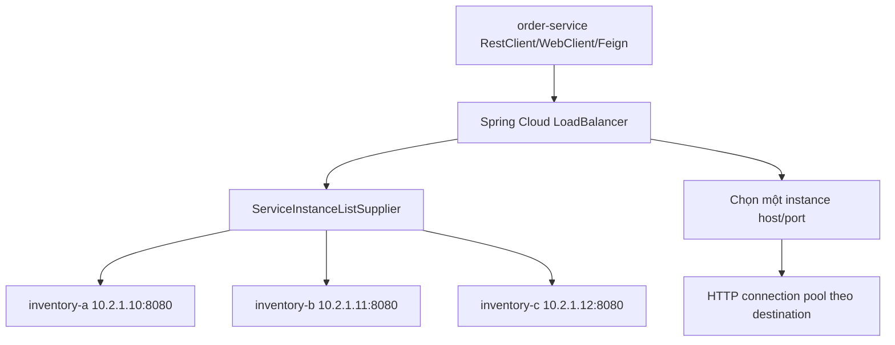
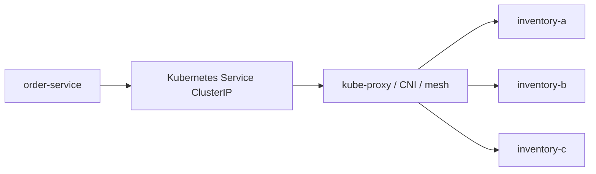
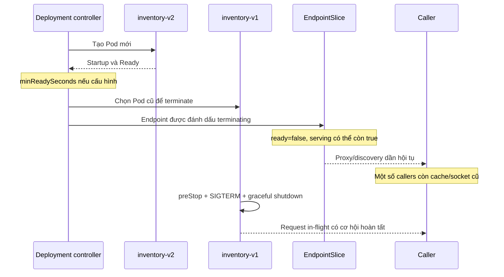
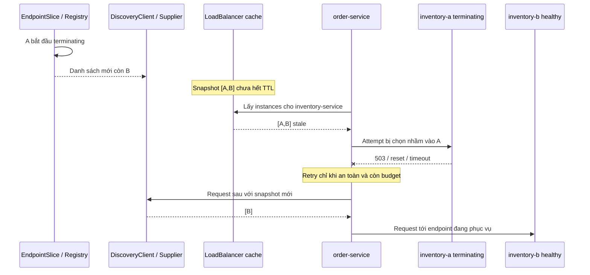
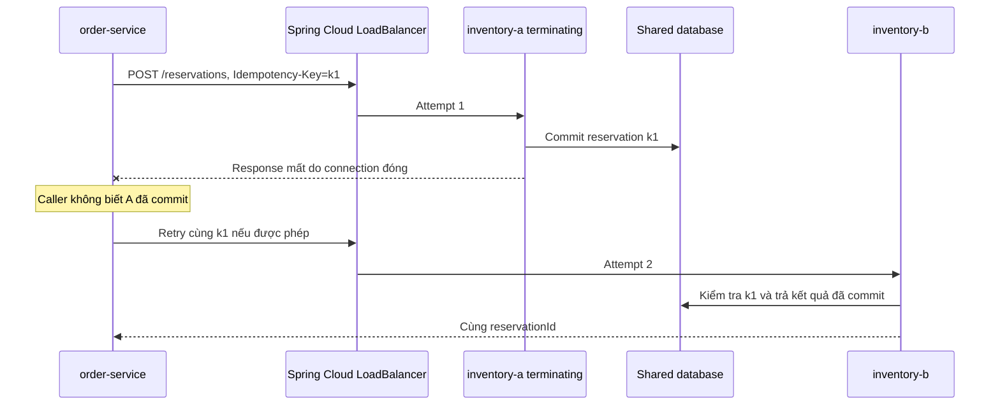

# Rolling update, thu hẹp số bản sao và yêu cầu đang xử lý

Trong Spring Cloud LoadBalancer, một lời gọi tới `http://inventory-service/api/items/42` được xử lý bằng cách chọn một `ServiceInstance` theo service ID, sau đó HTTP client kết nối đến host/port thực. Khi Kubernetes triển khai phiên bản mới (**rolling update**) hoặc giảm số bản sao (**scale-down**), danh sách endpoints thay đổi trong khi request cũ và kết nối keep-alive vẫn có thể đang hoạt động. Nếu không có kế hoạch drain, caller có thể gặp HTTP 503/504, `Connection reset`, stale discovery hoặc thậm chí thực thi trùng một lệnh nghiệp vụ sau retry.

Bài thuộc chương **Triển khai** của module **Spring Cloud Service Communication Load Balancing**. Chủ đề là **Rolling update, thu hẹp số bản sao và yêu cầu đang xử lý**: phối hợp Spring Boot graceful shutdown với Kubernetes readiness/EndpointSlice, giới hạn retry và timeout, quản lý kết nối cho `RestClient`, `WebClient`, OpenFeign, cùng kiểm thử và observability. Các nguyên tắc cũng áp dụng cho VM và service registry khác dù ví dụ sử dụng Kubernetes.

## 1. Mục tiêu của bài học

Sau bài này, bạn cần:

1. Phân biệt rolling update với scale-down, readiness với liveness và graceful shutdown với việc chấm dứt process tức thì.
2. Hiểu rằng một Pod đã Terminating có thể vẫn đang hoàn tất HTTP requests, trong khi EndpointSlice thông báo không nên nhận traffic mới.
3. Nhận biết nơi quyết định routing là Spring Cloud LoadBalancer chọn Pod IP hay là Kubernetes Service/mesh chọn Pod.
4. Phối hợp `maxSurge`, `maxUnavailable`, `terminationGracePeriodSeconds`, `preStop` và Spring Boot shutdown timeout.
5. Giảm cửa sổ chọn stale instances do discovery/cache hoặc stale connections do HTTP pool.
6. Chọn chính sách retry và idempotency an toàn khi request bị ngắt giữa rollout.
7. Giới hạn tác động của scale-down lên capacity/p99, không đẩy retry storm vào vài bản sao còn lại.
8. Viết bài thực hành đo request in-flight, lựa chọn instance, lỗi transport và business side effects.

Một lần rollout hoàn tất ở control plane **không đủ** để chứng minh không mất request. Kết quả đúng phải được đo bằng logs, traces, số outbound attempts, backend received requests và business outcomes.

## 2. Xác định ai đang làm load balancing

### 2.1. Spring Cloud LoadBalancer chọn trực tiếp Pod IP

Nếu source discovery của caller trả ba Pod instances, LoadBalancer chọn một `ServiceInstance` cho từng HTTP exchange:



Ở kiến trúc này, discovery source, cache và health supplier tác động trực tiếp tới khả năng **ngừng chọn Pod cũ** sau khi bị rút khỏi endpoints.

### 2.2. HTTP client gọi Kubernetes ClusterIP

Nếu caller gọi hostname Service `inventory-service.default.svc.cluster.local` và TCP connection đi tới Kubernetes Service IP, kube-proxy/eBPF dataplane hoặc service mesh thường quyết định backend Pod.



Trong mô hình này **không cần** Spring Cloud LoadBalancer biết Pod IP; nếu client tự gắn một LB supplier chỉ thấy ClusterIP là một endpoint ảo, Java round-robin không quyết định chính xác Pod nào nhận request. Đừng nhầm routing của Spring Cloud với load balancing do Kubernetes Service hoặc mesh thực hiện.

| Câu hỏi | Chọn Pod IP bằng Spring Cloud LB | Qua Service ClusterIP |
|---|---|---|
| Danh sách Pod ở đâu? | DiscoveryClient/supplier/cache trong Java | EndpointSlice và dataplane |
| Cần cập nhật gì khi Pod bị rút? | Source danh sách instance của caller | Service endpoints/routing state |
| Socket giữ đích nào? | Thường theo Pod host:port thực | Có thể giữ route/conntrack tới backend cũ |
| Nên xem logs/metrics nào? | LB selected instance + HTTP pool + server | EndpointSlice/proxy/mesh + HTTP pool + server |
| Có thể tồn tại stale routes? | Có | Có |

**Bước 0 khi xử lý sự cố:** xác minh HTTP client có bean `@LoadBalanced` hay không, supplier trả Pod IP hay Service IP, sidecar/proxy có mặt hay không, và request đi qua hop nào.

## 3. Rolling update và khái niệm Available

Deployment với `strategy.type=RollingUpdate` thay thế các Pods cũ bằng Pods mới theo hai tham số:

| Tham số | Vai trò | Ví dụ |
|---|---|---|
| `replicas` | Số Pods mong muốn | 3 |
| `maxSurge` | Số Pods phụ trội trong quá trình rolling update | 1 |
| `maxUnavailable` | Số Pods được phép không Available trong rolling update | 0 |
| `minReadySeconds` | Thời gian giữ trạng thái Ready trước khi được tính Available | 5 |
| `progressDeadlineSeconds` | Thời hạn để Deployment ghi nhận tiến triển | 300 |

Mặc định Kubernetes dùng `25%` cho cả `maxSurge` và `maxUnavailable`. Khi dùng tỷ lệ, `maxSurge` được làm tròn **lên**, `maxUnavailable` được làm tròn **xuống**. Với `replicas=3`, `maxSurge=1`, `maxUnavailable=0`, controller có thể tạo bản sao mới để duy trì số Pod Available trước khi rút bản sao cũ, **nếu** hạ tầng đủ tài nguyên và readiness chính xác.



**Đây là timeline khái niệm.** Trong Kubernetes, cập nhật EndpointSlice và gửi tín hiệu shutdown diễn ra bất đồng bộ, không có hàng rào bảo đảm mọi client đã quên Pod cũ trước khi nó bắt đầu đóng listener.

### 3.1. Những điều maxSurge/maxUnavailable không đảm bảo

- Chúng không bảo đảm **mọi HTTP request** thành công khi endpoint propagation có độ trễ.
- Chúng không bảo đảm bản mới/ cũ tương thích API, schema, upload state hoặc cursor.
- Chúng không trực tiếp giới hạn số Pod **Terminating** còn tiêu thụ CPU/RAM trong mọi khoảnh khắc.
- Chúng áp dụng cho **Deployment rolling update**, không phải cơ chế chung chặn mọi lần HPA scale-down.
- Với thiếu CPU/RAM/node capacity, Pod mới có thể Pending, làm rollout kẹt dù cấu hình số lượng đúng.

## 4. Một Pod bị terminate theo những bước nào?

Khi controller xóa Pod do rolling update hoặc scale-down:

1. API server ghi `deletionTimestamp` và grace period. Pod chuyển sang `Terminating`.
2. EndpointSlice được cập nhật để mô tả endpoint đang terminating.
3. Kubelet bắt đầu termination flow; `preStop` được thực thi trước tín hiệu TERM nếu được khai báo và grace period khác 0.
4. Runtime gửi `SIGTERM` tới process chính trong container (chi tiết phụ thuộc runtime/entrypoint).
5. Spring application context có thể đóng nhẹ nhàng, HTTP server ngừng nhận request mới và chờ request đang xử lý trong ngân sách.
6. Khi hết grace period, process còn tồn tại có thể nhận `SIGKILL` và bị chấm dứt bắt buộc.

`preStop` **tiêu tốn** thời gian trong `terminationGracePeriodSeconds`; không được hiểu là hook 10 giây **cộng thêm** 60 giây cho JVM. Kubernetes có một số cơ chế gia hạn rất ngắn nếu hook đang chạy, nhưng không nên dựa vào đó để thực thi business request.

### 4.1. EndpointSlice có ba condition quan trọng

| Condition | Ý nghĩa |
|---|---|
| `terminating` | Endpoint gắn với Pod đang bị xóa |
| `ready` | Thường tương đương khả năng phục vụ **và không terminating** |
| `serving` | Endpoint còn có thể phục vụ/tiếp tục drain ngay cả khi terminating |

Khi Pod đang Terminating, `ready=false` là giá trị thông thường để các consumers cũ không định tuyến traffic mới vào nó. `serving` vẫn có thể true cho tới khi app thực sự ngừng phục vụ. Kubernetes service proxies thường bỏ qua terminating endpoints, nhưng tài liệu cho phép một số trường hợp traffic tới endpoints vừa `serving` vừa `terminating` **nếu toàn bộ endpoints còn lại đều terminating**. Có ngoại lệ liên quan `publishNotReadyAddresses` của Service, nên không coi một flag đơn lẻ là bằng chứng tuyệt đối.

### 4.2. Readiness không phải liveness

**Readiness:** có nên nhận traffic nghiệp vụ mới không?

**Liveness:** process có cần restart không?

Một database chậm có thể khiến readiness cần điều chỉnh theo chính sách, nhưng không nên mặc định làm liveness fail. Nếu tất cả Pods cùng restart vì dependency chậm, cụm sẽ mất capacity và có thể tạo restart storm. Khi muốn drain, ưu tiên readiness/EndpointSlice và graceful shutdown, không cố làm liveness probe thất bại để Kubernetes giết Pod.

## 5. Loại request nào đang xử lý khi Pod bị rút?

| Công việc | Vấn đề khi terminate | Giải pháp chính |
|---|---|---|
| `GET`/`POST` ngắn | TCP reset hoặc response bị mất trước khi caller nhận | Graceful shutdown + deadline + idempotency |
| API chậm 5–30s | Pod hết grace trước khi request hoàn tất | Đo p99, giới hạn concurrency, grace đủ hoặc async |
| Download lớn | Mất một phần file | `Range`/`If-Range`/`ETag` và checksum |
| Upload lớn | Request body không replay được, partial object | Upload ID, chunk/checksum và shared staging |
| SSE/WebSocket | Luồng có thể sống hàng giờ | Reconnect + event ID/offset/replay |
| Async export/job | Process chết giữa tác vụ | Job ID, durable state, checkpoint/resume |
| Message consumer | Đã nhận message nhưng chưa ack/commit | Ngừng poll, drain batch, ack theo contract |
| Transaction đã commit | Response mất, retry có thể commit lần nữa | Server-side idempotency/dedup |

Graceful shutdown của embedded HTTP server không thể bảo đảm hoàn tất một stream **vô hạn** hoặc một job chạy lâu hơn Pod grace. Những workflow đó phải **tiếp tục được từ bản sao khác** thông qua shared state.

## 6. Spring Boot graceful shutdown

Spring Boot mới hỗ trợ graceful shutdown cho embedded Tomcat, Jetty và Reactor Netty; bản tài liệu hiện hành ghi **mặc định bật**, còn một số phiên bản Boot 3.x cần thiết lập tường minh. Để thể hiện ý định và kiểm thử phù hợp version, khai báo:

```yaml
server:
  port: 8080
  shutdown: graceful

spring:
  lifecycle:
    timeout-per-shutdown-phase: 40s

management:
  endpoint:
    health:
      probes:
        enabled: true
        add-additional-paths: true
```

- `server.shutdown: graceful`: không tắt HTTP server đột ngột khi Spring context đóng.
- `spring.lifecycle.timeout-per-shutdown-phase: 40s`: ngân sách **mỗi phase** của `SmartLifecycle` khi shutdown; **không phải** toàn bộ lifetime process chắc chắn dưới 40 giây.
- `management.endpoint.health.probes.enabled`: cho phép readiness/liveness probes.
- `add-additional-paths: true`: thường cung cấp `/readyz` và `/livez` trên **main server port**, hữu ích khi management port khác cổng ứng dụng.

Nếu HTTP server đã đóng listener nhưng management port riêng vẫn trả 200, health probe chỉ trên management port có thể không phản ánh được trạng thái phục vụ của main port. Hãy dùng probe trên chính port nhận traffic khi phù hợp.

### 6.1. Tại sao SIGTERM phải tới JVM?

Nếu PID 1 của container là một shell script không chuyển tín hiệu, Java process có thể không nhận TERM đúng thời điểm. Khi đó Kubernetes vẫn hết grace và kill container, dù `server.shutdown=graceful` đã cấu hình. Dùng entrypoint/exec form phù hợp, kiểm tra signal handling thực tế khi triển khai.

### 6.2. `@PreDestroy` không phải giải pháp drain duy nhất

`@PreDestroy` phù hợp dọn tài nguyên, nhưng không nên thêm `Thread.sleep(30_000)` rồi coi mọi request được bảo vệ. Callback này có thể làm chậm việc đóng beans khác và tiêu tốn grace period. Với Kafka consumers/schedulers, thiết kế `SmartLifecycle`, bounded draining và checkpoint riêng; HTTP graceful shutdown không tự drain tất cả background tasks.

## 7. Manifest Deployment mẫu

Dưới đây là cấu hình minh họa để chạy lab; image, resources và probe phải được thay theo môi trường:

```yaml
apiVersion: apps/v1
kind: Deployment
metadata:
  name: inventory-service
spec:
  replicas: 3
  minReadySeconds: 5
  progressDeadlineSeconds: 300
  strategy:
    type: RollingUpdate
    rollingUpdate:
      maxSurge: 1
      maxUnavailable: 0
  selector:
    matchLabels:
      app: inventory-service
  template:
    metadata:
      labels:
        app: inventory-service
    spec:
      terminationGracePeriodSeconds: 60
      containers:
        - name: inventory
          image: registry.example.com/inventory-service:v2
          imagePullPolicy: IfNotPresent
          ports:
            - name: http
              containerPort: 8080
          resources:
            requests:
              cpu: "250m"
              memory: "512Mi"
            limits:
              memory: "1Gi"
          startupProbe:
            httpGet:
              path: /livez
              port: http
            periodSeconds: 5
            failureThreshold: 30
          readinessProbe:
            httpGet:
              path: /readyz
              port: http
            periodSeconds: 5
            timeoutSeconds: 2
            failureThreshold: 2
          livenessProbe:
            httpGet:
              path: /livez
              port: http
            periodSeconds: 10
            timeoutSeconds: 2
            failureThreshold: 3
          lifecycle:
            preStop:
              exec:
                command: ["/bin/sh", "-c", "sleep 8"]
---
apiVersion: v1
kind: Service
metadata:
  name: inventory-service
spec:
  selector:
    app: inventory-service
  ports:
    - name: http
      port: 80
      targetPort: http
  type: ClusterIP
```

**Cần hiểu đúng ví dụ:**

1. `/livez`, `/readyz` phải tồn tại trên port `8080` qua Spring Boot Actuator additional paths. Nếu không, readiness fail và rollout bị kẹt.
2. `preStop sleep 8` là **một lựa chọn để tạo khoảng đệm cho endpoint/discovery propagation**, không phải công thức bắt buộc. Với distroless image không có `/bin/sh`/`sleep`, hook `exec` này sẽ thất bại; dùng cơ chế tương thích khác hoặc không dùng hook.
3. 8 giây sleep được tính **trong** 60 giây grace; để lại khoảng 52 giây lý thuyết cho TERM + shutdown + overhead. Cần đo trước khi chốt.
4. `maxUnavailable=0` và `maxSurge=1` yêu cầu cluster có đủ khả năng cấp thêm Pod trong rollout.
5. Spring Boot graceful shutdown có thể từ chối request mới ngay sau SIGTERM; `preStop` đôi khi dùng để giảm cửa sổ stale endpoints trước đó, nhưng không bảo đảm mọi client ngừng gửi request đúng lúc.
6. Đây chỉ là manifest lab: production cần bổ sung security context, pod distribution, alerts, storage và network policy phù hợp.

## 8. Readiness chuyển sang refusing traffic

Spring Boot cung cấp `AvailabilityChangeEvent` khi ứng dụng cần chuyển readiness sang `REFUSING_TRAFFIC` trong một quy trình drain **chủ động trước shutdown**:

```java
import org.springframework.boot.availability.AvailabilityChangeEvent;
import org.springframework.boot.availability.ReadinessState;
import org.springframework.context.ApplicationContext;
import org.springframework.stereotype.Component;

@Component
class ReadinessDrainControl {

    private final ApplicationContext context;

    ReadinessDrainControl(ApplicationContext context) {
        this.context = context;
    }

    void stopAcceptingNewWork() {
        AvailabilityChangeEvent.publish(
                context,
                ReadinessState.REFUSING_TRAFFIC);
    }
}
```

Đây là **một điểm điều khiển nội bộ**, không phải endpoint HTTP public. Nếu expose API drain, phải bảo vệ bằng authentication/authorization và network controls. Với Kubernetes Pod đã có deletionTimestamp, EndpointSlice có thể tự chuyển endpoint sang terminating/ready=false; không bắt buộc thiết kế thêm một API drain cho mọi ứng dụng.

Khi tự drain trước terminate, cần đo **thời gian hạ tầng/callers hội tụ** rồi mới đóng HTTP listener. Chuyển trạng thái readiness tức thì trong JVM không khiến mọi cache/discovery ở caller cập nhật tức thì.

## 9. Scale-down khác rolling update

Giảm từ 5 replicas xuống 2 không có ba Pods mới để thay thế; những Pods còn lại nhận nhiều traffic hơn.

Giả sử tổng tải là 500 requests/giây và các Pods đồng đều:

\[
\lambda_{\text{trước, mỗi Pod}} \approx \frac{500}{5}=100\ \text{req/s}
\]

\[
\lambda_{\text{sau, mỗi Pod}} \approx \frac{500}{2}=250\ \text{req/s}
\]

Nếu mỗi Pod chỉ đáp ứng SLO ở mức 150 req/s, scale-down về hai Pod có thể làm p99 tăng hoặc gây timeout dù termination được drain đúng. Con số là minh họa, cần xác định bằng load test, request mix, CPU/DB pool và distribution thực tế.

Theo Little's Law, số request đang hiện diện xấp xỉ:

\[
L = \lambda W
\]

Khi thời gian chờ `W` tăng trong khi arrival rate `λ` không giảm, concurrency `L` tăng; connection pool và thread pool có thể bão hòa, tạo cascading failures.

### 9.1. HPA và PodDisruptionBudget

- Nếu HPA đang điều khiển Deployment, `kubectl scale` có thể bị HPA reconcile theo metrics sau đó; cần lab có kiểm soát.
- HPA scale-down stabilization/policies hữu ích để tránh dao động số Pods quá nhanh; chúng **không** tự đảm bảo mọi request in-flight hoàn tất.
- PodDisruptionBudget chủ yếu giới hạn những voluntary disruptions dùng **Eviction API** (ví dụ node drain). Không coi PDB là thay thế cho `maxUnavailable`, HPA capacity policy hoặc graceful shutdown; Deployment rollout và scaling có semantics khác nhau.

## 10. Ngân sách thời gian cho drain

Một mô hình lập ngân sách:

\[
T_{\text{grace}} \gtrsim T_{\text{preStop}}
+ T_{\text{inflight}}
+ T_{\text{shutdown}}
+ T_{\text{margin}}
\]

Ví dụ thiết kế test:

| Thành phần | Giả định |
|---|---:|
| preStop buffer | 8s |
| Request in-flight lớn nhất thuộc nhóm được bảo vệ | 40s |
| Cleanup + safety margin | 12s |
| Pod termination grace period | 60s |

Đây **không phải bảo đảm** mọi operation dưới 60 giây: `spring.lifecycle.timeout-per-shutdown-phase` tính theo từng phase, có thể có nhiều phases và overhead. Nếu download/job dài nhiều phút, hãy dùng **resume/checkpoint/async job** thay vì giữ một Pod Terminating nhiều phút.

### 10.1. Deadline phía caller và server

Nếu `WebClient` timeout sau 2 giây nhưng backend tiếp tục xử lý 30 giây, caller đã bỏ cuộc nhưng backend có thể **đã commit tác dụng phụ**. Cần cancellation hợp lý khi áp dụng được và idempotency key cho lệnh có side effect.

Nếu caller đặt total deadline 60 giây nhưng Pod grace chỉ 15 giây, một request mới bắt đầu ngay trước shutdown rất dễ bị cắt. Hợp đồng operation và grace/timeout/retry budget phải được xem xét **cùng nhau**.

## 11. Cửa sổ hội tụ của discovery và Spring Cloud LoadBalancer

Khi một Pod cũ bắt đầu terminating, Kubernetes và discovery bên ngoài sẽ cập nhật endpoints; nhưng **caller chưa chắc ngay lập tức nhìn thấy danh sách mới**. Nếu Spring Cloud LoadBalancer chọn trực tiếp Pod IP, một request mới vẫn có thể chọn Pod đã bị rút do stale supplier/cache.



Mỗi bước có latency riêng: EndpointSlice watch, discovery SDK, `ServiceInstanceListSupplier`, cache và client selection. Chỉ giảm **một** timeout không đủ nếu nguồn dữ liệu ở tầng trước vẫn stale.

### 11.1. Cache của ServiceInstance khác cache của HTTP connection

| Cơ chế | Dữ liệu lưu | Nếu stale |
|---|---|---|
| Registry/EndpointSlice | Tập endpoints và conditions | Caller/discovery có thể chưa biết Pod bị rút |
| LoadBalancer cache | `List<ServiceInstance>` | Java LB có thể tiếp tục chọn Pod cũ |
| Health supplier | Snapshot healthy instances | Lịch probe/refetch chưa phản ánh thay đổi |
| HTTP connection pool | TCP/TLS connections tới host/port | Socket bị đóng hoặc route còn tồn tại |
| Proxy/mesh/conntrack | Routing/connection state ở network layer | Kết nối tới Pod cũ có thể còn được duy trì |

TTL danh sách instance **không** phải idle timeout của TCP socket. Nếu LB đã ngừng chọn A, một idle connection tới A có thể vẫn chiếm tài nguyên cho tới khi bị evict, nhưng điều đó **không có nghĩa** HTTP client vẫn sẽ gửi request mới tới A qua LB. Ngược lại, khi LB vẫn chọn A từ danh sách cũ, connection mới hoặc cũ đều có thể thất bại.

### 11.2. Thử điều chỉnh TTL có kiểm chứng

```yaml
spring:
  cloud:
    loadbalancer:
      cache:
        enabled: true
        ttl: 15s
```

`15s` chỉ là giá trị **thực hành**, không phải mặc định khuyến nghị cho mọi production. TTL ngắn giảm cửa sổ stale do LB cache nhưng có thể tăng truy vấn discovery; TTL dài giảm chi phí lookup nhưng giữ Pod đã rút lâu hơn. Nếu discovery client đã cache hoặc có watch hiệu quả, cân nhắc tránh **double caching**; khi thay đổi cache, đo cả lookup rate và stale-routing error rate.

### 11.3. HealthCheckServiceInstanceListSupplier không thay thế discovery convergence

`HealthCheckServiceInstanceListSupplier` có thể chủ động probe instances và lọc endpoint không còn phản hồi. Nó hữu ích với `SimpleDiscoveryClient` hoặc nguồn danh sách tĩnh, nhưng không bắt buộc thêm cho mọi registry đã chỉ xuất healthy instances.

Theo tài liệu Spring Cloud Commons:

- Khi **không instance nào vượt probe**, health supplier mặc định có thể **trả về toàn bộ danh sách nguồn** thay vì danh sách rỗng. Không dùng behavior này làm giả định fail-closed.
- Nếu delegate không phát các snapshots mới dù endpoints đổi, có thể cân nhắc `spring.cloud.loadbalancer.health-check.refetch-instances=true` và interval thích hợp.
- Probe `/actuator/health` trả 200 không tự chứng minh mọi API nghiệp vụ đáp ứng p99.
- Health supplier/caching/filter order có thể ảnh hưởng kết quả chọn instance; không tự nối một chuỗi decorators mà không kiểm tra kiến trúc và request context.

Trong rollout, ưu tiên xác định **nguồn danh sách được cập nhật ra sao** trước khi thêm nhiều probes làm tăng tải.

## 12. Kết nối keep-alive đang tồn tại trong lúc shutdown

Ngay cả khi discovery đã loại Pod A, HTTP client vẫn có thể giữ **một kết nối đã thiết lập** theo transport.

### 12.1. HTTP/1.1 và HTTP/2

- Với HTTP/1.1 keep-alive, client thường tái sử dụng socket cho nhiều HTTP requests tuần tự. Server đang shutdown có thể dừng nhận request mới trên socket cũ, đóng socket hoặc trả lỗi tùy implementation và timing.
- Với HTTP/2, nhiều streams chia sẻ một TCP connection; GOAWAY và stream draining có semantics khác HTTP/1.1. Không đồng nhất số connections với số requests đang inflight.
- Với mesh/ClusterIP, connection đang tồn tại có thể giữ routing tới một Pod cũ theo proxy/conntrack, **dù EndpointSlice đã thay đổi**.

Spring Boot graceful shutdown của Tomcat/Jetty/Reactor Netty cố ngừng nhận công việc mới và cho requests hiện tại hoàn tất, nhưng cách đóng connection/hành vi persistent connection **phụ thuộc web server và transport**.

### 12.2. Idle eviction không thay readiness

Ở `WebClient` + Reactor Netty, các tham số `ConnectionProvider.maxIdleTime`, `maxLifeTime` và `evictInBackground` có thể dọn các kết nối idle/già. Với `RestClient` sử dụng Apache HttpClient 5, có thể dùng idle/expired connection eviction và `validateAfterInactivity`. OpenFeign phụ thuộc HTTP transport thực tế (Apache, OkHttp...).

Những cơ chế đó giúp tránh tái sử dụng socket stale, nhưng **không** làm Pod đã rút biến mất khỏi discovery hoặc buộc connection active kết thúc đúng lúc. Đừng tăng `maxConnections` vô hạn để “sửa” lỗi rollout; nhiều sockets có thể làm backend sắp chết hoặc hai replicas còn lại càng quá tải.

### 12.3. SSE, WebSocket, download và upload cần recovery contract

Một connection có thể sống hàng phút/giờ, dài hơn mọi grace period hợp lý:

| Workflow | Contract giúp tiếp tục trên replica khác |
|---|---|
| SSE | `Last-Event-ID` hoặc cursor, event log chia sẻ, replay/dedup |
| WebSocket | Reconnect + session state bền vững, close reason/sequence |
| Download | Versioned object, `ETag`, `Range`/`If-Range`, checksum |
| Multipart upload | Upload ID, part number/hash, shared storage và idempotent finalize |
| Long-running export | `202 Accepted`, job ID, status/polling, checkpoint và cleanup |

Đây là **trách nhiệm API/ứng dụng**, không phải tính năng tự động của LoadBalancer. Sticky session có thể giảm chuyển instance khi còn healthy nhưng không cứu được process đã bị scale-in.

## 13. Retry đúng khi một bản sao bị rút

Khi A đang terminating, attempt có thể lỗi trước/sau khi HTTP request tới server. Spring Cloud LoadBalancer hỗ trợ retry theo các đường integration phù hợp:

| Kiểu retry | Hành vi khi A bị rút | Rủi ro |
|---|---|---|
| Same-instance retry | Thử lại A | Có thể lặp lại lỗi nếu listener đã đóng |
| Next-instance retry | Yêu cầu LB chọn lại instance | Có thể sang B nếu danh sách đã hội tụ và còn B phù hợp |
| Reactor `retryWhen` | Resubscribe publisher | Không tự bảo đảm IP khác hay ngân sách LB |
| Feign Retryer | Policy tại Feign | Có thể chồng lên LB/gateway retry |
| Gateway/mesh retry | Có thể tạo attempts mới ngoài caller | Retry amplification, khó đếm nếu chỉ xem Java logs |

`RetryAwareServiceInstanceListSupplier` có thể cố tránh previous instance khi có candidate phù hợp. Nhưng **next-instance** không bảo đảm endpoint khác: khi scale-down chỉ còn một replica, hoặc filters theo tenant/zone/version chỉ còn A, LoadBalancer không thể tự tạo đích B mới.

### 13.1. Deadline + retry budget

Ví dụ hai attempts, mỗi attempt tối đa 1.5 giây, thêm 200 ms backoff:

\[
T_{\text{logical}} \approx T_1 + T_{\text{backoff}} + T_2 + T_{\text{overhead}}
\]

Tổng có thể gần 3.2 giây hoặc hơn. Nếu caller có deadline 2 giây, **không nên** cố đủ attempts rồi mới kết luận timeout. Khi chỉ còn hai Pod và chúng đều đang quá tải, retries có thể làm p99 và backend load tăng.

Một cấu hình retry bảo thủ dành riêng cho GET có thể minh họa:

```yaml
spring:
  cloud:
    loadbalancer:
      retry:
        enabled: true
        max-retries-on-same-service-instance: 0
        max-retries-on-next-service-instance: 1
        retry-on-all-operations: false
        retry-on-all-exceptions: false
        retryable-status-codes:
          - 503
```

Giá trị này **không đảm bảo** retry được kích hoạt trên mọi client: `RestTemplate` blocking cần Spring Retry integration/classpath, `WebClient` reactive có đường retry riêng, `RestClient` phụ thuộc version/wiring và OpenFeign có retryer riêng. Cần xác minh bằng request journal và telemetry thay vì suy từ YAML.

### 13.2. POST đã commit nhưng response bị mất



Khi A đã ghi transaction nhưng caller chỉ thấy reset/timeout, retry sang B **có thể gây double commit** nếu server không có idempotency key được thực thi trên storage chia sẻ. Key cần có phạm vi tenant/operation, fingerprint payload, xử lý concurrent requests và retention phù hợp. Chỉ gửi header mà phía server không kiểm chứng là **không đủ**.

Với các thao tác không thể đảm bảo replay an toàn, nên trả lỗi/trạng thái “unknown” rồi **tra cứu kết quả bằng operation ID**, thay vì tự động retry.

### 13.3. Tránh retry storm khi scale-down

Giả sử từ 5 Pod còn 2 Pod nhưng request rate không giảm. Nếu client retry một lần trên mọi timeout, số attempts có thể gần gấp đôi trong một thời điểm downstream vốn đã giảm năng lực. Kết hợp:

- Deadline và retry budget nhỏ, đừng retry mọi 4xx hoặc `CallNotPermittedException`.
- Backoff có jitter, tôn trọng `Retry-After` khi contract phù hợp.
- Bulkhead/concurrency limit cho mỗi downstream, tránh queue vô hạn.
- Circuit breaker dùng failure/slow-call rate, phục hồi HALF_OPEN có giới hạn.
- Load shedding/degraded response **trung thực** với nghiệp vụ.
- HPA/capacity planning để không scale-down nhanh quá mức.

## 14. Old/new versions cùng sống: tránh hợp đồng không tương thích

Rolling update có thể có cả bản v1 và v2 dưới cùng `inventory-service`, nên hai HTTP requests liên tiếp có thể đến **hai version khác nhau**.

Các lỗi phổ biến:

- v2 ghi một field database mới bắt buộc, v1 không đọc được.
- Cursor pagination do v2 tạo không được v1 giải mã.
- Idempotency key được v2 lưu theo schema mới mà v1 không tìm ra.
- Upload/job/session state chỉ ở RAM của v1.
- Migration `DROP COLUMN` diễn ra trong khi old Pod còn xử lý.
- DTO/change status code khiến caller cũ thất bại sau khi route chuyển version.

Chiến lược thường an toàn hơn là **expand → deploy → migrate/backfill → contract**:

1. Mở rộng schema/contract theo hướng backward-compatible.
2. Deploy v2 có thể đọc dữ liệu do v1 ghi và viết dữ liệu mà v1 còn hiểu được trong giai đoạn hỗn hợp.
3. Chuyển traffic, backfill và đo lỗi.
4. Chỉ xóa schema/field cũ sau khi không còn process/caller phụ thuộc và rollout đủ an toàn.

Nếu bắt buộc tách version, dùng policy metadata/version-aware hoặc service IDs riêng; không mặc định round-robin sẽ luôn chọn phiên bản đúng cho request.

## 15. Quan sát rollout và request in-flight

Để đánh giá sự an toàn, thu thập dữ liệu từ **Kubernetes**, **caller/LoadBalancer** và **backend business**.

| Lớp | Chỉ số cần xem | Trả lời câu hỏi |
|---|---|---|
| Deployment | Desired, Ready, Available, updated/terminating Pods, rollout events | Có Pod mới đủ Ready trước khi rút Pod cũ? |
| EndpointSlice | `ready`, `serving`, `terminating` + địa chỉ | Endpoint A đã ngừng là đích thông thường từ lúc nào? |
| Discovery/LB | Candidates, selected instance, cache age, retry attempts | Caller còn chọn A sau khi rút không? |
| HTTP transport | Pool active/idle/pending, connection refused/reset, read timeout | Lỗi do stale socket hay chậm backend? |
| Backend server | Active requests, latency p95/p99, status, shutdown timestamp | A bị kill khi còn request không? |
| Business state | Idempotency hits, commits, job completion | Có duplicate/mất side effect không? |
| Capacity | CPU, memory, DB pool wait, concurrency và queue | Scale-down có vượt năng lực các Pod còn lại không? |

### 15.1. Micrometer cho LoadBalancer

Nếu có `MeterRegistry` và bật:

```yaml
spring:
  cloud:
    loadbalancer:
      stats:
        micrometer:
          enabled: true
        include-path: false
```

Các meters như `loadbalancer.requests.success`, `failed`, `discard` và `active` giúp quan sát lifecycle chọn instance. **`loadbalancer.requests.success` không mặc định là HTTP 2xx**: nó có thể phản ánh có response được chuyển xuống HTTP client, kể cả backend trả lỗi. Kết hợp `http.client.requests`, server metrics/status và business results.

Không gắn request ID/Pod UID/user ID vào **mọi metrics tags**; chúng có cardinality cao. Những giá trị cần điều tra một request nên lưu trong traces/logs có kiểm soát.

### 15.2. Đếm ba loại request khác nhau

Một request có thể thử kết nối tới Pod A sau khi Pod bị rút nhưng lỗi **trước khi server nhận HTTP**:

| Số liệu | Ví dụ |
|---|---:|
| Logical business requests | 1 |
| Outbound HTTP attempts | 2 |
| Backend received requests | 1 |

Vì vậy, chỉ nhìn HTTP access log của backend chưa đủ để biết caller đã thử gửi đến Pod cũ bao nhiêu lần; cần thêm LoadBalancer lifecycle/transport observations.

### 15.3. Timeline để chứng minh propagation

Tạo log có timestamp cùng tiêu chuẩn thời gian:

```text
T0  rollout/scale-down bắt đầu
T1  inventory-v2 Ready
T2  inventory-v1 được đặt deletionTimestamp
T3  EndpointSlice đánh dấu v1 terminating=true / ready=false
T4  Discovery client thấy danh sách không còn v1
T5  LB cache không còn v1
T6  HTTP request cuối trên v1 hoàn tất
T7  JVM v1 dừng
```

Đây là **các dấu mốc cần đo**, không phải thứ tự cứng mọi deployment luôn tuân. Một số sự kiện diễn ra song song. Cửa sổ giữa T3 và T5 là ứng viên giải thích stale routing; khoảng T2–T7 cho biết drain/cleanup thực tế.

## 16. Lab 1: rolling update trong Kubernetes

Dùng một cluster lab như kind/minikube/k3d và image `inventory-service` có Actuator probes cùng endpoint test trả instance ID và phiên bản. Đừng chạy fault-injection/scale-to-zero trên production.

### 16.1. Chuẩn bị và quan sát

1. Deploy v1 với ba replicas; bật graceful shutdown và readiness.
2. Đặt `maxSurge=1` và `maxUnavailable=0`; cluster đủ capacity cho Pod thứ tư.
3. Dùng load generator gửi GET ngắn và GET chậm khoảng 8 giây, có `X-Lab-Request-Id`.
4. Ghi access log instance/version, thời điểm bắt đầu/kết thúc và trạng thái response.
5. Xác định đường caller đang dùng: LB chọn Pod IP hay kube-proxy chọn backend qua ClusterIP.

Các lệnh minh họa:

```bash
kubectl apply -f inventory-deployment.yaml
kubectl get deployment inventory-service
kubectl get pods -l app=inventory-service -o wide
kubectl get endpointslices \
  -l kubernetes.io/service-name=inventory-service -o yaml
```

Các lệnh chỉ là ví dụ cho **môi trường lab**, không có lệnh nào được thực thi trong lúc soạn bài. Nếu đang dùng namespace khác, thêm `-n <namespace>` tương ứng.

### 16.2. Tạo traffic đang xử lý

```http
GET /api/slow?delayMs=8000 HTTP/1.1
Host: inventory-service
X-Lab-Request-Id: rolling-lab-001
```

Endpoint `/api/slow` chỉ nên tồn tại trong môi trường test, không public ra Internet. Nếu triển khai bằng Spring MVC `Thread.sleep` để mô phỏng backend chậm, không sao chép đoạn blocking này sang WebFlux event-loop.

### 16.3. Trigger rollout

```bash
kubectl set image deployment/inventory-service \
  inventory=registry.example.com/inventory-service:v2

kubectl rollout status deployment/inventory-service
kubectl get pods -l app=inventory-service -w
```

Quan sát:
- Pod v2 từ Pending/Running tới Ready/Available.
- Pod v1 vào Terminating, EndpointSlice `ready=false`.
- Caller còn gửi requests đến v1 sau thời điểm endpoint rút không?
- Những GET đã đến v1 trước SIGTERM có hoàn tất hay bị reset?
- Active connections, HTTP 503/504, timeouts và retry count có tăng không?
- Cluster có đủ CPU/RAM cho surge và Pod Terminating vẫn còn dùng tài nguyên không?

`kubectl rollout status` hoàn tất **không** chứng minh tất cả HTTP requests trong giai đoạn chuyển tiếp đều thành công; cần đối chiếu access logs/traces và kết quả nghiệp vụ.

### 16.4. Khi rollout kẹt, đừng chỉ tăng grace

Nếu v2 không Ready, kiểm tra rollout events, image/config, startup errors và scheduler capacity:

```bash
kubectl describe deployment inventory-service
kubectl get pods -l app=inventory-service
kubectl describe pod <pod-name>
kubectl logs <pod-name> -c inventory
kubectl rollout history deployment/inventory-service
```

Thay `<pod-name>` bằng tên Pod thật. Nếu phải rollback theo quy trình phát hành:

```bash
kubectl rollout undo deployment/inventory-service
```

Rollback vẫn thay thế Pods, nên áp dụng readiness/graceful shutdown và API compatibility như một rollout khác.

## 17. Lab 2: scale-down từ năm xuống hai bản sao

Bắt đầu từ năm Pods dưới tải đã đo:

```bash
kubectl scale deployment/inventory-service --replicas=5
kubectl rollout status deployment/inventory-service
kubectl get pods -l app=inventory-service -o wide
```

Giữ luồng GET ngắn và dài, sau đó:

```bash
kubectl scale deployment/inventory-service --replicas=2
kubectl get pods -l app=inventory-service -w
```

Nếu Deployment có HPA, hãy cô lập test hoặc ghi nhận HPA có thể đặt lại desired replicas.

### 17.1. Các câu hỏi phải trả lời

1. Ba Pods nào vào Terminating; vì sao controller chọn chúng?
2. Số requests inflight trên từng Pod tại thời điểm bắt đầu termination là bao nhiêu?
3. Các requests đã nhận có hoàn tất trong grace period không?
4. Hai Pods còn lại có đáp ứng p95/p99 và error-rate SLO không?
5. Có sự tăng đột biến `loadbalancer.requests.failed`/transport errors vì caller vẫn chọn Pod cũ?
6. Retry attempts per logical request tăng bao nhiêu?
7. Có POST nào được commit hai lần hoặc job nào mất trạng thái?
8. Có socket cũ/stream dài nào cần reconnect/resume?

### 17.2. Matrix biến thể

| Biến thể | Thay đổi | Mục tiêu |
|---|---|---|
| A | `terminationGracePeriodSeconds=5`, request 8s | Quan sát risk force kill |
| B | Grace 60s, Boot graceful 40s | Quan sát in-flight completion |
| C | LB cache TTL dài | Đo cửa sổ stale candidate |
| D | Only one replica | Kiểm tra next-instance retry không thể tạo đích mới |
| E | Scale to 0 replicas | Quan sát no endpoints/no instance; **dự kiến gián đoạn** |
| F | Bật HPA stabilization | Đo tránh scale-down dao động |
| G | SSE/download đang mở | Kiểm tra reconnect/resume sau termination |

Không chạy scenario scale-to-zero hoặc kill intentionally trong namespace có người dùng thật. Mỗi biến thể nên thay đổi một yếu tố và giữ workload comparably stable để có kết luận.

## 18. Lab 3: POST commit rồi mất response

Dùng API tạo reservation và backend có shared storage/idempotency:

```http
POST /api/reservations HTTP/1.1
Host: inventory-service
Idempotency-Key: lab-req-001
Content-Type: application/json

{"sku":"SKU-42","quantity":1}
```

Thao tác:

1. Gửi POST tới Pod A và để A commit vào database.
2. Mô phỏng connection bị cắt sau commit nhưng trước response, trùng lúc rollout/scale-down.
3. Caller quyết định retry theo hợp đồng; request tiếp theo có thể đến Pod B.
4. B tra idempotency key trên shared storage và trả cùng reservation ID.
5. Assert database chỉ có **một** reservation ứng với logical key.
6. Thử lại cùng key nhưng payload khác; backend phải trả conflict theo contract.

**Không dùng request journal một mình làm bằng chứng exactly-once side effect.** Journal đếm HTTP requests đã tới server; uniqueness phải được kiểm tra tại transaction/shared store. Nếu chưa có server-side dedup, **không bật retry tự động cho POST unsafe**.

## 19. Bảng xử lý sự cố triển khai

| Triệu chứng | Nguyên nhân có thể | Hướng kiểm tra/sửa |
|---|---|---|
| Pod v2 Ready nhưng HTTP 503 tăng | Readiness chưa phản ánh app path, version mismatch hoặc stale proxy | Kiểm tra probes trên app port, EndpointSlice, contract |
| Old Pod bị kill khi request đang chạy | Grace thiếu, preStop kéo dài, SIGTERM không tới JVM | Pod events, entrypoint PID 1, Spring shutdown logs |
| LB tiếp tục chọn Pod Terminating | Stale registry hoặc LB cache | Đo nguồn discovery/watch, TTL và supplier chain |
| LB không chọn A nữa nhưng socket idle vẫn còn | HTTP pool chưa evict | Chọn maxIdleTime/eviction, xác nhận không có request mới thực tới A |
| `Connection reset` khi scale-down | Server/proxy đóng connection trước response | Phân biệt stale socket và request đang xử lý, chỉnh drain/timeout |
| Scale-down làm p99 tăng mạnh | Capacity Pods còn lại không đủ, retry amplification | Load test, HPA policy, bulkhead, giới hạn retry |
| Pod mới Pending làm rollout kẹt | Thiếu CPU/RAM/quota, node scheduling | `kubectl describe pod`, capacity, requests/limits |
| Liveness fail đồng loạt khi database chậm | Liveness phụ thuộc external dependency | Phân biệt readiness/liveness, tránh restart storm |
| preStop `sleep` không chạy | Image distroless không có shell | Bỏ hook hoặc dùng handler tương thích |
| POST tạo bản ghi trùng sau retry | Response mất sau commit, thiếu shared idempotency | Server dedup + kiểm thử concurrency |
| Old/new cùng tồn tại nhưng cursor/API lỗi | Version/schema incompatibility | Expand–migrate–contract hoặc version-aware routing |
| `maxUnavailable=0` nhưng HPA vẫn scale-down | Rolling update policy khác scaling semantics | Kiểm tra HPA/controller và scale policy |
| SSE/WebSocket rơi khi rollout | Không có reconnect/replay contract | Event ID/session checkpoint và client reconnect |
| `/actuator/health` báo UP, app port không nhận | Management port độc lập hoặc probe chưa đủ | Dùng additional probe paths trên app port |

## 20. Checklist phát hành và vận hành

- [ ] Biết client chọn Pod IP trực tiếp hay kết nối qua Kubernetes Service/mesh.
- [ ] Ready/Live/Startup probes chạy đúng path/port và không biến liveness thành phép thử database nặng.
- [ ] RollingUpdate `maxSurge`/`maxUnavailable` phù hợp capacity/SLO.
- [ ] Grace period đã tính cả preStop, in-flight deadlines, shutdown phases và margin.
- [ ] SIGTERM tới JVM; không dựa vào kill/restart để đóng server.
- [ ] Spring Boot graceful shutdown được xác minh với web server/version đang dùng.
- [ ] HTTP streaming, upload và long-running jobs có cơ chế resume/checkpoint/shared state.
- [ ] Đã đo EndpointSlice `ready`/`serving`/`terminating` và thời gian hội tụ.
- [ ] Discovery cache/LB supplier và TCP connection pool được quan sát **riêng**.
- [ ] Có policy retry same/next và giới hạn attempts/deadline khi instance bị rút.
- [ ] Retry POST chỉ khi backend thực thi idempotency/dedup phù hợp.
- [ ] Old/new versions tương thích schema/token/cursor trong giai đoạn rollout.
- [ ] HPA/scale-down stabilization không làm các Pod còn lại quá tải.
- [ ] Metrics theo Pod/operation cho p99, inflight, errors, retry amplification và business result.
- [ ] Có bài test rolling update khi request 8s đang chạy, scale-down 5→2 và fault sau commit.
- [ ] Có kế hoạch rollback và cách quan sát rollout stalled.
- [ ] Không triển khai endpoints fault injection hoặc log raw token/PII trong production.

## 21. Câu hỏi tự kiểm tra

**1. Với `maxSurge=1`, `maxUnavailable=0`, có chắc 100% HTTP requests không lỗi trong rollout?**

Không. Các tham số ràng buộc số Pods Available trong rolling update, không loại bỏ endpoint propagation delay, stale sockets hoặc version incompatibility.

**2. Một endpoint `terminating=true, ready=false, serving=true` đã chết chưa?**

Chưa chắc. Nó đang được rút khỏi traffic bình thường nhưng có thể còn phục vụ/drain in-flight requests.

**3. preStop sleep 10s và grace 60s cho Spring thêm 60s sau SIGTERM?**

Không. preStop tiêu tốn **trong cùng 60s**; JVM chỉ còn thời gian còn lại cùng shutdown overhead.

**4. Khi LB cache đã bỏ Pod A nhưng pool vẫn có socket idle tới A, request mới chắc chắn đi tới A?**

Không. Nếu LB không còn chọn A trên đường Pod IP, socket idle A có thể chưa bị đóng nhưng không nhất thiết được dùng. Cần xem network topology/conntrack nếu đi qua ClusterIP hoặc proxy.

**5. Next-instance retry có luôn chuyển sang IP khác khi giảm còn một replica?**

Không. Không có instance khác, retry có thể vẫn dùng chính A hoặc dừng theo policy.

**6. POST đã commit nhưng response mất trong shutdown, có retry an toàn sang Pod B không?**

Chỉ khi API có idempotency được thực thi trên shared state hoặc có cách tra cứu kết quả để tránh side effect trùng.

**7. PDB có thay thế graceful shutdown và HPA scale-down policy không?**

Không. PDB giới hạn một số voluntary disruptions qua Eviction API; graceful shutdown và capacity planning là những trách nhiệm khác.

## 22. Tổng kết

Rolling update và scale-down là **quá trình chuyển tập endpoints theo thời gian**, không phải chỉ sửa `replicas` rồi mọi request tự an toàn. Spring Cloud LoadBalancer chọn trong **danh sách `ServiceInstance` mà caller hiện nhìn thấy**; nếu discovery/cache stale hoặc connection cũ còn hoạt động, request có thể đụng Pod đang bị rút. Spring Boot graceful shutdown cho phép requests đang xử lý hoàn tất **trong một giới hạn**; nó không thay được resume protocol cho stream dài hoặc idempotency cho lệnh đã commit trước khi response mất.

Thứ tự triển khai đáng tin là **readiness đúng → cập nhật endpoints/discovery → không nhận việc mới → drain requests cũ trong grace phù hợp → retry có giới hạn và đúng nghiệp vụ → kiểm chứng bằng metrics/traces/business state → tiếp tục hoặc rollback**. Riêng scale-down phải đánh giá capacity hai Pod còn lại, không chỉ sự thành công của lệnh điều khiển.

## Tài liệu tham khảo

- [Kubernetes — Deployments](https://kubernetes.io/docs/concepts/workloads/controllers/deployment/): rolling update, `maxSurge`, `maxUnavailable` và availability.
- [Kubernetes — Update a Deployment Without Downtime](https://kubernetes.io/docs/tasks/run-application/update-deployment-rolling/): theo dõi rollout, failed rollout và rollback.
- [Kubernetes — Termination of Pods](https://kubernetes.io/docs/concepts/workloads/pods/pod-termination/): `preStop`, signals, grace period và Pod shutdown.
- [Kubernetes — EndpointSlices](https://kubernetes.io/docs/concepts/services-networking/endpoint-slices/): `ready`, `serving` và `terminating`.
- [Kubernetes — Termination Flow of Pods and Endpoints](https://kubernetes.io/docs/tutorials/services/pods-and-endpoint-termination-flow/): quan sát endpoints trong termination.
- [Kubernetes — Horizontal Pod Autoscaling](https://kubernetes.io/docs/tasks/run-application/horizontal-pod-autoscale/): scale-down stabilization và capacity.
- [Kubernetes — Pod Disruptions](https://kubernetes.io/docs/concepts/workloads/pods/disruptions/): phạm vi `PodDisruptionBudget`.
- [Spring Boot — Graceful Shutdown](https://docs.spring.io/spring-boot/reference/web/graceful-shutdown.html): graceful shutdown và lifecycle timeout.
- [Spring Boot — Kubernetes Probes](https://docs.spring.io/spring-boot/reference/actuator/endpoints.html#actuator.endpoints.kubernetes-probes): readiness/liveness, additional paths trên main port.
- [Spring Cloud Commons — Spring Cloud LoadBalancer](https://docs.spring.io/spring-cloud-commons/reference/spring-cloud-commons/loadbalancer.html): chọn `ServiceInstance`, cache, health checks, retry và metrics.
- [Spring Cloud Commons — Configuration Properties](https://docs.spring.io/spring-cloud-commons/reference/configprops.html): TTL/refetch/retry properties.
