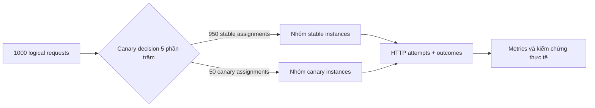
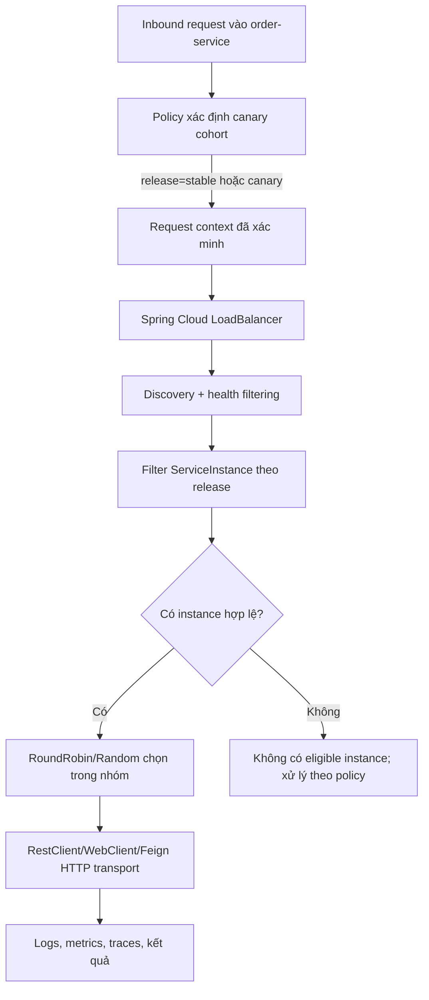
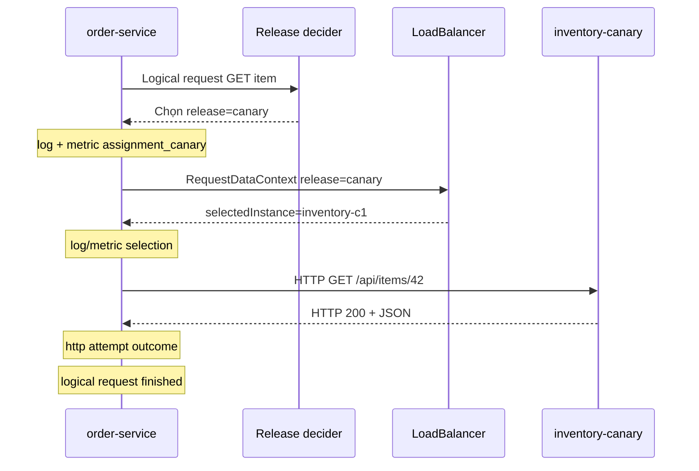

# Triển khai canary và kiểm chứng phân phối trước khi mở rộng

Trong một hệ thống có nhiều microservice, triển khai phiên bản mới đồng loạt khiến rủi ro lan ra toàn bộ người dùng ngay khi xuất hiện lỗi. **Canary deployment** giải quyết vấn đề này bằng cách cho một tập lưu lượng nhỏ đi qua phiên bản mới, so sánh với phiên bản ổn định, rồi **mở rộng từng bước khi có bằng chứng** rằng canary đáp ứng yêu cầu.

Ví dụ, `order-service` gọi `inventory-service` bằng URI logic `http://inventory-service`. Trong production đang có tám bản sao inventory phiên bản ổn định và hai bản sao phiên bản mới. Nếu Spring Cloud LoadBalancer mặc định phân phối đều theo danh sách mười `ServiceInstance`, phiên bản mới có thể nhận **khoảng 20% lượt chọn**, không phải 5% chỉ vì ta gọi rollout là “canary 5%”. Con số mục tiêu phải được định nghĩa ở **lớp quyết định lưu lượng**, được thực thi nhất quán và được đo lại từ request thật.

Bài thuộc chương **Triển khai** của module `SPRING_CLOUD_SERVICE_COMMUNICATION_LOAD_BALANCING`. Chúng ta sẽ dùng kiến thức client-side load balancing theo service ID, discovery, health check, routing, `RestClient`, `WebClient`, OpenFeign, retry/timeout và observability để thiết kế một quy trình canary có thể kiểm chứng, có ngưỡng dừng và có kế hoạch rollback rõ ràng.

## 1. Mục tiêu học tập và tiêu chí hoàn thành

Sau bài học, bạn cần:

1. Phân biệt **tỷ lệ replica**, **tỷ lệ phân công logical request**, **tỷ lệ chọn instance**, **tỷ lệ HTTP attempt** và **tỷ lệ request thành công**.
2. Xác định lớp nào điều khiển canary: ingress/gateway, service mesh, hay **Spring Cloud LoadBalancer phía caller**; tránh vô tình áp dụng nhiều tầng cùng một chính sách.
3. Gắn nhãn stable/canary cho `ServiceInstance` bằng metadata đáng tin và lọc ứng viên theo **request context**.
4. Thiết lập canary nhỏ trước, đo error rate, latency, saturation và phân phối lưu lượng trước khi tăng tỷ lệ.
5. Phân biệt fallback hợp lệ với fallback **che lỗi canary**; giữ ràng buộc hard zone/region/tenant khi retry hoặc rollback.
6. Lập runbook triển khai, quan sát, quyết định promote/hold/rollback và xác minh hậu rollback.

**Tiêu chí thực hành:** tạo được một nhóm stable và canary cùng service ID, gửi request thông qua client đã tích hợp LoadBalancer, ghi rõ request được phân công vào nhánh nào, kiểm tra **server thật** nhận bao nhiêu request, và có quyết định mở rộng/rollback dựa trên log, metrics, trace.

## 2. Canary là kiểm soát lưu lượng, không đơn thuần là chạy thêm Pod

Ba câu hỏi cần tách:

| Khía cạnh | Câu hỏi | Ví dụ |
|---|---|---|
| **Deployment capacity** | Có bao nhiêu replica mỗi phiên bản đang hoạt động? | Stable 8, canary 2. |
| **Traffic assignment** | Bao nhiêu logical requests *được chủ động phân công* sang canary? | Canary mục tiêu 5%. |
| **Observed delivery** | Bao nhiêu HTTP attempts thực sự tới canary? | Có thể lệch 5% vì retry, timeout, cache, sampling và lỗi trước HTTP. |

Nếu danh sách instance có tám stable và hai canary, một thuật toán chia đều lượt chọn giữa mười instance có thể cho canary khoảng `2 / 10 = 20%` requests trong điều kiện đủ mẫu và mọi instance đều eligible. **Đó không phải cơ chế canary traffic split 5%.**

Ngược lại, nếu 5% logical requests được gán canary nhưng retry chỉ xảy ra trên canary và mỗi request lỗi thử lại ba lần, **tỷ trọng HTTP attempts** tới canary có thể cao hơn 5%. Nếu tính tỷ trọng từ **những response thành công**, lỗi canary sẽ khiến tỷ lệ canary trông thấp hơn lưu lượng thực sự đã gửi đến phiên bản mới.



Các số trên là kỳ vọng đơn giản của một cửa sổ 1.000 request khi có assignment ngẫu nhiên 5%, **không bảo đảm** chính xác 950/50 ở mỗi đợt thử. Với cohort cố định theo tenant/user, mức phân chia theo **lượt truy cập** cũng có thể không tương ứng tỷ lệ người dùng nếu một cohort phát nhiều request hơn.

## 3. Chọn lớp điều khiển canary trước khi cấu hình

Canary có thể được điều khiển ở các vị trí khác nhau:

| Lớp quyết định | Có thể làm gì? | Khi phù hợp | Rủi ro |
|---|---|---|---|
| **Ingress/API Gateway** | Chọn stable/canary trước khi request đi sâu vào hệ thống. | Lưu lượng vào từ bên ngoài, muốn điều khiển tập trung. | Không bao quát mọi service-to-service call nội bộ bỏ qua gateway. |
| **Service mesh/sidecar** | Route/weight theo destination subset, header, policy. | Hạ tầng đã có mesh và traffic policy thống nhất. | Thêm một tầng proxy; cần phân biệt số lượt chọn mesh với LB trong ứng dụng. |
| **Spring Cloud LoadBalancer** | Caller chọn `ServiceInstance` thuộc stable/canary theo request context hoặc weight. | Gọi service nội bộ trực tiếp theo service ID, cần kiểm soát lựa chọn từ caller. | Mỗi caller có cấu hình/cache riêng; không có quota cluster tự động. |
| **Tách service ID** | Gọi `inventory-stable` hoặc `inventory-canary` qua routing gateway nội bộ. | Cần cách ly release thật rõ hoặc đơn giản hóa nguồn ứng viên. | Phải giữ contract, auth và policy cho hai định danh; đừng hard-code endpoint cố định. |

**Không nên cùng lúc giả định gateway đã chia 5%, mesh lại chia 5% và caller cũng chia 5% để rồi cộng thành 15%.** Tùy thứ tự và phạm vi, các phép chia có thể là độc lập hoặc có điều kiện, dẫn đến kết quả ngoài dự kiến. Cần chỉ định **một chủ sở hữu traffic assignment** và đo ở điểm đó.

### Đặc biệt khi triển khai trên Kubernetes

Một Kubernetes `Service` thông thường trỏ đến các endpoints do selector chọn và cơ chế cluster networking sẽ phân phối tới endpoints. **Số replica stable/canary không phải một cơ chế bảo đảm phần trăm canary chính xác**, và việc dùng Kubernetes Service VIP không mặc nhiên đưa từng Pod thành `ServiceInstance` cho Spring Cloud LoadBalancer.

Nếu caller kết nối đến **Service VIP/DNS ổn định**, transport có thể thấy một đích logic và phần chọn Pod diễn ra ở Kubernetes networking. Nếu muốn **client-side** LoadBalancer chọn theo metadata của từng replica, discovery integration phải thực sự cung cấp các Pod/endpoint làm `ServiceInstance` (ví dụ cơ chế Spring Cloud Kubernetes phù hợp). Hãy xác minh topology trước khi áp dụng custom supplier; không chỉ thêm `@LoadBalanced` rồi cho rằng đã điều khiển từng Pod.

## 4. Kiến trúc canary qua Spring Cloud LoadBalancer

Giả sử caller lấy một danh sách instance từ discovery:

| Instance | Release | Zone | Healthy | Địa chỉ ví dụ |
|---|---|---|---|---|
| `inventory-s1` | `stable` | `zone-a` | Có | `10.10.1.11:8080` |
| `inventory-s2` | `stable` | `zone-b` | Có | `10.10.2.12:8080` |
| `inventory-s3` | `stable` | `zone-a` | Có | `10.10.1.13:8080` |
| `inventory-c1` | `canary` | `zone-a` | Có | `10.10.1.21:8080` |
| `inventory-c2` | `canary` | `zone-b` | Có | `10.10.2.22:8080` |

Metadata `release=stable/canary` và `zone=...` trong bảng là **quy ước của ứng dụng/triển khai**, không phải trường metadata mặc định mà mọi discovery provider bắt buộc có. Trong hệ thống thật, metadata cần được cấp phát bởi deployment/registry đáng tin và được kiểm tra khi rollout.



**Hai bước tách biệt:**

1. **Assignment:** một logical request thuộc stable hay canary? Quyết định này phải có owner, tỷ lệ mục tiêu và chính sách stickiness.
2. **Instance selection:** trong nhóm đã được phép, LoadBalancer chọn `ServiceInstance` cụ thể nào? Đây là trách nhiệm của supplier/algorithm.

Nếu request đã được chọn vào canary nhưng không có replica canary khỏe, việc âm thầm chuyển sang stable có thể giúp giảm lỗi người dùng trong một số chính sách mềm. Tuy nhiên, nó cũng **che lỗi canary** và làm giảm lượng mẫu quan sát được. Nếu cho phép fallback, cần đếm riêng `canary_assigned`, `canary_fallback` và `stable_delivered`. Nếu canary gắn với hard region/tenant security, **không được fallback trái ràng buộc**.

## 5. Chuẩn bị triển khai an toàn trước khi cho traffic

Canary chỉ có ý nghĩa khi hai phiên bản **có thể cùng tồn tại trong một khoảng thời gian**. Kiểm tra:

- **Backward/forward compatibility:** client và server ổn với định dạng API cũ/mới, lỗi mới và giá trị enum chưa biết.
- **Schema/database:** dùng chiến lược *expand → migrate → contract*, không xóa cột/đổi schema phá stable khi canary chưa được promote.
- **Feature flags:** tách bật tính năng mới khỏi triển khai artifact; có thể rollback hành vi mà không cần tắt toàn bộ deployment.
- **Idempotency:** thao tác ghi được retry/call lại không tạo side effects trùng; nhất là khi request timeout sau khi server đã commit.
- **Auth và routing:** canary nhận đúng tenant/region/zone được phép, secret/config/permission tương đương stable.
- **Readiness/startup:** replica chỉ được đưa vào tập eligible khi thật sự có thể phục vụ nghiệp vụ; liveness không thay thế readiness.
- **Capacity:** cả stable và canary có CPU/memory, connection pool, downstream quota, DB pool và bulkhead phù hợp.
- **Observability:** log/metrics/tracing đã được bật **trước** khi gửi traffic vào canary để không mất baseline.
- **Rollback:** giữ stable còn đủ capacity trong suốt quá trình; biết chính xác thao tác giảm traffic về 0 và cách xác minh.

**Bắt đầu ở 0% canary traffic** là hữu ích để chạy startup/readiness smoke test trực tiếp trong mạng test; không đồng nghĩa canary đã vượt qua kiểm chứng khi nhận lưu lượng người dùng thật.

## 6. Dựng hai phiên bản từ cùng service ID

Trong một môi trường học tập, có thể chạy:

```text
inventory-stable-a  release=stable  port=8081
inventory-stable-b  release=stable  port=8082
inventory-canary-a  release=canary  port=8083
order-service                         port=8090
```

Mỗi inventory replica trả `instanceId` và `release` ở endpoint chỉ dành cho lab:

```json
{
  "itemId": "42",
  "stock": 17,
  "instanceId": "inventory-canary-a",
  "release": "canary"
}
```

Trong production, không nên trả ID Pod, hostname hay metadata nội bộ cho người dùng công khai. Có thể dùng server logs/traces hoặc endpoint debug bảo vệ quyền để biết replica thực sự nhận request.

### Dán nhãn Kubernetes không đủ để tạo traffic percentage

Ví dụ một deployment stable có nhãn `app=inventory`, `release=stable`; deployment canary có `app=inventory`, `release=canary`. Nếu một Service selector chỉ lọc `app=inventory` thì nó có thể trỏ tới **cả hai phiên bản**:

```yaml
apiVersion: v1
kind: Service
metadata:
  name: inventory
spec:
  selector:
    app: inventory
  ports:
    - name: http
      port: 8080
      targetPort: 8080
```

Đây là ví dụ để chỉ ra **Service selector không biểu diễn canary 5%**. Cách triển khai đầy đủ cần hai Deployments, health probes, resource requests và routing owner rõ ràng. Nếu dùng route theo revision qua ingress/mesh, thường cần service/subset stable và canary với nhãn tương ứng. Nếu dùng Spring Cloud LoadBalancer trực tiếp, discovery phải đưa metadata release đáng tin vào từng `ServiceInstance`.

## 7. Cách lựa chọn tỷ lệ canary: theo request hay theo cohort?

| Chiến lược | Cách hoạt động | Ưu điểm | Giới hạn |
|---|---|---|---|
| **Random per logical request** | Mỗi logical call được gán canary theo xác suất, ví dụ 5%. | Dễ chỉnh và phù hợp GET độc lập. | Một người có thể đi qua nhiều revision giữa các request; có biến động thống kê. |
| **Sticky theo user/tenant/cohort** | Hash định danh đã xác thực với salt cố định, so ngưỡng bucket. | Một chủ thể ở lại cùng revision trong giai đoạn rollout. | 5% user không nhất thiết bằng 5% RPS; tenant lớn gây thiên lệch. |
| **Tập allowlist** | Chỉ nội bộ/beta/test tenants được vào canary. | Rất an toàn cho giai đoạn sớm, dễ phân tích. | Không đại diện cho toàn bộ traffic thật. |
| **Weighted theo từng instance** | Mỗi instance có trọng số cho thuật toán chọn. | Hữu ích để điều chỉnh tải giữa máy có năng lực khác nhau. | Không tự bảo đảm tỷ trọng **theo release** khi replica count thay đổi. |

**Lựa chọn an toàn nhất cho nhiều nghiệp vụ có phiên làm việc dài** thường là sticky cohort theo identity đã được xác thực. Nếu chọn ngẫu nhiên từng request, cùng một người có thể nhận response từ stable và canary xen kẽ, gây khó hiểu khi dữ liệu/cache/feature flags khác nhau.

Ví dụ công thức đơn giản để hình dung:

```text
bucket = stableHash(verifiedAccountId + rolloutSalt) modulo 10000
targetRelease = (bucket < canaryBasisPoints) ? canary : stable

canaryBasisPoints = 500 tương đương 5%
```

`stableHash` trong ví dụ phải là một thuật toán nhất quán qua các instance caller, với salt/seed được kiểm soát. Không lấy `X-Account-ID` do client tự điền rồi mặc nhiên xem là danh tính đã xác thực. Với yêu cầu chống người dùng cố tình chọn cohort hoặc che lộ thông tin, cần dùng phép băm có khóa/policy phù hợp; đây không phải cơ chế cấp quyền truy cập.

## 8. Mẫu code: quyết định 5% canary ở service layer

Để minh họa luồng cơ bản, dùng `ThreadLocalRandom` cho **GET không có side effect** và ra quyết định một lần khi bắt đầu logical call. Đây không phải sticky-cohort routing:

```java
import java.util.concurrent.ThreadLocalRandom;
import org.springframework.beans.factory.annotation.Value;
import org.springframework.stereotype.Component;

@Component
public class InventoryReleaseDecider {

    private final int canaryBasisPoints;

    public InventoryReleaseDecider(
            @Value("${routing.inventory.canary-basis-points:0}")
            int canaryBasisPoints) {
        if (canaryBasisPoints < 0 || canaryBasisPoints > 10_000) {
            throw new IllegalArgumentException(
                "canary-basis-points must be in [0, 10000]");
        }
        this.canaryBasisPoints = canaryBasisPoints;
    }

    public String decideForNewLogicalRequest() {
        int bucket = ThreadLocalRandom.current().nextInt(10_000);
        return bucket < canaryBasisPoints ? "canary" : "stable";
    }
}
```

Cấu hình:

```yaml
routing:
  inventory:
    canary-basis-points: 500 # mục tiêu 5% logical requests
```

Lưu ý:

- Giá trị cấu hình được đọc khi bean khởi tạo trong ví dụ. Thay đổi file YAML không tự làm mọi caller process **hot reload**; cần một cơ chế dynamic config/refresh được thiết kế hoặc rolling restart có kiểm soát.
- Nếu có bốn instance `order-service`, **tất cả** phải dùng cùng rollout policy nếu muốn nhất quán. Trong quá trình cập nhật, cần đo riêng giai đoạn chính sách chưa đồng bộ.
- Với sticky cohort, thay bộ chọn random bằng quyết định theo **identity đã xác thực** và hash ổn định; đảm bảo lựa chọn được giữ nhất quán trong toàn workflow.
- Quyết định canary nên được giữ cùng logical request khi retry. Nếu mỗi attempt tự chọn random lần nữa, một lỗi canary có thể được “chữa” bằng stable và tỷ lệ sẽ sai ý nghĩa.

## 9. Truyền quyết định đã kiểm chứng đến RestClient

Sử dụng `RestClient` được build từ `@LoadBalanced RestClient.Builder` và service ID logic:

```java
import org.springframework.cloud.client.loadbalancer.LoadBalanced;
import org.springframework.context.annotation.Bean;
import org.springframework.context.annotation.Configuration;
import org.springframework.web.client.RestClient;

@Configuration
class InventoryHttpClientConfiguration {

    @Bean
    @LoadBalanced
    RestClient.Builder loadBalancedRestClientBuilder() {
        return RestClient.builder();
    }

    @Bean
    RestClient inventoryRestClient(
            @LoadBalanced RestClient.Builder builder) {
        return builder.clone()
            .baseUrl("http://inventory-service")
            .build();
    }
}
```

Một phương thức gọi:

```java
import org.springframework.stereotype.Service;
import org.springframework.web.client.RestClient;

@Service
class InventoryGateway {

    private final RestClient inventoryRestClient;
    private final InventoryReleaseDecider releaseDecider;

    InventoryGateway(
            RestClient inventoryRestClient,
            InventoryReleaseDecider releaseDecider) {
        this.inventoryRestClient = inventoryRestClient;
        this.releaseDecider = releaseDecider;
    }

    ItemDto getItem(String itemId) {
        // Chọn phiên bản MỘT LẦN cho logical call này.
        String release =
            releaseDecider.decideForNewLogicalRequest();

        return inventoryRestClient.get()
            .uri("/api/items/{id}", itemId)
            .headers(headers -> headers.set(
                "X-Internal-LB-Release", release))
            .retrieve()
            .body(ItemDto.class);
    }
}
```

`ItemDto` là DTO của ứng dụng. `X-Internal-LB-Release` ở đây là **cơ chế minh họa để truyền routing decision từ code tin cậy của caller sang LoadBalancer context**; header có thể đi tiếp đến upstream. Không đưa secret, access token hoặc thông tin PII vào header này. Nếu một external request mang header cùng tên, caller/gateway phải **bỏ hoặc ghi đè**, không cho người dùng tự chọn canary tùy ý.

Đối với một retry wrapper, phải giữ giá trị `release` đã chọn và gửi lại cùng header ở mỗi attempt; không gọi lại `decideForNewLogicalRequest()` bên trong retry loop. Để quan sát tỷ lệ assignment chính xác, ghi metric/log **ngay khi quyết định release**, không chỉ sau khi HTTP trả thành công.

## 10. Mẫu code: lọc ServiceInstance theo release

Ta có thể bọc một `ServiceInstanceListSupplier` bằng một supplier có xét `RequestDataContext`. Ở ví dụ, **mọi request không có ngữ cảnh canary hợp lệ đều mặc định chỉ thấy stable**. Nhờ vậy, canary không bị nhận traffic ngẫu nhiên từ những HTTP adapter không truyền được request context.

```java
import java.util.List;
import org.springframework.cloud.client.ServiceInstance;
import org.springframework.cloud.client.loadbalancer.Request;
import org.springframework.cloud.client.loadbalancer.RequestDataContext;
import org.springframework.cloud.loadbalancer.core.DelegatingServiceInstanceListSupplier;
import org.springframework.cloud.loadbalancer.core.ServiceInstanceListSupplier;
import reactor.core.publisher.Flux;

public final class ReleaseAwareServiceInstanceListSupplier
        extends DelegatingServiceInstanceListSupplier {

    public ReleaseAwareServiceInstanceListSupplier(
            ServiceInstanceListSupplier delegate) {
        super(delegate);
    }

    @Override
    public Flux<List<ServiceInstance>> get() {
        // Không có Request context -> CHỈ stable, không lộ canary.
        return delegate.get().map(instances ->
            selectRelease(instances, "stable"));
    }

    @Override
    public Flux<List<ServiceInstance>> get(Request request) {
        String release = requestedRelease(request);
        return delegate.get(request).map(instances ->
            selectRelease(instances, release));
    }

    private static String requestedRelease(Request request) {
        if (request == null ||
                !(request.getContext()
                    instanceof RequestDataContext dataContext)) {
            return "stable";
        }

        String raw = dataContext.getClientRequest()
            .getHeaders()
            .getFirst("X-Internal-LB-Release");

        return "canary".equals(raw) ? "canary" : "stable";
    }

    private static List<ServiceInstance> selectRelease(
            List<ServiceInstance> instances, String release) {
        return instances.stream()
            .filter(instance -> release.equals(
                instance.getMetadata().get("release")))
            .toList();
    }
}
```

Ví dụ dùng Java 17+, giả định nguồn discovery cung cấp metadata `release=stable` hoặc `release=canary`. Đoạn này là **policy chọn ứng viên**, không tự thực hiện phép tính 5%; quyết định 5% nằm ở `InventoryReleaseDecider`. Các SPI, vị trí request context và integration có thể thay đổi theo Spring Cloud BOM — cần kiểm thử phiên bản project thật.

**Tại sao không fallback khi không có canary?** Với mục tiêu đo rollout, nếu không còn canary khỏe thì danh sách của request được gán canary sẽ rỗng. Đây là tín hiệu quan trọng để **dừng tăng traffic/rollback**. Một chính sách fallback sang stable cũng có thể chấp nhận được nếu hợp đồng nghiệp vụ cho phép, nhưng phải được **thiết kế chủ động, đo riêng và không vi phạm hard region/tenant constraints**. Không được tự thêm `return instances` vào nhánh canary rỗng rồi báo rằng canary vẫn khỏe.

### Cấu hình riêng cho inventory-service

```java
import org.springframework.cloud.loadbalancer.annotation.LoadBalancerClient;
import org.springframework.boot.autoconfigure.SpringBootApplication;

@SpringBootApplication
@LoadBalancerClient(
    name = "inventory-service",
    configuration = InventoryLoadBalancerConfiguration.class)
class OrderApplication {
}
```

```java
import org.springframework.cloud.loadbalancer.core.ServiceInstanceListSupplier;
import org.springframework.context.ConfigurableApplicationContext;
import org.springframework.context.annotation.Bean;

// Đặt bên ngoài component scan của SpringBootApplication chính.
public class InventoryLoadBalancerConfiguration {

    @Bean
    ServiceInstanceListSupplier inventorySupplier(
            ConfigurableApplicationContext context) {
        ServiceInstanceListSupplier discovery =
            ServiceInstanceListSupplier.builder()
                .withDiscoveryClient()
                .build(context);

        return new ReleaseAwareServiceInstanceListSupplier(discovery);
    }
}
```

Đây là ví dụ về **ranh giới cấu hình theo service ID**. Trong production, builder thường phải ghép thêm cache/health supplier theo phiên bản và bảo đảm request-aware filter không bị cache sai. **Cache danh sách discovery chung trước, lọc theo request sau**; nếu cache danh sách đã được lọc theo release nhưng chỉ dùng key service ID, request stable có thể nhìn thấy danh sách canary hoặc ngược lại.

Đặt lớp configuration dành riêng cho LoadBalancer context **ngoài component scan của ứng dụng chính** để tránh bean/policy bị lan ra mọi service ID. Nếu source metadata không có nhãn release, ví dụ sẽ không chọn được instance: đó là tín hiệu cần kiểm tra deployment/discovery, không phải lý do mở toang filter sang tất cả instance.

## 11. Cảnh báo: cân trọng số instance khác cân tỷ lệ theo version

Một số cấu hình Spring Cloud LoadBalancer có hỗ trợ **weighted instance selection** hoặc supplier sử dụng metadata trọng số, tùy release/thuật toán. Cần phân biệt:

```text
stable: 8 replicas, mỗi replica weight = 1
canary: 2 replicas, mỗi replica weight = 1
-> tổng trọng số stable = 8, canary = 2
-> kỳ vọng canary ~20% lượt chọn
```

Muốn canary ~5%, tổng **trọng số của cả nhóm canary** phải chỉ chiếm khoảng 5% tổng trọng số trong điều kiện thuật toán chọn theo weights. Nếu scale canary từ hai lên bốn replica mà không thay tổng trọng số nhóm, tỷ lệ chọn có thể tăng ngoài ý muốn. Một số implementation không dùng weights theo cách này; phải kiểm tra semantics thực tế.

Vì vậy, cách **chia nhóm stable/canary theo request trước rồi chọn instance trong nhóm** thường dễ diễn giải hơn khi cần một tỷ lệ release có mục tiêu cố định. Dù chọn cách nào, vẫn phải đo `eligible_instances`, `selection_counts` và `HTTP attempts`, không chỉ đọc YAML weights.

## 12. Giữ tính nhất quán trên WebClient và OpenFeign

### WebClient

```java
@Bean
@LoadBalanced
WebClient.Builder loadBalancedWebClientBuilder() {
    return WebClient.builder();
}

@Bean
WebClient inventoryWebClient(
        @LoadBalanced WebClient.Builder builder) {
    return builder.clone()
        .baseUrl("http://inventory-service")
        .build();
}
```

Gắn quyết định đã kiểm chứng theo request:

```java
Mono<ItemDto> findItem(
        WebClient client,
        String itemId,
        String chosenRelease) {
    return client.get()
        .uri("/api/items/{id}", itemId)
        .headers(h -> h.set(
            "X-Internal-LB-Release", chosenRelease))
        .retrieve()
        .bodyToMono(ItemDto.class);
}
```

**Chú ý vòng đời Reactor:** khi đặt `retryWhen(...)`, thứ tự các operators có thể khiến request được subscribe lại. Quyết định `chosenRelease` nên được tính và giữ ổn định ở phạm vi **logical request**, không được thay đổi theo scheduler một cách tình cờ. `Reactor Context` không mặc nhiên là `RequestDataContext`; cần xác minh filter/adapter chuyển context đến LoadBalancer **trước** bước chọn instance.

### OpenFeign

```java
@FeignClient(
    name = "inventory-service",
    contextId = "inventoryRead")
interface InventoryReadClient {
    @GetMapping("/api/items/{id}")
    ItemDto findItem(
        @PathVariable("id") String id,
        @RequestHeader("X-Internal-LB-Release") String release);
}
```

Gọi method bằng `chosenRelease` do service layer quyết định. Không đặt URL cụ thể vào `@FeignClient(url = ...)` nếu mục tiêu là chọn giữa các `ServiceInstance` qua service ID. Feign client contexts, Retryer/timeout và HTTP engine riêng có thể làm số attempts khác với RestClient. Kiểm thử từng adapter để xác nhận `RequestDataContext` chứa header mà custom supplier cần; **không mặc định** cả ba client có pipeline giống nhau.

## 13. Đặt health, readiness và warm-up đúng chỗ

Canary có thể khởi động nhưng chưa thực sự sẵn sàng:

- JVM đã chạy nhưng connection tới database chưa sẵn sàng.
- Cache/lớp JIT còn lạnh, tạo độ trễ cao ở vài request đầu.
- Endpoint health trả `UP` nhưng API quan trọng chưa vượt qua smoke test.
- Discovery giữ instance mới/chết trong cache một khoảng thời gian.
- HTTP connection pool bên caller chưa có kết nối idle tới các endpoint canary mới, gây “cold connection” và TLS handshake ban đầu.

**Liveness, readiness và caller-side health checks giải quyết những tầng khác nhau.** Health `UP` không phải bằng chứng canary đúng về dữ liệu hoặc không có regression. Trước khi tăng traffic, nên:

1. Đợi readiness của replica canary.
2. Chạy smoke test trực tiếp vào canary qua đường nội bộ được phép.
3. Xác nhận canary thực sự xuất hiện trong discovery **với metadata release chính xác**.
4. Xác nhận một canary request theo service ID qua LoadBalancer chọn đúng instance.
5. Cho một lượng nhỏ lưu lượng để warm-up, theo dõi handshake, pending pool acquires, p95/p99.

Đừng “sửa” cold-start spike chỉ bằng cách tăng số concurrent calls vô hạn. Việc tăng pool/bulkhead không tạo thêm CPU/DB capacity ở canary.

## 14. Thiết kế metric kiểm chứng phân phối

Đo canary phải phân biệt các giai đoạn:

| Metric/event | Đơn vị đếm | Ý nghĩa |
|---|---|---|
| `canary_assignment_total{release}` | Logical call được phân công. | Bộ chia traffic đang gán bao nhiêu request sang stable/canary? |
| `loadbalancer_selection_total{release,outcome}` | Lượt chọn instance. | Có chọn được instance của release được yêu cầu không? |
| `outbound_http_attempts_total{release,outcome}` | HTTP attempt thực tế. | Retry đang khuếch đại tải tới canary bao nhiêu? |
| `outbound_logical_calls_total{release,outcome}` | Logical request kết thúc. | Tỷ lệ thành công/lỗi theo release. |
| `outbound_logical_latency` | Duration logical call. | So sánh p50/p95/p99 khi có đủ mẫu. |
| `upstream_http_server_requests{release,status}` | HTTP request server đã nhận. | Canary thực sự phục vụ bao nhiêu calls và status nào? |
| `fallback_total{from,to,reason}` | Số lần fallback được cho phép. | Có che lỗi canary bằng stable không? |
| `eligible_instances{release,zone}` | Gauge/tập ứng viên sau filter. | Có replica khỏe hợp lệ trong mỗi nhóm không? |

Tên trên là **metric do ứng dụng tự thiết kế hoặc tên minh họa**, không phải mặc định sẽ tồn tại trong mọi Spring Cloud/Micrometer/Actuator. Nếu dùng Micrometer, cần ghi metric ở **đúng tầng sở hữu sự kiện**. Ví dụ counter đặt ở gateway trước `RestClient.get()` có thể đếm một invocation dù transport bên dưới retry ba HTTP attempts.

Không dùng `userId`, `traceId`, raw URI, `instanceId` thay đổi liên tục hoặc bearer token làm metric labels. Các nhãn `release`, `outcome`, `operation template`, `status class` có cardinality dễ kiểm soát hơn. Chi tiết instance nên truy vết qua logs/traces có sampling và quyền phù hợp.

### Công thức đối chiếu đơn giản

```text
assignment_canary_ratio =
  canary assignments / (stable assignments + canary assignments)

delivered_canary_ratio =
  HTTP attempts đến canary /
  tổng HTTP attempts đến inventory

canary_error_rate =
  số logical calls gán canary kết thúc lỗi /
  tổng logical calls gán canary đã hoàn tất
```

**Ba tỷ lệ này không bắt buộc bằng nhau.** Nếu client retry, nếu canary được gán mà không có instance eligible, hoặc nếu fallback có điều kiện, số mẫu ở các giai đoạn khác nhau. Cần nêu rõ metrics được đo ở caller hay upstream, mẫu số có tính request hủy/timeout không và khoảng thời gian lấy mẫu.

## 15. Phân bố 5% không có nghĩa chính xác 5 trên 100 request

Giả sử assignment random độc lập theo logical request với `p = 0,05`. Khi có `N` request, số lần vào canary có kỳ vọng `N × p` và độ lệch chuẩn xấp xỉ:

```text
sigma_count = sqrt(N × p × (1 - p))
```

| Số logical requests | Số canary kỳ vọng | Độ lệch chuẩn gần đúng | Cách hiểu |
|---:|---:|---:|---|
| 100 | 5 | 2,18 requests | Kết quả 2 hoặc 8 canary chưa tự chứng minh split sai. |
| 1.000 | 50 | 6,89 requests | Tỷ lệ quan sát có thể lệch quanh mức 5%; cần đo đủ mẫu. |
| 10.000 | 500 | 21,79 requests | Tỷ lệ ổn định hơn, nhưng vẫn không chính xác tuyệt đối. |

Đây chỉ là mô hình ngẫu nhiên đơn giản khi các logical requests độc lập; **sticky cohort, tenant traffic, retries, cache, hàng đợi và sampling** có thể khiến phân bố khác hẳn. Không dùng một cửa sổ có 20 request để kết luận thuật toán canary sai tỷ lệ mục tiêu.

Khi rollout theo cohort, cần đo cả **số chủ thể được gán** và **RPS/attempts thực tế**. Một tenant lớn được đưa vào canary có thể tạo 30% traffic dù chỉ chiếm 1% số tenant.

## 16. Quy trình progressive delivery từng nấc

Một lịch canary minh họa:

| Pha | Canary mục tiêu | Việc thực hiện | Điều kiện chuyển pha |
|---|---:|---|---|
| **P0 — Chuẩn bị** | 0% | Deploy canary, readiness, smoke test, xác minh discovery/metadata. | Không có blocker chức năng/bảo mật; telemetry hoạt động. |
| **P1 — Mẫu nội bộ** | Allowlist hoặc 1% | Gửi request thật nhưng giới hạn đối tượng. | Contract, error classes, traces và routing đúng. |
| **P2 — Thăm dò** | 5% | So sánh canary với stable trong một thời gian và số mẫu đủ. | Không vi phạm guardrails. |
| **P3 — Mở rộng** | 10–25% | Tăng theo nấc, đo saturation, DB/connection pools, retry. | Capacity và SLO không xấu đi vượt ngưỡng. |
| **P4 — Mở rộng lớn** | 50% | Kiểm chứng traffic đa dạng hơn, tail latency, zone/tenant policy. | Canary vẫn ổn dưới tải đáng kể. |
| **P5 — Promote** | 100% | Chuyển hoàn toàn sau khi đạt điều kiện; tiếp tục quan sát. | Không còn blocker, có kế hoạch xử lý residual traffic. |
| **P6 — Hoàn tất** | 100% bản mới | Draining, dọn stable cũ khi an toàn, cập nhật release labels. | Không có traffic/connection phụ thuộc vào bản cũ ngoài kế hoạch. |

**Các tỷ lệ và bước chuyển là ví dụ**; production phải chọn dựa trên traffic, mức rủi ro và đặc tính nghiệp vụ. Không mở rộng chỉ vì đã chờ “10 phút” nếu canary mới nhận vài chục request không đại diện. Ngược lại, nếu thấy lỗi nghiêm trọng liên quan dữ liệu hoặc security, phải **dừng/rollback ngay**, không chờ đủ mẫu thống kê.

### Ở mỗi pha phải làm cùng một quy trình

1. **Cố định baseline:** lấy metrics stable và canary trước khi tăng tỷ lệ; ghi release version, hash/config, topology và time window.
2. **Thay đổi một biến:** cập nhật routing owner về tỷ lệ mới, xác nhận config được mọi caller áp dụng.
3. **Xác minh assignment:** xem log/metric canary assignment, không nhìn mỗi số replica.
4. **Xác minh delivery:** đối chiếu `ServiceInstance` đã chọn, upstream access logs/traces và HTTP attempts.
5. **Quan sát quality:** error rates, latency p95/p99, timeout, connection pool, CPU, memory, DB, retry amplification, saturation.
6. **Quyết định:** promote/hold/rollback theo guardrails đã định, ghi người duyệt và bằng chứng.
7. **Sau quyết định:** ghi snapshot kết quả, giữ khả năng trở về phiên bản ổn định.

**Không cập nhật canary percent ở những caller khác nhau bằng tay theo thứ tự ngẫu nhiên mà không theo dõi trạng thái đồng bộ.** Nếu hệ thống dùng config refresh bất đồng bộ, trong thời gian hội tụ có thể có caller áp dụng 5% và caller khác áp dụng 25%. Cần đo theo caller version/config và chỉ đánh giá tỷ lệ toàn cụm sau khi xác minh propagation.

## 17. Các guardrail cần chốt trước khi thử canary

Không có “ngưỡng an toàn chuẩn” áp dụng cho mọi dịch vụ. Một bộ guardrail **minh họa cho môi trường giả định**:

| Tín hiệu | Ví dụ điều kiện HOLD | Ví dụ điều kiện ROLLBACK | Lưu ý |
|---|---|---|---|
| HTTP 5xx từ canary | Tăng rõ so với stable sau đủ mẫu. | Sự cố lặp lại, vượt ngân sách lỗi. | Phân biệt upstream 5xx với status do gateway tạo. |
| Logical error rate | Tăng vượt ngưỡng thử nghiệm so với baseline. | Không đáp ứng SLO hoặc lỗi nghiệp vụ nghiêm trọng. | Mẫu phải cùng operation/cohort. |
| p95/p99 latency | Canary cao hơn baseline có ý nghĩa vận hành. | Tail latency vượt deadline/SLO kéo dài. | Không so trực tiếp cohort có workload khác nhau. |
| Timeout/connection reset | Xuất hiện spike sau release. | Gây lỗi người dùng, tiếp tục tăng. | Kiểm tra cold start/drain trước khi quy bug. |
| CPU/memory/DB pool | Tiệm cận giới hạn và tiếp tục tăng. | OOM, cạn pool, ảnh hưởng stable. | Mọi replica/sidecar/DB chung cần quan sát. |
| Retry amplification | HTTP attempts/logical request tăng bất thường. | Retry storm gây quá tải downstream. | Retry có thể che lỗi bản mới ở final success. |
| Security/data integrity | Có nghi ngờ vi phạm policy. | **Dừng ngay; rollback/fail closed.** | Không cần chờ mẫu lớn. |

Ngưỡng cuối cùng cần được quyết định **trước khi tăng traffic**, kèm thời gian quan sát, số mẫu tối thiểu, độ nhạy cảnh báo và trách nhiệm ra quyết định. Nếu canary chỉ nhận traffic “dễ” hoặc một zone đặc biệt, việc so error rate với toàn bộ stable dễ sai lệch; nên so cùng route, tenant category, payload size và zone được phép.

### Một ví dụ đối chiếu không nên kết luận vội

```text
Stable:
  10.000 GET, 20 lỗi 5xx  -> 0,2%
Canary:
  100 GET, 1 lỗi 5xx     -> 1,0%
```

Canary có tỷ lệ lỗi quan sát cao hơn, nhưng chỉ một lỗi trên 100 lượt chưa đủ để đánh giá chắc một regression nhỏ; cần cả loại lỗi, traces, khoảng thời gian, workload mix và mức độ nghiêm trọng. Nếu lỗi đó là vi phạm dữ liệu, tất nhiên phải xử lý ngay mà không cần lý do thống kê.

## 18. Quan sát đúng tầng: assignment, selection, HTTP response

Sơ đồ đường đi và tín hiệu:



Để ghi `selectedInstanceId` chính xác, instrument tại lifecycle/Observation của Spring Cloud LoadBalancer theo API của release đang dùng, thay vì giả định interceptor HTTP bất kỳ luôn nhìn thấy URI rewrite. `RestClient` có thể nhận `200` rồi decode lỗi; khi đó `HTTP response received` và `logical request success` là hai sự kiện khác nhau.

Mẫu structured log:

```json
{
  "event": "outbound_logical_finished",
  "callerService": "order-service",
  "targetService": "inventory-service",
  "operation": "GET /api/items/{id}",
  "assignedRelease": "canary",
  "selectedInstanceId": "inventory-c1",
  "outcome": "success",
  "httpStatus": 200,
  "attempts": 1,
  "durationMs": 44,
  "traceId": "4bf92f3577b34da6a3ce929d0e0e4736"
}
```

Giá trị là dữ liệu ví dụ. Nếu không chọn được instance, `selectedInstanceId` phải để null/vắng; nếu không có HTTP response thật thì không bịa `httpStatus=503` chỉ để điền field. Với retry, giữ cùng logical ID và policy release, nhưng ghi attempt number và selected instance từng lần thử.

## 19. Retry, circuit breaker và fallback trong rollout

Canary thường bộc lộ lỗi dưới tải. Chính lúc đó, **retry** có thể làm tăng rủi ro:

```text
1 logical request
  -> canary attempt #1 lỗi
  -> canary attempt #2 retry
  -> canary attempt #3 retry

Kết quả: 1 assignment canary, 3 HTTP attempts vào canary
```

Nếu chỉ đếm final responses, rollout có thể trông khỏe hơn thực tế; nếu chỉ đếm attempts, tỷ lệ canary có thể lớn hơn tỷ lệ logical assignments. Phải đo cả hai.

Nguyên tắc:

- **Giới hạn retry:** số attempts, backoff, jitter và deadline tổng rõ ràng; không retry vô hạn.
- **Idempotency:** không retry POST/PUT/PATCH có side effects khi chưa có chính sách an toàn và dedup.
- **Giữ release quyết định ban đầu:** retry ở lớp nào cũng không được tự ý đổi stable/canary mà không ghi nhận fallback hợp lệ.
- **Circuit breaker:** canary và stable nên có khả năng quan sát/trạng thái ngắt độc lập khi muốn cô lập lỗi theo release; đừng để canary lỗi nhiều làm mở một circuit chung khiến stable cũng bị từ chối không cần thiết.
- **Bulkhead:** giới hạn in-flight cho nhóm canary nếu canary có ít capacity; không đặt 5% assignment rồi để retry làm hàng trăm request canary đồng thời.
- **Timeout:** mức timeout phù hợp có thể phản ánh canary chậm; timeout không chứng minh upstream chưa hoàn tất.
- **Hard routing constraints:** không đưa canary hoặc stable sang vùng/tenant bị cấm chỉ để thoát lỗi.

**Fallback cần có nhãn riêng** như `canary_assigned_but_stable_delivered`. Nếu tỷ lệ fallback tăng, phải coi đó là tín hiệu canary cần hold/rollback, không công bố rằng canary “đạt 100% thành công”.

## 20. Chi phí kết nối khi thêm bản sao canary

Ở mô hình chọn thẳng `ServiceInstance` từ caller, tăng số replica đích có thể tăng số **route connection pool**, socket idle, TLS handshakes và health probes của nhiều caller. Ví dụ:

```text
8 caller processes × 2 canary replicas × 1 idle connection/route
= 16 idle sockets giả định nếu mọi caller đều đã chạm 2 replica canary
```

Đây chỉ là giả định học tập, không phải số socket chắc chắn được tạo. Số thực phụ thuộc HTTP engine, HTTP/1.1 hay HTTP/2, connection reuse, max idle time, route identity và việc canary được chọn thường xuyên đến đâu.

Khi mở canary từ 1% lên 25%, theo dõi:

1. Số connection mới/closed, active/idle connections, pending acquire.
2. HTTP response latency và connect/TLS handshake.
3. Thread pool, bulkhead active permits, queue depth.
4. Tổng downstream DB connections/cache load.
5. CPU/memory của canary và stable, không chỉ tổng cluster.

Nếu lỗi tăng khi vừa đưa replica mới vào nhưng giảm sau warm-up, hãy phân biệt cold connections/cache với regression code; **đừng lấy warm-up làm lý do bỏ qua data integrity hoặc security failures**.

## 21. Bài thực hành kiểm chứng phân phối với server giả

Để kết quả có thể lặp lại, dùng **WireMock hoặc MockWebServer** dựng các server giả độc lập:

```text
stable-a  -> localhost:18081 -> trả release=stable, instanceId=stable-a
stable-b  -> localhost:18082 -> trả release=stable, instanceId=stable-b
canary-a  -> localhost:18083 -> trả release=canary, instanceId=canary-a
canary-b  -> localhost:18084 -> trả release=canary, instanceId=canary-b
```

Trong test, một `ServiceInstanceListSupplier` có thể cung cấp bốn `DefaultServiceInstance` với `serviceId=inventory-service`, host/port của từng stub và metadata `release` tương ứng. Dùng cùng `ReleaseAwareServiceInstanceListSupplier` để xác minh filter. Cần test source static/dynamic port độc lập, không đặt `RestClient.baseUrl` trực tiếp thành `localhost:18083` khi mục đích là kiểm thử LoadBalancer.

### Ma trận test bắt buộc

| Input/policy | Danh sách eligible | HTTP server được phép nhận | Assertion |
|---|---|---|---|
| Release không có context | Stable A/B | Chỉ A/B | Không có request tới canary. |
| `release=stable` tin cậy | Stable A/B | Chỉ A/B | Canary requests = 0. |
| `release=canary` tin cậy | Canary A/B | Chỉ canary A/B | Stable requests = 0 nếu không có fallback. |
| Canary instance duy nhất còn khỏe | Canary A | Chỉ canary A | Route không sang canary B đã bị loại. |
| Không còn canary eligible | Danh sách canary rỗng | Không server nào cho request gán canary | Có lỗi selection hoặc policy rollback, không fallback ngầm. |
| Tenant hard region EU | Instance EU của release yêu cầu | Không replica ngoài EU | Không vi phạm policy khi retry/failover. |
| Canary trả HTTP `503` | Canary vẫn được chọn | Server canary trả 503 thật | Phân biệt upstream 503 với no-instance. |
| Canary không lắng nghe | `ServiceInstance` còn trong cache | Không có HTTP response hợp lệ | Phân biệt transport error với upstream 503. |
| Retry bật có giới hạn | Cùng release assignment | Có thể nhiều attempts | Đếm logical vs attempts riêng. |

### Kiểm tra tỷ lệ 5% có thật sự được gán

Chạy một cửa sổ đủ mẫu, chẳng hạn **10.000 logical GET** tại test environment với nguồn assignment random; **không áp dụng 10.000 request tải lớn vào production**. Thu thập:

- `assignedStable` và `assignedCanary` tại caller.
- Số lần `ServiceInstance` được chọn theo release và số lần không có candidate.
- Request count từng HTTP stub ở stable/canary.
- Logical outcome, HTTP status, timeout và số retries.

Sau đó so `assignedCanary/(assignedStable+assignedCanary)` với mức mục tiêu 5%. Không đòi con số chính xác 500/10.000; phân bố ngẫu nhiên có sai số. Nếu ratio **selected/delivered** lệch nhiều khỏi **assigned** hoặc có request sai release, cần điều tra filter, metadata, cache, retries và fallback.

## 22. Bài thực hành triển khai nhiều giai đoạn

Chạy các bước trong môi trường staging/canary an toàn:

| Giai đoạn | Tác vụ | Bằng chứng phải lưu |
|---|---|---|
| **Baseline** | Chạy stable 100%, thu dữ liệu trong cùng khung giờ tải. | Stable error/latency, throughput, CPU, connection pools. |
| **P0** | Khởi động canary nhưng giữ traffic 0%. | Readiness, smoke test, discovery metadata đúng. |
| **P1** | Cho 1%/allowlist vào canary. | Assignment, selected release, upstream request count, trace, hợp đồng JSON. |
| **P2** | Nâng 5%, quan sát đủ mẫu. | Error/latency theo release, retries, p95/p99, canary saturation. |
| **P3** | Nâng 10–25% nếu gate PASS. | Guardrails, config propagation, capacity. |
| **P4** | Nâng 50%, quan sát cohort/zone đa dạng. | Chất lượng không suy giảm, policy cứng không vi phạm. |
| **Promote** | Tăng canary 100%, giữ stable dự phòng theo kế hoạch. | Không còn unplanned fallback, dữ liệu contract ổn định. |
| **Cleanup** | Drain/decommission stable cũ khi an toàn. | Không còn active requests/connections cần phục vụ, rollback plan cập nhật. |

Ở mỗi nấc, hỏi: **“Tỷ lệ được yêu cầu có thật sự xảy ra ở nơi đo đúng không?”** trước khi hỏi “canary có lỗi không?”. Một canary 0 request và 0 lỗi **không phải** canary đã được kiểm chứng.

## 23. Runbook khi phải HOLD hoặc ROLLBACK

Một runbook rõ ràng giúp giảm phản ứng tùy hứng lúc sự cố:

### HOLD — dừng tăng traffic

Khi thấy tín hiệu xấu chưa đủ rõ:

1. Giữ nguyên tỷ lệ hiện tại; **không tăng** thêm.
2. Cố định thời gian đo, version/config hash, số caller và số canary replicas.
3. So sánh cùng operation/cohort/zone giữa stable và canary.
4. Xác định lỗi nằm ở selection, HTTP transport, response status, decode hay nghiệp vụ.
5. Nếu có lỗi integrity/security, **chuyển ngay sang rollback/fail closed**.

### ROLLBACK — giảm/loại traffic canary

1. Cập nhật **chính lớp sở hữu routing assignment** về 0% canary hoặc tắt flag. Đừng chỉ scale canary xuống 0 trong khi routing vẫn phân công request vào canary, vì sẽ sinh no-instance.
2. Xác minh policy đã tới mọi caller/gateway/mesh cần thiết; đo `canary_assignment_total` và `selection_total` giảm về mức mong đợi.
3. Đợi các request in-flight, connection draining và các queues đang xử lý theo deadline hợp đồng. Không xóa instance khi vẫn có request cần hoàn tất mà không có graceful shutdown.
4. So sánh metrics và logs sau rollback: HTTP errors, timeouts, p95/p99, retries, CPU/DB/circuit state.
5. Xác nhận **không còn HTTP attempts mới** tới canary ngoài các smoke/test request đã biết.
6. Lưu snapshot evidence, incident notes, config/version đã rollback và điều kiện cần đáp ứng trước lần thử canary tiếp theo.

**Rollback traffic không tự đảo ngược dữ liệu đã ghi hoặc database migration.** Nếu canary đã làm thay đổi dữ liệu không tương thích, cần kế hoạch khắc phục dữ liệu riêng; vì vậy tính tương thích của schema phải được kiểm tra ở mục preflight.

### PROMOTE — chuyển hoàn toàn sang bản mới

1. Đảm bảo canary đã vượt qua đủ các guardrail ở những mức tải/cohort đại diện.
2. Thay nhãn/định danh revision khi promote sao cho bộ lọc không vô tình loại toàn bộ “stable mới”. Nếu policy mặc định chỉ nhìn `release=stable`, phải thiết kế rõ **giai đoạn chuyển nhãn stable ← bản mới**.
3. Kiểm tra caller/registry/cache hội tụ và không phát sinh no-instance trong thời gian cập nhật.
4. Giữ bản cũ đủ lâu cho rollback theo chính sách, sau đó thực hiện drain/decommission có kiểm chứng.

## 24. Những lỗi triển khai thường gặp

| Sai lầm | Hậu quả | Cách sửa |
|---|---|---|
| Scale 1 canary/9 stable rồi coi như chính xác 10%. | Tỷ lệ thực phụ thuộc thuật toán, weight, eligible set. | Đặt traffic assignment có owner và đo request thực. |
| Chỉ đọc số canary responses thành công. | Canary lỗi nhiều có thể “biến mất” khỏi mẫu. | Đếm assignment, selection, attempts và outcomes riêng. |
| Dùng instance weights nhưng không tính tổng theo release khi scale. | Thêm replica làm đổi tỷ lệ canary ngoài ý muốn. | Kiểm soát weights toàn nhóm hoặc lọc theo release trước. |
| Cho raw user header chọn canary/region. | Người dùng điều khiển routing và có thể vượt policy. | Xác thực identity, loại header bên ngoài, sinh decision ở trusted layer. |
| Gán header release sau bước LoadBalancer selection. | Supplier không thấy context, mọi request vào stable hoặc tập sai. | Test thứ tự filter/interceptor và `RequestDataContext`. |
| Cache kết quả lọc canary theo key chỉ có service ID. | Request stable/canary chia sẻ candidate list sai. | Cache discovery candidates chung, lọc theo request sau. |
| Khi không có canary, fallback ngầm sang stable. | Che canary outage, báo cáo tỷ lệ/sức khỏe sai. | Định nghĩa fallback công khai, tách metric assigned/delivered. |
| Bật retry mọi 503, timeout hoặc 4xx. | Retry storm, tải canary tăng dù target % nhỏ. | Retry budget, backoff/jitter, deadline, idempotency. |
| Scale down canary trước khi chuyển assignment về 0. | Request vào canary gặp no-instance/transport failures. | Đổi policy, xác minh hội tụ, rồi drain. |
| So p99 canary từ 10 mẫu với stable từ 1 triệu mẫu. | Kết luận thống kê thiếu cơ sở. | Có số mẫu/cửa sổ tối thiểu, so cùng mix workload. |
| Chỉ nhìn readiness `UP`. | Không phát hiện bug API, contract, data integrity. | Smoke/contract tests, traces, metrics nghiệp vụ. |
| Dùng `localhost` trong container làm địa chỉ replica. | Caller tự kết nối về chính container mình. | Dùng DNS/network/discovery thật, xác minh topology. |
| Có hai lớp cùng chia traffic canary nhưng không biết. | Tỷ lệ thực không như cấu hình. | Chỉ định traffic owner và ghi lại mọi route policy. |
| Tắt canary rồi coi như rollback xong. | Có thể còn retry/in-flight/DB changes/connection stale. | Xác minh delivery về 0, drain, data compatibility và hậu kiểm. |

## 25. Checklist nghiệm thu trước khi mở rộng

- Đã xác định **traffic assignment owner**: gateway, mesh hay Spring Cloud LoadBalancer; không có chia tỷ lệ mâu thuẫn ở lớp khác.
- Có định nghĩa stable/canary release được gắn đáng tin vào từng `ServiceInstance`; metadata, service ID, host/port và health đã kiểm chứng.
- Hiểu số replica **khác** tỷ lệ request; kiểm tra các trọng số/thuật toán chọn theo release thật sự.
- Có chính sách **soft/hard**; không fallback vượt tenant/region/zone bắt buộc.
- Không tin header do external caller tự gửi để điều khiển release; routing decision ở trust boundary đã được xác thực.
- `RestClient`, `WebClient`, OpenFeign dùng service ID qua LB integration tương ứng; không có URL cố định bỏ qua canary policy.
- Đã kiểm tra `RequestDataContext`/filter order và fallback khi thiếu context; mặc định ổn định, không vô tình đưa canary vào traffic.
- Health/readiness và smoke test của canary PASS, đồng thời contract/schema có thể cùng tồn tại với stable.
- Có log/metric **assignment, selection, attempts, outcomes, fallback** và trace liên kết caller/downstream.
- Có mẫu đo đủ và so sánh cùng operation/cohort/zone; biết sai số thống kê khi tỷ lệ nhỏ.
- Có guardrails rõ cho 5xx, timeout, p95/p99, saturation, retry amplification và data integrity.
- Mọi lần tăng % có chủ sở hữu, ghi thời điểm, config version/hash, kết quả sau hội tụ.
- Có retry/bulkhead/timeout/circuit breaker độc lập và phù hợp, không gây amplification quá mức.
- Có kế hoạch HOLD/ROLLBACK/PROMOTE, không xóa replica khi request vẫn đang chạy và không rollback DB mù quáng.
- Đã xác minh 0% canary **thật sự không còn request sản xuất mới** vào canary sau rollback.
- Có bảng báo cáo bằng chứng từ nhiều nguồn trước khi đánh giá rollout là thành công.

## 26. Mẫu báo cáo quyết định rollout

```text
Release: inventory-service v2.4.0 (canary)
Stable: inventory-service v2.3.8
Traffic owner: order-service Spring Cloud LoadBalancer
Policy version/config hash: ghi giá trị đã triển khai
Stage: 5% canary assignments
Observation window: 15 phút, số mẫu theo từng operation

Assignment ratio:
  target 5%, observed ...%, canary assignments ...
Selection:
  canary selected ..., no eligible ..., fallback ...
HTTP delivery:
  canary attempts ..., HTTP status distribution ...
Quality:
  stable error rate ..., canary error rate ...
  stable p95/p99 ..., canary p95/p99 ...
  retry attempts per logical request ...
Resources:
  CPU/memory/connection pool/bulkhead/DB saturation ...
Security/data:
  hard routing and data integrity checks ...

Decision: PROMOTE / HOLD / ROLLBACK
Evidence: metrics dashboard, trace IDs, redacted log samples
Owner: người chịu trách nhiệm rollout
Next action: điều kiện cụ thể cho bước kế tiếp
```

Không điền số giả rồi trình bày như kết quả thực nghiệm. Đây là **mẫu trống**, dùng để đảm bảo mỗi lần tăng traffic có bằng chứng và trách nhiệm rõ ràng.

**Ghi nhớ:** canary không được kiểm chứng bằng số Pod đang chạy hay vài request thành công. Trong Spring Cloud LoadBalancer, cần tách **quyết định phiên bản cho logical request** khỏi **việc chọn `ServiceInstance`**, giữ chính sách định tuyến an toàn khi discovery/health/retry thay đổi, và đo cả số request **được gán**, số **được chọn**, số **HTTP attempts thực sự gửi** và kết quả cuối. Chỉ mở rộng khi logs, metrics, traces, guardrails và capacity cùng ủng hộ quyết định. Nếu tín hiệu cho thấy lỗi nghiêm trọng, việc đúng là **dừng/rollback có kiểm chứng**, không tăng tỷ lệ để “thử thêm” trong production.
