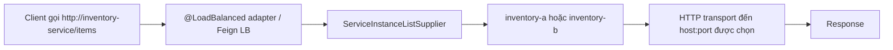
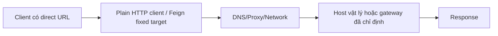
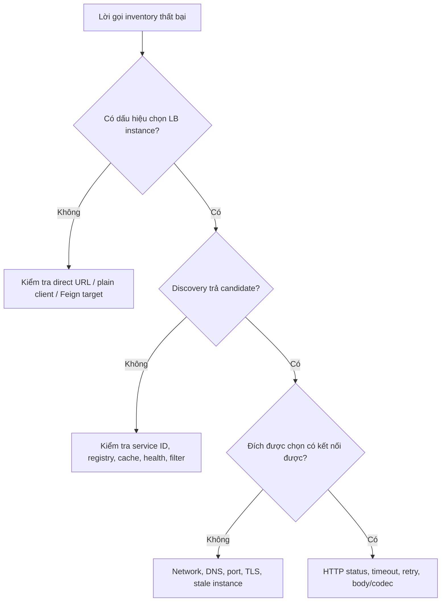

# URL trực tiếp làm bỏ qua LoadBalancer

Trong một hệ thống Spring Cloud, có tình huống `inventory-service` đã đăng ký hai bản sao và discovery trả đủ cả hai, nhưng mọi request vẫn gửi đến `inventory-a`. Khi bản sao A dừng, client nhận `Connection refused` mặc dù B vẫn khỏe. Nguyên nhân có thể đơn giản là ứng dụng **đã cấu hình một URL vật lý cố định** và không thực sự sử dụng Spring Cloud LoadBalancer cho lời gọi đó.

Bài thuộc chương **Chẩn đoán sự cố** của module `SPRING_CLOUD_SERVICE_COMMUNICATION_LOAD_BALANCING`. Mục tiêu là xác định **khi nào một direct URL bỏ qua LoadBalancer, khi nào không**, phân biệt hành vi của OpenFeign với RestClient, WebClient, RestTemplate và HTTP Interfaces, rồi xây dựng phép kiểm thử có hai `ServiceInstance` để chứng minh request đi qua discovery hay được gửi thẳng đến một server.

Một điểm rất dễ nhầm cần nắm ngay:

> **Không phải cứ xuất hiện URL đầy đủ `http://host:port` là mọi client đều tự bỏ qua LoadBalancer.** Với **OpenFeign**, một `url` được chỉ định cho named Feign client sẽ chọn direct target, không dùng load balancing theo `name`. Với **RestClient/WebClient/RestTemplate**, điều quyết định là **HTTP client có được gắn tích hợp `@LoadBalanced` hay không**. Nếu đã gắn, host trong URL thường được hiểu là **service ID cần tra cứu**; dùng IP/hostname vật lý trên client đó có thể gây lỗi `No instances available` thay vì đi trực tiếp.

## 1. Bài toán thực tế: service ID tồn tại nhưng chỉ A nhận request

Giả sử `order-service` muốn gọi:

```text
Logical service ID: inventory-service

Service discovery:
  inventory-a -> 10.20.0.11:8081
  inventory-b -> 10.20.0.12:8081

Caller expected:
  request 1 -> chọn A hoặc B
  request 2 -> chọn A hoặc B
  ...
```

Đội vận hành phát hiện:

```text
Consul/Eureka:
  inventory-a: UP
  inventory-b: UP

order-service:
  GET inventory-a:8081/api/v1/stock  -> 200
  GET inventory-a:8081/api/v1/stock  -> 200
  GET inventory-a:8081/api/v1/stock  -> 200

inventory-b:
  HTTP requests observed: 0
```

Đừng vội kết luận `RoundRobinLoadBalancer` bị lỗi. Có thể code đang dùng:

```java
@FeignClient(
        name = "inventory-service",
        url = "http://inventory-a:8081")
interface InventoryClient {
    @GetMapping("/api/v1/stock/{sku}")
    StockView findStock(@PathVariable String sku);
}
```

Ở đây `name` vẫn là `inventory-service`, nhưng `url` đã xác định **đích HTTP trực tiếp**. Theo tài liệu Spring Cloud OpenFeign, request dùng URL này **không trải qua lựa chọn instance theo service ID**.

Một ví dụ tương tự với client không có tích hợp LoadBalancer:

```java
RestClient directClient =
        RestClient.create("http://inventory-a:8081");
```

Cả hai đều có thể trả HTTP 200 nếu A hoạt động. **Một response thành công không chứng minh Spring Cloud LoadBalancer đã chạy.**

## 2. Tách bốn khái niệm thường bị gộp

| Khái niệm | Ví dụ | Trách nhiệm |
|---|---|---|
| **Service ID** | `inventory-service` | Khóa logic để LoadBalancer yêu cầu danh sách instance |
| **Instance host/port** | `inventory-a:8081` hoặc `10.20.0.11:8081` | Endpoint vật lý mà HTTP transport có thể kết nối |
| **HTTP client integration** | `@LoadBalanced RestClient.Builder`, `@LoadBalanced WebClient.Builder`, Feign LB | Chuyển từ service ID sang một `ServiceInstance` |
| **Direct URL / target** | `https://api.example.com/v1` | HTTP client kết nối trực tiếp theo DNS/URL, không cần client-side discovery nếu không có LB adapter |

Đường đi lý tưởng khi dùng Spring Cloud LoadBalancer:



Đường đi direct:



**Bỏ qua Spring Cloud LoadBalancer không nhất thiết có nghĩa bỏ qua mọi hình thức cân bằng tải.** Một direct URL trỏ tới Nginx, API gateway, Kubernetes Service hoặc DNS nhiều địa chỉ vẫn có thể được cân bằng tải bởi **một tầng khác**. Nhưng client không còn áp dụng `ServiceInstanceListSupplier`, health/zone/hint/weighted policy hoặc retry chọn instance riêng của Spring Cloud cho request đó.

## 3. Bảng kết luận nhanh theo loại client

| Cách gọi | Có Spring Cloud LB? | Ghi chú |
|---|---|---|
| `@FeignClient(name="inventory-service")`, không có `url` ở annotation/property | **Có**, khi Feign LB integration được cấu hình | `name` được dùng như service ID |
| `@FeignClient(name="inventory-service", url="http://inventory-a:8081")` | **Không**, direct target | `name` không ép sử dụng discovery |
| Feign không có annotation `url` nhưng có `spring.cloud.openfeign.client.config.inventory-service.url` | **Không**, direct target | Config URL được ưu tiên làm đích |
| `RestClient.create("http://inventory-a:8081")` | **Không**, mặc định | Dùng plain client, trừ khi thêm interceptor LB thủ công |
| `RestClient.builder()` tự tạo, không được cấu hình LB | **Không**, mặc định | Host được đưa cho HTTP transport/DNS |
| `@LoadBalanced RestClient.Builder` + `http://inventory-service` | **Có** | Host logic cần khớp service ID |
| `@LoadBalanced RestClient.Builder` + `http://inventory-a:8081` | **Thường vẫn cố đi qua LB** | Có thể tra cứu service ID `inventory-a` và báo no-instance |
| `WebClient.create("http://inventory-a:8081")` | **Không**, mặc định | Không có LB exchange filter nếu không cấu hình thêm |
| `@LoadBalanced WebClient.Builder` + `http://inventory-service` | **Có** | Reactive LB exchange filter chọn instance |
| `new RestTemplate()` + IP/host vật lý | **Không**, mặc định | Không có `LoadBalancerInterceptor` |
| `@LoadBalanced RestTemplate` + `http://inventory-service` | **Có** | Client-side service selection |
| HTTP Interface qua adapter của plain RestClient/WebClient | **Không** | Annotation `@HttpExchange` không tự tạo LB |
| HTTP Interface qua adapter client đã cấu hình LB | **Có** | Phụ thuộc adapter bên dưới |
| Spring Cloud LB 5.x HTTP Service Client group có explicit base-url HTTP(S) | **Có thể không** | Với auto-config được tài liệu mô tả, base URL không phải `lb://` khiến LB integration không được thêm |

**Phạm vi:** Những kết luận nêu trên áp dụng cho cấu hình thông thường theo tài liệu Spring Cloud. Nếu ứng dụng tự thêm custom `Client`, interceptor, proxy hoặc exchange filter, hãy kiểm tra **runtime thực tế**; chỉ nhìn một annotation không đủ để biết toàn bộ đường đi.

## 4. OpenFeign: bốn trường hợp URL cần phân biệt

Đây là trường hợp có quy tắc rõ ràng nhất từ tài liệu chính thức Spring Cloud OpenFeign.

### 4.1. Trường hợp đúng: chỉ định name, không chỉ định URL

```java
import org.springframework.cloud.openfeign.FeignClient;
import org.springframework.web.bind.annotation.GetMapping;
import org.springframework.web.bind.annotation.PathVariable;

@FeignClient(name = "inventory-service")
public interface InventoryFeignClient {

    @GetMapping("/api/v1/stock/{sku}")
    StockView findStock(@PathVariable("sku") String sku);
}
```

Ứng dụng bật Feign clients:

```java
@SpringBootApplication
@EnableFeignClients
public class OrderApplication {

    public static void main(String[] args) {
        SpringApplication.run(OrderApplication.class, args);
    }
}
```

Các điều kiện:

- Có `spring-cloud-starter-openfeign`.
- Có Spring Cloud LoadBalancer integration (thông thường qua `spring-cloud-starter-loadbalancer`).
- Có nguồn discovery hoặc `ServiceInstanceListSupplier` cung cấp `inventory-service`.
- **Không có `url` trong annotation.**
- **Không có `spring.cloud.openfeign.client.config.inventory-service.url` từ bất kỳ nguồn cấu hình có hiệu lực nào.**

Khi đủ điều kiện, Feign client theo `name` được load-balanced. `@EnableFeignClients` chỉ quét interface; nó **không tự chữa** một URL cố định hoặc một registry không có instance.

### 4.2. Sai mục tiêu LB: URL trực tiếp ngay trong annotation

```java
@FeignClient(
        name = "inventory-service",
        url = "http://inventory-a:8081")
public interface InventoryFeignClient {

    @GetMapping("/api/v1/stock/{sku}")
    StockView findStock(@PathVariable("sku") String sku);
}
```

Feign xây client hướng tới `inventory-a:8081`. Kể cả khi registry trả A/B và starter LB có mặt, URL annotation làm lời gọi trực tiếp thay vì chọn instance theo `name`.

Nếu A ngừng, B vẫn khỏe nhưng lời gọi có thể lỗi. Tăng `max-retries-on-next-service-instance` của Spring Cloud LoadBalancer **không giải quyết được** vì request không đi vào cơ chế chọn A/B của LoadBalancer.

### 4.3. URL trong application.yml cũng khiến Feign gọi trực tiếp

Một interface trông đúng:

```java
@FeignClient(name = "inventory-service")
public interface InventoryFeignClient {

    @GetMapping("/api/v1/stock/{sku}")
    StockView findStock(@PathVariable("sku") String sku);
}
```

Nhưng cấu hình:

```yaml
spring:
  cloud:
    openfeign:
      client:
        config:
          inventory-service:
            url: "http://inventory-a:8081"
```

lại cung cấp fixed target. Theo tài liệu OpenFeign, đây cũng là trường hợp **không load-balanced**. Do đó không đủ nếu chỉ tìm `url=` trong source code; phải kiểm tra **effective properties** từ cấu hình từng profile, config server, environment và startup arguments.

### 4.4. Có cả annotation URL và property URL

```java
@FeignClient(
        name = "inventory-service",
        url = "http://inventory-a:8081")
interface InventoryFeignClient {
    // ...
}
```

```yaml
spring:
  cloud:
    openfeign:
      client:
        config:
          inventory-service:
            url: "http://inventory-b:8081"
```

Theo bảng “Supported Ways To Provide URL To A Feign Client” của Spring Cloud OpenFeign, **URL trong annotation được dùng**, còn URL trong config không có hiệu lực cho target đó. Cả hai vẫn là **direct target**, không phải cách tạo danh sách hai instances. Thay property thành B không có nghĩa annotation sẽ tự thay đổi hoặc Feign sẽ round robin giữa A/B.

| Annotation `url` | Property `client.config.<client>.url` | Hành vi target thông thường |
|---|---|---|
| Trống | Trống | Load-balanced theo `name` |
| Có URL A | Trống | Direct A |
| Trống | Có URL A | Direct A |
| Có URL A | Có URL B | Direct A theo annotation |

### 4.5. Placeholder và override từ môi trường

```java
@FeignClient(
        name = "inventory-service",
        url = "${inventory.http.base-url}")
interface InventoryFeignClient {
    // ...
}
```

Giả sử runtime cấp:

```yaml
inventory:
  http:
    base-url: "http://inventory-a:8081"
```

Placeholder không thay đổi bản chất cấu hình: sau khi resolve, Feign có **direct URL**. Đừng chỉ kiểm tra một file YAML mặc định; một profile local có thể thiết lập URL thử nghiệm rồi vô tình đi vào production.

Trong các hệ thống có Spring Cloud Config/Kubernetes ConfigMap/Helm values, biến môi trường hoặc startup flags có thể ghi đè URL. **Effective runtime URL** mới là nguồn sự thật cần xác minh.

### 4.6. Khi nào direct URL là lựa chọn đúng?

Không phải mọi direct URL đều sai:

- Gọi một **third-party API** đã có DNS/TLS/ingress ổn định.
- Gọi một **API gateway** quản lý định tuyến riêng.
- Một test chỉ muốn **cố định target** A để kiểm tra lỗi server cụ thể.
- Migration/canary được thiết kế với đích cố định, giám sát và rollback.
- Một endpoint quản trị không được expose qua service discovery.

Vấn đề xảy ra khi **yêu cầu nghiệp vụ là client-side load balancing theo service ID**, nhưng config direct lại được triển khai mà không ai biết. Hãy ghi rõ mục tiêu và dùng tên bean/config để phân biệt direct client với load-balanced client.

## 5. RestClient: “URL trực tiếp” và “không có LB interceptor” là hai điều khác nhau

Với Spring Cloud Commons, RestClient muốn dùng LoadBalancer cần một builder do Spring quản lý và được đánh dấu `@LoadBalanced`.

### 5.1. Plain RestClient: kết nối theo URL thật

```java
RestClient directClient =
        RestClient.create("http://inventory-a:8081");

String body = directClient.get()
        .uri("/whoami")
        .retrieve()
        .body(String.class);
```

`RestClient.create` ở đây không tự thêm Spring Cloud LoadBalancer. HTTP transport dùng hostname/port vật lý, với DNS, proxy, TLS và pooling theo cấu hình. Dù project đã có `spring-cloud-starter-loadbalancer`, direct client này **không mặc định trở thành load-balanced**.

### 5.2. Đúng: @LoadBalanced RestClient.Builder và service ID

```java
package com.example.order.config;

import org.springframework.cloud.client.loadbalancer.LoadBalanced;
import org.springframework.context.annotation.Bean;
import org.springframework.context.annotation.Configuration;
import org.springframework.web.client.RestClient;

@Configuration(proxyBeanMethods = false)
public class InventoryRestClientConfiguration {

    @Bean("loadBalancedRestClientBuilder")
    @LoadBalanced
    RestClient.Builder loadBalancedRestClientBuilder() {
        return RestClient.builder();
    }
}
```

Inject builder này:

```java
package com.example.order.inventory;

import org.springframework.beans.factory.annotation.Qualifier;
import org.springframework.stereotype.Service;
import org.springframework.web.client.RestClient;

@Service
public class InventoryGateway {

    private final RestClient inventory;

    public InventoryGateway(
            @Qualifier("loadBalancedRestClientBuilder")
            RestClient.Builder builder) {

        this.inventory = builder.clone()
                .baseUrl("http://inventory-service")
                .build();
    }

    public String whoAmI() {
        return inventory.get()
                .uri("/whoami")
                .retrieve()
                .body(String.class);
    }
}
```

URL logic `inventory-service` đi qua interceptor/load-balancer adapter để chọn một instance và chuyển thành host/port thật. `@Qualifier` ở constructor phải chọn **đúng builder đã gắn `@LoadBalanced`**; nếu có hai builders mà ứng dụng inject nhầm plain builder, request có thể dùng DNS trực tiếp hoặc lỗi hostname.

### 5.3. Một hiểu nhầm gây chẩn đoán sai

Giả sử ai đó sửa code:

```java
RestClient client = loadBalancedBuilder.clone()
        .baseUrl("http://inventory-a:8081")
        .build();
```

Không nên khẳng định client này “đã bypass LB vì URL là physical”. Nếu `loadBalancedBuilder` **thực sự giữ interceptor LB**, interceptor có thể lấy `inventory-a` từ URI và coi **inventory-a là service ID**, sau đó tra cứu trong discovery.

Nếu registry chỉ có service ID `inventory-service`, có thể xuất hiện:

```text
No servers available for service: inventory-a
```

hoặc response/exception biểu thị không có instance. **Đây là một request vẫn đi qua LoadBalancer nhưng dùng sai service ID**, khác hoàn toàn với direct URL bypass. Cách sửa:

- Muốn cân bằng tải: dùng `http://inventory-service` với LB builder.
- Muốn gọi cố định A: dùng **plain RestClient builder/client riêng**, không dùng builder đã gắn LB.
- Không vô hiệu hoặc tháo interceptor “tạm thời” trên shared builder để vượt lỗi.

### 5.4. Tạo hai builder rõ ràng theo mục đích

```java
@Configuration(proxyBeanMethods = false)
class HttpClientBuilders {

    @Bean("serviceDiscoveryBuilder")
    @LoadBalanced
    RestClient.Builder serviceDiscoveryBuilder() {
        return RestClient.builder();
    }

    @Bean("directHttpBuilder")
    RestClient.Builder directHttpBuilder() {
        return RestClient.builder();
    }
}
```

Khi dùng:

```java
@Service
class InventoryClients {

    private final RestClient balanced;
    private final RestClient direct;

    InventoryClients(
            @Qualifier("serviceDiscoveryBuilder")
            RestClient.Builder balancedBuilder,
            @Qualifier("directHttpBuilder")
            RestClient.Builder directBuilder) {

        this.balanced = balancedBuilder.clone()
                .baseUrl("http://inventory-service")
                .build();

        this.direct = directBuilder.clone()
                .baseUrl("http://inventory-a:8081")
                .build();
    }
}
```

Trong ứng dụng thật, ưu tiên builder/customizer do Spring Boot quản lý để không mất observability, SSL bundle, proxy, timeout và HTTP request factory. Ví dụ trên tách hai đường đi theo **nguyên tắc phạm vi**, không định nghĩa mặc định về các customizations của mọi phiên bản Boot.

## 6. WebClient: kiểm tra ExchangeFilterFunction và builder

WebClient có hành vi tương tự ở điểm cốt lõi: **builder được cấu hình** mới quyết định có Spring Cloud LoadBalancer hay không.

### 6.1. Plain WebClient có fixed target

```java
WebClient direct = WebClient.create(
        "http://inventory-a:8081");

Mono<String> result = direct.get()
        .uri("/whoami")
        .retrieve()
        .bodyToMono(String.class);
```

Không có LB filter mặc định trong client tự tạo này. Reactive publisher là lazy: request chỉ được gửi khi subscribe/compose pipeline.

### 6.2. Load-balanced WebClient

```java
@Configuration(proxyBeanMethods = false)
class ReactiveClientsConfiguration {

    @Bean("loadBalancedWebClientBuilder")
    @LoadBalanced
    WebClient.Builder loadBalancedWebClientBuilder() {
        return WebClient.builder();
    }
}
```

```java
Mono<String> result = loadBalancedWebClientBuilder
        .clone()
        .baseUrl("http://inventory-service")
        .build()
        .get()
        .uri("/whoami")
        .retrieve()
        .bodyToMono(String.class);
```

Ở đây `loadBalancedWebClientBuilder` là bean đã inject từ Spring; không phải biến tạo mới bằng `WebClient.builder()` trong method mà không qua cấu hình.

### 6.3. URL tuyệt đối trong LB WebClient

```java
WebClient webClient = loadBalancedBuilder
        .clone()
        .build();

Mono<String> result = webClient.get()
        .uri("http://inventory-a:8081/whoami")
        .retrieve()
        .bodyToMono(String.class);
```

Dù URL là absolute URI, nếu client giữ `ReactorLoadBalancerExchangeFilterFunction`, filter vẫn xử lý hostname theo service ID. Request có thể thất bại khi không có registration tên `inventory-a`. **Đừng suy đoán bypass chỉ từ chuỗi URL.** Hãy quan sát filter chain, selected instance và các logs/metrics của LB.

### 6.4. Cẩn thận khi copy builder hoặc mutate

`WebClient.mutate()` có thể giữ filters/connector của client gốc. Nếu clone một WebClient đã được load-balanced rồi thay `baseUrl` sang third-party URL, client có thể tiếp tục coi host của third-party là service ID.

Quy tắc an toàn:

- Mỗi loại client có bean/builder riêng và tên phản ánh mục đích.
- Chỉ cho phép service-ID URL trên client có tích hợp LB.
- Chỉ cho phép physical/external URL trên direct client, trừ khi chủ động thiết kế một extension đặc biệt.
- Với WebClient, không gọi `retryWhen` vô hạn để che lỗi “không có service ID tương ứng”.

## 7. RestTemplate: cũng có bẫy tương tự

Một RestTemplate thuần:

```java
RestTemplate direct = new RestTemplate();

String body = direct.getForObject(
        "http://inventory-a:8081/whoami",
        String.class);
```

gọi direct target theo DNS/transport. Nhưng RestTemplate bean có `@LoadBalanced`:

```java
@Bean("loadBalancedRestTemplate")
@LoadBalanced
RestTemplate loadBalancedRestTemplate() {
    return new RestTemplate();
}
```

sẽ xử lý host trong URI logic như một service ID:

```java
String body = loadBalancedRestTemplate.getForObject(
        "http://inventory-service/whoami",
        String.class);
```

Lỗi thường gặp là inject nhầm bean:

```java
@Autowired
RestTemplate restTemplate; // Chưa chắc là bean có @LoadBalanced
```

Nếu có nhiều RestTemplate hoặc `@Primary` plain client, injection không qualified có thể gọi direct mà người viết code không nhận ra. Dùng `@Qualifier`/`@LoadBalanced` theo configuration thực tế, không dùng `new RestTemplate()` ngay trong service nghiệp vụ khi cần discovery.

### 7.1. RequestInterceptor custom cũng có thể đổi đường đi

Ngay cả một client đã cấu hình đúng, interceptor, filter hoặc gateway adapter custom có thể sửa URI host sang physical target hoặc thay request factory. Khi một bản nâng cấp khiến LoadBalancer “mất tác dụng”, so sánh bean construction/interceptor chain trước và sau thay đổi.

## 8. HTTP Interfaces và cơ chế group-based auto-configuration

`@HttpExchange`, `@GetExchange` là **HTTP contracts**, không tự khẳng định caller có dùng client-side LoadBalancer. Runtime thường sử dụng một adapter dựa trên RestClient/WebClient.

### 8.1. HTTP Interface với adapter tự tạo

```java
@HttpExchange("/api/v1")
interface InventoryHttpApi {

    @GetExchange("/stock/{sku}")
    StockView stock(@PathVariable("sku") String sku);
}
```

Nếu adapter được tạo từ một **plain RestClient** có base URL vật lý, lời gọi đi trực tiếp. Nếu adapter được tạo từ **load-balanced RestClient** có base URL `http://inventory-service`, lời gọi dùng service discovery.

Quyết định nằm ở **client tạo adapter**, không phải ở annotation `@GetExchange`.

### 8.2. Spring Cloud LoadBalancer 5.x: chú ý base-url của HTTP Service Client groups

Spring Cloud LoadBalancer từ **5.0.0** có hỗ trợ auto-configuration cho Spring HTTP Service Client groups. Theo tài liệu Spring Cloud Commons 5.x:

- Khi group `base-url` **không được khai báo**, framework có thể tạo URL theo service ID (group name) và gắn integration LoadBalancer.
- Khi group `base-url` dùng scheme `lb://`, framework gắn integration LoadBalancer tương ứng.
- Khi group `base-url` là URL với scheme HTTP(S) thông thường, **không thêm integration LoadBalancer cho group theo cơ chế auto-config này**, kể cả hostname trông giống service ID.

Ví dụ (chỉ cho ứng dụng dùng **HTTP Service Client groups auto-configuration** của các phiên bản tương ứng):

```yaml
spring:
  http:
    serviceclient:
      inventory-service:
        base-url: "http://inventory-service"
```

Trong cơ chế group auto-config được mô tả, URL này là HTTP URL bình thường, nên LB integration **không tự được thêm**. Đây là khác biệt với trường hợp **bạn tự tạo `@LoadBalanced RestClient.Builder`** ở mục 5.

Một biến thể theo tài liệu 5.x:

```yaml
spring:
  http:
    serviceclient:
      inventory-service:
        base-url: "lb://inventory-service"
```

được dùng để yêu cầu load balancing cho group đó. **Không sao chép cấu hình `lb://` sang một RestClient/WebClient thuần và giả định transport hiểu scheme này**; nó chỉ có ý nghĩa khi cơ chế auto-config thích hợp xử lý.

Nếu ứng dụng dùng Spring Cloud 4.x, đừng mặc định tính năng group auto-configuration 5.x đã có; kiểm tra bản release train và cách dựng HTTP Interface thật sự.

## 9. Những dấu hiệu cho thấy request đang bypass Spring Cloud LoadBalancer

| Triệu chứng | Có thể là direct URL? | Cần đối chiếu thêm |
|---|---|---|
| Discovery trả A/B, nhưng chỉ A nhận request | Có | Sticky routing, supplier chỉ còn A, pool, Feign URL |
| Khi A chết, tất cả lời gọi lỗi dù B khỏe | Rất có thể | URL fixed target, health/cache stale, retry config |
| Xóa toàn bộ registration vẫn gọi được A | Dấu hiệu mạnh | Có direct call, gateway/cache/fallback? |
| Không thấy sự kiện lựa chọn instance của LB | Có thể | LB stats có bật/instrument không? |
| RestClient/WebClient URL tuyệt đối nhưng `No instances available for inventory-a` | **Ngược lại: LB có thể vẫn hoạt động** | LB filter coi `inventory-a` là service ID |
| Feign annotation có `name` và `url` | **Có** theo docs | URL annotation là direct target |
| Feign annotation không có `url` nhưng property `client.config.*.url` có | **Có** theo docs | Effective runtime properties |
| URL `http://inventory-service` vẫn gọi được dù không có LB | Có thể | Docker/Kubernetes DNS trùng hostname |
| HTTP client báo `UnknownHostException: inventory-service` | Có thể plain client | DNS, thiếu LB adapter hoặc sai bean |
| HTTP client báo no-instance dù DNS hostname thật tồn tại | Có thể LB đang tra cứu host như service ID | Kiểm tra builder/filter |
| OpenFeign nói thiếu load-balancing client | Không nhất thiết có direct URL | Starter/integration thiếu, không phải vì hostname sai |
| Không có LB metric | Chưa kết luận được | Metric chưa bật hoặc không có request |

**Không có một triệu chứng duy nhất chứng minh bypass.** Chẩn đoán đáng tin cần xác nhận **effective target**, **HTTP client bean/integration**, **sự kiện chọn instance** và **server thực nhận request**.

## 10. Quy trình chẩn đoán trong một incident thật

Giả sử `order-service` nhận lỗi khi `inventory-a` dừng. Thực hiện theo thứ tự sau.

### Bước 1 — Xác định đúng loại HTTP client

Ghi nhận:

```text
clientType: OpenFeign / RestClient / WebClient / RestTemplate / HTTP Interface
caller: order-service
dependency: inventory-service
logicalOperation: GET /api/v1/stock/{sku}
environment: staging
```

Hỏi: lời gọi nằm ở interface Feign nào, bean RestClient nào, hay WebClient nào? Có một gateway class custom tạo thêm client riêng không?

### Bước 2 — Xem URL hiệu lực, không chỉ URL trong code

Với Feign, kiểm tra:

- `@FeignClient(name=..., url=...)`.
- `spring.cloud.openfeign.client.config.<clientName>.url`.
- Config của profile, Spring Cloud Config, ConfigMap/Secret, startup options.
- Placeholder đã resolve sang giá trị nào.
- Một `contextId` khác tên `name` có làm tra sai property client không.
- Feign client builder custom hoặc factory đã định một direct target chưa.

Với RestClient/WebClient/RestTemplate, kiểm tra nơi bean được tạo, có `@LoadBalanced` không, bean nào được inject và URL thực tế được gắn trong `baseUrl(...)`/`uri(...)`.

### Bước 3 — So discovery với selected instance

Kiểm tra registry hoặc gọi `DiscoveryClient.getInstances("inventory-service")`. Một ví dụ:

```text
serviceId=inventory-service
instances:
  - inventory-a:8081
  - inventory-b:8081
```

Danh sách có hai instance là điều kiện cần nhưng không phải bằng chứng caller đang sử dụng nó. Nếu không có instance, tách sự cố **discovery** khỏi sự cố **direct target** trước khi chỉnh code.

### Bước 4 — Tạo chứng cứ từ server

Để biết instance nào thực nhận request, mỗi server trả header:

```http
HTTP/1.1 200 OK
X-Instance-Id: inventory-b
Content-Type: text/plain

inventory-b
```

Gửi request theo correlation ID và đối chiếu server logs. Đừng chỉ dựa vào DNS lookup từ máy developer: client đang chạy trong container hoặc Pod khác có network namespace riêng.

### Bước 5 — Xác nhận LoadBalancer lifecycle

Khi có Micrometer/LoadBalancer metrics, kiểm tra `loadbalancer.requests.active`, `success`, `failed` và `discard` trong bối cảnh đã cấu hình đúng. **LB success không đồng nghĩa HTTP 2xx**; nó có thể là một response HTTP lỗi được chuyển tiếp.

Nếu chỉ thấy HTTP transport metrics mà không thấy LB stats, có thể caller không qua LB, **hoặc** thống kê LB chưa bật / chưa có meter. Cần kiểm tra request path/interceptor để kết luận.

### Bước 6 — Thử tình huống phân biệt bypass

Trong môi trường test cô lập:

1. Registry có A/B.
2. Gọi qua service ID, xác nhận cả hai bản sao có thể nhận request.
3. Tắt hoặc deregister A, chờ discovery/health/cache hội tụ.
4. Gọi lại.
5. Nếu client vẫn cố kết nối A trong khi registry chỉ còn B, kiểm tra direct URL, cache stale và supplier chain.
6. Nếu xóa hết registration nhưng một client vẫn gọi A thành công, kiểm tra liệu nó đang dùng direct URL hoặc một routing layer khác.

Không thực hiện fault injection/tắt instance ở production nếu chưa có kế hoạch và quyền vận hành.

## 11. Kiểm thử có hai HTTP stubs và SimpleDiscoveryClient

Để chứng minh sự khác nhau giữa **direct** và **load-balanced** mà không phụ thuộc Eureka/Consul, dùng:

- Hai HTTP servers thật trên loopback, cổng động.
- `SimpleDiscoveryClient` công bố A/B dưới cùng `inventory-service`.
- Một `@LoadBalanced RestClient.Builder`.
- Một `RestClient.Builder` plain.
- Server trả body `inventory-a`/`inventory-b` và đếm số request đã nhận.
- JUnit xác nhận direct client luôn đến A; load-balanced client có thể đến A/B.

Đây là **integration test HTTP client và selection**, chưa phải integration test với real registry. Kiểm thử discovery thật cần Eureka/Consul/Testcontainers ở suite riêng.

### 11.1. Dependencies Maven

Dùng Spring Boot/Spring Cloud BOM tương thích; ví dụ:

```xml
<dependencies>
    <dependency>
        <groupId>org.springframework.boot</groupId>
        <artifactId>spring-boot-starter-web</artifactId>
    </dependency>
    <dependency>
        <groupId>org.springframework.cloud</groupId>
        <artifactId>spring-cloud-starter-loadbalancer</artifactId>
    </dependency>
    <dependency>
        <groupId>org.springframework.boot</groupId>
        <artifactId>spring-boot-starter-test</artifactId>
        <scope>test</scope>
    </dependency>
</dependencies>
```

Ví dụ sử dụng Java 17+ và JDK module `jdk.httpserver`. Nếu project dùng Java module descriptors, đảm bảo quyền truy cập `com.sun.net.httpserver`.

### 11.2. Cấu hình ứng dụng test

```java
package com.example.lb.troubleshooting;

import org.springframework.boot.SpringBootConfiguration;
import org.springframework.boot.autoconfigure.EnableAutoConfiguration;
import org.springframework.cloud.client.loadbalancer.LoadBalanced;
import org.springframework.context.annotation.Bean;
import org.springframework.web.client.RestClient;

@SpringBootConfiguration
@EnableAutoConfiguration
class DirectUrlTestApplication {

    @Bean("balancedBuilder")
    @LoadBalanced
    RestClient.Builder balancedBuilder() {
        return RestClient.builder();
    }

    @Bean("directBuilder")
    RestClient.Builder directBuilder() {
        return RestClient.builder();
    }
}
```

Không đánh dấu `directBuilder` bằng `@LoadBalanced`. Test sẽ inject cả hai bằng `@Qualifier` để tránh không rõ bean nào được dùng.

### 11.3. Hai stub HTTP, mỗi stub trả marker riêng

```java
package com.example.lb.troubleshooting;

import java.io.IOException;
import java.io.OutputStream;
import java.io.UncheckedIOException;
import java.net.InetSocketAddress;
import java.nio.charset.StandardCharsets;
import java.util.concurrent.atomic.AtomicInteger;

import com.sun.net.httpserver.HttpServer;

final class InstanceHttpStub implements AutoCloseable {

    private final HttpServer server;
    private final AtomicInteger received = new AtomicInteger();

    private InstanceHttpStub(String name) throws IOException {
        server = HttpServer.create(
                new InetSocketAddress("127.0.0.1", 0), 0);

        server.createContext("/whoami", exchange -> {
            received.incrementAndGet();

            byte[] body = name.getBytes(StandardCharsets.UTF_8);
            exchange.getResponseHeaders().set(
                    "X-Instance-Id", name);

            exchange.sendResponseHeaders(200, body.length);
            try (OutputStream output =
                         exchange.getResponseBody()) {
                output.write(body);
            }
        });

        server.start();
    }

    static InstanceHttpStub start(String name) {
        try {
            return new InstanceHttpStub(name);
        } catch (IOException error) {
            throw new UncheckedIOException(error);
        }
    }

    String baseUrl() {
        return "http://127.0.0.1:"
                + server.getAddress().getPort();
    }

    int received() {
        return received.get();
    }

    @Override
    public void close() {
        server.stop(0);
    }
}
```

Hai servers đều phục vụ `/whoami`, nhưng mỗi server có port và body riêng. Counter ở server giúp xác nhận **request thật đã đến đâu**, thay vì kết luận từ log client.

### 11.4. JUnit Spring Boot test chứng minh hai đường đi

```java
package com.example.lb.troubleshooting;

import java.util.ArrayList;
import java.util.List;
import java.util.Set;

import org.junit.jupiter.api.AfterAll;
import org.junit.jupiter.api.Test;

import org.springframework.beans.factory.annotation.Autowired;
import org.springframework.beans.factory.annotation.Qualifier;
import org.springframework.boot.test.context.SpringBootTest;
import org.springframework.test.context.DynamicPropertyRegistry;
import org.springframework.test.context.DynamicPropertySource;
import org.springframework.web.client.RestClient;

import static org.junit.jupiter.api.Assertions.*;

@SpringBootTest(
        classes = DirectUrlTestApplication.class,
        webEnvironment = SpringBootTest.WebEnvironment.NONE,
        properties = {
                "spring.cloud.loadbalancer.cache.enabled=false",
                "spring.cloud.loadbalancer.retry.enabled=false"
        })
class DirectUrlBypassIT {

    private static final InstanceHttpStub A =
            InstanceHttpStub.start("inventory-a");
    private static final InstanceHttpStub B =
            InstanceHttpStub.start("inventory-b");

    @DynamicPropertySource
    static void registerInstances(DynamicPropertyRegistry registry) {
        registry.add(
                "spring.cloud.discovery.client.simple.instances."
                        + "inventory-service[0].uri",
                A::baseUrl);

        registry.add(
                "spring.cloud.discovery.client.simple.instances."
                        + "inventory-service[1].uri",
                B::baseUrl);
    }

    @Autowired
    @Qualifier("balancedBuilder")
    RestClient.Builder balancedBuilder;

    @Autowired
    @Qualifier("directBuilder")
    RestClient.Builder directBuilder;

    @Test
    void directUrlAlwaysTargetsA() {
        RestClient direct = directBuilder.clone()
                .baseUrl(A.baseUrl())
                .build();

        int beforeA = A.received();
        int beforeB = B.received();

        for (int i = 0; i < 5; i++) {
            assertEquals("inventory-a", direct.get()
                    .uri("/whoami")
                    .retrieve()
                    .body(String.class));
        }

        assertEquals(beforeA + 5, A.received());
        assertEquals(beforeB, B.received());
    }

    @Test
    void serviceIdRoutesToMultipleInstances() {
        RestClient balanced = balancedBuilder.clone()
                .baseUrl("http://inventory-service")
                .build();

        List<String> responders = new ArrayList<>();

        for (int i = 0; i < 8; i++) {
            responders.add(balanced.get()
                    .uri("/whoami")
                    .retrieve()
                    .body(String.class));
        }

        assertTrue(responders.stream()
                .allMatch(Set.of(
                        "inventory-a", "inventory-b")::contains));

        assertTrue(responders.contains("inventory-a"));
        assertTrue(responders.contains("inventory-b"));
    }

    @Test
    void unknownServiceNameDoesNotFallBackToA() {
        RestClient balanced = balancedBuilder.clone().build();

        int beforeA = A.received();
        int beforeB = B.received();

        assertThrows(RuntimeException.class,
                () -> balanced.get()
                        .uri("http://service-not-registered/whoami")
                        .retrieve()
                        .body(String.class));

        assertEquals(beforeA, A.received());
        assertEquals(beforeB, B.received());
    }

    @AfterAll
    static void shutdown() {
        A.close();
        B.close();
    }
}
```

### 11.5. Kết luận từ ba test

| Test | Bằng chứng |
|---|---|
| `directUrlAlwaysTargetsA` | Plain RestClient dùng URL vật lý, chỉ A nhận request |
| `serviceIdRoutesToMultipleInstances` | `@LoadBalanced RestClient` dùng tên logic và thật sự chọn A/B |
| `unknownServiceNameDoesNotFallBackToA` | Khi service ID không có, client không tự gửi tới một instance vật lý đã biết |

Với default `RoundRobinLoadBalancer` và hai instances ổn định, tám request tuần tự trong môi trường test kiểm soát đủ để nhìn thấy cả hai. Nếu môi trường đã bật random/sticky/zone/hint hoặc có các request nền, điều chỉnh assertion theo policy thực thay vì đòi thứ tự A-B-A-B tuyệt đối.

`assertThrows(RuntimeException.class)` cố ý không cố định lớp exception, vì mỗi integration/release train có thể biểu diễn no-instance bằng exception hoặc HTTP 503 do client xử lý. Tại test này, `RestClient.retrieve()` với status lỗi thường ném runtime exception; cần chọn assertion chi tiết theo runtime đang kiểm chứng.

### 11.6. Trường hợp cần test thêm: dùng physical URL trên LB builder

Thêm một phép thử riêng (có thể tùy theo release train và interceptor customization) với:

```java
RestClient balanced = balancedBuilder.clone().build();

balanced.get()
        .uri("http://127.0.0.1:18081/whoami")
        .retrieve()
        .body(String.class);
```

Nếu LB interceptor hoạt động, host `127.0.0.1` có thể bị xem là service ID và phép chọn không tìm thấy instance. **Không xem lỗi đó là bằng chứng URL đi trực tiếp nhưng TCP hỏng.** Kiểm tra log/trace của LoadBalancer cho service ID được yêu cầu và không hard-code cổng `18081` khi cổng server test thực tế là động.

## 12. Kiểm thử trực tiếp cho Feign URL override

Để chứng minh OpenFeign không dùng LoadBalancer khi có `url`:

1. Dựng registry test trả A và B.
2. Tạo Feign client `@FeignClient(name="inventory-service", url="http://127.0.0.1:<portA>")` bằng test property/annotation resolution.
3. Gọi `whoami()` nhiều lần.
4. Chứng minh A nhận tất cả requests, B không nhận.
5. Deregister A nhưng **để HTTP A vẫn mở**. Direct Feign vẫn có thể gọi A thành công: bằng chứng nó không dùng registry để chọn.
6. Xóa URL khỏi annotation/property, dựng lại context và kiểm chứng Feign load-balanced chọn từ discovery.

Cần chạy **hai context hoặc hai Feign interfaces có config tách biệt**, không giả định một bean Feign đã khởi tạo sẽ đổi client target ngay khi sửa property runtime. Nếu dùng refresh feature, hãy xác minh cơ chế hỗ trợ và version; refresh URL không tự biến một direct target thành service-ID load balancing.

### 12.1. Không dùng kiểm thử “hai requests khác nhau” làm tiêu chí duy nhất

Khi Feign có direct URL trỏ tới **một gateway**:

```text
Feign -> https://inventory-gateway.example.com
                 ├─ inventory-a
                 └─ inventory-b
```

Caller có thể thấy response từ A và B, nhưng vẫn **không sử dụng Spring Cloud LoadBalancer** ở Feign client. Vì vậy phải kiểm tra cả routing layer và Feign target config, không chỉ xem backend nào trả response.

## 13. Khôi phục đúng hành vi load-balanced cho Feign

Nếu mục tiêu là chọn A/B theo discovery, thay:

```java
// Sai khi mong muốn Spring Cloud LoadBalancer chọn instance:
@FeignClient(
        name = "inventory-service",
        url = "http://inventory-a:8081")
interface InventoryFeignClient {
    // ...
}
```

bằng:

```java
// Đúng khi mong muốn Spring Cloud LoadBalancer chọn instance:
@FeignClient(name = "inventory-service")
interface InventoryFeignClient {
    // ...
}
```

Đồng thời **bỏ** property:

```yaml
# Xóa/không cung cấp property direct URL này cho client cần LB.
spring:
  cloud:
    openfeign:
      client:
        config:
          inventory-service:
            # url: "http://inventory-a:8081"
            connectTimeout: 2000
            readTimeout: 5000
```

Trong YAML thực, `connectTimeout`/`readTimeout` là ví dụ mili-giây theo Spring Cloud OpenFeign và phải phù hợp ngân sách timeout thực của ứng dụng.

Các điều kiện cần kiểm tra tiếp:

- `spring-cloud-starter-openfeign` và `spring-cloud-starter-loadbalancer`.
- `@EnableFeignClients` hoặc cấu hình quét Feign clients tương ứng.
- Discovery/`ServiceInstanceListSupplier` có đủ A/B dưới đúng tên `inventory-service`.
- Client không vô tình cấu hình `Feign.Builder`/`Client` riêng làm mất LB adapter.
- Không bị property URL khác từ profile hoặc config server ghi đè.
- Có instrumentation để quan sát instance thực nhận request.

Không thêm `url="http://inventory-service"` vào `@FeignClient` để “đổi từ IP sang service ID”: một `url` tuyệt đối có hostname trông như service ID vẫn được Feign xử lý theo đường **direct URL**, theo bảng cấu hình tài liệu OpenFeign.

## 14. Khôi phục đúng RestClient/WebClient/RestTemplate

### 14.1. RestClient

Tách hai bean:

```java
@Bean("inventoryServiceIdBuilder")
@LoadBalanced
RestClient.Builder inventoryServiceIdBuilder() {
    return RestClient.builder();
}

@Bean("thirdPartyDirectBuilder")
RestClient.Builder thirdPartyDirectBuilder() {
    return RestClient.builder();
}
```

Trong gateway nghiệp vụ gọi inventory:

```java
RestClient inventory = inventoryServiceIdBuilder
        .clone()
        .baseUrl("http://inventory-service")
        .build();
```

Trong gateway gọi third-party:

```java
RestClient paymentsExternal = thirdPartyDirectBuilder
        .clone()
        .baseUrl("https://payment-provider.example.com")
        .build();
```

Không sử dụng một builder có `@LoadBalanced` cho mọi URL của hệ thống. Trong môi trường production, dùng Spring Boot-configured builders/customizers để duy trì TLS/observation/timeout.

### 14.2. WebClient

Bean `@LoadBalanced WebClient.Builder` cho service IDs, bean plain builder cho direct external destinations:

```java
@Bean("discoveredWebClientBuilder")
@LoadBalanced
WebClient.Builder discoveredWebClientBuilder() {
    return WebClient.builder();
}

@Bean("directWebClientBuilder")
WebClient.Builder directWebClientBuilder() {
    return WebClient.builder();
}
```

Đừng chia sẻ một `WebClient` đã build từ load-balanced builder rồi dùng `mutate()` thay base URL thành third-party URL nếu không chắc filters đã được loại bỏ có chủ ý. Cách rõ ràng hơn là tạo client từ direct builder.

### 14.3. RestTemplate

Giữ hai beans riêng và dùng `@Qualifier` trong constructor. Nếu đang inject `RestOperations`, xác nhận đúng object được đánh dấu LB, không vô tình dùng bean `@Primary` direct.

### 14.4. HTTP Interfaces

Hãy kiểm tra adapter và group auto-config phiên bản. Khi group 5.x có explicit HTTP(S) base URL, sửa thành cấu hình group hỗ trợ LB theo tài liệu nếu mục tiêu là service-ID selection. Đối với proxy được tạo thủ công, cấu hình client adapter từ load-balanced RestClient/WebClient.

## 15. Các lỗi cần phân loại khác nhau

| Tín hiệu | Diễn giải thường gặp | Cách kiểm tra |
|---|---|---|
| `UnknownHostException: inventory-service` | Plain HTTP client cố dùng DNS cho service ID logic | Kiểm tra LB builder và môi trường DNS |
| `No instances available for inventory-service` | LB chạy nhưng không có candidate | Registry, supplier, health/zone/cache |
| `No instances available for inventory-a` | Có thể LB đang nhầm physical host là service ID | Kiểm tra URL trên LB client |
| `Connection refused inventory-a:8081` | Direct URL A chết, hoặc LB chọn A đã chết | Xác minh selected instance/lifecycle và target config |
| `Read timed out` | Backend chậm hoặc direct target không phù hợp | HTTP client timeout, selected target và retry |
| `SSLHandshakeException` | Truststore/SAN/scheme không khớp đích TLS | Kiểm tra host cuối, TLS configuration |
| `FeignException$ServiceUnavailable` | Backend/gateway hoặc LB có thể tạo 503 | Xác định nguồn HTTP 503, có chọn instance hay không |
| HTTP 200 nhưng không thấy LB metrics | Có thể direct, cũng có thể meter không bật | Runtime Feign client/builder/filter |
| B không được chọn dù khỏe | Có thể direct A, hoặc sticky/zone/hint policy | Candidate list sau filtering và URL hiệu lực |
| Retry không chuyển sang B | Có thể direct target, retry khác tầng hoặc chỉ một candidate | Feign URL, retry config, supplier chain |

### 15.1. “No instance” và “bypass” là hai hướng sửa khác nhau



Không tăng retry như bước đầu tiên. Trước tiên phải biết request **có đang sử dụng LoadBalancer không**, và nếu có, LoadBalancer **chọn instance nào**.

## 16. Kết hợp retry, health check, zones và hints: tác động khi bypass

Direct URL loại bỏ khả năng ứng dụng tự tận dụng các chính sách per-service của Spring Cloud LoadBalancer:

| Tính năng | Load-balanced theo service ID | Direct target |
|---|---|---|
| Discovery cập nhật A/B | Dùng danh sách từ supplier | Không tự lấy danh sách đó |
| Health filtering | Có thể loại B/A trước selection | Đích đã cố định |
| Retry next-instance | Có thể chuyển A → B khi policy/client hỗ trợ | Không có bước chọn B của Spring Cloud LB |
| Zone preference | Có thể ưu tiên bản sao cùng zone | Đích direct không đổi theo zone |
| Hints/metadata | Có thể lọc candidate | Không sử dụng supplier/hint policy |
| Weighted/random/round robin | Áp dụng cho candidate list | Không lựa chọn bằng thuật toán này |
| LoadBalancer selection stats | Có thể có nếu instrumentation bật | Không ghi nhận từ đường direct |
| Circuit breaker | Có thể dùng ở cả hai | Có thể tồn tại riêng ngoài LB |
| HTTP transport retry | Có thể vẫn tồn tại | Vẫn có thể gửi lại đến cùng target |
| TLS, proxy, DNS, connection pool | Vẫn có | Vẫn có |

**Direct URL không tắt mọi retry hoặc circuit breaker.** Một Feign `Retryer`, Resilience4j, HTTP transport hoặc gateway vẫn có thể retry/failover. Nhưng đó **không đồng nghĩa** Spring Cloud LoadBalancer đã chọn `ServiceInstance` tiếp theo. Khi đếm attempts, phải phân biệt tầng nào đang retry.

### 16.1. Bypass có thể che sai sót health/discovery

Một direct URL tới A vẫn trả 200 ngay cả khi `DiscoveryClient.getInstances("inventory-service")` rỗng. Trong môi trường test, điều này là một cách phát hiện đường direct.

Ngược lại, nếu LoadBalancer trả no-instance nhưng direct tới A vẫn thành công, không nên lập tức thay LB bằng direct URL: cần sửa **registry/discovery/health** để ứng dụng có thể route an toàn khi số instance thay đổi.

## 17. Tác động của môi trường triển khai

Một URL hoạt động trên laptop không nhất thiết hợp lệ trong Docker/Kubernetes:

```text
Developer host:
  http://localhost:18081 -> published port inventory-a

order-service container:
  http://localhost:18081 -> chính order-service container
  http://inventory-a:8081 -> inventory-a nếu cùng Docker network
  http://inventory-service -> service ID cần LB hoặc Docker DNS riêng
```

Nếu direct Feign URL là `http://localhost:18081`, khi đưa order-service vào container, client có thể kết nối tới **localhost của chính caller** thay vì inventory-a.

Với Kubernetes:

- `http://inventory-service.namespace.svc.cluster.local` trên plain HTTP client có thể đi qua **Kubernetes Service** và được nền tảng phân phối đến Pod.
- Điều đó không chứng minh Spring Cloud LoadBalancer đang chọn từng Pod.
- Nếu một `@LoadBalanced RestClient` sử dụng chính hostname DNS dài này, Spring Cloud có thể coi nó là **service ID không được đăng ký** và báo no-instance.
- Với `Spring Cloud Kubernetes DiscoveryClient`, cần kiểm tra service ID/namespace và dạng instance được supplier trả.

Đừng lẫn lộn **DNS/service proxy của nền tảng** với **client-side Spring Cloud LoadBalancer** khi đánh giá hành vi direct URL.

## 18. Quan sát request path bằng logs và metrics

Một log hữu ích (format **tự thiết kế**):

```text
event=dependency.request
caller=order-service
clientType=OpenFeign
dependency=inventory-service
targetMode=DIRECT
effectiveTarget=http://inventory-a:8081
retryLayer=feign
finalOutcome=CONNECTION_REFUSED
```

Một request đi qua LB có thể ghi:

```text
event=loadbalancer.selection
caller=order-service
serviceId=inventory-service
selectedInstanceId=inventory-b
selectedHost=inventory-b
selectedPort=8081
attempt=1
```

**Đừng nhầm các field trên là log mặc định bắt buộc của Spring Cloud**; ứng dụng có thể cần thêm observation/filter/tracing để thu thập. Không log Authorization header, tokens, URL query chứa secrets hoặc toàn bộ body nhạy cảm.

Các metric đáng tham khảo (khi Micrometer integration được bật và request đã phát sinh):

- `http.client.requests`: lỗi/status và latency của HTTP client.
- `loadbalancer.requests.success`: LB lifecycle hoàn tất với response; **không đồng nghĩa HTTP 2xx**.
- `loadbalancer.requests.failed`: LB lifecycle kết thúc với exception.
- `loadbalancer.requests.discard`: không có instance để chọn.
- Custom metric `app.dependency.target.mode` hoặc field trace `targetMode=direct|service_id` nếu cần phân loại ổn định.

Khi direct target, các meter LB có thể không tăng; tuy nhiên **thiếu meter không tự chứng minh bypass** vì chúng có thể chưa bật hoặc chỉ ghi trên những integrations cụ thể.

### 18.1. Không đưa URL vật lý có cardinality cao vào labels

Nếu cần đếm số request direct, dùng label ổn định `dependency=inventory-service` và `mode=direct`. Không đưa arbitrary URL, IP động, order ID hoặc correlation ID làm tag metric. Chi tiết per-request nên vào trace/log đã redacted.

## 19. Chẩn đoán cấu hình bằng một bảng kiểm tra

| Câu hỏi | Nếu trả lời “có” | Hành động |
|---|---|---|
| Feign annotation có `url`? | Target direct | Bỏ `url` nếu muốn LB |
| Feign có property `client.config.<name>.url`? | Target direct nếu annotation không có URL | Xóa property hoặc áp profile đúng |
| Client được tạo qua `RestClient.create`/`WebClient.create`? | Thường plain client | Dùng builder `@LoadBalanced` nếu cần service ID |
| Builder được gắn `@LoadBalanced`? | LB có thể được áp dụng | Kiểm tra đúng bean được inject |
| URL logic dùng host trùng service ID? | Đúng đầu vào selection | Kiểm tra danh sách instance |
| URL trên LB builder là IP/hostname vật lý? | Có thể LB tra cứu sai service ID | Dùng service ID hoặc chuyển sang plain builder |
| Có Docker/Kubernetes DNS tên giống service ID? | Plain client có thể gọi được | Đừng coi HTTP 200 là chứng cứ LB |
| Có direct gateway URL? | LB có thể nằm ở gateway thay vì client | Xác định đúng tầng cân bằng tải |
| Có retry/circuit breaker custom? | Có thể che failure hoặc chọn target khác | Xác định retry layer |
| Có HTTP Interface group auto-config 5.x với explicit HTTP URL? | LB integration có thể không được thêm | Đối chiếu group `base-url`/`lb://` |
| Metrics LB không thấy? | Chưa kết luận bypass | Kiểm tra stats enabled và runtime path |
| A bị gỡ khỏi registry mà direct A vẫn trả 200? | Bằng chứng mạnh direct hoặc routing khác | Xác minh target config và A logs |

## 20. Runbook khắc phục theo mục tiêu thật

### 20.1. Muốn load balancing bằng Spring Cloud

1. Xác định service ID chính xác, ví dụ `inventory-service`.
2. Kiểm tra registry/supplier có ít nhất một `ServiceInstance` eligible cho tên đó.
3. Với **OpenFeign**, bỏ `url` ở annotation **và** effective property URL.
4. Với **RestClient/WebClient/RestTemplate**, sử dụng bean/builder có `@LoadBalanced`.
5. Dùng URI logic có hostname là service ID; không hard-code port/host của một instance.
6. Xác nhận Spring Cloud LoadBalancer starter/integration có mặt.
7. Gửi request và quan sát selected instance + HTTP responder.
8. Kiểm thử failure của một instance và recovery sau discovery hội tụ.
9. Xem lại retry, timeout, idempotency, cache và health sau khi routing đúng.
10. Xác minh HTTPS, SAN/truststore và transport pooling cho target vật lý sau selection.

### 20.2. Muốn direct request có chủ ý

1. Dùng plain HTTP client hoặc Feign với URL rõ ràng.
2. Ghi rõ URL là gateway/third-party/single target, không mong LB selection.
3. Có DNS/TLS/timeout/authentication phù hợp với đích trực tiếp.
4. Không trông chờ `RetryAwareServiceInstanceListSupplier` hoặc per-service LB zone/hint policy.
5. Có phương án failover do gateway/platform hoặc ứng dụng quản lý.
6. Test hành vi khi đích trực tiếp chết.
7. Không dùng load-balanced builder và hy vọng nó “tự bỏ qua” vì host nhìn như IP.

### 20.3. Muốn chuyển dần từ direct sang discovery

Đối với migration:

- Dựng một adapter/gateway với API hợp đồng không đổi.
- Tách tên config rõ như `inventory.target.mode=direct|service-id` nếu cần rollout, nhưng hãy **tạo hai clients đúng kiểu** thay vì thay URI trên cùng LB builder.
- Canary traffic nhỏ qua service ID, quan sát status, latency, retries và instance distribution.
- Kiểm chứng service registry, health, zone và TLS trước khi tăng traffic.
- Loại bỏ fixed URL override trong config khi đã chuyển xong.
- Có rollback rõ về direct target/gateway nếu cần, kèm giới hạn phạm vi và trách nhiệm vận hành.

## 21. Kiểm thử hồi quy sau khi sửa

| Trường hợp | Tiêu chí PASS |
|---|---|
| Feign không URL | Dùng service ID, LB client được tạo đúng |
| Feign annotation URL direct | Target A duy nhất; không tuyên bố có LB |
| Feign property URL direct | Target cố định; test phát hiện config override |
| RestClient balanced builder | Chọn từ tập A/B theo service ID |
| RestClient plain builder | Direct URL đến A không thay theo discovery |
| WebClient balanced | Có selection từ supplier và request được subscribe |
| WebClient plain | Target DNS/URL direct, không có LB filter |
| RestTemplate balanced/plain | Hành vi tương ứng với bean thật |
| HTTP Interface adapter | Kế thừa behavior của RestClient/WebClient |
| HTTP Service Client group 5.x | `base-url`/scheme được test theo đúng version |
| No-instance | Không tự truy cập một server vật lý ngoài registry |
| A bị xóa, B còn healthy | LB chuyển sang B sau hội tụ; direct A không tự chuyển |
| Docker/Kubernetes | Host/port có thể truy cập **từ caller** |
| Metrics | HTTP status, LB selection và logical outcome không bị gộp sai |
| Retry | Không đếm nhầm retry của Feign/gateway thành LB next-instance |

### 21.1. Không “làm test xanh” bằng cách sửa registry giả

Nếu một fixed URL khiến client chỉ gọi A, đừng thay `SimpleDiscoveryClient` sao cho nó chỉ công bố A để test khớp. Điều đó **che đi mục tiêu cần kiểm tra** là khả năng dùng nhiều bản sao. Test nên giữ A/B trong registry và chỉ ra direct client không tiêu thụ danh sách đó.

### 21.2. Không bắt Random phải xen kẽ

Nếu chính sách là `RandomLoadBalancer` hoặc sticky routing, trong 5 request có thể chỉ thấy A một cách hợp lệ. Khi đó assert đúng **policy bean và selected `ServiceInstance`**, hoặc dùng một thuật toán deterministic trong test để phân biệt với direct target. Không dựa duy nhất vào tần suất xuất hiện A/B ngắn hạn.

## 22. Checklist chẩn đoán

- [ ] Tôi biết HTTP client thật sự là OpenFeign, RestClient, WebClient, RestTemplate hay HTTP Interface.
- [ ] Đã kiểm tra `@FeignClient(url=...)` và effective `spring.cloud.openfeign.client.config.*.url`.
- [ ] Không nhầm `name` của Feign với việc bắt buộc sử dụng LoadBalancer khi có `url`.
- [ ] Đã kiểm tra bean/builder có `@LoadBalanced`, không chỉ dependency trong pom.xml.
- [ ] Đã xác nhận gateway inject đúng client (balanced hoặc plain).
- [ ] Đã xác nhận hostname logic khớp service ID trong discovery.
- [ ] Không mặc định URL tuyệt đối trên client có LB là direct URL.
- [ ] Không dùng IP vật lý trong URI của balanced client trừ khi có policy riêng được kiểm chứng.
- [ ] Đã phân biệt DNS Docker/Kubernetes và Spring Cloud client-side selection.
- [ ] Đã xác nhận registry trả candidates và supplier không lọc hết.
- [ ] Đã ghi selected instance/HTTP responder, không chỉ response status 200.
- [ ] Có test direct URL cố định A với hai server A/B.
- [ ] Có test balanced service ID có thể tới cả A/B dưới policy deterministic.
- [ ] Có test unknown service ID không tự dùng IP A.
- [ ] Đã kiểm tra no-instance, network failure và timeout thuộc đúng tầng.
- [ ] Biết retry Feign/transport/gateway không đồng nghĩa LB next-instance.
- [ ] Với HTTP Interfaces, đã kiểm tra adapter hoặc group auto-config theo version.
- [ ] Không vô tình làm mất TLS, proxy, connection pool, timeout hoặc observability khi sửa builder.
- [ ] Không đưa raw URL/trace ID vào metric tags cardinality cao.
- [ ] Có kế hoạch canary, quan sát và rollback nếu đổi direct sang service discovery.

## 23. Tổng kết

**URL trực tiếp có thể làm bỏ qua Spring Cloud LoadBalancer**, nhưng không phải tất cả HTTP clients có cùng quy tắc. Với **Spring Cloud OpenFeign**, `@FeignClient(name="inventory-service", url="http://inventory-a:8081")` hoặc `spring.cloud.openfeign.client.config.inventory-service.url` tạo **direct target**; chỉ có `name` mà không có URL override mới đi theo hướng service-ID load balancing khi integration được cấu hình.

Với **RestClient, WebClient và RestTemplate**, trọng tâm là client/builder **có `@LoadBalanced` hay không**. Plain client gọi theo URL/DNS; client đã gắn LoadBalancer tiếp tục xử lý hostname như service ID. Vì vậy một URL vật lý trên balanced builder có thể gây lỗi **no-instance theo hostname vật lý**, chứ không chứng minh bypass. Với HTTP Interfaces, kiểm tra adapter bên dưới; còn cơ chế HTTP Service Client groups của Spring Cloud 5.x có quy tắc `base-url` riêng.

Cách chẩn đoán có cơ sở là **kiểm tra effective URL và bean/integration → đối chiếu discovery → quan sát selected instance → kiểm tra HTTP server thật nhận request**. Khi đã biết đường đi, mới xử lý lỗi registry, health, timeout, retry hoặc kết nối. Không dùng fixed target để che lỗi discovery và không dùng retry để thay cho việc chọn đúng `ServiceInstance`.

### Tài liệu tham khảo

- [Spring Cloud OpenFeign — Supported Ways To Provide URL To A Feign Client](https://docs.spring.io/spring-cloud-openfeign/reference/spring-cloud-openfeign.html) — bảng bốn trường hợp URL annotation/property và load balancing.
- [Spring Cloud Commons — Common Abstractions](https://docs.spring.io/spring-cloud-commons/reference/spring-cloud-commons/common-abstractions.html) — `@LoadBalanced RestTemplate`, `RestClient.Builder` và `WebClient.Builder`, hỗ trợ cả plain builders.
- [Spring Cloud Commons — Spring Cloud LoadBalancer](https://docs.spring.io/spring-cloud-commons/reference/spring-cloud-commons/loadbalancer.html) — lựa chọn instance, suppliers, retry và HTTP Service Client group auto-config từ 5.0.
- [Spring Framework — REST Clients](https://docs.spring.io/spring-framework/reference/integration/rest-clients.html) — RestClient/WebClient/HTTP Interface và cơ chế adapter.
- [Spring Cloud Commons — Configuration Properties](https://docs.spring.io/spring-cloud-commons/reference/configprops.html) — tùy chỉnh LoadBalancer và metrics.

