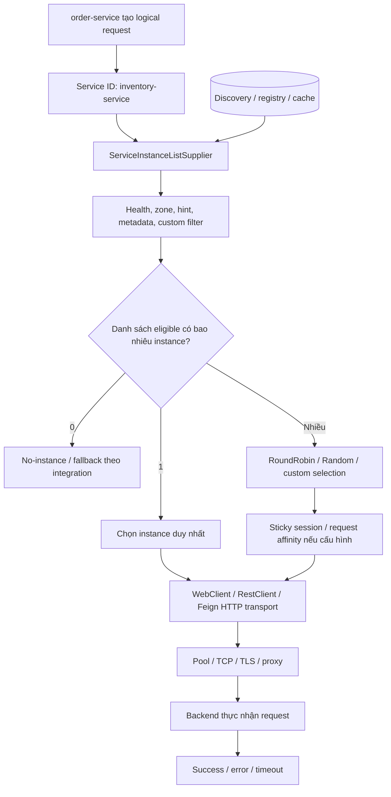
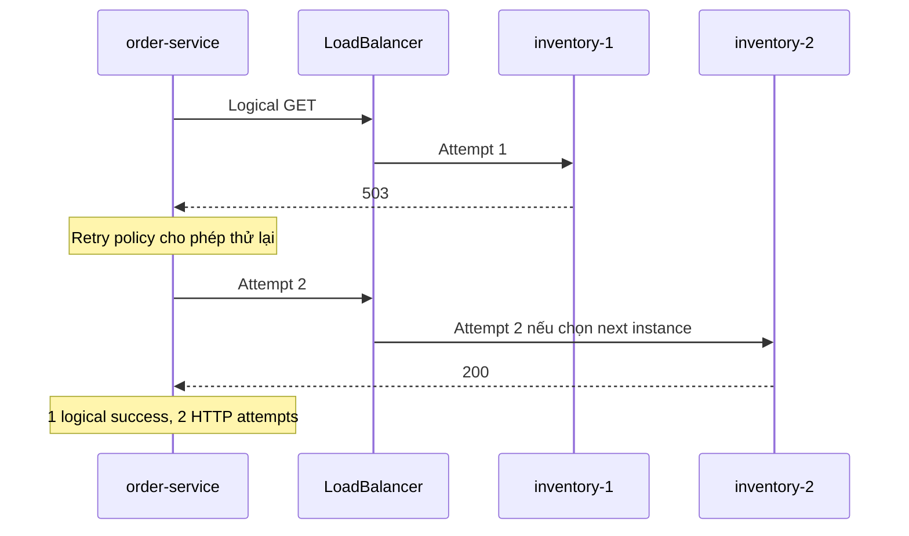
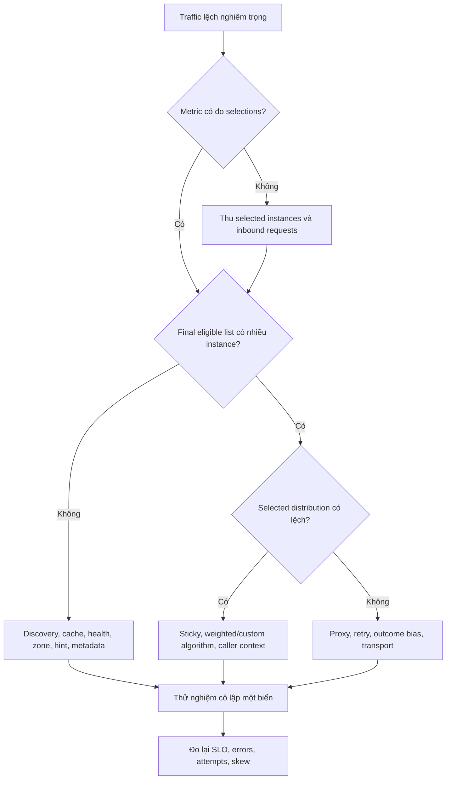

# Yêu cầu dồn vào một bản sao: kiểm tra cache, sticky và thuật toán

Trong một hệ thống sử dụng **Spring Cloud LoadBalancer**, `order-service` gọi `http://inventory-service/api/products/P-1001` và mong đợi các yêu cầu được chọn từ nhiều `ServiceInstance`. Thế nhưng dashboard cho thấy `inventory-1` nhận gần như toàn bộ lưu lượng, còn `inventory-2` và `inventory-3` rất ít hoặc không nhận request. Phản ứng phổ biến là đổi ngay thuật toán từ round robin sang random, xóa connection pool hoặc tăng số bản sao. Những thay đổi đó có thể không giúp gì nếu nguyên nhân thực là **danh sách instance bị cache chỉ còn một phần tử, health/zone filter loại mất các instance khác, sticky-session giữ client ở một đích, hoặc chỉ số đang đo sai tầng**.

Bài thuộc chương **Chẩn đoán sự cố** của module Spring Cloud LoadBalancer. Ta sẽ điều tra hiện tượng **nhiều request dồn vào một bản sao**, phân biệt giữa hành vi chủ ý và lỗi, xác minh chuỗi discovery → cache → supplier/filter → thuật toán → HTTP transport, đồng thời xây một lab có thể tái hiện và bảng quyết định xử lý dành cho `RestClient`, `WebClient` và `OpenFeign`.

**Nguyên tắc chính:** Đừng kết luận LoadBalancer đã chọn sai chỉ từ dashboard HTTP responses. Trước hết cần đo **mỗi caller nhìn thấy bao nhiêu instance, đã chọn instance nào, request thật sự tới backend nào, và có cơ chế affinity nào đứng giữa**.

## 1. “Dồn vào một bản sao” có thể mang nhiều ý nghĩa

| Hiện tượng quan sát | Có nhất thiết là lỗi LoadBalancer? | Cần phân biệt |
|---|---|---|
| 95% request count vào `inventory-1` | Chưa chắc. | Có thực sự chọn 1 nhiều, hay gateway/proxy định tuyến về 1 sau lựa chọn logic? |
| Request **đang xử lý đồng thời** tập trung ở `inventory-1` | Chưa chắc. | Instance 1 xử lý chậm, giữ connection lâu hơn dù số lần chọn gần đều. |
| Chỉ response **thành công** đến từ `inventory-1` | Chưa chắc. | Instance 2/3 có thể đã nhận request nhưng timeout hoặc trả lỗi. |
| Tất cả request của **một người dùng** tới một instance | Có thể chủ ý. | Cookie/session affinity, tenant/shard routing, request hash. |
| Mọi request của **một caller pod** tới một instance, caller khác bình thường | Có thể là lỗi cấu hình cục bộ. | Cache, child context, discovery/zone metadata hoặc sticky key khác nhau theo caller. |
| Một instance nhận nhiều requests hơn khi số mẫu nhỏ | Có thể là dao động bình thường. | Random selection không bảo đảm tỷ lệ chính xác cho vài lượt. |
| Một instance vẫn nhận request sau khi bị rút khỏi registry | Có thể liên quan dữ liệu stale. | Cache/discovery refresh, DNS/proxy hoặc requests đã in-flight. |

### Ba tỷ lệ không được đánh đồng

```text
Tỷ lệ được chọn    = selections(instance-i) / tổng selections
Tỷ lệ nhận request = inbound HTTP requests(instance-i) / tổng inbound requests
Tỷ lệ trả thành công = successful responses(instance-i) / tổng responses thành công
```

Khi retry, network errors, socket reuse, proxy, circuit breaker và timeout xuất hiện, ba tỷ lệ có thể rất khác nhau. Chẳng hạn `inventory-2` được chọn 50 lần nhưng 40 request timeout, còn `inventory-1` trả thành công toàn bộ 50 request: dashboard chỉ đếm thành công khiến `inventory-1` trông như đang nhận phần lớn lưu lượng.

**Dấu hiệu dồn tải thật cần có bằng chứng:** phân phối `selectedInstance` ở caller lệch đáng kể trong một cửa sổ đủ mẫu, **đồng thời** inbound request count của backend hoặc proxy tương ứng xác nhận sự lệch đó.

## 2. Hình dung đường đi trước khi tìm nguyên nhân



Sơ đồ là mô hình chẩn đoán. **Thứ tự cụ thể của các supplier, filter và xử lý sticky phụ thuộc cấu hình cùng Spring Cloud release train**; không coi các ô trong sơ đồ là một thứ tự cố định cho mọi dự án.

### Mỗi tầng có thể tạo hiệu ứng “chỉ một đích”

1. **Discovery:** registry chỉ trả một `ServiceInstance`, các instance còn lại chưa đăng ký/không sẵn sàng.
2. **Cache:** một danh sách cũ chỉ gồm một phần tử vẫn được sử dụng; hoặc nhiều lớp cache có TTL/refresh khác nhau.
3. **Supplier/filter:** health, zone, hint, metadata, subset hoặc custom routing loại các instance không đạt điều kiện.
4. **Selection:** thuật toán custom luôn chọn index 0, random bị seed/cách dùng sai, hoặc round robin có state không như mong đợi.
5. **Affinity:** cookie, header, tenant ID, sharding hoặc service mesh session persistence ưu tiên một đích cho nhóm requests.
6. **Transport/proxy:** lựa chọn logic khác nhau nhưng request thực đi qua cùng upstream proxy và bị proxy route về một instance.
7. **Measurement:** chỉ đếm response success hoặc một trace sample nên kết luận sai.

Không nhất thiết chỉ có một nguyên nhân. Ví dụ cache stale làm chỉ còn một instance; rồi caller tự retry ba attempts vào instance đó, dẫn tới tải tập trung nặng hơn.

## 3. Bước đầu tiên: xác minh số lượng bản sao ở từng tầng

Trước khi chỉnh thuật toán, lập bảng so sánh tại **cùng thời điểm**:

| Điểm quan sát | Câu hỏi | Dữ liệu cần lấy |
|---|---|---|
| Deployment/registry | Có bao nhiêu instance thực sự Ready/registered? | Pod/instance ID, address/port, readiness, registration timestamp. |
| Discovery client của **mỗi caller** | Caller A/B/C nhìn thấy bao nhiêu instances? | Danh sách host:port/service ID có quyền xem; version/timestamp. |
| `ServiceInstanceListSupplier` cuối cùng | Sau health/zone/custom filters còn những đích nào? | Số eligible, các đích bị loại và lý do loại. |
| LoadBalancer selector | Mỗi logical attempt chọn instance nào? | `serviceId`, `instanceId`, attempt, caller ID, timestamp. |
| Proxy/service mesh nếu có | Upstream endpoint nào thực nhận request? | Access logs, upstream host, route/cluster. |
| Backend | Instance nào nhận request và hoàn tất request? | Inbound request count, HTTP status, duration, correlation ID. |

### Cách diễn giải ba trường hợp căn bản

**Trường hợp A — Registry có ba, supplier chỉ còn một:** Vấn đề nằm **trước thuật toán lựa chọn**. Round robin không thể chia tải cho ba đích khi chỉ nhận một phần tử.

**Trường hợp B — Supplier có ba, selector luôn chọn một:** Điều tra policy, sticky/affinity, selector custom, request context, counter/child context và version.

**Trường hợp C — Selector có ba, backend chỉ thấy một:** Điều tra proxy/sidecar, URL override, HTTP client không dùng instance đã chọn, retry, metrics sai hoặc requests thất bại trước khi tới backend.

Lưu ý service discovery và Spring Cloud LoadBalancer là **client-side**; nếu dashboard về một ingress Kubernetes hoặc hardware load balancer, không nhất thiết nó quan sát cùng tầng với thuật toán LoadBalancer của Java caller.

## 4. Cache danh sách ServiceInstance: tác động và hiểu lầm thường gặp

Spring Cloud LoadBalancer có thể cache **danh sách `ServiceInstance`** được cung cấp cho một service ID. Cache làm giảm chi phí liên tục hỏi discovery, nhưng có thể khiến caller nhìn thấy topology **trễ hơn** registry khi instance được thêm/bớt.

### Cache danh sách không đồng nghĩa cache lựa chọn instance

Giả sử cache giữ:

```text
inventory-service -> [inventory-1, inventory-2, inventory-3]
```

Nếu selector round robin được sử dụng trên danh sách này và không có affinity/filter khác, **cache danh sách không tự khiến mọi request chọn inventory-1**. Nó chỉ giữ tập candidates; round robin vẫn có thể chọn các phần tử trong danh sách.

Nhưng nếu cache giữ:

```text
inventory-service -> [inventory-1]
```

thì dù selector là round robin hay random, nó **chỉ có một lựa chọn**. Đây là khác biệt quan trọng giữa “có bật cache” và “cache đang giữ sai/thiếu danh sách”.

### Những loại cache dễ bị nhầm

| Loại trạng thái/cache | Thuộc về đâu? | Khi stale thường gây gì? |
|---|---|---|
| **LoadBalancer instance-list cache** | `ServiceInstanceListSupplier`/LoadBalancer cache nếu cấu hình. | Caller tiếp tục dùng danh sách cũ, có thể thiếu instance vừa scale up hoặc chứa instance đã chết. |
| **DiscoveryClient/registry cache** | Client tích hợp Eureka/Consul/Kubernetes hoặc discovery provider. | Danh sách nguồn đã stale **trước khi** LB cache nhận nó. |
| **Health-check supplier state** | Kết quả probe hoặc danh sách eligible theo thời điểm. | Instance mới/khỏe bị loại tạm thời do probe lỗi hoặc chính sách refresh. |
| **DNS resolver cache** | JVM/HTTP connector/OS/DNS. | Một hostname động vẫn resolve IP cũ; không nhất thiết đồng nghĩa `ServiceInstance` bị cache. |
| **HTTP connection pool** | Reactor Netty/Apache HC5/OkHttp. | Có socket cũ/idle; **không phải bộ chọn ServiceInstance**. |
| **Proxy/mesh affinity/cache** | Envoy/ingress/load balancer hạ tầng. | Tất cả requests qua một upstream dù Java caller đã có nhiều lựa chọn. |

**Nguyên tắc:** Đừng “xóa mọi cache” khi chưa biết cache nào thực sự chứa sai dữ liệu. Tăng số request discovery hoặc DNS lookups vô hạn có thể làm registry/resolver quá tải mà vẫn không sửa cấu hình sticky.

### Cấu hình LoadBalancer cache để làm phép thử

Trong một số Spring Cloud release train, có các properties:

```yaml
spring:
  cloud:
    loadbalancer:
      cache:
        enabled: true
        ttl: 15s
        capacity: 256
```

Giá trị trên **chỉ minh họa cho lab**. Kiểm tra configuration metadata/tài liệu của phiên bản đang chạy vì cú pháp, đơn vị TTL và khả năng thực thi có thể thay đổi. Đừng đặt TTL cực ngắn trong production chỉ để sửa skew trước khi xác nhận đúng cache.

### Kiểm thử giả thuyết cache

1. Ghi lại tập instances thực của registry và **tập supplier cuối** ở caller trong cùng thời điểm.
2. Scale up/thêm một instance lab, chờ đồng bộ discovery rồi theo dõi thời điểm caller thấy nó.
3. Sau khi ghi baseline, **tạm tắt riêng LoadBalancer cache trong môi trường test** và thực hiện lại cùng phép đo.
4. Nếu danh sách mới xuất hiện ngay và distribution trở nên đều hơn, cache LB có thể là một phần nguyên nhân; nếu vẫn chỉ thấy một instance, kiểm tra lớp discovery/health/supplier ở trước.
5. Khôi phục cấu hình và điều chỉnh TTL/refresh dựa trên nhu cầu topology thực, không dùng tắt cache như một phương án chữa cháy mặc định.

**Một cache TTL hết hạn không bảo đảm ngay lập tức có danh sách mới:** còn registry propagation, discovery refresh, supplier filters và kết nối tới registry. Một số discovery client đã cache riêng; chồng nhiều cache có thể kéo dài độ stale.

## 5. Sticky session và request affinity: dồn tải có thể là có chủ đích

**Sticky** nghĩa là những requests có cùng một khóa được ưu tiên định tuyến tới cùng một đích trong một khoảng thời gian. Khóa có thể là cookie, session ID, tenant, user, order/shard key hoặc custom header.

### Những dạng affinity cần nhận diện

| Cơ chế | Dấu hiệu | Điều cần kiểm chứng |
|---|---|---|
| **Cookie-based sticky session** | Nhiều lượt của cùng client/browser luôn tới một instance. | Tên/cấu trúc cookie, thời hạn, path/domain và nơi cookie được phát ra. |
| **Header/request affinity** | Requests cùng tenant/user/request key luôn tới một instance. | Filter/custom supplier/route policy đọc header nào? |
| **Hash/shard routing** | Tập key nhỏ phân bố không đều giữa instances. | Hàm hash, số partitions, mapping key→instance, hot keys. |
| **Gateway/ingress session affinity** | Java caller chọn một đích logic nhưng proxy vẫn giữ upstream. | Cookie/header/route config tại gateway/mesh, không chỉ Spring config. |
| **Connection-level persistence** | Một connection dài sống giữ các lượt tới một backend phía proxy. | Proxy upstream selection, HTTP/2 stream routing, connection reuse. |

Spring Cloud LoadBalancer có khả năng hỗ trợ sticky-session qua supplier/request context trong những phiên bản/tích hợp phù hợp. **Không mặc định sticky được bật**, không mặc định mọi HTTP client truyền cookie, và không suy vị trí cookie trong request/response nếu chưa xác minh class/filter thực tế.

### Tình huống một user test duy nhất

Nếu bạn dùng một phiên trình duyệt hoặc k6 giữ cùng cookie jar, mọi request có thể mang **cùng affinity key**. 100 requests từ một người dùng tới cùng instance có thể **đúng yêu cầu sticky**, nhưng không chứng minh cân bằng tải bị hỏng cho 100 người dùng độc lập.

Thí nghiệm đúng gồm hai phép thử:

1. **Giữ nguyên cookie/affinity key** và gửi nhiều requests: đo tỷ lệ chọn đích cho *một session*.
2. **Đổi cookie/affinity key theo nhiều sessions độc lập**: đo phân phối cho *nhiều sessions*.

Nếu (1) dính một instance nhưng (2) phân bố đều, khả năng cao đây là affinity hoạt động đúng. Nếu mọi keys khác nhau vẫn chọn instance 1, tiếp tục kiểm tra danh sách eligible, custom hash và proxy/selector.

### Không xóa sticky trên production khi chưa hiểu ngữ nghĩa

Hệ thống có thể giữ session state trong bộ nhớ instance hoặc áp dụng routing theo tenant/shard. Tắt sticky đột ngột có thể làm mất session, lệch dữ liệu hoặc khiến requests vào instance không có partition phù hợp. Phương án bền vững là thiết kế state chung hoặc routing hợp đồng rõ ràng, có kế hoạch migration và thử nghiệm.

## 6. RoundRobin, Random và custom selector: câu hỏi thật cần hỏi

### RoundRobin

`RoundRobinLoadBalancer` thường chọn tuần tự trên danh sách instances hiện tại. Nhưng các yếu tố sau khiến phân phối ở dashboard **không nhìn như A-B-C-A-B-C**:

- Từng caller process có state/counter riêng; khi có nhiều caller pods, các chuỗi lựa chọn không nhất thiết đồng bộ.
- LoadBalancer có thể tạo context riêng theo service ID, và client khác nhau không chắc dùng chung bộ đếm trong mọi cấu hình.
- Danh sách instance thay đổi, lọc theo request hoặc được sắp xếp lại.
- Requests chạy đồng thời, hoàn tất khác thứ tự đã được chọn.
- Retry tạo thêm attempts và response thất bại làm thành công bị lệch.
- Sticky/hint/zone/metadata/custom supplier có thể giới hạn candidates theo request.

**Kết luận:** Round robin không hứa rằng 6 requests quan sát ở *thứ tự hoàn tất* sẽ luôn là A-B-C-A-B-C. Muốn test thuật toán, kiểm tra **thứ tự selection thật trong một context xác định**, không dựa trên thứ tự log response từ các server có latency khác nhau.

### Random

Random selection **không bảo đảm** 10 requests chia gần như 3-3-4 trên ba instances. Với số mẫu nhỏ, việc một instance nhận phần lớn có thể là dao động xác suất. Với mẫu lớn và candidates đồng nhất, tỷ lệ kỳ vọng có thể gần nhau hơn; song vẫn phải xét sticky, supplier filters và traffic mix.

### Custom selection/weighted routing

Một thuật toán custom có thể cố ý chọn instance dựa trên trọng số, zone, version, locality, tenant, sharding hoặc ít active requests. Nếu một instance có weight lớn, **request count lệch không nhất thiết là bug**.

Trường hợp dễ mắc lỗi:

```java
// Sai về logic: chọn phần tử đầu cho mọi request.
ServiceInstance chosen = instances.get(0);
```

Hoặc:

```java
// Sai nếu danh sách thay đổi mà index không được xử lý an toàn.
int index = cachedIndex; // giả sử luôn là index 0
ServiceInstance chosen = instances.get(index);
```

Hai snippet là phản ví dụ, **không phải cách hiện thực LoadBalancer**. Với custom code, kiểm tra bounds, state concurrency, event-loop blocking, điều kiện fallback, metadata và cách thay đổi instance list theo thời gian.

### Bài test quyết định

Nếu supplier trả **cố định ba instances khỏe**, mọi sticky/affinity được tắt trong lab, không có proxy và code chỉ thực hiện các requests đồng bộ tuần tự, round robin thông thường sẽ có khả năng chọn qua cả ba đích. Nếu vẫn chỉ chọn một, lúc này mới cần điều tra **bean algorithm cuối cùng** và custom code.

## 7. Health check, zone và metadata: vì sao registry có ba mà eligible chỉ có một?

Một trong những nguyên nhân có xác suất cao khi lưu lượng tập trung là **các `ServiceInstanceListSupplier` lọc dữ liệu trước khi thuật toán được chạy**.

### Health filtering

Ví dụ registry có:

```text
inventory-1: UP, readiness = UP
inventory-2: UP, nhưng /actuator/health/readiness trả 401
inventory-3: UP, nhưng health probe timeout
```

Nếu supplier health check loại các instance không qua probe, danh sách eligible có thể chỉ còn `inventory-1`, dù dashboard registry nhìn thấy ba bản sao **đã đăng ký**.

Các lỗi health phổ biến:

- Probe gọi sai path, sai port hoặc sai scheme HTTP/HTTPS.
- Health endpoint yêu cầu OAuth2/mTLS nhưng probe không có credential.
- TLS certificate/SAN không hợp lệ hoặc truststore phía probe thiếu CA.
- Health timeout quá ngắn so với startup/cold instance.
- Readiness phản ánh dependency sâu như DB/Redis không khả dụng, nên pod đăng ký nhưng chưa được coi là có thể phục vụ.
- Custom health-check supplier làm mới danh sách không đúng cadence.

**Không suy chỉ từ registry status:** xác minh **response code và latency của health probe theo đúng client/network path**, sau đó mới kiểm tra supplier final list. Trường hợp hết healthy instances, cách fallback về danh sách gốc hoặc danh sách rỗng có thể phụ thuộc phiên bản/cấu hình; không mặc định Spring Cloud LoadBalancer luôn chọn một cách duy nhất.

### Zone/locality preference

Ví dụ:

```text
Caller order-1 ở zone=az-a
  inventory-1 metadata zone=az-a
  inventory-2 metadata zone=az-b
  inventory-3 metadata zone=az-b
```

Một policy ưu tiên local zone có thể đẩy hầu hết lưu lượng của `order-1` vào `inventory-1`. Đây có thể là **hành vi chủ đích để giảm network latency/chi phí cross-zone**. Cần kiểm tra:

1. Zone được lấy từ đâu: caller environment, discovery metadata, Kubernetes labels hay custom config?
2. Thuật toán dùng **hard filtering** hay chỉ **preference/fallback**?
3. Khi instance local quá tải, có được phép chuyển sang zone khác không?
4. Tỷ lệ phân phối có khác giữa callers ở hai zones không?

Không tắt locality ngay chỉ để đạt tỷ lệ 33/33/33 toàn cụm; cần đánh giá SLA, cross-zone traffic và failure domain.

### Hint, version, tenant và canary

Một request có hint `version=stable` có thể loại canary instances khỏi candidates. Tương tự, các supplier tùy biến có thể lọc theo metadata `tenant=gold`, `region=vn-south`, `protocol=https` hoặc API compatibility.

| Registry | Request context/filter | Eligible thực |
|---|---|---|
| A(stable), B(canary), C(stable) | Chỉ stable | A, C |
| A(zone-a), B(zone-b), C(zone-b) | Bắt buộc local zone-a | A |
| A(tenant-x), B(tenant-y), C(tenant-y) | Tenant-x | A |
| A(healthy), B(unhealthy), C(unhealthy) | Health filter | Có thể chỉ A, theo policy |

Đây là các **tình huống minh họa**, không phải mặc định mọi supplier dùng hard filtering cho zone/tenant. Mỗi cấu hình cần xem provider/filter thực tế.

## 8. Thứ tự chuỗi supplier quyết định dữ liệu mà selector thấy

Spring Cloud LoadBalancer có thể xâu chuỗi `ServiceInstanceListSupplier` để lấy danh sách từ discovery rồi áp cache, health check, zone preference, hint/sticky/custom filter. Với chain tùy biến, **vị trí cache so với filter** có thể thay đổi dữ liệu được lưu và ngữ nghĩa invalidation.

### Hai giả thuyết khác nhau

```text
Giả thuyết 1:
Discovery -> Cache(all 3) -> Filter(request-specific) -> [1 eligible]

Giả thuyết 2:
Discovery -> Filter(one eligible) -> Cache(filtered list) -> [1 cached]
```

Ở giả thuyết 1, cache có thể đúng ba instances, nhưng filter yêu cầu chỉ một. Ở giả thuyết 2, cache có thể lưu danh sách đã lọc và tiếp tục dùng kết quả không phù hợp nếu ngữ nghĩa cache key/request context bị thiết kế sai.

Không coi hai chuỗi trên là source code cấu hình chuẩn; đó là **mô hình phân tích**. Trong implementation thực:

- Đọc thứ tự beans/suppliers được cấu hình trong application context.
- Xem supplier nào phụ thuộc request context và supplier nào chỉ phụ thuộc service ID.
- Xác minh cache key có phản ánh các thuộc tính request cần thiết **nếu** bạn tự viết cache/supplier theo tenant/hint.
- Đảm bảo các supplier không block event-loop bằng HTTP health calls đồng bộ ngoài dự kiến.
- Khi custom chain, theo hướng dẫn của release train để tránh cache lồng nhau hoặc filter đặt sai tầng.

**Rủi ro bảo mật:** Không dùng metadata/cookie/tenant ID do người dùng tự cung cấp để lựa chọn instance có quyền riêng nếu server chưa xác thực và kiểm tra quyền. Routing theo tenant chỉ đúng khi identity/tenant context đáng tin cậy.

## 9. Retry có thể làm dồn traffic sau lỗi

Retry là một nguồn khiến phân phối **HTTP attempts** khác phân phối **logical operations**.



**Hai trường hợp thường gây nhầm:**

1. **Retry cùng instance:** `inventory-1` bị lỗi nhưng vẫn nhận nhiều attempts từ một logical call. Request counter tại `inventory-1` tăng mạnh, trong khi caller tưởng chỉ có một operation.
2. **Retry sang instance khác:** instance yếu nhận attempt đầu thất bại, instance khỏe nhận attempt sau thành công. Dashboard chỉ nhìn responses thành công có thể nghiêng mạnh về instance khỏe.

Khi debug, tạm **tắt các tầng retry có chủ đích trong lab** (Spring Cloud LoadBalancer, Spring Retry, Reactor `retryWhen`, Feign `Retryer`/business policy) để quan sát selection gốc. Không tắt retry production thiếu kế hoạch rollback.

Một số property của Spring Cloud LoadBalancer retry có thể có dạng:

```yaml
spring:
  cloud:
    loadbalancer:
      retry:
        enabled: false
```

Hiệu lực property phụ thuộc dependency, phiên bản và tích hợp blocking/reactive đang hoạt động. Ngoài ra HTTP transport/proxy có thể tự phục hồi/điều phối lại requests. Vì vậy **đếm HTTP attempts thực ở backend** vẫn là nguồn kiểm chứng quan trọng.

### Đừng quên idempotency và deadline

Với GET đọc thông thường, retry có giới hạn có thể hợp lý. Với POST ghi dữ liệu, timeout phía caller **không bảo đảm** backend chưa thực hiện side effect. Khi retry để “cân lại tải”, cần idempotency key/operation ID và deduplication tại server nếu thao tác có thể được phát lại.

Nếu instance 1 chậm kéo dài khiến retries đổ sang instance 2, cả hai có thể trở nên bão hòa. Kết hợp attempt budget, backoff có jitter, overall deadline, circuit breaker/bulkhead phù hợp; không sửa skew bằng cách tăng số retries không giới hạn.

## 10. Connection pool, keep-alive và proxy: hiểu đúng chức năng

Một giải thích phổ biến nhưng thiếu chính xác là: “HTTP client dùng connection pool nên luôn gọi một instance.” Trong Spring Cloud LoadBalancer client-side **khi mỗi request được thực thi qua LoadBalancer**, pool thông thường **không quyết định instance thay cho selector**. Client chọn đích logic/remote rồi HTTP transport mới cấp/reuse socket phù hợp.

Tuy nhiên, nhiều tình huống đặc biệt có thể tạo hiệu ứng tập trung:

| Tình huống | Pool có thật sự gây sticky? | Hướng kiểm chứng |
|---|---|---|
| WebClient Reactor Netty chọn A/B/C, pool theo từng remote | Thông thường **không**: pool reuse socket của remote đã chọn. | So selected instance vs remote address trong client metrics. |
| Java client kết nối **một proxy chung** thay vì backend trực tiếp | Proxy có thể giữ upstream theo connection/session. | Xem proxy upstream access log, route/cluster. |
| Ingress/mesh có `sessionAffinity` hoặc sticky cookie | Có thể có affinity **ở tầng proxy**, độc lập Spring algorithm. | Test có/không cookie, kiểm tra mesh/ingress config. |
| HTTP/2 multiplex qua cùng TCP socket đến reverse proxy | Nhiều streams cùng connection proxy, nhưng upstream routing tùy proxy. | Xem HTTP/2 streams và backend routing tại proxy. |
| Một client gọi URL cố định hoặc Feign có `url` override | Không qua selection theo service ID như kỳ vọng. | Kiểm tra effective URL và bean/delegate. |

Đặc biệt với Kubernetes:

- Nếu Java caller dùng Service DNS/IP của Kubernetes và không đi qua Java LoadBalancer cho lời gọi đó, phân phối có thể do kube-proxy/mesh/ingress đảm nhiệm.
- Nếu `SimpleDiscoveryClient`/Kubernetes DiscoveryClient cung cấp **pod IPs riêng**, Java LoadBalancer có thể chọn pod cụ thể.
- Nếu discovery chỉ cung cấp **một Kubernetes Service ClusterIP**, Java selector có thể thấy một entry, còn kube-proxy/mesh làm phân phối phía dưới. Khi đó một entry ở Java không chứng minh traffic dồn vào đúng một pod.

Muốn kết luận chính xác, kiểm tra **remote TCP destination**, proxy upstream destination và request thực ở từng backend.

## 11. Cách quan sát không gây nhiễu lớn cho production

Một dashboard chẩn đoán cần nhìn cả **selection** và **outcome**. Nên lấy tín hiệu từ bốn lớp:

| Lớp | Metric/log nên có | Ý nghĩa |
|---|---|---|
| Caller / logical request | Operation count, success/error, retry count, p95/p99. | Người dùng/caller thực sự trải nghiệm gì? |
| Discovery / supplier | Số candidates trước/sau filter, list age, empty-list count, refresh error. | Thuật toán được trao bao nhiêu đích hợp lệ? |
| LoadBalancer selection | `serviceId`, `selectedInstance`, request/attempt ID, caller identity. | Selector thực sự chọn đích nào? |
| HTTP/proxy/backend | Actual remote IP:port, inbound requests, status, latency, pool active/pending. | Lựa chọn logic có biến thành HTTP request đến backend không? |

Ví dụ log cấu trúc **minh họa**:

```text
traceId=tr-202
caller=order-2
serviceId=inventory-service
eligibleCount=3
selectionPolicy=roundRobin
selectedInstance=inventory-3
attempt=1
httpRemote=10.22.1.13:8080
outcome=HTTP_200
```

Các field này không tự xuất hiện đầy đủ chỉ vì bật Spring Cloud LoadBalancer. Có thể cần custom observation, interceptor/filter, event listener hoặc instrumentation đặc thù. Khi ghi metrics, hạn chế cardinality của `instanceId` (nhất là pod IDs thay đổi liên tục), tránh dùng raw user ID/session ID, bearer token hay URL có PII làm label.

### Metric nào không đủ nếu đứng một mình?

- `http.server.requests` ở backend chỉ đếm request backend **đã thấy**; không bao gồm attempts bị pool-acquire timeout ở caller.
- `http.client.requests` có thể đo logical call hoặc attempt tùy tầng instrumentation; cần biết meter semantics.
- `reactor.netty.connection.provider.active.connections` là số connections active theo pool, **không bằng số request đã chọn**.
- Một status `200` không nói instance nào được selector chọn nếu proxy đã thực hiện thêm một bước routing.
- Tracing sample rate thấp có thể bỏ sót phần lớn failures, khiến phân phối trên trace khác thực tế.

### Kết hợp ba ID

Dùng **trace/correlation ID** cho logical operation, **attempt index** cho retry và **instance ID/remote endpoint** cho đích được chọn. Nhờ vậy có thể đối chiếu:

```text
logical operation #42
  attempt 1: selected inventory-2, HTTP timeout
  attempt 2: selected inventory-1, HTTP 200
  final business outcome: SUCCESS
```

Không dựa vào **response completion order** để suy thứ tự selection; instance chậm thường trả sau và có thể làm log bị đảo thứ tự.

## 12. Dựng lab với ba bản sao inventory-service

Để tái hiện và kiểm tra các giả thuyết mà không phụ thuộc registry hoặc hạ tầng production, ta dựng:

```text
                       ┌── inventory-1 localhost:8081
test client → order-service localhost:8080
                 │     ├── inventory-2 localhost:8082
                 └─ LB └── inventory-3 localhost:8083
```

Mỗi inventory instance trả JSON chứa `instance` và `requestId`. `order-service` dùng `@LoadBalanced WebClient.Builder` gọi `http://inventory-service`. Trong lab baseline, **không bật sticky, retry, proxy hoặc health filtering tùy biến** để tránh nhiều yếu tố cùng tác động.

### Chuẩn bị

- Java 17+, Maven và một cặp Spring Boot/Spring Cloud tương thích. Khi sử dụng Spring Framework 6.1+ và Spring Cloud LoadBalancer, hãy chọn release train đúng theo compatibility matrix của dự án; không dùng ngẫu nhiên các phiên bản mới/cũ.
- Project `inventory-service`: `spring-boot-starter-webflux` và (tùy chọn) `spring-boot-starter-actuator`.
- Project `order-service`: `spring-boot-starter-webflux`, `spring-cloud-starter-loadbalancer` và (tùy chọn) `spring-boot-starter-actuator`.
- Các project cần dependency management Spring Boot/Cloud phù hợp và chạy trên các port tách biệt.
- Công cụ `curl`/Postman hoặc `k6` để gửi requests; có quyền đọc logs/metrics của ba instances.

Một cấu trúc thư mục của **người học**, không phải file được tạo tự động bởi bài:

```text
lb-skew-lab/
├── inventory-service/
│   ├── pom.xml
│   └── src/main/...
├── order-service/
│   ├── pom.xml
│   └── src/main/...
└── route-test.js
```

### Backend: mỗi bản sao tự nhận diện mình

File cấu hình `inventory-service/src/main/resources/application.yml`:

```yaml
spring:
  application:
    name: inventory-service
server:
  port: ${SERVER_PORT:8081}
lab:
  instance-id: ${LAB_INSTANCE_ID:inventory-1}
  response-delay-ms: ${LAB_RESPONSE_DELAY_MS:0}
management:
  endpoints:
    web:
      exposure:
        include: health,info,metrics
```

Ví dụ Java trong project inventory:

```java
package lab.inventory;

import java.time.Duration;
import java.util.concurrent.atomic.AtomicLong;
import org.springframework.beans.factory.annotation.Value;
import org.springframework.boot.SpringApplication;
import org.springframework.boot.autoconfigure.SpringBootApplication;
import org.springframework.web.bind.annotation.GetMapping;
import org.springframework.web.bind.annotation.RequestHeader;
import org.springframework.web.bind.annotation.RestController;
import reactor.core.publisher.Mono;

@SpringBootApplication
public class InventoryApplication {
    public static void main(String[] args) {
        SpringApplication.run(InventoryApplication.class, args);
    }
}

@RestController
class InventoryDebugController {
    private final String instanceId;
    private final long delayMs;
    private final AtomicLong inbound = new AtomicLong();

    InventoryDebugController(
            @Value("${lab.instance-id}") String instanceId,
            @Value("${lab.response-delay-ms:0}") long delayMs) {
        this.instanceId = instanceId;
        this.delayMs = Math.max(0, Math.min(delayMs, 5000));
    }

    @GetMapping("/debug/instance")
    Mono<InstanceReply> instance(
            @RequestHeader(value = "X-Debug-Request-Id",
                           defaultValue = "manual") String requestId) {
        long count = inbound.incrementAndGet();
        return Mono.delay(Duration.ofMillis(delayMs))
                .map(x -> new InstanceReply(instanceId, requestId, count));
    }

    @GetMapping("/debug/count")
    InstanceCount count() {
        return new InstanceCount(instanceId, inbound.get());
    }
}

record InstanceReply(String instance, String requestId, long receivedCount) {}
record InstanceCount(String instance, long received) {}
```

**Vì sao tăng counter ở đầu handler?** Nếu response chậm rồi caller timeout, counter vẫn có thể cho biết handler đã được gọi. Counter này **không** đếm TCP attempts chưa vào HTTP handler hoặc request bị chặn tại proxy. Nó cũng không phải metrics production; dự án thật dùng instrumentation có kiểm soát cardinality.

### Khởi động ba backend độc lập

Ví dụ trên PowerShell, dùng ba terminals:

```powershell
# Terminal A: inventory-service/
$env:SERVER_PORT = "8081"
$env:LAB_INSTANCE_ID = "inventory-1"
$env:LAB_RESPONSE_DELAY_MS = "0"
mvn spring-boot:run
```

```powershell
# Terminal B: inventory-service/
$env:SERVER_PORT = "8082"
$env:LAB_INSTANCE_ID = "inventory-2"
$env:LAB_RESPONSE_DELAY_MS = "0"
mvn spring-boot:run
```

```powershell
# Terminal C: inventory-service/
$env:SERVER_PORT = "8083"
$env:LAB_INSTANCE_ID = "inventory-3"
$env:LAB_RESPONSE_DELAY_MS = "0"
mvn spring-boot:run
```

Trên macOS/Linux dùng cú pháp biến môi trường tương ứng. Nếu dùng Docker, không cấu hình `localhost:8081` trong một container để trỏ sang container khác; dùng hostnames/ports reachable của mạng container.

Test trực tiếp từng backend:

```bash
curl "http://localhost:8081/debug/instance"
curl "http://localhost:8082/debug/instance"
curl "http://localhost:8083/debug/instance"
```

Xác minh mỗi JSON trả `instance` khác nhau và endpoint `/debug/count` tương ứng tăng. Nếu cả ba cùng trả `inventory-1`, bạn đã clone process/config sai; **không thể sử dụng các response đó để kết luận LoadBalancer dồn lưu lượng**.

## 13. Caller WebClient qua service ID: baseline có thể tái hiện

File `order-service/src/main/resources/application.yml`:

```yaml
spring:
  application:
    name: order-service
  cloud:
    discovery:
      client:
        simple:
          instances:
            inventory-service:
              - uri: http://localhost:8081
              - uri: http://localhost:8082
              - uri: http://localhost:8083
    loadbalancer:
      retry:
        enabled: false
      cache:
        enabled: false

server:
  port: 8080
management:
  endpoints:
    web:
      exposure:
        include: health,info,metrics
```

Tắt LoadBalancer cache ở đây là **một lựa chọn giảm biến số trong lab**, không phải khuyến nghị production. Không dùng cấu hình này để suy rằng startup/discovery của một registry thật luôn cho ra ba instances ngay lập tức.

Mã Java của project caller:

```java
package lab.order;

import org.springframework.boot.SpringApplication;
import org.springframework.boot.autoconfigure.SpringBootApplication;
import org.springframework.cloud.client.loadbalancer.LoadBalanced;
import org.springframework.context.annotation.Bean;
import org.springframework.context.annotation.Configuration;
import org.springframework.stereotype.Service;
import org.springframework.web.bind.annotation.GetMapping;
import org.springframework.web.bind.annotation.RequestHeader;
import org.springframework.web.bind.annotation.RestController;
import org.springframework.web.reactive.function.client.WebClient;
import reactor.core.publisher.Mono;

@SpringBootApplication
public class OrderApplication {
    public static void main(String[] args) {
        SpringApplication.run(OrderApplication.class, args);
    }
}

@Configuration(proxyBeanMethods = false)
class HttpClientConfiguration {
    @Bean
    @LoadBalanced
    WebClient.Builder inventoryLoadBalancedBuilder() {
        return WebClient.builder();
    }
}

@Service
class InventoryGateway {
    private final WebClient client;

    InventoryGateway(@LoadBalanced WebClient.Builder builder) {
        this.client = builder
                .baseUrl("http://inventory-service")
                .build();
    }

    Mono<InstanceReply> whichInstance(String requestId) {
        return client.get()
                .uri("/debug/instance")
                .header("X-Debug-Request-Id", requestId)
                .retrieve()
                .bodyToMono(InstanceReply.class);
    }
}

@RestController
class RouteController {
    private final InventoryGateway gateway;

    RouteController(InventoryGateway gateway) {
        this.gateway = gateway;
    }

    @GetMapping("/debug/route")
    Mono<InstanceReply> route(
            @RequestHeader(value = "X-Debug-Request-Id",
                           defaultValue = "manual") String requestId) {
        return gateway.whichInstance(requestId);
    }
}

record InstanceReply(String instance, String requestId, long receivedCount) {}
```

Đây là **code minh họa riêng cho lab**: `WebClient.builder()` không nhất thiết giữ tất cả Spring Boot customizations (observation, SSL, custom codec). Khi áp vào ứng dụng thật, kiểm tra builder/HTTP connector được Boot quản lý và các beans child context `LoadBalancerClientFactory` nếu có customizations.

Start `order-service` ở port 8080, gọi:

```bash
curl -H "X-Debug-Request-Id: demo-1" \
  "http://localhost:8080/debug/route"
```

Gọi liên tục nhiều lượt để thấy response `instance` thay đổi. Nếu chỉ gọi một lần, không thể nhận định distribution. **Không thay baseUrl thành `localhost:8081`** khi debug: cách đó bypass Spring Cloud LoadBalancer và che mất vấn đề chính.

### Đặt giả thuyết rõ ràng

Với ba backends khỏe, danh sách tĩnh ba URIs, không có sticky/retry/custom algorithm và các requests tuần tự, mặc định round robin thường chọn qua cả ba endpoints. Nếu không thấy điều đó:

1. Kiểm tra `@LoadBalanced WebClient.Builder` có đúng bean được inject không.
2. Kiểm tra classpath có Spring Cloud LoadBalancer starter và WebClient integration.
3. Kiểm tra cả ba URIs reachable từ **process caller**.
4. Xác minh không có URL override, proxy hoặc cấu hình supplier/filter tùy biến.
5. Xem exception/status của các requests không trả `200` và inbound counters.

**Đừng vội đổi random:** Nếu list còn một hoặc code đang gọi URL cố định, random cũng không tạo phân phối.

## 14. Đo phân phối bằng công cụ thử tải và counter tại backend

Tạo `route-test.js` trong thư mục lab của người học:

```javascript
import http from 'k6/http';
import { check } from 'k6';
import { Counter } from 'k6/metrics';

const selected = new Counter('lab_success_by_instance');
const failed = new Counter('lab_failed');

export const options = {
  scenarios: {
    concurrent_requests: {
      executor: 'constant-vus',
      vus: Number(__ENV.VUS || 10),
      duration: __ENV.DURATION || '30s',
    },
  },
};

export default function () {
  const id = 'lab-' + __VU + '-' + __ITER;
  const url = (__ENV.BASE_URL || 'http://localhost:8080')
      + '/debug/route';

  const response = http.get(url, {
    timeout: '5s',
    headers: { 'X-Debug-Request-Id': id },
  });

  if (response.status === 200) {
    const body = response.json();
    const ok = check(body, {
      'instance and id match': x =>
        ['inventory-1', 'inventory-2', 'inventory-3'].includes(x.instance)
        && x.requestId === id,
    });
    if (ok) selected.add(1, { instance: body.instance });
  } else {
    failed.add(1, { status: String(response.status) });
  }
}
```

Chạy thử:

```bash
k6 run -e VUS=10 -e DURATION=30s route-test.js
```

Lưu ý:

- `lab_success_by_instance` đếm **response thành công**, **không đếm lựa chọn LB** trong các lần lỗi.
- `constant-vus` là workload theo concurrency, không phải arrival rate cố định. Nếu backend chậm đi, tốc độ requests có thể giảm theo.
- k6 đang gọi một `order-service` duy nhất. Production có nhiều caller replicas; phải kiểm tra theo từng caller và toàn cụm.
- Trong lab, có thể xem counter inbound tại ba backend:

```bash
curl "http://localhost:8081/debug/count"
curl "http://localhost:8082/debug/count"
curl "http://localhost:8083/debug/count"
```

Đọc giá trị counter **trước và sau** mỗi phép thử, tính delta, không lấy trị tuyệt đối vì đã có requests warm-up/kiểm tra trước đó. Nếu k6 kết thúc với nhiều errors, chỉ số successful responses có thể khác chênh lệch inbound counters.

### Một mẫu bảng kết quả, để trống chờ đo

| Phép thử | Instance 1 inbound delta | Instance 2 inbound delta | Instance 3 inbound delta | Success count | Error count | Nhận xét |
|---|---:|---:|---:|---:|---:|---|
| Baseline, 1 caller, 3 đích | Đo | Đo | Đo | Đo | Đo | Đánh giá phân phối |
| Chỉ 1 URI trong supplier | Đo | Đo | Đo | Đo | Đo | Kiểm chứng list-size |
| Sticky 1 session (khi bật đúng policy) | Đo | Đo | Đo | Đo | Đo | Kiểm chứng affinity |
| Nhiều session keys | Đo | Đo | Đo | Đo | Đo | Kiểm chứng hash/bias |
| Backend 2 chậm | Đo | Đo | Đo | Đo | Đo | So inbound với success |

Các số liệu phải do người học tự đo; không tự điền benchmark giả hoặc coi phân phối bằng tuyệt đối là điều bắt buộc dưới tải concurrent.

## 15. Kịch bản tái hiện chỉ một instance trong supplier

Khi nghi vấn dữ liệu discovery/cache, trước hết tạo một tình huống **đúng là chỉ có một candidate**, để thấy mọi thuật toán đều chịu cùng giới hạn.

### Bước thực hành

1. Dừng `order-service` trong lab.
2. Sửa **duy nhất** danh sách trong `order-service/application.yml` còn `inventory-1`:

```yaml
spring:
  cloud:
    discovery:
      client:
        simple:
          instances:
            inventory-service:
              - uri: http://localhost:8081
```

3. Khởi động lại caller; giữ cả ba backend đang chạy.
4. Gửi nhiều requests qua `http://localhost:8080/debug/route`, xem `instance` và inbound counters.
5. Khôi phục đủ ba URIs rồi khởi động lại caller và đo baseline.

**Dự đoán có căn cứ:** Khi supplier chỉ chứa một `ServiceInstance`, round robin/random không thể chọn các backend khác dù chúng đang nghe ở 8082/8083. Đây là biểu hiện **candidate set bị thu hẹp**, chưa phải lỗi của selector.

### Không gọi phép thử này là “cache stale”

`SimpleDiscoveryClient` đang đọc **cấu hình tĩnh**. Nếu sửa file YAML trên đĩa nhưng không refresh/restart application context, đừng kỳ vọng danh sách instance tự cập nhật. “Không thấy URI mới” ở đây là **hành vi của cấu hình tĩnh**, không đủ chứng minh cache Spring Cloud LoadBalancer bị lỗi.

Muốn kiểm tra stale cache đúng nghĩa:

- Dùng một discovery provider thật trong test, hoặc một `ServiceInstanceListSupplier`/mock discovery có **dữ liệu nguồn thay đổi trong lúc caller vẫn chạy**.
- Ghi thời điểm nguồn có đủ ba instances, thời điểm supplier phía caller bắt đầu trả ba và thời điểm cache làm mới.
- Thử có/không có LoadBalancer cache **trong một môi trường được cô lập**, giữ nguyên chính sách health/filter/selector.
- Nếu tắt cache mà danh sách cuối vẫn chỉ có một, kiểm tra discovery provider/health filtering thay vì tiếp tục giảm TTL.

## 16. Kịch bản sticky session và hot key

Lab ở phần 13 **không bật sticky**. Do đó chỉ thêm `Cookie: session=abc` hoặc `X-Tenant: A` **không tự kích hoạt sticky trong Spring Cloud LoadBalancer**.

Để kiểm thử, cần một cấu hình sticky thật (supplier/filter hỗ trợ theo phiên bản hoặc proxy/ingress có session affinity) và biết rõ khóa được dùng.

### Ma trận phân biệt sticky với selector lỗi

| Case | Dữ liệu request | Kết quả có thể phù hợp với sticky | Khi nào nghi lỗi? |
|---|---|---|---|
| S1 | 100 lượt cùng một cookie | Có thể cùng một instance. | Cookie được cho là không ảnh hưởng nhưng thực tế luôn chọn một do config ngoài dự kiến. |
| S2 | 100 sessions/cookies khác nhau | Nên quan sát nhiều đích **nếu chính sách có hash/phân phối nhiều buckets**. | Mọi key khác nhau vẫn cùng một đích dù final list có nhiều và policy không yêu cầu vậy. |
| S3 | Xóa cookie/đổi session ID | Có thể đổi instance. | Không đổi và luôn rơi vào một, cần kiểm tra route key khác hoặc proxy affinity. |
| S4 | Hai caller pods, cùng session | Phụ thuộc shared hashing/state và policy. | Các caller dùng config khác nhau không mong đợi, phải kiểm tra child contexts. |
| S5 | Một tenant chiếm 90% RPS | Có thể một shard/instance nóng. | Cân bằng request count toàn hệ thống không đồng nghĩa cân bằng tenant weights. |

Không đặt kỳ vọng “100 session IDs nhất định phải chia đều 33/33/34” nếu policy hash có số lượng keys nhỏ hoặc trọng số/zone khác nhau. Với consistent hashing, phân phối phụ thuộc keyspace, số partitions và mapping; một số key “nóng” có thể chiếm hầu hết requests dù hash đúng.

### Dùng test browser/curl đúng cách

Để kiểm tra cookie affinity ở **một hệ thống đã bật sticky rõ ràng**, thử:

```bash
# Cùng cookie, nhiều lần
curl -H "Cookie: sc-test-session=A" "http://localhost:8080/debug/route"
curl -H "Cookie: sc-test-session=A" "http://localhost:8080/debug/route"

# Cookie khác
curl -H "Cookie: sc-test-session=B" "http://localhost:8080/debug/route"
```

`sc-test-session` là **tên cookie giả định**; đoạn này chỉ kiểm chứng được affinity khi một thành phần trong đường đi được cấu hình **thực sự đọc tên cookie đó**. Không suy Spring Cloud LoadBalancer tự hiểu cookie này, hoặc tự thêm/relay nó trong WebClient. Khi có sticky từ downstream response cookie, kiểm tra cả `Set-Cookie`, path/domain, thời hạn và khả năng caller/browser gửi cookie lại.

### Điều chỉnh sticky an toàn

Nếu vấn đề là nhiều requests từ một tenant lớn được dồn tới một instance, cân nhắc giới hạn tenant concurrency, phân shard nhỏ hơn, chuyển state thành shared store hoặc dùng weighted/partition-aware routing. Không tắt affinity đột ngột với stateful workloads vì có thể làm session invalidation hoặc dữ liệu sai.

## 17. Kịch bản thuật toán: phân biệt thuật toán và dữ liệu đầu vào

Một thí nghiệm quyết định nên chia thành ba nhóm:

**Nhóm 1 — Cố định candidate list và không có sticky:** ba instances ổn định, request tuần tự, một caller process. Quan sát selection thực bằng logs/response ID. Nếu dùng round robin đúng với dữ liệu đầu vào cố định, kỳ vọng **mọi đích đều có cơ hội được chọn**.

**Nhóm 2 — Giữ list, đổi thuật toán:** so sánh round robin với random hoặc selector custom trong **test context riêng**, giữ cùng traffic và cùng ba instances. Nếu random cũng chỉ chọn một, tìm nguyên nhân ở supplier/affinity/proxy trước. Nếu chỉ custom selector dồn về index 0, kiểm tra logic.

**Nhóm 3 — Giữ thuật toán, bật filter:** thử thêm zone/hint/health có chủ đích. Nếu list sau filter còn một, selection luôn một là kết quả hợp lý. Khi tắt filter và candidates trở về ba, mới đánh giá thuật toán.

### Bảng quy trách nhiệm

| Source list | Final eligible | Selected distribution | Backend inbound | Giả thuyết ưu tiên |
|---:|---:|---|---|---|
| 1 | 1 | Một instance | Một instance | Registry/source list không đủ. |
| 3 | 1 | Một instance | Một instance | Health/zone/hint/custom filter. |
| 3 | 3 | Một instance | Một instance | Sticky, custom selection, request context, state hoặc lỗi thuật toán. |
| 3 | 3 | Ba instances | Một instance | Proxy/transport/URL override/measurement bias. |
| 3 | 3 | Ba instances | Ba instances nhưng only-success lệch | Timeouts/errors/latency không đồng đều. |

**Quan trọng:** Trong Spring Cloud LoadBalancer, thuật toán và supplier có thể nằm trong các child contexts theo service ID. Nếu ứng dụng tùy biến bean cho `inventory-service`, đừng chỉ xem bean của main application context rồi kết luận không có custom selector. Kiểm tra đúng service ID, bean selection và auto-configuration thực tế.

## 18. Kịch bản backend chậm: phân phối thành công có thể lệch dù selection đều

Giữ ba instances trong supplier và **không bật retry**, nhưng làm `inventory-2` chậm hơn.

Tại terminal `inventory-2`:

```powershell
$env:SERVER_PORT = "8082"
$env:LAB_INSTANCE_ID = "inventory-2"
$env:LAB_RESPONSE_DELAY_MS = "2500"
mvn spring-boot:run
```

Để tái hiện timeout, phải **đặt giới hạn HTTP response/overall timeout ở caller** nếu muốn cắt requests chậm; code `InventoryGateway` phần 13 **chưa có timeout**. Có thể bổ sung giới hạn ở pipeline:

```java
// Chỉ trong biến thể test timeout; cần import java.time.Duration.
Mono<InstanceReply> result = client.get()
        .uri("/debug/instance")
        .header("X-Debug-Request-Id", requestId)
        .retrieve()
        .bodyToMono(InstanceReply.class)
        .timeout(Duration.ofMillis(800));
```

Đây là **thay thế cho phần return** trong `InventoryGateway.whichInstance`, không phải code dán vào chỗ bất kỳ. Khi dùng limit 800 ms trong khi `inventory-2` trì hoãn 2500 ms:

- Caller có thể chọn `inventory-2` nhiều lần nhưng timeout trước khi response thành công.
- Backend `inventory-2` có thể đã nhận các HTTP requests; inbound counter vẫn tăng.
- k6 chỉ gắn nhãn instance cho response `200` hợp lệ, nên số thành công của `inventory-2` thấp.
- Nếu chỉ nhìn `lab_success_by_instance` sẽ kết luận sai rằng LoadBalancer bỏ qua `inventory-2`.

**Thực hành:** đo chênh lệch `/debug/count` từng backend trước/sau load; đồng thời đếm HTTP `200` và lỗi từ caller. Nếu inbound count gần đều nhưng success lệch, vấn đề nằm ở **outcome/latency**, không nhất thiết ở selector. Sau đó bỏ delay hoặc tăng timeout **trong môi trường lab** để xác minh giả thuyết.

Đừng dùng giải pháp tăng response timeout production chỉ để “làm đều” dashboard: backend chậm có thể khiến pool pending, retry và p99 tăng. Phải xác định nguyên nhân backend chậm — CPU, DB pool, lock, I/O hoặc upstream dependency.

## 19. Khi health/zone làm thiếu đích: xử lý theo nguồn gốc

Không dùng một cách khắc phục duy nhất cho mọi trường hợp:

| Nguyên nhân đã xác minh | Thay đổi nên cân nhắc | Không nên làm |
|---|---|---|
| Instance mới chưa registration/ready | Sửa startup/readiness/registration và thời gian propagation; đo lại supplier. | Đổi round robin thành random. |
| Health endpoint trả `401`/`403` | Thiết kế probe authentication/network đúng mức hoặc readiness endpoint phù hợp. | Tắt bảo mật API toàn bộ để health check qua. |
| Health probe timeout | Xem đúng path/port/scheme, TLS và nguyên nhân probe chậm; điều chỉnh có kiểm chứng. | Cho timeout vô hạn hoặc bỏ qua readiness thật. |
| Zone filter chỉ cho một local instance | Đánh giá hard vs soft locality, fallback cross-zone và capacity. | Tắt locality mà không xét cross-zone chi phí/SLO. |
| Custom hint/version filter quá chặt | Sửa request metadata, policy fallback và canary routing. | Bỏ toàn bộ validation của tenant/version. |
| Discovery cache stale | Kiểm tra registry refresh, supplier chain, TTL đúng lớp. | Cứ giảm mọi cache TTL xuống 0 trên production. |
| Selector custom luôn index 0 | Sửa thuật toán, kiểm thử concurrency và boundary, rollback custom rule. | Tăng kết nối, tăng timeout, tăng backend replicas. |
| Proxy/mesh sticky bất ngờ | Sửa proxy routing/session policy sau khi xác minh stateful needs. | Chỉ chỉnh bean Spring LoadBalancer. |
| Chỉ metrics successful requests lệch | Bổ sung attempt/inbound/selection metrics và phân tích lỗi. | Điều chỉnh thuật toán để “sửa” dashboard sai. |

Chỉ khi đã xác định **source list, eligible set, selected instance và actual backend** mới quyết định cấu hình cần thay. Với hệ thống production, chuẩn bị canary/rollback và theo dõi p95/p99, error rate, retry amplification sau khi chỉnh.

## 20. Cùng một sự cố khi dùng RestClient, WebClient hay OpenFeign

Các HTTP clients khác nhau về API nhưng **cùng nguyên tắc chẩn đoán**: xác minh URL logic đi qua Spring Cloud LoadBalancer, danh sách candidates, chọn instance, HTTP transport và response.

### RestClient

Với Spring Framework 6.1+/Spring Boot phù hợp, một cấu hình tối giản:

```java
import org.springframework.cloud.client.loadbalancer.LoadBalanced;
import org.springframework.context.annotation.Bean;
import org.springframework.context.annotation.Configuration;
import org.springframework.web.client.RestClient;

@Configuration(proxyBeanMethods = false)
class RestClientConfiguration {
    @Bean
    @LoadBalanced
    RestClient.Builder inventoryRestClientBuilder() {
        return RestClient.builder();
    }
}
```

Gateway sử dụng **đúng bean được đánh dấu `@LoadBalanced`**:

```java
RestClient client = inventoryRestClientBuilder
        .baseUrl("http://inventory-service")
        .build();

InstanceReply reply = client.get()
        .uri("/debug/instance")
        .retrieve()
        .body(InstanceReply.class);
```

`inventoryRestClientBuilder` là bean đã inject vào gateway, còn `InstanceReply` là DTO lab. Với client blocking, mỗi request có thể giữ caller thread tới khi response về; connection pool và timeout phụ thuộc `ClientHttpRequestFactory` đang được dùng. **Connection reuse không phải bằng chứng sticky** khi URL được LoadBalancer resolve đúng mỗi lần; phải so selected instance và remote address.

**Lỗi phổ biến:** một service inject nhầm `RestClient.Builder` mặc định không có `@LoadBalanced`, rồi gọi `http://inventory-service`. Nó có thể báo DNS error hoặc trỏ qua DNS/service routing khác, không phải Spring Cloud LoadBalancer như dự kiến.

### WebClient

WebClient dùng filter của LoadBalancer và HTTP connector. Kiểm tra:

- Builder có `@LoadBalanced`, filter thực sự được gắn?
- `baseUrl("http://inventory-service")` hay một URL cố định?
- Reactor Netty `ConnectionProvider` có pool theo remote nào? Có proxy dùng chung không?
- Code có `retryWhen` hoặc `flatMap` concurrency tạo nhiều attempts tới một đích không?
- Có block event loop khiến một instance bị timeout nhiều hơn dù selector chia đều?

Trong reactive pipeline, việc tạo `Mono` chưa gửi request; **subscription** mới kích hoạt I/O. Khi log selection, phải gắn instrumentation vào vị trí được thực thi, không log lúc khởi tạo bean rồi suy từ đó.

### OpenFeign

Ví dụ:

```java
import org.springframework.cloud.openfeign.FeignClient;
import org.springframework.web.bind.annotation.GetMapping;

@FeignClient(name = "inventory-service")
public interface InventoryFeignClient {
    @GetMapping("/debug/instance")
    InstanceReply whichInstance();
}
```

Khi không cấu hình `url` cố định và có LoadBalancer integration, Feign có thể dùng `FeignBlockingLoadBalancerClient` để chọn instance. Nhưng cần xác minh:

- `@FeignClient` có `url`, property `spring.cloud.openfeign.client.config.<name>.url` hoặc custom target override không?
- Feign HTTP `Client` thật là HC5, OkHttp hay transport khác? Có wrapper LoadBalancer đúng không?
- Có custom `RequestInterceptor`, `Retryer`, `Capability` hoặc custom load balancing config không?
- Có proxy HTTP/HTTPS đứng sau Feign delegate không?

Một Feign client chỉ có `name` thường chọn theo service ID; một Feign client có URL cố định có thể bypass discovery/selection. **Tên bean/interface không đủ chứng minh LoadBalancer đang làm việc.**

### Ma trận lỗi chung

| Triệu chứng | RestClient | WebClient | OpenFeign | Nên đo |
|---|---|---|---|---|
| Gọi service ID không resolve | Builder/interceptor thiếu LB hoặc discovery rỗng. | Builder/filter thiếu LB hoặc discovery rỗng. | Wrapper thiếu LB, URL override hoặc discovery rỗng. | Bean/URL/candidate list. |
| Một instance được chọn liên tục | Supplier/affinity/selector chung. | Supplier/affinity/selector chung. | Supplier/affinity/selector chung. | Eligible set và selections. |
| Đích thực khác selected instance | HTTP request factory/proxy. | Connector/proxy. | Feign delegate/proxy. | Actual remote, proxy upstream. |
| Lỗi sau khi chọn instance | Blocking connect/read timeout. | Reactive pool/Netty timeout. | Feign connect/read/transport exception. | Attempts, backend inbound, status/cause. |
| Success count lệch | Lỗi/timeout từng instance. | Lỗi/timeout từng instance. | Lỗi/timeout từng instance. | Inbound vs successful responses. |

### Hệ thống legacy có RestTemplate

Một `@LoadBalanced RestTemplate` có thể dùng `LoadBalancerInterceptor`. Dù bài tập nhấn vào ba client hiện đại, cùng quy trình xử lý còn áp dụng cho RestTemplate: kiểm tra đúng bean annotated, interception, danh sách `ServiceInstance`, lựa chọn remote và `ClientHttpRequestFactory`. Không coi mọi `RestTemplate` mặc định đều có client-side load balancing.

## 21. Runbook sự cố 15 phút đầu: từ triệu chứng đến bằng chứng

Khi dashboard cảnh báo một instance nhận phần lớn requests, thực hiện các bước **read-only trước**, tránh đổi cấu hình ngay:

### Phút 0–3: xác nhận phạm vi

1. Ghi service ID, môi trường, khoảng thời gian, số caller replicas và backend replicas.
2. Xác nhận metric là **inbound**, **completed**, **successful** hay **selected** requests.
3. So sánh tổng request count, p95/p99, error/timeout rate và retry rate giữa các instances.
4. Xác định chỉ một endpoint/tenant/session bị dồn hay toàn bộ traffic.

### Phút 3–7: so sánh candidates với lựa chọn

1. Đối chiếu registry/ready instances với **discovery result ở từng caller**.
2. Xem danh sách sau health/zone/hint/custom filters.
3. Đếm selected instances theo từng caller pod/service ID/attempt.
4. Kiểm tra có retry, sticky cookie/header, weighted routing hoặc canary/zone policy nào bật.

### Phút 7–11: đối chiếu mạng và backend

1. So selected instance với remote HTTP destination và proxy upstream.
2. Kiểm tra inbound request count của cả các backend đang trả lỗi.
3. Xem instance nào response chậm, connection pool pending theo remote nào.
4. Nếu có data stale, ghi source list refresh/cache age và thời điểm scale up/down.

### Phút 11–15: lập giả thuyết và hành động an toàn

1. Chọn **một** nhánh nguyên nhân từ evidence: source/cache, filter/health, sticky, selector hoặc proxy/metrics.
2. Thử phép so sánh ít rủi ro trong lab/canary, **chỉ thay một biến**.
3. Nếu sự cố nghiêm trọng, ưu tiên biện pháp giảm tải/rollback có quy trình; không tắt security/health hoặc sticky stateful một cách mù quáng.
4. Ghi rõ điều đã quan sát, điều còn chưa biết, thay đổi đã thực hiện và điều kiện rollback.



## 22. Bảng chẩn đoán nhanh theo triệu chứng

| Triệu chứng | Giả thuyết ưu tiên | Phép xác minh | Khắc phục có điều kiện |
|---|---|---|---|
| Sau scale-up vẫn chỉ chọn pod cũ | Cache/discovery propagation stale. | Registry vs supplier theo thời gian; cache age; thử tắt một cache trong lab. | Chỉnh đúng refresh/TTL, sửa registry hoặc supplier. |
| Registry 3, final list 1 | Health/zone/hint filter. | Ghi lý do lọc, probe status, metadata. | Sửa probe/config filter hoặc fallback policy. |
| Chỉ request có cookie luôn tới A | Sticky session. | Cùng cookie vs nhiều cookie độc lập. | Giữ nếu đúng yêu cầu; sửa affinity policy nếu ngoài ý muốn. |
| Mọi tenant đều tới A dù list 3 | Custom selector lỗi hoặc proxy. | Selected-instance logs và upstream proxy. | Sửa index/hash/policy hoặc proxy. |
| Một caller pod chọn A, pods khác chia đều | Caller-local config/state/cache. | So child contexts, discovery view, env/zone và version. | Đồng bộ config, sửa cache/metadata lệch. |
| Backend A nhận 80%, LB lựa chọn tương đối đều | Proxy upstream affinity hoặc đo sai nguồn. | So selected với actual remote và inbound. | Sửa lớp gây lệch, không đổi LB algorithm tùy tiện. |
| Chỉ successes của A cao, inbound B/C vẫn cao | B/C bị timeout/5xx hoặc xử lý chậm. | So inbound/status/latency từng backend. | Xử lý backend/per-instance issue, retry/deadline. |
| K6 một user luôn tới A, nhiều users chia đều | Affinity theo session/key. | Đổi cookie/session, đo phân phối key. | Có thể là hành vi hợp lệ. |
| Đổi random vẫn chỉ tới A | Candidates chỉ A hoặc sticky/proxy áp sau selector. | Ghi eligible count và selected-instance. | Sửa nguồn/affinity/proxy trước. |
| URI khác nhau nhưng TCP chỉ tới một IP | Proxy/DNS/mesh hoặc discovery URI đều resolve cùng remote. | Remote TCP endpoint, DNS, proxy upstream logs. | Sửa topology/routing, không giả định pool là selector. |
| Instance được rút vẫn nhận requests một lúc | Cache, in-flight, proxy/dns/pool lifecycle. | Registry timestamp, cache refresh, socket state, attempts. | Thiết kế graceful draining và refresh, không chỉ xóa socket. |
| Health endpoint `401` khiến dồn tải | Probe không có credential hoặc sai endpoint. | Health check request/response và supplier filtering. | Thiết kế probe auth/network riêng, không mở toàn API. |
| p99 của instance A cao nhưng request count đều | Instance A xử lý chậm, nhiều in-flight hơn. | Handler/DB spans, active connection và queue. | Xử lý bottleneck backend, không “ép” mỗi instance có cùng active. |

Không coi bảng là chẩn đoán tự động: các triệu chứng có thể do nhiều nguyên nhân tương tác. Đặc biệt **retry, timeout và circuit breaker** tạo khác biệt giữa request count, selected count, accepted count và completed count.

## 23. Những phép thử tự động đáng có trước khi triển khai

Một bài test có thể xác minh hành vi của algorithm/supplier và tránh regressions khi thêm health/sticky:

### Test tập eligible

Giả lập registry trả A/B/C, sau đó cố ý đặt metadata khiến filter loại B/C. Assert danh sách **sau filter** đúng policy, không chỉ assert có ba instance trong registry mock. Tách một test khi health probe trả `401`/timeout để xác nhận cách đánh giá unhealthy/fallback theo version thật.

### Test thuật toán với danh sách ổn định

Dùng `ServiceInstanceListSupplier` cố định và một selector trong test context, gửi đủ số lời chọn tuần tự. Assert mọi candidate được chọn theo policy dự kiến. Không phụ thuộc thứ tự **response completion** ở các backends chạy đồng thời.

### Test sticky / affinity

Khi có sticky policy thật, gửi cùng session key nhiều lần và nhiều session keys độc lập; assert *hợp đồng affinity*, không mặc định tất cả sessions phải chia đều tuyệt đối. Kiểm tra behavior khi instance được gắn cookie không còn eligible.

### Test cache refresh

Dùng một discovery provider/supplier có dữ liệu có thể thay đổi khi caller vẫn sống: A → A/B/C → B/C; kiểm tra thời gian cập nhật qua cache và thời điểm instance bị rút không còn eligible. Nếu dùng `SimpleDiscoveryClient` tĩnh và restart application context sau mỗi thay đổi, test **không chứng minh TTL/refresh**.

### Test integration bằng HTTP thật

Chạy ba `MockWebServer` hoặc ba backend nhỏ trên port động, đăng ký với service ID, gửi request qua `@LoadBalanced` client và assert:

- HTTP request thật đến backend mong đợi.
- Headers/correlation ID không bị thay đổi ngoài hợp đồng.
- Selected instances và inbound request counters khớp trong trường hợp không có proxy/retry.
- Một backend chậm/`503` không bị hiểu nhầm là thuật toán bỏ qua instance.

### Test theo từng caller

Nếu production có nhiều `order-service` replicas, chạy nhiều caller test contexts với config/zone khác nhau. Quan sát local state/counters; không suy rằng round robin là một bộ đếm toàn cụm được chia sẻ giữa mọi JVM.

**Quan trọng:** Những bài test trên cần config/test harness phù hợp với release train. `MockRestServiceServer` có thể kiểm tra dựng request của RestClient/RestTemplate nhưng không chứng minh TCP và LoadBalancer lựa chọn đích; test integration cần HTTP server thật hoặc instrumentation đáng tin cậy.

## 24. Các ngộ nhận cần loại bỏ

**“Có ba pod Ready thì round robin chắc chắn chia đều.”** Chưa đủ: Spring Cloud LoadBalancer có thể nhìn thấy ít hơn ba candidates do discovery/caching/health/zone, hoặc policy cố ý ưu tiên một đích.

**“Bật cache là nguyên nhân sticky.”** Không đúng nói chung. Cache danh sách A/B/C không tự cố định phần tử được chọn. Chỉ khi list cache thiếu đích hoặc cache/custom supplier dùng sai request-specific state mới gây skew theo cơ chế đó.

**“Một TCP connection nên chỉ một instance, nên cần tắt keep-alive.”** HTTP pool không mặc định thay thế bước chọn instance; trong kiến trúc proxy/mesh có thể có connection-level affinity riêng. Phải xác minh remote routing.

**“Đổi round robin sang random sẽ hết lệch.”** Không nếu list còn một, sticky đang active hoặc requests đã bị route lại ở proxy. Random cũng chỉ đảm bảo kỳ vọng phân bố trên mẫu lớn.

**“Tất cả requests thành công đến từ A, vậy B/C không được chọn.”** Không nếu B/C nhận requests nhưng timeout/5xx. Cần inbound attempts và selected-instance metrics.

**“Sau khi tắt cache vài giây mà không đổi thì lỗi không nằm ở discovery.”** Không đủ: registry/discovery client có cache riêng, supplier health/metadata vẫn lọc, hoặc static provider chưa thay đổi nguồn.

**“Chỉ cần tăng replica count là phân phối sẽ đều.”** Không nếu mới tạo replicas chưa ready/registered, bị zone filter loại hoặc selector vẫn chỉ nhìn list cũ.

**“Round robin phải A-B-C-A-B-C ở log response.”** Không với concurrent requests, latency khác nhau, nhiều caller contexts, retries hoặc list thay đổi. Cần log **thời điểm selection**.

**“Dồn tải luôn là bug.”** Có thể là sticky session, hot tenant/shard hoặc locality routing được thiết kế. Sự cố xảy ra khi phân phối thực **không đáp ứng capacity/SLO hoặc sai hợp đồng**, không đơn thuần khi tỷ lệ không đều.

## 25. Checklist điều tra và xác nhận khắc phục

- [ ] Xác định đúng service ID, các caller instances và backend replicas trong cùng thời gian quan sát.
- [ ] Phân biệt số lần **được chọn**, số HTTP **đã nhận**, số response **thành công** và số requests **in-flight**.
- [ ] Kiểm tra registry/Ready, discovery result tại từng caller và danh sách cuối của `ServiceInstanceListSupplier`.
- [ ] Kiểm tra LoadBalancer cache, discovery-provider cache, TTL/refresh, version và nguồn cập nhật instances.
- [ ] Không kết luận cache stale từ việc sửa `SimpleDiscoveryClient` YAML tĩnh mà chưa restart.
- [ ] Kiểm tra health probes, readiness, `401/403`, TLS/port/path/timeout và supplier filtering.
- [ ] Kiểm tra zone preference, hint, version/canary, tenant metadata, request context và fallback khi thiếu candidate.
- [ ] Xác định có sticky session/cookie, affinity header, consistent hash, shard/hot key hoặc weighted policy không.
- [ ] Chạy test với **một cookie** và **nhiều session keys** để phân biệt affinity hợp lệ với chọn sai.
- [ ] Xác minh thuật toán thực: `RoundRobinLoadBalancer`, `RandomLoadBalancer` hoặc custom selection trong đúng service child context.
- [ ] Không suy thứ tự chọn từ thứ tự response hoàn tất khi có concurrency, timeout và retry.
- [ ] Xác minh RestClient/WebClient inject đúng `@LoadBalanced` builder; OpenFeign không bị URL override/bypass.
- [ ] Đối chiếu selected instances với HTTP remote address, proxy/mesh upstream và inbound counters.
- [ ] Phân biệt Kubernetes Service IP với pod IP và lớp nào đang làm load balancing.
- [ ] Kiểm tra retry ở HTTP transport, LoadBalancer và tầng nghiệp vụ; đếm actual attempts, không chỉ logical operations.
- [ ] So sánh status, p95/p99, queue/pool active/pending và backend capacity theo instance.
- [ ] Tách lỗi instance chậm/timeout khỏi lỗi selection trước khi đổi thuật toán.
- [ ] Kiểm tra điều kiện graceful draining khi instance được rút khỏi discovery.
- [ ] Chỉ thay một policy trong lab/canary, đo lại eligible set, selections, inbound, successful responses và SLO.
- [ ] Không tắt mTLS, authorization, readiness hoặc sticky stateful chỉ để làm dashboard đều.
- [ ] Không ghi bearer token, session cookie thực, user ID hay dữ liệu nhạy cảm vào metric labels/logs.
- [ ] Ghi rõ thay đổi, bằng chứng trước/sau, phạm vi ảnh hưởng, hành động rollback và vấn đề còn tồn tại.

## 26. Tổng kết

Khi yêu cầu dồn vào một bản sao, ba nhóm nguyên nhân cốt lõi cần kiểm chứng theo thứ tự:

1. **Cache/discovery/supplier:** Caller thật sự nhìn thấy bao nhiêu `ServiceInstance`? Danh sách cũ, health/zone/hint filters hoặc sai service ID có thu hẹp candidates xuống một không?
2. **Sticky/affinity:** Có cookie, session, tenant, hot key, hash hoặc proxy routing cố ý đưa các requests tương quan vào cùng một đích không? Một session dồn tải khác hoàn toàn toàn hệ thống dồn tải.
3. **Thuật toán/selection:** Khi eligible list có nhiều đích và không có affinity, thuật toán thật đang chạy là round robin, random hay custom? Có state riêng theo caller/service ID hoặc lỗi chọn index không?

Sau đó kiểm tra **HTTP transport, proxy, retry và sai lệch do chỉ đếm responses thành công**. Spring Cloud LoadBalancer quyết định lựa chọn instance ở phía Java caller, nhưng không tự sửa registry stale, không giải quyết backend chậm, không thay thế TLS/health policy và không kiểm soát toàn bộ proxy bên dưới.

**Nguyên tắc chốt sự cố:** **đo danh sách eligible → đo selected instance → đo backend inbound → đối chiếu outcome**, rồi mới sửa đúng lớp gây lệch. Cách đó tránh tắt cache/sticky hoặc thay thuật toán một cách mù quáng, đồng thời giúp các lời gọi qua `RestClient`, `WebClient` và `OpenFeign` ổn định ngay cả khi service instances thay đổi.
