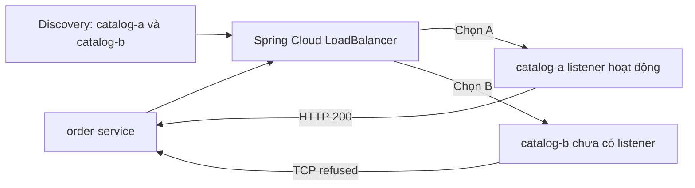
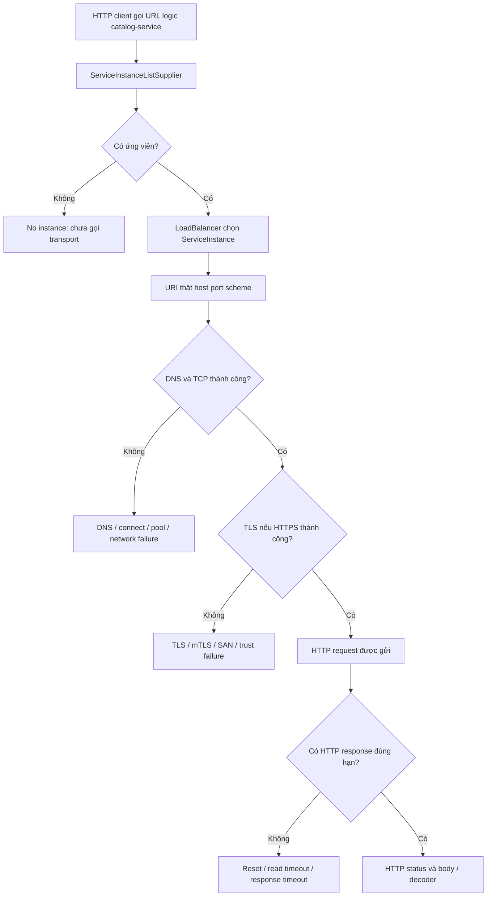
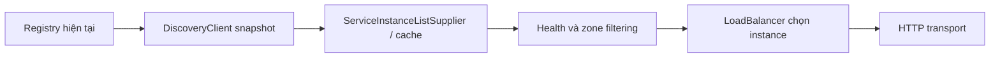

# Kết nối thất bại dù discovery vẫn báo bản sao tồn tại

Một sự cố phổ biến trong hệ thống microservices: `order-service` gọi `http://catalog-service/api/products/P42` qua Spring Cloud LoadBalancer, registry vẫn hiển thị hai bản sao `catalog-service`, nhưng một số request lại báo `Connection refused`, `Connect timed out` hoặc lỗi TLS. Người vận hành nhìn thấy bản ghi “UP” và cho rằng LoadBalancer đã chọn sai thuật toán. Thực tế, **instance còn tên trong discovery không đồng nghĩa nó đang lắng nghe ở host/port đã công bố hoặc có thể kết nối từ chính ứng dụng gọi**.

Trong module `SPRING_CLOUD_SERVICE_COMMUNICATION_LOAD_BALANCING`, Spring Cloud LoadBalancer chọn `ServiceInstance` theo service ID, discovery và các chính sách health/zone/routing. Sau khi chọn xong, `RestClient`, `WebClient` hoặc OpenFeign mới đi qua DNS, TCP, TLS và HTTP transport. Bài thuộc chương **Chẩn đoán sự cố**, giúp tách lỗi trước khi chọn đích, lỗi khi kết nối và lỗi sau khi server đã nhận request; từ đó sửa đúng nguyên nhân thay vì chỉ tăng timeout hoặc retry.

## 1. Tình huống: hai instance được đăng ký, một instance không kết nối được

Giả sử discovery trả danh sách:

```text
Service ID: catalog-service
  catalog-a: 10.40.2.11:8081  (registered)
  catalog-b: 10.40.2.12:8081  (registered)

Thực tế:
  catalog-a: listener mở, trả HTTP 200
  catalog-b: vừa restart, port 8081 chưa lắng nghe
```

`order-service` sử dụng `RoundRobinLoadBalancer`. Một phần request tới A thành công, phần còn lại tới B thất bại. Registry chưa hết lease hoặc consumer còn snapshot cũ nên vẫn thấy B.



Kết luận đầu tiên không phải “round robin lỗi” mà là: **LoadBalancer đã chọn một endpoint có trong danh sách, nhưng endpoint đó không phục vụ được request**. Cần xác minh record, snapshot tại consumer, endpoint được chọn và tình trạng network tại thời điểm request lỗi.

## 2. Bốn khái niệm không được đánh đồng

| Tầng | Điều được chứng minh | Điều **chưa** được chứng minh |
|---|---|---|
| Registration | Registry giữ thông tin một bản sao | Tiến trình còn sống hoặc port mở |
| Discovery | Consumer lấy được danh sách `ServiceInstance` | Danh sách còn mới và truy cập được từ consumer |
| Selection | LoadBalancer trả một instance theo policy | DNS/TCP/TLS sẽ thành công |
| Connectivity | Có thể nối tới host:port và hoàn thành handshake nếu dùng TLS | API tồn tại, quyền hợp lệ, nghiệp vụ trả thành công |
| Readiness | Probe đo được điều kiện sẵn sàng được cấu hình | Mọi API và dependency đều không thể lỗi |

Một `ServiceInstance` thường mô tả `serviceId`, `instanceId`, `host`, `port`, `uri`, `isSecure()` và metadata. Đó là dữ liệu cấu hình/khám phá, không phải socket luôn mở. Đặc biệt:

- `isSecure() == true` không chứng minh certificate server hợp lệ.
- Health endpoint trả `200` không chứng minh business endpoint nhanh hoặc khỏe.
- Một bản ghi còn trong registry có thể là dữ liệu cũ từ heartbeat/lease hoặc cache.
- Một host kết nối được từ máy quản trị không có nghĩa nó kết nối được từ pod/container consumer.

## 3. Xác định pha hỏng của một HTTP request



| Dấu hiệu từ caller | Pha nghi ngờ trước tiên | Đã có HTTP response từ đích? |
|---|---|---|
| Không có instance / không chọn được server | Discovery, supplier, selection | Chưa |
| `UnknownHostException` | DNS của hostname thật hoặc thiếu LoadBalancer | Chưa |
| `Connection refused` | TCP connect bị từ chối, port/listener sai | Chưa |
| Connect timeout | Routing, firewall, CNI/network policy, đích không phản hồi | Chưa |
| Pool acquire timeout | Chờ lấy connection của HTTP client | Chưa gửi trên connection được mượn |
| `SSLHandshakeException` | TLS/mTLS, CA, SAN, chứng chỉ, protocol | Thường chưa tới HTTP handler |
| `Connection reset` | Peer/proxy đóng connection | Có thể request đã tới server |
| Read/response timeout | Đã chờ response quá hạn | Có thể server đã thực hiện tác vụ |
| HTTP `404`, `401`, `403` hoặc `503` | Một HTTP endpoint/proxy thực sự trả status | Có |
| JSON decode error sau `200` | Contract, body, converter | Có |

**Lưu ý quan trọng cho thao tác ghi:** reset hoặc read timeout không bảo đảm server chưa xử lý request. Nếu retry `POST` thanh toán/giữ hàng, phải sử dụng idempotency key và tra cứu trạng thái trước khi lặp tác dụng phụ.

## 4. Quy trình chẩn đoán chuẩn

Khi nhận báo lỗi, đừng bắt đầu bằng đổi retry hay timeout. Thực hiện theo thứ tự:

1. **Xác nhận một mẫu request lỗi:** thời điểm, service ID, method/path template, correlation ID, HTTP client, exception root cause và duration.
2. **Xác nhận URL logic thực tế:** có dùng `http://catalog-service` qua LoadBalancer hay đã cấu hình `url` cố định/proxy không?
3. **Xem danh sách ứng viên từ tiến trình consumer:** địa chỉ nào đang nằm trong `DiscoveryClient` và `ServiceInstanceListSupplier`?
4. **Xác định instance đã chọn:** ID, host, port, scheme, `isSecure`, zone và URI thực tế.
5. **Kiểm tra từ chính môi trường consumer:** DNS, TCP port, TLS và HTTP endpoint theo từng pha.
6. **Kiểm tra server tương ứng:** process, listener, readiness, container/pod network, log nhận request.
7. **Đối chiếu thời gian cập nhật discovery/cache:** record có quá cũ hoặc sai port/IP sau restart/rollout không?
8. **Kiểm tra chính sách phục hồi:** timeout, retry, health, bulkhead/circuit breaker có che hoặc nhân lỗi không?

Không suy ra instance được chọn chỉ từ thứ tự round robin trong log. Concurrency, retry, zone, cache và thay đổi ứng viên có thể khiến thứ tự lựa chọn khác thứ tự response. Cần quan sát outcome thực tế theo từng attempt.

## 5. Đọc danh sách instance từ đúng consumer

Ví dụ một diagnostic component chỉ dùng ở môi trường test/nội bộ:

```java
package com.example.orders.diagnostics;

import java.util.List;
import org.springframework.cloud.client.ServiceInstance;
import org.springframework.cloud.client.discovery.DiscoveryClient;
import org.springframework.stereotype.Component;

@Component
public class CatalogDiscoveryDiagnostic {

    private final DiscoveryClient discoveryClient;

    public CatalogDiscoveryDiagnostic(DiscoveryClient discoveryClient) {
        this.discoveryClient = discoveryClient;
    }

    public List<String> snapshot() {
        return discoveryClient.getInstances("catalog-service")
                .stream()
                .map(this::describe)
                .toList();
    }

    private String describe(ServiceInstance instance) {
        return "instanceId=" + instance.getInstanceId()
                + " serviceId=" + instance.getServiceId()
                + " host=" + instance.getHost()
                + " port=" + instance.getPort()
                + " secure=" + instance.isSecure()
                + " uri=" + instance.getUri();
    }
}
```

Đây là snapshot từ `DiscoveryClient`. **Không mặc định** nó giống danh sách mà LoadBalancer cuối cùng chọn, vì `ServiceInstanceListSupplier` có thể áp cache, health filtering, zone preference, request hint hoặc chính sách khác. Với nguyên nhân liên quan lựa chọn, instrument supplier chain và selected instance theo release train đang sử dụng.

Không công khai component chẩn đoán này thành API mở: topology, IP, port nội bộ và metadata instance là thông tin cần kiểm soát. Nếu dùng `ReactiveDiscoveryClient`, đọc publisher bằng pipeline reactive; không gọi `.block()` trên Reactor event loop để chẩn đoán.

## 6. Registry đúng service ID nhưng sai host/port

Các lỗi đăng ký thường gặp:

- Server chạy `server.port=8082` nhưng registry công bố `8081`.
- Server chỉ bind `127.0.0.1`, trong khi caller kết nối đến IP mạng.
- Registry quảng bá hostname/private IP không có route từ consumer.
- Docker container sử dụng port nội bộ `8080`, nhưng discovery lưu port publish ra host `18080` dù caller ở trong Docker network.
- Một lần rolling deployment đổi Pod IP; consumer vẫn giữ IP cũ.
- Proxy/sidecar có listener riêng, nhưng registry trỏ thẳng vào port ứng dụng không được phép truy cập.
- Instance mới đăng ký trước khi process thật sự mở port/readiness đạt yêu cầu.

```text
catalog-b process:  listen 0.0.0.0:8082
registry record:   catalog-b.internal:8081
consumer connects: catalog-b.internal:8081

→ Có bản ghi discovery nhưng không có listener tại endpoint đã chọn.
```

Kiểm tra ba phía độc lập:

| Phía | Câu hỏi |
|---|---|
| Server | Ứng dụng đang lắng nghe `IP:port` nào? Có bind loopback không? |
| Registry/supplier | Endpoint nào thực sự được công bố và chọn? |
| Consumer | Từ namespace mạng và policy của consumer, endpoint ấy có truy cập được không? |

Trên Linux có thể dùng `ss -lnt` trên máy/container chứa server; trên Windows có thể dùng `Get-NetTCPConnection -State Listen`. Một listener tồn tại chưa chứng minh firewall hoặc NetworkPolicy cho phép consumer kết nối.

## 7. DNS sai, TCP sai và cấu hình thiếu LoadBalancer

Phân biệt hai đường đi:

```text
Có @LoadBalanced builder:
  http://catalog-service
    → ServiceInstanceListSupplier
    → chọn catalog-b.internal:8081
    → DNS/TCP tới catalog-b.internal:8081

Không có @LoadBalanced builder:
  http://catalog-service
    → HTTP transport cố phân giải DNS "catalog-service"
    → có thể UnknownHostException
```

Trong trường hợp thứ hai, registry có `catalog-service` cũng không giúp ích vì client **không sử dụng discovery**. Một starter LoadBalancer trên classpath không tự biến mọi `RestClient.builder()` hoặc `WebClient.builder()` mới tạo thành load-balanced client.

Một số lệnh thử từ **network namespace của consumer**:

```bash
# Chỉ kiểm tra hostname đích thật, không phải service ID logic.
getent hosts catalog-b.internal

# Dùng một endpoint test an toàn; xem TCP và HTTP khác nhau.
curl -v --connect-timeout 2 --max-time 5 \
  http://catalog-b.internal:8081/whoami
```

Trên Windows PowerShell:

```powershell
Test-NetConnection -ComputerName catalog-b.internal -Port 8081
```

`Connection refused` thường cho biết kết nối bị từ chối nhanh ở mức TCP/listener hoặc policy. `Connect timed out` gợi ý packet bị drop, route/firewall hoặc đích không đáp ứng; cần kiểm tra network path. `UnknownHostException` cho thấy vấn đề phân giải hostname nhưng cũng có thể là dấu hiệu HTTP client hoàn toàn **bỏ qua** LoadBalancer.

Các image/container tối giản có thể không có `curl` hay `getent`. Dùng debug pod/container được tổ chức cho phép; **không dùng kết quả từ laptop làm bằng chứng cho network của workload**.

## 8. Container và Kubernetes: vì sao `localhost` dễ đánh lừa?

Trong Docker/Kubernetes, `localhost` của `order-service` là localhost **của chính container/pod đó**, không phải máy chạy catalog ở nơi khác. Container trong cùng một Kubernetes Pod có thể chia sẻ network namespace, nhưng Pod A và Pod B thì không.

Ví dụ discovery tĩnh đúng cho **ba tiến trình cùng một máy local**, nhưng sai khi catalog nằm ở hai container độc lập:

```yaml
spring:
  cloud:
    discovery:
      client:
        simple:
          instances:
            catalog-service:
              - uri: http://localhost:8081
              - uri: http://localhost:8082
```

Trong một Docker network có hostname `catalog-a` và `catalog-b` đã được cấu hình và phân giải được từ consumer, ứng dụng có thể dùng:

```yaml
spring:
  cloud:
    discovery:
      client:
        simple:
          instances:
            catalog-service:
              - uri: http://catalog-a:8080
              - uri: http://catalog-b:8080
```

Các host trong YAML thứ hai chỉ là **ví dụ**, không phải tên được Docker tự tạo trong mọi deployment. Với Kubernetes có thể xem:

```bash
kubectl -n demo get pods -o wide
kubectl -n demo get services
kubectl -n demo get endpointslices -l kubernetes.io/service-name=catalog-service
```

Kiểm tra `Service.targetPort`, Pod IP, EndpointSlice addresses, readiness và NetworkPolicy. `Pod Running` không đồng nghĩa `Ready` hay listener có thể truy cập. Pod IP có thể thay đổi khi restart.

Đặc biệt, URL tới Kubernetes `Service`/ClusterIP có thể được định tuyến bởi kube-proxy/CNI thay vì Spring Cloud LoadBalancer chọn từng Pod. Cần biết client đang sử dụng danh sách **pod endpoints** hay **một service VIP/DNS** để tránh nhầm hai lớp cân bằng tải.

## 9. Sai scheme HTTP/HTTPS hoặc chứng chỉ TLS

Một bản sao có thể lắng nghe **HTTPS** cổng `8443` trong khi consumer dùng URI `http://...`. Hoặc registry ghi `secure=false` dù server yêu cầu TLS. Scheme sau LoadBalancer cần được kiểm tra theo `ServiceInstance.isSecure()`, URI ban đầu và hành vi của integration/version thực tế.

| Lỗi | Nguyên nhân cần xét |
|---|---|
| Đóng kết nối ngay khi gửi request | HTTP plaintext tới listener HTTPS hoặc proxy reset |
| `NotSslRecordException` hoặc tương tự | TLS transport nhận bytes không phải TLS |
| `SSLHandshakeException` | CA không tin, certificate hết hạn, SAN mismatch, TLS version/cipher, mTLS client cert |
| `Connection refused` trên 8443 | Không có listener HTTPS ở port đó hoặc policy từ chối |
| HTTP `401/403` | TLS/HTTP đã đi đủ xa để server trả response; kiểm tra auth, không coi là TCP failure |

Nếu registry công bố `catalog-b.internal` nhưng certificate chỉ có SAN `catalog-service.internal`, hostname verification có thể thất bại khi client xác thực host `catalog-b.internal`. Với kết nối bằng IP, certificate cần IP SAN tương ứng.

**Không dùng `curl -k`, `trustAll` hoặc vô hiệu hóa hostname verification để “khắc phục” TLS.** Hãy sửa đúng CA, SAN, hostname, `isSecure` hoặc TLS termination.

Để cô lập DNS trong lab mà vẫn giữ kiểm tra hostname TLS:

```bash
curl -v --connect-timeout 2 --max-time 5 \
  --resolve catalog-b.internal.example:8443:10.40.2.12 \
  https://catalog-b.internal.example:8443/whoami
```

`--resolve` bỏ qua DNS lookup cho hostname trong lệnh, **không chứng minh DNS đang hoạt động tốt**. Nếu server yêu cầu mTLS, còn cần client certificate và private key hợp lệ theo chính sách; không được bypass xác thực server.


## 10. Registry/LoadBalancer cache quá cũ hoặc health không phản ánh endpoint

Một nguồn gây lỗi khó thấy là **nhiều lớp trạng thái không cập nhật cùng lúc**:



Những tình huống thường gặp:

1. Instance chết nhưng lease/heartbeat ở registry chưa hết hạn.
2. Instance đã deregister, song discovery client vẫn trả snapshot trước đó.
3. Supplier của LoadBalancer cache hoặc replay danh sách, chưa refresh.
4. Pod mới có IP khác sau rollout, một số consumer vẫn dùng Pod IP cũ.
5. Health check định kỳ chưa phát hiện vấn đề; readiness có thể đang báo không chính xác.
6. Các consumer khác nhau giữ snapshot ở thời điểm khác nhau, khiến chỉ một số consumer lỗi.

**Đừng kiểm tra mỗi TTL của registry rồi kết luận toàn hệ thống đã cập nhật.** Cần phân biệt tuổi dữ liệu registry, discovery client, cache của supplier và kết quả health. Nên đo timestamp refresh, số instance trước/sau filtering và instance ID thực sự được chọn.

`HealthCheckServiceInstanceListSupplier` giúp lọc instance theo probe, nhưng có giới hạn: health là ảnh chụp theo chu kỳ, endpoint `/actuator/health` trả 200 không chứng minh API tra cứu sản phẩm đang phục vụ tốt. Tùy chính sách và phiên bản, supplier còn có thể **trả lại danh sách delegate khi không có instance nào vượt health check** (fail-open). Không được giả định thêm health check sẽ khiến mọi lần chọn tránh hoàn toàn endpoint lỗi.

### Readiness, liveness và draining

| Trạng thái của bản sao | Registry có thể vẫn liệt kê? | Trạng thái kết nối |
|---|---|---|
| Khởi động chưa bind cổng | Có nếu đăng ký sớm | TCP refused |
| Listener đã mở nhưng chưa sẵn sàng DB | Có | TCP được, business endpoint có thể 503 |
| Đang shutdown/draining | Có trong khoảng trễ | Một số request reset/timeout |
| Process chết đột ngột | Có tới khi lease/cache hết hạn | Connect fail |
| Liveness UP, readiness DOWN | Tùy discovery/route integration | Không nên nhận request mới |
| Health UP nhưng endpoint riêng quá chậm | Có | HTTP response chậm hoặc timeout |

Cần bảo đảm quy trình **đăng ký sau khi sẵn sàng**, và **ngừng nhận request mới/drain trước khi đóng listener**, với cơ chế registry hoặc orchestration đang dùng. Liveness probe có nhiệm vụ quyết định restart process, không phải thay thế readiness của việc định tuyến.

## 11. Sửa đúng HTTP client: service ID phải đi qua LoadBalancer

Một HTTP client bình thường có thể gọi `http://catalog-service` như một hostname DNS. Điều kiện có Spring Cloud LoadBalancer trong dependencies **chưa đủ**; phải sử dụng builder/proxy đã gắn tích hợp.

### RestClient đồng bộ

Ví dụ Spring Framework 6.1+ và Spring Cloud tương thích:

```java
package com.example.orders.config;

import org.springframework.cloud.client.loadbalancer.LoadBalanced;
import org.springframework.context.annotation.Bean;
import org.springframework.context.annotation.Configuration;
import org.springframework.web.client.RestClient;

@Configuration(proxyBeanMethods = false)
public class CatalogClientConfiguration {

    @Bean
    @LoadBalanced
    RestClient.Builder loadBalancedRestClientBuilder() {
        return RestClient.builder();
    }
}
```

```java
package com.example.orders.catalog;

import org.springframework.cloud.client.loadbalancer.LoadBalanced;
import org.springframework.stereotype.Component;
import org.springframework.web.client.RestClient;

@Component
public class CatalogClient {
    private final RestClient restClient;

    public CatalogClient(@LoadBalanced RestClient.Builder builder) {
        restClient = builder.clone()
                .baseUrl("http://catalog-service")
                .build();
    }

    public ProductDto find(String id) {
        return restClient.get()
                .uri("/api/products/{id}", id)
                .retrieve()
                .body(ProductDto.class);
    }
}
```

`ProductDto` là DTO của ứng dụng. Nếu code bên trong một service method lại tạo `RestClient.builder().build()` mới, client ấy **không tự nhận** LoadBalancer interceptor của bean trên. Khi có nhiều builder, cần `@Qualifier` rõ ràng để tránh injection nhầm client không load balanced.

### WebClient reactive

```java
@Bean
@LoadBalanced
WebClient.Builder loadBalancedWebClientBuilder() {
    return WebClient.builder();
}
```

```java
public CatalogReactiveClient(@LoadBalanced WebClient.Builder builder) {
    webClient = builder.clone()
            .baseUrl("http://catalog-service")
            .build();
}
```

`@LoadBalanced WebClient.Builder` giúp Spring Cloud gắn exchange filter phù hợp. Trả `Mono<ProductDto>` từ lời gọi thay vì `.block()` trên event loop, nhưng lưu ý lỗi kết nối vẫn có thể xảy ra nếu instance mà filter chọn có host/port sai.

### OpenFeign

```java
@FeignClient(name = "catalog-service", path = "/api/products")
public interface CatalogFeignClient {
    @GetMapping("/{id}")
    ProductDto get(@PathVariable("id") String id);
}
```

Cần quét interface bằng `@EnableFeignClients`, có starter OpenFeign và LoadBalancer tương thích. Nếu thêm `url="http://localhost:8081"` trên annotation hoặc cấu hình URL cố định, Feign có thể bỏ qua discovery và gọi đúng một endpoint; khi nó chết, khả năng chọn replica khác từ registry không giúp gì.

Với HTTP Interface (`HttpServiceProxyFactory`), adapter `RestClientAdapter` hoặc `WebClientAdapter` cũng phải được tạo từ HTTP client **đã load balanced**. Annotation `@HttpExchange` tự nó không kích hoạt discovery.

## 12. Phân loại exception theo HTTP client thay vì catch chung

| Client | Loại exception thường gặp | Diễn giải cần kiểm chứng |
|---|---|---|
| `RestClient` | `ResourceAccessException`, các subtype `RestClientException` | Kiểm tra root cause, request factory, connect/read timeout |
| `WebClient` | `WebClientRequestException` | I/O, DNS, connect, TLS hoặc connection error, không nhất thiết chỉ DNS |
| `WebClient` | `WebClientResponseException` | Đã nhận HTTP error status; đọc status an toàn |
| OpenFeign | `RetryableException` | Có thể do I/O hoặc chính sách retry; không tự chứng minh retry an toàn |
| OpenFeign | `FeignException` và subtype | Có thể chứa HTTP status/response; xem phương thức và nguồn lỗi |
| Lớp nguyên nhân | `ConnectException`, `UnknownHostException`, `SSLHandshakeException`, `SocketTimeoutException` | Tương ứng pha, không đồng nhất với exception bên ngoài |

Ví dụ WebClient phân biệt transport error và HTTP response error:

```java
Mono<ProductDto> result = webClient.get()
        .uri("http://catalog-service/api/products/{id}", id)
        .retrieve()
        .bodyToMono(ProductDto.class)
        .doOnError(error -> {
            if (error instanceof WebClientRequestException transport) {
                Throwable cause = transport.getCause();
                log.warn("catalog transport failure: cause={}",
                        cause == null
                            ? "unknown"
                            : cause.getClass().getSimpleName());
            } else if (error instanceof WebClientResponseException response) {
                log.warn("catalog HTTP response status={}",
                        response.getStatusCode().value());
            }
        });
```

Đoạn code giả định logger và DTO đã được khai báo, cần import các class `WebClientRequestException` và `WebClientResponseException`. Log được viết ngắn để tránh in token và body nhạy cảm. Có thể cần ghi selected instance bằng LoadBalancer lifecycle/tracing riêng; URI trong exception của một số integration có thể vẫn là URL logic, **không đủ** để khẳng định instance thực tế.

Với OpenFeign, nếu server trả `404`, `ErrorDecoder` thường xử lý HTTP status; nếu chưa TCP connect được, decoder không có response từ server để đọc. Nếu circuit breaker đang OPEN, caller cũng có thể nhận exception **mà chưa hề gửi HTTP attempt**.

## 13. Timeout nào, phải sửa lớp đó

| Timeout | Xảy ra ở đâu? | Kiểm tra |
|---|---|---|
| Discovery/selection | Chờ supplier hoặc chọn `ServiceInstance` | Registry latency, snapshot, scheduler, health |
| Connection pool acquisition | Chờ connection khả dụng | Pool leased/available/pending, per-route limit |
| DNS lookup | Phân giải hostname được chọn | DNS record, search domain, cache/resolver |
| Connect | Mở TCP socket tới host/port | Listener, firewall, route, NetworkPolicy |
| TLS handshake | CA, SAN, TLS/mTLS negotiation | Certificate, protocol/cipher, trust material |
| Read/response | Server/proxy xử lý chậm, response chưa kịp | Downstream logs, DB, queue, network |
| Deadline tổng | Toàn logical request gồm retries/backoff | Remaining budget trước mỗi attempt |

Một `readTimeout` dài không sửa `Connection refused`. Tăng `connectTimeout` cũng không sửa một `ServiceInstanceListSupplier` trả `[]`. Thêm retry khi pool đang cạn có thể tăng queue và làm mọi request chậm hơn.

Đặt ngân sách **toàn request**: nếu ban đầu có 1.000 ms, nhưng đã tiêu 700 ms cho selection, pool wait và lần thử đầu, lần tiếp theo không được cấp lại nguyên 1.000 ms. Với WebClient, có thể dùng `Mono.timeout(remaining)` đặt ngoài chuỗi retry; với blocking client cần phối hợp timeout của HTTP transport và hủy công việc trong phạm vi khả thi. **Caller timeout không bảo đảm side effect ở server đã bị hủy**.

## 14. Retry chỉ che triệu chứng nếu không sửa endpoint

Nếu A khỏe còn B có port sai, retry sang A có thể giúp một số logical request thành công. Nhưng điều đó không sửa được B trong registry; hệ thống vẫn mất thời gian ở attempt lỗi và có thể tạo tải tăng thêm.

| Nguyên nhân | Retry sang instance khác? | Chính sách gợi ý |
|---|---|---|
| B vừa chết, A khỏe | Có thể | Giới hạn attempts, health/removal để giảm chọn B |
| Mọi instance có hostname sai | Không hữu ích | Sửa registration/DNS |
| TLS CA/SAN sai cho mọi instance | Không | Sửa PKI/scheme |
| Pool client cạn | Thường gây hại | Concurrency limit, pool tuning, giảm thời gian giữ connection |
| 503 do server quá tải | Có điều kiện | Backoff/jitter, `Retry-After` và retry budget |
| POST/PUT sau read timeout | Phụ thuộc idempotency | Không retry mù quáng; kiểm tra trạng thái giao dịch |
| Snapshot registry quá cũ | Có thể vẫn chọn endpoint cũ | Refresh nguồn/supplier; bảo đảm TTL phù hợp |

Dù lỗi mạng chỉ đến từ một replica, **retry không có ngân sách** có thể nhân attempts qua Gateway, ứng dụng, LoadBalancer và HTTP transport. Chọn một retry owner, giới hạn số lần và tôn trọng deadline. Không coi policy retry cùng instance là tương đương retry sang instance khác; nếu chỉ có một instance hợp lệ, tăng số lần chọn lại không tạo ra bản sao khỏe mới.

Circuit breaker và bulkhead giúp giảm tác động của dependency lỗi, nhưng không tự sửa DNS, port, TLS hay dữ liệu registry sai. Nếu breaker OPEN, request có thể bị từ chối trước khi kết nối, cần ghi `failureStage=short_circuit` thay vì gọi là TCP timeout.

## 15. Observability: phải biết instance nào và hỏng ở pha nào

Một dashboard chỉ có `http.client.duration=800ms` và `publicStatus=503` thường chưa đủ. Những trường nên có:

| Tín hiệu | Câu hỏi |
|---|---|
| `traceId` / `correlationId` | Những hop nào cùng request? |
| `serviceId` | Tên dịch vụ logic nào được gọi? |
| `instanceId`, host/port được chọn | Có phải lỗi tập trung vào một bản sao? |
| `attemptNumber`, `retryOwner` | Request đã phát thêm bao nhiêu attempts? |
| `failureStage` = selection/dns/pool/connect/tls/response/decode | Đã lỗi ở bước nào? |
| `supplierSnapshotAge`, instance count | Danh sách có cũ hoặc bị filter hết không? |
| HTTP upstream status (nếu có) | Đã nhận 404/503 từ server/proxy chưa? |
| Connect/TLS/response duration | Kết nối chậm hay xử lý server chậm? |
| Pool pending/leased | Có nghẽn connection pool không? |
| Deadline remaining | Có tiếp tục gọi khi hết ngân sách không? |

Đối chiếu log client với access log trên **đúng selected instance**. Nếu client bị connect refused và server không thấy request, nguyên nhân có thể trước HTTP handler. Nếu server đã ghi xử lý một POST nhưng caller nhận read timeout, **không kết luận tác vụ chưa xảy ra**.

Micrometer/Actuator, Reactor Netty và Apache HttpClient có thể cung cấp các metric theo transport khi dependency và instrumentation phù hợp. `LoadBalancerLifecycle` có callback trước/sau những phần của request, nhưng không được mặc định mọi lifecycle duration đều là thời gian **chọn instance thuần**. Hãy xác minh hook trên release train đang dùng.

Giữ metric tags có cardinality kiểm soát; `traceId`, raw URL chứa product ID, token, instance ID động hoặc IP thường phù hợp hơn cho trace/log được phân quyền, không phải mọi time-series label.


## 16. Bài thực hành: hai bản sao, một bản không thể kết nối

**Mục tiêu:** chứng minh `SimpleDiscoveryClient` vẫn liệt kê một bản sao đã chết hoặc đăng ký sai port, và phân biệt lỗi TCP với no-instance, DNS, TLS và HTTP 503.

### Chuẩn bị server

Chạy hai ứng dụng Spring Boot `catalog-service` trên cùng máy: bản sao A ở cổng `8081` và bản sao B ở `8082`. Mỗi process có một endpoint đơn giản:

```java
package com.example.catalog;

import java.util.Map;
import org.springframework.core.env.Environment;
import org.springframework.web.bind.annotation.GetMapping;
import org.springframework.web.bind.annotation.RestController;

@RestController
public class IdentityController {
    private final String instanceId;

    public IdentityController(Environment environment) {
        this.instanceId =
                environment.getProperty("catalog.instance-id", "unknown");
    }

    @GetMapping("/whoami")
    public Map<String, String> whoAmI() {
        return Map.of("instanceId", instanceId);
    }
}
```

Cấu hình mỗi process lần lượt là `catalog.instance-id=catalog-a`/`server.port=8081` và `catalog.instance-id=catalog-b`/`server.port=8082`. Trong **consumer**, dùng danh sách tĩnh:

```yaml
spring:
  cloud:
    discovery:
      client:
        simple:
          instances:
            catalog-service:
              - uri: http://localhost:8081
              - uri: http://localhost:8082
```

`localhost` chỉ hợp lệ khi consumer và hai server chia sẻ cùng máy/network namespace. Nếu triển khai container, phải dùng các hostname/port có thể truy cập **từ consumer**.

Tạo `@LoadBalanced RestClient.Builder` hoặc `@LoadBalanced WebClient.Builder` như phần 11, rồi gọi lặp lại:

```java
String result = restClient.get()
        .uri("http://catalog-service/whoami")
        .retrieve()
        .body(String.class);
```

Để quan sát rõ nguồn lỗi, ban đầu **tắt retry tự động và health filtering** trong đường gọi test. Sau đó mới bật lần lượt từng tính năng để đánh giá ảnh hưởng.

### Các ca thử có kiểm soát

| Ca | Thao tác | Bằng chứng cần thu thập |
|---|---|---|
| **A — Baseline** | Cả A và B chạy bình thường | Có lần chọn mỗi instance; response 200 |
| **B — B dừng** | Dừng B, giữ nguyên YAML discovery | B vẫn xuất hiện; nếu chọn B thì TCP refused |
| **C — Port sai** | Cho B chạy 8082 nhưng đăng ký 18082 | B khỏe ở 8082 nhưng URI được chọn sai |
| **D — Không có instance** | Gọi service ID `catalog-missing` | Lỗi tại selection, không có kết nối đến A/B |
| **E — Server trả 503** | Tạo endpoint `/unavailable` trả status 503 | Client nhận HTTP response thực sự |
| **F — DNS sai** | Đăng ký một hostname không phân giải | Root cause dạng `UnknownHostException` |
| **G — Scheme/cert sai** | Thử HTTPS tới port HTTP, hoặc SAN không khớp | Lỗi giao thức/TLS, không disable verify |

Ví dụ endpoint E trong một controller test:

```java
@GetMapping("/unavailable")
public ResponseEntity<String> unavailable() {
    return ResponseEntity.status(503)
            .body("Temporarily unavailable");
}
```

Cần có import `ResponseEntity`; đây là mã chỉ dành cho môi trường test. Khi server trả 503, **đường TCP/HTTP đã hoạt động đủ xa để nhận response**; khác hẳn ca B và D.

### Kỳ vọng chi tiết của ca B

1. `DiscoveryClient` hoặc static supplier vẫn thấy `localhost:8082`.
2. LoadBalancer có thể chọn B với đúng host/port đã công bố.
3. Nếu B không còn listener, client gặp connect error.
4. Access log HTTP của B không có request đã bị TCP refused.
5. Các lần chọn A có thể vẫn thành công.
6. Bật health filtering/retry sau đó có thể thay đổi tỷ lệ lỗi, nhưng **không tự sửa bản ghi sai hoặc process đã chết**.

Không dùng thứ tự response làm bằng chứng duy nhất của round robin vì concurrency, retries và supplier filters có thể thay đổi thứ tự. Ghi `attemptNumber`, chosen instance và root cause trong log/traces.

## 17. Ma trận phân biệt lỗi

| Tình huống | Có entry discovery? | Chọn được instance? | HTTP response từ đích? | Failure stage |
|---|---|---|---|---|
| A và B khỏe | Có | Có | Có | `success` |
| B dừng, registry tĩnh | Có | Có thể chọn B | Không khi refused | `connect` |
| B sai port | Có | Có | Không nếu không có listener | `connect` |
| Service ID không tồn tại | Không có ứng viên | Không | Không | `selection` |
| Server trả 503 | Có | Có | **Có** | `response` |
| Host không phân giải | Có | Có | Không | `dns` |
| TLS hostname không khớp | Có | Có | Không có response HTTP hợp lệ | `tls` |
| Pool client đã đầy | Có | Có | Có thể chưa gửi | `pool` |

Đây là **kỳ vọng của cấu hình lab**, không phải output bảo đảm cho mọi HTTP client/phiên bản. Nếu thấy kết quả khác, hãy kiểm tra các lớp proxy, health, retries, circuit breaker và route thực tế trước khi kết luận.

Khi đã hoàn thành baseline, thử bật retry sang instance khác và health check tuần hoàn. Đo thời điểm instance lỗi bị loại, snapshot cache cập nhật và số attempts tới mỗi bản sao. Cuối cùng bật B lại và xác minh cả A/B đều có thể phục vụ ổn định.

## 18. Runbook xử lý sản xuất

### Giai đoạn 1 — Giảm tác động nhưng giữ bằng chứng

- Lưu trace/log một số logical requests lỗi với instance, stage và root cause.
- Nếu chỉ một replica không kết nối được, dùng cơ chế vận hành hợp lệ để chuyển nó về not-ready hoặc deregister/drain; tránh tắt cả service một cách mù quáng.
- Giữ retry/deadline có giới hạn; đừng để Gateway, ứng dụng và LoadBalancer cùng nhân attempts.
- Không tắt TLS verification hoặc mở firewall quá rộng để “thử nhanh”.
- Với POST/PUT/PATCH tạo tác dụng phụ, giữ idempotency key và đối soát trạng thái khi response bị mất.

### Giai đoạn 2 — Khoanh vùng

- So sánh endpoint trong registry với listener thực tế.
- Xác định consumer snapshot và chosen instance, không chỉ nhìn dashboard.
- Test DNS, TCP, TLS từ network namespace đúng của consumer.
- Đối chiếu thời điểm restart/rollout với heartbeat, cache TTL, readiness và health refresh.
- Kiểm tra HTTP connection pool, sidecar/service mesh và network policy nếu lỗi chưa rõ.

### Giai đoạn 3 — Phục hồi

- Sửa đúng host, port, URI/scheme, certificate, network policy hoặc cấu hình builder.
- Kiểm tra startup chỉ đưa instance vào tập phục vụ khi sẵn sàng; shutdown có draining thích hợp.
- Xác minh cache/supplier loại endpoint cũ và cập nhật endpoint mới.
- Theo dõi p95/p99, lỗi connect/TLS, retries, số instance được chọn và tỷ lệ HTTP 5xx.
- Thêm regression test tương ứng vào staging.

**Một request thành công không đủ để xác nhận đã phục hồi.** Nếu request đó tình cờ chọn A, B vẫn có thể lỗi. Hãy quan sát đủ attempts tới các replica hợp lệ.

## 19. Cây quyết định chẩn đoán nhanh

```text
Request đến catalog-service thất bại
|
+-- LoadBalancer có trả ServiceInstance?
|     |
|     +-- Không -> service ID, discovery/supplier,
|     |            health/zone/cache, empty list
|     |
|     +-- Có -> ghi instanceId, host, port, scheme
|                 |
|                 +-- Host không phân giải?
|                 |      -> DNS, đăng ký sai, builder thiếu @LoadBalanced
|                 |
|                 +-- TCP refused?
|                 |      -> port, listener, bind, stale instance
|                 |
|                 +-- Connect timeout?
|                 |      -> route, firewall, NetworkPolicy, CNI
|                 |
|                 +-- TLS handshake failure?
|                 |      -> CA, SAN, client cert, scheme, proxy
|                 |
|                 +-- Có HTTP response 4xx/5xx?
|                 |      -> server/proxy, auth, API contract
|                 |
|                 +-- Chờ response quá hạn?
|                        -> server, DB, network, read timeout
|
+-- Có retry/circuit breaker?
      -> kiểm tra HTTP attempt thật sự có phát đi không
```

Một logical request có thể có nhiều attempts và nhiều nguyên nhân khác nhau. Không chỉ ghi lỗi cuối cùng nếu attempt đầu connect refused rồi attempt thứ hai trả 503; cần giữ cả chuỗi để chẩn đoán.

## 20. Anti-pattern và cách sửa

| Sai lầm | Hậu quả | Cách thay thế |
|---|---|---|
| Registry báo instance tồn tại nên chắc chắn gọi được | Bỏ qua host/port, listener, mạng | Test endpoint thực tế từ consumer |
| Mọi public 503 đều gọi là no-instance | Che HTTP 503 do server trả | Tách selection và response |
| Thay round robin bằng random khi port sai | Không sửa dữ liệu discovery | Sửa đăng ký endpoint |
| Tăng read timeout khi TCP refused | Sai pha xử lý | Kiểm tra listener và port |
| Dùng `localhost` giữa hai containers khác nhau | Kết nối quay về chính consumer | Dùng internal DNS/port hợp lệ |
| Chỉ kiểm tra `curl` trên máy server | Không phản ánh đường mạng caller | Dùng consumer/debug namespace |
| Tắt hostname verification | Mất xác thực server TLS | Sửa CA/SAN/hostname |
| Retry mọi lỗi không giới hạn | Tăng tải, timeout dây chuyền | Một retry owner và deadline chung |
| Chỉ xem registry TTL, bỏ qua LB cache | Consumer tiếp tục dùng entry cũ | Quan sát mọi tầng snapshot |
| Health UP nghĩa mọi API khỏe | Probe có thể nông hoặc trễ | Readiness và business monitoring |
| Gom mọi exception thành `catch Exception` | Khó biết lỗi ở đâu | Phân loại theo failure stage |
| Không ghi chosen instance | Không định vị được replica lỗi | Trace/log instance an toàn |
| Retry POST sau read timeout với key mới | Có thể ghi trùng | Idempotency và đối soát |

## 21. Checklist trước khi đóng sự cố

1. Đã biết HTTP client thật sự đi qua Spring Cloud LoadBalancer chưa?
2. Đã xem danh sách instance từ **consumer**, không chỉ từ dashboard registry chưa?
3. Đã biết instance ID, host, port, URI và scheme của attempt lỗi chưa?
4. Đã đối chiếu listener của server với endpoint được đăng ký sau rollout/restart chưa?
5. Đã thử DNS, TCP và TLS từ đúng môi trường consumer chưa?
6. Đã phân biệt no-instance, unknown host, refused, connect timeout, pool timeout, TLS và HTTP status chưa?
7. Đã kiểm tra Docker/Kubernetes internal ports, Pod IP, EndpointSlice, NetworkPolicy và sidecar chưa?
8. Có biết thời gian heartbeat, lease, cache/refetch và health refresh không?
9. Readiness/liveness và shutdown draining có bảo vệ giai đoạn instance chưa sẵn sàng không?
10. Có vô tình dùng URL cố định, builder sai hoặc HTTP Interface không load balanced không?
11. Đã kiểm tra pool saturation và timeout theo pha trước khi sửa thông số chưa?
12. Retry có giới hạn, không nhân nhiều tầng và an toàn với thao tác ghi không?
13. TLS certificate có SAN và trust chain đúng cho hostname thật không?
14. Tracing/metrics có chọn instance, attempt và failure stage để đối chiếu không?
15. Đã tái hiện port sai, B chết, no-instance, DNS/TLS và upstream 503 ở staging chưa?
16. Sau sửa, các instance hợp lệ đều phục vụ ổn định, không chỉ một request tình cờ thành công chưa?

**Kết luận:** **Discovery còn bản ghi chỉ chứng minh có thông tin để chọn đích, không chứng minh đích kết nối được.** Muốn xử lý đúng, hãy lần theo **service ID → snapshot tại consumer → ServiceInstance được chọn → URI/host/port → DNS/TCP/TLS → HTTP response**. Khi kiểm tra từ network của consumer, chuẩn hóa lỗi theo pha, sửa đúng dữ liệu registration/readiness/cache và kiểm soát timeout/retry, hệ thống sẽ hạn chế lỗi lan truyền thay vì liên tục gửi lại đến bản sao không thể truy cập.


