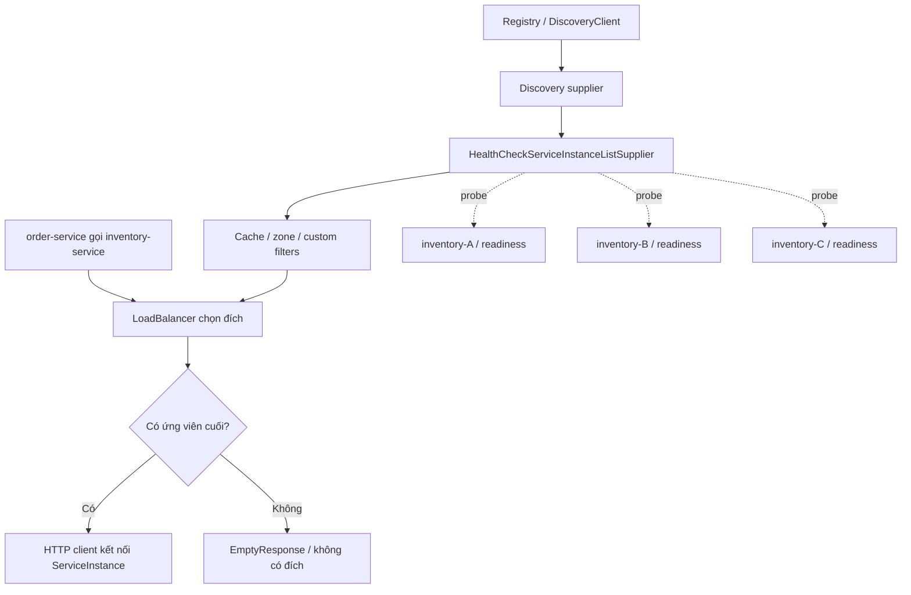
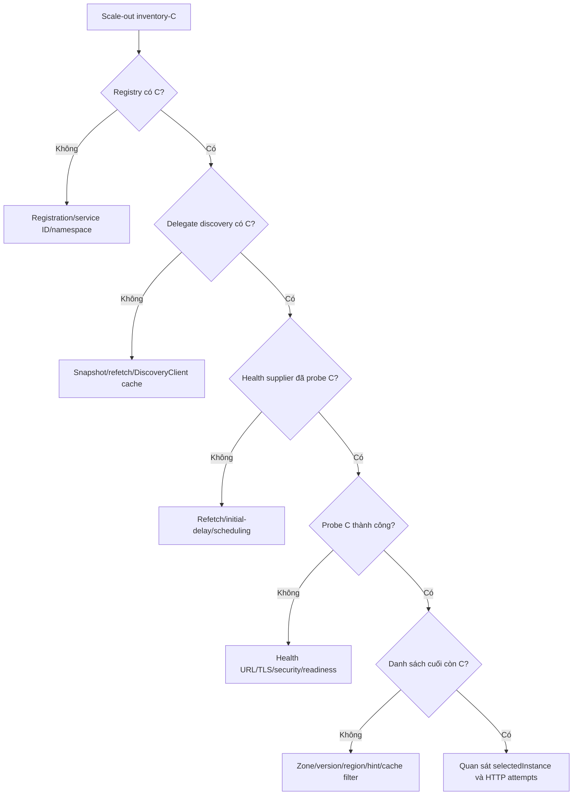

# Health check loại hết bản sao hoặc không phát hiện bản sao mới

Trong hệ thống microservices sử dụng Spring Cloud LoadBalancer, một tình huống khó chẩn đoán là **registry vẫn có các bản sao `inventory-service` nhưng client báo không có instance khỏe**, hoặc **vừa scale thêm bản sao C mà client tiếp tục chỉ gọi A/B**. Đôi khi các request vẫn tới những bản sao đã thất bại health probe; đôi khi tất cả request trả HTTP 503 dù provider đang chạy. Các hiện tượng này có thể có **nguyên nhân hoàn toàn khác nhau**.

Đối với module `SPRING_CLOUD_SERVICE_COMMUNICATION_LOAD_BALANCING`, Spring Cloud LoadBalancer chọn `ServiceInstance` theo service ID qua chuỗi `ServiceInstanceListSupplier`, có thể kết hợp discovery, health check, cache, zone và policy tùy biến; các HTTP client `RestClient`, `WebClient` hoặc OpenFeign sau đó thực hiện kết nối. Bài này tập trung **chẩn đoán nguồn danh sách instance**, hiểu hoạt động `HealthCheckServiceInstanceListSupplier`, phân biệt health probe lỗi với discovery rỗng, xác định vì sao instance mới không xuất hiện và thử nghiệm quá trình hồi phục có kiểm soát.

> **Lưu ý cốt lõi:** với hành vi thông dụng của `HealthCheckServiceInstanceListSupplier` trong Spring Cloud Commons, nếu **delegate còn các instance** nhưng **không có instance nào vượt health probe**, supplier có thể **trả lại danh sách nguồn** thay vì luôn trả `[]`. Vì vậy “mọi probe DOWN” không đồng nghĩa chắc chắn “LoadBalancer không còn đích”. Phải xác định chính xác supplier chain và phiên bản sử dụng trước khi đặt kỳ vọng fail-open/fail-closed.

## 1. Ba tập danh sách cần phân biệt trước khi sửa cấu hình

Hãy đặt tên cho ba tập dữ liệu:

1. **Discovered:** các instance mà registry/`DiscoveryClient` hiện cung cấp theo service ID.
2. **Health-eligible:** các instance có kết quả probe được chấp nhận tại thời điểm health supplier đánh giá.
3. **LoadBalancer-visible:** danh sách cuối cùng qua supplier chain (health, cache, zone, filters, retry-aware supplier...) mà thuật toán lựa chọn đang thấy.



Thứ tự `Cache`/`Health`/`Zone` trên sơ đồ là **minh họa**. Trong hệ thống thật, thứ tự các delegate và việc tầng health tự lưu/phát lại kết quả có thể ảnh hưởng trực tiếp đến khả năng phát hiện bản sao mới. Không dùng sơ đồ để suy diễn thứ tự bean khi chưa kiểm tra cấu hình thực tế.

| Quan sát | Có thể suy ra | Chưa thể kết luận |
|---|---|---|
| Registry trả `[A,B,C]` | Registry biết ba instance | LoadBalancer đã thấy C hoặc C healthy |
| Health probe C trả 200 | C đáp ứng một endpoint từ nơi probe | Client đã refetch để thêm C vào danh sách |
| Supplier cuối trả `[A,B]` | C chưa được chọn trong snapshot đó | C đã bị registry xóa |
| Tất cả probe 503 | Không có instance đạt điều kiện probe vừa kiểm tra | Supplier chắc chắn trả `[]` |
| HTTP client nhận 503 | Lời gọi thất bại | 503 do provider, gateway hay LoadBalancer tạo |
| Một request vẫn vào A sau khi A DOWN | Có thể có cache/fallback/race | Health check không bao giờ chạy |

Để chẩn đoán, trước tiên hãy thu thập **số lượng và instance ID ở từng tầng**, sau đó mới quyết định chỉnh interval, path hay thuật toán.

## 2. Hai sự cố trong tiêu đề thực chất là hai nhóm khác nhau

### 2.1. “Health check loại hết bản sao”

Các nguyên nhân điển hình:

- Cả A/B **thật sự không ready** (dependency thiết yếu lỗi, startup chưa hoàn tất, đang shutdown).
- Health checker gọi **sai path hoặc port**; provider phục vụ HTTP nghiệp vụ được nhưng `/actuator/health` không tồn tại trên application port.
- Endpoint health bị **401/403** bởi Spring Security, gateway hoặc service mesh.
- Probe dùng `http` trong khi endpoint bắt buộc `https` hoặc có mTLS và certificate/truststore không phù hợp.
- Container/Pod gọi được bằng địa chỉ nội bộ khác, nhưng **`ServiceInstance.host:port` quảng bá không reachable** từ nơi client đang chạy.
- Timeout probe quá ngắn, interval quá dày, instance đang quá tải hoặc có jitter.
- Health endpoint báo DOWN do một dependency **không cần thiết cho tất cả operation**, tạo false negative diện rộng.

Đừng giả định tất cả 404/503 của business endpoint là kết quả health probe: readiness nên được kiểm tra **độc lập**, theo đúng URL và transport.

### 2.2. “Không phát hiện bản sao mới”

Các nguyên nhân điển hình:

- Bản sao C **chưa đăng ký** hoặc đăng ký với **service ID khác**.
- Discovery source có C nhưng **supplier đang giữ snapshot ban đầu** và không refetch hoặc không nhận stream cập nhật.
- Có lớp cache với TTL/chính sách refresh khiến C chưa tới danh sách mà LoadBalancer dùng.
- Health supplier chỉ biết A/B nên **chưa hề probe C**; tăng số lượt health probe A/B không tự tạo C.
- C đã vào health supplier nhưng probe fail, nên chỉ thấy A/B trong tập eligible.
- Filter zone/region/version/metadata hoặc request hint loại C sau health.
- C được chọn nhưng trả HTTP lỗi và retry chuyển sang A/B, khiến chỉ nhìn **response cuối** tưởng C chưa bao giờ được chọn.

**Mục tiêu chẩn đoán khác nhau:** nhóm đầu cần tìm vì sao probe đánh giá sai/tất cả không ready; nhóm sau phải xác định **C bị mất ở tầng nào**: đăng ký → refetch → health → filter → selection → transport.

## 3. Bảng quyết định nhanh theo triệu chứng

| Triệu chứng | Kiểm tra đầu tiên | Hướng xử lý ban đầu |
|---|---|---|
| Registry không có instance | `service ID`, namespace, registration/TTL | Sửa đăng ký và service identity |
| Registry có A/B nhưng supplier cuối rỗng | Probe, policy lọc, fallback của supplier | Kiểm tra chain và lý do loại instance |
| Mọi probe 401/403 | Security rule của health endpoint, auth context | Cho probe nội bộ truy cập có kiểm soát |
| Mọi probe 404 | Health path/management port chưa đúng | Kiểm tra Actuator endpoints và port |
| Mọi probe timeout | Địa chỉ quảng bá, DNS/TCP/TLS, deadline | Gọi trực tiếp từ mạng của caller |
| A/B vẫn được chọn dù probe đều lỗi | Cơ chế fallback nguồn, cache hoặc race | Xác minh all-unhealthy policy |
| C xuất hiện ở registry nhưng chưa trong supplier | Refetch/stream update, cache, child context | Làm mới nguồn instance và đo snapshot |
| C trong supplier nhưng không bao giờ tới HTTP | Health/zone filter, algorithm, retry | Quan sát sau mỗi lớp và chosen ID |
| Sau scale-in vẫn gọi bản sao đã chết | Stale registry/cache/health, grace shutdown | Kiểm tra refresh và deregistration |
| GET business 404 làm “health DOWN” | Tái sử dụng sai business response để đo readiness | Tách health probe khỏi domain errors |

Một chiến thuật hiệu quả là xác minh **một provider cụ thể** bằng `instance ID + host + port + health URL`, thay vì chỉ nhìn aggregate “UP/DOWN”. Khi hàng chục instance đồng loạt thất bại sau một thay đổi cấu hình, ưu tiên điều tra **lỗi dùng chung của probe** trước khi kết luận toàn bộ fleet hỏng.

## 4. Cơ chế HealthCheckServiceInstanceListSupplier và điểm dễ hiểu sai

`HealthCheckServiceInstanceListSupplier` được dùng để kiểm tra health của các `ServiceInstance` từ delegate và cung cấp danh sách để client cân bằng tải. Có vài chi tiết thiết kế cần phân biệt:

1. **Nguồn instance:** delegate (`DiscoveryClient`/reactive discovery/cấu hình tùy biến) xác định **những instance nào tồn tại trong tầm nhìn client**.
2. **Thăm dò:** supplier gửi request health tới từng instance theo đường dẫn được cấu hình, phụ thuộc HTTP client, lịch probe và kết quả response.
3. **Danh sách đã kiểm tra:** những instance được đánh giá khỏe được đưa vào kết quả theo policy của supplier.
4. **Khi không có instance khỏe:** một số implementation mặc định quay lại **danh sách delegate không rỗng** để tránh ngừng phục vụ khi tất cả probe cùng có false negative.
5. **Khi delegate vốn rỗng:** không có địa chỉ nguồn để fallback; thuật toán lựa chọn nhận danh sách rỗng/không có đích.

```text
Delegate discovery = [A, B]
Health check       = [A]             -> visible thường là [A]

Delegate discovery = [A, B]
Health check       = []              -> có thể visible = [A, B] (fallback)

Delegate discovery = []
Health check       = []              -> visible = []
```

**Đừng dùng `HealthCheckServiceInstanceListSupplier` như một danh sách đen tuyệt đối** nếu yêu cầu bảo mật/compliance bắt buộc không gọi instance không ready. Kiểm tra behavior thực tế của phiên bản, rồi thiết kế fail-closed riêng nếu cần. Ngược lại, đừng xóa bỏ fallback mặc định chỉ vì một lần health probe không thành công: điều đó có thể biến sự cố DNS/Actuator chung thành outage toàn dịch vụ.

### 4.1. Tập hợp nhìn thấy không phải kết quả probe thô

Giả sử health supplier xuất danh sách `[A,B]` trong khi log probe của A/B đều 503. Đây có thể là **fallback all-unhealthy**. Nếu metric đặt tên danh sách đó là `healthyInstanceCount=2`, biểu đồ sẽ gây hiểu nhầm.

Nên tách:

- `discoveredCount=2`: nguồn discovery còn hai instance.
- `probeHealthyCount=0`: kết quả thăm dò hiện tại không có instance đạt yêu cầu.
- `loadBalancerVisibleCount=2`: danh sách sau fallback được chọn.
- `healthFallbackActivated=true`: nếu có instrumentation riêng cung cấp được tín hiệu.

Đây là **các trường minh họa để instrument**, không phải tên metric Spring Cloud luôn phát sẵn. Nếu supplier không cho biết kết quả probe trước fallback, cần thiết kế cách quan sát trước bước hợp nhất; không suy `probeHealthyCount` chỉ từ danh sách cuối.

### 4.2. `get()` không đồng nghĩa mỗi request sẽ gọi probe mới

Lớp health có thể quản lý một dòng kết quả được làm mới theo lịch và chia sẻ/cached giữa các request. **Không mặc định** mỗi lần `RoundRobinLoadBalancer.choose()` là một chu kỳ GET `/actuator/health` tới mọi instance. Probe interval, initial delay, repeat, refetch và cache đều ảnh hưởng thời điểm dữ liệu đổi.

Khi test các thuộc tính này, đọc lại **chuỗi supplier đang đăng ký trong child context của service ID cụ thể**, không chỉ xem `application.yml` có property hay không.

## 5. Readiness endpoint nào mới nên được thăm dò?

Với ứng dụng Spring Boot có Actuator, endpoint readiness phổ biến là:

```text
GET /actuator/health/readiness
```

Để dùng trong môi trường lab hoặc ngoài Kubernetes khi cần, có thể bật:

```yaml
management:
  endpoint:
    health:
      probes:
        enabled: true
```

Trên phiên bản Spring Boot phù hợp, readiness phản ánh `ReadinessState` (ví dụ `ACCEPTING_TRAFFIC`, `REFUSING_TRAFFIC`) và health indicators của nhóm readiness được cấu hình. Nếu không bật probes hoặc ứng dụng expose management endpoint ở port/base path khác, URL trên có thể không tồn tại hoặc không nằm trên cổng ứng dụng.

### 5.1. Liveness không phải readiness

| Probe | Hỏi điều gì? | Dùng để chọn instance? |
|---|---|---|
| **Liveness** | Tiến trình còn sống, cần restart không? | Thường không phải tín hiệu phù hợp duy nhất để nhận traffic |
| **Readiness** | Có sẵn sàng nhận request mới không? | Thường phù hợp cho routing/health supplier |
| **Business GET** | Resource có tồn tại hoặc nghiệp vụ trả kết quả gì? | Không nên coi HTTP 404/409 là DOWN |
| **Dependency diagnostic** | DB/queue/cache có đang hoạt động không? | Chỉ đưa vào readiness khi thật sự quyết định khả năng phục vụ |

Nếu một chức năng read-only vẫn hoạt động khi queue không sẵn sàng, việc buộc readiness DOWN vì queue có thể khiến cả hệ thống đọc bị rút khỏi pool. Quy tắc đúng phụ thuộc kiến trúc: **chỉ kiểm tra dependency thiết yếu** cho loại traffic mà readiness bảo vệ, tránh health cascade không cần thiết.

### 5.2. Management port và đường dẫn bổ sung

Giả sử provider phục vụ API tại `:8080`, nhưng Actuator được đặt tại `management.server.port: 9090`. Một LoadBalancer health supplier gọi mặc định `http://provider:8080/actuator/health/readiness` sẽ nhận 404, **dù readiness ở cổng 9090 trả 200**.

Những hướng xử lý có thể là:

- Expose một readiness endpoint được bảo vệ trên **application port** cho probe của client, với khả năng phản ánh đúng trạng thái ứng dụng.
- Với các phiên bản Spring Boot hỗ trợ, cân nhắc `management.endpoint.health.probes.add-additional-paths=true` để đưa `/readyz`/`/livez` lên main port và cấu hình đúng đường probe tương ứng.
- Nếu deployment yêu cầu management port riêng, dùng health checker hỗ trợ **management host/port được cấu hình tin cậy** thay vì chỉ ghép path vào service port; xác minh chính xác khả năng của supplier đang sử dụng.

**Không công khai toàn bộ Actuator hoặc tắt authentication trên toàn ứng dụng** chỉ để sửa một HTTP 401/403 của probe. Chỉ cho phép những probe endpoint cần thiết qua mạng/trust boundary phù hợp; không làm lộ health details, secrets hay environment config.

## 6. Kiểm tra path, port, scheme và khả năng kết nối **từ caller**

Một ứng dụng tự gọi `http://localhost:8080/actuator/health/readiness` thành công **không chứng minh** `order-service` ở máy/Pod/container khác sẽ probe được cùng instance. Health supplier chạy ở phía client, vì vậy **địa chỉ quảng bá của `ServiceInstance` phải reachable từ nơi client chạy**.

### 6.1. Checklist theo thứ tự ít tốn công nhất

1. Lấy **`instanceId`, `host`, `port`, scheme** và service ID từ discovery mà caller nhìn thấy.
2. Dùng chính network namespace của caller để phân giải hostname/quay về địa chỉ IP.
3. Gọi **đúng URL health mà supplier tạo** và ghi HTTP status, thời gian connect, TLS/redirect nếu có.
4. Nếu HTTP 404, kiểm tra Actuator exposure, base path, readiness probes và management port.
5. Nếu HTTP 401/403, xem policy auth dành riêng cho health endpoint/mesh.
6. Nếu TLS lỗi, kiểm tra scheme, CA, mTLS, SNI và certificate SAN; không tắt hostname verification.
7. Nếu timeout, so sánh timeout của probe với connect/response latency; kiểm tra firewall/NetworkPolicy và port thực.
8. Nếu probe trả 503 một cách hợp lệ, kiểm tra readiness state/dependency, không “chữa” bằng cách trả 200 giả.

Ví dụ kiểm tra từ một container/VM caller có `curl`:

```bash
curl --silent --show-error --include --max-time 5 \
  'http://inventory-a:8080/actuator/health/readiness'

curl --verbose --connect-timeout 2 --max-time 5 \
  'http://inventory-b:8080/actuator/health/readiness'
```

Khi client nằm trong Docker, `localhost` là container **client**, không phải container provider. Trong Kubernetes, Pod khác không chia sẻ loopback (ngoại trừ các container trong cùng Pod). Nếu ứng dụng chạy dưới image distroless không có `curl`, dùng **debug Pod/container có network policy và trust configuration tương đương**; không biến lỗi thiếu CLI thành lỗi ứng dụng.

Với TLS:

```bash
curl --verbose --connect-timeout 2 --max-time 5 \
  'https://inventory-a.internal.example:8443/actuator/health/readiness'
```

Không sử dụng `curl -k` như cách sửa lỗi chứng chỉ. Nó có thể che sai hostname hoặc truststore; ứng dụng Java thực tế vẫn phải xác thực peer. Nếu endpoint yêu cầu mTLS, dùng client certificate và CA phù hợp do môi trường test cấp, không đưa secrets vào tài liệu hoặc log.

### 6.2. Đọc status đúng ngữ nghĩa

| Kết quả probe | Khả năng đầu tiên cần kiểm tra |
|---|---|
| HTTP 200 và body `{"status":"UP"}` | Probe endpoint phản hồi hợp lệ; xem bộ lọc/refresh nếu instance vẫn vắng |
| HTTP 503 và `OUT_OF_SERVICE`/`DOWN` | Provider chủ động không ready; kiểm tra readiness contributors |
| HTTP 404 | Sai port/base path/Actuator exposure hoặc endpoint chưa bật |
| HTTP 401/403 | Chính sách xác thực của endpoint, mesh/gateway; không coi là app DOWN ngay |
| HTTP 301/302 | Redirect/proxy/HTTP→HTTPS: cần URL chuẩn, không mặc định probe tự follow |
| Connect refused | ServiceInstance có port sai hoặc provider chưa lắng nghe |
| DNS failure | Host quảng bá không được phân giải từ caller |
| TLS handshake failure | Sai scheme/trust/SAN/mTLS, không phải thiếu discovery |
| Read timeout | Response không hoàn thành theo deadline; có thể do overload/network |

Một số library coi **2xx HTTP** là phản hồi health thành công mà không parse đầy đủ body; hành vi cụ thể phụ thuộc implementation/phiên bản. Cần kiểm tra contract của probe đang sử dụng: **không tự động đồng nhất một JSON body chứa chữ “DOWN” với việc mọi HTTP checker sẽ hiểu nó DOWN nếu status vẫn 200**.

## 7. Bật health-check supplier đúng cách trong Spring Cloud LoadBalancer

Đặt `spring.cloud.loadbalancer.health-check.path` trong YAML chỉ cấu hình thông tin **cho một health supplier nếu supplier được dùng**, chứ không tự biến mọi `ServiceInstanceListSupplier` thành health-aware.

Ví dụ minh họa client blocking với Spring Boot và Spring Cloud Commons/LoadBalancer tương thích:

```java
import org.springframework.cloud.loadbalancer.core.ServiceInstanceListSupplier;
import org.springframework.context.ConfigurableApplicationContext;
import org.springframework.context.annotation.Bean;
import org.springframework.context.annotation.Configuration;

@Configuration(proxyBeanMethods = false)
public class InventoryLoadBalancerConfiguration {

    @Bean
    ServiceInstanceListSupplier inventoryInstanceSupplier(
            ConfigurableApplicationContext context) {

        return ServiceInstanceListSupplier.builder()
                .withBlockingDiscoveryClient()
                .withBlockingHealthChecks()
                .build(context);
    }
}
```

Và đăng ký riêng theo service ID:

```java
import org.springframework.boot.autoconfigure.SpringBootApplication;
import org.springframework.cloud.loadbalancer.annotation.LoadBalancerClient;

@SpringBootApplication
@LoadBalancerClient(
        name = "inventory-service",
        configuration = InventoryLoadBalancerConfiguration.class)
public class OrderApplication {
}
```

Đặt `InventoryLoadBalancerConfiguration` **ngoài phạm vi component scan thông thường** của ứng dụng chính, nhưng vẫn tham chiếu qua `@LoadBalancerClient`. Nếu bean của child-context được quét vào parent-context, policy chỉ dành cho `inventory-service` có thể vô tình ảnh hưởng các service ID khác.

Ví dụ `application-lab.yml`:

```yaml
spring:
  cloud:
    loadbalancer:
      health-check:
        path:
          inventory-service: /actuator/health/readiness
        initial-delay: 2s
        interval: 10s
        repeat-health-check: true
        refetch-instances: true
        refetch-instances-interval: 15s
      cache:
        enabled: false
```

Các thông số `2s`/`10s`/`15s` chỉ để mô tả hành vi trong lab, **không phải giá trị chuẩn cho production**. Phải dùng Spring Boot/Spring Cloud BOM tương thích, `spring-cloud-starter-loadbalancer`, discovery client đang dùng và Spring Boot Actuator bên provider. Nếu dự án dựa vào `ReactiveDiscoveryClient` hoặc `WebClient` reactive, hãy chọn builder `withDiscoveryClient()`/`withHealthChecks()` phù hợp với HTTP stack và kiểm tra phiên bản.

**Cảnh báo về thứ tự supplier:** health checker cần đứng ngay sau nguồn discovery (đặc biệt nếu nguồn discovery gọi network) và trước những filter có thể biến đổi ứng viên theo request. Đừng đặt cache bên ngoài health một cách tùy ý, hoặc vừa bật cache tích hợp vừa chồng cache thứ hai mà không rõ TTL. Supplier health có cơ chế lưu/phát lại kết quả riêng; cache sai vị trí có thể khiến test hoặc production chậm thấy instance mới.

### 7.1. Giải thích các property quan trọng

| Thuộc tính | Ý nghĩa khi chẩn đoán |
|---|---|
| `spring.cloud.loadbalancer.health-check.path.[SERVICE_ID]` | Đường probe cho service ID cụ thể |
| `initial-delay` | Độ trễ trước lần health check đầu tiên |
| `interval` | Khoảng cách chu kỳ health probe |
| `repeat-health-check` | Có tiếp tục chạy probe định kỳ không |
| `refetch-instances` | Có chủ động lấy lại danh sách instance từ delegate hay không |
| `refetch-instances-interval` | Tần suất refresh danh sách nguồn khi refetch được bật |
| `spring.cloud.loadbalancer.cache.enabled` | Có dùng cache LoadBalancer tích hợp ở lớp tương ứng không |

Tác động thực tế của mỗi thuộc tính còn phụ thuộc **supplier có được đăng ký**, nguồn `DiscoveryClient` có push update hay không, việc cache/refetch được wiring thế nào, và phiên bản release train. **Đừng sửa `interval` khi C còn chưa có mặt trong delegate**: probe nhanh A/B không làm registry tự sản sinh instance C.

### 7.2. Không bật health checker lặp trên từng request

Health check là tín hiệu cập nhật theo thời gian; gọi nó đồng bộ cho mọi request có thể tạo **probe storm** và biến Health endpoint thành bottleneck. Hãy kiểm tra implementation scheduler/cache thay vì thêm một `GET /ready` thủ công trước mọi business GET.

Ở những môi trường đã có Kubernetes Service/EndpointSlice quản lý readiness, cần đánh giá lợi ích **thực sự** của health probing thêm tại client: nhiều tầng health có thể mâu thuẫn về thời điểm cập nhật hoặc fallback. Thiết kế phải xác định **tầng nào có quyền quyết định instance usable**.

## 8. Vì sao scale thêm C nhưng client không thấy?

Hình dung registry đã có `[A,B,C]`, nhưng response từ `order-service` chỉ cho thấy `servedBy=A` hoặc `B`. Có thể truy vết theo bốn lớp:



### 8.1. C chưa vào registry

Kiểm tra:

- Provider C đăng ký **đúng service ID** (phân biệt `inventory`, `inventory-service`, namespace, case và prefix theo registry).
- C đăng ký đúng host/port/scheme và có heartbeat/lease hợp lệ.
- Registry mà provider dùng là **cùng cluster/tenant/namespace** với registry mà `order-service` đang truy vấn.
- Deployment hiện tại có admission/registration delay hoặc registry eventual consistency.
- C đã vào readiness trước hay sau khi thông tin instance được công bố.

Nếu dùng `SimpleDiscoveryClient` với list trong `application.yml`, danh sách này về bản chất **cấu hình tĩnh**: tăng số tiến trình ngoài thực tế không tự thêm C. Muốn test scale-out, phải đổi cấu hình/restart context hoặc dùng supplier/discovery động.

### 8.2. Registry có C nhưng delegate chưa có C

Kiểm tra thứ tự:

1. Nguồn `DiscoveryClient.getInstances("inventory-service")` có trả C khi **gọi mới** không?
2. `DiscoveryClientServiceInstanceListSupplier` hoặc reactive equivalent có phát lại snapshot khi registry đổi không?
3. Health supplier có bật `refetch-instances` khi cần đọc lại danh sách source theo lịch không?
4. Có cache ngoài delegate/source với TTL hoặc cơ chế push update chưa được tiêu thụ không?
5. Bean supplier được tạo cho **đúng child context service ID** hay một context khác?

**Bật `refetch-instances=true` là một hướng xử lý**, không phải bảo đảm tức thì: cần chu kỳ refetch phù hợp, discovery source thực sự trả dữ liệu mới và client còn hoạt động để nhận emission. Nếu nguồn reactive discovery đã push đủ snapshot mới, tránh cấu hình polling trùng lặp gây tải không cần thiết.

### 8.3. Delegate có C nhưng health chưa cho C vào pool

Khi C vừa khởi động, có thể:

- `readiness=DOWN` trong warm-up (hợp lệ).
- Probe đầu tiên chưa đến hạn.
- Probe nhắm sai URL/port hoặc bị TLS/auth/network chặn.
- Cache giữ danh sách healthy từ vòng trước.
- Provider C đã ready nhưng kết quả probe chưa được phát tới danh sách downstream.

Chờ **điều kiện cụ thể** trong một cửa sổ hợp lý, ví dụ “supplier cuối cùng chứa C”, thay vì chỉ `Thread.sleep(500)` và coi thất bại là bug.

### 8.4. Health có C nhưng policy chọn không thấy C

Nếu filter `zone=zone-a` ưu tiên A/B, C ở `zone-b` có thể không bao giờ được chọn cho đến khi zone-a không còn ứng viên. Với `WeightedServiceInstanceListSupplier`, C có trọng số nhỏ nên có thể rất ít được chọn; 10 request chưa thấy C **không chứng minh** C bị loại.

Đừng gắn cứng yêu cầu “cứ thêm C là phải trả response từ C trong ba lần gọi đầu”. Thay vào đó:

- Assert **C có trong danh sách eligible** sau refresh.
- Với thuật toán chọn có đảm bảo deterministic trong unit test, kiểm tra theo đặc tả của thuật toán.
- Nếu muốn kiểm tra distribution, dùng đủ số lần chọn và lý giải xác suất, tránh test flaky.
- Ghi `selectedInstanceId` trước HTTP và `servedBy` sau HTTP để phân biệt **đã chọn C nhưng request thất bại**.

## 9. Cache và lịch refetch: đừng chỉ tăng một con số

Cần kiểm tra ít nhất bốn cơ chế độc lập:

| Cơ chế | Câu hỏi |
|---|---|
| Registry discovery cache | `DiscoveryClient` có đọc dữ liệu mới từ registry chưa? |
| `CachingServiceInstanceListSupplier` | Kết quả list có bị giữ theo TTL không? |
| `HealthCheckServiceInstanceListSupplier` | Có biết C tồn tại và probe đúng C không? |
| Custom supplier/request filter | Có giữ snapshot riêng hoặc cache theo request/zone không? |

Ví dụ:

```text
t=00s  registry = [A,B]
t=02s  health view = [A,B]
t=05s  C đăng ký: registry = [A,B,C]
t=07s  discovery client thấy C
t=15s  health refetch lấy lại [A,B,C]
t=17s  health probe C thành công
t=17s+ LoadBalancer có thể thấy C nếu các filter cho phép
```

Các mốc trên chỉ để minh họa **độ trễ nhiều tầng**, không phải timeline mặc định của Spring Cloud. Nếu cache đặt sai vị trí, phản hồi có thể trễ thêm một TTL; nếu nguồn không push/refetch, C có thể không bao giờ vào view dù thử lại HTTP liên tục.

### 9.1. Khi nào nên tắt cache trong test?

Nếu đang unit test chính sách lọc hoặc luồng cập nhật `ServiceInstanceListSupplier`, tắt cache được cấu hình và dùng một source có thể publish snapshot nguyên tử để kiểm thử cập nhật trực tiếp.

Nếu muốn **test cache**, phải bật cache, xác định TTL/refresh, kiểm tra eventual visibility và dùng deadline thay vì sleep cứng. Khi sử dụng Caffeine, `spring.cloud.loadbalancer.cache.caffeine.spec` có thể ảnh hưởng những cấu hình TTL khác; xác minh cấu hình có hiệu lực thay vì chỉ nhìn `spring.cloud.loadbalancer.cache.ttl`.

### 9.2. Thận trọng với double caching

Không mặc định builder `withCaching()` là tốt trong mọi pipeline. Nếu `HealthCheckServiceInstanceListSupplier` đã lưu kết quả riêng mà một lớp cache ngoài lại giữ danh sách sau health, việc khôi phục instance có thể chậm hơn mong muốn. Mặt khác, không có cache trên một discovery API truy cập mạng chậm có thể tăng tải và latency.

Mục tiêu là **thấy một sơ đồ supplier chain thật**, đánh dấu vị trí cache, TTL và nguồn emission, rồi chỉnh cấu hình theo điểm nghẽn xác định. Việc thử tăng/decrease nhiều interval cùng lúc khiến khó biết thay đổi nào giải quyết lỗi.

## 10. Debug đúng service ID và child context

Spring Cloud LoadBalancer có **child context theo service ID**. Điều này quan trọng vì có thể:

- `inventory-service` được cấu hình health check, còn `payment-service` thì không.
- Một class `@LoadBalancerClient(configuration=...)` chỉ áp dụng cho đúng tên được khai báo.
- Cấu hình supplier bị component scan vào **parent context**, vô tình ảnh hưởng tất cả service ID.
- Ứng dụng có hai `RestClient.Builder`, nhưng một gateway inject **builder không có `@LoadBalanced`**, khiến DNS trực tiếp được dùng thay vì supplier.

Không dựa vào tên method `@Bean` hoặc các thuộc tính YAML để kết luận chắc chắn client đang sử dụng supplier nào; hãy kiểm tra bean thực trong đúng child context.

### 10.1. Đọc hai danh sách trong môi trường test

Một controller chẩn đoán **chỉ bật bằng profile lab** có thể thu danh sách từ `DiscoveryClient` và supplier cuối:

```java
import java.time.Duration;
import java.util.List;
import java.util.Map;

import org.springframework.cloud.client.ServiceInstance;
import org.springframework.cloud.client.discovery.DiscoveryClient;
import org.springframework.cloud.loadbalancer.core.ServiceInstanceListSupplier;
import org.springframework.cloud.loadbalancer.support.LoadBalancerClientFactory;
import org.springframework.context.annotation.Profile;
import org.springframework.web.bind.annotation.GetMapping;
import org.springframework.web.bind.annotation.RestController;

@Profile("lab")
@RestController
class InventoryLbDiagnosticController {

    private final DiscoveryClient discoveryClient;
    private final LoadBalancerClientFactory factory;

    InventoryLbDiagnosticController(
            DiscoveryClient discoveryClient,
            LoadBalancerClientFactory factory) {
        this.discoveryClient = discoveryClient;
        this.factory = factory;
    }

    @GetMapping("/internal/lab/inventory-candidates")
    Map<String, Object> inspect() {
        String serviceId = "inventory-service";

        List<ServiceInstance> discovered =
                discoveryClient.getInstances(serviceId);

        ServiceInstanceListSupplier supplier = factory.getInstance(
                serviceId, ServiceInstanceListSupplier.class);

        List<ServiceInstance> visible = supplier == null
                ? List.of()
                : supplier.get()
                        .next()
                        .blockOptional(Duration.ofSeconds(2))
                        .orElseGet(List::of);

        return Map.of(
                "serviceId", serviceId,
                "discovered", summarize(discovered),
                "loadBalancerVisible", summarize(visible));
    }

    private static List<String> summarize(
            List<ServiceInstance> instances) {
        return instances.stream()
                .map(value -> value.getServiceId() + "/" +
                        value.getHost() + ":" + value.getPort())
                .toList();
    }
}
```

**Giới hạn ví dụ:**

- Đây là API debug, **không triển khai công khai trong production**; ngay cả host/port/instance list cũng là metadata nội bộ có thể nhạy cảm.
- `blockOptional(...)` chỉ được minh họa trong controller **blocking của lab**. Không gọi `block()` trên Reactor Netty event loop/luồng xử lý WebFlux.
- `factory.getInstance(...)` có thể trả `null` nếu cấu hình không có supplier phù hợp; ví dụ hiển thị list rỗng, còn phần điều tra cần ghi nhận **bean vắng mặt** riêng thay vì coi như discovery thực sự rỗng.
- `supplier.get().next()` cho biết **một emission của danh sách sau các filter**, không phản ánh kết quả health probe thô trước fallback. Muốn thấy `probeHealthyCount` cần instrument ở tầng probe.
- Một số nguồn reactive discovery và blocking `DiscoveryClient` có cơ chế/dữ liệu cập nhật khác nhau; không mặc định mọi source dùng chung một cache.

Sử dụng endpoint lab trước và sau khi C được đăng ký:

```bash
curl -sS 'http://localhost:8080/internal/lab/inventory-candidates'
```

Nếu `discovered` đã có C nhưng `loadBalancerVisible` không có C, điều tra health/cache/filters. Nếu `discovered` cũng thiếu C, kiểm tra registry/config hoặc độ trễ của `DiscoveryClient` trước khi chỉnh health probe. **Không dựa trên danh sách trả về cuối để kết luận C chưa đăng ký.**

### 10.2. Tránh biến debug endpoint thành health endpoint

Không đặt logic `factory.getInstance(...)`/`get().next().block(...)` vào `/actuator/health/readiness` của `order-service` một cách máy móc. Nếu mỗi readiness probe lại gọi downstream và trigger thêm refresh/probe, có thể tạo vòng phụ thuộc khiến nhiều service cùng DOWN.

Diagnostic và readiness có **mục đích khác nhau**: diagnostic giúp tìm nguyên nhân; readiness phải đủ nhẹ và phản ánh khả năng phục vụ theo policy đã thiết kế.

## 11. Khi tất cả probe DOWN: chọn fail-open hay fail-closed có chủ đích

Giả sử A/B còn trong registry nhưng health probe đều thất bại:

```text
discovered  = [A, B]
probeHealthy = []
```

Có hai chiến lược thường được xem xét:

| Chính sách | Hành động khi mọi probe fail | Ưu điểm | Rủi ro |
|---|---|---|---|
| **Fail-open** | Tiếp tục cho phép thử A/B trong tập nguồn | Giảm outage do false negative/probe sai | Có thể gửi vào instance thật sự đang không phục vụ |
| **Fail-closed** | Không đưa instance nào vào tập chọn | Bảo vệ yêu cầu readiness/an toàn nghiêm ngặt | Probe lỗi đồng loạt có thể gây outage dù business endpoint vẫn hoạt động |

**Hành vi fallback mặc định của health supplier không phải một bộ công tắc chung cho mọi service**. Nếu cần chính sách riêng, hãy tạo một nguồn danh sách/health policy có kiểm thử rõ ràng, không suy từ một cờ YAML “fail-open” mà hệ thống chưa chắc hỗ trợ.

### 11.1. Khi có thể cân nhắc fail-open

Ví dụ hệ thống đọc catalog ít nhạy cảm có thể phục vụ một phần ngay cả khi diagnostic dependency tạm thời không phản hồi, hoặc health path bị đổi sai sau một rollout. Tiếp tục một số request **có deadline và circuit breaker phù hợp** có thể hữu ích hơn trả lỗi cho mọi caller.

Tuy nhiên phải đo:

- Bao nhiêu instance đã fail probe?
- Bao nhiêu HTTP request thật vào các instance đó thành công/thất bại?
- Có đang tạo retry storm vì tiếp tục gửi vào backend đã chết không?
- Khi sửa probe, thời gian hồi phục là bao lâu?

Không dùng fail-open để che lỗi lâu dài của health endpoint.

### 11.2. Khi bắt buộc fail-closed

Nếu một quy tắc an toàn yêu cầu **không gửi request tới instance chưa vượt kiểm tra**, ví dụ backend sai tenant boundary, sai version contract, chưa hoàn tất khôi phục dữ liệu hoặc không được phép xử lý dữ liệu nhạy cảm, fallback sang mọi discovered instances là không phù hợp.

Khi đó:

1. Xác định **hard constraints** và nguồn chứng thực trạng thái, không chỉ dựa vào string metadata có thể bị giả.
2. Thiết kế health filtering không tự đưa mọi instance thất bại probe quay lại tập eligible.
3. Đảm bảo trường hợp `[]` được biến thành lỗi **không có đích hợp lệ**; không tạo một địa chỉ mặc định.
4. Có test all-unhealthy, cache/refetch và phiên bản Spring Cloud thật.
5. Phân biệt lỗi do policy fail-closed với lỗi `DiscoveryClient` hoàn toàn rỗng trong telemetry.

**Không tùy tiện chỉnh source code của Spring Cloud hoặc thay đổi callback thành trả 200 giả** để ép một policy. Nếu cần custom supplier, hãy tách trách nhiệm lọc và fail-closed rõ ràng, giữ tính nhất quán giữa các service ID.

### 11.3. Retry và circuit breaker không thay thế health

Circuit breaker đo **outcome của lời gọi**, có thể được đặt theo service ID/operation, và có vòng đời `CLOSED → OPEN → HALF_OPEN`. Nó không tự biết A đã fail health probe nếu chỉ thấy lỗi gộp của service. Ngược lại, health check đánh giá instance sẵn sàng, không thay thế quy tắc phân loại 404/409 nghiệp vụ hoặc retry ngân sách.

Nếu breaker đang OPEN, không tạo retry vòng lặp chỉ vì health supplier vẫn cung cấp A/B. Với GET có thể retry có giới hạn khi connect lỗi, nhưng POST đã gửi và timeout có thể đã commit; fallback sang instance khác **không bảo đảm thao tác ghi an toàn**, cần idempotency key và deduplication thực sự.

## 12. Lab hai instance: tái hiện probe lỗi và quan sát phục hồi

Để tránh tác động tới production, dùng hai bản sao provider `inventory-service` và client `order-service`. Mỗi provider trả lời một endpoint nghiệp vụ và một endpoint health **giả lập**; endpoint thay đổi trạng thái chỉ để thử nghiệm.

### 12.1. Provider Spring Boot dùng health endpoint riêng

Trong một ứng dụng Spring Boot Web dành cho lab:

```java
import java.util.Map;
import java.util.concurrent.atomic.AtomicBoolean;

import org.springframework.beans.factory.annotation.Value;
import org.springframework.http.ResponseEntity;
import org.springframework.web.bind.annotation.GetMapping;
import org.springframework.web.bind.annotation.PathVariable;
import org.springframework.web.bind.annotation.PostMapping;
import org.springframework.web.bind.annotation.RestController;

record ItemDto(String id, String servedBy) {
}

@RestController
class InventoryLabController {

    private final int port;
    private final AtomicBoolean ready = new AtomicBoolean(true);

    InventoryLabController(@Value("${server.port}") int port) {
        this.port = port;
    }

    @GetMapping("/api/v1/items/{id}")
    ItemDto getItem(@PathVariable String id) {
        return new ItemDto(id, "inventory-" + port);
    }

    @GetMapping("/internal/ready")
    ResponseEntity<Map<String, String>> ready() {
        if (ready.get()) {
            return ResponseEntity.ok(Map.of("status", "UP"));
        }
        return ResponseEntity.status(503)
                .body(Map.of("status", "DOWN"));
    }

    @PostMapping("/internal/lab/ready/{value}")
    ResponseEntity<Void> setReady(@PathVariable boolean value) {
        ready.set(value);
        return ResponseEntity.noContent().build();
    }
}
```

**Chỉ dùng controller này trong lab cô lập**: endpoint `POST /internal/lab/ready/{value}` cho phép thay đổi readiness không có authentication và **không được đưa nguyên mẫu lên production**. Trong ứng dụng thật hãy dùng Actuator readiness và lifecycle/dependency state có kiểm soát, không thao túng trạng thái bằng public HTTP endpoint.

Chạy hai tiến trình với port khác nhau:

```bash
# Terminal A
java -jar inventory-service.jar --server.port=8091

# Terminal B
java -jar inventory-service.jar --server.port=8092
```

Kiểm tra trực tiếp:

```bash
curl -i http://localhost:8091/internal/ready
curl -i http://localhost:8092/internal/ready
curl -i http://localhost:8091/api/v1/items/42
```

Ban đầu readiness của A/B trả 200, business GET trả 200 và có `servedBy` tương ứng.

### 12.2. Client đăng ký hai bản sao trong SimpleDiscoveryClient

Ở `order-service` chạy trên **cùng máy**:

```yaml
# application-lab.yml
server:
  port: 8080

spring:
  cloud:
    discovery:
      client:
        simple:
          instances:
            inventory-service:
              - uri: http://localhost:8091
              - uri: http://localhost:8092
    loadbalancer:
      health-check:
        path:
          inventory-service: /internal/ready
        initial-delay: 1s
        interval: 2s
        repeat-health-check: true
      cache:
        enabled: false
```

`SimpleDiscoveryClient` là **danh sách tĩnh** trong lab; không tự phát hiện bản sao C khi bạn mở thêm tiến trình trên cổng 8093. Ở Docker/Kubernetes, `localhost` của client **không** trỏ tới provider ở container/Pod khác: phải thay URI bằng host/port reachable trong chính mạng caller.

### 12.3. Gắn đúng health supplier cho lab

Dùng `InventoryLoadBalancerConfiguration` ở mục 7 và `@LoadBalancerClient(name="inventory-service", configuration=...)`. Để gọi bằng blocking HTTP client:

```java
import org.springframework.cloud.client.loadbalancer.LoadBalanced;
import org.springframework.context.annotation.Bean;
import org.springframework.context.annotation.Configuration;
import org.springframework.web.client.RestClient;

@Configuration
class LabHttpClientConfiguration {

    @Bean
    @LoadBalanced
    RestClient.Builder loadBalancedRestClientBuilder() {
        return RestClient.builder();
    }
}
```

```java
import org.springframework.beans.factory.annotation.Qualifier;
import org.springframework.stereotype.Service;
import org.springframework.web.client.RestClient;

@Service
class InventoryGateway {

    private final RestClient client;

    InventoryGateway(
            @Qualifier("loadBalancedRestClientBuilder")
            RestClient.Builder builder) {
        this.client = builder
                .baseUrl("http://inventory-service")
                .build();
    }

    ItemDto get(String id) {
        return client.get()
                .uri("/api/v1/items/{id}", id)
                .retrieve()
                .body(ItemDto.class);
    }
}
```

Tạo controller proxy:

```java
import org.springframework.web.bind.annotation.GetMapping;
import org.springframework.web.bind.annotation.PathVariable;
import org.springframework.web.bind.annotation.RestController;

@RestController
class InventoryProxyController {

    private final InventoryGateway gateway;

    InventoryProxyController(InventoryGateway gateway) {
        this.gateway = gateway;
    }

    @GetMapping("/test/items/{id}")
    ItemDto item(@PathVariable String id) {
        return gateway.get(id);
    }
}
```

Client có `spring-cloud-starter-loadbalancer`, HTTP starter và BOM Spring Cloud tương thích. Khi health supplier và bean `@LoadBalanced` được áp dụng đúng, các GET được gửi tới URI của A/B theo danh sách visible. Nếu dùng `RestClient.create("http://inventory-service")` mà không có LoadBalancer, kết quả có thể chỉ là DNS failure; đó **không phải bài test health supplier**.

### 12.4. Kịch bản 1 — A không ready, B vẫn khỏe

Trong lab, chuyển A sang not-ready:

```bash
curl -i -X POST 'http://localhost:8091/internal/lab/ready/false'

# Probe trực tiếp xác nhận A trả 503, B vẫn 200.
curl -i 'http://localhost:8091/internal/ready'
curl -i 'http://localhost:8092/internal/ready'
```

Sau một hoặc vài chu kỳ probe, health view thông thường chỉ còn B. Gọi proxy:

```bash
curl -i 'http://localhost:8080/test/items/42'
curl -i 'http://localhost:8080/test/items/42'
curl -i 'http://localhost:8080/test/items/42'
```

Kỳ vọng **sau khi health view đã cập nhật** các request chỉ tới `inventory-8092`. Không yêu cầu thay đổi tức thì ngay ở request đầu tiên sau lệnh POST, vì probe/check cache là bất đồng bộ. Nếu vẫn có A sau thời gian hợp lý, kiểm tra bean supplier được dùng, refetch/interval, health path và các lớp cache.

### 12.5. Kịch bản 2 — A và B đều không ready

Tiếp tục:

```bash
curl -i -X POST 'http://localhost:8092/internal/lab/ready/false'
curl -i 'http://localhost:8091/internal/ready'
curl -i 'http://localhost:8092/internal/ready'
```

Ở đây **cả hai readiness endpoints trả 503**, nhưng business endpoints `/api/v1/items/42` trong demo vẫn trả 200. Nếu health supplier phiên bản bạn đang dùng có **all-unhealthy fallback về danh sách nguồn**, proxy có thể tiếp tục chọn A/B và trả item thành công. Đây là cách tái hiện vì sao “mọi probe thất bại” và “không còn instance có thể chọn” **không đồng nghĩa**.

Nếu ứng dụng của bạn áp dụng custom fail-closed policy, kết quả hợp lệ cho **chính sách đó** là không chọn instance, thường dẫn đến lỗi no-instance/503 tổng hợp. Trong cả hai trường hợp, ghi rõ **supplier behavior thực tế** thay vì kết luận framework có bug từ một status HTTP đơn lẻ.

### 12.6. Kịch bản 3 — Khôi phục readiness

```bash
curl -i -X POST 'http://localhost:8091/internal/lab/ready/true'
curl -i -X POST 'http://localhost:8092/internal/lab/ready/true'
```

Chờ health view phát lại snapshot A/B; kiểm tra proxy với nhiều request và quan sát cả hai instance. **Không suy từ response 200** rằng cả A/B đều đã được probe; nếu LoadBalancer đang fallback thì business endpoint trong lab vẫn có thể trả 200 trước khi readiness phục hồi.

### 12.7. Kịch bản 4 — Không còn instance trong discovery

Trong một **profile lab riêng**, khai báo `inventory-service` có danh sách rỗng hoặc gọi một service ID chưa được đăng ký. Khi delegate thật sự rỗng, không có A/B nào để fallback. Với integration client thông thường, cần quan sát `selectedInstance=null` và không có request tới provider; HTTP adapter có thể ném exception hoặc tạo response 503 tổng hợp.

Không dùng “tắt A/B nhưng giữ URI tĩnh” để mô phỏng discovery rỗng. Trong trường hợp đó, supplier vẫn có thể chọn A/B rồi nhận **connect refused**, tức lỗi xảy ra **sau** bước chọn đích.

## 13. Lab bản sao mới: tách “đăng ký C” khỏi “probe C”

Muốn kiểm tra việc scale-out thật sự, không dùng một `SimpleDiscoveryClient` tĩnh rồi chỉ mở thêm server C. Nguồn tĩnh không tự phát hiện process mới. Có hai hướng:

1. **Integration thật:** dùng một registry/discovery integration mà C có thể đăng ký hoặc mock registry API phát snapshot mới; kiểm tra refetch và health ở cùng client context.
2. **Unit fixture:** dùng một `ServiceInstanceListSupplier` có thể publish snapshot để chứng minh code downstream thấy C; đây là test của nguồn danh sách, **chưa chứng minh** lịch refetch/health của Spring Cloud.

### 13.1. Nguồn danh sách động dành cho unit test

Ví dụ chỉ dùng trong `src/test/java`:

```java
import java.util.List;
import java.util.concurrent.atomic.AtomicReference;

import org.springframework.cloud.client.ServiceInstance;
import org.springframework.cloud.client.loadbalancer.Request;
import org.springframework.cloud.loadbalancer.core.ServiceInstanceListSupplier;

import reactor.core.publisher.Flux;

final class MutableInstanceSource implements ServiceInstanceListSupplier {

    private final String serviceId;
    private final AtomicReference<List<ServiceInstance>> snapshot =
            new AtomicReference<>(List.of());

    MutableInstanceSource(String serviceId) {
        this.serviceId = serviceId;
    }

    void publish(List<ServiceInstance> next) {
        // Thay toàn bộ snapshot, không clear/add một list đang được đọc.
        snapshot.set(List.copyOf(next));
    }

    @Override
    public String getServiceId() {
        return serviceId;
    }

    @Override
    public Flux<List<ServiceInstance>> get() {
        return Flux.defer(() -> Flux.just(snapshot.get()));
    }

    @SuppressWarnings("rawtypes")
    @Override
    public Flux<List<ServiceInstance>> get(Request request) {
        return get();
    }
}
```

Hàm `publish` dùng `AtomicReference` và `List.copyOf` để tránh các consumer nhìn thấy danh sách bị sửa dở. `Flux.defer` đảm bảo snapshot được lấy ở thời điểm subscription; mỗi lần gọi mới thấy state mới trong fixture này.

Test nguồn:

```java
import static org.junit.jupiter.api.Assertions.assertEquals;

import java.time.Duration;
import java.util.List;
import java.util.stream.Collectors;

import org.junit.jupiter.api.Test;
import org.springframework.cloud.client.DefaultServiceInstance;
import org.springframework.cloud.client.ServiceInstance;

class MutableInstanceSourceTest {

    private static ServiceInstance instance(String id, int port) {
        return new DefaultServiceInstance(
                id, "inventory-service", "127.0.0.1", port, false);
    }

    private static List<String> ids(MutableInstanceSource source) {
        List<ServiceInstance> list = source.get()
                .blockFirst(Duration.ofSeconds(1));
        return list == null ? List.of()
                : list.stream()
                    .map(ServiceInstance::getInstanceId)
                    .collect(Collectors.toList());
    }

    @Test
    void newlyPublishedInstanceAppearsOnNextSubscription() {
        var a = instance("A", 8091);
        var b = instance("B", 8092);
        var c = instance("C", 8093);

        MutableInstanceSource source =
                new MutableInstanceSource("inventory-service");

        source.publish(List.of(a, b));
        assertEquals(List.of("A", "B"), ids(source));

        source.publish(List.of(a, b, c));
        assertEquals(List.of("A", "B", "C"), ids(source));
    }

    @Test
    void emptyDiscoveryStaysEmpty() {
        MutableInstanceSource source =
                new MutableInstanceSource("inventory-service");
        assertEquals(List.of(), ids(source));
    }
}
```

**Phạm vi test:** điều này chứng minh việc publish list động trong fixture, không chứng minh `HealthCheckServiceInstanceListSupplier` đang refetch theo `refetch-instances-interval` hay Spring Boot context đã dùng đúng supplier. Muốn kiểm tra lịch thật, cần integration test đặt nguồn động trước health supplier rồi chờ C vào **view cuối**.

### 13.2. Integration test cho scale-out theo từng checkpoint

Kịch bản có registry/stub động:

```text
Phase 1:
  Registry           = [A, B]
  Health view        = [A, B] sau thời gian khởi động
  LoadBalancer view  = [A, B]

Phase 2:
  Start C; C readiness = 200
  Registry publish    = [A, B, C]
  Chờ delegate thấy C
  Chờ health probe đã chạy cho C
  Chờ LoadBalancer-visible list chứa C

Phase 3:
  Gửi request mới qua service ID
  Xác minh không chọn instance ngoài tập hợp lệ
  Nếu dùng Round Robin ổn định và không có filter ưu tiên,
    kiểm tra C có khả năng được chọn trong một batch đủ lớn
```

Mỗi checkpoint cần có **timeout kiểm thử**, không dùng một sleep cố định để thay cho việc quan sát kết quả. Nếu thất bại, in ra **discovery IDs, health-probe statuses, visible IDs và selected instance** để biết C biến mất ở bước nào.

### 13.3. Nếu C vào view nhưng chưa có traffic

Lưu ý `RoundRobinLoadBalancer` có thể có vị trí khởi đầu không cố định, số lần chọn đồng thời, retry hoặc hint/zone filters. Test “C phải xử lý request đầu tiên” rất dễ flaky. Trước tiên kiểm tra `visibleIds.contains("C")`. Sau đó, nếu chính sách phân phối yêu cầu C nhận lưu lượng, kiểm tra trong **phạm vi số request phù hợp** và tách metric selection khỏi số response HTTP thành công.

Không dùng response của operation ghi có side effect làm phép thử phân phối hàng nghìn request. Dùng endpoint GET idempotent dành cho lab hoặc server stub có dấu `servedBy`.

## 14. Kiểm thử eventual consistency thay cho Thread.sleep

Với health/refetch, sự kiện không xảy ra ngay khi bạn đổi `ready=false` hoặc đăng ký C. Trong test có thể dùng Awaitility (test dependency tùy chọn) để đợi một điều kiện quan sát được:

```java
import static org.awaitility.Awaitility.await;
import static org.junit.jupiter.api.Assertions.assertEquals;
import static org.junit.jupiter.api.Assertions.assertNotNull;

import java.time.Duration;
import java.util.List;
import java.util.Set;
import java.util.stream.Collectors;

await()
        .atMost(Duration.ofSeconds(8))
        .pollInterval(Duration.ofMillis(100))
        .untilAsserted(() -> {
            List<ServiceInstance> visible = supplier.get()
                    .next()
                    .blockOptional(Duration.ofSeconds(1))
                    .orElse(null);

            assertNotNull(visible, "Supplier has not emitted a list");
            Set<String> ids = visible.stream()
                    .map(ServiceInstance::getInstanceId)
                    .collect(Collectors.toSet());

            assertEquals(Set.of("A", "B", "C"), ids);
        });
```

Đoạn trên là **phần thân minh họa cho integration test**: biến `supplier` phải được lấy từ đúng child context đã cấu hình. Nó không tạo ra registry, HTTP servers hoặc health supplier; những thành phần đó thuộc fixture của test.

Nếu đang test **all-unhealthy fallback**, hãy khẳng định riêng **probe thực sự thấy 0 healthy** và **list sau fallback** theo chính sách của phiên bản; `visibleIds` có thể vẫn là A/B. Không đặt tên danh sách sau fallback là `healthyIds` nếu nó không còn biểu đạt điều đó.

**Giới hạn timeout:** `atMost(8s)` phải đủ bao trùm `initial-delay`, `refetch-instances-interval`, `interval` và cache TTL trong profile test; không tăng tùy tiện trên CI để che việc C không bao giờ được refetch. Đồng thời phải đóng HTTP server/executor/scheduler sau test để tránh can thiệp tests chạy song song.

## 15. Ma trận kiểm thử hồi quy và tiêu chí chấp nhận

Một test chỉ assert HTTP 200 ở cuối chưa đủ chứng minh health/refetch đúng. Nên ghi rõ **thay đổi ở nguồn nào**, **thời điểm điều kiện đúng** và **instance thực sự được chọn**:

| Kịch bản | Input/thiết lập | Assertion quan trọng | Không nên suy luận |
|---|---|---|---|
| A/B đều UP | Registry `[A,B]`, probe 200 | Visible có A/B sau health refresh | Request đầu luôn tới A |
| A DOWN, B UP | A probe 503, B probe 200 | Sau refresh chọn B, không chọn A | Đổi ngay sau một `sleep(100)` |
| A/B đều DOWN | Registry `[A,B]`, cả hai probe 503 | Kết quả theo policy all-unhealthy đã xác minh | Mặc định luôn phải `[]` |
| Discovery empty | Delegate `[]` | Không có selected instance, không HTTP attempt tới provider | Provider đã trả 503 |
| Health path sai | Cả provider trả 404 ở health URL | Tìm đúng 404 của probe dù API trả 200 | Business 404 đồng nghĩa instance DOWN |
| Management port sai | API port 8080, readiness port 9090 | Probe URL/port là nguyên nhân | Tăng retry có thể sửa sai port |
| Health bị auth chặn | Probe 401/403 | Xác định security rule và phục hồi sau sửa đúng | Tắt auth toàn bộ Actuator |
| C mới được đăng ký | Registry `[A,B] → [A,B,C]` | Delegate → probe → view cuối eventually có C | C phải nhận request đầu tiên |
| C chỉ khác zone | C healthy nhưng zone khác | Health view có C; filter/algorithm giải thích không chọn | C không được discover |
| Registry đã xóa A | Nguồn `[B]` | Sau refresh không còn chọn A | Các request cũ đã chọn A phải tự đổi đích |
| C được chọn nhưng port chết | Eligible C, TCP không connect | Selection thành công, transport error riêng | Health list chắc chắn rỗng |
| Cache TTL lớn | Source đã mới, view cuối stale | Thời gian cập nhật có giới hạn phù hợp TTL | Sửa duy nhất probe interval là đủ |
| Circuit breaker OPEN | Downstream đã hồi phục | Breaker hồi phục theo thử half-open riêng | Probe 200 nghĩa breaker đã CLOSED |

### 15.1. Tách số request logic và số HTTP attempts

Retry có thể làm một logical GET gọi A rồi B. Nếu test chỉ nhìn response `servedBy=B`, có thể tưởng A không được chọn, dù nó đã được chọn và thất bại connect. Với một bài test có retry, hãy ghi:

```text
logicalRequest = 1
attempt[1].selected = A
attempt[1].outcome = CONNECT_TIMEOUT
attempt[2].selected = B
attempt[2].outcome = HTTP_200
finalOutcome = SUCCESS
```

Các trường là **pseudocode cho telemetry/assertions**, không phải schema event có sẵn. Với POST hoặc thao tác ghi, **không dùng retry như một công cụ test phân phối** nếu chưa có idempotency key và deduplication để ngăn side effect trùng.

### 15.2. Đánh giá cả trạng thái mới và trạng thái cũ

Khi C xuất hiện, ngoài assert C mới được nhìn thấy, cũng cần assert:

- A/B có còn đủ điều kiện và tiếp tục nhận traffic theo policy không?
- Nếu C chưa ready, A/B vẫn có phục vụ không?
- Nếu A bị scale-in, danh sách visible cuối có ngừng chứa A sau refresh không?
- Các request đã chọn A **trước thời điểm deregistration** có được xử lý theo timeout/retry/graceful shutdown hợp lệ không?

Đây là hai chiều của cùng bài toán: **phát hiện instance mới** và **loại bỏ instance cũ**. Hệ thống có thể cập nhật theo một hướng tốt nhưng vẫn giữ snapshot cũ sai thời điểm ở hướng còn lại.

## 16. Observability: đo nguyên nhân thay vì chỉ đếm số server

Một bộ telemetry có ý nghĩa nên phân tách **nguồn discovery**, **kết quả probe**, **danh sách visible**, **chọn instance** và **HTTP transport**:

| Trường đề xuất | Ý nghĩa |
|---|---|
| `serviceId` | Dịch vụ logic như `inventory-service` |
| `discoveredCount` | Số instance tại nguồn discovery |
| `discoveredIds` (log có giới hạn) | Danh sách ID khi debug một sự cố |
| `probeTarget` / `probePath` | URL health đang kiểm tra theo host/port/path |
| `probeStatusClass` | 2xx, 3xx, 4xx, 5xx hoặc network error |
| `probeDuration` / `probeTimeout` | Thời gian probe và giới hạn |
| `probeHealthyCount` | Số instance qua probe thô (nếu instrument được) |
| `loadBalancerVisibleCount` | Số ứng viên cuối cùng |
| `allUnhealthyFallback` | Có fallback về danh sách nguồn không (nếu instrument được) |
| `registryRefreshAge` / `lastRefetchAt` | Đã bao lâu chưa lấy lại danh sách nguồn |
| `cacheAge` / `cacheHit` | Có đang sử dụng snapshot cũ không |
| `selectedInstanceId` / `selectedHostPort` | Đích thật đã chọn trước HTTP |
| `retryAttempt` / `responseOrigin` | Phân biệt attempt và 503 do provider/gateway/LB |
| `traceId` / `spanId` | Liên kết client → provider → registry/proxy |

Các tên trên là **gợi ý instrumentation**, không phải những metric/attributes mặc định có cùng tên trong mọi phiên bản Spring Cloud. Có thể dùng Micrometer/Observation và `LoadBalancerLifecycle`/logging phù hợp để đo lựa chọn instance; probe source có thể cần instrument riêng vì danh sách sau fallback **không còn cho biết số instance healthy thực tế**.

### 16.1. Không ghi lộ thông tin nhạy cảm

Trong log chẩn đoán:

- Có thể ghi service ID, class lỗi, status và số lượng instance.
- Hostname/IP, zone và metadata nội bộ cần kiểm soát quyền đọc/log retention.
- Không ghi Bearer token, cookie, thông tin tenant cá nhân hoặc body health chứa secrets.
- Không dùng `traceId`, request ID, full URL chứa dữ liệu người dùng làm nhãn metric không giới hạn cardinality.
- Với autoscaling, số lượng `instanceId` có thể tăng nhanh; cân nhắc cardinality của per-instance metric.

### 16.2. Logging debug có kiểm soát

Trong **profile chẩn đoán ngắn hạn**, có thể bật logger:

```yaml
logging:
  level:
    org.springframework.cloud.loadbalancer: DEBUG
    org.springframework.cloud.client.discovery: DEBUG
```

Mức log và thông điệp cụ thể tùy release train/implementation; không bảo đảm mọi quyết định hoặc URL probe sẽ tự động xuất hiện. Khi không thấy đủ dữ liệu, instrument supplier chain/test probe trực tiếp thay vì bật `TRACE` vô thời hạn. Tránh bật logging rộng trên production với traffic lớn vì có thể tăng tải và rủi ro lộ metadata.

### 16.3. Phân biệt nguồn HTTP 503

```text
Case A — chọn instance thất bại:
  discoveredCount = 0  hoặc final eligible = 0
  selectedInstance = none
  providerRequestCount = 0
  clientResponse = 503 tổng hợp (tùy adapter)

Case B — đã chọn instance, provider trả 503:
  selectedInstance = inventory-A
  providerRequestCount = 1
  upstreamHttpStatus = 503
  responseOrigin = provider

Case C — đã chọn instance nhưng không kết nối được:
  selectedInstance = inventory-A
  providerRequestCount = 0
  transportFailure = connect_refused/timeout
```

Không dùng `if (httpStatus == 503) discoveryBroken=true` làm logic chẩn đoán. Cùng một mã status có thể đến từ các lớp khác nhau; **đã chọn ServiceInstance hay chưa** và **provider có nhận request hay không** mới là dấu hiệu phân tách quan trọng.

## 17. Runbook khắc phục theo từng dấu hiệu

### Tình huống A — tất cả probe đột nhiên trả 404/401/403

1. Xác minh **endpoint thật** trực tiếp từ network của caller: method, scheme, hostname, port, path.
2. Đối chiếu thay đổi Spring Boot Actuator, management port, Spring Security, ingress/mesh và certificate.
3. Nếu 404, sửa `health-check.path.inventory-service` hoặc đường expose readiness ở application port; **không đổi business GET** thành health probe.
4. Nếu 401/403, cấp quyền cho health checker **đúng trust boundary**; không public hóa mọi Actuator endpoint.
5. Theo dõi kết quả probe tiếp theo và danh sách visible. Kiểm tra all-unhealthy fallback đang có thật hay không.
6. Tạo regression test để lần deploy sau không làm lại sai path/auth.

### Tình huống B — A/B đều thật sự not-ready

1. Kiểm tra `/actuator/health/readiness` và health contributors; xem service còn xử lý được operation nào.
2. Xác định nguyên nhân chung: DB, queue, rate limit, readiness dependency và scale/resource.
3. Quyết định policy fail-open/fail-closed **theo yêu cầu nghiệp vụ và bảo mật**, không phải theo trạng thái HTTP mong muốn.
4. Kiểm soát retry budget, circuit breaker và fallback dữ liệu đọc nếu hợp đồng cho phép.
5. Không giả `status=UP` để làm đẹp dashboard; sửa dependency/lifecycle thật hoặc thay readiness policy có cơ sở.
6. Sau khôi phục, theo dõi cả probe status và tỷ lệ HTTP attempts thành công.

### Tình huống C — C đã đăng ký nhưng client vẫn chỉ biết A/B

1. Ghi một checkpoint registry chứa C, gồm service ID và host/port.
2. Kiểm tra `DiscoveryClient` tại **chính `order-service`** có thấy C không.
3. Kiểm tra `refetch-instances` và lịch refresh của health supplier; đừng chỉ tăng interval probe.
4. Kiểm tra cache/discovery TTL và supplier chain, tránh double cache sai thứ tự.
5. Khi delegate đã có C, kiểm tra URL/probe readiness của C.
6. Khi C đã healthy, kiểm tra zone/region/version/metadata filters và selected instance.
7. Đặt một eventual assertion/alert cho thời gian đăng ký → visible; không dựa trên số lần GET ngẫu nhiên.

### Tình huống D — client tiếp tục gọi instance đã scale-in

1. Xác nhận A đã được deregister/removed khỏi EndpointSlice/discovery theo đúng lifecycle.
2. Kiểm tra registry TTL/heartbeat/lease và snapshot cache đang dùng.
3. Xác minh health/refetch thực sự phát list mới; nếu list cũ vẫn được cache, sửa đúng tầng.
4. Kết hợp graceful shutdown và readiness để giảm khoảng chọn đích đã chết.
5. Nếu retry connect failure, giới hạn attempts/deadline; với thao tác ghi không retry mù quáng.
6. Dùng test rolling update/staging để đo thời gian từ terminate đến hết request mới tới A.

### Tình huống E — C có trong visible list nhưng không được chọn

1. Kiểm tra thuật toán thực tế: Round Robin, weighted, zone preference, request hint, retry-aware supplier.
2. Xem C có nằm trong **tập hard constraints** không; không bypass region/version/security chỉ để tăng tải cho C.
3. Phân biệt số lượt **chọn C** với số response **thành công từ C**.
4. Nếu C có weight rất thấp, tăng lượng mẫu hoặc test thuật toán riêng, không kết luận dựa trên vài request.
5. Nếu C được chọn nhưng kết nối lỗi, chuyển điều tra sang DNS/TLS/firewall/port và advertised address.

**Không có giải pháp duy nhất cho mọi triệu chứng.** Tăng `health-check.interval`, bật refetch hoặc tắt cache chỉ nên thực hiện khi đã xác định tầng gây trễ; nới chính sách healthy/region bừa bãi có thể khiến sự cố tệ hơn.

## 18. Những nhầm lẫn thường gặp khi sửa health check

| Nhầm lẫn | Hậu quả | Cách kiểm tra/sửa |
|---|---|---|
| “Registry có C nghĩa là LoadBalancer chắc chắn biết C” | Bỏ sót delegate snapshot/cache/health refetch | Đo C tại từng tầng |
| “Mọi probe DOWN thì danh sách chắc chắn rỗng” | Test fail sai khi health supplier fallback | Xác minh all-unhealthy behavior của phiên bản |
| “Đã bật `health-check.path` thì probe đã hoạt động” | Thực tế chưa có health supplier | Kiểm tra bean/supplier chain đúng service ID |
| “Probe 404 nghĩa provider chết” | Path/port Actuator có thể sai | Kiểm tra endpoint trực tiếp từ caller |
| “Probe 401/403 thì tắt Spring Security” | Mở lộ endpoint nội bộ | Chỉ cấp truy cập health theo trust boundary |
| “Business 404/409 nghĩa instance không khỏe” | Loại nhầm backend phục vụ đúng | Phân biệt domain error với readiness |
| “C không có traffic nghĩa C không trong discovery” | Có thể bị zone/weight filter hoặc lỗi transport | Đo discovered, eligible, selected riêng |
| “Tăng probe frequency giúp tìm instance mới” | Tăng tải probe A/B nhưng vẫn không refetch C | Kiểm tra refetch-instances và discovery source |
| “Tắt mọi cache là giải pháp production” | Registry/API bị thăm dò quá nhiều | Xác định cache layer, TTL, mục tiêu consistency |
| “Mỗi request phải health probe một lần” | Probe storm, latency tăng, tạo cascading failure | Dùng health stream/scheduler có giới hạn |
| “Bật retry cho mọi request khi no-instance” | Retry storm trên snapshot rỗng | Deadline, backoff, điều kiện dừng |
| “WebClient/Feign 503 luôn do provider trả” | Chẩn đoán sai synthetic 503 | Kiểm tra selected instance/provider trace |
| “Sau `ready=true` phải thấy thay đổi ngay” | Test flaky vì scheduler/refetch/cache | Await condition với deadline |
| “Chỉ đọc danh sách cuối là biết số healthy” | Fallback khiến metric sai | Instrument probe thô tách visible list |
| “Đổi `@LoadBalanced` client bất kỳ là xong” | Có thể inject bare builder/client | Xác minh adapter và service ID |
| “Pod Running đồng nghĩa ready” | Chọn instance chưa hoàn tất startup | Dùng readiness/lifecycle rõ |
| “Chỉ cần sửa provider A” khi mọi instance fail sau cùng một deploy | Lặp lỗi shared path/cert/security | Ưu tiên kiểm tra thay đổi chung của probe |
| “Fail-open luôn tốt hơn fail-closed” | Có thể vượt ranh giới dữ liệu/contract | Chọn policy theo hard constraints |
| “Probe UP thì circuit breaker CLOSED” | Client vẫn có state breaker riêng | Kiểm tra half-open/success và scope breaker |

## 19. Checklist trước khi kết luận sửa xong

- [ ] Đã xác định **service ID** chính xác và supplier đang được dùng trong đúng LoadBalancer child context.
- [ ] Đã phân biệt **registry/discovery**, **probe-healthy** và **LoadBalancer-visible**.
- [ ] Đã xác định **all-unhealthy fallback** của `HealthCheckServiceInstanceListSupplier` trong phiên bản đang chạy.
- [ ] Có bằng chứng `ServiceInstance.host:port` reachable từ chính namespace của client.
- [ ] URL health có đúng scheme, path, port, security và TLS/mTLS không?
- [ ] Không dùng business 404/409 như health failure chỉ vì status không phải 2xx.
- [ ] Đã kiểm tra Actuator readiness thực sự được bật và health contributor có ý nghĩa cho traffic.
- [ ] Không thêm health check sai tầng khi Kubernetes Service đã xử lý readiness phù hợp.
- [ ] Đã xác nhận `HealthCheckServiceInstanceListSupplier` thật sự có trong supplier chain; YAML properties một mình không đủ.
- [ ] `refetch-instances` và nguồn discovery cập nhật snapshot mới theo lịch/stream được xác định.
- [ ] Đã kiểm tra cache TTL và tránh double caching ngoài health làm chậm visibility.
- [ ] Nếu C mới không xuất hiện, đã xác định C mất ở **registration / delegate / probe / filter / selection**.
- [ ] Nếu A cũ vẫn được gọi, đã kiểm tra deregistration, cache, readiness và graceful shutdown.
- [ ] Đã tách selection-empty, connection failure, HTTP 503 từ provider và synthetic 503 từ LoadBalancer.
- [ ] Đã thử kịch bản **A DOWN, B UP**, **all DOWN**, **recovery**, **discovery empty** trong lab.
- [ ] Đã kiểm tra scale-out C bằng **nguồn động**, không chỉ chạy thêm process khi đang dùng SimpleDiscoveryClient tĩnh.
- [ ] Tests chờ trạng thái bằng điều kiện quan sát được với timeout; không phụ thuộc `Thread.sleep` chính.
- [ ] Chính sách fail-open/fail-closed, hard constraints và retry budget được ghi rõ theo dịch vụ.
- [ ] Metrics/log tách discovered count, probe result, visible count, selected instance và HTTP attempts.
- [ ] Sau khi sửa, request thành công từ cả những instance mới đủ điều kiện và không còn attempts kéo dài tới instance đã gỡ.
- [ ] Tài liệu vận hành nêu rõ cách rollback thay đổi probe/interval/cache/registry nếu ảnh hưởng production.

## 20. Tổng kết

**“Health check loại hết bản sao” và “không phát hiện bản sao mới” không phải một lỗi duy nhất.** Ở tình huống đầu, cần phân biệt những instance thực sự không ready với probe sai path, port, security, TLS hoặc network; sau đó xác định health supplier đang fail-open hay fail-closed. Ở tình huống sau, việc thêm C phải đi qua **đăng ký → discovery/refetch → health probe → filter/cache → LoadBalancer selection**; chỉ tăng tần suất probe A/B sẽ không giúp nếu C chưa xuất hiện trong nguồn dữ liệu.

Trong Spring Cloud LoadBalancer, xử lý sự cố bền vững bắt đầu từ **biết danh sách nào đang rỗng hoặc stale và ở bước nào**. Một `ServiceInstance` được đăng ký không đảm bảo client đã nhìn thấy hoặc kết nối được; một health probe 200 không đảm bảo breaker đã hồi phục; và một HTTP 503 không chứng minh provider đã trả lỗi. Khi thu thập tín hiệu theo từng lớp, dùng readiness đúng mục đích, cấu hình refetch/cache nhất quán và kiểm thử các tình huống all-down/scale-out có kiểm soát, hệ thống sẽ tránh rút nhầm bản sao khỏe hoặc bỏ sót bản sao mới.

### Tài liệu tham khảo

- [Spring Cloud Commons — Spring Cloud LoadBalancer](https://docs.spring.io/spring-cloud-commons/reference/spring-cloud-commons/loadbalancer.html): `HealthCheckServiceInstanceListSupplier`, chuỗi `ServiceInstanceListSupplier`, cache, health check và refetch.
- [Spring Cloud Commons — Configuration Properties](https://docs.spring.io/spring-cloud-commons/reference/configprops.html): thuộc tính `health-check.path`, `interval`, `refetch-instances` và cache.
- [Spring Cloud Commons — Common Abstractions](https://docs.spring.io/spring-cloud-commons/reference/spring-cloud-commons/common-abstractions.html): `DiscoveryClient`, `SimpleDiscoveryClient` và service instance resolution.
- [Spring Boot Actuator — Health](https://docs.spring.io/spring-boot/reference/actuator/endpoints.html#actuator.endpoints.health): health endpoints, status mapping và readiness/liveness probes.
- [Spring Cloud Commons source — HealthCheckServiceInstanceListSupplier](https://github.com/spring-cloud/spring-cloud-commons/blob/main/spring-cloud-loadbalancer/src/main/java/org/springframework/cloud/loadbalancer/core/HealthCheckServiceInstanceListSupplier.java): cách thăm dò và hành vi supplier theo mã nguồn đang sử dụng.
- [Spring Cloud OpenFeign](https://docs.spring.io/spring-cloud-openfeign/reference/spring-cloud-openfeign.html): HTTP client theo service ID và các cơ chế lỗi/retry liên quan.
- [Awaitility](https://github.com/awaitility/awaitility): chờ điều kiện bất đồng bộ có giới hạn trong integration test.
