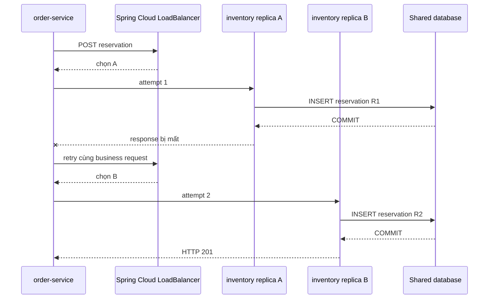
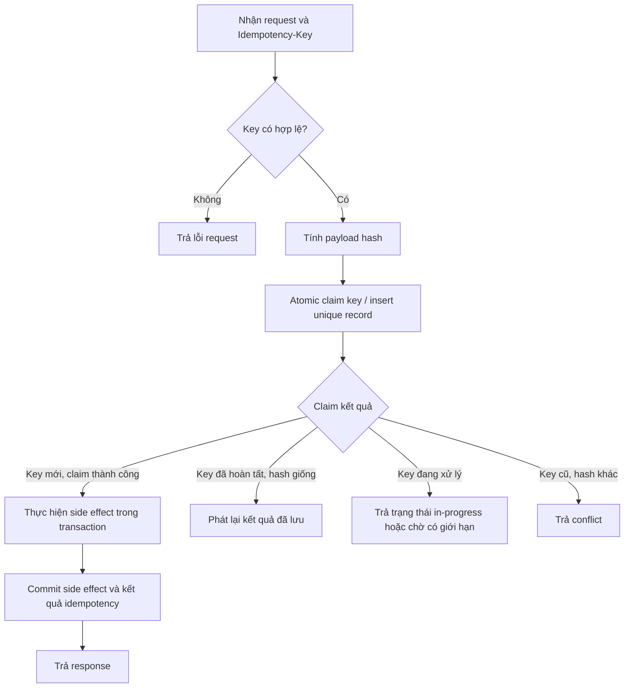

# Retry quá mức gây yêu cầu trùng và tăng tải

Trong hệ thống microservices, retry giúp một lời gọi có thêm cơ hội thành công khi replica tạm thời không phản hồi. Nhưng nếu nhiều tầng cùng retry, hoặc caller gửi lại sau khi server đã thực hiện thao tác nhưng response bị mất, một business request có thể tạo ra **nhiều HTTP attempt và nhiều tác dụng phụ**. Hệ quả thường thấy là reservation/đơn hàng bị tạo trùng, tồn kho bị trừ nhiều lần, database tăng tải và những replica còn sống tiếp tục quá tải.

Ví dụ `order-service` gọi `inventory-service` để giữ hai sản phẩm. Request đầu tới replica A, server đã commit giao dịch nhưng response bị timeout trên đường về. Caller không biết thao tác đã hoàn tất hay chưa nên gửi lại. Retry được cân bằng tải sang replica B; nếu B không nhận diện đây là cùng một yêu cầu nghiệp vụ, nó có thể tạo thêm một reservation. Việc chọn replica khác **không làm request trở thành một thao tác mới hợp lệ**, vì các replica thường cùng phục vụ một API và dùng chung dữ liệu.

Bài này thuộc chương **Chẩn đoán sự cố** của module `SPRING_CLOUD_SERVICE_COMMUNICATION_LOAD_BALANCING`. Trọng tâm là nhận diện retry amplification, hiểu kết quả không chắc chắn sau timeout, bảo vệ thao tác ghi bằng idempotency, phối hợp retry giữa HTTP client/Spring Cloud LoadBalancer/gateway/service mesh và xây dựng quy trình điều tra có thể kiểm chứng.

> Nguyên tắc cốt lõi: **retry policy quyết định có thử lại hay không; LoadBalancer chọn instance cho attempt tiếp theo; idempotency ở phía server bảo vệ tác dụng phụ khỏi bị thực hiện trùng.** Ba trách nhiệm này bổ sung cho nhau, không thể thay thế nhau.

## 1. Nhận diện sự cố qua một timeline

Giả sử người dùng tạo đơn hàng order-7841 và hệ thống cần giữ hai sản phẩm BOOK-001. Caller gửi:

```http
POST /api/reservations HTTP/1.1
Host: inventory-service
Content-Type: application/json

{
  "orderId": "order-7841",
  "sku": "BOOK-001",
  "quantity": 2
}
```

Timeline có thể diễn ra như sau:

```text
t=0 ms      order-service gửi attempt 1 tới inventory replica A
t=80 ms     A nhận request và bắt đầu xử lý
t=140 ms    A ghi reservation, commit database
t=150 ms    A gửi response HTTP 201
t=160 ms    Kết nối bị reset; caller không nhận được response
t=900 ms    Caller hết read timeout và coi attempt 1 là lỗi
t=920 ms    Retry policy cho phép attempt 2
t=940 ms    LoadBalancer chọn replica B
t=1.020 ms  B nhận lại POST và tạo reservation thứ hai
t=1.080 ms  Caller nhận HTTP 201 từ B
```

Ở góc nhìn caller, attempt 1 thất bại và attempt 2 thành công. Ở góc nhìn nghiệp vụ, có thể đã có **hai reservation**. Đây là tình huống *ambiguous outcome* (kết quả không xác định): caller không biết chắc server đã thực hiện thao tác hay chưa.

| Quan sát | Điều có thể kết luận | Điều chưa thể kết luận |
| --- | --- | --- |
| Caller nhận read timeout | Không nhận response trong thời hạn | Server chưa xử lý request |
| LoadBalancer chọn B ở lần retry | Attempt tiếp theo được định tuyến tới B | A chưa commit dữ liệu |
| Attempt 2 trả HTTP 201 | B đã trả response thành công | Chỉ có một reservation |
| Log caller chỉ có một response cuối | Caller hoàn tất lời gọi | Chỉ có một HTTP attempt hoặc một side effect |

**Timeout là giới hạn chờ của caller, không phải lệnh rollback ở server.** Khi request đã rời caller, server có thể tiếp tục xử lý ngay cả khi caller hủy hoặc đóng kết nối.

## 2. Phân biệt business request, logical call và HTTP attempt

Một phần lớn sự cố bắt đầu từ việc dashboard chỉ có một con số “request count”, không nói rõ đang đếm ở tầng nào.

| Khái niệm | Ý nghĩa | Ví dụ |
| --- | --- | --- |
| Business request | Một ý định nghiệp vụ từ người dùng hoặc upstream | Tạo reservation cho đơn order-7841 |
| Logical downstream call | Một lần code gọi adapter/client tới inventory-service | inventoryClient.reserve(...) |
| HTTP attempt | Một lần transport thực hiện request tới một endpoint | POST tới replica A, sau đó POST tới B |
| Server receive | Một request mà application instance thực sự nhận | A nhận attempt 1, B nhận attempt 2 |
| Side effect | Thay đổi trạng thái nghiệp vụ hoặc dữ liệu | Hai bản ghi reservation hoặc hai lần trừ kho |

Một business request có thể sinh nhiều logical call nếu code gọi downstream nhiều lần. Một logical call có thể sinh nhiều HTTP attempt do retry. Một HTTP attempt có thể thất bại trước khi server nhận request. Một server receive có thể tạo side effect dù caller không nhận response.

Cần đặt metric và log riêng cho từng phạm vi. Ví dụ, nếu một business request tạo một logical call nhưng ba attempt, thì:

```text
business_requests_total       += 1
downstream_logical_calls      += 1
http_client_attempts_total    += 3
inventory_server_receives     += 2 hoặc 3 tùy attempt nào tới server
```

Không dùng số lần chọn ServiceInstance để đại diện cho số request server nhận. Không dùng số response cuối cùng để đại diện cho số lần thực thi ở phía server.

## 3. Vì sao retry làm tăng tải?

Retry được tạo ra để vượt qua lỗi tạm thời. Nhưng mỗi retry là một attempt bổ sung cần tài nguyên: connection, thread/event loop, CPU, serialization, network, database và logging.

Giả sử 1.000 business request/giây, mỗi request ban đầu tạo một attempt. Nếu 20% request retry thêm một lần:

```text
Attempt rate = 1.000 × (1 + 0,20)
             = 1.200 HTTP attempts/giây
Retry amplification = 1.200 / 1.000
                    = 1,20
```

Downstream phải xử lý hoặc tiếp nhận 1.200 attempt/giây thay vì 1.000. Nếu 20% số attempt retry đó lại thất bại và retry thêm lần nữa, số attempt còn tăng.

Một cách biểu diễn tổng quát:

```text
Attempt rate = Business request rate × Average attempts per business request

Amplification factor =
    Total HTTP attempts / Business requests
```

Nếu nhiều tầng cùng retry, số attempt tối đa có thể nhân lên. Ví dụ mỗi tầng cho phép ba attempt (một lần đầu + hai retry):

```text
Gateway:             tối đa 3 attempt tới order-service
order-service:       tối đa 3 attempt cho mỗi lần gọi inventory
Service mesh:        tối đa 2 attempt cho mỗi request mà mesh xử lý

Cận trên minh họa:
3 × 3 × 2 = 18 lần truyền tới downstream
```

Con số thực tế phụ thuộc phạm vi retry của từng lớp, việc lỗi có kích hoạt retry hay không, deadline và việc có tạo request mới ở tầng dưới hay không. Nhưng phép nhân cho thấy tại sao phải kiểm tra **toàn bộ chuỗi retry**, không chỉ một YAML.

## 4. Những nguyên nhân thường gặp

| Nguyên nhân | Biểu hiện | Rủi ro |
| --- | --- | --- |
| Read timeout sau khi server commit | Caller retry dù server đã hoàn thành | Tạo side effect trùng |
| Retry bật ở nhiều tầng | Attempt rate cao hơn business RPS nhiều lần | Khuếch đại tải |
| Retry ngay, không backoff | Nhiều client gửi lại cùng thời điểm | Retry storm |
| Không giới hạn tổng deadline | Request tiếp tục retry sau khi không còn thời gian hữu ích | Chiếm tài nguyên và làm tăng tail latency |
| Retry cả lỗi nghiệp vụ | Retry 400, 404 hoặc lỗi validation | Tốn tải mà không thể tự phục hồi |
| Không có idempotency key | Server coi mỗi attempt là một yêu cầu mới | Duplicate write |
| Idempotency store không atomic | Hai replica cùng xử lý một key đồng thời | Race condition, side effect kép |
| Idempotency key không được giữ nguyên | Mỗi attempt sinh key mới | Server không nhận ra retry |
| Key hết hạn quá sớm | Retry đến muộn sau khi bản ghi dedupe bị xóa | Thao tác có thể bị thực hiện lại |
| Đổi instance nhưng dùng chung database | Replica mới không biết request trước đã xử lý | Duplicate xuyên instance |

Một retry sang replica khác chỉ thay đổi đích mạng. Nếu các replica cùng dùng một database hoặc cùng ghi vào một hệ thống downstream, **idempotency phải được thực thi ở nơi kiểm soát side effect dùng chung**.

## 5. Timeout không chứng minh request chưa được thực hiện

Các lỗi xảy ra ở các thời điểm khác nhau có mức độ mơ hồ khác nhau:

| Điểm lỗi | Khả năng server đã nhận request | Cách xử lý |
| --- | --- | --- |
| Không tìm thấy ServiceInstance | Chưa gửi tới server qua attempt đó | Có thể trả lỗi thiếu đích; retry chỉ khi danh sách có khả năng thay đổi và còn deadline |
| DNS lookup thất bại | Thường chưa tới application server | Xử lý DNS/registry; tránh retry dày đặc |
| Connection refused trước khi kết nối | Thường chưa có HTTP request được server nhận | Có thể thử instance khác nếu lỗi tạm thời và request an toàn |
| TLS handshake thất bại | Thường chưa có HTTP application request hoàn chỉnh | Kiểm tra certificate/trust; không retry vô hạn lỗi cấu hình |
| Connection reset khi đang gửi request | Có thể server đã nhận một phần hoặc toàn bộ | Kết quả có thể mơ hồ |
| Read/response timeout sau khi gửi | Server có thể đang xử lý hoặc đã commit | Không giả định an toàn để retry |
| HTTP response 500 | Server đã trả response, nhưng side effect trước lỗi có thể đã xảy ra | Cần contract nghiệp vụ và idempotency |
| HTTP response 503 | Có response báo tạm thời không phục vụ | Chỉ retry theo policy, deadline và semantics |
| HTTP response 429 | Có thể đang bị rate limit | Xem Retry-After; không đổi replica để né quota toàn service |

Đặc biệt, POST không tự động là không idempotent trong mọi API, và PUT không tự động an toàn nếu implementation có side effect không tuân thủ semantics. Cần xem **hợp đồng nghiệp vụ thực tế**, không chỉ HTTP verb.

## 6. Phân biệt lỗi có thể retry và lỗi không nên retry

Một retry policy cần có allowlist/điều kiện rõ ràng thay vì “exception nào cũng thử lại”.

| Lỗi hoặc response | Hướng xử lý thường cân nhắc |
| --- | --- |
| Connection refused tới một replica | Có thể thử replica khác với giới hạn |
| Connect timeout | Có thể retry có điều kiện; xác định network/topology |
| Connection reset sau khi gửi | Kết quả có thể mơ hồ; cần idempotency |
| Read timeout | Không giả định server chưa commit; chỉ retry thao tác an toàn hoặc có idempotency |
| HTTP 429 | Tôn trọng Retry-After và deadline; rate limit có thể áp dụng toàn dịch vụ |
| HTTP 502, 503, 504 | Có thể retry giới hạn nếu thao tác an toàn và lỗi được xem là tạm thời |
| HTTP 400, 401, 403, 404, 422 | Thường không retry tự động; sửa request/quyền/contract |
| TLS certificate/hostname error | Sửa cấu hình chứng chỉ; không lặp vô hạn |

Đây là hướng dẫn tổng quát. Một API có thể định nghĩa status riêng, ví dụ 409 là conflict có thể giải quyết bằng thao tác khác. Hãy dựa trên error code và contract đã công bố.

**Không retry 429 ngay sang replica khác để tránh giới hạn.** Nếu quota được áp dụng ở cấp service hoặc tenant, đổi Pod không làm request được phép.

## 7. Retry ở đâu trong Spring Cloud?

Trong một ứng dụng Spring Cloud, retry có thể nằm ở nhiều nơi:

- **Spring Cloud LoadBalancer:** tích hợp retry có thể thử lại và lựa chọn ServiceInstance khác, tùy client/integration và cấu hình.
- **OpenFeign:** Retryer của Feign quyết định hành vi retry ở lớp Feign; Spring Cloud OpenFeign thường cấu hình Retryer.NEVER_RETRY mặc định trong các phiên bản phổ biến.
- **WebClient/Reactor:** toán tử retry, retryWhen có thể subscribe lại pipeline và tạo HTTP attempt mới.
- **RestClient:** retry có thể được triển khai ở tầng adapter/service, decorator hoặc thư viện resilience; RestClient không nên được giả định tự retry mọi lỗi.
- **API Gateway / service mesh:** proxy có thể retry theo route, status hoặc reset/timeout.
- **Business workflow / message consumer:** tầng nghiệp vụ có thể gửi lại command hoặc xử lý message redelivery.

Các cơ chế này không nhất thiết chia sẻ cùng attempt counter, deadline hoặc idempotency context. Đặc biệt, RetryAwareServiceInstanceListSupplier có thể tránh chọn lại instance trước đó khi có lựa chọn khác, nhưng **không bảo vệ side effect trùng** và không tự quyết định request có an toàn để retry hay không.

### 7.1. Lập bảng retry ownership

Trước khi sửa sự cố, lập bảng cho từng cạnh gọi:

| Tầng | Có retry? | Max attempts | Lỗi được retry | Chủ sở hữu deadline |
| --- | --- | ---: | --- | --- |
| Gateway → order | Có/không | Giá trị đã xác minh | Status/reset cụ thể | Gateway hoặc request context |
| order → inventory (HTTP client) | Có/không | Giá trị đã xác minh | Exception/status cụ thể | Order service |
| Spring Cloud LoadBalancer | Có/không | Same/next instance | Theo integration | Caller |
| Service mesh | Có/không | Giá trị route | Theo proxy policy | Mesh/request |
| Business workflow | Có/không | Số redelivery | Theo trạng thái nghiệp vụ | Workflow |

Không để ô “có retry” mà không có giá trị max attempts, loại lỗi và chủ sở hữu deadline. Nếu hai tầng cùng cần retry, phải chứng minh tổng attempt và side effect vẫn nằm trong giới hạn.

## 8. Vì sao đổi replica không giải quyết duplicate?

Giả sử A và B cùng phục vụ inventory-service và cùng ghi vào database inventory_db.



LoadBalancer đã làm đúng nhiệm vụ: chọn một instance cho mỗi attempt. Nhưng database không biết R1 và R2 có cùng nguồn gốc business request. Nếu server không có idempotency, cả hai đều có thể được commit.

RetryAwareServiceInstanceListSupplier giúp tránh chọn lại replica vừa lỗi khi còn instance khác. Nó không thể biết database đã ghi gì và không thể biến thao tác thứ hai thành thao tác đầu tiên.

**Bảo vệ duplicate phải nằm tại server hoặc hệ thống sở hữu side effect**, ví dụ unique constraint, idempotency record, transaction, inbox/outbox hoặc cơ chế deduplication tương đương.

## 9. Idempotency key: giữ nguyên định danh qua mọi attempt

Một API có thể yêu cầu caller gửi một key ổn định cho một thao tác nghiệp vụ:

```http
POST /api/reservations HTTP/1.1
Host: inventory-service
Content-Type: application/json
Idempotency-Key: order-7841-reserve-BOOK-001

{
  "orderId": "order-7841",
  "sku": "BOOK-001",
  "quantity": 2
}
```

Nếu caller retry, **phải gửi lại cùng key** cho cùng một thao tác nghiệp vụ. Không sinh UUID mới bên trong mỗi HTTP attempt.

Key nên được thiết kế theo phạm vi phù hợp:

- Duy nhất trong tenant/customer hoặc principal cần thiết.
- Gắn với một operation cụ thể, không dùng chung cho mọi request.
- Có thời hạn lưu đủ dài để bao phủ retry, redelivery và quy trình phục hồi.
- Không chứa dữ liệu bí mật hoặc thông tin cá nhân trực tiếp.
- Có payload fingerprint/hash để phát hiện cùng key nhưng body khác nhau.
- Được xử lý atomic để hai replica không cùng thực thi side effect.

Ví dụ một key minh họa:

```text
order-7841-reserve-BOOK-001
```

Trong production, có thể dùng một định danh ngẫu nhiên do caller sinh một lần khi tạo command và lưu bền vững cùng command. Key có thể được biểu diễn bằng UUID/opaque token; không nhất thiết ghép trực tiếp các ID nghiệp vụ như ví dụ.

## 10. Server cần lưu kết quả idempotency như thế nào?

Một bảng deduplication có thể có cấu trúc khái niệm:

```sql
CREATE TABLE idempotency_record (
    tenant_id       VARCHAR(100) NOT NULL,
    idempotency_key VARCHAR(200) NOT NULL,
    operation       VARCHAR(100) NOT NULL,
    payload_hash    VARCHAR(128) NOT NULL,
    state           VARCHAR(20) NOT NULL,
    response_status INTEGER,
    response_body   TEXT,
    created_at      TIMESTAMP NOT NULL,
    expires_at      TIMESTAMP NOT NULL,
    PRIMARY KEY (tenant_id, idempotency_key, operation)
);
```

Ý nghĩa:

| Trường | Mục đích |
| --- | --- |
| tenant_id | Tránh đụng key giữa các phạm vi tenant |
| idempotency_key | Định danh thao tác được gửi lại |
| operation | Phân biệt endpoint/loại thao tác |
| payload_hash | Phát hiện key bị tái sử dụng với nội dung khác |
| state | Phân biệt đang xử lý, hoàn tất hoặc trạng thái cần phục hồi |
| response_status/body | Phát lại kết quả đã lưu theo contract |
| expires_at | Chính sách giữ dedupe record |

**Unique constraint/primary key là điều kiện quan trọng để chống race giữa nhiều replica.** Nếu A và B cùng nhận một key gần như đồng thời, chỉ một bên được quyền tạo record mới. Bên còn lại phải đọc trạng thái đã có hoặc chờ/nhận trạng thái đang xử lý theo contract.

Không nên chỉ kiểm tra SELECT rồi sau đó INSERT mà không có ràng buộc atomic: hai transaction có thể cùng đọc “chưa tồn tại” rồi cả hai cùng thực thi side effect.

### 10.1. Luồng xử lý idempotency



Đây là mô hình khái niệm. Cách đảm bảo atomicity giữa record idempotency và side effect phụ thuộc datastore và kiến trúc. Nếu side effect nằm ở một hệ thống khác, không thể giả định một transaction database cục bộ bao trùm được. Có thể cần transactional outbox, inbox/dedup ở consumer, workflow state machine hoặc giao thức tương ứng.

### 10.2. Cùng key nhưng payload khác

Ví dụ caller gửi lần đầu:

```json
{"sku":"BOOK-001","quantity":2}
```

Sau đó vô tình retry cùng key nhưng payload là:

```json
{"sku":"BOOK-001","quantity":5}
```

Server phải phát hiện payload hash khác và trả lỗi conflict theo contract. Không được âm thầm phát lại kết quả của request đầu như thể payload thứ hai giống hệt; cũng không được thực hiện side effect mới dưới key đã dùng.

## 11. Ví dụ controller và service theo hướng idempotent

Controller chỉ minh họa contract và chuyển key vào service:

```java
import org.springframework.http.ResponseEntity;
import org.springframework.web.bind.annotation.*;

@RestController
@RequestMapping("/api/reservations")
class ReservationController {

    private final ReservationService service;

    ReservationController(ReservationService service) {
        this.service = service;
    }

    @PostMapping
    ResponseEntity<ReservationResponse> reserve(
            @RequestHeader("Idempotency-Key") String key,
            @RequestBody ReservationRequest request) {

        ReservationResponse result = service.reserve(key, request);
        return ResponseEntity.status(result.httpStatus()).body(result);
    }
}
```

Các kiểu ReservationRequest, ReservationResponse và ReservationService là kiểu do ứng dụng định nghĩa. Để implementation thực sự an toàn, service cần dùng atomic claim/unique constraint và lưu kết quả cùng side effect theo transaction phù hợp. Controller ở trên **không tự cung cấp idempotency** chỉ vì nó đọc header.

Pseudocode phần service:

```java
ReservationResponse reserve(String key, ReservationRequest request) {
    String hash = hashCanonicalPayload(request);

    Claim claim = idempotencyStore.claimAtomically(
            tenantId(), key, "reserve", hash);

    if (claim.isPayloadConflict()) {
        throw new IdempotencyKeyReuseException();
    }

    if (claim.isCompleted()) {
        return claim.savedResponse();
    }

    if (claim.isInProgress()) {
        throw new ReservationStillProcessingException();
    }

    // Thực thi side effect và ghi response theo transaction/idempotency design.
    return reservationTransaction.executeOnce(claim, request);
}
```

Đây là pseudocode thể hiện các nhánh logic, không phải implementation có thể compile nguyên trạng. Điểm quan trọng là claimAtomically phải thực sự atomic giữa các replica; executeOnce phải có chiến lược phục hồi nếu process chết sau khi claim nhưng trước khi hoàn tất.

### 11.1. Xử lý trạng thái IN_PROGRESS

Một request có thể bị server dừng giữa lúc ghi IN_PROGRESS và hoàn thành side effect. Cần thiết kế:

- Lease/owner token hoặc cơ chế khóa có thời hạn.
- Quy tắc lấy lại quyền xử lý khi worker chết.
- Phân biệt thao tác chưa bắt đầu với thao tác đã commit nhưng chưa lưu response.
- Cơ chế truy vấn trạng thái nghiệp vụ để caller có thể xác minh kết quả.
- Retention/cleanup không xóa record đang cần cho retry hoặc đối soát.

Không nên giữ trạng thái IN_PROGRESS vô hạn. Cũng không nên xóa ngay record chỉ vì caller timeout, bởi server có thể đã thực hiện thao tác.

## 12. Caller phải giữ idempotency key qua retry

Một gateway/adaptor nên nhận hoặc tạo key ở **ranh giới business request**, rồi dùng lại cho mọi attempt. Ví dụ method gọi RestClient:

```java
import org.springframework.cloud.client.loadbalancer.LoadBalanced;
import org.springframework.stereotype.Component;
import org.springframework.web.client.RestClient;

@Component
class InventoryReservationClient {

    private final RestClient client;

    InventoryReservationClient(
            @LoadBalanced RestClient.Builder builder) {
        this.client = builder
                .baseUrl("http://inventory-service")
                .build();
    }

    ReservationResponse reserve(
            String idempotencyKey,
            ReservationRequest request) {

        return client.post()
                .uri("/api/reservations")
                .header("Idempotency-Key", idempotencyKey)
                .body(request)
                .retrieve()
                .body(ReservationResponse.class);
    }
}
```

Đoạn code cho thấy key được truyền từ caller vào mỗi lần gọi. Nếu retry được triển khai bên trong một lớp phía dưới, request factory/retry mechanism phải giữ nguyên header đó. Nếu retry nằm ở tầng business, hãy gọi method lại với **cùng** idempotencyKey.

Không sinh key bên trong method nếu method có thể được gọi lại để retry; nếu mỗi lần vào method lại tạo key mới thì server coi mỗi attempt là một operation khác nhau.

Với WebClient, nguyên tắc tương tự: tạo key một lần trước pipeline, gắn vào header và giữ nguyên khi publisher được resubscribe. Với OpenFeign, có thể nhận key như tham số RequestHeader hoặc dùng interceptor có context rõ ràng; tránh một biến ThreadLocal không được truyền đúng qua reactive/asynchronous boundary.

## 13. Retry nhiều tầng: chọn một chủ sở hữu chính

Không nhất thiết mọi retry phải nằm ở cùng một thư viện, nhưng cần **một chính sách có chủ sở hữu rõ ràng cho mỗi cạnh gọi**.

| Tầng | Vai trò đề xuất | Cần tránh |
| --- | --- | --- |
| API Gateway | Retry giới hạn cho lỗi kết nối trước khi chuyển request hoặc thao tác được chứng minh an toàn | Retry POST tùy tiện sau timeout mơ hồ |
| Business adapter | Quyết định theo semantics nghiệp vụ, idempotency key và deadline | Tự retry không giới hạn rồi để HTTP client retry tiếp |
| Spring Cloud LoadBalancer | Chọn instance phù hợp cho attempt được cho phép | Coi lựa chọn instance khác là bảo vệ duplicate |
| HTTP transport | Connect/read timeout, connection management | Retry ẩn không quan sát được |
| Service mesh | Policy mạng tập trung khi có yêu cầu rõ | Retry cùng một operation mà không chia sẻ idempotency context |
| Consumer/workflow | Redelivery có dedup và trạng thái bền vững | Tạo operation mới khi xử lý lại message |

Spring Cloud LoadBalancer có các cấu hình retry liên quan tới số lần retry trên cùng instance và instance tiếp theo. Tên và hành vi cụ thể phụ thuộc phiên bản và HTTP client integration; phải kiểm tra dependency/BOM và test. Cấu hình max-retries-on-next-service-instance không có nghĩa caller đã chống được side effect trùng.

OpenFeign trong Spring Cloud OpenFeign thường có Retryer.NEVER_RETRY mặc định, khác với một số hành vi retry của Feign lõi. Không bật retry Feign chỉ vì muốn LoadBalancer chọn replica khác; hãy xác minh integration đang chịu trách nhiệm tạo attempt.

## 14. Cấu hình minh họa và những điều cần xác minh

Ví dụ một cấu hình LoadBalancer retry có giới hạn:

```yaml
spring:
  cloud:
    loadbalancer:
      retry:
        enabled: true
        max-retries-on-same-service-instance: 0
        max-retries-on-next-service-instance: 1
        retry-on-all-operations: false
        avoid-previous-instance: true
```

Đây là **cấu hình minh họa**, không phải chính sách an toàn áp dụng cho mọi endpoint. Cần xác minh:

1. Phiên bản Spring Cloud có hỗ trợ các property này và integration đang dùng hay không.
2. Dependency cần thiết cho blocking/reactive retry đã có chưa.
3. Những lỗi/status nào thực sự kích hoạt retry.
4. retry-on-all-operations được diễn giải ra sao ở version đó và HTTP method nào được phép.
5. Số attempt thực tế khi kết hợp với retry ở Feign, Reactor, gateway hoặc mesh.
6. Deadline tổng và backoff có giới hạn hay không.
7. Idempotency key có được giữ nguyên tới server không.

Với thao tác ghi, retry-on-all-operations: false không tự chứng minh mọi POST đều không retry trong toàn hệ thống. Các tầng khác có thể có policy riêng.

### 14.1. Tại sao tránh retry trên cùng instance không giải quyết duplicate?

Nếu attempt đầu tới A đã commit nhưng caller timeout, attempt sau tới B vẫn có thể thực hiện cùng side effect. Đổi instance có thể giúp tránh một replica đang lỗi, nhưng không thay đổi trạng thái dữ liệu đã commit ở A.

Do đó, tránh previous instance là chính sách **chọn đích**. Idempotency là chính sách **thực hiện thao tác đúng một lần về mặt hiệu ứng quan sát được**. Không dùng một chính sách để thay cho chính sách còn lại.

## 15. Backoff, jitter và deadline tổng

Khi retry, caller nên chờ một khoảng có kiểm soát để tránh nhiều request cùng dồn lại vào một thời điểm.

Một mô hình exponential backoff có trần:

```text
baseDelay(k) = min(maxBackoff, initialBackoff × 2^(k - 1))
actualDelay  = random(0, baseDelay(k))  // ví dụ full jitter
```

Ví dụ initialBackoff=100ms, maxBackoff=800ms:

| Lần retry | Delay cơ sở tối đa |
| ---: | ---: |
| 1 | 100 ms |
| 2 | 200 ms |
| 3 | 400 ms |
| 4 | 800 ms |
| 5 trở đi | 800 ms |

Jitter phân tán thời điểm retry của nhiều caller. Nhưng backoff không được vượt deadline tổng.

Giả sử business deadline là 2.000 ms, attempt đầu đã dùng 900 ms, caller còn 1.100 ms. Nếu attempt tiếp theo cần tối đa 900 ms và backoff có thể tới 300 ms, không còn đủ ngân sách cho retry. Caller nên dừng hoặc chọn một attempt có budget nhỏ hơn nếu có ích.

```text
remaining = deadline - now

Retry chỉ được bắt đầu nếu:
remaining > backoff + minimumUsefulAttemptBudget + responseReserve
```

Timeout ở từng HTTP attempt khác deadline tổng. Nếu mỗi attempt có read timeout 1 giây và có ba attempt cùng backoff, tổng thời gian có thể vượt 3 giây cộng các khoảng chờ. Cần đặt deadline bao trùm chuỗi retry và tính cả admission/pool wait nếu các bước đó nằm trong đường gọi.

## 16. WebClient: retry phải giữ nguyên request identity

Với Reactor, một publisher có thể được subscribe lại khi dùng retryWhen. Ví dụ minh họa một request GET an toàn:

```java
import java.time.Duration;

import org.springframework.web.reactive.function.client.WebClientRequestException;
import org.springframework.web.reactive.function.client.WebClientResponseException;
import reactor.core.publisher.Mono;
import reactor.util.retry.Retry;

Mono<StockResponse> stock =
        webClient.get()
                .uri("/api/stocks/{sku}", sku)
                .retrieve()
                .bodyToMono(StockResponse.class)
                .retryWhen(
                        Retry.backoff(2, Duration.ofMillis(100))
                                .maxBackoff(Duration.ofMillis(400))
                                .jitter(0.5)
                                .filter(error ->
                                        error instanceof WebClientRequestException
                                        || (error instanceof WebClientResponseException response
                                            && response.getStatusCode()
                                                    .is5xxServerError()))
                )
                .timeout(Duration.ofMillis(2000));
```

Ở đây Retry.backoff(2, ...) cho tối đa **hai lần retry** sau attempt đầu. timeout đặt sau retryWhen giới hạn tổng pipeline theo subscription. Filter chỉ là ví dụ; production cần phân loại lỗi chi tiết, xem status, Retry-After, semantics và deadline.

Với thao tác POST có idempotency key, key phải được tạo trước publisher và giữ ổn định:

```java
String key = command.idempotencyKey();

Mono<ReservationResponse> reservation =
        webClient.post()
                .uri("/api/reservations")
                .header("Idempotency-Key", key)
                .bodyValue(command.request())
                .retrieve()
                .bodyToMono(ReservationResponse.class);
```

Nếu thêm retry, mọi subscription phải phát cùng key và cùng payload. Không tạo key mới trong defer cho từng attempt. Ngoài ra, cần kiểm tra retry ở Spring Cloud LoadBalancer hoặc mesh để tránh publisher retry bị nhân với retry bên dưới.

## 17. RestClient và OpenFeign: kiểm tra đúng tầng retry

RestClient là API đồng bộ; retry có thể được thêm ở service/adaptor, resilience decorator hoặc integration tương ứng. Một vòng try/catch rồi gọi lại method không tự có deadline, backoff hay idempotency. Hãy giữ key và command ở ngoài vòng lặp retry.

OpenFeign sử dụng interface khai báo, nhưng retry behavior phụ thuộc Retryer, error decoder và Spring Cloud LoadBalancer integration. Trong các phiên bản Spring Cloud OpenFeign phổ biến, retryer mặc định là NEVER_RETRY; cấu hình tùy chỉnh có thể thay đổi hành vi. Không suy ra số attempt chỉ từ @FeignClient.

Checklist theo client:

| Client | Kiểm tra |
| --- | --- |
| RestClient | Có wrapper/decorator retry không? HTTP request được gửi bao nhiêu lần? |
| WebClient | Có retry, retryWhen, filter retry hoặc resubscription không? |
| OpenFeign | Bean Retryer, ErrorDecoder, client config và URL cố định? |
| Spring Cloud LoadBalancer | Retry enabled, same/next instance, request context và policy? |
| Gateway/mesh | Route retry, per-try timeout, retry conditions, total timeout? |

Không dùng cùng một tên metric cho logical call và attempt. Nếu adapter đo một Timer quanh toàn bộ method, timer đó có thể chỉ ghi một lần dù bên trong có nhiều HTTP attempt.

## 18. Observability: nối business request với từng attempt

Để điều tra duplicate, cần một định danh business request xuyên suốt. Một bộ trường log có thể gồm:

| Trường | Ý nghĩa |
| --- | --- |
| traceId | Ghép các span/log của một đường xử lý |
| businessRequestId | Định danh ý định nghiệp vụ |
| idempotencyKeyHash | Nhận diện key mà không log raw key nếu key nhạy cảm |
| attemptIndex | Lần thử trong logical call |
| serviceId | Downstream logic |
| selectedInstance | Replica được LoadBalancer chọn |
| httpStatus / exceptionType | Kết quả transport/HTTP |
| retryReason | Lý do attempt tiếp theo được tạo |
| serverOperationId | Định danh thao tác ở phía server |
| dedupOutcome | NEW, REPLAYED, IN_PROGRESS, CONFLICT theo contract nội bộ |

Ví dụ timeline log:

```text
traceId=7c2a businessRequestId=order-7841-reserve
attempt=1 serviceId=inventory-service selected=A
result=READ_TIMEOUT durationMs=900

traceId=7c2a businessRequestId=order-7841-reserve
attempt=2 serviceId=inventory-service selected=B
idempotencyKeyHash=9f... dedupOutcome=REPLAYED
httpStatus=201 durationMs=45

traceId=7c2a businessRequestId=order-7841-reserve
businessOutcome=SUCCESS attempts=2
```

Nếu attempt 2 được server trả lại response đã lưu từ attempt 1, dedupOutcome=REPLAYED giúp chứng minh idempotency đang hoạt động. Đây là trường log đề xuất, không phải field mặc định do Spring Cloud sinh ra.

### 18.1. Metrics nên có

Các metric có cardinality thấp và định nghĩa rõ:

- business_requests_total{operation,outcome}
- http_client_attempts_total{service_id,method,outcome}
- retry_attempts_total{service_id,reason}
- idempotency_requests_total{operation,outcome}
- duplicate_side_effect_prevented_total{operation}
- downstream_inflight{service_id}
- downstream_duration_seconds histogram theo service ID và method template.

Không đưa raw idempotency key, order ID, user ID, trace ID, SKU hoặc URI động vào metric label. Những giá trị này có thể xuất hiện trong structured log/trace với sampling và chính sách lưu trữ phù hợp.

Một chỉ số khuếch đại:

```promql
sum(rate(http_client_attempts_total{service_id="inventory-service"}[5m]))
/
sum(rate(business_requests_total{operation="reserve"}[5m]))
```

Truy vấn chỉ có ý nghĩa nếu numerator và denominator đo **cùng tập business flow**, cùng cửa sổ thời gian và các metric có labels phù hợp. Nếu một business request gọi inventory nhiều lần theo thiết kế, tỷ lệ trên không chỉ phản ánh retry; cần thêm metric logical_downstream_calls_total để tách số call hợp lệ khỏi số attempt phát sinh do retry.

## 19. Quy trình xử lý incident khi có yêu cầu trùng

Khi phát hiện nhiều reservation hoặc side effect tăng bất thường, thực hiện theo thứ tự:

1. **Bảo vệ dữ liệu:** xác định nghiệp vụ nào bị ảnh hưởng, tạm hạn chế retry của thao tác ghi nếu có nguy cơ tiếp tục tạo duplicate.
2. **Giữ nguyên bằng chứng:** lưu trace ID, business request ID, server operation ID, attempt timeline và các transaction liên quan.
3. **Đếm phạm vi:** business request, logical call, HTTP attempt, server receive và số side effect thực tế.
4. **Xác định tầng retry:** gateway, service code, HTTP client, LoadBalancer, mesh hoặc message redelivery.
5. **Đối chiếu thời điểm timeout:** server đã commit trước hay sau khi caller hết hạn chờ?
6. **Kiểm tra idempotency:** key có tồn tại, có được giữ qua retry, có unique constraint và có replay response không?
7. **Kiểm tra race:** hai replica có cùng claim một key? Database có unique constraint thật không?
8. **Tạm giảm tải:** giới hạn attempt, backoff, concurrency và admission; tránh chuyển tải retry sang replica còn sống.
9. **Đối soát side effect:** dùng business ID và transaction log để tìm bản ghi trùng; chỉ sửa dữ liệu bằng quy trình nghiệp vụ có kiểm soát.
10. **Triển khai biện pháp bảo vệ:** idempotency, deadline, retry owner, metric và test lỗi mơ hồ.
11. **Theo dõi sau sửa:** attempt/business ratio, duplicate prevented, error rate, p95/p99 và số side effect.
12. **Kiểm tra lại rollout:** mọi replica và caller version đều tuân thủ contract idempotency trước khi bật retry trở lại.

Không xóa bản ghi trùng một cách máy móc chỉ dựa trên cùng payload. Hai yêu cầu hợp lệ có thể có payload giống nhau nhưng là hai ý định nghiệp vụ khác nhau. Cần xác định business request identity và quy tắc đối soát trước khi sửa dữ liệu.

## 20. Ví dụ tình huống và cách suy luận

### Tình huống A: timeout nhưng server log có commit

Caller thấy attempt 1 timeout. Server A ghi reservation R100 và commit trước timeout. Caller retry sang B, B ghi R101.

**Kết luận:** lỗi nằm ở việc caller không thể biết kết quả attempt 1, cộng với server thiếu deduplication. Cần idempotency key dùng chung qua A/B; không chỉ tăng timeout hoặc thay thuật toán Round Robin.

### Tình huống B: gateway và service đều retry

Gateway cho tối đa 2 attempt, order-service cho tối đa 3 attempt. Một request có thể tạo tới 6 attempt ở downstream trong kịch bản lồng nhau.

**Kết luận:** lập retry ownership, giảm một tầng hoặc thiết kế tổng attempt/deadline rõ ràng. Không chỉ đổi max-retries-on-next-service-instance.

### Tình huống C: retry GET làm tăng tải nhưng không tạo duplicate write

Một API GET an toàn bị chậm; caller retry nhiều lần, tất cả đều đọc cùng dữ liệu. Không có side effect trùng nhưng database bị tăng read QPS, pool chạm giới hạn và các API khác chậm theo.

**Kết luận:** idempotency không giải quyết tải đọc. Cần giảm retry, backoff/jitter, deadline, cache phù hợp, bulkhead và capacity planning.

### Tình huống D: cùng idempotency key nhưng payload khác

Caller gửi lại key cũ nhưng quantity thay từ 2 thành 5.

**Kết luận:** server phải phát hiện payload hash khác và trả conflict theo contract. Không được thực hiện thao tác mới hoặc trả kết quả cũ như thể payload tương đương.

### Tình huống E: replica A chết trước khi nhận request

Caller nhận connection refused, LoadBalancer chọn B và B xử lý thành công. Server không có bằng chứng attempt A đã nhận request.

**Kết luận:** đây là trường hợp retry có khả năng hữu ích. Tuy nhiên, vẫn giữ cùng idempotency key cho thao tác ghi vì caller không phải lúc nào cũng phân biệt chắc chắn request đã được gửi đến server hay chưa.

## 21. Kiểm thử lỗi để chứng minh không tạo side effect trùng

Một bài test chỉ kiểm tra caller nhận HTTP 201 sau retry là chưa đủ. Phải xác minh **số side effect cuối cùng**.

| Test case | Cách tạo lỗi | Kỳ vọng |
| --- | --- | --- |
| Response bị mất sau commit | Server commit DB rồi test proxy cắt response | Retry cùng key trả lại kết quả đã lưu; chỉ một reservation |
| Hai replica nhận cùng key đồng thời | Gửi song song cùng request/key tới A và B | Một claim thắng; không có hai side effect |
| Retry đổi instance | Attempt đầu tới A, attempt sau tới B | Dedup dùng chung giữa replicas |
| Cùng key, payload khác | Gửi lại key với quantity khác | Conflict; không side effect mới |
| Server chết sau claim | Dừng process sau khi tạo IN_PROGRESS | Lease/recovery đưa operation tới trạng thái có thể xử lý an toàn |
| Key hết hạn | Gửi retry sau retention window | Hành vi theo contract; retention không ngắn hơn retry/redelivery hợp lệ |
| HTTP 503 trước khi xử lý | Server từ chối request trước side effect | Retry có giới hạn có thể thành công |
| HTTP 500 sau commit | Server commit rồi lỗi khi dựng response | Retry không tạo duplicate |
| Nhiều tầng retry | Bật policy gateway + client + mesh trong test | Đếm attempt tổng và xác nhận deadline |
| Hết deadline | Cố tình chờ server lâu hơn budget | Caller dừng retry; trạng thái nghiệp vụ vẫn có thể được truy vấn |

### 21.1. Mẫu kiểm thử response bị mất

Một test tích hợp có thể dùng hai mock server A/B và database test:

1. Gửi POST có key K-123 tới A.
2. A ghi reservation và commit.
3. Test proxy đóng kết nối trước khi response tới caller.
4. Caller retry cùng key tới B.
5. B đọc idempotency record dùng chung và phát lại response đã lưu.
6. Truy vấn database xác nhận chỉ có một reservation cho operation key.
7. Kiểm tra attempt count là 2, side-effect count là 1 và dedup replay count là 1.

Test phải mô phỏng **mất response sau commit**, không chỉ dừng server trước khi xử lý. Hai tình huống này có ý nghĩa hoàn toàn khác nhau đối với tính an toàn của retry.

## 22. Những lỗi triển khai idempotency cần tránh

1. **Sinh key mới cho mỗi attempt:** server coi retry là thao tác mới.
2. **Lưu key chỉ trong memory của một replica:** retry sang B không nhìn thấy trạng thái của A.
3. **Không có unique constraint:** hai replica có thể cùng tạo record.
4. **Claim key và side effect ở hai transaction không liên kết:** process chết giữa hai bước tạo trạng thái mồ côi hoặc duplicate.
5. **Không kiểm tra payload hash:** cùng key nhưng request khác được xử lý sai.
6. **Không lưu/replay response:** caller không thể nhận lại kết quả nhất quán.
7. **Xóa key quá sớm:** retry hoặc redelivery hợp lệ tới sau thời gian retention có thể chạy lại.
8. **Giữ IN_PROGRESS vô hạn:** thao tác treo không thể phục hồi.
9. **Tin vào header do client tùy ý gửi:** key có thể bị tái sử dụng giữa tenant hoặc user không đúng phạm vi.
10. **Dùng idempotency thay cho authorization:** cùng key không cấp quyền truy cập.
11. **Cho rằng HTTP PUT luôn không có side effect phụ:** implementation có thể gửi email, phát event hoặc tạo log nghiệp vụ lặp.
12. **Không xử lý hệ thống ngoài transaction:** gửi message hoặc gọi payment provider cần outbox/dedup/idempotency riêng.

## 23. Những lỗi vận hành và cấu hình cần tránh

1. **Retry mọi exception:** lỗi certificate, validation hoặc quyền truy cập không tự khỏi nhờ retry.
2. **Retry POST sau read timeout mà không idempotency:** nguy cơ side effect trùng.
3. **Bật retry ở gateway, Feign, LoadBalancer và mesh cùng lúc:** attempt bị nhân.
4. **Không đặt deadline tổng:** request có thể sống lâu hơn SLA dù từng attempt có timeout.
5. **Không backoff/jitter:** retry đồng loạt làm downstream quá tải.
6. **Retry 429 sang replica khác:** có thể né sai quota chung của service/tenant.
7. **Coi retry-aware supplier là deduplication:** supplier chỉ hỗ trợ lựa chọn instance.
8. **Đếm một logical call là một HTTP request:** dashboard đánh giá thiếu tải thực.
9. **Chỉ nhìn response cuối:** che các lần commit trước khi response bị mất.
10. **Không quan sát server receive/DB commit:** không biết side effect đã xảy ra ở attempt nào.
11. **Chỉ tăng timeout để tránh lỗi:** giữ request lâu hơn có thể làm cạn pool và tăng concurrency.
12. **Tắt retry toàn hệ thống trong incident mà không phân loại:** có thể làm giảm khả năng phục hồi các lỗi kết nối an toàn.
13. **Sửa dữ liệu trùng không có đối soát:** có thể xóa nhầm hai yêu cầu nghiệp vụ hợp lệ.
14. **Không test concurrent duplicate:** chỉ test tuần tự không phát hiện race condition giữa replicas.

## 24. Checklist trước khi bật retry cho một API ghi

- [ ] Có business request ID hoặc idempotency key ổn định.
- [ ] Caller giữ nguyên key qua mọi retry và redelivery.
- [ ] Server lưu key trong kho dữ liệu dùng chung giữa các replica.
- [ ] Có unique constraint hoặc atomic claim để chống race.
- [ ] Cùng key nhưng payload khác được phát hiện và xử lý theo contract.
- [ ] Side effect và trạng thái idempotency có transaction/recovery design phù hợp.
- [ ] Kết quả hoàn tất có thể replay cho caller.
- [ ] Có xử lý trạng thái IN_PROGRESS, lease và process crash.
- [ ] Retention bao phủ khoảng retry/redelivery hợp lệ.
- [ ] Retry chỉ áp dụng cho lỗi có khả năng phục hồi.
- [ ] Số attempt tối đa được tính xuyên gateway/client/LoadBalancer/mesh.
- [ ] Có backoff/jitter và deadline tổng.
- [ ] Có metrics business request, HTTP attempt và duplicate prevented.
- [ ] Có test mất response sau commit và test đồng thời qua hai replica.
- [ ] Có runbook khi xuất hiện duplicate side effect hoặc retry storm.

## 25. Câu hỏi tự kiểm tra

1. Vì sao read timeout không chứng minh server chưa thực hiện thao tác?
2. Business request, logical downstream call và HTTP attempt khác nhau ở đâu?
3. Nếu gateway cho 3 attempt và service cho 3 attempt mỗi lần gọi, cận trên đơn giản có thể là bao nhiêu attempt ở downstream?
4. Tại sao retry sang một ServiceInstance khác vẫn có thể tạo duplicate?
5. Vai trò của RetryAwareServiceInstanceListSupplier khác gì idempotency?
6. Những lỗi nào thường không nên retry tự động?
7. Vì sao 429 không nên mặc định được retry sang replica khác?
8. Idempotency key cần được tạo và giữ ở tầng nào để mọi attempt dùng cùng một key?
9. Tại sao chỉ SELECT kiểm tra key rồi INSERT mà không có unique constraint là không an toàn?
10. Cần làm gì khi cùng key được gửi lại với payload hash khác?
11. Vì sao cần xử lý trạng thái IN_PROGRESS và process crash?
12. Retryer.NEVER_RETRY của Spring Cloud OpenFeign có nói lên retry ở gateway hoặc service mesh không?
13. Những metric nào giúp phân biệt retry amplification với nhiều logical call hợp lệ?
14. Làm thế nào kiểm thử trường hợp server commit nhưng response bị cắt trên đường về?
15. Khi nào nên dừng retry và truy vấn trạng thái nghiệp vụ thay vì gửi lại thao tác ghi?

**Kết luận:** retry quá mức có thể vừa tăng tải vừa làm lặp side effect, đặc biệt khi caller timeout sau khi server đã commit. Muốn giao tiếp giữa các dịch vụ ổn định, cần phân biệt business request với HTTP attempt, chọn một chủ sở hữu retry rõ ràng, giới hạn attempt bằng deadline/backoff và bảo vệ API ghi bằng idempotency được thực thi atomic ở phía server. Spring Cloud LoadBalancer giúp chọn ServiceInstance cho lần thử tiếp theo; nó không thể xác định request trước đã ghi dữ liệu hay chưa. Chỉ khi kết hợp routing, retry policy, idempotency và observability, hệ thống mới có thể phục hồi sau lỗi mạng mà vẫn giữ dữ liệu đúng và kiểm soát được tải.
