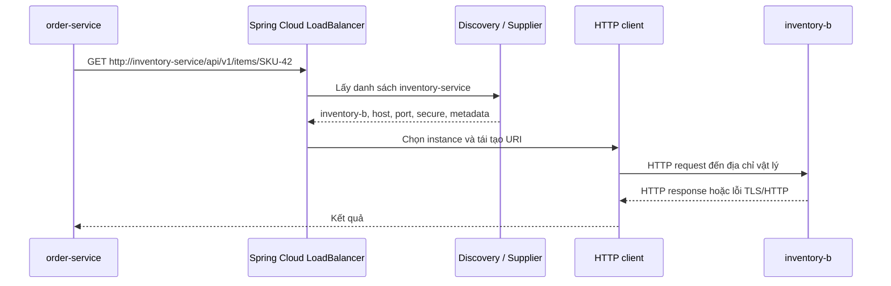

# Lỗi URI, TLS, token hoặc header sau khi thay địa chỉ đích

## Mục tiêu

Một HTTP client trong `order-service` có thể gọi địa chỉ logic:

```text
http://inventory-service/api/v1/items/SKU-42?include=warehouse
```

Spring Cloud LoadBalancer chọn một `ServiceInstance`, ví dụ `inventory-b` tại `10.20.1.12:8443`, rồi HTTP client gửi request đến địa chỉ vật lý. Sau khi đổi địa chỉ đích, request có thể bắt đầu lỗi dù code nghiệp vụ không thay đổi: URI sai path, TLS không tin chứng chỉ, token không còn hợp lệ với resource server, hoặc header/Host/cookie bị mất hay không còn đúng ngữ cảnh.

Bài học này giúp bạn chẩn đoán những lỗi thường xuất hiện **sau khi hostname logic được thay bằng host/port của instance** trong Spring Cloud LoadBalancer. Bạn sẽ:

- Phân biệt URL logic, URI sau khi LoadBalancer tái tạo và đích mạng thực tế.
- Kiểm tra scheme, host, port, path, query, encoding, base path và redirect.
- Chẩn đoán TLS handshake, SNI, SAN, trust chain, mTLS và cờ secure của instance.
- Phân biệt lỗi token do issuer, audience, scope, expiry, token relay và policy của resource server.
- Kiểm tra `Host`, `Authorization`, `Cookie`, `Forwarded`, correlation/trace headers và chữ ký request.
- Xác định khác biệt giữa gọi qua service ID và gọi URL cố định.
- Dùng log, curl, SimpleDiscoveryClient và HTTP test server để tái hiện lỗi.
- Thiết lập quy trình sửa lỗi mà không làm lộ token, cookie hoặc dữ liệu nhạy cảm.

> Phạm vi: Spring Cloud LoadBalancer chọn `ServiceInstance` cho client-side load balancing. TLS, OAuth2, header forwarding và HTTP transport còn phụ thuộc Spring Boot, Spring Security, HTTP client, proxy/service mesh và hạ tầng thực tế. Các ví dụ dưới đây là mẫu chẩn đoán; hãy đối chiếu API đúng với Spring Boot/Cloud Release Train của dự án.

## 1. Hiểu đường đi của URI trước khi sửa lỗi

Một lời gọi qua service ID thường có ba dạng địa chỉ:

| Giai đoạn | Ví dụ | Ai quyết định? |
|---|---|---|
| URL logic | `http://inventory-service/api/v1/items/SKU-42` | Code caller |
| Instance được chọn | `inventory-b = 10.20.1.12:8443` | Discovery + supplier + LoadBalancer |
| URI vật lý sau khi tái tạo | Ví dụ `https://10.20.1.12:8443/api/v1/items/SKU-42` | LoadBalancer integration + HTTP client |



**LoadBalancer chọn instance không có nghĩa request chắc chắn đến được backend.** Việc chọn có thể thành công nhưng DNS, TCP, TLS, authentication, path routing hoặc proxy vẫn có thể thất bại.

### 1.1. Ghi nhận thông tin chẩn đoán theo từng attempt

Khi có lỗi, ghi các thông tin không nhạy cảm:

- Service ID: `inventory-service`.
- Instance ID và host/port đã chọn.
- Scheme sau khi tái tạo: `http` hay `https`.
- Method, URI template và path đã chuẩn hóa.
- HTTP status hoặc loại lỗi ở root cause: DNS, connect, TLS, 401, 403, 404, 421, 502...
- Tên HTTP client/transport: RestClient, WebClient/Reactor Netty, OpenFeign/HC5...
- Attempt index nếu có retry.
- Correlation ID/trace ID để tìm log tương ứng.

Không log raw `Authorization`, `Cookie`, API key, JWT hoặc toàn bộ query string nếu có dữ liệu bí mật.

## 2. Lỗi URI: host đúng nhưng path/query sai

### 2.1. Kiểm tra path và base path

Caller gửi:

```text
http://inventory-service/api/v1/items/SKU-42
```

Instance được chọn:

```text
http://10.20.1.12:8080
```

URI sau khi thay host thường cần giữ path và query:

```text
http://10.20.1.12:8080/api/v1/items/SKU-42
```

Nhưng backend/proxy mới có thể expose path khác, chẳng hạn `/inventory/api/v1/items/SKU-42`. Khi đó lỗi 404 có thể do **base path hoặc gateway rewrite**, không phải do LoadBalancer chọn sai instance.

Kiểm tra lần lượt:

1. Backend có thực sự expose đúng method/path không?
2. Gateway hoặc ingress có thêm prefix hay rewrite path không?
3. Client có set `baseUrl` chứa prefix, rồi lại nối prefix lần thứ hai không?
4. Có redirect 301/302/307/308 sang một URL tuyệt đối khác không?
5. Query parameter có được giữ nguyên sau URI template expansion không?
6. Path variable có được encode đúng, nhất là dấu cách, Unicode, `/`, `%` và `?` không?

### 2.2. Ví dụ kiểm tra URI qua RestClient

```java
import org.springframework.cloud.client.loadbalancer.LoadBalanced;
import org.springframework.stereotype.Component;
import org.springframework.web.client.RestClient;

@Component
class InventoryGateway {

    private final RestClient client;

    InventoryGateway(@LoadBalanced RestClient.Builder builder) {
        this.client = builder
                .baseUrl("http://inventory-service")
                .build();
    }

    String findItem(String sku) {
        return client.get()
                .uri(uriBuilder -> uriBuilder
                        .path("/api/v1/items/{sku}")
                        .queryParam("include", "warehouse")
                        .build(sku))
                .retrieve()
                .body(String.class);
    }
}
```

Đoạn code dùng URL logic `inventory-service`; builder phải thực sự có `@LoadBalanced`. Nếu thay bằng `RestClient.create()` hoặc builder không gắn LoadBalancer, hostname có thể bị xử lý như DNS host bình thường thay vì service ID.

### 2.3. Tránh ghép URL bằng chuỗi

Không nên tự nối:

```java
String url = baseUrl + "/" + path + "?sku=" + sku;
```

Vì có thể sinh double slash, thiếu encode, mất query hiện có hoặc làm sai ký tự đặc biệt. Ưu tiên `uriBuilder`/URI template của client.

Khi debug, so sánh các giá trị:

| Giá trị | Điều cần xác minh |
|---|---|
| URL logic | Host có phải service ID mong muốn? |
| Instance URI | Host/port/scheme có đúng discovery data? |
| Path | Prefix và version có đúng backend? |
| Query | Có bị mất hoặc encode hai lần? |
| Redirect Location | Có trỏ về hostname cũ, localhost hoặc domain nội bộ không? |
| Effective URI | HTTP client thực sự kết nối tới đích nào? |

### 2.4. Redirect có thể làm request rời khỏi service ID

Backend hoặc proxy có thể trả:

```http
HTTP/1.1 302 Found
Location: https://old-inventory.example.internal/api/v1/items/SKU-42
```

HTTP client có thể tự theo redirect tùy transport và cấu hình. Request tiếp theo có thể:

- Bỏ qua LoadBalancer vì URL redirect là hostname tuyệt đối.
- Đi tới host cũ không còn tồn tại.
- Mất header tùy chính sách redirect.
- Không gửi lại `Authorization` khi origin thay đổi (đây thường là biện pháp bảo vệ).
- Bị lỗi TLS hoặc DNS ở đích redirect.

Khi thấy 3xx, kiểm tra `Location` và policy redirect của transport. Không bật chuyển tiếp Authorization qua origin khác một cách tùy tiện; nếu redirect là hợp lệ, dùng hostname và credential policy rõ ràng.

## 3. Host header, authority và virtual hosting

HTTP request có URL đích và thông tin host/authority. Với HTTP/1.1, server thường định tuyến virtual host dựa trên header `Host`; HTTP/2 dùng pseudo-header `:authority`. Nếu URI đã được đổi sang host mới nhưng caller vẫn tự gắn `Host` cũ, proxy/backend có thể chọn nhầm virtual host hoặc trả 400/404/421.

Ví dụ lỗi:

```http
GET /api/v1/items/SKU-42 HTTP/1.1
Host: inventory-service
```

Trong khi TCP/TLS connection thực tế đến `10.20.1.12:8443` và server yêu cầu authority `inventory.internal.example`.

### 3.1. Không tự set Host nếu không có yêu cầu cụ thể

Thông thường HTTP client dựng Host/authority từ URI cuối cùng. Nếu code hoặc interceptor đặt thủ công:

```java
headers.set("Host", "inventory-service");
```

giá trị này có thể không còn đúng sau khi LoadBalancer thay host/port. Xóa cấu hình Host thủ công trừ khi kiến trúc virtual hosting yêu cầu một giá trị cụ thể; nếu cần, phải kiểm thử với đúng proxy/server.

### 3.2. Phân biệt Host, SNI và certificate SAN

Ba giá trị liên quan nhưng không giống nhau:

- **HTTP Host/authority:** server HTTP dùng để định tuyến request.
- **TLS SNI:** tên server mà client gửi trong TLS handshake để server chọn certificate/virtual host.
- **Certificate SAN:** tên DNS/IP mà certificate được phép đại diện.

Ví dụ caller kết nối tới IP `10.20.1.12` nhưng certificate chỉ có SAN `DNS:inventory.internal.example`. Nếu HTTP client dùng IP làm hostname kiểm tra TLS, certificate có thể không hợp lệ. Chỉ set header `Host: inventory.internal.example` **không sửa được** SNI hoặc certificate hostname verification.

Giải pháp đúng thường là dùng hostname khớp SAN và cấu hình DNS/service discovery hoặc proxy sao cho hostname đó phân giải tới instance; hoặc cấp certificate SAN phù hợp với địa chỉ mà client xác minh. Không tắt hostname verification để né lỗi.

## 4. TLS: scheme, SNI, SAN, trust chain và mTLS

Sau khi thay địa chỉ đích, TLS có thể lỗi vì service ID ban đầu không còn là hostname được HTTP client dùng để handshake.

### 4.1. Kiểm tra scheme và secure flag của ServiceInstance

Một instance có thể có:

| Field | Ví dụ | Tác động |
|---|---|---|
| `host` | `inventory.internal.example` | Đích mạng và có thể là hostname kiểm tra certificate |
| `port` | `8443` | Cổng backend |
| `isSecure()` | `true` | Thể hiện instance dùng secure transport theo mô hình ServiceInstance |
| URI logic | `http://inventory-service` | Scheme ban đầu của caller |

Đừng đoán scheme cuối cùng từ port. Port 8443 không tự chứng minh HTTPS đang bật; port 8080 cũng không đảm bảo HTTP cleartext. Hãy kiểm tra URI thực tế sau khi LoadBalancer tái tạo và cấu hình transport.

Nếu discovery đăng ký instance secure sai, client có thể gửi HTTP tới cổng TLS hoặc HTTPS tới cổng cleartext, dẫn đến lỗi như:

- `Connection reset` hoặc `Empty reply from server`.
- TLS handshake error khi server mong HTTP.
- Server log báo request HTTP không hợp lệ trên TLS listener.
- HTTP parser báo dữ liệu TLS không phải HTTP.

### 4.2. Trust chain

Lỗi `PKIX path building failed`, `unable to find valid certification path` hoặc lỗi tương tự thường cho biết caller không tin CA phát hành certificate.

Kiểm tra:

1. Certificate backend có còn hạn không?
2. Server có gửi đủ intermediate certificates không?
3. CA nội bộ đã được thêm vào truststore của đúng JVM/container chưa?
4. HTTP client có dùng truststore riêng khác JVM default không?
5. Certificate chain ở từng instance có đồng nhất sau rollout không?

Không dùng trust-all manager hoặc tắt certificate verification trong production.

### 4.3. SNI và SAN

Nếu certificate được cấp cho `inventory.internal.example` nhưng service discovery trả IP, HTTP client có thể handshake với tên không khớp. Hãy xác minh:

- DNS name mà client dùng để TLS handshake.
- SNI thực tế.
- SAN trong certificate.
- Hostname verification của transport.
- Có proxy TLS termination/re-encryption hay không.

Thử nghiệm local có thể dùng `curl --resolve` để giữ hostname certificate nhưng ánh xạ sang IP test:

```bash
curl -v \
  --resolve inventory.internal.example:8443:127.0.0.1 \
  --cacert ./dev-ca.pem \
  "https://inventory.internal.example:8443/health"
```

Lệnh này yêu cầu certificate hợp lệ cho `inventory.internal.example` và CA `dev-ca.pem`. Nó giúp tách lỗi DNS khỏi lỗi TLS hostname/trust; không phải cấu hình thay thế cho service discovery production.

### 4.4. Mutual TLS (mTLS)

Nếu backend yêu cầu client certificate, ngoài truststore còn cần **keystore/client identity**:

- Caller phải có certificate và private key được backend tin cậy.
- Backend phải trust CA cấp client certificate.
- Certificate identity phải được ánh xạ thành principal/permission phù hợp.
- Nếu mỗi backend/zone có trust policy khác nhau, tất cả instance phải được cấu hình nhất quán.

Một instance mới có thể healthy ở TCP level nhưng từ chối TLS vì thiếu client certificate hoặc certificate hết hạn. Đây là lỗi handshake/authentication ở tầng TLS, không phải LoadBalancer chọn nhầm instance.

### 4.5. HTTP/2 và ALPN

Nếu một transport thương lượng HTTP/2 qua TLS, ALPN phải chọn protocol mà cả hai phía hỗ trợ. Khi backend/proxy chỉ hỗ trợ HTTP/1.1, client cấu hình chỉ HTTP/2 có thể thất bại; client hỗ trợ cả hai có thể fallback tùy implementation.

Kiểm tra HTTP protocol thực tế ở từng hop; đừng suy luận từ việc server bật HTTP/2 hoặc từ tên thư viện HTTP client.

## 5. Token: URL mới không đồng nghĩa token mới

Một access token thường được phát hành cho **resource/audience**, issuer, client và scope cụ thể. Thay host vật lý không nhất thiết làm token sai; cũng không có nghĩa token luôn hợp lệ cho mọi host.

Các lỗi phổ biến:

| Response/log | Nguyên nhân cần kiểm tra |
|---|---|
| HTTP 401 | Token thiếu/hết hạn, chữ ký/issuer sai, audience không phù hợp, header Authorization bị mất |
| HTTP 403 | Token đã xác thực nhưng thiếu scope/authority/role hoặc policy từ chối |
| HTTP 407 | Proxy yêu cầu proxy authentication; không phải backend OAuth token |
| TLS handshake fail trước HTTP 401 | Lỗi certificate/mTLS xảy ra trước bước xác thực HTTP |
| Token hợp lệ ở Gateway nhưng backend từ chối | Gateway đã xác thực nhưng không relay/exchange token phù hợp, hoặc backend có resource policy riêng |

### 5.1. Audience và issuer

Ví dụ access token có claim:

```json
{
  "iss": "https://identity.example.internal",
  "aud": ["inventory-api"],
  "scope": "inventory.read",
  "exp": 1890000000
}
```

Backend resource server cần kiểm tra issuer, audience và scope theo hợp đồng. Nếu đổi đích từ inventory API sang pricing API mà vẫn dùng token chỉ có `aud=inventory-api`, việc bị từ chối có thể là **đúng chính sách**.

Ngược lại, nếu chỉ đổi từ một IP instance sang IP khác của cùng logical service `inventory-service`, token thường nên gắn với **resource identity ổn định của service**, không phụ thuộc IP pod, trừ khi kiến trúc identity quy định khác.

Không tự sửa audience thành host/IP của instance trong mỗi lần LoadBalancer chọn backend. Điều đó làm token phụ thuộc topology và gây lỗi khi scale/rollout.

### 5.2. User token forwarding và service-to-service token

Phân biệt hai mô hình:

- **Token relay:** caller chuyển tiếp access token của user đã được xác thực tới downstream khi downstream cần authorization theo user.
- **Client credentials/token exchange:** caller lấy token cho chính service hoặc đổi token theo audience/scope của downstream.

Không forward mọi header `Authorization` mặc định tới mọi dependency. Một token dành cho API Gateway không nhất thiết được phép dùng ở inventory service; một token user có thể chứa claims không nên chia sẻ cho service khác.

Với Spring Cloud Gateway, `TokenRelay` có thể chuyển tiếp access token theo cấu hình OAuth2 client. Nhưng service gọi nội bộ bằng `RestClient`/`WebClient`/Feign cần policy riêng; không tự động được Gateway TokenRelay áp dụng nếu request không đi qua Gateway.

### 5.3. Kiểm tra token an toàn

- Xem status, error code và claim cần thiết trong môi trường được phép.
- Dùng công cụ decode JWT offline trong môi trường an toàn; decode không đồng nghĩa xác minh chữ ký.
- Xác minh issuer, audience, expiry, not-before, scope/role.
- Kiểm tra clock skew giữa issuer và resource server.
- Kiểm tra token relay/interceptor có chạy sau khi URL được thay hay không.
- Không dán JWT thật vào log, ticket, chat hoặc output CI.
- Không log toàn bộ header `Authorization` để “so sánh token trước và sau”.

## 6. Header sau khi thay địa chỉ đích

HTTP header có nhiều loại và không phải header nào cũng nên được giữ nguyên khi request đi tới instance mới.

| Header | Rủi ro khi thay host/route | Hướng xử lý |
|---|---|---|
| `Host` / `:authority` | Không còn khớp đích mới nếu set thủ công | Để transport dựng từ URI, trừ khi virtual host yêu cầu |
| `Authorization` | Token sai audience, mất do interceptor hoặc relay sai | Policy token theo downstream; không forward toàn cục |
| `Cookie` | Cookie Domain/Path chỉ hợp lệ ở domain/path cũ | Chỉ gửi cookie khi đúng origin và contract |
| `Forwarded`, `X-Forwarded-Host`, `X-Forwarded-Proto` | Proxy có thể tin nhầm host/scheme client tự gửi | Chỉ trusted proxy tạo/ghi đè; xóa giá trị không tin cậy |
| `X-Correlation-ID` | Bị mất hoặc bị thay ở một interceptor | Chuẩn hóa propagation, validate ở ingress |
| `traceparent`, `tracestate`, `baggage` | Trace đứt hoặc baggage lộ metadata | Dùng tracing instrumentation, giới hạn baggage |
| `Content-Type` | Body bị parse sai sau route mới | Kiểm tra contract và converter |
| `Accept` | Backend không hỗ trợ representation mong muốn | Thống nhất response media type |
| `Idempotency-Key` | Bị mất khi retry/forward | Giữ nguyên trong cùng operation nếu backend dùng deduplication |
| `If-Match` / `ETag` | Cache/version semantics thay đổi giữa instance | Đảm bảo shared state hoặc định tuyến phù hợp |
| Signature headers | Chữ ký bao gồm host/path/date nhưng URI đã đổi | Ký theo canonical request đúng đích, không tái sử dụng chữ ký cũ |

### 6.1. Header Forwarded và X-Forwarded-*

Các header `Forwarded`, `X-Forwarded-Host`, `X-Forwarded-Proto` và `X-Forwarded-For` mô tả thông tin proxy/original request. Chúng **không tự trở thành dữ liệu đáng tin** chỉ vì có mặt.

Nếu một request từ Internet tự gửi:

```http
X-Forwarded-Host: admin.internal.example
X-Forwarded-Proto: https
```

backend có thể tạo link, redirect hoặc quyết định security theo host/scheme sai nếu trust proxy policy cấu hình rộng. Trusted ingress phải loại bỏ/ghi đè header do client cung cấp và chỉ tin proxy hop đã định.

LoadBalancer thay đích vật lý cho một request outbound không có nghĩa bạn nên ghi đè `Forwarded` thành IP instance. Header forwarded thường biểu diễn **đường đi qua proxy**, không phải cơ chế discovery.

### 6.2. Cookie và domain/path

Nếu backend trả:

```http
Set-Cookie: SESSION=...; Domain=old.example.internal; Path=/legacy; Secure; HttpOnly
```

nhưng client gọi qua domain mới, cookie có thể không được gửi ở request sau do `Domain`/`Path` không khớp. Nếu có reverse proxy/gateway, dùng policy rewrite cookie phù hợp (nếu thực sự cần) và đánh giá SameSite/Secure/HttpOnly. Không chuyển cookie của user sang một service khác chỉ vì cả hai cùng nằm trong một cluster.

### 6.3. Chữ ký request và canonical host

Một số hệ thống ký request dựa trên method, path, query, Host, timestamp hoặc body hash. Nếu ký trước khi URL bị rewrite, chữ ký có thể đại diện cho host logic `inventory-service` trong khi backend/proxy xác minh host vật lý hoặc canonical host khác.

Không sửa bằng cách tắt signature verification. Xác định **thành phần nào ký**, **thành phần nào xác minh** và canonical request mà hai phía cùng dùng. Nếu chữ ký cần được kiểm tra ở gateway, giữ nguyên host logic và cấu hình gateway xác minh ở đúng ranh giới; nếu backend xác minh, thiết kế canonical host/forwarded policy rõ ràng.

## 7. Khác biệt giữa service ID và URL cố định

| Cách khai báo | Có chọn instance qua LoadBalancer? | Điều cần lưu ý |
|---|---|---|
| `@FeignClient(name="inventory-service")` không có `url` | Có, nếu LoadBalancer integration/dependency được bật | Discovery, supplier và retry theo service ID |
| `@LoadBalanced RestClient.Builder` + `http://inventory-service` | Có | URL logic được tái tạo theo instance |
| `@LoadBalanced WebClient.Builder` + `http://inventory-service` | Có | Cần filter/connector tương thích |
| `@FeignClient(name="inventory-service", url="https://host.example")` | Không qua bước chọn instance cho client đó | HTTP transport vẫn có thể dùng TLS/metrics, nhưng URL là cố định |
| `RestClient.create("https://host.example")` | Không | DNS/HTTP client xử lý hostname trực tiếp |
| `WebClient.builder().baseUrl("https://host.example")` không có LB filter | Không | Không có service ID resolution |

Khi URL cố định, lỗi certificate, token, header hoặc redirect vẫn có thể xảy ra, nhưng không nên điều tra discovery/`ServiceInstanceListSupplier` như nguyên nhân đầu tiên.

## 8. Cấu hình service instance và SimpleDiscoveryClient để tái hiện

Trong môi trường local, có thể đăng ký instance rõ ràng:

```yaml
spring:
  cloud:
    discovery:
      client:
        simple:
          instances:
            inventory-service:
              - uri: http://localhost:8081
              - uri: http://localhost:8082
```

Đây là cấu hình HTTP cleartext minh họa. Nó không tạo backend server tại port 8081/8082; cần khởi động ứng dụng hoặc mock server ở các địa chỉ đó.

Nếu backend dùng HTTPS, đăng ký URI HTTPS phù hợp với certificate/trust policy:

```yaml
spring:
  cloud:
    discovery:
      client:
        simple:
          instances:
            inventory-service:
              - uri: https://inventory-a.test.internal:8443
              - uri: https://inventory-b.test.internal:8443
```

Đừng thay hostname bằng IP nếu certificate không có SAN IP tương ứng. Cũng đừng coi việc URI có scheme `https` là bằng chứng caller đã có truststore, client certificate hoặc đúng ALPN.

### 8.1. Kiểm tra từng instance độc lập trước khi qua LoadBalancer

Gọi trực tiếp từng backend bằng hostname/certificate đúng để tách lỗi:

```bash
curl -v --cacert ./dev-ca.pem \
  "https://inventory-a.test.internal:8443/health"

curl -v --cacert ./dev-ca.pem \
  "https://inventory-b.test.internal:8443/health"
```

Nếu cả hai đều lỗi TLS trực tiếp, vấn đề nằm ở certificate/trust/network trước khi xem LoadBalancer. Nếu gọi trực tiếp thành công nhưng qua service ID thất bại, so sánh URI cuối, scheme, host, port, header và HTTP client config sau khi chọn instance.

### 8.2. Kiểm tra kết quả ServiceInstance

Trong test hoặc diagnostic component, có thể ghi metadata không nhạy cảm của instance đã chọn:

```java
import org.springframework.cloud.client.ServiceInstance;
import org.springframework.cloud.client.loadbalancer.Response;
import org.springframework.cloud.loadbalancer.core.ReactorLoadBalancer;
import reactor.core.publisher.Mono;

Mono<ServiceInstance> chooseInstance(
        ReactorLoadBalancer<ServiceInstance> loadBalancer) {
    return loadBalancer.choose()
            .flatMap(response -> response.hasServer()
                    ? Mono.just(response.getServer())
                    : Mono.empty());
}
```

Đây là ví dụ minh họa kiểu reactive; cách inject `ReactorLoadBalancer` phụ thuộc context/service ID và không nên thêm endpoint debug công khai chỉ để expose host nội bộ. Nếu có thể, dùng log/trace có quyền truy cập hạn chế và mask thông tin mạng theo policy.

## 9. RestClient, WebClient và OpenFeign: điểm kiểm tra riêng

### 9.1. RestClient

Với RestClient, xác minh:

- Builder có `@LoadBalanced` và được inject đúng bean không?
- Có custom request factory/HTTP client thay thế default không?
- Interceptor có đặt Host hoặc Authorization sai không?
- URI template có tạo đúng path/query không?
- TLS config của underlying client có trust CA và hostname verification phù hợp không?

Ví dụ giữ URL logic:

```java
@Bean
@LoadBalanced
RestClient.Builder inventoryRestClientBuilder() {
    return RestClient.builder();
}
```

Trong ứng dụng Spring Boot có customizer/observation, hãy dùng builder đã được Boot cấu hình và tích hợp `@LoadBalanced` theo cơ chế tương thích release train; đừng thay toàn bộ builder mà vô tình bỏ tracing, TLS hoặc HTTP metrics.

### 9.2. WebClient

Kiểm tra:

- `WebClient.Builder` có `@LoadBalanced` không?
- Có `ReactorClientHttpConnector`/`HttpClient` tùy chỉnh khiến TLS hoặc proxy config thay đổi không?
- Filter có mutate request URI hoặc headers không?
- Reactive context có giữ correlation/authorization policy đúng không?
- Retry filter có lặp request sau khi token hết hạn hoặc body không replay được không?

Ví dụ:

```java
@Bean
@LoadBalanced
WebClient.Builder inventoryWebClientBuilder() {
    return WebClient.builder();
}
```

Khi thêm filter tùy chỉnh, hãy kiểm tra request **sau toàn bộ filter chain** trong test; một filter chạy sau có thể ghi đè header do filter trước tạo.

### 9.3. OpenFeign

Với Feign, xác minh:

- `@FeignClient(name="inventory-service")` có URL cố định không?
- `spring-cloud-starter-loadbalancer` có trên classpath không?
- Feign client thực tế có dùng `FeignBlockingLoadBalancerClient` hoặc integration phù hợp không?
- `RequestInterceptor` nào thêm/ghi đè Authorization, Host, correlation hoặc tenant header?
- `ErrorDecoder`/retryer có thay đổi cách xử lý 401/403/503 không?
- HTTP transport HC5/OkHttp có TLS truststore, proxy và redirect policy riêng không?

Không thêm một global `RequestInterceptor` chuyển tiếp mọi inbound header cho mọi Feign client. Dùng cấu hình theo `contextId`/client và allowlist header cần thiết.

## 10. Bảng chẩn đoán theo triệu chứng

| Triệu chứng | Kiểm tra đầu tiên | Nguyên nhân thường gặp |
|---|---|---|
| 404 sau khi đổi instance | Path, base path, gateway rewrite | Backend mới expose prefix/API version khác |
| 400 hoặc 421 | Host/authority, virtual host | Host header cũ hoặc proxy route không khớp |
| 301/302 lặp lại | Location, scheme, hostname | Backend redirect về domain cũ hoặc HTTPS/HTTP mismatch |
| Unknown host | Host sau khi chọn instance | DNS của instance/proxy không phân giải được |
| Connection refused | Host/port và readiness | Port sai, process chưa listen, instance stale |
| Connection reset/empty reply | HTTP vs HTTPS, proxy protocol | Gửi HTTP vào TLS listener hoặc ngược lại |
| PKIX path building failed | Trust chain | CA/intermediate chưa được tin cậy |
| No subject alternative names | Hostname/IP so với SAN | Certificate không đại diện hostname mà client xác minh |
| TLS handshake failure | SNI, protocol, cipher, mTLS | Server yêu cầu client cert hoặc không hỗ trợ protocol |
| HTTP 401 | Authorization header, issuer/aud/exp | Token thiếu, hết hạn, sai resource hoặc bị mất |
| HTTP 403 | Scope/role/tenant policy | Đã xác thực nhưng không đủ quyền |
| HTTP 407 | Proxy configuration | Proxy yêu cầu xác thực riêng |
| Backend không nhận correlation ID | Interceptor/filter propagation | Header bị bỏ hoặc không nằm trong allowlist |
| Cookie không được gửi | Domain/Path/SameSite/Secure | Cookie chỉ hợp lệ với origin cũ |
| Signature invalid | Canonical Host/path/query/body | Chữ ký được tạo trước URI rewrite |
| Chỉ một instance lỗi | So sánh instance metadata/cert/config | Rollout không đồng nhất, một pod có certificate hoặc route sai |
| Lỗi chỉ xảy ra khi retry | Attempt đích, token refresh, body replay | Retry sang instance khác với config khác hoặc body không replay được |
| Chỉ lỗi qua Gateway | Forwarded headers, route rewrite, TLS termination | Gateway thay host/scheme/header |

## 11. Quy trình điều tra từng lớp

Thực hiện theo thứ tự dưới đây để tránh sửa nhầm tầng:

1. **Xác định kiểu gọi:** URL service ID có qua LoadBalancer hay URL cố định?
2. **Ghi nhận instance:** service ID, instance ID, host, port, secure và metadata.
3. **So sánh URI:** scheme, authority, path, query và encoding trước/sau rewrite.
4. **Gọi trực tiếp backend:** dùng cùng hostname, TLS và credential hợp lệ để cô lập discovery khỏi network/security.
5. **Kiểm tra TCP/DNS:** hostname phân giải đúng? port có listen? network policy/firewall cho phép?
6. **Kiểm tra TLS:** SNI, SAN, trust chain, expiry, mTLS, ALPN.
7. **Kiểm tra HTTP routing:** Host/authority, prefix, redirect, forwarded headers, virtual host.
8. **Kiểm tra authentication:** token có được gửi không? issuer/audience/scope/expiry có đúng? resource server nào từ chối?
9. **Kiểm tra headers/cookies:** allowlist, cookie domain/path, correlation/trace, signature và content negotiation.
10. **Kiểm tra retry:** request attempt nào lỗi, đã đổi instance chưa, token/body có replay an toàn không?
11. **So sánh giữa các instance:** chỉ một pod lỗi hay tất cả? Certificate/config/image version có đồng nhất?
12. **Xác nhận sau sửa:** test cả URL logic qua LoadBalancer lẫn gọi trực tiếp instance, sau đó mới triển khai canary/production.

## 12. Thực hành: tái hiện lỗi sau khi đổi đích

Mục tiêu là dùng hai instance local để phân biệt lỗi URI, header và HTTPS. Thực hiện trong local/test, không dùng token thật.

### Bước 1. Tạo hai backend có hành vi khác nhau

Mỗi backend cung cấp:

```java
import java.util.Map;
import org.springframework.beans.factory.annotation.Value;
import org.springframework.web.bind.annotation.GetMapping;
import org.springframework.web.bind.annotation.RequestHeader;
import org.springframework.web.bind.annotation.RestController;

@RestController
class DiagnosticController {

    private final String instanceId;

    DiagnosticController(
            @Value("${demo.instance-id:unknown}") String instanceId) {
        this.instanceId = instanceId;
    }

    @GetMapping("/api/v1/diagnostic")
    Map<String, String> diagnostic(
            @RequestHeader(value = "X-Correlation-ID", required = false)
            String correlationId,
            @RequestHeader(value = "Host", required = false)
            String host) {
        return Map.of(
                "instanceId", instanceId,
                "host", host == null ? "missing" : host,
                "correlationId",
                correlationId == null ? "missing" : correlationId
        );
    }
}
```

Endpoint chỉ phục vụ bài test, không nên expose Host/header nội bộ trên API public production. Trong thực tế, ghi thông tin chẩn đoán ở log có kiểm soát thay vì trả cho người dùng.

Chạy hai backend:

```text
Backend A: --server.port=8081 --demo.instance-id=inventory-a
Backend B: --server.port=8082 --demo.instance-id=inventory-b
```

### Bước 2. Đăng ký hai instance bằng SimpleDiscoveryClient

```yaml
spring:
  cloud:
    discovery:
      client:
        simple:
          instances:
            inventory-service:
              - uri: http://localhost:8081
              - uri: http://localhost:8082
```

Caller phải dùng `@LoadBalanced RestClient.Builder` hoặc `@LoadBalanced WebClient.Builder` và URL logic `http://inventory-service`.

### Bước 3. Gọi qua service ID và kiểm tra

```bash
curl -i "http://localhost:8080/demo/inventory"
```

Trong caller, gọi:

```java
return client.get()
        .uri("http://inventory-service/api/v1/diagnostic")
        .header("X-Correlation-ID", "diag-2026-001")
        .retrieve()
        .body(String.class);
```

Kiểm tra response:

- `instanceId` phải là A hoặc B.
- `correlationId` phải giữ đúng giá trị theo policy.
- `Host`/authority phải phù hợp với server nhận request.
- Path phải là `/api/v1/diagnostic`.

### Bước 4. Cố tình tạo lỗi Host

Trong môi trường test, thêm một interceptor set Host cũ rồi gọi qua LoadBalancer. Quan sát virtual host/server log. Sau đó bỏ header thủ công và để transport dựng Host theo URI đã được tái tạo.

Không áp dụng thay đổi này lên production; mục tiêu là chứng minh header thủ công có thể không còn phù hợp khi host vật lý đổi.

### Bước 5. Cố tình tạo lỗi path

Cho backend B chỉ map `/inventory/api/v1/diagnostic` trong khi caller vẫn gọi `/api/v1/diagnostic`. Khi LoadBalancer chọn B, request có thể nhận 404. Hãy kiểm tra backend route và quyết định dùng chung contract path hoặc cấu hình rewrite rõ ràng.

Không chữa bằng cách retry mọi 404 sang instance A: 404 có thể là lỗi contract và fallback có thể che sự không tương thích giữa các phiên bản.

### Bước 6. Tách lỗi TLS

Nếu có test certificate/CA:

1. Chạy backend HTTPS với certificate có SAN `inventory.test.internal`.
2. Gọi trực tiếp bằng `curl --resolve` và `--cacert` để xác minh TLS.
3. Đăng ký instance với hostname đúng certificate.
4. Đổi sang IP không có SAN IP để quan sát hostname verification fail.
5. Khôi phục hostname/SAN đúng; không tắt certificate validation.

### Bước 7. Tách lỗi token

Dùng test token giả do test identity provider cấp:

- Token đúng `aud=inventory-api`, scope `inventory.read` → request đọc thành công.
- Token có audience khác → backend trả 401 theo resource server policy.
- Token đúng audience nhưng thiếu scope → backend trả 403.
- Bỏ Authorization header ở interceptor → backend trả 401.

Không dùng JWT thật hoặc token production trong bài thực hành.

## 13. Kiểm thử tự động các trường hợp lỗi

### 13.1. Kiểm tra URI logic và path

Dùng HTTP test server hoặc WireMock/MockWebServer để ghi nhận request đã nhận:

```text
Expected:
  method = GET
  path = /api/v1/items/SKU-42
  query = include=warehouse
  target instance = inventory-a hoặc inventory-b
```

Assertions cần kiểm tra URI template và path/query. Không chỉ assert status 200 vì server mock có thể trả 200 cho mọi path, che lỗi rewrite.

### 13.2. Kiểm tra header allowlist

Viết test với:

| Header | Expected |
|---|---|
| `X-Correlation-ID` | Được truyền nếu policy cho phép |
| `traceparent` | Được tracing instrumentation inject |
| `Authorization` | Chỉ truyền khi token policy cho downstream cho phép |
| `Cookie` | Không tự động forward sang origin khác |
| `Host` | Do URI/transport dựng, trừ virtual-host policy rõ ràng |
| `X-Forwarded-Host` | Chỉ trusted proxy tạo/ghi đè |

Test phải xác minh cả header **có mặt** lẫn header **không được phép xuất hiện**. Kiểm tra header nhạy cảm bằng giá trị giả, không log secret.

### 13.3. Kiểm tra TLS

Các test cần phân biệt:

- CA tin cậy + SAN đúng → handshake thành công.
- CA không tin cậy → trust failure.
- SAN không khớp hostname → hostname verification failure.
- Backend yêu cầu mTLS, client không có cert → handshake fail.
- Client có cert hợp lệ → handshake thành công nếu backend trust CA và identity được phép.

Không mock toàn bộ TLS layer nếu mục tiêu test là certificate/hostname validation. Dùng test server có TLS thật và certificate test được tạo cho purpose đó.

### 13.4. Kiểm tra retry và side effects

Nếu attempt đầu lỗi sau khi backend có thể đã xử lý request:

- Kiểm tra `Idempotency-Key` được giữ nguyên qua attempts nếu contract yêu cầu.
- Đếm số side effect thực tế tại backend.
- Không retry 401/403/404 tùy tiện.
- Đối chiếu attempt đích và token audience của từng service ID.
- Phân biệt HTTP response từ backend với lỗi connect/TLS trước khi có HTTP request.

## 14. Lỗi thường gặp khi sửa vội

| Cách sửa sai | Vì sao nguy hiểm | Cách sửa đúng |
|---|---|---|
| Tắt TLS hostname verification | Mở cửa cho MITM và host giả mạo | Cấp SAN đúng, dùng hostname hợp lệ và trust CA |
| Trust tất cả certificate | Chấp nhận cả certificate không tin cậy | Quản lý truststore/CA đúng |
| Gửi mọi Authorization header đến mọi service | Rò token hoặc gửi sai audience | Token relay/exchange theo dependency |
| Ghi đè Host bằng service ID | Virtual host/authority có thể sai | Để transport dựng Host hoặc policy cụ thể |
| Retry mọi 404/401/403 | Che contract/auth lỗi, tăng tải | Chỉ retry lỗi tạm thời và operation an toàn |
| Forward tất cả X-Forwarded-* từ Internet | Host/scheme spoofing | Trusted proxy strip và set lại |
| Chuyển URL logic thành IP ở code nghiệp vụ | Bỏ qua discovery/LoadBalancer và làm TLS khó đúng | Giữ service ID; để LB chọn instance |
| Thêm prefix path ở cả caller và Gateway | Double prefix/404 | Xác định một nơi sở hữu path rewrite |
| Disable redirect policy mà không hiểu flow | Có thể đổi hành vi auth hoặc làm request fail | Kiểm tra Location, origin và credential policy |
| Log toàn bộ request headers | Lộ JWT, cookie, API key | Allowlist field log và redact secrets |
| Tắt certificate validation chỉ trong một instance | Hành vi không đồng nhất, tạo lỗ hổng | Chuẩn hóa certificate/config mọi instance |
| Retry sang stable khi canary lỗi contract | Che lỗi phiên bản và gây dữ liệu sai | Giữ variant boundary, contract test và fail policy |

## 15. Checklist chẩn đoán production

- [ ] Xác nhận URL là service ID qua LoadBalancer hay URL cố định.
- [ ] Ghi nhận service ID, instance ID, host/port và secure flag đã chọn.
- [ ] So sánh URI logic với URI cuối: scheme, host, port, path, query, encoding.
- [ ] Kiểm tra base path, prefix, rewrite và redirect Location.
- [ ] Không set Host/authority thủ công nếu không có virtual-host requirement.
- [ ] Phân biệt Host, TLS SNI và certificate SAN.
- [ ] Kiểm tra trust chain, expiry, CA, mTLS và ALPN.
- [ ] Kiểm tra HTTP/HTTPS scheme theo đúng backend listener, không đoán từ port.
- [ ] Kiểm tra Authorization header có được gửi không mà không log giá trị.
- [ ] Xác minh issuer, audience, expiry, scope/role và token relay/exchange.
- [ ] Không forward token/cookie sang origin khác nếu policy không cho phép.
- [ ] Kiểm tra forwarded headers chỉ đến từ trusted proxy.
- [ ] Kiểm tra correlation/trace headers và signature canonicalization.
- [ ] So sánh cấu hình giữa tất cả instance, nhất là instance mới rollout.
- [ ] Tách no-instance, DNS, connection refused, TLS failure và HTTP status.
- [ ] Kiểm tra từng attempt khi retry; giữ idempotency key khi contract yêu cầu.
- [ ] Có test URL logic qua LoadBalancer và test gọi trực tiếp từng instance.
- [ ] Có test TLS với certificate/SAN/truststore thật trong môi trường kiểm thử.
- [ ] Redact secrets trong log, trace, metrics và output CI.

## Kết luận

Khi thay địa chỉ đích bằng Spring Cloud LoadBalancer, lỗi có thể xuất hiện ở nhiều tầng: **URI reconstruction**, virtual host, TLS/SNI/SAN, trust chain/mTLS, token audience/scope, header/cookie forwarding hoặc proxy rewrite. Đừng quy mọi lỗi thành “LoadBalancer chọn sai instance”. Trước hết hãy ghi nhận instance và URI thực tế, rồi kiểm tra lần lượt DNS/TCP, TLS, HTTP routing và authentication.

Giữ URL logic theo service ID, để transport dựng Host/authority phù hợp, cấp certificate đúng hostname, thiết kế token theo resource identity ổn định và chỉ truyền những header cần thiết. Kết hợp test từng instance trực tiếp với test qua LoadBalancer, quan sát từng retry attempt và không tắt kiểm tra bảo mật để né lỗi sẽ giúp hệ thống giữ được tính đúng đắn khi scale, rollout hoặc thay đổi địa chỉ backend.

## Tài liệu tham khảo

- [Spring Cloud Commons — Spring Cloud LoadBalancer và ServiceInstance](https://docs.spring.io/spring-cloud-commons/reference/spring-cloud-commons/loadbalancer.html)
- [Spring Cloud Commons — RestClient, RestTemplate và WebClient LoadBalancer integration](https://docs.spring.io/spring-cloud-commons/reference/spring-cloud-commons/common-abstractions.html)
- [Spring Cloud OpenFeign — Client configuration và LoadBalancer integration](https://docs.spring.io/spring-cloud-openfeign/reference/spring-cloud-openfeign.html)
- [Spring Security — OAuth2 Resource Server JWT](https://docs.spring.io/spring-security/reference/servlet/oauth2/resource-server/jwt.html)
- [Spring Cloud Gateway — TokenRelay GatewayFilter](https://docs.spring.io/spring-cloud-gateway/reference/spring-cloud-gateway-server-webflux/gatewayfilter-factories/tokenrelay-factory.html)
- [Spring Framework — URI building and encoding](https://docs.spring.io/spring-framework/reference/web/webmvc/mvc-uri-building.html)
- [RFC 9110 — HTTP Semantics: Host, redirects and status codes](https://www.rfc-editor.org/rfc/rfc9110.html)
- [RFC 9113 — HTTP/2 authority and protocol](https://www.rfc-editor.org/rfc/rfc9113.html)
- [RFC 8446 — TLS 1.3](https://www.rfc-editor.org/rfc/rfc8446.html)
- [RFC 8705 — OAuth 2.0 Mutual-TLS Client Authentication](https://www.rfc-editor.org/rfc/rfc8705.html)
