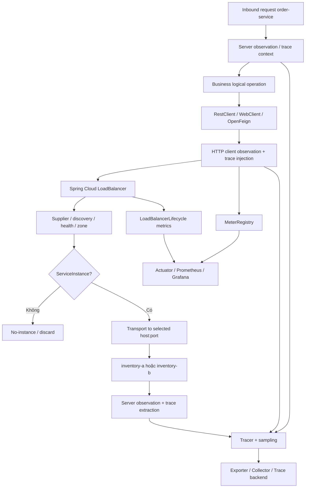
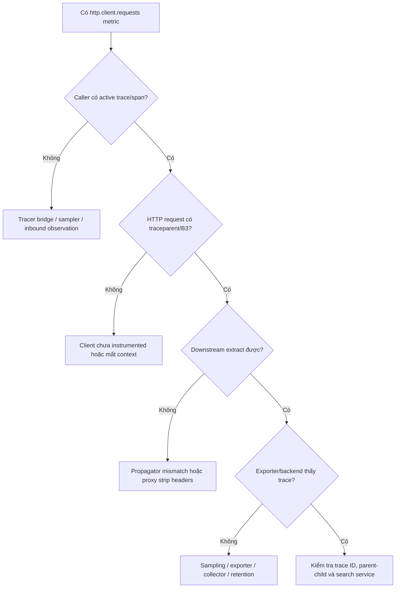

# Mất trace hoặc thiếu metrics trong đường gọi có cân bằng tải

Một request từ `order-service` gọi `inventory-service` qua Spring Cloud LoadBalancer có thể thành công, nhưng dashboard không có `http.client.requests`, không thấy `loadbalancer.requests.success`, hoặc trace chỉ xuất hiện ở service nhận mà thiếu span của service gọi. Một số hệ thống lại có đầy đủ metrics nhưng không tìm thấy trace trong Jaeger/Tempo/Zipkin; số khác có trace ID trong log nhưng HTTP header `traceparent` không tới downstream.

Các triệu chứng này **không cùng một nguyên nhân**. Trong kiến trúc Spring Cloud, thuật toán chọn `ServiceInstance`, HTTP client instrumentation, Micrometer Observation, trace context propagation, tracing exporter, Prometheus scrape và trace backend là **những tầng riêng biệt**. Bật `@LoadBalanced` không tự đảm bảo HTTP client có observation; bật Actuator không tự đảm bảo trace được xuất đi.

Bài thuộc chương **Chẩn đoán sự cố**, module `SPRING_CLOUD_SERVICE_COMMUNICATION_LOAD_BALANCING`. Mục tiêu là tìm đúng vị trí mất dữ liệu trên đường gọi RestClient, WebClient, RestTemplate, OpenFeign hoặc HTTP Interface; kiểm chứng bằng HTTP stubs và `MeterRegistry`, phân biệt meter vắng mặt với metric bằng 0, kiểm tra sampling/propagation và dùng runbook để khôi phục observability mà không làm tăng cardinality hay lộ thông tin nhạy cảm.

> **Nguyên tắc chẩn đoán:** Trước khi sửa trace exporter hoặc Grafana, hãy xác định request đã đi qua **client nào**, **builder/adapter nào**, **service ID nào** và **chỗ nào có bằng chứng observation đã được tạo**. Trace, metrics và log tương quan nhưng không thay thế cho nhau.

## 1. Triệu chứng điển hình và hướng kiểm tra đầu tiên

| Biểu hiện | Nghi ngờ đầu tiên | Bằng chứng để phân biệt |
|---|---|---|
| API trả 200 nhưng không có `http.client.requests` | Client tự tạo, thiếu `ObservationRegistry`, meter bị filter | Kiểm tra bean builder và `/actuator/metrics` sau request |
| Có `http.client.requests` nhưng không có `loadbalancer.requests.*` | LB stats chưa bật, direct target, request không qua LB, meter chưa record | Xem `@LoadBalanced`/Feign target và cấu hình `stats.micrometer.enabled` |
| Có `loadbalancer.requests.success` nhưng HTTP 503 | Không hẳn lỗi instrumentation | LB “success” chỉ nghĩa response được chuyển, không đồng nghĩa HTTP 2xx |
| Có HTTP client metric nhưng không thấy trace | Thiếu tracer/exporter, sampling, backend hoặc propagation | Kiểm tra trace hiện tại ở caller, exporter và collector |
| Caller có trace ID, downstream có trace ID khác | Không inject/extract context hoặc propagation format không khớp | Xem header `traceparent`/`b3` ở hai phía |
| Trace mất khi dùng `@Async`, `CompletableFuture` | Không chuyển observation context sang thread mới | Kiểm tra executor, task decorator và context snapshot |
| Trace mất giữa các toán tử Reactor | Context không được propagate hoặc subscription tách rời | Kiểm tra Reactor Context, `subscribe()` riêng và propagation mode |
| Trace xuất hiện không thường xuyên | Sampling < 100%, tail sampling hoặc backend retention | Kiểm tra probability/sampler/collector, không coi là mất ngẫu nhiên |
| `/actuator/prometheus` có dữ liệu nhưng Grafana trống | Prometheus chưa scrape, nhãn/PromQL sai, dashboard lọc nhầm | Kiểm tra `up`, target, query tên metric thực |
| `/actuator/metrics` không có LB meter ngay lúc startup | Meter được ghi nhận lazily | Gửi request thật và kiểm tra lại |
| Feign client A có trace, client B không | `feign-micrometer`, feature flag từng client hoặc custom Feign builder | Xem `MicrometerObservationCapability` của đúng Feign context |
| Lỗi no-instance nhưng không có server span | Không có server nào được gọi | Tìm `loadbalancer.requests.discard` và client-side error |
| HTTP request có trace nhưng không có span “chọn instance” riêng | Framework không mặc định tạo span đó | Phân biệt LB lifecycle metrics với HTTP client/server spans |

**Tầng nào mất tín hiệu?** Đây là câu hỏi trung tâm. Không được dùng một đường biểu diễn Grafana trống để kết luận “Spring Cloud LoadBalancer không chạy”.

## 2. Sơ đồ đường đi và các điểm có thể mất observability

Giả sử:

```text
order-service -> GET http://inventory-service/api/v1/items/SKU-001

Discovery:
  inventory-a -> http://inventory-a:8081
  inventory-b -> http://inventory-b:8081
```



Những câu hỏi cần trả lời theo thứ tự:

1. Request đã chạy thật chưa? Với WebClient, publisher chỉ thực thi khi được subscribe.
2. Client dùng tên logic `inventory-service` hay một URL vật lý cố định?
3. Client có được cấu hình **cả LoadBalancer và ObservationRegistry**?
4. `MicrometerStatsLoadBalancerLifecycle` có được tạo và có record nào chưa?
5. Tracer implementation có tồn tại, sampling có giữ trace không?
6. Header propagation có được inject vào HTTP request và extract ở downstream?
7. Span đã export qua collector hay bị drop/reject?
8. Metrics đã được scrape, có đúng tên/labels và khoảng thời gian không?

### 2.1. Cần tách “không tạo” khỏi “không hiển thị”

```text
A. Observation chưa được tạo
   -> Không có http.client.requests, cũng không có client span

B. Observation đã tạo + MeterRegistry có số liệu
   -> Actuator có, Prometheus/Grafana trống: scrape/query/export

C. HTTP observation đã tạo nhưng trace không xuất
   -> Tracer bridge, sampling, exporter/backend

D. Traces đã xuất nhưng parent-child bị đứt
   -> W3C/B3 propagation, context thread/reactive

E. LoadBalancer metrics vắng, HTTP metrics vẫn có
   -> LB stats config, direct target, lifecycle/version

F. Không có backend span vì no-instance
   -> LB không chọn được endpoint; không phải lỗi propagation
```

## 3. Hiểu đúng Metrics, Observation, Span và Log

| Khái niệm | Đơn vị/nguồn | Điều nó chứng minh |
|---|---|---|
| `Observation` | Micrometer Observation API | Một công việc được quan sát và có thể sinh metric/span |
| `MeterRegistry` | Micrometer Core | Counter, timer, gauge trong process, kể cả chưa được scrape |
| `http.client.requests` | Spring Framework HTTP client observation | Lời gọi HTTP client được instrument và đã đo |
| `http.server.requests` | Spring Framework server observation | Endpoint server đã được instrument |
| `loadbalancer.requests.*` | Spring Cloud `MicrometerStatsLoadBalancerLifecycle` | Vòng đời lựa chọn/gửi request qua Spring Cloud LB |
| Span | Micrometer Tracing + tracer implementation | Một đơn vị công việc trong distributed trace khi sampling/recording cho phép |
| Trace context | W3C `traceparent` hoặc B3 | Cho phép các span liên kết cùng trace qua network |
| Exporter | OTLP/Zipkin/etc. | Gửi spans ra collector/backend |
| Prometheus scrape | Registry → HTTP endpoint → Prometheus | Chuyển metric process thành series được lưu/query |
| Structured log | Logging framework/MDC | Có thể ghi trace ID, span ID và lỗi chi tiết |

Một **HTTP 500 có thể được ghi là response** ở LoadBalancer lifecycle; `loadbalancer.requests.success` không phải tỷ lệ HTTP status 2xx. Ngược lại, `http.client.requests` có thể đếm retry attempts hoặc exchanges, còn business-level logical request chỉ có một final outcome. Không so hai metric này bằng phép trừ hoặc tính SLO mà chưa xác định boundary.

### 3.1. Không có span riêng cho mỗi bước chọn instance là điều có thể bình thường

Spring Cloud LoadBalancer có `LoadBalancerLifecycle` cung cấp lifecycle/statistics, nhưng tài liệu không bảo đảm rằng mọi lần `choose` sẽ sinh một tracing span chuyên biệt tên “loadbalancer.choose”. Một trace hợp lệ có thể chỉ gồm:

```text
order-service: HTTP SERVER /orders/123
  └─ order-service: HTTP CLIENT /api/v1/items/{sku}
        └─ inventory-service: HTTP SERVER /api/v1/items/{sku}
```

Không thấy span chọn instance **không đủ để kết luận** HTTP request bypass LB. Muốn biết selected instance, thêm logs/observations riêng tại lifecycle hoặc xem target trong trace khi backend cho phép, có kiểm soát cardinality.

## 4. Preflight: dependency và cấu hình giám sát nền tảng

Ví dụ dưới đây chọn **Spring Boot 3.2–3.5** cùng Spring Cloud release train tương thích, vì `RestClient.Builder` và Micrometer Observation đã có trong dòng này. **Spring Boot 4.x thay đổi package của một số helper và cách khai báo tracing/exporter**; không copy nguyên import/profile giữa major versions.

Maven tối thiểu để **đọc HTTP và LB metrics bằng Actuator/Prometheus**:

```xml
<dependencies>
    <dependency>
        <groupId>org.springframework.boot</groupId>
        <artifactId>spring-boot-starter-web</artifactId>
    </dependency>
    <dependency>
        <groupId>org.springframework.boot</groupId>
        <artifactId>spring-boot-starter-actuator</artifactId>
    </dependency>
    <dependency>
        <groupId>io.micrometer</groupId>
        <artifactId>micrometer-registry-prometheus</artifactId>
    </dependency>
    <dependency>
        <groupId>org.springframework.cloud</groupId>
        <artifactId>spring-cloud-starter-loadbalancer</artifactId>
    </dependency>
</dependencies>
```

Với WebClient, thêm `spring-boot-starter-webflux`. Với OpenFeign, thêm `spring-cloud-starter-openfeign` và kiểm tra `feign-micrometer` thực sự có trên classpath.

**Chỉ dependency metrics không tự cấp trace backend.** Để xuất distributed traces, cần thêm Micrometer Tracing bridge + tracer implementation + exporter tương ứng và một collector/backend hoạt động.

### 4.1. Actuator và LB statistics

```yaml
management:
  endpoints:
    web:
      exposure:
        include: health,info,metrics,prometheus

spring:
  cloud:
    loadbalancer:
      stats:
        micrometer:
          enabled: true
        include-path: false
```

`spring.cloud.loadbalancer.stats.micrometer.enabled=true` cùng `MeterRegistry` cho phép framework đăng ký `MicrometerStatsLoadBalancerLifecycle` khi auto-configuration phù hợp. `include-path=false` hạn chế path động biến thành metric tag có cardinality cao.

**Đừng quên bảo mật Actuator**: endpoint `/actuator/metrics` và `/actuator/prometheus` có thể tiết lộ tên service, URI template, lỗi, danh sách hệ thống. Chỉ expose tới mạng giám sát tin cậy và áp authentication/authorization/network policy theo môi trường.

### 4.2. Tracing config dành cho giai đoạn chẩn đoán

Chỉ trong local/test/staging có kiểm soát:

```yaml
management:
  tracing:
    sampling:
      probability: 1.0

spring:
  reactor:
    context-propagation: auto
```

`probability: 1.0` yêu cầu lấy mẫu 100% cho phép thử ngắn, nhưng **không tự tạo tracer/exporter**. Không giữ sampling 100% ở production tải lớn nếu chi phí, bảo mật hoặc dung lượng backend không cho phép. `spring.reactor.context-propagation=auto` giúp khôi phục context trong reactive pipelines theo cơ chế của Reactor/Spring Boot, nhưng không sửa được một HTTP client hoàn toàn không được instrument.

### 4.3. Tracing dependencies khác nhau theo Spring Boot

**Boot 3.5 — ví dụ OpenTelemetry/OTLP:**

```xml
<dependency>
    <groupId>io.micrometer</groupId>
    <artifactId>micrometer-tracing-bridge-otel</artifactId>
</dependency>
<dependency>
    <groupId>io.opentelemetry</groupId>
    <artifactId>opentelemetry-exporter-otlp</artifactId>
</dependency>
```

Kèm Actuator và cấu hình endpoint **theo Boot 3.x**:

```properties
management.otlp.tracing.endpoint=http://otel-collector:4318/v1/traces
```

**Boot 4.x — ví dụ theo tài liệu hiện hành:**

```xml
<dependency>
    <groupId>org.springframework.boot</groupId>
    <artifactId>spring-boot-starter-opentelemetry</artifactId>
</dependency>
```

Dòng Boot 4.x dùng nhóm property `management.opentelemetry.tracing.export.otlp.*` hoặc config chung `management.opentelemetry.otlp.*` tùy trường hợp. **Không mặc định key Boot 3.x và Boot 4.x tương đương.** Cần xem BOM/auto-config và effective properties của ứng dụng.

Trường hợp dùng Brave/Zipkin cũng có dependency/exporter riêng. Mục tiêu của bài là **chẩn đoán đúng luồng**, không bắt hệ thống đang dùng Jaeger/Tempo phải đổi backend chỉ để có trace.

## 5. Kiểm tra metrics theo chuỗi: process → Actuator → Prometheus → Grafana

Thực hiện theo thứ tự, tránh nhảy thẳng vào dashboard:

1. Gửi ít nhất một lời gọi từ **đúng HTTP client** bị nghi mất metrics.
2. Xác nhận request đã nhận response hoặc exception; có log ở caller.
3. Liệt kê meter qua endpoint `/actuator/metrics`.
4. Đọc `/actuator/metrics/http.client.requests`.
5. Đọc các meter `/actuator/metrics/loadbalancer.requests.success` và `...discard` sau khi tạo tình huống tương ứng.
6. Kiểm tra `/actuator/prometheus` có các series tương ứng không.
7. Vào Prometheus Targets kiểm tra scrape target có `up=1`.
8. Query metric name thật trong Prometheus, **không áp filter Grafana quá sớm**.
9. Kiểm tra recording rules, label relabel, retention và time range dashboard.

Ví dụ kiểm tra local **chỉ khi endpoint được cấp quyền**:

```shell
curl -fsS http://127.0.0.1:8080/actuator/metrics
curl -fsS http://127.0.0.1:8080/actuator/metrics/http.client.requests
curl -fsS http://127.0.0.1:8080/actuator/prometheus
```

Lưu ý: `/actuator/metrics` là API đọc meter theo tên **Micrometer**, còn `/actuator/prometheus` dùng naming convention của **Prometheus**. Một tên có dấu chấm có thể thành snake_case và hậu tố theo loại meter. Ví dụ timer:

```text
Micrometer:
  http.client.requests

Prometheus (thường gặp):
  http_client_requests_seconds_count
  http_client_requests_seconds_sum
  http_client_requests_seconds_bucket (chỉ khi histogram cấu hình)

Spring Cloud LoadBalancer:
  loadbalancer.requests.discard

Prometheus (thường gặp):
  loadbalancer_requests_discard_total
```

**Không tự suy ra một series `_bucket` sẽ xuất hiện** khi chưa bật histogram. Prometheus name/tag có thể khác theo version, registry/filter hoặc semantic convention; lấy tên đã scrape làm chuẩn.

### 5.1. “Meter không có” và “meter bằng 0” không giống nhau

Spring Cloud LoadBalancer ghi `loadbalancer.requests.*` theo lifecycle. Các meters có thể chỉ được đăng ký khi **đã có dữ liệu tương ứng**. Vì vậy startup xong mà `discard` chưa xuất hiện không có nghĩa hệ thống hỏng: có thể chưa từng gặp no-instance.

Phân biệt:

- **Không có meter:** chưa instrument, chưa record, đã filter, hoặc chưa có event.
- **Counter đang bằng 0:** meter tồn tại nhưng chưa tăng.
- **Không thấy ở Prometheus:** không scrape được, sai labels/name/time range, target bị down hoặc bị relabel/drop.
- **Không thấy ở Grafana:** dashboard variable hoặc query sai, dù Prometheus vẫn có series.

## 6. Bốn meter Spring Cloud LoadBalancer cần kiểm tra

Theo tài liệu Spring Cloud Commons, `MicrometerStatsLoadBalancerLifecycle` đăng ký:

| Micrometer name | Loại | Ý nghĩa |
|---|---|---|
| `loadbalancer.requests.active` | Gauge | Số yêu cầu load-balanced đang active, có tag instance tùy availability |
| `loadbalancer.requests.success` | Timer | Request kết thúc với một **response được chuyển tiếp** tới client |
| `loadbalancer.requests.failed` | Timer | Request kết thúc bằng exception trong lifecycle tương ứng |
| `loadbalancer.requests.discard` | Counter | Không lấy được `ServiceInstance` cho request |

`success` **không đồng nghĩa HTTP status 2xx**. Một `503` do backend trả có thể là response hoàn chỉnh ở góc nhìn LB, nhưng `RestClient.retrieve()` xử lý status rồi ném exception. Không lấy `success/(success+failed)` làm “HTTP success rate” của business operation.

### 6.1. Chẩn đoán khi chỉ một trong bốn meter tồn tại

Ví dụ:

```text
loadbalancer.requests.success   -> có data
loadbalancer.requests.failed    -> không có
loadbalancer.requests.discard   -> không có
```

Không nhất thiết là lỗi. Có thể chưa có failed/discard event. Hãy tạo các test cases **có kiểm soát**:

- HTTP 200 từ A/B: success timer có thể tăng.
- Lỗi transport sau lựa chọn instance: failed timer có thể tăng theo integration.
- Service ID không có candidate: discard counter cần được kiểm chứng.
- HTTP 503 do server trả: đối chiếu `http.client.requests` theo `status=503`, không tự coi là LB failed.

Một số blocking integration có thể thiếu request/response detail tags vì `BlockingLoadBalancerClient` không nắm được generic HTTP response type ở tầng lifecycle. **Thiếu một tag nhất định không phải mất cả meter.**

### 6.2. Nếu HTTP metric có nhưng LB metric không có

Kiểm tra:

1. `spring.cloud.loadbalancer.stats.micrometer.enabled` có thực sự là `true` tại runtime?
2. `MeterRegistry` đã được tạo chưa?
3. HTTP client có thực sự dùng Spring Cloud LB không?
4. Feign có `url` direct override không?
5. RestClient/WebClient có dùng bean `@LoadBalanced` hay một plain builder không?
6. Đã có request đi qua selection chưa?
7. Meter có bị `management.metrics.enable.*`, `MeterFilter` hoặc registry exporter loại bỏ?
8. Có cấu hình custom `LoadBalancerLifecycle` làm thay đổi lifecycle behavior không?

**Một client gọi URL trực tiếp** vẫn có thể có `http.client.requests` do HTTP observation, nhưng không tạo LB stats vì không chọn `ServiceInstance` qua Spring Cloud.

## 7. Điểm lỗi phổ biến nhất: @LoadBalanced có nhưng không có ObservationRegistry

Spring Cloud LoadBalancer và Micrometer Observation phục vụ hai việc khác nhau.

Ví dụ đơn giản minh họa **chưa bảo đảm observation**:

```java
@Bean
@LoadBalanced
RestClient.Builder loadBalancedBuilder() {
    return RestClient.builder();
}
```

Bean này có thể được Spring Cloud gắn LoadBalancer interceptor, nhưng **không mặc định nhận mọi customizer mà Spring Boot cấp cho builder auto-configured**. Nếu code chỉ gọi `RestClient.builder()` thủ công, HTTP client observation có thể là no-op.

Theo tài liệu Spring Cloud Commons, với **Spring Boot 3.2–3.5**, dùng `RestClientBuilderConfigurer` của Boot để bảo toàn customizers — bao gồm observability.

### 7.1. Sửa RestClient bằng RestClientBuilderConfigurer

```java
package com.example.order.config;

import org.springframework.beans.factory.annotation.Qualifier;
import org.springframework.boot.autoconfigure.web.client.RestClientBuilderConfigurer;
import org.springframework.cloud.client.loadbalancer.LoadBalanced;
import org.springframework.context.annotation.Bean;
import org.springframework.context.annotation.Configuration;
import org.springframework.web.client.RestClient;

@Configuration(proxyBeanMethods = false)
public class ObservedRestClientConfiguration {

    @Bean("loadBalancedRestClientBuilder")
    @LoadBalanced
    RestClient.Builder loadBalancedRestClientBuilder(
            RestClientBuilderConfigurer configurer) {

        return configurer.configure(RestClient.builder());
    }

    @Bean
    RestClient inventoryRestClient(
            @Qualifier("loadBalancedRestClientBuilder")
            RestClient.Builder builder) {

        return builder.clone()
                .baseUrl("http://inventory-service")
                .build();
    }
}
```

Điểm cần hiểu:

- `RestClientBuilderConfigurer` áp cấu hình Spring Boot lên builder, bao gồm Observation và những HTTP client customizations khác mà Boot hỗ trợ.
- `@LoadBalanced` cho Spring Cloud cơ hội thêm interceptor để xử lý service ID.
- `inventory-service` là hostname **logic**, không phải một Pod IP.
- Client được build từ **đúng builder được inject**.
- `clone()` tránh thay base URL của builder được chia sẻ với các client khác.

**Version caveat:** Boot 4.x chuyển class này sang package `org.springframework.boot.restclient.autoconfigure.RestClientBuilderConfigurer`. Không copy import Boot 3 vào Boot 4 rồi cho rằng bean bị thiếu do LoadBalancer.

### 7.2. Nếu phải cấu hình ObservationRegistry thủ công

Về nguyên tắc, Spring Framework RestClient có API:

```java
RestClient client = RestClient.builder()
        .observationRegistry(observationRegistry)
        .baseUrl("https://api.example.com")
        .build();
```

Nhưng đây là **manual client instrumentation**, không tự thêm LB interceptor. Muốn LB, vẫn phải tạo/nhận đúng builder `@LoadBalanced`, hoặc tích hợp adapter phù hợp. Khi ứng dụng có Spring Boot, ưu tiên cách dùng **Boot-configured builder** để không đánh mất TLS/timeout/proxy/connection pooling/tracing.

### 7.3. RestTemplate có tình huống tương tự

`new RestTemplate()` không tự có observation. Spring Boot cấu hình `RestTemplateBuilder`, còn việc thêm `@LoadBalanced` là trách nhiệm riêng của Spring Cloud. Nếu có nhiều RestTemplates, phải biết bean nào được dùng; `@Primary` plain client có thể khiến code inject sai object.

## 8. WebClient: filter LB có rồi nhưng trace vẫn mất

Một WebClient có thể được cấu hình:

```java
@Bean("loadBalancedWebClientBuilder")
@LoadBalanced
WebClient.Builder loadBalancedWebClientBuilder() {
    return WebClient.builder();
}
```

Spring Cloud sẽ cấu hình reactive LB exchange filter khi điều kiện đầy đủ. Tuy nhiên, builder tự tạo có thể không nhận ObservationRegistry/customizers của Boot.

Cách dễ đối chiếu với API Spring Framework:

```java
package com.example.order.config;

import io.micrometer.observation.ObservationRegistry;
import org.springframework.cloud.client.loadbalancer.LoadBalanced;
import org.springframework.context.annotation.Bean;
import org.springframework.context.annotation.Configuration;
import org.springframework.web.reactive.function.client.WebClient;

@Configuration(proxyBeanMethods = false)
class ObservedWebClientConfiguration {

    @Bean("observedLoadBalancedWebClientBuilder")
    @LoadBalanced
    WebClient.Builder observedLoadBalancedWebClientBuilder(
            ObservationRegistry observations) {

        return WebClient.builder()
                .observationRegistry(observations);
    }
}
```

Đây là ví dụ **explicitly gắn ObservationRegistry**. Trong production, cần đảm bảo vẫn áp các customizers mà Spring Boot cung cấp cho WebClient, như TLS, proxy, connector, codec, tracing, observation convention và connection pool. Có thể dùng `WebClientCustomizer`/cách tạo builder theo tài liệu Boot tương ứng thay vì khởi tạo một builder rỗng rồi ghi đè settings.

### 8.1. Kiểm tra client nào thực sự gửi request

```java
WebClient client = observedBuilder.clone()
        .baseUrl("http://inventory-service")
        .build();

Mono<StockView> result = client.get()
        .uri("/api/v1/items/{sku}", sku)
        .retrieve()
        .bodyToMono(StockView.class);
```

`Mono` là publisher **lazy**. Nếu không ai subscribe/compose return publisher, request chưa được gửi nên không có HTTP span/metric. Cũng cần chờ terminal signal/cancellation trong test, không assert meter trước khi request thực thi.

### 8.2. Dùng mutate() có thể giữ hoặc mất cấu hình theo cách không mong đợi

Nếu ứng dụng có code custom:

```java
WebClient revised = oldClient.mutate()
        .baseUrl("https://external.example.com")
        .build();
```

`mutate()` có thể giữ filter/connector/observation config đã có. Nó không mặc nhiên biến load-balanced client thành plain client hoặc ngược lại. Hãy kiểm tra exchange filter chain và bean source thay vì suy đoán từ `baseUrl`.

## 9. OpenFeign: kiểm tra MicrometerObservationCapability và per-client flag

Theo tài liệu Spring Cloud OpenFeign, `MicrometerObservationCapability` được đăng ký khi:

1. `feign-micrometer` có trên classpath.
2. Có `ObservationRegistry` bean.
3. Micrometer feature flags cho Feign cho phép.

Ví dụ dependency bổ sung:

```xml
<dependency>
    <groupId>io.github.openfeign</groupId>
    <artifactId>feign-micrometer</artifactId>
</dependency>
```

Một client:

```java
@FeignClient(name = "inventory-service")
public interface InventoryFeignClient {
    @GetMapping("/api/v1/items/{sku}")
    StockView get(@PathVariable("sku") String sku);
}
```

Flag chung:

```yaml
spring:
  cloud:
    openfeign:
      micrometer:
        enabled: true
```

Flag theo client (giá trị `feignName` phải khớp configuration key/context thực tế):

```yaml
spring:
  cloud:
    openfeign:
      client:
        config:
          inventory-service:
            micrometer:
              enabled: true
```

**Cảnh báo precedence:** `spring.cloud.openfeign.micrometer.enabled=false` tắt Micrometer cho **tất cả** Feign clients, bất chấp cờ từng client. Nếu muốn cấu hình từng client, theo docs không nên đặt global=false mà chỉ điều khiển per-client flags.

### 9.1. MicrometerCapability và MicrometerObservationCapability khác nhau

- `MicrometerObservationCapability` làm Feign **observable bằng ObservationRegistry**, có thể sinh metric và trace khi bridge/tracer tồn tại.
- `MicrometerCapability` theo mode metrics-only có thể ghi metrics vào `MeterRegistry` nhưng không tự bảo đảm distributed tracing.
- Không tự đăng ký **cả hai** nếu chúng cùng đo một HTTP call, tránh đếm trùng.

Khi một Feign client có metrics nhưng không trace, cần kiểm tra nó có đang dùng `MicrometerCapability` metrics-only hay `MicrometerObservationCapability`, cũng như exporter/sampling/propagation.

### 9.2. Feign name không bảo đảm LoadBalancer

```java
@FeignClient(
        name = "inventory-service",
        url = "http://inventory-a:8081")
interface DirectInventoryFeignClient {
    // ...
}
```

Client này có thể có Feign metrics và client span, nhưng **không dùng Spring Cloud LoadBalancer theo service ID** do target URL cố định. Vì vậy không có LB stats tương ứng là **đúng theo đường đi**, không phải lỗi Micrometer.

## 10. HTTP Interface: quan sát client adapter, không chỉ @HttpExchange

Với `HttpServiceProxyFactory`, interface khai báo contract:

```java
@HttpExchange("/api/v1")
interface InventoryApi {
    @GetExchange("/items/{sku}")
    StockView find(@PathVariable String sku);
}
```

Nếu proxy được tạo từ RestClient/WebClient **đã có ObservationRegistry và LB integration**, HTTP calls có thể sinh metrics/traces tương ứng. Nếu adapter được build từ plain client, nó sẽ không tự nhận instrumentation hay service-ID selection chỉ vì có `@HttpExchange`.

Runbook: xác định `RestClientAdapter`/`WebClientAdapter` nào đã được sử dụng, client được cấu hình từ builder nào, và hiện tại target URL/group base URL là gì. Với Spring Cloud 5.x HTTP Service Client groups, quy tắc `lb://` và explicit HTTP(S) base URL cần được kiểm tra theo version — không suy rằng mọi HTTP Interface đều tự đi qua LoadBalancer.

## 11. Trace đã tạo nhưng không xuất: sampling và exporter

Có metrics không đồng nghĩa có trace. Micrometer Observation có thể tạo metrics khi tracing bridge/exporter chưa tồn tại.

Các tầng:

```text
Observation created
      |
      v
Tracing observation handler / tracer bridge
      |
      v
Sampler decides sampled / not sampled
      |
      v
Span recorded and ended
      |
      v
OTLP / Zipkin exporter
      |
      v
Collector ingestion / processor / filters
      |
      v
Trace backend (Tempo / Jaeger / Zipkin)
      |
      v
Trace search / retention / permissions
```

### 11.1. Sampling thấp không phải lỗi ngẫu nhiên của LoadBalancer

Spring Boot thường cấu hình sampling xác suất dưới 100% theo mặc định (tài liệu Spring Boot tham chiếu giá trị `0.1`). Nếu chỉ gửi một vài requests, có thể không thấy trace dù hệ thống đang hoạt động bình thường. Ngoài head sampling, collector/backend có thể áp tail sampling, drop policies hoặc retention.

Để chẩn đoán trong **staging giới hạn traffic**, đặt `management.tracing.sampling.probability=1.0` và gửi một batch request với correlation ID. Khi đã có bằng chứng, trả sampling về ngân sách vận hành.

Không đặt sampling 100% dài hạn ở production chỉ để “lấp dashboard” nếu có rủi ro chi phí, privacy và throughput.

### 11.2. Có span ở process nhưng backend trống

Kiểm tra:

- Có tracer implementation thực và exporter tương ứng trong classpath?
- Endpoint OTLP/Zipkin có đúng protocol, scheme, host, port và path?
- Có proxy/firewall/service mesh chặn đường tới collector?
- TLS truststore/mTLS/client auth đến collector đúng không?
- Exporter có logs lỗi `UNAVAILABLE`, `403`, `429`, rejected spans hoặc queue full không?
- Collector receivers, processors, exporters có active và drop count thế nào?
- Trace backend đã ingest, retention và tenant/permission/search scope có đúng không?
- Time range/time skew giữa services có khiến trace nằm ngoài cửa sổ tìm kiếm không?

Không nhầm endpoint gửi traces sang OTLP `4318/v1/traces` (HTTP) với endpoint nhận metrics hoặc endpoint gRPC `4317`. Địa chỉ/port ở đây chỉ là giá trị phổ biến của OTLP và phải đối chiếu cấu hình collector thật.

### 11.3. Trace có nhưng search theo service không thấy

Một span có thể được xuất nhưng có `service.name` không như mong đợi, do cấu hình `spring.application.name`/OpenTelemetry resource attributes hoặc exporter. Hãy tìm theo **trace ID** từ log trước, rồi xem resource attributes và service name. Không tự giả định mọi trường quan sát đều được đính kèm vào trace span.

## 12. Propagation: traceparent, B3 và parent-child relationship

Để nối trace:

```text
Trace ID = cùng chuỗi định danh xuyên services
Span ID  = khác nhau cho từng span
Parent   = span phía caller có quan hệ cha với span phía callee
```

W3C Trace Context sử dụng header:

```http
traceparent: 00-4bf92f3577b34da6a3ce929d0e0e4736-00f067aa0ba902b7-01
```

Các hex trong ví dụ mang tính minh họa. Không tự phát sinh một `traceparent` “đúng format” rồi xem như trace được propagate. Header phải được instrumented HTTP client/tracer tạo từ active context, và phía nhận extract với propagator tương thích.

B3 có thể dùng `b3` hoặc bộ header `X-B3-*`. Nếu caller chỉ inject W3C còn downstream chỉ extract B3, nó có thể tạo **trace mới**. Đây là lỗi **protocol/context compatibility**, không phải lỗi discovery hay thuật toán LoadBalancer.

### 12.1. Thứ tự quan sát đúng khi debug propagation

1. Kiểm tra caller có active trace/span không.
2. HTTP client observation có tạo outbound client span không.
3. Tại **server stub thuộc môi trường test**, ghi lại có/không có `traceparent`/`b3` (không cần log mọi request production).
4. Downstream có cấu hình tracer/propagator extractor phù hợp không.
5. So trace IDs caller và server; chúng phải cùng trace nếu được propagate.
6. Kiểm tra parent-child chain, sampling flag và exporter.
7. Khi có gateway/sidecar, kiểm tra nó có bảo toàn/truyền header hay khởi tạo trace mới.

**Không tự viết interceptor ghi đè `traceparent` bằng một random ID**, vì điều đó có thể phá quan hệ parent-child và làm invalid headers. Để debug, thêm logger có bảo vệ thông tin hoặc kiểm tra headers tại test server.

## 13. Lỗi phổ biến: context mất khi đổi thread hoặc reactive scheduler

### 13.1. @Async và thread pool

Micrometer tracing context có thể được gắn với `ThreadLocal` trong một phạm vi. Khi chạy trên thread khác, nếu không propagate context, log ở thread mới có thể mất trace ID, hoặc HTTP client tạo root span mới.

Spring Boot 3.x có `ContextPropagatingTaskDecorator`:

```java
import org.springframework.context.annotation.Bean;
import org.springframework.context.annotation.Configuration;
import org.springframework.core.task.support.ContextPropagatingTaskDecorator;

@Configuration(proxyBeanMethods = false)
class AsyncContextConfiguration {

    @Bean
    ContextPropagatingTaskDecorator contextPropagatingTaskDecorator() {
        return new ContextPropagatingTaskDecorator();
    }
}
```

Với **Boot 3.x auto-configured task executor**, cấu hình này có thể được Boot áp cho executor. Nếu ứng dụng tạo `ThreadPoolTaskExecutor` thủ công, phải **gắn task decorator vào chính executor đó**:

```java
ThreadPoolTaskExecutor executor = new ThreadPoolTaskExecutor();
executor.setTaskDecorator(new ContextPropagatingTaskDecorator());
executor.setCorePoolSize(4);
executor.setMaxPoolSize(8);
executor.initialize();
```

Đây là snippet minh họa cơ chế; trong application nên quản lý executor thành bean có lifecycle phù hợp và không tạo mới cho mỗi request.

**Boot 4.x** có property về context propagation của task execution khi dùng auto-configured executor; kiểm tra docs phiên bản thay vì dựa vào một bean custom từ Boot 3.x.

### 13.2. Reactor Context khác ThreadLocal

Trong WebFlux/Reactor, execution có thể chuyển thread tại `publishOn`/`subscribeOn` hoặc IO callbacks. Một `ThreadLocal`/SLF4J MDC tự thiết lập không đảm bảo đi theo Reactor stream.

Theo tài liệu Spring Boot:

```yaml
spring:
  reactor:
    context-propagation: auto
```

Chế độ này dùng thư viện context propagation và cơ chế Reactor để khôi phục context khi thích hợp. Có chi phí hiệu năng; kiểm thử đúng reactive pipeline và đo overhead trên tải thật.

### 13.3. subscribe() tách rời làm đứt trace

Anti-pattern:

```java
public Mono<Void> saveOrder(Order order) {
    webClient.post()
            .uri("/events")
            .bodyValue(order)
            .retrieve()
            .bodyToMono(Void.class)
            .subscribe(); // Fire-and-forget không gắn vào lifecycle caller

    return repository.save(order).then();
}
```

Ngoài lỗi propagation, cách này làm callback/lỗi/cancellation/transaction lifecycle tách khỏi logical operation. Nếu `subscribe()` tạo một subscription mới khi context cha không còn, outbound span có thể là root span riêng hoặc bị thiếu.

Tốt hơn là **compose publisher**:

```java
public Mono<Void> saveOrder(Order order) {
    return repository.save(order)
            .then(webClient.post()
                    .uri("/events")
                    .bodyValue(order)
                    .retrieve()
                    .bodyToMono(Void.class));
}
```

`repository.save(order)` được giả định trả publisher reactive, ví dụ `Mono<?>`. Nếu ứng dụng muốn fire-and-forget thật, hãy dùng queue/event broker và **propagate trace context rõ ràng qua message headers**, không dùng `subscribe()` tùy ý để đạt concurrency.

## 14. Metrics và trace của retries không có cùng mẫu số

Ví dụ:

```text
Logical request: GET inventory-service/SKU-001

Attempt 1 -> inventory-a -> TCP connect timeout
Attempt 2 -> inventory-b -> HTTP 200
Final outcome -> SUCCESS
```

Tùy integration:

- `http.client.requests` có thể quan sát một hoặc nhiều exchanges/attempts.
- `loadbalancer.requests.success/failed` ghi theo lifecycle request của LB; không được mặc định 1:1 với business request.
- Distributed trace có thể có client span cho mỗi attempt hoặc một span bao nhiều retry ở tầng cao hơn, tùy nơi đặt instrumentation.
- Business SLO nên dựa trên **final outcome của logical call** và tổng thời gian bao gồm retry/backoff.

Nếu một dashboard có `http_client_requests_seconds_count` tăng gấp đôi so với số endpoint user request, đừng vội quy kết “bị duplicate metrics”. Có thể retry thực sự phát sinh thêm HTTP attempts. Kiểm tra stub server counters và retry layer thực.

### 14.1. Khi metrics có nhưng không có downstream span

Nếu LoadBalancer không chọn được instance, không có HTTP request thực tế tới backend nên **không có server span downstream** là đúng. Nếu request chết tại TCP connect/TLS handshake, downstream cũng có thể không có server span dù caller đã tạo client span.

Muốn biết vị trí lỗi, cần đo:

- `loadbalancer.requests.discard` cho no-instance.
- HTTP client observation với exception/outcome.
- Transport connect/TLS/pool metrics nếu HTTP connector hỗ trợ.
- Trace/log tại caller để định danh thất bại và selected instance nếu có.
- Metrics server chỉ khi server thật sự đã nhận request.

## 15. Một kịch bản mất metrics vì dùng sai bean HTTP client

Giả sử code:

```java
@Service
class InventoryGateway {

    private final RestClient inventory;

    InventoryGateway() {
        this.inventory = RestClient.create(
                "http://inventory-service");
    }

    StockView get(String sku) {
        return inventory.get()
                .uri("/api/v1/items/{sku}", sku)
                .retrieve()
                .body(StockView.class);
    }
}
```

Vấn đề:

1. `RestClient.create(...)` không có Spring Cloud LoadBalancer integration mặc định.
2. Không dùng Boot-configured builder → có thể không có HTTP observation/propagation.
3. Nếu DNS không phân giải `inventory-service`, request lỗi `UnknownHostException`.
4. Nếu Docker/Kubernetes DNS có tên đó, request **vẫn có thể thành công** nhưng bypass client-side Spring Cloud LoadBalancer.
5. Chỉ thấy HTTP 200 không chứng minh request được tracing hoặc load-balanced.

Cách sửa:

- Inject đúng `@LoadBalanced RestClient.Builder` đã được `RestClientBuilderConfigurer` cấu hình.
- Dùng base URL là **service ID** mong muốn.
- Giữ TLS, timeout, proxy và observation customizers.
- Kiểm tra sau request có HTTP metric, LB metric, và trace headers/collector khi tracer đã cấu hình.

## 16. Kiểm thử tích hợp: khẳng định HTTP metric và LB metric cùng có

Bài test sau chủ ý dùng **SimpleDiscoveryClient** và hai JDK `HttpServer` có cổng động. Nó kiểm tra instrumentation và service-ID routing, **không** kiểm tra registry thật như Eureka/Consul. Dùng Spring Boot **3.2–3.5** và Spring Cloud BOM tương thích.

Maven test cần Spring Boot Test, Spring Web, Actuator, Micrometer (có thể thêm Prometheus registry) và Spring Cloud LoadBalancer.

### 16.1. Test application config — giữ Boot observability

```java
package com.example.order.observability;

import org.springframework.boot.SpringBootConfiguration;
import org.springframework.boot.autoconfigure.EnableAutoConfiguration;
import org.springframework.boot.autoconfigure.web.client.RestClientBuilderConfigurer;
import org.springframework.cloud.client.loadbalancer.LoadBalanced;
import org.springframework.context.annotation.Bean;
import org.springframework.web.client.RestClient;

@SpringBootConfiguration
@EnableAutoConfiguration
class ObservedLbTestApplication {

    @Bean("observedLoadBalancedBuilder")
    @LoadBalanced
    RestClient.Builder observedLoadBalancedBuilder(
            RestClientBuilderConfigurer configurer) {

        return configurer.configure(RestClient.builder());
    }
}
```

### 16.2. Hai HTTP servers trả marker

```java
package com.example.order.observability;

import java.io.IOException;
import java.io.OutputStream;
import java.io.UncheckedIOException;
import java.net.InetSocketAddress;
import java.nio.charset.StandardCharsets;
import java.util.concurrent.atomic.AtomicInteger;

import com.sun.net.httpserver.HttpServer;

final class InstanceServer implements AutoCloseable {

    private final HttpServer server;
    private final AtomicInteger requests = new AtomicInteger();

    private InstanceServer(String marker) throws IOException {
        server = HttpServer.create(
                new InetSocketAddress("127.0.0.1", 0), 0);

        server.createContext("/whoami", exchange -> {
            requests.incrementAndGet();
            byte[] body = marker.getBytes(
                    StandardCharsets.UTF_8);

            exchange.sendResponseHeaders(200, body.length);
            try (OutputStream output =
                         exchange.getResponseBody()) {
                output.write(body);
            }
        });

        server.start();
    }

    static InstanceServer start(String marker) {
        try {
            return new InstanceServer(marker);
        } catch (IOException ex) {
            throw new UncheckedIOException(ex);
        }
    }

    String uri() {
        return "http://127.0.0.1:"
                + server.getAddress().getPort();
    }

    int requests() {
        return requests.get();
    }

    @Override
    public void close() {
        server.stop(0);
    }
}
```

### 16.3. JUnit đọc MeterRegistry tại caller

```java
package com.example.order.observability;

import java.util.Set;

import io.micrometer.core.instrument.MeterRegistry;
import io.micrometer.core.instrument.Timer;

import org.junit.jupiter.api.AfterAll;
import org.junit.jupiter.api.Test;
import org.springframework.beans.factory.annotation.Autowired;
import org.springframework.beans.factory.annotation.Qualifier;
import org.springframework.boot.test.context.SpringBootTest;
import org.springframework.test.context.DynamicPropertyRegistry;
import org.springframework.test.context.DynamicPropertySource;
import org.springframework.web.client.RestClient;

import static org.junit.jupiter.api.Assertions.*;

@SpringBootTest(
    classes = ObservedLbTestApplication.class,
    webEnvironment = SpringBootTest.WebEnvironment.NONE,
    properties = {
        "spring.cloud.loadbalancer.stats.micrometer.enabled=true",
        "spring.cloud.loadbalancer.stats.include-path=false",
        "spring.cloud.loadbalancer.cache.enabled=false",
        "spring.cloud.loadbalancer.retry.enabled=false"
    })
class ObservedLoadBalancedRestClientIT {

    private static final InstanceServer A =
            InstanceServer.start("inventory-a");
    private static final InstanceServer B =
            InstanceServer.start("inventory-b");

    @DynamicPropertySource
    static void instances(DynamicPropertyRegistry registry) {
        registry.add(
                "spring.cloud.discovery.client.simple.instances."
                        + "inventory-service[0].uri",
                A::uri);
        registry.add(
                "spring.cloud.discovery.client.simple.instances."
                        + "inventory-service[1].uri",
                B::uri);
    }

    @Autowired
    MeterRegistry metrics;

    @Autowired
    @Qualifier("observedLoadBalancedBuilder")
    RestClient.Builder builder;

    @Test
    void recordsHttpObservationAndLoadBalancerLifecycle() {
        RestClient client = builder.clone()
                .baseUrl("http://inventory-service")
                .build();

        for (int n = 0; n < 6; n++) {
            String result = client.get()
                    .uri("/whoami")
                    .retrieve()
                    .body(String.class);

            assertTrue(Set.of(
                    "inventory-a", "inventory-b")
                    .contains(result));
        }

        long httpCount = metrics.find(
                "http.client.requests")
                .timers().stream()
                .mapToLong(Timer::count)
                .sum();

        long lbSuccessCount = metrics.find(
                "loadbalancer.requests.success")
                .timers().stream()
                .mapToLong(Timer::count)
                .sum();

        assertTrue(httpCount >= 6,
                "HTTP client observation was not recorded");
        assertTrue(lbSuccessCount >= 6,
                "LB lifecycle meter was not recorded");
        assertTrue(A.requests() + B.requests() >= 6,
                "No actual HTTP traffic reached the stubs");
    }

    @Test
    void missingServiceProducesNoDownstreamHttpRequest() {
        RestClient client = builder.clone().build();

        int beforeA = A.requests();
        int beforeB = B.requests();

        assertThrows(RuntimeException.class,
                () -> client.get()
                        .uri("http://unknown-service/whoami")
                        .retrieve()
                        .body(String.class));

        assertEquals(beforeA, A.requests());
        assertEquals(beforeB, B.requests());

        // Counter discard có thể kiểm tra tiếp theo runtime/version.
        // Không có server span khi không instance nào nhận request.
    }

    @AfterAll
    static void stopServers() {
        A.close();
        B.close();
    }
}
```

**Giới hạn và cách diễn giải:**

- Test đòi hỏi Actuator/Micrometer auto-configuration thực sự được bật. Nếu registry không được tạo, test phải fail rõ ràng thay vì giả lập “metrics có”.
- Khi dùng `SimpleDiscoveryClient`, test biết hai URIs nhưng không xác minh Eureka/Consul API.
- `>= 6` dùng vì metrics có thể chứa record từ những lời gọi khác trong cùng context. Với test cô lập hoàn toàn, có thể lấy delta counts trước/sau để chính xác hơn.
- Không assert thứ tự `A,B,A,B`; default RoundRobin có state khởi tạo/selection có thể thay đổi.
- `loadbalancer.requests.success` là **LB completion meter**, không phải chứng cứ status 2xx cho toàn hệ thống.
- Test chỉ chứng minh **có HTTP observations và LB lifecycle metrics**, chưa chứng minh trace được export sang backend. Cần test tracing riêng.

### 16.4. Vì sao dùng @SpringBootTest thay vì mock RestClient?

`MockRestServiceServer` hoặc Mockito có thể trả response mà **không đi qua mạng, discovery hoặc LoadBalancer**. Các bài test kiểu đó phù hợp để kiểm tra method contract, nhưng không phải bằng chứng end-to-end cho HTTP metric, LB selection và trace propagation. Hai HTTP servers thật cho phép kiểm tra request đã chạm endpoint vật lý.

## 17. Kiểm thử trace propagation bằng receiver có kiểm soát

Sau khi test ở mục 16 có metrics, thêm tracing dependencies và tạo một **HTTP stub thật** ghi các headers:

```text
traceparent
tracestate
b3
X-B3-TraceId
X-B3-SpanId
```

Kịch bản:

1. Tạo một inbound HTTP request được Spring server instrumentation nhận, hoặc mở parent span hợp lệ bằng Micrometer Tracer.
2. Từ bên trong scope/span, gọi `@LoadBalanced RestClient` tới `inventory-service`.
3. Server stub ghi nhận `traceparent` (nếu client dùng W3C) hoặc B3 headers theo config.
4. Extract trace ID bằng tracer/propagator tương thích tại phía server; so với trace ID của caller.
5. Assert trace ID cùng nhau, span ID khác nhau ở các span khác nhau khi được tạo.
6. Dừng exporter/collector trong một test khác: request HTTP vẫn có thể thành công nhưng backend không nhận trace.
7. Đổi sampling thành xác suất nhỏ trong một test riêng và xác nhận trace có thể không được export dù metrics vẫn tăng.

Ví dụ một receiver đơn giản chỉ lưu header **trong test**:

```java
server.createContext("/inspect-trace", exchange -> {
    String traceparent = exchange.getRequestHeaders()
            .getFirst("traceparent");

    lastSeenTraceparent.set(traceparent);

    byte[] body = "OK".getBytes(
            java.nio.charset.StandardCharsets.UTF_8);
    exchange.sendResponseHeaders(200, body.length);
    try (OutputStream out = exchange.getResponseBody()) {
        out.write(body);
    }
});
```

`lastSeenTraceparent` là một `AtomicReference<String>` do test class tạo. Ví dụ chỉ kiểm tra **header được gửi**. Nó **không** kiểm chứng sampler/exporter/backend và cũng không phải cách an toàn để log toàn bộ tracing headers của production.

**Không tự ghi tay `traceparent` trong request test.** Mục tiêu là xác minh HTTP client instrumentation thực sự inject từ active tracing context.

## 18. Test fault matrix: phải tạo đúng loại lỗi để thấy đúng tín hiệu

| Tình huống | HTTP client metric | LB lifecycle metric | Downstream server span | Cách chẩn đoán |
|---|---|---|---|---|
| A trả 200 | Có, nếu instrumented | Thường có success | Có nếu backend instrumented/sampled | Đường bình thường |
| A trả 503 | Có thể có `status=503` | Có thể được xem như LB success (response) | Có thể có | So status, không đọc nhầm LB success |
| B TCP connection refused | Có exception/outcome theo client | Có thể có failed | Không có HTTP server span | Network/instance |
| Service ID không có candidate | Có thể có client-side error observation | `discard` nếu lifecycle active | Không | Registry/supplier, không phải propagation |
| Client plain direct URL A | Có HTTP metric nếu observation bật | **Không có LB selection stats** | Có thể có | Target mode |
| Client tự tạo thiếu ObservationRegistry | HTTP metric thường thiếu | LB metric vẫn có nếu LB integration + stats | Downstream vẫn có thể được instrumented | Client builder |
| Feign `feign-micrometer` vắng | Feign metric/span có thể thiếu | LB metric vẫn có nếu Feign dùng LB và stats | Downstream tùy instrumentation | Feign capability |
| HTTP success nhưng sampling 0 | Metrics vẫn có thể tăng | LB stats vẫn có | Server span không được export | Sampling |
| Collector unavailable | Metric còn | LB metric còn | Spans có thể được tạo nhưng export lỗi | Exporter/collector |
| `@Async` không propagate | Caller HTTP metric có thể có | LB stats có thể có | Trace có ID khác hoặc thiếu parent | Context |
| Grafana query sai | Process metrics có | Process LB metrics có | Không liên quan | PromQL/labels |
| Scrape target down | Process metrics có | Process LB metrics có | Tracing có thể độc lập | Prometheus target |

Không một hàng nào đảm bảo tất cả HTTP libraries tạo **cùng số span hoặc cùng số timer records**. Phải biết nơi đặt observation và retries/circuit breaker.

## 19. Runbook A: mất http.client.requests nhưng API vẫn trả 200

**Bước 1 — Xác nhận traffic thật.** Với WebClient, đợi subscription/completion; với Feign/RestClient, ghi timestamp và endpoint đang gọi.

**Bước 2 — Xem process meter.** Vào `/actuator/metrics/http.client.requests`. Nếu không có, đừng kiểm tra Grafana trước.

**Bước 3 — Xác định client construction.** Tìm `RestClient.create()`, `RestClient.builder()`, `WebClient.create()`, `WebClient.builder()`, `new RestTemplate()` hoặc Feign custom builder.

**Bước 4 — Kiểm tra ObservationRegistry.** HTTP client thực tế có registry khác `NOOP` không? Có dùng auto-configured builder/customizer không?

**Bước 5 — Kiểm tra filters và options.** Meter name có bị đổi bằng `management.observations.http.client.requests.name`, observation bị disable, `MeterFilter` deny, hoặc HTTP client metric đã được chuyển sang naming convention khác không?

**Bước 6 — Kiểm tra đường gọi.** Client có qua `@LoadBalanced` không, hay một direct URL/gateway? Điều này giải thích LB stats, nhưng **không tự giải thích HTTP metrics** nếu HTTP observation vẫn được bật.

**Bước 7 — Khắc phục.** RestClient dùng `RestClientBuilderConfigurer`; WebClient gắn ObservationRegistry và giữ Boot customizers; Feign kiểm tra `feign-micrometer`/capability.

**Bước 8 — Retest.** Gửi HTTP call thật, đọc `MeterRegistry` trước rồi Prometheus/Grafana sau.

## 20. Runbook B: có HTTP metrics, thiếu LB metrics

1. Xác nhận `spring-cloud-starter-loadbalancer` hiện diện và **client đi qua LB**, không chỉ có dependency.
2. Xác nhận URL là service ID logic `inventory-service`, không direct IP.
3. Với Feign, kiểm tra `@FeignClient(url=...)`/effective `client.config.<name>.url` có bypass không.
4. Với RestClient/WebClient, kiểm tra bean builder `@LoadBalanced` thực sự được inject; physical URL trên LB builder vẫn có thể bị coi host là service ID.
5. Bật `spring.cloud.loadbalancer.stats.micrometer.enabled=true` và bảo đảm `MeterRegistry`.
6. Kiểm tra request đã hoàn tất hoặc tạo no-instance event tương ứng; meters đăng ký lazily.
7. Kiểm tra `MicrometerStatsLoadBalancerLifecycle` trong cấu hình/auto-config tương thích.
8. Đọc các meter từ `/actuator/metrics/loadbalancer.requests.*` trước khi viết PromQL.
9. Kiểm tra custom lifecycle hoặc meter filters không làm mất meter.
10. Đối chiếu kết quả với HTTP stub và selected instance ID.

**Không dùng `loadbalancer.requests.success` làm chỉ số lỗi HTTP.** Nếu mục tiêu là HTTP 5xx/timeout, đọc HTTP client observations và failure categories đúng tầng.

## 21. Runbook C: có metrics, trace bị đứt giữa order-service và inventory-service



Checklist thực tế:

1. Xác định span/trace ID hiện tại ở caller từ log có tương quan.
2. Kiểm tra downstream đã có HTTP server observation/tracer dependencies chưa.
3. Trên một test receiver, xem headers W3C/B3 có xuất hiện không.
4. So propagation formats mà mỗi bên produce/consume.
5. Kiểm tra `@Async` executor task decorator hoặc Reactor context mode.
6. Loại bỏ `subscribe()`/thread spawn không kiểm soát khỏi đường chính.
7. Đặt sampling 100% **chỉ trong staging phép thử**.
8. Kiểm tra exporter/collector và search bằng trace ID, không chỉ service name.
9. Đảm bảo gateway không xóa tracing headers trong cấu hình proxy.
10. Kết thúc bằng bằng chứng gồm **cùng trace ID** ở caller và callee, span relationships hợp lệ, export thành công.

## 22. Đọc PromQL cẩn thận: tên metric và labels thực tế

Sau khi Prometheus scrape được dữ liệu, những query tham khảo:

### 22.1. HTTP client observations mỗi giây

```promql
sum(rate(http_client_requests_seconds_count{
  job="order-service"
}[5m]))
```

Query này chỉ có ý nghĩa nếu metric đã được export đúng tên và `job` label trùng target. Nếu dashboard có filter `client_name` nhưng exposition thực tế dùng `client_name` khác hoặc không có, có thể nhận “No data” dù metric còn.

### 22.2. LoadBalancer success observations/giây

```promql
sum(rate(loadbalancer_requests_success_seconds_count{
  job="order-service"
}[5m]))
```

Đây là **LB lifecycle completion rate**, không phải HTTP 2xx rate. Tên Prometheus chỉ mang tính ví dụ theo naming convention. Nếu ứng dụng không có series này, kiểm tra exposition trước.

### 22.3. No-instance discard trong năm phút

```promql
sum(increase(loadbalancer_requests_discard_total{
  job="order-service"
}[5m]))
```

Nếu `discard` không từng được record, có thể series không tồn tại, không phải bằng 0. Muốn cảnh báo khi metrics vắng mặt, cần có quy tắc giám sát scrape/meter presence riêng.

### 22.4. Kiểm tra target đã scrape chưa

```promql
up{job="order-service"}
```

`up=1` chứng minh target Prometheus scrape thành công, **không chứng minh** mọi HTTP client đã instrumented. `up=0` hoặc no-series cho thấy pipeline collection cần điều tra trước khi xem lỗi ứng dụng.

### 22.5. Đừng dùng trace ID làm metric label

Các label như `traceId`, `requestId`, raw `uri` có path động, IP/port ephemeral hoặc user ID có thể tạo cardinality rất lớn. Giữ trace ID ở logs/traces; cho metrics dùng `serviceId`, endpoint template, method, outcome/status class và error category có tập giá trị giới hạn.

## 23. Ma trận quyết định khắc phục

| Bằng chứng | Chỗ cần sửa | Không nên làm |
|---|---|---|
| RestClient tự tạo, `http.client.requests` vắng | Boot-configured builder/ObservationRegistry | Chỉ bật `@LoadBalanced` rồi coi xong tracing |
| WebClient có LB filter nhưng không HTTP metric | ObservationRegistry/customizers | Tăng connection pool để “hiện metric” |
| Feign A có trace, B không | `feign-micrometer`/capability/per-client flag | Đổi `RandomLoadBalancer` thành round robin |
| HTTP metric có, LB meter vắng vì Feign direct URL | Mục tiêu routing và Feign target config | Ép thêm LB metric thủ công cho direct call |
| LB meter vắng, stats disabled | `stats.micrometer.enabled` + registry | Coi `/actuator/prometheus` trống là lỗi discovery |
| LB `discard` tăng | Service ID, discovery, health/filters | Sửa traceparent để “tạo backend span” |
| Trace ID đổi sau `@Async` | Task decorator/context snapshot | Sao chép SLF4J MDC mà bỏ qua tracing context |
| Trace ID đổi sau Reactor pipeline | Reactor Context/automatic propagation | Dùng `ThreadLocal` cứng trên event loop |
| Có trace headers nhưng backend thiếu | Extractor/sampling/exporter/collector | Tắt TLS verification tới collector |
| Actuator có data, Grafana không | Scrape/PromQL/labels/time range | Xóa rồi tạo lại HTTP client |
| Metrics/trace tăng đột biến sau retry | Instrumentation boundary/double counting | Coi hai attempts là hai người dùng |
| Backend chỉ thấy trace 10% requests | Sampling policy | Kết luận 90% requests mất LoadBalancer |

## 24. Những sai lầm khi “sửa observability” có thể gây hại

**1. Bật full debug logging HTTP body.** Có thể làm lộ token, PII, payload nội bộ và gây tăng bộ nhớ/I/O. Chỉ log metadata đã redacted và sampling hợp lý.

**2. Tắt sampling toàn bộ hệ thống rồi bật 100% mãi.** Trace backend quá tải làm rơi spans nhiều hơn. Hãy dùng một cửa sổ test có deadline và khôi phục cấu hình theo SLO.

**3. Tự nhét trace ID vào request header như một UUID tùy ý.** Trace ID/span ID phải được tracer/propagator quản lý. Tự ghi đè phá parent-child chain.

**4. Tạo một `MeterRegistry` mới bên trong từng gateway service.** Metrics có thể bị ghi vào registry không được Actuator/Prometheus export, hoặc bị nhân đôi. Hãy dùng registry do Spring quản lý.

**5. Đọc một metric ở boot-time rồi nghĩ nó vắng mãi.** Nhiều meter chỉ được tạo sau khi request hoàn tất hoặc xuất hiện event tương ứng.

**6. Xem `loadbalancer.requests.success` là HTTP 200.** Lifecycle “response passed” khác với status/response body.

**7. Dùng HTTP 200 để chứng minh LB đã chạy.** Direct gateway và DNS cũng có thể trả 200. Kiểm tra selected instance/bean filter.

**8. Bật cả `MicrometerCapability` và `MicrometerObservationCapability` cho một Feign client.** Có thể đo trùng, gây lệch tỷ lệ request.

**9. Chỉ kiểm tra Trace backend.** Nếu caller chưa có observation, sửa exporter không tạo ra client span; phải debug từ process.

**10. Đặt `traceId` làm Prometheus label.** Mỗi request tạo thêm series, gây chi phí cao và có thể làm hệ thống monitoring suy giảm.

**11. Bỏ qua lỗi quyền truy cập Actuator.** `403`/`404` không tự chứng minh meter thiếu; kiểm tra access, management port/context path và exposure.

**12. Biến một sự cố instrumentation thành thay đổi routing.** Đổi thuật toán LB, cache/health hoặc retries chỉ vì trace trống có thể làm tăng rủi ro production.

## 25. Checklist trước khi kết luận sự cố đã được khắc phục

- [ ] Tôi đã xác định đúng HTTP client, builder/Feign configuration và route thực.
- [ ] Đã phân biệt service ID logic với host/port `ServiceInstance` vật lý.
- [ ] Client có `@LoadBalanced` nếu mục tiêu là Spring Cloud client-side selection.
- [ ] Client có ObservationRegistry hoặc MicrometerObservationCapability thật sự.
- [ ] Spring Boot builder/customizers không bị bỏ qua khi tạo bean mới.
- [ ] `http.client.requests` có record trong `MeterRegistry` sau HTTP call thật.
- [ ] `spring.cloud.loadbalancer.stats.micrometer.enabled` có hiệu lực.
- [ ] `loadbalancer.requests.*` xuất hiện khi đã có event tương ứng.
- [ ] Không coi LB success là HTTP 2xx.
- [ ] Feign không bị direct URL override ngoài ý muốn; feature flags Micrometer đúng.
- [ ] Có tracing bridge, tracer implementation và exporter tương thích version.
- [ ] Sampling được xác minh bằng test có kiểm soát, sau đó trả về policy production.
- [ ] Header `traceparent`/B3 được inject từ tracer, không tự tạo thủ công.
- [ ] Caller và callee giữ cùng trace ID khi có parent-child relationship.
- [ ] Context được propagate qua `@Async`/thread pool/Reactor khi cần.
- [ ] Không có `subscribe()` tách rời ngoài ý muốn gây mất trace/errors.
- [ ] Exporter/collector/backend không có lỗi network/TLS/authentication/drop.
- [ ] `/actuator/metrics` và `/actuator/prometheus` được xác minh từ process thật.
- [ ] Prometheus target `up=1` và Grafana query dùng đúng labels/metric names.
- [ ] Có test hai HTTP stubs chứng minh LB chọn instance và HTTP metrics record.
- [ ] Có test no-instance để phân biệt `discard` với mất downstream span.
- [ ] Logs/metric tags không chứa token, PII, raw URI động hay trace ID cardinality cao.
- [ ] Có khả năng rollback config tracing/metrics sau canary.
- [ ] Sau khi nâng Spring Boot/Spring Cloud BOM, đã kiểm tra lại imports, properties và series names.

## 26. Tổng kết

**Mất trace hoặc thiếu metrics trong đường gọi có cân bằng tải** phải được chẩn đoán theo từng tầng. Spring Cloud LoadBalancer chọn `ServiceInstance`; Micrometer Observation đo HTTP exchanges; `MicrometerStatsLoadBalancerLifecycle` ghi lifecycle metrics; tracing bridge và sampler tạo spans; exporter đưa dữ liệu tới collector/backend; Prometheus/Grafana lại có một chuỗi scrape/query riêng.

Với **RestClient/WebClient**, vấn đề hay gặp là dùng builder tự tạo hoặc sai bean khiến ObservationRegistry không được áp dụng dù `@LoadBalanced` vẫn hoạt động. Với **OpenFeign**, cần kiểm tra `feign-micrometer`, `MicrometerObservationCapability` và feature flags. Khi metrics còn nhưng trace đứt, ưu tiên sampling, W3C/B3 propagation, context qua Reactor/`@Async` và exporter/backend thay vì thay thuật toán load balancing.

Dùng hai HTTP stubs thật, `MeterRegistry`, trace headers ở receiver test, `/actuator/metrics` và `/actuator/prometheus` để dựng chuỗi chứng cứ: **logical request → HTTP client observation → LB instance selection → network attempt → downstream response → trace propagation/export → metrics scrape**. Chỉ khi từng bước được xác minh, dashboard mới đáng tin để chẩn đoán timeout, no-instance, health filtering và retry trong production.

### Tài liệu tham khảo

- [Spring Cloud Commons — Spring Cloud LoadBalancer Statistics](https://docs.spring.io/spring-cloud-commons/reference/spring-cloud-commons/loadbalancer.html) — `MicrometerStatsLoadBalancerLifecycle`, active/success/failed/discard, điều kiện bật và `include-path`.
- [Spring Cloud Commons — Common Abstractions](https://docs.spring.io/spring-cloud-commons/reference/spring-cloud-commons/common-abstractions.html) — `@LoadBalanced RestClient.Builder`, `RestClientBuilderConfigurer` và các HTTP clients.
- [Spring Boot — Actuator Metrics](https://docs.spring.io/spring-boot/reference/actuator/metrics.html) — HTTP client observations, auto-configured builders và `http.client.requests`.
- [Spring Boot — Tracing](https://docs.spring.io/spring-boot/reference/actuator/tracing.html) — sampling, OTLP/Zipkin và propagation.
- [Spring Boot — Observability](https://docs.spring.io/spring-boot/reference/actuator/observability.html) — Micrometer Observation, Reactor context propagation và `@Async`.
- [Spring Framework — Observability Support](https://docs.spring.io/spring-framework/reference/integration/observability.html) — HTTP client/server observations và tags.
- [Spring Cloud OpenFeign — Micrometer Support](https://docs.spring.io/spring-cloud-openfeign/reference/spring-cloud-openfeign.html) — `feign-micrometer`, observation capability và config flags.
- [Project Reactor — Context Propagation](https://projectreactor.io/docs/core/release/reference/advanced-contextPropagation.html) — `Reactor Context`, automatic mode và thread-local restoration.
- [Spring Boot — Actuator Endpoints](https://docs.spring.io/spring-boot/reference/actuator/endpoints.html) — exposure/access và `/actuator/prometheus`.

