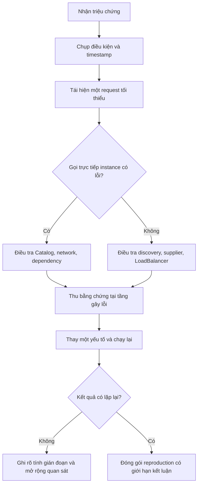
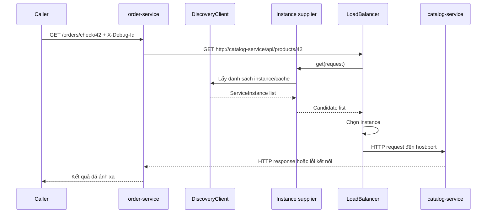

# Quy trình tái hiện lỗi tối thiểu và thu thập bằng chứng

Khi một lời gọi liên dịch vụ qua Spring Cloud LoadBalancer thất bại, thông báo như `503 Service Unavailable`, `No servers available for service: catalog-service` hoặc `Read timed out` chỉ mô tả **triệu chứng tại một tầng**. Chúng chưa đủ để kết luận nguyên nhân nằm ở Eureka, danh sách `ServiceInstance`, chính sách chọn instance, HTTP client hay dịch vụ đích.

Quy trình chẩn đoán đáng tin cậy cần tạo được **một tình huống nhỏ, lặp lại được**, giữ cố định các yếu tố không liên quan và thu thập bằng chứng tại từng ranh giới. Bằng chứng tốt trả lời được: request nào thất bại, caller nhìn thấy những instance nào, LoadBalancer chọn gì, kết nối có được mở không, server có nhận request không và lỗi xuất hiện lúc nào.

Bài thuộc chương **Chẩn đoán sự cố** của module Spring Cloud LoadBalancer. Nội dung dựng một lab Eureka–Catalog–Order tối thiểu, so sánh gọi trực tiếp với gọi qua service ID, tái hiện các lỗi thường gặp, thu log/trace/metrics và đóng gói bằng chứng đủ để một người khác có thể chạy lại.

## 1. Nguyên tắc: từ triệu chứng đến bằng chứng

Một lỗi chỉ được coi là tái hiện được khi người khác có thể chạy lại cùng điều kiện và quan sát cùng loại kết quả.

1. **Một biến đổi tại một thời điểm:** thay discovery, cache, health, timeout hoặc retry lần lượt; không chỉnh tất cả cùng lúc.
2. **Một request mẫu trước:** bắt đầu bằng một request đơn lẻ, sau đó mới tăng số lượng hoặc concurrency.
3. **Có mốc thời gian:** ghi thời điểm caller gửi request, registry thay đổi, instance được chọn và response/lỗi xuất hiện.
4. **So sánh đúng đường đi:** gọi trực tiếp instance và gọi bằng service ID để phân biệt lỗi backend với lỗi discovery/LoadBalancer.
5. **Giữ bằng chứng gốc:** lưu status, exception, root cause, log liên quan và cấu hình đã loại bỏ bí mật.
6. **Không suy luận quá mức:** registry có instance không chứng minh instance ready; HTTP 503 không chứng minh backend đã nhận request; timeout không chứng minh server chưa xử lý.
7. **Ghi rõ điều chưa biết:** nếu không có log chọn instance, ghi “chưa xác định được host được chọn” thay vì đoán.



## 2. Phân rã đường đi của request

Với `order-service` gọi `catalog-service`, một request đi qua các ranh giới:



| Tầng | Câu hỏi | Bằng chứng |
|---|---|---|
| API caller | Request nào, lúc nào, tham số gì? | Request ID, method/path, timestamp |
| Order application | Có vào đúng method và tạo đúng service ID không? | Application log, sanitized config |
| Discovery | Caller thấy service ID và instance nào? | Registry view, DiscoveryClient snapshot |
| Supplier chain | Health/zone/hint/cache có lọc ứng viên không? | Candidate list trước/sau filter |
| LoadBalancer | Chọn instance nào, hay không có server? | Selection log/trace/observation |
| HTTP client | Có mở kết nối, timeout hay nhận response? | Exception root cause, client metrics |
| Catalog | Server có nhận request và xử lý đến đâu? | Access log, correlation ID, server metrics |

Không phải mọi phiên bản/integration đều tự log tất cả điểm trên. Nếu thiếu selection log, có thể thêm instrumentation trong môi trường thử nghiệm; **không giả vờ rằng metric tổng hợp đã xác định được instance của request lỗi**.

## 3. Chốt phạm vi và điều kiện trước khi tái hiện

Ghi snapshot môi trường trước khi sửa code:

| Thông tin | Giá trị cần ghi |
|---|---|
| Ứng dụng | Order caller và Catalog callee |
| Spring Boot | Version thực tế từ build |
| Spring Cloud BOM | Release train thực tế |
| HTTP client | RestClient, WebClient hay OpenFeign |
| Discovery | Eureka, Consul, Kubernetes hay static supplier |
| Service ID | `catalog-service` |
| Instance ID/host/port | Các bản sao caller đang nhìn thấy |
| Supplier chain | Discovery, cache, health, zone, hint, custom filter |
| LoadBalancer policy | Round-robin, random hay custom |
| Timeout/retry | Giá trị hiệu lực, gồm override theo service |
| Môi trường | Local, container, Kubernetes hay staging |
| Thời điểm | Múi giờ và timestamp có offset |

Không đoán version từ tên dependency. Nếu cần chia sẻ dependency tree, chỉ lấy phần Spring Boot, Spring Cloud LoadBalancer, discovery client và HTTP connector. Lỗi có thể chỉ xuất hiện ở một cặp version hoặc một HTTP connector cụ thể.

Trước reproduction, xác nhận Order gọi đúng service ID; Catalog direct endpoint đang hoạt động hoặc cố ý được làm lỗi; mỗi instance có ID duy nhất; đồng hồ các process đủ đồng bộ; log level và Actuator endpoints đã được bật trong phạm vi test; không có load generator hay job nền khác làm nhiễu baseline.

## 4. Dựng reproduction tối thiểu Eureka–Catalog–Order

Lab có ba ứng dụng:

```text
loadbalancer-repro/
|-- eureka-server/
|-- catalog-service/
|-- order-service/
```

| Ứng dụng | Cổng ví dụ | Chức năng |
|---|---:|---|
| Eureka Server | `8761` | Service registry |
| Catalog 1 | `8081` | Backend instance thứ nhất |
| Catalog 2 | `8082` | Backend instance thứ hai |
| Order | `8090` | Caller sử dụng LoadBalancer |

Dùng Spring Boot và Spring Cloud BOM tương thích. Dependency cơ bản:

- Eureka Server: `spring-cloud-starter-netflix-eureka-server`.
- Catalog: `spring-boot-starter-web`, `spring-boot-starter-actuator` và `spring-cloud-starter-netflix-eureka-client`.
- Order: `spring-boot-starter-web`, `spring-boot-starter-actuator`, `spring-cloud-starter-netflix-eureka-client` và `spring-cloud-starter-loadbalancer`.

Lab dùng blocking `RestClient` để giảm số thành phần cần điều tra. Nếu lỗi chỉ xảy ra với WebClient/OpenFeign, hãy thay đúng client đó trong một reproduction riêng.

### 4.1. Eureka Server

```java
@SpringBootApplication
@EnableEurekaServer
public class EurekaServerApplication {
    public static void main(String[] args) {
        SpringApplication.run(EurekaServerApplication.class, args);
    }
}
```

`application.yml`:

```yaml
server:
  port: 8761

spring:
  application:
    name: eureka-server

eureka:
  client:
    register-with-eureka: false
    fetch-registry: false
```

### 4.2. Catalog trả về instance đã xử lý request

DTO:

```java
public record DiagnosticResponse(
        String instanceId,
        String requestId,
        String service,
        long timestampEpochMs) { }
```

Controller thử nghiệm:

```java
@RestController
@RequestMapping("/diagnostics")
public class CatalogDiagnosticController {

    private final String instanceId;

    public CatalogDiagnosticController(
            @Value("${eureka.instance.instance-id}") String instanceId) {
        this.instanceId = instanceId;
    }

    @GetMapping("/instance")
    public DiagnosticResponse instance(
            @RequestHeader(value = "X-Debug-Id", required = false)
            String requestId) {
        return new DiagnosticResponse(
                instanceId, requestId, "catalog-service",
                System.currentTimeMillis());
    }
}
```

`X-Debug-Id` là ID thử nghiệm do caller tạo, không phải token xác thực. Không dùng ID chứa dữ liệu cá nhân hoặc bí mật. Trong production, nên dùng tracing context chuẩn nếu đã có distributed tracing.

Catalog `application.yml`:

```yaml
server:
  port: 8081

spring:
  application:
    name: catalog-service

eureka:
  client:
    service-url:
      defaultZone: http://localhost:8761/eureka/
  instance:
    instance-id: catalog-local
    prefer-ip-address: true

management:
  endpoints:
    web:
      exposure:
        include: health,info,metrics
```

Mỗi process phải override `server.port` và `eureka.instance.instance-id`: `catalog-1` trên `8081`, `catalog-2` trên `8082`. Trùng instance ID có thể làm registry hiển thị không đúng số bản sao.

### 4.3. Order dùng RestClient đã tích hợp LoadBalancer

Bean:

```java
@Configuration(proxyBeanMethods = false)
public class CatalogHttpConfiguration {

    @Bean
    @LoadBalanced
    RestClient.Builder loadBalancedRestClientBuilder() {
        SimpleClientHttpRequestFactory factory =
                new SimpleClientHttpRequestFactory();
        factory.setConnectTimeout(1_000);
        factory.setReadTimeout(3_000);

        return RestClient.builder().requestFactory(factory);
    }
}
```

Service client:

```java
@Component
public class CatalogDiagnosticClient {

    private final RestClient restClient;

    public CatalogDiagnosticClient(
            @Qualifier("loadBalancedRestClientBuilder")
            RestClient.Builder builder) {
        this.restClient = builder
                .baseUrl("http://catalog-service")
                .build();
    }

    public DiagnosticResponse inspect(String requestId) {
        return restClient.get()
                .uri("/diagnostics/instance")
                .header("X-Debug-Id", requestId)
                .retrieve()
                .body(DiagnosticResponse.class);
    }
}
```

Endpoint Order tạo ID cho reproduction:

```java
@RestController
@RequestMapping("/debug")
public class OrderDiagnosticController {

    private final CatalogDiagnosticClient catalog;

    public OrderDiagnosticController(CatalogDiagnosticClient catalog) {
        this.catalog = catalog;
    }

    @GetMapping("/catalog")
    public DiagnosticResponse inspect() {
        String requestId = UUID.randomUUID().toString();
        return catalog.inspect(requestId);
    }
}
```

Các import, package và DTO cần được đặt đúng trong dự án. Ví dụ tập trung vào luồng chẩn đoán; không cần tạo endpoint debug này trong production. Endpoint phải được giới hạn trong môi trường thử nghiệm, không trở thành API quản trị công khai.

Order `application.yml`:

```yaml
server:
  port: 8090

spring:
  application:
    name: order-service
  cloud:
    loadbalancer:
      cache:
        enabled: false

eureka:
  client:
    service-url:
      defaultZone: http://localhost:8761/eureka/
    registry-fetch-interval-seconds: 5

management:
  endpoints:
    web:
      exposure:
        include: health,info,metrics
```

Tắt cache LoadBalancer và giảm registry fetch interval chỉ nhằm làm lab dễ quan sát; **không tắt cache Eureka client** và không bảo đảm discovery cập nhật đúng sau năm giây. Trong production, giữ cấu hình phù hợp với tải và mục tiêu hội tụ.

## 5. Tạo baseline có thể lặp lại

Khởi động theo thứ tự: Eureka Server, Catalog 1, Catalog 2, rồi Order. Gọi trực tiếp từng Catalog:

```powershell
Invoke-RestMethod "http://localhost:8081/diagnostics/instance"
Invoke-RestMethod "http://localhost:8082/diagnostics/instance"
```

Sau khi cả hai trả đúng instance ID, gọi qua Order:

```powershell
Invoke-RestMethod "http://localhost:8090/debug/catalog"
Invoke-RestMethod "http://localhost:8090/debug/catalog"
Invoke-RestMethod "http://localhost:8090/debug/catalog"
```

Kỳ vọng response có `instanceId` là một trong hai ID, `service` là `catalog-service` và `requestId` không rỗng. Không bắt buộc hai request liên tiếp phải đến hai instance khác nhau: seed, policy, cache, số caller và version có thể ảnh hưởng.

Ghi baseline:

| Mục | Kết quả cần lưu |
|---|---|
| Eureka | Instance ID, host, port và status |
| Direct HTTP | Status/body từ từng Catalog |
| Order → service ID | Status, latency và instance ID trả về |
| Candidate list | Nếu có thể quan sát, danh sách caller thực sự thấy |
| Cấu hình | Cache, supplier, health, timeout, retry, policy |
| Log | Startup, registration, selection và response có timestamp |

## 6. So sánh gọi trực tiếp và gọi qua service ID

```powershell
# Gọi trực tiếp từng backend
Invoke-RestMethod "http://localhost:8081/diagnostics/instance"
Invoke-RestMethod "http://localhost:8082/diagnostics/instance"

# Gọi qua Order và Spring Cloud LoadBalancer
Invoke-RestMethod "http://localhost:8090/debug/catalog"
```

| Direct Catalog | Qua service ID | Hướng điều tra ưu tiên |
|---|---|---|
| Thành công | Thành công | Baseline cơ bản hoạt động |
| Thất bại | Thất bại | Catalog, port, network, dependency hoặc request |
| Thành công | Thất bại | Discovery, service ID, supplier, LoadBalancer, client integration |
| Một instance tốt, một instance lỗi | Lúc thành công lúc lỗi | Instance-specific config/readiness |
| Cả hai thành công nhưng response sai | Sai hợp đồng/dữ liệu | Controller, DTO, version, serialization |

Direct call chỉ kiểm tra **host:port đó**, không kiểm tra instance còn lại, registry hay LoadBalancer. Nếu direct cả hai đều thành công nhưng service ID thất bại, thu candidate list và exception trước khi kết luận thuật toán chọn sai.

## 7. Tái hiện lỗi theo từng giả thuyết

Mỗi lần chỉ thực hiện **một thí nghiệm**, ghi timestamp bắt đầu/kết thúc, rồi khôi phục baseline trước thí nghiệm tiếp theo.

| Mã | Thí nghiệm | Triệu chứng dự kiến | Bằng chứng |
|---|---|---|---|
| R1 | Sai service ID | Không tìm được instance | Service ID request, registry |
| R2 | Không có instance | No-server/exception hoặc lỗi được ánh xạ | Registry, candidate list, root cause |
| R3 | Instance dừng đột ngột | Lỗi do stale snapshot | Instance đã chọn, thời điểm dừng, cache |
| R4 | Backend phản hồi chậm | Read timeout/deadline | Direct latency, client timeout, server log |
| R5 | Backend trả 503 có chủ ý | HTTP error từ server | Server access log và status |
| R6 | Health filter loại instance | Candidate list rỗng/thu hẹp | Health probe và danh sách trước/sau filter |
| R7 | Hint/zone không khớp | Không có ứng viên hoặc fallback | Request context, metadata, supplier |
| R8 | Retry được bật | Một logical request có nhiều attempt | Attempt count, instance từng attempt |
| R9 | Cache cũ | Client tiếp tục nhìn instance đã thay đổi | Registry và candidate list theo thời gian |

### 7.1. Sai service ID

Trong profile thử nghiệm, đổi URL logic thành `http://catalog-typo/...` trong khi Eureka chỉ đăng ký `catalog-service`. Ghi service ID client thực sự gửi, danh sách service ID trong registry, exception gốc và lớp ánh xạ lỗi HTTP.

Không suy từ thông báo “no servers” rằng Eureka bị hỏng; service ID sai cũng tạo kết quả tương tự.

### 7.2. Không có instance

Dừng cả hai Catalog theo cách bình thường hoặc dùng profile không đăng ký instance. Gọi một request qua Order và ghi: Eureka còn hiển thị bản ghi cũ không; DiscoveryClient ở Order trả danh sách rỗng hay snapshot cũ; supplier/filter nào đã áp dụng; LoadBalancer trả `EmptyResponse` hay phát lỗi; HTTP integration ánh xạ thành exception/status gì.

Không mặc định một HTTP status cố định cho mọi client/version. Đây là lỗi **không có đích khả dụng**, không phải endpoint sản phẩm trả 404.

### 7.3. Instance chết nhưng còn trong snapshot

Khởi động hai instance, xác nhận baseline rồi dừng đột ngột đúng process `catalog-2` trong lab. Tiếp tục gọi qua Order với tốc độ thấp.

Ghi thời điểm process chết, thời điểm Eureka loại bản ghi, thời điểm Order không còn candidate đó và lỗi cuối cùng. Eureka có heartbeat/lease/eviction và self-preservation; LoadBalancer hoặc supplier có thể có cache riêng. **Không dùng một lần chạy để khẳng định một TTL phổ quát**.

### 7.4. Phân biệt timeout với HTTP 503

Với timeout, tạo backend chậm có kiểm soát hoặc giảm read timeout trong client thử nghiệm. Xác nhận direct call cũng chậm hay chỉ service-ID call chậm. Với HTTP 503, để Catalog chủ động trả 503 và ghi access log.

Ghi thời điểm request vào Catalog, response, exception root cause và số retry. HTTP 503 là response status nếu có response HTTP thực. Timeout/connection refused thường là lỗi transport và không nhất thiết có status từ Catalog. Gateway hoặc exception handler của Order có thể ánh xạ transport failure thành 502/503 cho caller; cần phân biệt status bên ngoài với nguyên nhân bên trong.

## 8. Ghi log đủ để nối caller và callee

Một log hữu ích có thể chứa:

```text
timestamp
application
environment
trace_id / request_id
service_id
operation
selected_instance_id (nếu biết)
remote_host / remote_port (nếu được phép)
attempt
duration_ms
outcome
http_status (nếu có)
exception_type
root_cause_type
```

Không phải mọi trường đều có sẵn ở mọi tầng. Nếu LoadBalancer chưa log instance được chọn, đừng tự điền giá trị đoán vào `selected_instance_id`. Có thể ghi `unknown` và bổ sung instrumentation ở môi trường thử nghiệm.

Catalog nên log khi nhận request với cùng ID:

```java
@Slf4j
@RestController
@RequestMapping("/diagnostics")
public class CatalogDiagnosticController {

    @Value("${eureka.instance.instance-id}")
    private String instanceId;

    @GetMapping("/instance")
    public DiagnosticResponse instance(
            @RequestHeader(
                value = "X-Debug-Id",
                required = false) String requestId) {

        log.info(
                "catalog_request requestId={} instanceId={} timestamp={}",
                requestId, instanceId, Instant.now());

        return new DiagnosticResponse(
                instanceId, requestId, "catalog-service",
                System.currentTimeMillis());
    }
}
```

Đây là log lab minh họa; cần import Lombok, Java time và DTO tương ứng nếu dùng nguyên đoạn code. Nếu không dùng Lombok, khai báo logger bằng SLF4J. Trong production, dùng tracing context chuẩn thay vì tạo nhiều header ID khác nhau không có quy ước xuyên dịch vụ.

### 8.1. Không ghi bí mật vào log

Không log raw Authorization, cookie, access token, session ID, payload nhạy cảm hoặc URL có query chứa bí mật. Trước khi chia sẻ reproduction, thay token bằng `<REDACTED>`, dùng ID giả, ẩn hostname/IP nếu chính sách yêu cầu và giữ lại timestamp, service ID, port logic, loại lỗi cần thiết.

## 9. Bật log có mục tiêu

Có thể tăng log level trong profile reproduction:

```yaml
logging:
  level:
    org.springframework.cloud.client.discovery: DEBUG
    org.springframework.cloud.loadbalancer: DEBUG
    org.springframework.web.client: DEBUG
    com.netflix.discovery: INFO
```

Tên logger và lượng log phụ thuộc phiên bản. `DEBUG` cho toàn bộ HTTP stack có thể phát ra nhiều dữ liệu, kể cả header/URL; chỉ bật trong môi trường kiểm soát và kiểm tra nội dung trước khi chia sẻ. Không bật log body/token ở production chỉ để tìm lỗi routing.

Thu thập log startup của Order/Catalog, log registration/fetch của discovery client, log LoadBalancer/supplier quanh request ID hoặc timestamp, log access tại Catalog và exception stack trace đầy đủ ở Order. Đặc biệt giữ phần `Caused by` sâu nhất.

`ResourceAccessException` có thể bao quanh `ConnectException` hoặc `SocketTimeoutException`; root cause giúp phân biệt kết nối bị từ chối và chờ response quá lâu.

## 10. Thu thập metrics và observations

Actuator có thể liệt kê metric đang có:

```powershell
Invoke-RestMethod "http://localhost:8090/actuator/metrics"
Invoke-RestMethod "http://localhost:8090/actuator/health"
```

Nếu đã cấu hình Prometheus registry, có thể xem `GET /actuator/prometheus`. Tên metric HTTP client, LoadBalancer, retry và connection pool phụ thuộc Spring Boot/Spring Cloud, HTTP connector và Observation convention. **Không giả định một tên metric tồn tại trên mọi version.** Bắt đầu bằng danh sách Actuator metrics, sau đó truy vấn chi tiết một metric thực tế.

| Nhóm | Chỉ số |
|---|---|
| HTTP client | Số request, latency, status/outcome, lỗi transport |
| LoadBalancer | Lượt chọn, no-instance, thời gian chọn nếu được instrument |
| Discovery | Số instance theo service ID, thời gian refresh/cache |
| Catalog | Request in-flight, latency, 4xx/5xx, saturation |
| Resilience | Retry attempts, timeout, circuit breaker state |
| JVM/runtime | Thread, heap, CPU, GC, connection pool |

Không gắn `traceId`, user ID, raw URL hoặc exception message vào metric labels; giá trị cardinality cao nên nằm trong log/trace. Metric dùng để thấy xu hướng tổng hợp, trace để điều tra request cụ thể.

## 11. Thu thập trace và biết instance được chọn

Nếu dùng Micrometer Observation/Tracing hoặc OpenTelemetry, xác nhận trace context được truyền qua HTTP client đến Catalog. Một trace có thể thể hiện:

```text
order-service inbound span
  └─ catalog-service HTTP client span
       attributes:
         server/service target = catalog-service
         http.request.method = GET
         http.response.status_code = 200 (nếu có)
       events/logs:
         request_id = ...
         selected_instance_id = catalog-2 (nếu instrumentation có)
  └─ catalog-service server span
       request_id = ...
       served_by = catalog-2
```

Tên attribute phụ thuộc instrumentation/version. Nếu không có span cho lựa chọn instance, ghi instance ID trong structured log ở điểm phù hợp. Đừng tạo span giả để làm bằng chứng; phải phân biệt span thật, event bổ sung và field suy ra từ response.

Với request lỗi trước khi server nhận kết nối, không có server span là điều có thể xảy ra. Khi đó cần client-side span/log ghi remote address và exception root cause nếu connector cung cấp.

## 12. Phân tích dấu hiệu thường gặp

| Dấu hiệu | Điều đã biết | Điều chưa thể kết luận | Bằng chứng tiếp theo |
|---|---|---|---|
| `No servers available for service` | Không có server phù hợp tại thời điểm chọn | Eureka chết hay service ID/filter sai | Registry, DiscoveryClient, supplier |
| HTTP 503 trong Catalog access log | Backend đã nhận và trả 503 | LB chọn sai hay nghiệp vụ lỗi | Request ID, instance, dependency |
| HTTP 503 nhưng Catalog không có access log | Lỗi có thể sinh trước backend | Chưa đủ kết luận no-instance | Order exception, gateway, selection log |
| `Connection refused` | Có thử kết nối nhưng không có listener nhận | Không chứng minh registry đã cập nhật | Remote host/port, lifecycle, snapshot |
| `Read timed out` | Client chờ response vượt timeout | Server chưa xử lý hay đã commit | Server log, duration, timeout setting |
| Direct OK, service ID lỗi | Backend thử trực tiếp có thể hoạt động | Chưa rõ discovery hay LB | Candidate list, service ID, supplier |
| Một instance lỗi, instance khác tốt | Có lỗi theo bản sao | Chưa chắc thuật toán phân phối sai | Direct test từng instance, config/version |
| Lúc được lúc không sau rollout | Có thể có cửa sổ stale/readiness | Chưa đủ kết luận cache TTL | Timeline registry→caller→selection→HTTP |

Status do caller nhìn thấy không nhất thiết là status do Catalog trả. Exception handler của Order, gateway hoặc reverse proxy có thể ánh xạ lỗi transport thành status khác. Luôn tìm tầng đầu tiên tạo ra lỗi.

## 13. Tái hiện timeout có kiểm soát

Thêm endpoint chậm chỉ trong profile lab:

```java
@GetMapping("/slow")
public DiagnosticResponse slow(
        @RequestHeader(
            value = "X-Debug-Id",
            required = false) String requestId)
        throws InterruptedException {

    Thread.sleep(2_000);

    return new DiagnosticResponse(
            instanceId, requestId, "catalog-service",
            System.currentTimeMillis());
}
```

Đoạn này minh họa handler Spring MVC blocking; không dùng sleep trong event loop reactive hoặc production. Đặt client read timeout ngắn hơn hai giây rồi gọi trực tiếp và qua service ID.

Ghi connect/read timeout hiệu lực, thời điểm request vào Catalog, thời điểm Catalog trả response, exception root cause tại Order, số retry và server có tiếp tục chạy sau khi caller timeout không.

**Timeout ở client không tự hủy công việc nghiệp vụ trên server.** Server có thể đã commit rồi response đến muộn; retry có thể gây tác dụng phụ lặp lại. Dùng GET đọc trong lab; với thao tác ghi cần idempotency key và kiểm tra trạng thái nghiệp vụ.

## 14. Phân biệt no-instance và stale-instance

### 14.1. No-instance

Mục tiêu là chứng minh candidate list rỗng tại thời điểm chọn:

- Ghi service ID caller yêu cầu.
- Chụp registry view.
- Chụp danh sách `DiscoveryClient.getInstances(serviceId)` từ chính Order nếu có thể.
- Ghi supplier/filter đã áp dụng.
- Ghi kết quả `Response.hasServer()` hoặc exception.
- Không có HTTP request đến Catalog là điều dự kiến khi chưa chọn được server.

### 14.2. Stale-instance

Mục tiêu là chứng minh client vẫn thấy/chọn địa chỉ đã chết:

- Ghi instance ID, host/port trước khi dừng.
- Ghi timestamp dừng process.
- Theo dõi registry loại instance lúc nào.
- Theo dõi DiscoveryClient/supplier ở Order cập nhật lúc nào.
- Nếu có, ghi host/port được chọn cho request thất bại.
- Đối chiếu connection refused/timeout và thời điểm hết lỗi.

Ảnh chụp Eureka sau sự cố không đủ chứng minh client đã thấy gì **tại thời điểm request lỗi**. Cần timestamp/log hoặc chuỗi quan sát theo thời gian.

## 15. Tái hiện filter/hint/zone không còn ứng viên

Ví dụ registry có hai instance nhưng request không khớp policy:

```text
Registry:
  catalog-1 (zone=az-a, hint=stable)
  catalog-2 (zone=az-b, hint=stable)

Request:
  zone=az-c
  hint=canary

Candidate after policy:
  []
```

Trong tình huống này, câu “Eureka không có instance” là sai: registry có instance, nhưng **policy hiện tại không có ứng viên phù hợp**.

Thu thập metadata của từng `ServiceInstance`, request context/hint/cookie/zone, thứ tự supplier chain và danh sách sau từng filter. Xác định fallback là fail-closed hay trả lại danh sách ban đầu. Không đưa raw header hoặc metadata nhạy cảm vào log; chỉ ghi policy value đã chuẩn hóa.

## 16. Thu thập cấu hình và dependency đang có hiệu lực

File YAML trong repository chưa chắc là cấu hình cuối cùng runtime. Profile, environment variables, command-line args, config server và per-service properties có thể ghi đè.

| Nhóm | Ví dụ cần xác minh |
|---|---|
| Service identity | `spring.application.name`, LoadBalancer service ID |
| Discovery | Registry URL, fetch interval, heartbeat/lease |
| LoadBalancer | Cache, supplier chain, algorithm, per-service config |
| Health | Probe path, interval, timeout, health mapping |
| Zone/hint | Metadata key, request hint, fallback |
| HTTP client | Connect/read/response timeout, pool |
| Retry | Enabled, max attempts, retryable errors/status, backoff |
| Runtime | Active profile, port, hostname/IP, JVM options |
| Security | TLS/mTLS, proxy, trust store (không thu private key/secret) |

Có thể xem dependency tree trong dự án Maven:

```powershell
mvn dependency:tree
```

Khi chia sẻ output, lọc phần Spring Boot, Spring Cloud, Eureka, Reactor và HTTP connector. Không cần gửi toàn bộ tree nếu quá lớn; giữ version và quan hệ dependency đủ để tái lập.

Không dump toàn bộ `/actuator/env` ra kênh công khai; endpoint có thể lộ cấu hình nhạy cảm. Nếu cần kiểm tra property runtime, chọn đúng key và che secret trước khi chia sẻ.

## 17. Quy trình tái hiện tối thiểu theo từng vòng

1. **Đóng băng baseline:** version, profile, service ID, instance ID, supplier chain, cache, timeout/retry.
2. **Xác nhận backend:** gọi trực tiếp từng instance; ghi status, latency và ID.
3. **Xác nhận discovery:** lấy danh sách từ registry và caller; không chỉ xem dashboard.
4. **Một request qua service ID:** gắn debug/trace ID và lưu log tương ứng.
5. **Lặp lại ít lần:** chỉ xác nhận tính tái diễn, chưa tạo concurrency cao.
6. **Tái hiện một giả thuyết:** no-instance, stale, timeout, 503 hoặc filter/hint.
7. **Thu bằng chứng ở mỗi tầng:** timestamp, candidate list, selection, remote address, server access log.
8. **Khôi phục baseline:** đưa process/config về trạng thái ban đầu và xác nhận request thành công.
9. **Thay đúng một yếu tố:** chỉ đổi cache, hoặc chỉ timeout; chạy lại cùng kịch bản.
10. **So sánh:** ghi điều thay đổi, điều không đổi, kết quả mới và giới hạn kết luận.

Không xóa log hoặc restart mọi thành phần ngay khi thấy lỗi; thao tác đó có thể xóa bằng chứng. Nếu cần restart để khôi phục, lưu log, timestamp và snapshot trước nếu điều kiện cho phép.

## 18. Evidence bundle để chuyển cho người khác

Một gói bằng chứng có thể gồm:

```text
incident/
  README-reproduction.md
  versions.txt
  effective-config-redacted.yml
  registry-before.txt
  registry-during.txt
  registry-after.txt
  request-samples.csv
  order-service.log
  catalog-service-1.log
  catalog-service-2.log
  exception-root-cause.txt
  metrics-snapshot.txt
  trace-links.txt
```

Không cần mọi file trong mọi sự cố. README phải ghi mục tiêu, điều kiện, bước tái hiện, kết quả mong đợi, kết quả thực tế, tính lặp lại, bằng chứng, thay đổi đã thử và giới hạn quan sát.

### 18.1. Mẫu README reproduction

```markdown
# Reproduction: Order không gọi được catalog-service

## Environment
- Spring Boot: <version>
- Spring Cloud BOM: <release train>
- Discovery: Eureka
- HTTP client: RestClient
- Service ID: catalog-service
- Active profile: <profile>

## Topology
- catalog-1: <host:port>
- catalog-2: <host:port>
- order-service: <host:port>

## Steps
1. Start Eureka.
2. Start catalog-1 and catalog-2 with unique instance IDs.
3. Wait until Order sees both candidates.
4. Send one request with X-Debug-Id=<redacted-id>.
5. Stop catalog-2 using <exact controlled action>.
6. Repeat the same request and record timestamps.

## Expected
A new request should use a currently eligible instance.

## Actual
- HTTP status / exception:
- Root cause:
- Selected host (if observed):
- Request reached Catalog: yes/no/unknown

## Evidence
- registry-before.txt
- registry-during.txt
- order-service.log
- catalog-service-*.log
- request-samples.csv

## Limits
State what was not observed. Do not infer a selected instance without evidence.
```

Mẫu dùng placeholder; thay bằng giá trị đã che bí mật. Không đưa credential, private key, token hoặc dữ liệu khách hàng thật vào evidence bundle.

## 19. Những kết luận sai thường gặp

| Kết luận vội | Vì sao chưa đủ bằng chứng | Cách chứng minh |
|---|---|---|
| “Eureka hỏng vì không có server” | Service ID sai hoặc supplier filter hết cũng có thể no-server | So registry, DiscoveryClient và candidate list |
| “Round-robin chọn sai” | Snapshot có thể còn instance đã gỡ | Ghi snapshot và selection lúc request |
| “503 nghĩa là Catalog trả 503” | Order/gateway có thể ánh xạ lỗi transport | Kiểm tra Catalog access log và response origin |
| “Timeout nghĩa là server không nhận request” | Server có thể đã xử lý/commit | Ghép request ID ở server và client |
| “Dashboard có hai instance nên caller thấy hai” | Client fetch/cache độc lập | Lấy danh sách từ caller |
| “Tắt cache đã sửa lỗi” | Chỉ một lớp cache có thể bị tắt | Đo registry fetch, supplier cache, routing |
| “Retry đã chữa lỗi” | Retry có thể che stale routing hoặc tăng tải | Đếm attempt, instance từng lần, lỗi cuối |
| “Direct URL chạy nên LB chắc chắn lỗi” | Direct test chỉ thử một host/port | So candidate list, service ID, integration |
| “Không có server log tức request không gửi” | Log có thể bị sampling hoặc thiếu instrumentation | Kiểm tra access log, trace, client evidence |

## 20. Ghi nhớ

Chẩn đoán Spring Cloud LoadBalancer hiệu quả bắt đầu bằng **một request tối thiểu có thể lặp lại**, một baseline cố định và phép so sánh giữa gọi trực tiếp với gọi theo service ID. Sau đó thu bằng chứng lần lượt tại discovery, supplier chain, lựa chọn instance, HTTP client và backend. Mỗi kết luận cần chỉ rõ nó được xác nhận bởi log, metric, trace hay response nào.

Đừng coi một status code, một ảnh chụp Eureka hoặc một dòng exception là toàn bộ nguyên nhân. Hãy ghi timestamp, service ID, instance ID khi biết, root cause, timeout/retry có hiệu lực và candidate list tại caller. Khi evidence bundle giữ được cả bước tái hiện lẫn giới hạn quan sát, một người khác có thể chạy lại, kiểm chứng giả thuyết và sửa đúng tầng gây lỗi mà không phải đoán.

