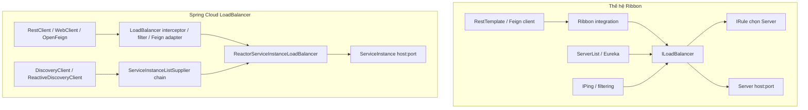
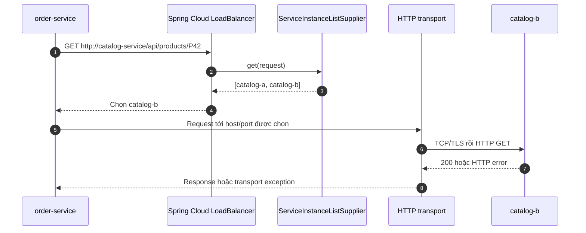
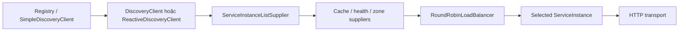

# Phân biệt Ribbon cũ với Spring Cloud LoadBalancer

Trong một hệ thống microservices, `order-service` có thể gọi `http://catalog-service/api/products/P42` thay vì hard-code địa chỉ của một bản sao cụ thể. Dịch vụ khám phá các bản sao `catalog-service`, bộ cân bằng tải phía client chọn một bản sao, rồi HTTP client gửi request đến host/port đã chọn. Ý tưởng này xuất hiện cả trong **Netflix Ribbon** trước đây lẫn **Spring Cloud LoadBalancer** hiện đại. Tuy nhiên, việc hai giải pháp cùng giải quyết bài toán chọn instance **không có nghĩa API, chính sách, cache, retry, timeout và cách tùy biến của chúng tương đương từng thuộc tính**.

Bài học thuộc chương **Tương thích và nâng cấp** của module `SPRING_CLOUD_SERVICE_COMMUNICATION_LOAD_BALANCING`. Mục tiêu là nhận ra dấu vết Ribbon trong mã nguồn và cấu hình cũ, hiểu các thay đổi kiến trúc, chuyển những tình huống sử dụng thực tế sang Spring Cloud LoadBalancer, đồng thời kiểm chứng đường gọi qua `RestTemplate`, `RestClient`, `WebClient` và OpenFeign. Đây là hướng dẫn học thuật/di trú theo **nhóm khả năng**; tên dependency, class và property cụ thể cần đối chiếu với Spring Boot và Spring Cloud release train mà dự án đang sử dụng.

## 1. Vì sao cần phân biệt hai thế hệ?

Netflix Ribbon là thư viện client-side load balancing của hệ sinh thái Netflix OSS, từng được Spring Cloud Netflix tích hợp để hỗ trợ gọi service theo tên. Ribbon chuyển sang giai đoạn bảo trì, và những Spring Cloud release train hiện đại **không còn dùng Ribbon làm giải pháp cân bằng tải được hỗ trợ**. Spring Cloud LoadBalancer là giải pháp do Spring Cloud cung cấp để thay thế trong các ứng dụng Spring.

Điểm quan trọng khi nâng cấp:

- **Không chỉ thay dependency** rồi kỳ vọng mọi cấu hình Ribbon cũ tự động được hiểu.
- **Không nhầm thư viện discovery với thư viện load balancing**: Eureka, Consul, Kubernetes discovery hay danh sách instance tĩnh là nguồn cung cấp địa chỉ; LoadBalancer quyết định địa chỉ nào được chọn.
- **Không nhầm client HTTP với LoadBalancer**: `RestClient`, `WebClient` và Feign gửi HTTP; Spring Cloud LoadBalancer chọn `ServiceInstance` trước khi transport làm việc.
- **Không nhầm chuyển Ribbon sang LoadBalancer với nâng cấp toàn bộ stack**: thay Hystrix, migrate từ `javax.*` sang `jakarta.*`, đổi Java/Boot hoặc HTTP transport là các hạng mục khác nhau, tuy có thể xảy ra trong cùng chương trình nâng cấp.

Một dự án legacy có thể có các class `IRule`, `IPing`, `ServerList`, property `ribbon.*` và annotation `@RibbonClient`. Trong dự án hiện đại, những khái niệm tương ứng thường nằm ở `ReactorServiceInstanceLoadBalancer`, `ServiceInstanceListSupplier`, `LoadBalancerClientFactory` và `@LoadBalancerClient`.

## 2. Khung kiến trúc: giải bài toán giống nhau, hợp đồng khác nhau



Bảng so sánh ở cấp khái niệm:

| Khía cạnh | Netflix Ribbon trước đây | Spring Cloud LoadBalancer |
|---|---|---|
| Lớp chọn đích | `ILoadBalancer` và `IRule`, chẳng hạn `RoundRobinRule` | `ReactorServiceInstanceLoadBalancer`, chẳng hạn `RoundRobinLoadBalancer` |
| Đối tượng bản sao | Ribbon `Server` | Spring Cloud `ServiceInstance` |
| Nguồn danh sách | `ServerList` và tích hợp registry | `ServiceInstanceListSupplier` lấy từ `DiscoveryClient`/`ReactiveDiscoveryClient` hoặc nguồn tùy biến |
| Thăm dò khả dụng | `IPing`, một số chính sách filtering | Health-check/decorator supplier, readiness và registry phù hợp |
| API lập trình | Trọng tâm các kiểu Ribbon/Netflix | Reactor `Mono<Response<ServiceInstance>>` và chuỗi supplier |
| Chọn theo service ID | Named Ribbon client/context | LoadBalancer named client qua `LoadBalancerClientFactory` |
| Tùy biến chính sách | `IRule`, `ServerList`, `@RibbonClient` | Custom load balancer/supplier, `@LoadBalancerClient` |
| Hỗ trợ reactive | Không thiết kế lõi theo Reactor | Tích hợp tự nhiên với Reactor/WebClient |
| HTTP client blocking | `RestTemplate` hoặc Feign thông qua tích hợp Ribbon | `RestTemplate`, `RestClient` hoặc Feign qua Spring Cloud LoadBalancer |
| Retry | Ribbon retry cùng/các server theo integration | Spring Cloud LoadBalancer retry tùy stack và cấu hình |
| Cache/health/zone | Các component và properties đặc thù Ribbon | Supplier decorators/cache/health/zone, ngữ nghĩa khác |
| Vòng đời/observability | Log/metric tùy tích hợp Ribbon | `LoadBalancerLifecycle`/Micrometer/Observation tùy release train |

**Không nên tìm tương đương một-một cho tất cả thành phần.** Ví dụ `IPing` và `HealthCheckServiceInstanceListSupplier` đều liên quan đánh giá khả dụng, nhưng vị trí trong pipeline, thời điểm probe và hành vi khi không còn instance khỏe có thể khác nhau. Tương tự, `ZoneAvoidanceRule` của Ribbon không tương đương hoàn toàn với một supplier ưu tiên zone được ghép cùng `RoundRobinLoadBalancer`.

## 3. Thuật ngữ và trách nhiệm: Server khác ServiceInstance

Trong Ribbon, nhiều chính sách thao tác trên `com.netflix.loadbalancer.Server`, thường biểu diễn host/port và trạng thái do các thành phần Ribbon quản lý.

Trong Spring Cloud LoadBalancer, đối tượng trung tâm là `org.springframework.cloud.client.ServiceInstance`:

```java
import org.springframework.cloud.client.ServiceInstance;

void inspect(ServiceInstance instance) {
    String serviceId = instance.getServiceId();
    String instanceId = instance.getInstanceId();
    String host = instance.getHost();
    int port = instance.getPort();
    boolean https = instance.isSecure();
    java.net.URI uri = instance.getUri();
    java.util.Map<String, String> metadata = instance.getMetadata();
}
```

`ServiceInstance` đưa các thông tin do discovery công bố tới thuật toán chọn. Nó **không** chứng minh kết nối tới `host:port` sẽ thành công: instance có thể đã chết, IP đổi, port sai, TLS certificate không khớp hoặc readiness chưa đạt.

Khi chuyển một policy cũ có dùng thông tin của `Server`, hãy xác định từng nguồn dữ liệu:

| Thông tin policy cần | Ribbon legacy thường lấy từ | Với Spring Cloud LoadBalancer cần tìm ở |
|---|---|---|
| Host/port | `Server` | `ServiceInstance.getHost()/getPort()` |
| Service name | Named client/registry | `ServiceInstance.getServiceId()` và service ID của context |
| Zone | Server metadata, client zone config, rule | `ServiceInstance.getMetadata()` hoặc cơ chế zone supplier |
| Trạng thái khỏe | Ping/ServerList filtering | Discovery/readiness/health-check supplier |
| Trọng số/capacity | Policy/metadata tùy biến | Metadata + supplier/custom choose có kiểm soát |
| Session affinity | Strategy tùy biến | Request hints/sticky session supplier tùy stack |

Đừng đưa toàn bộ thông tin này vào một `ThreadLocal` không được propagate khi dùng Reactor. Request-scoped hints hoặc context cần đi theo cơ chế Spring Cloud/Reactive có hỗ trợ.

## 4. Bức tranh dependency: cái gì phải bỏ, cái gì phải giữ?

Trong một dự án cũ, có thể thấy những dependency sau:

```xml
<!-- Ví dụ nhận diện dự án cũ: KHÔNG thêm vào dự án hiện đại -->
<dependency>
    <groupId>org.springframework.cloud</groupId>
    <artifactId>spring-cloud-starter-netflix-ribbon</artifactId>
</dependency>
```

Hoặc Ribbon nằm **bắc cầu** từ một starter thuộc stack Spring Cloud cũ. Đừng chỉ tìm tên `ribbon` trong `pom.xml` trực tiếp: cần xem dependency graph đúng phiên bản thực tế khi thực hiện migration.

Với dự án Spring Boot/Spring Cloud hiện đại, một lựa chọn thay thế là:

```xml
<dependency>
    <groupId>org.springframework.cloud</groupId>
    <artifactId>spring-cloud-starter-loadbalancer</artifactId>
</dependency>
```

Nếu dùng `WebClient`, cần stack WebFlux tương thích; nếu dùng `RestClient`, Spring Framework 6.1+ và Spring Boot release phù hợp. OpenFeign cần starter tương ứng. **Dependency Spring Cloud LoadBalancer không tự kích hoạt discovery HTTP ở mọi client**: vẫn cần adapter/interceptor/filter và nguồn instance được cung cấp.

### Không tự ghép version tùy ý

Spring Boot và Spring Cloud phải thuộc các phiên bản/release train **tương thích được công bố**. Thay một starter Ribbon bằng `spring-cloud-starter-loadbalancer` trong một ứng dụng Spring Boot đã quá cũ, nhưng không nâng cả tập dependency liên quan, có thể dẫn tới classpath conflict hoặc API không tương thích.

Một kế hoạch có trách nhiệm:

1. Xác định Java runtime, Spring Boot version, Spring Cloud release train và HTTP client hiện có.
2. Tra ma trận compatibility/BOM tương ứng **đúng bản sẽ triển khai**, không lấy một version từ bài blog cũ.
3. Chọn một tổ hợp đã được hỗ trợ, để BOM quản lý version Spring Cloud thay vì gán lẻ nhiều phiên bản.
4. Kiểm tra dependency graph không còn Ribbon không mong muốn hoặc các phiên bản Spring Cloud lẫn lộn.
5. Nâng cấp từng đường gọi bằng test và metrics thay vì đổi cùng lúc tất cả timeout, retry, circuit breaker.

Việc Eureka vẫn còn trong hệ thống **không có nghĩa** bắt buộc giữ Ribbon: Eureka là service discovery, LoadBalancer là selection. Ngược lại, bỏ Ribbon không thay thế công việc cấu hình Eureka/Consul/Kubernetes registry.

## 5. Hành trình một HTTP request: trước và sau

Giả sử trong cả hai hệ thống, caller viết URL logic:

```http
GET /api/products/P42 HTTP/1.1
Host: catalog-service
```

### Với Ribbon legacy

```text
Logical URI http://catalog-service/api/products/P42
  → Ribbon client cho tên catalog-service
  → ServerList / Eureka cung cấp danh sách Server
  → IRule chọn một Server, ví dụ catalog-b:8082
  → interceptor/Feign client viết lại host:port
  → HTTP transport thực hiện kết nối và request
```

### Với Spring Cloud LoadBalancer

```text
Logical URI http://catalog-service/api/products/P42
  → @LoadBalanced RestClient / WebClient filter / Feign LB
  → ServiceInstanceListSupplier cung cấp snapshot các ServiceInstance
  → ReactorServiceInstanceLoadBalancer chọn catalog-b:8082
  → adapter viết lại URI phù hợp với ServiceInstance
  → HTTP transport kết nối, gửi request và nhận response
```



Điểm giống nhau: client không cần biết cứng địa chỉ `catalog-b` trong nghiệp vụ. Điểm khác nhau: nguồn danh sách, lifecycle, API tùy biến, default policy và cách cấu hình retry/health **khác**. Không phải chỉ đổi tên class trong mã.

## 6. Thuật toán: RoundRobin không phải mọi chính sách Ribbon

Một bài học nâng cấp thường nhìn thấy:

```java
// Ribbon legacy: minh họa loại policy cũ.
import com.netflix.loadbalancer.IRule;
import com.netflix.loadbalancer.RoundRobinRule;

IRule rule = new RoundRobinRule();
```

Ở Spring Cloud LoadBalancer, implementation mặc định thường là `RoundRobinLoadBalancer`, trong khi `RandomLoadBalancer` là một lựa chọn khác. Chúng chọn từ danh sách `ServiceInstance` do supplier cung cấp.

| Nhu cầu | Ribbon trước đây | Spring Cloud LoadBalancer |
|---|---|---|
| Chọn luân phiên | `RoundRobinRule` | `RoundRobinLoadBalancer` |
| Chọn ngẫu nhiên | `RandomRule` | `RandomLoadBalancer` |
| Tránh instance không khỏe | `IPing`/availability-aware rule | Registry/readiness/health-check supplier |
| Ưu tiên zone | `ZoneAvoidanceRule` và cấu hình vùng | Zone preference/filter supplier theo release train |
| Giữ instance theo session | Rule/filter tùy biến | Sticky session/cookie/hint supplier nếu được hỗ trợ |
| Trọng số tùy biến | Ribbon rule/ServerList metadata | Custom supplier/`ReactorServiceInstanceLoadBalancer` và metadata |

**Không coi ZoneAvoidanceRule = ZonePreferenceServiceInstanceListSupplier**. Tên policy nghe gần giống nhau nhưng Ribbon có thể kết hợp thống kê server availability/load và các ngưỡng khác, còn cơ chế zone preference trong Spring Cloud có thể ưu tiên danh sách tại zone, sau đó fallback. Muốn giữ đúng hành vi cũ, phải kiểm thử phân phối tải và hành vi khi zone hỏng.

## 7. Tách nguồn instance khỏi thuật toán chọn

Một kiến trúc nâng cấp dễ kiểm thử là tách ba khâu:

- **Discovery:** registry hoặc danh sách tĩnh trả dữ liệu về những instance khả dụng.
- **Candidate selection/filtering:** `ServiceInstanceListSupplier` có thể cache, kiểm tra health, ưu tiên zone/metadata/hints.
- **Final selection:** `ReactorServiceInstanceLoadBalancer` chọn một instance từ danh sách kết quả.



Cách tách này hữu ích khi thay một `ServerList` Ribbon phức tạp. Thay vì để custom `IRule` tự gọi registry, health HTTP và chọn server trong cùng hàm, ta có thể để supplier refresh danh sách có kiểm soát, còn LoadBalancer chỉ chọn nhanh một `ServiceInstance`.

Một số caveat quan trọng:

1. **Thứ tự supplier/decorator ảnh hưởng ngữ nghĩa**: cache trước/sau lọc theo zone, hint hoặc request có thể làm dữ liệu không mong muốn bị dùng lại.
2. **Health check có độ trễ**: probe trả 200 không bảo đảm mọi business endpoint khỏe; một số health supplier có thể fallback danh sách delegate khi không còn instance khỏe.
3. **Không có instance**: request có thể fail trước transport; khác với đã chọn instance nhưng TCP bị refused.
4. **Reactive chỉ là API**: supplier gọi `DiscoveryClient` blocking hoặc `.block()` trong `choose()` vẫn có thể chặn event loop.
5. **Snapshot cũ**: registry đã xóa endpoint nhưng client cache còn giữ; phải có cơ chế refresh và observability.

Một custom algorithm không thay thế chính sách readiness, timeout và vận hành registry.

## 8. Phân biệt client-side load balancing với service discovery

Một số dự án migration thực hiện sai trình tự: bỏ Ribbon rồi dùng URL cứng đến một bản sao hoặc chỉ giữ `DiscoveryClient`. Hai việc đó không đủ để tái tạo client-side load balancing:

```text
Discovery only:
  catalog-service → [catalog-a:8081, catalog-b:8082]
  (ứng dụng vẫn cần quyết định sẽ gọi cái nào)

Load balancing:
  [catalog-a:8081, catalog-b:8082]
       ↓ chọn theo policy
  catalog-b:8082
       ↓ TCP/HTTP
  HTTP result
```

Nếu ứng dụng chọn một Kubernetes Service VIP, có thể có **một tầng load balancing khác** bên dưới (kube-proxy/CNI/mesh) thay vì Spring Cloud chọn từng pod instance. Khi kiểm thử số lần request tới mỗi replica, phải biết bạn đang kiểm chứng **định tuyến bởi Spring Cloud** hay **định tuyến bởi hạ tầng mạng**. Cả hai có thể cùng tồn tại nhưng cơ chế và cách quan sát khác nhau.

## 9. RestTemplate: annotation có thể giữ, nhưng implementation thay đổi

Một dự án cũ có thể dùng:

```java
@Bean
@LoadBalanced
RestTemplate restTemplate() {
    return new RestTemplate();
}
```

Ý nghĩa ở mức ứng dụng của `@LoadBalanced` vẫn là: URL sử dụng service ID được chuyển thành request tới một instance nhờ tích hợp Spring Cloud. Nhưng **phần implementation bên dưới** chuyển từ Ribbon sang Spring Cloud LoadBalancer theo stack/version đã chọn.

Do đó, không nhất thiết phải thay toàn bộ code `RestTemplate` chỉ để loại bỏ Ribbon. Trước tiên:

1. Đảm bảo version mới có starter LoadBalancer và client-side interceptor thích hợp.
2. Kiểm tra bean `RestTemplate` được gọi là bean **được đánh dấu** `@LoadBalanced`, không phải `new RestTemplate()` tùy ý.
3. Kiểm tra discovery thực sự có instance và việc chọn một instance thành công.
4. Rà soát exception, timeout, connection pool và retry **bên dưới**; chúng không tự giữ hành vi Ribbon.
5. Thêm test khi một replica tắt và khi danh sách ứng viên rỗng.

`RestTemplate` vẫn có thể dùng trong các ứng dụng blocking, nhưng Spring Framework hiện đại cung cấp `RestClient` với API fluent cho các dự án mới. **Đổi Ribbon và đổi RestTemplate sang RestClient là hai quyết định độc lập**; khi muốn giảm rủi ro, nâng từng bước thay vì làm mọi thay đổi cùng lúc.

## 10. Những cấu hình Ribbon cũ không được sao chép nguyên xi

Có thể thấy `application.yml` của một dự án cũ:

```yaml
# Ví dụ Ribbon legacy để NHẬN DIỆN, không sao chép vào cấu hình mới.
catalog-service:
  ribbon:
    NFLoadBalancerRuleClassName: com.netflix.loadbalancer.RoundRobinRule
    ConnectTimeout: 1000
    ReadTimeout: 2500
    MaxAutoRetries: 1
    MaxAutoRetriesNextServer: 1
    OkToRetryOnAllOperations: false
```

Những property này thuộc một mô hình cấu hình Ribbon cũ. Trong stack hiện đại, không mặc định chúng có hiệu lực. Hãy chuyển **ý định** của từng property, không chỉ thay một tiền tố string:

| Ý định cần giữ | Ribbon legacy | Khi chuyển sang Spring Cloud LoadBalancer |
|---|---|---|
| Chọn round robin | `NFLoadBalancerRuleClassName` | Dùng `RoundRobinLoadBalancer` mặc định hoặc bean tương ứng |
| Danh sách server tĩnh | `listOfServers`/ServerList | `SimpleDiscoveryClient` hoặc supplier theo service ID |
| Timeout TCP connect | `ConnectTimeout` | Cấu hình **HTTP transport** của RestClient/WebClient/Feign |
| Timeout chờ response | `ReadTimeout` | Cấu hình response/read timeout của transport đúng phiên bản |
| Retry trên cùng instance | `MaxAutoRetries` | Xem chính sách `spring.cloud.loadbalancer.retry.*`/retry owner thực tế |
| Retry sang instance kế tiếp | `MaxAutoRetriesNextServer` | Chính sách next-instance của Spring Cloud LoadBalancer khi được hỗ trợ |
| Retry mọi HTTP operation | `OkToRetryOnAllOperations` | Chọn whitelist theo method/idempotency và policy retry thích hợp |
| Health/availability | `IPing`/availability filter | Readiness/discovery/`HealthCheckServiceInstanceListSupplier` |
| Zone affinity | Ribbon zone rule/properties | Supplier zone preference/policy riêng |
| Stats/quyết định chọn | Ribbon statistics | Micrometer/tracing và custom observability theo Spring Cloud |

**Hai lỗi migration nguy hiểm:** (1) để các property Ribbon cũ trong YAML rồi tưởng ứng dụng vẫn dùng timeout/retry đó; (2) bật retry ở Gateway, ứng dụng, LoadBalancer và HTTP transport cùng lúc, dẫn đến **retry amplification**.

Ví dụ một property Spring Cloud LoadBalancer dùng để tắt retry tại lớp này, khi release train có hỗ trợ:

```yaml
spring:
  cloud:
    loadbalancer:
      retry:
        enabled: false
```

Property trên **không tắt** `WebClient.retryWhen`, Feign `Retryer`, retry của gateway hoặc transport. Để bật retry ở Spring Cloud LoadBalancer, cần kiểm tra các điều kiện enablement/dependency và giới hạn same/next-instance theo bản cụ thể, cùng semantic của HTTP method/status. Không thể lấy `MaxAutoRetries=1` và `MaxAutoRetriesNextServer=1` của Ribbon rồi khẳng định phiên bản mới phát đúng số attempts tương đương.


## 11. Nâng cấp đường gọi blocking: RestTemplate và RestClient

Trong các ứng dụng legacy, có thể giữ `RestTemplate` khi chuyển từ Ribbon sang Spring Cloud LoadBalancer, vì ý nghĩa mức cao của `@LoadBalanced` vẫn là **giải quyết URL logic có service ID thành endpoint thực**. Tuy nhiên, bean và HTTP transport phải được tích hợp đúng với LoadBalancer mới.

Ví dụ bean `RestTemplate` quen thuộc:

```java
@Bean
@LoadBalanced
RestTemplate loadBalancedRestTemplate() {
    return new RestTemplate();
}
```

Những điểm phải xác minh khi giữ cách gọi này:

- Dự án có starter Spring Cloud LoadBalancer phù hợp và interceptor đã gắn vào bean.
- Mã nghiệp vụ dùng bean `RestTemplate` được injection, **không** tự `new RestTemplate()` ở nơi khác.
- Nguồn `ServiceInstance` tồn tại và LoadBalancer chọn được endpoint.
- HTTP transport, timeout và connection pool có cấu hình mới; property Ribbon cũ không tự chuyển.
- Retry/error mapping của lời gọi không thay đổi ngoài ý muốn.

Khi dự án đã ở Spring Framework 6.1+ và muốn dùng API mới cho blocking HTTP, có thể chọn `RestClient`.

### Dependencies Maven tiêu biểu

```xml
<dependencies>
    <dependency>
        <groupId>org.springframework.boot</groupId>
        <artifactId>spring-boot-starter-web</artifactId>
    </dependency>
    <dependency>
        <groupId>org.springframework.cloud</groupId>
        <artifactId>spring-cloud-starter-loadbalancer</artifactId>
    </dependency>
</dependencies>
```

Đoạn này giả định dự án đã dùng Spring Boot dependency management và Spring Cloud BOM tương thích.

### Bean @LoadBalanced RestClient.Builder

```java
package com.example.orders.config;

import org.springframework.cloud.client.loadbalancer.LoadBalanced;
import org.springframework.context.annotation.Bean;
import org.springframework.context.annotation.Configuration;
import org.springframework.web.client.RestClient;

@Configuration(proxyBeanMethods = false)
public class CatalogRestClientConfiguration {

    @Bean
    @LoadBalanced
    RestClient.Builder loadBalancedRestClientBuilder() {
        return RestClient.builder();
    }
}
```

```java
package com.example.orders.catalog;

import org.springframework.cloud.client.loadbalancer.LoadBalanced;
import org.springframework.stereotype.Component;
import org.springframework.web.client.RestClient;

@Component
public final class CatalogClient {
    private final RestClient client;

    public CatalogClient(@LoadBalanced RestClient.Builder builder) {
        this.client = builder.clone()
                .baseUrl("http://catalog-service")
                .build();
    }

    public ProductDto find(String id) {
        return client.get()
                .uri("/api/products/{id}", id)
                .retrieve()
                .body(ProductDto.class);
    }
}
```

`ProductDto` là DTO do ứng dụng định nghĩa. URL `http://catalog-service` là **service ID logic** được LoadBalancer xử lý, không phải một địa chỉ IP cố định. Nếu dự án có nhiều builder, nên dùng qualifier thích hợp và kiểm thử bean thực sự được gọi. Khi một lập trình viên tạo `RestClient.builder().build()` mới trong method, client đó **không tự thừa hưởng** interceptor LoadBalancer từ bean đã cấu hình.

### Dữ liệu discovery tĩnh cho lab

```yaml
spring:
  cloud:
    discovery:
      client:
        simple:
          instances:
            catalog-service:
              - uri: http://localhost:8081
              - uri: http://localhost:8082
```

`SimpleDiscoveryClient` hữu ích khi làm lab mà không triển khai registry. Nó không tự loại instance đã chết khỏi YAML; thêm health/supplier phù hợp nếu muốn mô phỏng phát hiện instance hỏng. `localhost` chỉ đúng khi consumer và các bản sao chia sẻ cùng máy/network namespace; với Docker/Kubernetes, phải thay bằng hostname/port mà consumer thực sự truy cập được.

## 12. WebClient: chuyển từ selection blocking sang pipeline reactive

Với Spring WebFlux, `WebClient` dùng Reactor, trong khi Spring Cloud LoadBalancer có các API lựa chọn reactive:

```java
package com.example.orders.config;

import org.springframework.cloud.client.loadbalancer.LoadBalanced;
import org.springframework.context.annotation.Bean;
import org.springframework.context.annotation.Configuration;
import org.springframework.web.reactive.function.client.WebClient;

@Configuration(proxyBeanMethods = false)
public class WebClientConfiguration {

    @Bean
    @LoadBalanced
    WebClient.Builder loadBalancedWebClientBuilder() {
        return WebClient.builder();
    }
}
```

```java
package com.example.orders.catalog;

import org.springframework.cloud.client.loadbalancer.LoadBalanced;
import org.springframework.stereotype.Component;
import org.springframework.web.reactive.function.client.WebClient;
import reactor.core.publisher.Mono;

@Component
public final class ReactiveCatalogClient {
    private final WebClient client;

    public ReactiveCatalogClient(@LoadBalanced WebClient.Builder builder) {
        this.client = builder.clone()
                .baseUrl("http://catalog-service")
                .build();
    }

    public Mono<ProductDto> find(String id) {
        return client.get()
                .uri("/api/products/{id}", id)
                .retrieve()
                .bodyToMono(ProductDto.class);
    }
}
```

Phải có dependency WebFlux/HTTP connector phù hợp; LoadBalancer starter **không thay thế** dependency của HTTP client. Khi tích hợp thiếu LoadBalancer exchange filter, `catalog-service` có thể bị coi là hostname DNS bình thường và `WebClient` báo `UnknownHostException` dù registry có bản ghi.

Một lỗi migration nguy hiểm là tự viết custom `ReactorServiceInstanceLoadBalancer.choose()` trả `Mono` nhưng bên trong lại dùng `.block()`, `Thread.sleep()` hoặc `DiscoveryClient` blocking trên event loop. Chữ ký reactive không làm I/O đồng bộ trở thành non-blocking. Nên tận dụng supplier/cache có sẵn; nếu buộc tích hợp SDK blocking, cô lập bằng `Mono.fromCallable(...)` và scheduler `boundedElastic` có giới hạn, rồi giảm tần suất gọi bằng prefetch/cache.

Ở pipeline WebClient, `retryWhen(...)` có thể subscribe lại publisher và tạo request mới. Cần tách **logical request** khỏi mỗi **attempt**, giới hạn retry và áp deadline bao trùm attempts/backoff.

## 13. OpenFeign: interface có thể giữ, client bên dưới cần kiểm tra

Một interface Feign dùng service ID có thể giữ dạng quen thuộc:

```java
package com.example.orders.catalog;

import org.springframework.cloud.openfeign.FeignClient;
import org.springframework.web.bind.annotation.GetMapping;
import org.springframework.web.bind.annotation.PathVariable;

@FeignClient(name = "catalog-service")
public interface CatalogFeignClient {

    @GetMapping("/api/products/{id}")
    ProductDto find(@PathVariable("id") String id);
}
```

Cần `spring-cloud-starter-openfeign`, `@EnableFeignClients` hoặc scan tương ứng, và tích hợp LoadBalancer phù hợp release train. Đừng chỉ nhìn annotation rồi mặc định mọi request đều qua discovery.

| Cấu hình | Cần chú ý |
|---|---|
| `@FeignClient(name="catalog-service")` | Có thể sử dụng service ID qua LoadBalancer nếu được tích hợp đúng |
| `@FeignClient(name="catalog-service", url="http://localhost:8081")` | URL cố định thường bypass discovery và lựa chọn instance |
| Feign `Retryer` custom từ dự án Ribbon | Có thể khiến tổng attempts khác kỳ vọng |
| Apache/OkHttp/transport khác thay đổi | Timeout, connection pooling, TLS và automatic retries khác |
| `ErrorDecoder` tùy biến | Có thể thay cách xử lý `404/503` và body lỗi |
| Circuit breaker/fallback của dự án cũ | Cần di trú riêng, không tự được thay bằng LoadBalancer |

Spring Cloud OpenFeign ở nhiều phiên bản hiện đại cung cấp `Retryer.NEVER_RETRY` theo mặc định tại lớp Feign; nhưng điều đó **không chứng minh** Gateway, Spring Cloud LoadBalancer hoặc transport không tự retry thêm. Đo requests thực tế ở downstream và xác định một retry owner cho đường gọi.

Tương tự, bỏ Ribbon không thay thế Hystrix hay thiết kế fallback. Nếu dự án cũ dùng Hystrix, cần đánh giá công nghệ circuit breaker được hỗ trợ như Spring Cloud CircuitBreaker/Resilience4j và giữ chính sách fallback đúng nghiệp vụ, không tự coi điều này là phần của RoundRobinLoadBalancer.

## 14. Tùy biến theo service ID: @RibbonClient sang @LoadBalancerClient

Trong ứng dụng cũ, có thể gặp:

```java
// Minh họa nhận diện Ribbon legacy, không dùng trong dự án hiện đại.
@RibbonClient(
        name = "catalog-service",
        configuration = CatalogRibbonConfiguration.class)
public class LegacyRibbonClientConfiguration {
}
```

Với `CatalogRibbonConfiguration` cung cấp bean `IRule` hoặc `ServerList`. Ở Spring Cloud LoadBalancer, cần chuyển sang chính sách chọn instance và supplier tương ứng.

Ví dụ explicit round robin cho một service ID:

```java
package com.example.cataloglbconfig;

import org.springframework.cloud.loadbalancer.core.ReactorServiceInstanceLoadBalancer;
import org.springframework.cloud.loadbalancer.core.RoundRobinLoadBalancer;
import org.springframework.cloud.loadbalancer.core.ServiceInstanceListSupplier;
import org.springframework.cloud.loadbalancer.support.LoadBalancerClientFactory;
import org.springframework.context.annotation.Bean;
import org.springframework.context.annotation.Configuration;
import org.springframework.core.env.Environment;

@Configuration(proxyBeanMethods = false)
public class CatalogLoadBalancerConfiguration {

    @Bean
    ReactorServiceInstanceLoadBalancer catalogLoadBalancer(
            Environment environment,
            LoadBalancerClientFactory factory) {

        String serviceId = environment.getProperty(
                LoadBalancerClientFactory.PROPERTY_NAME);

        return new RoundRobinLoadBalancer(
                factory.getLazyProvider(
                        serviceId, ServiceInstanceListSupplier.class),
                serviceId);
    }
}
```

Kích hoạt ở consumer:

```java
package com.example.orders;

import com.example.cataloglbconfig.CatalogLoadBalancerConfiguration;
import org.springframework.boot.SpringApplication;
import org.springframework.boot.autoconfigure.SpringBootApplication;
import org.springframework.cloud.loadbalancer.annotation.LoadBalancerClient;

@SpringBootApplication
@LoadBalancerClient(
        name = "catalog-service",
        configuration = CatalogLoadBalancerConfiguration.class)
public class OrderApplication {

    public static void main(String[] args) {
        SpringApplication.run(OrderApplication.class, args);
    }
}
```

Trong các release train có các API này, `LoadBalancerClientFactory` tạo context theo service ID. **Đặt `CatalogLoadBalancerConfiguration` ngoài package được component scan của ứng dụng chính** nếu chỉ muốn cấu hình áp dụng cho `catalog-service`; bean vô tình bị quét vào parent context có thể gây tác dụng ngoài phạm vi dự kiến.

Nếu default của framework đã là round robin, không cần viết bean trên. Giá trị chính của ví dụ là cách cấu hình **per-service**: khi muốn migrate `IRule` với zone/weight/sticky behavior, có thể dùng `ServiceInstanceListSupplier` cho khâu lọc ứng viên và custom `ReactorServiceInstanceLoadBalancer` khi thực sự cần thuật toán khác.

## 15. Chính sách zone, health và trọng số: không có tương đương một-một

Ví dụ Ribbon-era dùng `ZoneAvoidanceRule` kết hợp thông tin vùng và trạng thái load của server. Chuyển sang `RoundRobinLoadBalancer` thuần sẽ có nguy cơ thay đổi tỷ lệ traffic cross-zone ngay cả khi mọi request vẫn trả `200`.

Hãy viết **hợp đồng hành vi** trước khi tìm class thay thế:

| Tình huống đầu vào | Quyết định cần định nghĩa | Điều phải đo sau migration |
|---|---|---|
| Zone local có A/B khỏe, remote có C | Ưu tiên local? | Tỷ lệ request tới A/B/C |
| Zone local không còn instance khỏe | Fallback remote hay fail closed? | Tỷ lệ thành công và latency |
| Metadata zone bị thiếu | Chọn đại hay fallback danh sách gốc? | Instance được chọn và cảnh báo |
| Một replica chỉ nên nhận 10% requests | Weighted distribution theo policy | Phân bố trên đủ nhiều samples |
| Một khách hàng cần sticky session | Giữ cùng instance bằng cookie/hint? | Tính ổn định và failover |
| Không có instance sau health filtering | Empty response hay dùng lại danh sách gốc? | Behavior đúng với safety/SLO |

`ZoneAvoidanceRule`, `ZonePreferenceServiceInstanceListSupplier`, weighted supplier và sticky-session policy **không phải các tên đồng nghĩa**. Có thể cần kết hợp nhiều supplier/decorator theo thứ tự phù hợp và kiểm thử các nhánh fallback. Cache sai vị trí cũng có thể lưu danh sách đã lọc cho một request/zone rồi tái sử dụng ở request khác.

Thực hành migration đúng là:

1. Viết test cho input danh sách `ServiceInstance`, metadata, policy và outcome.
2. Thử tình huống thiếu local zone, all unhealthy, registry rỗng, instance vừa bị rút.
3. Chọn supplier/bộ lọc có sẵn trước khi viết custom thuật toán.
4. Chỉ thêm logic custom tối thiểu, tránh I/O/health probe blocking trong `choose()`.
5. Dùng trace/metric xác minh routing thực tế, không chỉ kiểm tra class bean được tạo.

## 16. Health, cache và readiness không tự giữ cấu hình Ribbon

Spring Cloud LoadBalancer có thể nhận snapshot instance qua discovery và một chuỗi supplier:

```text
Registry / SimpleDiscoveryClient
    ↓ DiscoveryClient hoặc ReactiveDiscoveryClient
    ↓ ServiceInstanceListSupplier / cache
    ↓ Health / zone / hint filtering
    ↓ ReactorServiceInstanceLoadBalancer.choose
    ↓ HTTP transport
```

Khi migrate, một số vấn đề phổ biến:

- Ribbon trước đây có `IPing` hoặc server-list filtering; sau khi bỏ Ribbon, một instance bị dừng vẫn có thể nằm trong danh sách nếu health supplier/readiness chưa được cấu hình thích hợp.
- Registry đã xóa instance nhưng cache của discovery client/supplier vẫn còn endpoint cũ.
- Probe `/actuator/health` trả thành công nhưng endpoint kinh doanh vẫn timeout.
- Health check chỉ cập nhật định kỳ; thời gian phát hiện lỗi không bằng không.
- Một số health suppliers có thể fallback danh sách delegate khi tất cả instance bị đánh giá không khỏe (fail-open), cần kiểm tra hành vi bản đang dùng.

Không nhầm **discovery has instance** với **connectivity**. LoadBalancer chọn `ServiceInstance` không mở TCP để kiểm tra chắc chắn trước; DNS, TCP, TLS và HTTP có thể thất bại sau lựa chọn. Muốn giảm sự cố, cần readiness/deregistration đúng, TTL/cache phù hợp, timeouts và retry hạn chế.

## 17. Timeout: cấu hình theo lớp HTTP thật sự

Ribbon-era thường có `ConnectTimeout` và `ReadTimeout`. Sau migration, cấu hình hai loại này ở **HTTP transport** thực sự đang dùng, không sao chép sang `spring.cloud.loadbalancer.*` rồi giả định có tác dụng.

| Loại thời gian | Lớp hiện đại cần xem | Lỗi điển hình |
|---|---|---|
| Selection/discovery | Supplier/LoadBalancer/deadline | Không chọn được instance kịp |
| Pool acquisition | HTTP connection manager | Chờ pool leased/pending |
| TCP connect | Transport RestClient/Feign/Reactor Netty | Connect timeout/refused |
| TLS handshake | SSL context/connector | Handshake timeout, trust/SAN failure |
| Response/read | HTTP transport | Server response chậm |
| Tổng logical request gồm retry/backoff | Tầng điều phối | Hết deadline trước khi hoàn tất |

Ví dụ một request factory đơn giản:

```java
import org.springframework.http.client.SimpleClientHttpRequestFactory;
import org.springframework.web.client.RestClient;

SimpleClientHttpRequestFactory factory =
        new SimpleClientHttpRequestFactory();
factory.setConnectTimeout(300);
factory.setReadTimeout(800);

RestClient client = RestClient.builder()
        .requestFactory(factory)
        .build();
```

Đoạn này chỉ minh họa **cách định nghĩa timeout cho transport của RestClient**. Nếu cần gọi theo service ID, phải gắn request factory vào chính builder `@LoadBalanced` mà ứng dụng thực sự dùng. `SimpleClientHttpRequestFactory` không tạo connection pool Apache HttpClient 5; sản phẩm có tải cao có thể dùng `HttpComponentsClientHttpRequestFactory` cùng pool, request timeout/lease timeout và quản lý lifecycle.

Không tăng `readTimeout` khi `ServiceInstanceListSupplier` trả danh sách rỗng; cũng không tăng retry khi lỗi CA/SAN TLS khiến mọi bản sao đều không thể handshake.


## 18. Retry: kiểm chứng bằng số attempts, không bằng tên thuộc tính

Một chính sách cũ có thể cho phép retry trên cùng server, sau đó chuyển qua server khác. Nhưng khi nâng cấp, số lần thử lại và điều kiện retry có thể thay đổi theo `RestTemplate`, `RestClient`, `WebClient`, OpenFeign, LoadBalancer integration và HTTP transport.

Giả sử có ba tầng cùng cho phép tối đa hai attempts:

```text
Gateway: tối đa 2 attempts
  order-service: tối đa 2 attempts
    Spring Cloud LoadBalancer: tối đa 2 attempts

Giới hạn lý thuyết khi retry lồng nhau:
    2 × 2 × 2 = 8 attempts ở lớp dưới
```

Đây là giới hạn minh họa, không phải mọi request đều thực sự phát tám attempts. Tuy vậy, một lệnh “retry thêm một lần” ở từng tầng **có thể khuếch đại tải đúng lúc downstream đang lỗi**.

Quy trình chuyển cấu hình retry:

1. Kiểm kê retry tại Gateway, application-level annotations/operators, Feign `Retryer`, Spring Cloud LoadBalancer và HTTP transport.
2. Xác định **một retry owner** cho mỗi đường gọi và trần tổng số attempts.
3. Phân loại lỗi: connect failure do một replica vừa chết có thể retry sang replica khác, còn cấu hình DNS sai toàn service hoặc TLS trust sai thì retry lặp không hữu ích.
4. Giới hạn deadline chung bao cả discovery, pool wait, TCP/TLS, response, retry và backoff.
5. Thêm exponential backoff/jitter hoặc xử lý `Retry-After` khi hợp đồng API cho phép.
6. Với `POST`/ghi dữ liệu, chỉ retry khi có hợp đồng idempotency/deduplication và biết cách xác minh tác dụng phụ đã diễn ra.
7. Đo **attempts thực tế** tại client và downstream server, không chỉ đọc YAML.

Ví dụ ý định retry của Spring Cloud LoadBalancer, áp dụng khi phiên bản/starter có hỗ trợ cơ chế này:

```yaml
spring:
  cloud:
    loadbalancer:
      retry:
        enabled: true
        max-retries-on-same-service-instance: 0
        max-retries-on-next-service-instance: 1
        retry-on-all-operations: false
```

Không coi các property trên là một bản dịch tương đương chính xác từ `MaxAutoRetries` và `MaxAutoRetriesNextServer`. Phải kiểm tra phương thức HTTP, exception/status đủ điều kiện, dependency cần thiết và những adapter có thực sự sử dụng retry đó không. `WebClient.retryWhen` ở ngoài có thể tạo thêm subscriptions, nên tổng attempts vẫn khác trần LoadBalancer.

## 19. Theo dõi hành vi thực tế trước và sau migration

Sau khi thay stack, các chỉ số cần được giữ ở những **ranh giới ổn định**:

| Quan sát | Mục đích |
|---|---|
| Logical request latency p50/p95/p99 | Người dùng và caller chờ bao lâu? |
| Attempts trên mỗi logical request | Retry có nhân tải không? |
| Service ID và chosen instance ID | Tỉ lệ phân phối replica/zone có thay đổi không? |
| No-instance count | Có lỗi mất discovery hoặc filtering quá mức không? |
| LB selection duration | Nguồn instance/supplier và lựa chọn có chậm không? |
| Connection pool acquisition | Có tắc pool khi HTTP transport đổi không? |
| TCP/TLS/response latency | Lỗi nằm sau selection hay không? |
| HTTP `4xx/5xx` và transport exceptions | Hợp đồng lỗi có thay đổi không? |
| Cache age và health outcome | Có gọi vào instance stale/unhealthy không? |
| Circuit breaker/bulkhead state | Có fail fast thay vì liên tục tạo attempts không? |

**Một meter gọi là load-balancer request không nhất thiết chỉ đo thời gian chọn instance.** Ví dụ một lifecycle callback có thể bao toàn bộ HTTP request, tùy Spring Cloud release train và hook được dùng. Nếu muốn tách selection riêng, cần đo từ khi chọn tới khi có `Response<ServiceInstance>`, không tính pool/TCP/TLS/server response.

Cần kiểm soát metric cardinality: service ID/route template/outcome là các label thường dễ kiểm soát hơn `traceId`, raw URL có ID sản phẩm, IP instance mới tạo liên tục hoặc ID người dùng. Chi tiết cho một request phù hợp hơn với distributed trace và log được phân quyền.

Không so sánh tên metric Ribbon cũ với tên metric Spring Cloud mới như thể chúng có cùng ý nghĩa. Tốt hơn là tự định nghĩa các số liệu chuẩn hóa theo request boundary rồi đo kết quả trước/sau trong cùng điều kiện tải.

## 20. Kế hoạch nâng cấp theo giai đoạn

Một kế hoạch migration an toàn có thể chia làm sáu bước:

### Bước 1 — Kiểm kê legacy

Tìm trong mã nguồn và cấu hình (khi thực hiện dự án thực tế) những dấu vết:

```text
Ribbon client dependencies
com.netflix.loadbalancer.IRule
com.netflix.loadbalancer.IPing
com.netflix.loadbalancer.ServerList
@RibbonClient
ribbon.*
NFLoadBalancerRuleClassName
MaxAutoRetries
MaxAutoRetriesNextServer
ConnectTimeout / ReadTimeout trong Ribbon config
Custom Feign Client / Retryer
Hystrix hoặc fallback riêng
```

Trong bài học này, danh sách trên là **mẫu kiểm kê**, không phải khẳng định dự án hiện tại có chúng. Xem cả dependency bắc cầu và các context configuration để tránh vẫn chạy chính sách cũ ngoài ý muốn.

### Bước 2 — Chọn tổ hợp dependency được hỗ trợ

Chốt Java, Spring Boot, Spring Cloud release train, discovery implementation và HTTP clients. Dùng BOM thích hợp, không trộn nhiều tập dependency lệch nhau. Xác nhận starter Spring Cloud LoadBalancer và các starter Web/Feign được dùng thực sự.

### Bước 3 — Cố định hợp đồng hành vi

Ghi rõ policy cũ: phân phối tải, zone, health, failover, timeout, retry, exception và fallback. Ví dụ “GET sản phẩm tối đa hai attempts trong 900 ms, ưu tiên zone local và không gửi tới instance chưa Ready”. Các giới hạn trong câu này là **ví dụ thiết kế**, không phải defaults của Spring Cloud.

### Bước 4 — Đổi từng client

Giữ `RestTemplate` nếu cần giảm phạm vi thay đổi; chuyển sang `RestClient` hoặc `WebClient` khi dự án có mục tiêu API/architecture riêng. OpenFeign giữ contract interface theo service ID nhưng kiểm tra `url` override, transport và Retryer.

### Bước 5 — Thay các rule tùy biến bằng policy mới

Thử supplier/LoadBalancer sẵn có trước khi viết bean tùy biến. Đăng ký theo `@LoadBalancerClient(name=...)` để tránh ảnh hưởng mọi service. Bảo đảm custom configuration không bị quét vào parent context.

### Bước 6 — Kiểm chứng và rollout

Chạy contract tests, fault injection và đo metrics. Sau khi đạt tiêu chí, rollout theo nhóm nhỏ/canary với khả năng rollback. Rollback phải tính đến **tương thích cấu hình và dữ liệu**, không chỉ đổi lại một dependency khi các phiên bản Boot/Cloud đã thay đổi.

## 21. Bài thực hành: cùng một service ID, hai bản sao

**Mục tiêu:** quan sát đường đi Spring Cloud LoadBalancer và những hành vi phải so sánh với Ribbon legacy: round robin, không có instance, một replica dừng, retry và timeout.

### 21.1. Chuẩn bị hai provider

Chạy hai process `catalog-service` local:

- `catalog-a` ở `localhost:8081`.
- `catalog-b` ở `localhost:8082`.

Mỗi instance có endpoint `GET /whoami` trả tên instance. Ví dụ controller Spring MVC:

```java
package com.example.catalog;

import java.util.Map;
import org.springframework.core.env.Environment;
import org.springframework.web.bind.annotation.GetMapping;
import org.springframework.web.bind.annotation.RestController;

@RestController
public class WhoAmIController {

    private final String instanceId;

    public WhoAmIController(Environment environment) {
        this.instanceId =
                environment.getProperty("catalog.instance-id", "unknown");
    }

    @GetMapping("/whoami")
    public Map<String, String> whoAmI() {
        return Map.of("instanceId", instanceId);
    }
}
```

Chạy instance A với cấu hình `server.port=8081`, `catalog.instance-id=catalog-a`; B dùng `server.port=8082`, `catalog.instance-id=catalog-b`.

### 21.2. Cấu hình consumer

Trong `order-service`, dùng `SimpleDiscoveryClient` như phần 11. Tạo builder `@LoadBalanced RestClient.Builder` hoặc `@LoadBalanced WebClient.Builder`, gọi `http://catalog-service/whoami` theo đúng loại client đã chọn.

```java
String instance = restClient.get()
        .uri("http://catalog-service/whoami")
        .retrieve()
        .body(String.class);
```

Đảm bảo `restClient` là bean được tạo từ **builder đã load balanced**. Thử gọi nhiều lần và ghi response instance ID, selected host/port trong tracing, số HTTP attempts và latency. Không kỳ vọng response luôn theo thứ tự A-B-A-B nếu concurrency, supplier filtering hoặc retry có hiệu lực.

### 21.3. Bốn ca thử cốt lõi

| Ca | Thay đổi | Kết quả cần quan sát |
|---|---|---|
| A — Baseline | Cả hai instance đang khỏe | LoadBalancer chọn được A/B, requests trả 200 |
| B — B dừng | Dừng `catalog-b`, giữ discovery tĩnh | B vẫn có trong snapshot; có thể connect refused |
| C — Không có instance | Gọi `http://catalog-missing/whoami` | Lỗi ở discovery/selection trước HTTP |
| D — Sai HTTP client | Dùng builder không `@LoadBalanced` để gọi service ID | Có thể xảy ra lỗi DNS `catalog-service`, không phải load balancing |
| E — Retry có giới hạn | Cho một instance lỗi rồi bật retry phù hợp | Số HTTP attempts và chosen instance phải được đo |
| F — Zone/health policy | Cung cấp metadata hoặc lọc instance theo policy | Hành vi routing phải đúng hợp đồng mới, không chỉ mặc định round robin |

**Bài học từ ca B:** việc Ribbon cũ từng có ping/availability filtering không đảm bảo LoadBalancer mới tự loại B trong danh sách tĩnh. Thêm health filtering có chủ đích nếu yêu cầu, rồi đo chu kỳ phát hiện và hành vi khi tất cả instance đều không khỏe.

**Bài học từ ca C và D:** cùng lỗi nhìn từ phía người dùng (“không gọi được catalog”) có thể xuất hiện **trước khi chọn instance** hoặc do **không dùng LoadBalancer**. Hai nguyên nhân cần cách sửa khác nhau.

### 21.4. Biểu mẫu ghi kết quả

| Logical ID | Client | Chosen instance | Attempts | Thời gian | Kết quả |
|---|---|---|---:|---|---|
| `req-1` | RestClient LB | catalog-a | 1 | Đo thực tế | HTTP 200 |
| `req-2` | RestClient LB | catalog-b | 1 | Đo thực tế | HTTP 200/transport error tùy ca |
| `req-3` | WebClient LB | Không có | 0 request xuống server | Đo thực tế | No-instance |
| `req-4` | Client thường | Không chọn instance | 0 request xuống server | Đo thực tế | DNS error nếu service ID không có DNS |

Những dòng này mô tả cấu trúc ghi nhận và kỳ vọng có điều kiện, không phải output chắc chắn ở mọi runtime. Khi retry ở tầng transport, một attempt ứng dụng có thể tạo thêm network attempt; cần đối chiếu cả client và server logs.

### 21.5. Cách biết việc nâng cấp đã đạt

Đặt ra các tiêu chí có thể kiểm chứng:

- Mọi đường gọi service ID đi qua adapter/builder LoadBalancer dự kiến.
- Không còn Ribbon dependency/configuration đang được ngầm dùng cho production path.
- Phân phối traffic, zone fallback và health policy thỏa hợp đồng đã định nghĩa.
- Trần attempts và deadline không bị phá do retry chồng.
- Errors từ discovery, TCP/TLS, HTTP và timeout được phân loại đúng.
- Connection pool/transport hoạt động ổn định dưới tải và restart/scale.
- Tracing có service ID, selected instance và các attempt, không tạo metric cardinality không kiểm soát.
- Canary rollout giữ latency/error budget trong ngưỡng chấp nhận; có đường rollback khả thi.

## 22. Anti-pattern sau nâng cấp

| Anti-pattern | Hệ quả | Cách thay thế |
|---|---|---|
| Chỉ thêm starter LoadBalancer, giữ mọi `ribbon.*` | Property cũ có thể không còn tác dụng | Chuyển ý định từng property sang thành phần mới |
| Tìm cách giữ `IRule` bằng cách đổi import | API và mô hình instance khác | Viết supplier/LoadBalancer theo hợp đồng mới |
| Cho `ZoneAvoidanceRule` tương đương `RoundRobinLoadBalancer` | Mất zone/load-aware routing | Viết test policy và dùng supplier thích hợp |
| Nhầm Eureka bị loại cùng Ribbon | Bỏ mất service discovery đang cần | Tách discovery khỏi client-side selection |
| Bean `RestClient`/`WebClient` không `@LoadBalanced` | Service ID bị xử lý như hostname DNS | Inject builder có LB và kiểm thử |
| `@FeignClient(url=...)` cố định | Bỏ qua discovery và LB | Dùng service ID khi cần selection |
| Sao chép `ConnectTimeout` Ribbon sang LB retry config | Timeout có thể không được áp dụng | Cấu hình transport thực tế |
| Bật retry ở nhiều tầng | Attempts nhân lên trong sự cố | Một retry owner, idempotency, deadline |
| Tự gọi registry blocking trong reactive choose | Nghẽn event loop | Reactive supplier hoặc cache/offload |
| Chỉ test một instance khỏe | Không phát hiện lỗi next-instance/health | Fault injection hai bản sao, không có instance |
| Đo cùng tên metric rồi kết luận performance tương đương | Ranh giới timer khác nhau | Chuẩn hóa measurement boundary |
| Cấu hình per-service bị component scan vào parent context | Policy của catalog ảnh hưởng dịch vụ khác | Đặt config ngoài vùng scan và kiểm tra context |
| Gộp di trú Ribbon với mọi thay đổi khác không có baseline | Không biết lỗi do thành phần nào | Chia giai đoạn và đo before/after |

## 23. Checklist trước khi phát hành

1. Đã xác định bản Spring Boot, Spring Cloud release train, Java và BOM tương thích được hỗ trợ chưa?
2. Đã kiểm kê và loại những Ribbon dependency, class, annotation và property không còn phù hợp chưa?
3. Đã phân biệt discovery source với LoadBalancer policy và HTTP client transport chưa?
4. Các HTTP clients có đi qua `@LoadBalanced` builder/interceptor/filter hoặc Feign LB như kỳ vọng không?
5. Có URL cố định trong Feign/RestClient/WebClient làm bypass discovery không?
6. Các custom `IRule`, `IPing`, `ServerList` đã được chuyển thành supplier/LoadBalancer/health policy theo **hành vi** chứ không theo tên chưa?
7. Config `@LoadBalancerClient` có đúng service ID và tránh bị quét vào parent context không?
8. Health/readiness, cache/TTL và zone fallback đã được kiểm thử khi một instance chết/chuyển zone chưa?
9. Connect, pool acquisition, TLS, response/read timeout đã được đặt ở HTTP transport thực sự đang sử dụng chưa?
10. Retry có một owner, total attempts hữu hạn, backoff/deadline, idempotency cho request ghi chưa?
11. Các lỗi no-instance, connect refused, timeout, TLS và HTTP 503 đã được phân biệt rõ chưa?
12. Có đo traffic split, p95/p99 latency, attempts/request và pool saturation trước/sau nâng cấp không?
13. Đã test song song với một bản sao lỗi, discovery rỗng, cache stale, health filtering và custom zone chưa?
14. Có canary/rollback plan phù hợp khi upgrade Boot/Cloud làm thay đổi nhiều dependency không?
15. Đã cập nhật tài liệu cấu hình để không còn hướng dẫn dùng những property Ribbon bị bỏ hỗ trợ chưa?

**Kết luận:** Ribbon cũ và Spring Cloud LoadBalancer cùng giải quyết bài toán **chọn bản sao cho request tới một service ID**, nhưng khác về API, thành phần cung cấp instance, mô hình reactive, tùy biến, health, cache và cách cấu hình retry/timeout. Khi nâng cấp, đừng thay tên class hoặc dependency một cách cơ học: hãy chuyển **hợp đồng hành vi**, kiểm chứng HTTP client dùng đúng LoadBalancer, tách rõ trách nhiệm discovery–selection–transport và đo lại fault handling dưới tải. Như vậy ứng dụng có thể sử dụng Spring Cloud LoadBalancer ổn định với RestClient, WebClient và OpenFeign mà không mang theo các giả định Ribbon đã lỗi thời.


