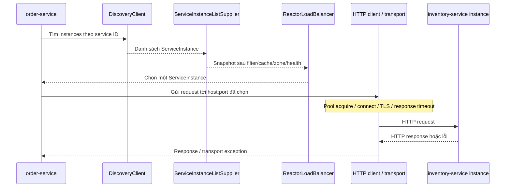

# Chuyển cấu hình chọn đích và timeout sang đúng thành phần

## 1. Vấn đề khi nâng cấp cấu hình giao tiếp

Trong chương **Tương thích và nâng cấp** của module `SPRING_CLOUD_SERVICE_COMMUNICATION_LOAD_BALANCING`, ứng dụng có thể cần chuyển từ cấu hình Ribbon cũ hoặc HTTP client tự tạo sang Spring Cloud LoadBalancer. Hai nhóm cấu hình thường bị trộn lẫn là **chọn đích** và **timeout**.

- **Chọn đích:** service ID nào được gọi, danh sách `ServiceInstance` lấy từ đâu, instance nào được chọn theo Round Robin, Random, zone, hint hoặc health.
- **Timeout:** chờ lấy connection từ pool bao lâu, thiết lập TCP connection bao lâu, chờ response bao lâu và toàn bộ logical request được phép chạy trong bao lâu.

Hai nhóm này liên quan nhưng thuộc các thành phần khác nhau. Spring Cloud LoadBalancer chọn instance trong tập ứng viên mà supplier cung cấp. HTTP client/transport quyết định giới hạn thời gian của kết nối và phản hồi. Retry có thể nằm ở LoadBalancer integration, Feign, Reactor pipeline hoặc một tầng ứng dụng khác.

Nếu chuyển nhầm cấu hình, ta có thể gặp các tình huống:

- Đưa `connectTimeout` vào namespace `spring.cloud.loadbalancer` rồi kỳ vọng TCP connection tự bị giới hạn.
- Thay `NFLoadBalancerRuleClassName` bằng một property không tồn tại hoặc đặt class cấu hình vào sai context.
- Gọi `http://inventory-service` bằng client không có `@LoadBalanced` nhưng nghĩ Spring đã chọn Pod.
- Cấu hình retry ở cả LoadBalancer và HTTP client khiến một logical request tạo nhiều attempts hơn dự kiến.
- Đặt read timeout thấp hơn thời gian xử lý hợp lệ của downstream, làm caller ngừng chờ trong khi server vẫn tiếp tục xử lý.
- Cấu hình timeout đúng cho OpenFeign nhưng request thực tế lại đi qua WebClient hoặc RestClient khác.

### Mục tiêu học tập

Sau bài này, bạn có thể:

1. Phân biệt DiscoveryClient, ServiceInstanceListSupplier, ReactorLoadBalancer và HTTP transport.
2. Chuyển policy chọn đích sang `@LoadBalancerClient`/supplier đúng service ID.
3. Đặt connect, pool-acquire, response/read và end-to-end timeout tại đúng HTTP client.
4. Phân biệt retry của LoadBalancer, Feign, Reactor và business layer.
5. Tổ chức cấu hình riêng cho `inventory-service` mà không vô tình áp dụng toàn cục.
6. Chuyển từng ý nghĩa của Ribbon legacy sang thành phần tương ứng, không sao chép tên property máy móc.
7. Kiểm thử service ID, instance thực nhận request, timeout, số HTTP attempts và tổng deadline.
8. Phát hiện cấu hình chết, bị ghi đè hoặc không được client đang dùng đọc tới.

## 2. Luồng gọi và nơi mỗi quyết định diễn ra



| Công việc | Thành phần chịu trách nhiệm | Ví dụ | Không thuộc trách nhiệm |
|---|---|---|---|
| Tìm service ID và instance | DiscoveryClient/registry/Kubernetes client | Eureka, Consul, Kubernetes DiscoveryClient | Chọn thuật toán cuối cùng |
| Lọc tập instance | ServiceInstanceListSupplier | zone, hint, health, cache, custom filter | TCP connect/read timeout |
| Chọn instance | ReactorLoadBalancer | Round Robin, Random, custom chooser | HTTP response timeout |
| Kết nối tới host:port | HTTP transport | JDK HttpClient, Reactor Netty, Apache HttpClient | Discovery metadata |
| Giới hạn chờ response | HTTP client/transport | read/response timeout | Chính sách chọn instance |
| Giới hạn tổng request | API/application boundary | Reactor `timeout`, deadline propagation | Một timeout TCP đơn lẻ |
| Retry | Một retry owner đã chọn | LoadBalancer, Feign, Reactor | Không nên bật trùng không kiểm soát |

**Cách nhớ:** discovery trả lời “có những instance nào?”, supplier trả lời “những instance nào đủ điều kiện?”, LoadBalancer trả lời “chọn instance nào?”, transport trả lời “chờ kết nối/phản hồi tối đa bao lâu?”.

### 2.1. Đừng gộp mọi timeout thành một giá trị

Một HTTP request có thể đi qua nhiều giai đoạn:

1. Chờ slot trong connection pool.
2. Phân giải DNS hoặc lấy địa chỉ từ service discovery.
3. Thiết lập TCP connection.
4. TLS handshake nếu dùng HTTPS.
5. Gửi request và chờ response headers/body.
6. Retry/backoff nếu lỗi thuộc nhóm được phép.
7. Deserialize và xử lý kết quả trong service caller.

Một `readTimeout=700ms` không nhất thiết bao toàn bộ các bước trên. Một `connectTimeout=300ms` cũng không phải deadline tổng. Cần đọc API của transport cụ thể để biết timeout bao phủ giai đoạn nào.

## 3. Phân loại namespace cấu hình trước khi di chuyển

| Namespace/cấu hình | Ý nghĩa điển hình | Nên chứa |
|---|---|---|
| `spring.cloud.loadbalancer.*` | Hành vi LoadBalancer | cache, retry của LB, stats, eager loading, supplier/selection |
| `@LoadBalancerClient` | Cấu hình child context theo service ID | chooser, supplier chain, custom policy |
| `spring.cloud.kubernetes.*` / Eureka / Consul | Discovery và endpoint metadata | namespace, registry endpoint, discovery options |
| RestClient request factory | HTTP blocking transport | connect/read timeout, TLS, connection behavior |
| WebClient connector | HTTP reactive transport | pool acquire, TCP connect, response timeout |
| `spring.cloud.openfeign.client.config.*` | Cấu hình HTTP client theo Feign client | connectTimeout, readTimeout, encoder/decoder, retry integration |
| WebClient/Reactor pipeline | Logical publisher | end-to-end `timeout`, retry/backoff |
| Gateway/business service | Deadline và fallback nghiệp vụ | request deadline, idempotency, status mapping |

**Không có một property timeout chung của Spring Cloud LoadBalancer thay thế tất cả timeout của mọi HTTP client.** LoadBalancer không sở hữu socket hay connection pool mà RestClient/WebClient/Feign sử dụng. Nếu một starter riêng cung cấp timeout, xác minh nó thuộc transport/integration nào trước khi đặt property.

### 3.1. Cấu hình nào không nên đặt ở đâu?

- Không đặt `connectTimeout`/`readTimeout` vào `spring.cloud.loadbalancer` trừ khi tài liệu của một property cụ thể xác nhận nó thuộc namespace đó.
- Không đặt policy Round Robin/zone vào `spring.cloud.openfeign.client.config` như thể Feign cung cấp danh sách Pod.
- Không đặt địa chỉ `listOfServers` cũ trong phần HTTP timeout; endpoint list thuộc discovery/supplier.
- Không coi `server.connection-timeout` của service nhận là timeout outbound của service gọi.
- Không đặt `spring.mvc.async.request-timeout` rồi nghĩ nó điều khiển connect timeout của WebClient.
- Không dùng timeout của gateway để thay timeout downstream transport; gateway chỉ giới hạn một ranh giới khác.

## 4. Chuyển cấu hình chọn đích sang Spring Cloud LoadBalancer

### 4.1. Dùng service ID với HTTP client có LoadBalancer integration

Một URL dạng:

```text
http://inventory-service/api/inventory/ABC-1
```

là **service ID logic** khi được dùng bởi HTTP client có LoadBalancer integration, ví dụ bean `RestClient.Builder` hoặc `WebClient.Builder` được đánh dấu `@LoadBalanced`.

Nếu dùng HTTP client thông thường, cùng chuỗi này có thể được đưa cho DNS resolver như hostname `inventory-service`. Spring không tự suy luận rằng bạn muốn gọi DiscoveryClient.

### 4.2. Cấu hình per-service bằng @LoadBalancerClient

Ví dụ dùng Round Robin riêng cho `inventory-service`:

```java
@SpringBootApplication
@LoadBalancerClient(
        name = "inventory-service",
        configuration = InventoryLoadBalancerConfiguration.class)
public class OrderApplication {

    public static void main(String[] args) {
        SpringApplication.run(OrderApplication.class, args);
    }
}
```

Cấu hình chooser:

```java
@Configuration(proxyBeanMethods = false)
class InventoryLoadBalancerConfiguration {

    @Bean
    ReactorLoadBalancer<ServiceInstance> inventoryLoadBalancer(
            Environment environment,
            LoadBalancerClientFactory clientFactory) {

        String serviceId = environment.getProperty(
                LoadBalancerClientFactory.PROPERTY_NAME);

        return new RoundRobinLoadBalancer(
                clientFactory.getLazyProvider(
                        serviceId, ServiceInstanceListSupplier.class),
                serviceId);
    }
}
```

Các import chính thuộc Spring Cloud Commons: `ReactorLoadBalancer`, `RoundRobinLoadBalancer`, `LoadBalancerClientFactory`, `ServiceInstanceListSupplier` và `ServiceInstance`. Cấu hình child context được tạo riêng cho service ID `inventory-service`.

**Lưu ý:** class `InventoryLoadBalancerConfiguration` không nên bị component scan của root application context đăng ký như cấu hình toàn cục. Đặt nó ngoài package scan của `OrderApplication` hoặc cấu trúc package phù hợp với hướng dẫn Spring Cloud phiên bản đang dùng. Nếu bị scan toàn cục, chooser có thể áp dụng ngoài dự định.

Constructor/API của chooser và cách inject supplier có thể thay đổi theo Spring Cloud Release Train. Đối chiếu version đang dùng trước khi nâng cấp; không copy code từ major version khác mà không compile/test.

### 4.3. Tùy biến danh sách ứng viên bằng supplier

Nếu mục tiêu là ưu tiên zone, cấu hình chuỗi supplier minh họa:

```java
@Configuration(proxyBeanMethods = false)
class InventoryLoadBalancerConfiguration {

    @Bean
    ServiceInstanceListSupplier inventorySupplier(
            ConfigurableApplicationContext context) {

        return ServiceInstanceListSupplier.builder()
                .withDiscoveryClient()
                .withZonePreference()
                .build(context);
    }

    @Bean
    ReactorLoadBalancer<ServiceInstance> inventoryLoadBalancer(
            Environment environment,
            LoadBalancerClientFactory clientFactory) {

        String serviceId = environment.getProperty(
                LoadBalancerClientFactory.PROPERTY_NAME);

        return new RoundRobinLoadBalancer(
                clientFactory.getLazyProvider(
                        serviceId, ServiceInstanceListSupplier.class),
                serviceId);
    }
}
```

Đây là cấu hình minh họa cho môi trường có DiscoveryClient phù hợp. Nếu đã có supplier mặc định từ discovery/cache/health, không tạo thêm một chuỗi chồng lên mà chưa hiểu thứ tự delegate. Cần xác định supplier nào đứng đầu và nó gọi delegate nào.

| Yêu cầu | Thành phần nên xem xét |
|---|---|
| Chia vòng trên tập ứng viên | RoundRobinLoadBalancer |
| Chọn ngẫu nhiên | RandomLoadBalancer |
| Ưu tiên zone | ZonePreferenceServiceInstanceListSupplier |
| Lọc theo hint | HintBasedServiceInstanceListSupplier |
| Kiểm tra health | HealthCheckServiceInstanceListSupplier |
| Chọn theo weight/metadata riêng | Supplier/chooser custom có contract rõ |
| Lấy danh sách từ registry | DiscoveryClient-backed supplier |

Supplier quyết định **tập ứng viên**; chooser quyết định **phần tử** trong tập đó. Nếu supplier chỉ trả một instance, không có thuật toán nào phân phối sang instance khác.

### 4.4. Per-service không có nghĩa mọi cấu hình đều nằm trong child context

`@LoadBalancerClient(name="inventory-service", configuration=...)` cấu hình **LoadBalancer child context** cho service ID đó. HTTP client transport có thể được dùng bởi nhiều service IDs; timeout của một HTTP client bean áp cho các lời gọi dùng bean đó.

Nếu cần timeout khác nhau theo downstream, tạo HTTP client/gateway bean riêng có tên/qualifier rõ ràng, hoặc cấu hình per-client của thư viện như OpenFeign. Không giả định `@LoadBalancerClient` tự tạo một RestClient riêng hoặc tự áp timeout vào socket.

## 5. Đặt timeout đúng cho RestClient

`RestClient` là API blocking của Spring Framework. Timeout được cấu hình qua `ClientHttpRequestFactory`/HTTP transport mà RestClient sử dụng.

### 5.1. Builder có LoadBalancer và request factory có timeout

Ví dụ Spring Boot 3.x dùng `SimpleClientHttpRequestFactory`:

```java
@Configuration(proxyBeanMethods = false)
class InventoryRestClientConfiguration {

    @Bean
    @LoadBalanced
    RestClient.Builder loadBalancedRestClientBuilder(
            RestClientBuilderConfigurer configurer) {
        return configurer.configure(RestClient.builder());
    }

    @Bean
    RestClient inventoryRestClient(
            @LoadBalanced RestClient.Builder builder) {

        SimpleClientHttpRequestFactory requestFactory =
                new SimpleClientHttpRequestFactory();

        requestFactory.setConnectTimeout(
                Duration.ofMillis(300));
        requestFactory.setReadTimeout(
                Duration.ofMillis(700));

        return builder.clone()
                .baseUrl("http://inventory-service")
                .requestFactory(requestFactory)
                .build();
    }
}
```

Trong ví dụ này:

- `@LoadBalanced` tích hợp resolve service ID với Spring Cloud LoadBalancer.
- `RestClientBuilderConfigurer` giữ các customizations của Spring Boot trong các phiên bản hỗ trợ API này.
- `requestFactory` quyết định transport và timeout.
- `connectTimeout=300ms` giới hạn giai đoạn thiết lập connection theo semantics của request factory.
- `readTimeout=700ms` giới hạn thời gian chờ dữ liệu phản hồi theo semantics của request factory.

`SimpleClientHttpRequestFactory` là ví dụ đơn giản phù hợp lab. Nó không đại diện cho mọi transport hay connection pooling. Nếu dùng JDK HttpClient, Apache HttpClient hoặc factory khác, đọc đúng API timeout của transport đó; một số timeout không có cùng ý nghĩa hoặc độ bao phủ.

### 5.2. Tách client cho từng downstream

Nếu `inventory-service` cần timeout 700ms còn `pricing-service` cần 1.500ms, tạo hai client với hai request factories/configuration riêng. Không thay timeout toàn cục của builder dùng chung rồi vô tình ảnh hưởng các service khác.

```java
@Configuration(proxyBeanMethods = false)
class OutboundClientConfiguration {

    @Bean
    @LoadBalanced
    RestClient.Builder loadBalancedRestClientBuilder(
            RestClientBuilderConfigurer configurer) {
        return configurer.configure(RestClient.builder());
    }

    @Bean("inventoryRestClient")
    RestClient inventoryRestClient(
            @LoadBalanced RestClient.Builder builder) {
        return create(builder, 300, 700, "http://inventory-service");
    }

    @Bean("pricingRestClient")
    RestClient pricingRestClient(
            @LoadBalanced RestClient.Builder builder) {
        return create(builder, 500, 1500, "http://pricing-service");
    }

    private RestClient create(
            RestClient.Builder builder,
            int connectMs,
            int readMs,
            String baseUrl) {

        SimpleClientHttpRequestFactory factory =
                new SimpleClientHttpRequestFactory();
        factory.setConnectTimeout(Duration.ofMillis(connectMs));
        factory.setReadTimeout(Duration.ofMillis(readMs));

        return builder.clone()
                .requestFactory(factory)
                .baseUrl(baseUrl)
                .build();
    }
}
```

Inject bằng `@Qualifier("inventoryRestClient")` hoặc `@Qualifier("pricingRestClient")`. Nếu project có nhiều bean `RestClient.Builder`, dùng qualifier phù hợp để tránh inject nhầm builder không có LoadBalancer integration.

## 6. Đặt timeout đúng cho WebClient/Reactor Netty

WebClient là reactive API; timeout có thể nằm ở pool, connect, response transport và toàn publisher. Không gộp chúng thành một con số.

### 6.1. Ví dụ connector có pool và transport timeout

```java
@Configuration(proxyBeanMethods = false)
class InventoryWebClientConfiguration {

    @Bean
    @LoadBalanced
    WebClient.Builder inventoryWebClientBuilder(
            ObjectProvider<WebClientCustomizer> customizers) {

        ConnectionProvider pool = ConnectionProvider
                .builder("inventory-pool")
                .maxConnections(50)
                .pendingAcquireTimeout(Duration.ofMillis(200))
                .build();

        HttpClient httpClient = HttpClient.create(pool)
                .option(ChannelOption.CONNECT_TIMEOUT_MILLIS, 300)
                .responseTimeout(Duration.ofMillis(700));

        WebClient.Builder builder = WebClient.builder()
                .clientConnector(
                        new ReactorClientHttpConnector(httpClient));

        customizers.orderedStream()
                .forEach(customizer -> customizer.customize(builder));

        return builder;
    }

    @Bean
    WebClient inventoryWebClient(
            @LoadBalanced WebClient.Builder inventoryWebClientBuilder) {
        return inventoryWebClientBuilder.clone()
                .baseUrl("http://inventory-service")
                .build();
    }
}
```

Các import cần có từ Reactor Netty, Netty, Spring WebFlux và Spring Boot. Tên builder/annotation và cách áp customizer cần đối chiếu Boot/Cloud version thực tế. Nếu đã inject builder được auto-configure đầy đủ, không áp customizer hai lần hoặc thay connector theo cách làm mất filter observation/LoadBalancer.

| Cấu hình | Giới hạn | Không nên hiểu thành |
|---|---|---|
| `pendingAcquireTimeout` | Chờ lấy connection từ pool | TCP connect timeout |
| `CONNECT_TIMEOUT_MILLIS` | Thời gian kết nối TCP | Response timeout |
| `responseTimeout` | Timeout phản hồi ở transport theo semantics Reactor Netty | Deadline tổng của mọi retry/business processing |
| Reactor `timeout(...)` | Thời gian publisher được phép chạy tại vị trí operator | Timeout của một socket riêng lẻ |

### 6.2. End-to-end timeout và vị trí operator

Ví dụ GET có một retry và tổng deadline một giây:

```java
Mono<InventoryStock> readStock(String sku) {
    return inventoryWebClient.get()
            .uri("/api/inventory/{sku}", sku)
            .retrieve()
            .bodyToMono(InventoryStock.class)
            .retryWhen(Retry.backoff(
                            1, Duration.ofMillis(100))
                    .maxBackoff(Duration.ofMillis(200))
                    .filter(this::isTransientFailure))
            .timeout(Duration.ofSeconds(1));
}
```

Vì `timeout(...)` nằm **sau** `retryWhen(...)`, nó giới hạn publisher tổng gồm lần đầu, backoff và lần retry. Nếu đặt timeout trước retry, semantics có thể khác: mỗi subscription/attempt có thể có ngân sách riêng. Viết test chứng minh vị trí operator đáp ứng deadline mong muốn.

`isTransientFailure` là policy do ứng dụng định nghĩa; không retry mọi exception một cách mù quáng. Đặc biệt không tự động retry lỗi validation, authentication, authorization hoặc lỗi domain không tạm thời.

### 6.3. Cancellation không phải rollback

Khi publisher timeout và cancel, client ngừng chờ hoặc cố hủy exchange theo transport. Điều đó **không bảo đảm** server chưa nhận request hoặc đã dừng xử lý. Với thao tác ghi, cần idempotency key, deduplication và hợp đồng trạng thái rõ ràng.

## 7. Đặt timeout đúng cho OpenFeign

OpenFeign có cấu hình client riêng. Ví dụ:

```yaml
spring:
  cloud:
    openfeign:
      client:
        config:
          inventory-service:
            connectTimeout: 300
            readTimeout: 700
          pricing-service:
            connectTimeout: 500
            readTimeout: 1500
```

`inventory-service` phải khớp tên client trong `@FeignClient(name = "inventory-service")`. Các giá trị ví dụ tính bằng millisecond theo cấu hình OpenFeign tương ứng; kiểm tra version, HTTP client implementation và property metadata của project.

```java
@FeignClient(name = "inventory-service")
interface InventoryFeignClient {

    @GetMapping("/api/inventory/{sku}")
    InventoryStock get(@PathVariable("sku") String sku);
}
```

Khi có Spring Cloud LoadBalancer trên classpath và cấu hình phù hợp, Feign client theo `name` có thể resolve qua LoadBalancer. Nếu khai báo URL cố định trong `@FeignClient(url=...)`, đường gọi không còn cùng ý nghĩa service discovery/LB như client theo service ID. Đừng thêm `url` khi mục tiêu là để Spring chọn instance.

### 7.1. Retry mặc định của OpenFeign

Spring Cloud OpenFeign mặc định cung cấp `Retryer.NEVER_RETRY`, khác với retry behavior có thể gặp ở Feign core hoặc HTTP client tự cấu hình. Vì vậy:

- Cấu hình `readTimeout` không tự bật retry.
- HTTP 503 không tự động được retry chỉ vì LoadBalancer có mặt.
- Nếu cài `Retryer` riêng, xác định status/exception nào retryable và số lần tối đa.
- Nếu đồng thời bật LoadBalancer retry và Feign retry, đếm actual HTTP attempts để phát hiện retry lồng nhau.

## 8. Retry thuộc lớp nào?

| Retry owner | Điều khiển | Dấu hiệu | Cần lưu ý |
|---|---|---|---|
| Spring Cloud LoadBalancer retry | Thử lại theo service instance/policy trong integration được hỗ trợ | Có thể chọn instance khác | Cần đúng HTTP client integration/dependency và version |
| OpenFeign `Retryer` | Thử lại lời gọi Feign theo exception/retryable response | Feign attempts | Spring Cloud OpenFeign mặc định `NEVER_RETRY` |
| Reactor `retryWhen` | Subscribe lại publisher reactive | HTTP exchanges có thể lặp | Predicate, backoff, jitter và deadline |
| Spring Retry/application loop | Retry tại business/service layer | Có thể bao nhiều downstream calls | Dễ nhân attempts nếu dưới nó đã có retry |
| Gateway/service mesh | Retry ở lớp proxy/edge | Request có thể bị gửi lại | App có thể không nhìn thấy toàn bộ policy |

### 8.1. Ví dụ cấu hình retry LoadBalancer

Một cấu hình minh họa cho Spring Cloud Commons 4.3:

```yaml
spring:
  cloud:
    loadbalancer:
      retry:
        enabled: true
        max-retries-on-same-service-instance: 0
        max-retries-on-next-service-instance: 1
        retryable-status-codes:
          - 503
        avoid-previous-instance: true
```

Các property retry cụ thể phụ thuộc phiên bản và HTTP client integration. Một số stack blocking cần dependency/tích hợp retry riêng; WebClient reactive có cơ chế khác. **Không suy rằng cùng một YAML có hiệu lực giống hệt cho RestClient, WebClient và Feign.**

Nếu retry đã được thực hiện ở LoadBalancer, tránh thêm `retryWhen`/Feign `Retryer` cho cùng lỗi trừ khi có thiết kế phân tầng rõ. Với một retry ở hai tầng, số attempts tối đa có thể nhân lên; ví dụ hai tầng mỗi tầng cho phép hai attempts có thể tạo tới bốn HTTP attempts tùy cách lồng.

### 8.2. Tính tổng ngân sách thời gian

Giả sử:

- Connect timeout: 300ms.
- Response/read timeout: 700ms.
- Một retry.
- Backoff: 100ms.
- Overhead/queue/deserialize: 100ms.

Ngân sách xấu nhất gần đúng có thể vượt 1.900ms nếu cả hai attempts đều chờ đủ response timeout và chi phí kết nối/overhead phát sinh. Đây là phép tính bảo thủ minh họa, không phải guarantee của transport.

Nếu API contract yêu cầu phản hồi trong 1.000ms, không thể chỉ đặt mỗi `readTimeout=700ms` rồi cho retry tự do. Phải quản lý **remaining deadline** và bỏ retry khi ngân sách không đủ.

## 9. Chuyển cấu hình cũ từ Ribbon sang đúng thành phần

Ribbon đã được thay thế trong các thế hệ Spring Cloud mới bằng Spring Cloud LoadBalancer. Khi di chuyển, **chuyển ý nghĩa cấu hình**, không đổi prefix theo kiểu tìm-và-thay tên.

| Ý định cấu hình Ribbon cũ | Nơi chuyển sang | Ghi chú |
|---|---|---|
| `NFLoadBalancerRuleClassName` | Per-service `@LoadBalancerClient` + `ReactorLoadBalancer` | Round Robin, Random hoặc custom chooser |
| `NIWSServerListClassName` / server list | `DiscoveryClient` + `ServiceInstanceListSupplier` | Nguồn instance, cache, filter |
| `ribbon.ConnectTimeout` | HTTP transport của RestClient/WebClient/Feign | Connect timeout của client đang thực dùng |
| `ribbon.ReadTimeout` | HTTP transport của RestClient/WebClient/Feign | Read/response timeout |
| `ribbon.MaxAutoRetries` | Retry owner được chọn | LoadBalancer/Feign/Reactor; không có mapping một-một phổ quát |
| `ribbon.MaxAutoRetriesNextServer` | Retry policy qua instance tiếp theo nếu integration hỗ trợ | Kiểm tra actual attempts và supplier retry-aware |
| `ribbon.OkToRetryOnAllOperations` | Không sao chép máy móc | Thiết kế retry theo method/idempotency và lỗi tạm thời |
| `NIWSDiscoveryPing`/health logic | Kubernetes readiness, discovery health hoặc supplier health check | Phân biệt readiness và business availability |
| `listOfServers` | Discovery registry hoặc supplier cấu hình tĩnh cho test | Không đặt trong HTTP timeout config |

### 9.1. Ví dụ cấu hình Ribbon cũ

```yaml
# Legacy Ribbon-style configuration (illustrative)
inventory-service:
  ribbon:
    ConnectTimeout: 300
    ReadTimeout: 700
    MaxAutoRetries: 0
    MaxAutoRetriesNextServer: 1
    NFLoadBalancerRuleClassName: com.netflix.loadbalancer.RoundRobinRule
```

Đây là **ví dụ legacy** để nhận diện ý nghĩa, không phải cấu hình Spring Cloud LoadBalancer hiện hành. Không mang nguyên khối này sang ứng dụng mới và kỳ vọng Spring Cloud Commons đọc nó.

### 9.2. Sau khi di chuyển

Phần chọn đích chuyển sang cấu hình LoadBalancer:

```java
@LoadBalancerClient(
        name = "inventory-service",
        configuration = InventoryLoadBalancerConfiguration.class)
@SpringBootApplication
class OrderApplication {}
```

Phần timeout chuyển sang HTTP client. Nếu dùng OpenFeign:

```yaml
spring:
  cloud:
    openfeign:
      client:
        config:
          inventory-service:
            connectTimeout: 300
            readTimeout: 700
```

Nếu dùng RestClient/WebClient, cấu hình request factory/connector tương ứng ở mục 5 và 6. Phần retry cần chọn một owner và kiểm thử riêng. **Không có một YAML thay thế Ribbon hoàn chỉnh dùng chung cho mọi client** vì mỗi transport có lifecycle và API timeout riêng.

### 9.3. Dọn cấu hình cũ sau khi chứng minh đường mới

1. Tìm và loại dependency Ribbon cũ theo kế hoạch nâng cấp của project.
2. Tìm `ribbon.*`, `NFLoadBalancer*`, `NIWS*` và các bean rule cũ.
3. Chuyển từng ý nghĩa sang LoadBalancer, discovery, HTTP transport hoặc retry owner.
4. Xác nhận không còn hai cơ chế chọn đích cùng hoạt động ngoài ý muốn.
5. Kiểm tra configuration properties binding/startup logs để tìm property không được đọc.
6. Xóa cấu hình legacy sau khi đã có test bảo đảm hành vi mới.

Không xóa một property chỉ vì tên có chữ Ribbon; trước hết xác minh component nào thực sự đọc nó trong version cũ và hành vi đó đã được thay thế ở đâu.

## 10. Cấu hình tổng hợp theo từng thành phần

Bảng sau là ví dụ cho hai downstream có timeout khác nhau:

```yaml
spring:
  application:
    name: order-service

  cloud:
    loadbalancer:
      retry:
        enabled: false
      eager-load:
        clients:
          - inventory-service
          - pricing-service

    openfeign:
      client:
        config:
          inventory-service:
            connectTimeout: 300
            readTimeout: 700
          pricing-service:
            connectTimeout: 500
            readTimeout: 1500

server:
  port: 8080
```

Đọc cấu hình:

- `spring.application.name`: định danh ứng dụng caller.
- `spring.cloud.loadbalancer.retry.enabled`: tắt retry LoadBalancer trong baseline để số attempts dễ kiểm chứng; không phải timeout.
- `eager-load.clients`: yêu cầu khởi tạo context LoadBalancer sớm cho service IDs được liệt kê, không quyết định instance và không đặt timeout.
- `spring.cloud.openfeign.client.config.*`: timeout cho Feign clients tương ứng.
- Nếu client dùng RestClient/WebClient, giá trị Feign **không** tự áp cho chúng.

Đừng giữ cả cấu hình Feign và RestClient chỉ vì “có thể dùng sau”. Mỗi downstream gateway nên dùng client rõ ràng, đúng transport và timeout đã chọn.

## 11. Kiểm tra property có thực sự được áp dụng

### 11.1. Kiểm tra dependency và bean wiring

- Có `spring-cloud-starter-loadbalancer` tương thích BOM không?
- Có `@LoadBalanced` trên đúng `RestClient.Builder`/`WebClient.Builder` không?
- Có nhiều builder và inject nhầm qualifier không?
- Client đang gọi URL service ID hay URL vật lý/URL cố định?
- Với Feign, `@FeignClient(name=...)` có đúng tên và có khai báo `url` làm bypass LB không?
- Cấu hình `@LoadBalancerClient` có nằm ngoài root component scan không?
- Supplier nào đang thực sự được dùng: discovery, cache, health, zone, custom?

### 11.2. Kiểm tra timeout bằng fault server

Dùng mock server:

| Tình huống | Timeout cần quan sát |
|---|---|
| Server port không có listener | Connect refused có thể xuất hiện ngay, không nhất thiết chờ hết connect timeout |
| TCP handshake bị blackhole trong test proxy | Connect timeout |
| Server nhận request rồi trì hoãn response | Read/response timeout |
| Connection pool đầy và không cấp slot | Pool acquire timeout |
| Nhiều attempts + backoff vượt SLA | End-to-end deadline |

Không chỉ đo elapsed time bằng assertion chính xác `700ms`; scheduling/GC/network khiến sai số. Kiểm tra root cause, request log của server và deadline tổng với khoảng dung sai hợp lý.

### 11.3. Kiểm tra cấu hình theo client thực tế

| Client đang gọi | Cấu hình phải kiểm tra | Bằng chứng |
|---|---|---|
| RestClient | `ClientHttpRequestFactory` thực gắn vào builder | Request factory và connect/read timeout test |
| WebClient | Reactor Netty connector/pool | Connect/response/pending-acquire behavior |
| OpenFeign | `spring.cloud.openfeign.client.config.<name>` và HTTP client | Feign exception, attempt count |
| Plain RestClient/WebClient | Không có `@LoadBalanced` | DNS/service VIP hoặc fixed URL |
| LoadBalanced client | Service ID, supplier, chooser | Host/port/instance ID đã chọn |

Có thể dùng Actuator `/actuator/configprops` trong **môi trường test đã bảo vệ** để xem configuration properties được bind. Không expose endpoint này công khai nếu nó tiết lộ cấu hình nội bộ/secret.

## 12. Test migration: chứng minh cả selection lẫn timeout

### 12.1. Test chooser không cần network

Dùng supplier cố định `[inventory-a, inventory-b]`:

- Danh sách rỗng ⇒ no-server.
- Singleton ⇒ luôn chọn đúng instance đó.
- Round Robin với seed/snapshot cố định ⇒ kiểm tra chu kỳ nếu cần.
- Random ⇒ kiểm tra membership, không khẳng định lần đầu là A.
- Zone filter ⇒ kiểm tra danh sách sau supplier trước khi assert chooser.

Đây là test xác minh **chọn đích**, không kiểm tra timeout.

### 12.2. Test transport timeout

Dùng mock server với hai endpoint:

- `/fast`: trả 200 ngay.
- `/slow`: nhận request, chờ 1.800ms rồi trả 200.

Với client read/response timeout 700ms:

- `/fast` phải hoàn tất.
- `/slow` có thể timeout phía caller trước khi server hoàn tất.
- Kiểm tra request server đã nhận để tránh kết luận “không có HTTP attempt”.
- Không khẳng định server đã rollback hoặc ngừng xử lý sau client timeout.

### 12.3. Test per-service config

Tạo `inventory-service` và `pricing-service` có latency khác nhau. Chứng minh inventory client timeout theo giá trị inventory, pricing client timeout theo giá trị pricing. Nếu cả hai cùng timeout theo một giá trị, xem lại bean sharing, Feign client name/contextId, qualifier và config precedence.

### 12.4. Test retry một nơi duy nhất

1. Tắt retry ở LoadBalancer, Feign, Reactor và gateway.
2. Gửi một GET đến mock server trả 503.
3. Xác minh đúng một HTTP attempt.
4. Bật đúng một retry owner.
5. Cấu hình lần đầu lỗi và lần kế tiếp thành công.
6. Xác minh tổng attempts và instance của từng attempt.
7. Thử hai server đều lỗi, xác nhận request kết thúc trong deadline.

Không test retry bằng cách chỉ assert HTTP cuối cùng là 200; có thể đã có quá nhiều attempts bị che.

## 13. Timeout, retry và idempotency trong API contract

Timeout là **caller ngừng chờ trong giới hạn cấu hình**, không phải bằng chứng server chưa xử lý.

- GET thường an toàn để retry hơn, nhưng vẫn có thể tạo tải hoặc đọc snapshot khác.
- POST giữ hàng/đặt đơn/thanh toán có thể đã commit trước khi response mất.
- Nếu retry POST, cần idempotency key duy nhất cho logical operation và cơ chế dedup bền vững ở nơi thực hiện side effect.
- Không dùng `available=0` làm fallback khi inventory timeout; trạng thái đúng là unknown/unavailable.
- Không retry 400/401/403 hoặc lỗi contract không tạm thời một cách vô điều kiện.
- Với 429/503, tuân thủ policy/quota/`Retry-After` nếu client implementation có hỗ trợ; không giả định mọi retry integration tự đọc header.
- Tổng attempts phải nằm trong end-to-end deadline và giới hạn tải của downstream.

## 14. Các lỗi di chuyển thường gặp

| Triệu chứng | Nguyên nhân khả dĩ | Cách sửa |
|---|---|---|
| `UnknownHostException: inventory-service` | Client thường dùng service ID như hostname | Dùng `@LoadBalanced` builder hoặc Kubernetes Service FQDN |
| Luôn gọi cùng Pod dù đổi Round Robin | Client thực tế gọi ClusterIP Service, hoặc supplier chỉ trả một instance | Kiểm tra host/port/instance ID và discovery list |
| Cấu hình connect timeout không có tác dụng | Đặt sai namespace hoặc builder không dùng request factory đó | Kiểm tra transport bean thực tế |
| Read timeout không áp lên WebClient | Cấu hình RestClient/Feign nhưng request đi WebClient | Đặt response timeout/publisher timeout ở đúng client |
| Feign timeout vẫn mặc định | Tên property client không khớp `@FeignClient` hoặc bị override | Kiểm tra client name/context/config precedence |
| Retry nhiều hơn dự kiến | Retry ở nhiều tầng | Chọn một owner, đếm server requests |
| Retry không sang instance khác | Supplier/retry integration không retry-aware hoặc chỉ có một ứng viên | Kiểm tra next-instance policy và tập eligible |
| 503 bị chuyển thành 200 | Fallback che lỗi hoặc map sai | Ghi rõ degraded response và metric riêng |
| Request timeout nhưng server vẫn commit | Client timeout không rollback remote operation | Idempotency, status query và dedup |
| Cấu hình Ribbon cũ vẫn nằm trong YAML | Property legacy không còn được đọc | Chuyển semantics rồi xóa sau kiểm thử |
| Per-service chooser áp dụng toàn cục | Config class bị component scan | Đặt cấu hình ngoài root scan |
| Inventory timeout ảnh hưởng pricing | Dùng chung client/transport config | Tách client bean hoặc Feign client config |
| Spring LB stats không có khi gọi URL cố định | Request bypass LoadBalancer | Xác minh service ID và annotation |
| `server.connection-timeout` không đổi outbound timeout | Đó là server-side config | Đặt timeout ở caller transport |
| Timeout 700ms nhưng logical request 2s | Có pool, retry, backoff hoặc overhead | Đặt end-to-end deadline |

## 15. Quy trình nâng cấp từng bước

1. **Lập danh sách outbound clients:** service ID, loại client, transport, retry owner và nơi cấu hình hiện tại.
2. **Xác định đường chọn đích:** DNS/VIP, Spring LoadBalancer, mesh hay URL cố định. Xác minh bằng instance log.
3. **Chuyển discovery:** giữ registry/namespace/metadata phù hợp; không thay nguồn instance cùng lúc với timeout nếu chưa có baseline.
4. **Chuyển chooser/supplier:** dùng `@LoadBalancerClient` theo service ID; test tập eligible và policy.
5. **Chuyển timeout:** tạo request factory/connector/Feign config cho client thực tế; tách pool, connect, response và end-to-end deadline.
6. **Chọn retry owner:** bắt đầu tắt retry để đo baseline, sau đó bật một nơi với max attempts, predicate và deadline.
7. **Kiểm tra API semantics:** status mapping, idempotency, fallback và unknown state.
8. **Chạy integration tests:** hai replica, slow/503/stopped/no-instance, xác minh request count và Pod ID.
9. **So sánh observability:** logical requests, attempts, latency, status, selected instance và trace.
10. **Dọn legacy config:** xóa Ribbon properties/dependencies/beans khi đã chứng minh hành vi mới.
11. **Canary rollout:** theo dõi error rate, p95/p99, attempts/request, pool saturation và no-instance.
12. **Rollback có chuẩn bị:** giữ artifact/config cũ trong thời gian rollout, biết cách phục hồi timeout/retry và version tương thích.

## 16. Checklist trước khi merge cấu hình mới

- [ ] Spring Boot và Spring Cloud Release Train tương thích theo BOM.
- [ ] Mỗi outbound client đã ghi rõ service ID hoặc URL vật lý.
- [ ] Đã biết request có thực sự đi qua Spring Cloud LoadBalancer hay Kubernetes/mesh VIP.
- [ ] DiscoveryClient và supplier trả đúng tập instance.
- [ ] Per-service chooser nằm trong `@LoadBalancerClient` đúng tên.
- [ ] Config class không bị root component scan áp dụng toàn cục ngoài ý muốn.
- [ ] RestClient dùng đúng `ClientHttpRequestFactory`.
- [ ] WebClient dùng đúng connector và pool timeout.
- [ ] OpenFeign config key khớp tên client và HTTP transport đang dùng.
- [ ] Connect, pool acquire, read/response và end-to-end timeout được phân biệt.
- [ ] Không đặt timeout HTTP vào namespace LoadBalancer không có property tương ứng.
- [ ] Đã chọn một retry owner và đếm attempts thật.
- [ ] Retry chỉ áp dụng lỗi tạm thời, an toàn và còn deadline.
- [ ] POST side effects có idempotency/dedup khi retry.
- [ ] Đã kiểm tra 503 upstream, connect refused, read timeout và no-instance.
- [ ] Metrics phân biệt logical request, HTTP attempt và LoadBalancer selection.
- [ ] Không còn Ribbon properties/dependencies chết mà chưa có kế hoạch.
- [ ] Có canary/rollback và ngưỡng theo dõi rõ ràng.

## 17. Bài tập vận dụng

### Bài 1 — Phân loại cấu hình sai

Cho YAML đặt `connectTimeout: 300` dưới `spring.cloud.loadbalancer`. Giải thích vì sao không được mặc định property đó điều khiển TCP; chuyển nó sang RestClient request factory, Reactor Netty connector hoặc OpenFeign config tùy client.

### Bài 2 — Di chuyển Round Robin

Thay `NFLoadBalancerRuleClassName` bằng `@LoadBalancerClient` và `RoundRobinLoadBalancer`. Chứng minh supplier trả ít nhất hai `ServiceInstance`; log ID của instance nhận request và test empty/singleton.

### Bài 3 — Hai downstream, hai timeout

Cấu hình inventory connect/read 300/700ms, pricing 500/1500ms. Tạo mock server với các delay khác nhau và chứng minh mỗi client sử dụng timeout riêng.

### Bài 4 — Phân biệt response timeout và deadline

Dựng WebClient có `responseTimeout=700ms`, retry một lần và backoff 100ms. Đặt `.timeout(1s)` sau retry. Tạo server chậm để quan sát publisher bị timeout trước khi đủ hai attempts.

### Bài 5 — Retry nhân đôi

Bật một retry tại LoadBalancer và một retry ở Reactor. Đếm số requests tới hai server; chứng minh số attempts có thể nhân. Sau đó tắt một owner và giữ một retry policy rõ ràng.

### Bài 6 — Feign và URL cố định

Tạo hai Feign clients: một `@FeignClient(name="inventory-service")`, một client có `url` cố định tới ClusterIP. Xác minh client nào đi qua Spring LoadBalancer, client nào để Kubernetes chọn Pod.

### Bài 7 — Ribbon migration review

Nhận cấu hình cũ có `ribbon.ConnectTimeout`, `ribbon.ReadTimeout`, `MaxAutoRetriesNextServer`, `NFLoadBalancerRuleClassName`. Lập bảng đích chuyển từng ý nghĩa, không thay prefix bằng find-and-replace.

### Bài 8 — Timeout khi POST đã commit

Mô phỏng server đã ghi reservation nhưng response bị timeout. Thử retry không idempotency để thấy duplicate; thêm idempotency key và dedup để kiểm chứng chỉ có một side effect.

### Bài 9 — Kiểm tra property precedence

Đặt global config và per-service config có giá trị khác nhau. Kiểm tra bean/client thực sự dùng giá trị nào. Không dựa vào YAML nhìn thấy; xác minh bằng test và config diagnostics có bảo vệ.

### Bài 10 — Viết migration report

Báo cáo gồm: client name, service ID, discovery source, supplier chain, chooser, HTTP transport, timeout stages, retry owner, attempts tối đa, end-to-end deadline, metrics và rollback plan.

## Nguồn tham khảo

- [Spring Cloud Commons — Spring Cloud LoadBalancer](https://docs.spring.io/spring-cloud-commons/reference/spring-cloud-commons/loadbalancer.html): chooser, `ServiceInstanceListSupplier`, per-service configuration, caching, health và retry.
- [Spring Cloud Commons — Configuration Properties](https://docs.spring.io/spring-cloud-commons/reference/configprops.html): các thuộc tính `spring.cloud.loadbalancer.*` theo phiên bản.
- [Spring Framework — REST Clients](https://docs.spring.io/spring-framework/reference/integration/rest-clients.html): `RestClient`, builder, request factory và HTTP error handling.
- [Spring Framework — WebClient](https://docs.spring.io/spring-framework/reference/web/webflux-webclient.html): reactive HTTP client và connector.
- [Reactor Netty — HTTP Client](https://projectreactor.io/docs/netty/release/reference/http-client.html): connection pool, connect/response timeout và transport.
- [Spring Cloud OpenFeign](https://docs.spring.io/spring-cloud-openfeign/reference/spring-cloud-openfeign.html): Feign client config, connect/read timeout và retryer.
- [Spring Cloud — Release Train](https://spring.io/projects/spring-cloud/): đối chiếu Spring Boot/Spring Cloud compatibility trước khi chuyển major version.
- [Spring Cloud Netflix](https://docs.spring.io/spring-cloud-netflix/reference/): kiểm tra các thay đổi lịch sử của Ribbon và thành phần thay thế trong Spring Cloud.

**Kết luận:** cấu hình chọn đích phải nằm ở **discovery → supplier → LoadBalancer**, còn connect/read/response timeout phải nằm ở **HTTP transport/client đang thực hiện request**. End-to-end deadline thuộc logical request; retry cần một owner rõ ràng. Chuyển cấu hình đúng theo trách nhiệm giúp tránh property không có hiệu lực, retry nhân tầng và hiểu nhầm rằng một timeout socket đã bảo vệ toàn bộ giao dịch.
