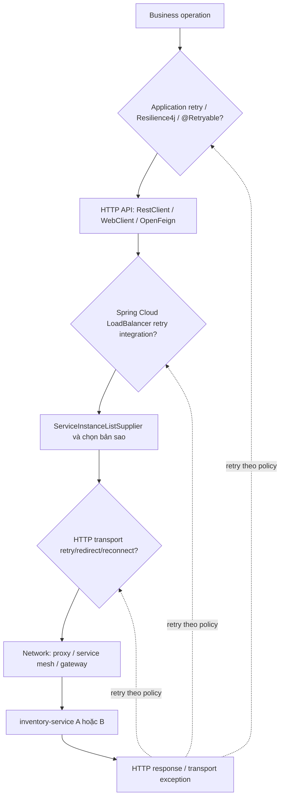
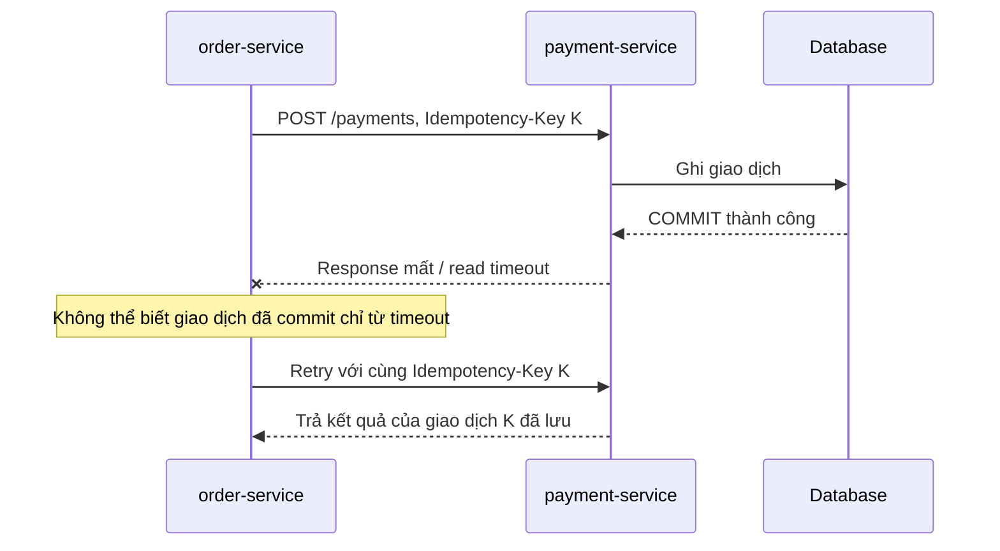

# Đối chiếu retry mặc định khi đổi thư viện hoặc Release Train

Giả sử `order-service` dùng Spring Cloud LoadBalancer gọi `inventory-service` qua service ID. Trước khi nâng cấp, một yêu cầu GET lỗi kết nối được gửi **một lần**; sau khi đổi dependency hoặc nâng Spring Cloud Release Train, log ở `inventory-service` bỗng ghi nhận **hai lần** cùng một yêu cầu. Một nhóm khác có thể gặp chiều ngược lại: trước khi nâng cấp, lời gọi tự thử lại và phục hồi từ lỗi tạm thời; sau nâng cấp, request thất bại ngay. Cả hai đều có thể xảy ra dù **business code không thay đổi**.

Nguyên nhân là **retry không thuộc riêng thuật toán Round Robin**. Nó có thể nằm tại Spring Cloud LoadBalancer, HTTP client, OpenFeign, Spring Retry, Reactor, Resilience4j, proxy/service mesh hoặc chính tầng nghiệp vụ. Những thành phần này có **điều kiện kích hoạt, default, tiêu chí retry và phạm vi áp dụng khác nhau**; thay đổi classpath hoặc release train có thể làm một tầng được bật/tắt hay thay cách phân loại lỗi.

Bài thuộc chương **Tương thích và nâng cấp** của module `SPRING_CLOUD_SERVICE_COMMUNICATION_LOAD_BALANCING`. Mục tiêu là lập **baseline retry có thể chứng minh bằng số HTTP attempts**, đối chiếu hành vi của `RestTemplate`, `RestClient`, `WebClient` và OpenFeign, hiểu thay đổi `retry-on-all-exceptions`, quản lý Spring Boot–Spring Cloud BOM và xây kiểm thử hồi quy an toàn trước/sau khi nâng cấp.

> **Nguyên tắc trọng tâm:** đừng kết luận “mặc định retry 1 lần” chỉ từ một dòng property, và cũng đừng kết luận “không retry” chỉ vì không thấy `@Retryable`. **Effective retry = phiên bản + dependency/classpath + loại HTTP client + integration + cấu hình + exception/status + HTTP method + tầng khác trên đường đi.**

## 1. Sơ đồ các tầng có thể gửi lại cùng một request



Sơ đồ chỉ là mô hình **các khả năng**, không có nghĩa mọi tầng đều retry hoặc tất cả thư viện đều có cùng thứ tự thực thi. Một hệ thống có thể chỉ bật một tầng; một hệ thống khác có thể vô tình bật ba tầng và làm số request thật tăng mạnh.

### 1.1. Phân biệt logical operation với HTTP attempt

```text
Logical operation: GET /api/v1/items/42 từ order-service

Attempt #1: LoadBalancer chọn inventory-A; HTTP connect timeout
Attempt #2: LoadBalancer chọn inventory-B; HTTP 200

Logical outcome = SUCCESS
HTTP attempts   = 2
```

**Một logical call thành công không chứng minh chỉ có một HTTP request.** Nếu chỉ đo tỷ lệ 2xx ở controller, nhiều retry thất bại phía dưới có thể bị che. Ngược lại, khi một POST timeout, provider **có thể đã ghi dữ liệu** dù caller không thấy response; gửi lại request không đồng nghĩa thao tác đầu chưa được xử lý.

### 1.2. Cùng một status, nhiều đường retry khác nhau

- `HTTP 503` do **provider** trả sau khi nhận request: thuộc nhóm response status.
- `HTTP 503 tổng hợp` do LoadBalancer tạo khi không có `ServiceInstance`: không chứng minh provider đã nhận request.
- `ConnectException`, `SocketTimeoutException` hoặc `WebClientRequestException`: thuộc đường network/transport, có thể được bọc bởi client adapter.
- `WebClientResponseException`, `FeignException`: exception ánh xạ từ HTTP response, **không phải** mọi loại lỗi đều retry mặc định.
- `DecodeException`/`DecodingException`: response nhận được nhưng body không đúng contract; retry thường không sửa được schema.

Một chính sách “retry mọi exception” có thể vô tình thử lại cả lỗi nghiệp vụ, lỗi giải mã hoặc thao tác ghi không idempotent. Khi nâng cấp, **tập exception được phép retry** quan trọng không kém số lần retry.

## 2. Bảng so sánh default: phải nói rõ đang xét tầng nào

| Thành phần | Điều cần biết về retry mặc định | Thứ phải xác minh sau đổi version |
|---|---|---|
| **Spring Cloud LoadBalancer – blocking `RestTemplate`** | Tài liệu Commons mô tả load-balanced retry **không tự hoạt động chỉ vì dùng RestTemplate**; đường blocking có thể được kích hoạt khi Spring Retry có mặt và auto-configuration đáp ứng điều kiện | Có `spring-retry` ở runtime không; retry interceptor có được gắn thật không; policy exception/status nào có hiệu lực |
| **Spring Cloud LoadBalancer – blocking `RestClient`** | `RestClient` dùng tích hợp blocking `BlockingLoadBalancerClient`, nhưng chi tiết retry cần kiểm tra **adapter/Release Train cụ thể**, không suy nguyên xi từ RestTemplate | Bean `@LoadBalanced RestClient.Builder` thực tế, HTTP request factory, retry adapter và số attempts |
| **Spring Cloud LoadBalancer – reactive `WebClient`** | Có cơ chế retry ở integration reactive khi được bật/cấu hình tương ứng; không đồng nghĩa mọi lỗi HTTP 5xx sẽ tự retry | `spring.cloud.loadbalancer.retry.enabled`, filter đã gắn, retryable status/exception, `retryWhen` trong application |
| **Spring Cloud OpenFeign** | Spring Cloud OpenFeign đăng ký `Retryer.NEVER_RETRY` theo mặc định, **khác với Feign core** | Feign client config thực, `Retryer` bean/properties, `ErrorDecoder`, LB và transport phía dưới |
| **Feign core standalone** | Feign core mặc định có thể retry lỗi I/O và `RetryableException` do `ErrorDecoder` tạo | Đừng đem mặc định core Feign áp cho `@FeignClient` do Spring Cloud tạo |
| **Spring Retry / `@Retryable`** | Không tự retry mọi service method chỉ vì dependency hiện diện | Proxy/annotation/config, `RetryTemplate`, chính sách exception và số attempts |
| **Reactor `retry`/`retryWhen`** | Chỉ lặp publisher khi ứng dụng **thêm operator** hoặc một integration thêm retry | Vị trí operator, số lần subscribe, loại exception/status thực tế |
| **Resilience4j Retry** | Chỉ hoạt động khi được tích hợp và cấu hình/áp dụng cho operation | Tên retry instance, aspect/decorator order, retry predicates, max attempts |
| **HTTP transport / gateway / mesh** | Phụ thuộc thư viện, phương thức, chính sách idempotency/redirect và cấu hình hạ tầng | Request replay ở transport/proxy, số attempts tại provider |

**Không được đọc bảng này thành một bảng giá trị cố định vĩnh viễn.** Các default trong một Release Train, một version Feign core và một HTTP transport có thể khác nhau. Nguồn đáng tin cậy để kết luận là **dependency tree + effective configuration + test trên phiên bản khóa chính xác**.

### 2.1. Mâu thuẫn bề ngoài: property `retry.enabled=true` nhưng request vẫn không retry

Trong bảng configuration properties của Spring Cloud Commons ở các dòng phiên bản gần đây, `spring.cloud.loadbalancer.retry.enabled` có giá trị mặc định được liệt kê là `true`. Trong khi đó, phần hướng dẫn Commons giải thích load-balanced blocking retry có thể **chưa được kích hoạt** nếu thiếu Spring Retry, và từng client/integration có điều kiện wiring riêng.

Hai điều này không nhất thiết mâu thuẫn: **giá trị một thuộc tính cho phép tính năng không bảo đảm có đúng retry implementation trong runtime**. Tương tự, có retry implementation cũng không chứng minh `HTTP 503` nằm trong các status được phép retry hoặc method hiện tại được phép thử lại.

Vì vậy, khi kiểm tra upgrade:

1. Xem property **đã bind** và giá trị thực sự được áp dụng.
2. Kiểm tra có dependency/bean/filter/interceptor thực thi retry không.
3. Kích thích **một lỗi xác định** và đếm số attempts gửi tới HTTP server thật.
4. Lặp lại với **GET, POST, transport error, 503, 404** để phân biệt policy.

Đừng dùng mỗi `/actuator/env` hoặc một entry trong appendix làm bằng chứng chắc chắn request đã được retry.

## 3. Spring Boot và Spring Cloud Release Train phải được đối chiếu cùng nhau

Một nâng cấp an toàn bắt đầu từ việc ghép **Spring Boot generation** với **Spring Cloud Release Train** được dự án Spring hỗ trợ. Spring Cloud quản lý tập dependency liên quan qua BOM; thay riêng phiên bản `spring-cloud-commons` hoặc `spring-cloud-openfeign` có thể tạo tổ hợp chưa được kiểm thử.

Theo bảng tương thích Spring Cloud công bố tại thời điểm biên soạn (2026), có thể tham chiếu:

| Spring Cloud Release Train | Spring Boot generation được liệt kê | Ghi chú |
|---|---|---|
| `2023.0.x` (Leyton) | Boot `3.2.x` và `3.3.x` theo điều kiện service release | Nhánh cũ; kiểm tra support/EOL trước khi chọn |
| `2024.0.x` (Moorgate) | Boot `3.4.x` | Không sử dụng như bản nâng cấp “mặc định” cho Boot 3.5 |
| `2025.0.x` (Northfields) | Boot `3.5.x` | Kiểm tra tình trạng hỗ trợ và service release |
| `2025.1.x` (Oakwood) | Boot `4.0.x`; Boot `4.1.x` từ `2025.1.2` theo bảng công bố | Bước đổi major Spring Boot/Spring Framework cần kiểm thử kỹ |

**Bảng này mang tính thời điểm.** Trước khi nâng cấp thật, hãy mở [Spring Cloud project — compatibility matrix](https://spring.io/projects/spring-cloud) và release notes của **service release cụ thể**. Không suy ra mọi bản vá trong một train hỗ trợ ngay tất cả các bản vá Boot của một generation; có thể có điều kiện kể từ một phiên bản nhất định.

### 3.1. Quản lý phiên bản qua BOM

Ví dụ Maven **minh họa** dùng Spring Cloud train tương thích với Boot được parent POM quản lý:

```xml
<properties>
    <java.version>21</java.version>
    <spring-cloud.version>2025.0.0</spring-cloud.version>
</properties>

<dependencyManagement>
    <dependencies>
        <dependency>
            <groupId>org.springframework.cloud</groupId>
            <artifactId>spring-cloud-dependencies</artifactId>
            <version>${spring-cloud.version}</version>
            <type>pom</type>
            <scope>import</scope>
        </dependency>
    </dependencies>
</dependencyManagement>
```

`2025.0.0` ở đây **chỉ là một ví dụ khai báo phiên bản**, không có nghĩa đó là service release mới nhất hoặc tương thích với mọi bản Boot 3.5. Để tránh dùng nhầm, chọn cả Spring Boot parent/plugin, Spring Cloud BOM và các starters theo ma trận chính thức, rồi khóa exact versions trong baseline test.

### 3.2. Các nhóm dependency cần ghi lại trước/sau

| Nhóm | Thứ cần đối chiếu |
|---|---|
| Spring Boot/Framework | Boot version, Spring Framework version, `RestClient`/`WebClient` |
| Spring Cloud Commons | `spring-cloud-commons`, `spring-cloud-loadbalancer` và starter |
| Spring Retry | Có/không `org.springframework.retry:spring-retry`, version thực |
| Reactor | `reactor-core`, `reactor-netty` khi dùng WebClient |
| OpenFeign | `spring-cloud-starter-openfeign` và `feign-core` runtime |
| HTTP transport | JDK HttpClient, Apache HttpClient 5, OkHttp, Reactor Netty |
| Resilience | Resilience4j retry/circuit breaker, `spring-cloud-starter-circuitbreaker-*` |
| Proxy/runtime | Gateway/mesh policy, service discovery, health/cache, retry trên proxy |

Một dependency được thêm **transitively** vẫn có thể làm auto-configuration thay đổi. Đừng chỉ xem dependency được khai trực tiếp trong `pom.xml`/`build.gradle`; phải xem **runtime classpath đã resolve**.

## 4. Các property Spring Cloud LoadBalancer thường gây khác biệt khi nâng cấp

Bảng configuration properties chính thức của Spring Cloud Commons gần đây công bố những giá trị sau. Đây là **mốc tham khảo** chứ không thay thế việc đọc effective config trong phiên bản đang chạy:

| Property | Giá trị được công bố ở nhánh tham khảo | Tác động |
|---|---|---|
| `spring.cloud.loadbalancer.retry.enabled` | `true` | Cho phép LoadBalancer retry nếu implementation áp dụng |
| `max-retries-on-same-service-instance` | `0` | Không thêm retry trên **cùng** instance theo mặc định tham khảo |
| `max-retries-on-next-service-instance` | `1` | Giới hạn retry chọn instance mới; không bảo đảm luôn có lần gửi thứ hai |
| `retry-on-all-exceptions` | `false` | Không coi mọi exception là retryable |
| `retry-on-all-operations` | `false` | Không bật retry cho mọi HTTP method |
| `retryable-status-codes` | danh sách rỗng | **Không** tự suy mọi HTTP 503/500 sẽ được retry |
| `retryable-exceptions` | không khai báo riêng | Dùng tập exception theo policy mặc định thực tế |
| `avoid-previous-instance` | `true` | Khi có retry-aware supplier, ưu tiên tránh bản sao vừa thử nếu còn lựa chọn |
| `retry.backoff.enabled` | `false` | Reactive backoff không tự bật theo bảng tham khảo |

Điểm then chốt: `max-retries-on-next-service-instance=1` **không phải cam kết luôn gửi đúng hai HTTP requests**. Phải có tình huống được coi là retryable, method được phép, còn retry budget và có đường retry được kích hoạt. Một `404` nghiệp vụ bình thường, `200` thành công hay một lỗi không thuộc policy không tự phát sinh retry.

### 4.1. “Same instance” khác “next instance”

```text
GET /items/42
  attempt 1 -> instance A -> kết nối lỗi
  attempt 2 -> instance A -> nếu retry cùng instance được phép
  attempt 3 -> instance B -> nếu retry sang instance mới được phép
```

`max-retries-on-same-service-instance` và `max-retries-on-next-service-instance` điều khiển các lượt thử **ở hai phạm vi khác nhau**. Số attempts cuối cùng còn chịu exception/status policy, số instance, cách supplier xử lý retry context và những retry khác bên ngoài.

`avoid-previous-instance=true` cũng chỉ có thể tránh A nếu **còn một instance thay thế hợp lệ**. Với discovery chỉ có A, không thể “chọn instance khác” bằng cách bật một property.

### 4.2. HTTP status có được retry phụ thuộc quy tắc riêng

Mặc định tham khảo `retryable-status-codes` là rỗng. Để retry 503 có chủ đích, cần cấu hình theo policy của từng service và xác minh handler thực sự đưa 503 vào retry path; **không** suy mọi 503 đương nhiên retry chỉ vì `retry.enabled=true`.

Với 429, cần cân nhắc `Retry-After`, rate limit và backoff; không tạo retry storm. Với 404/409/422, phần lớn operation không nên retry y nguyên. Với 5xx tạm thời, chỉ retry nếu operation an toàn và còn deadline. Lỗi decode do JSON sai contract thường không giải quyết được bằng retry.

## 5. Thay đổi dễ bỏ sót: retry mọi exception ở đường blocking

Tài liệu Spring Cloud Commons lưu ý rằng **trong các bản phát hành trước, đường blocking khi sử dụng Spring Retry đã có chế độ retry trên mọi exception theo mặc định**. Trong các phiên bản mới hơn, behavior có thể chuyển sang **chỉ những exception thuộc tập được phép retry**, với `retry-on-all-exceptions=false` là giá trị được liệt kê trong property reference.

Đây là một thay đổi có thể gây khác biệt mà **không cần thay số lần retry**:

```text
Trước nâng cấp (policy rộng):
  GET /items/42 -> downstream 409/decoder error
  policy thử lại exception được bọc -> có thể thêm attempts

Sau nâng cấp (policy hẹp):
  GET /items/42 -> cùng exception không thuộc retryable set
  request thất bại ngay, không thêm attempt
```

Ví dụ chỉ mô tả **hệ quả của thay đổi policy**; không phải mọi 409/decoder error trên mọi adapter đều được ném dưới cùng exception hay chắc chắn đã retry trong một train cũ. Kết luận chính xác phải dựa vào exception thực tế và cấu hình trước/sau.

### 5.1. Cách kiểm tra thay đổi này

1. Trước nâng cấp, tạo test GET có lỗi **transport tạm thời**, GET nhận **HTTP 503**, và GET trả **404 hoặc JSON sai schema**.
2. Đếm HTTP attempts hoặc số lần bắt đầu xử lý ở provider.
3. Nâng đúng BOM/release train trong nhánh thử nghiệm, không đổi code nghiệp vụ.
4. Chạy lại cùng các test và ghi **exception class, root cause, retry event và attempts**.
5. Đối chiếu tập retryable exceptions theo bản Commons đang dùng, không đánh giá bằng message string.

### 5.2. Có nên bật lại retry-on-all-exceptions?

Tùy cấu hình, property sau có thể được dùng để **khôi phục behavior cũ** khi cần thời gian di chuyển:

```yaml
spring:
  cloud:
    loadbalancer:
      retry:
        retry-on-all-exceptions: true
```

**Đây không phải khuyến nghị bật mặc định cho production mới.** Nó có thể khiến lỗi nghiệp vụ hoặc lỗi hợp đồng dữ liệu bị retry vô ích. Nếu cần compatibility tạm thời, phải có test bảo đảm operation an toàn, giới hạn attempts/deadline và kế hoạch chuyển sang một allowlist exception cụ thể.

Một lần nâng cấp thành công không phải là “mọi test vẫn retry giống cũ bằng cách bật lại tất cả”; mục tiêu là **khớp hợp đồng retry mong muốn**, có thể chủ động sửa hành vi trước đây nếu hành vi đó không an toàn.

### 5.3. Tránh nhầm retry-on-all-exceptions với retry-on-all-operations

Hai property này giải quyết **hai chiều độc lập**:

- `retry-on-all-exceptions=true` nới tập **lỗi** được xem là có thể thử lại.
- `retry-on-all-operations=true` nới tập **HTTP methods/operations** có thể bị thử lại.

Một yêu cầu POST có thể chưa được phép retry dù exception được coi là retryable. Ngược lại, bật retry cho mọi method trong khi vẫn chỉ xử lý một tập exception hẹp không có nghĩa lỗi nghiệp vụ 409 chắc chắn được retry.

Đặc biệt với `POST /payments`, không bật cả hai để “tăng độ ổn định” khi chưa có idempotency key và cơ chế chống trùng giao dịch phía provider.

## 6. RestTemplate, RestClient và WebClient: cùng URL logic, retry khác đường

Ba API có thể đều gọi `http://inventory-service`, nhưng tích hợp Spring Cloud và các bước xử lý khác nhau.

### 6.1. RestTemplate và RestClient (blocking)

`RestTemplate` và `RestClient` có thể dùng `BlockingLoadBalancerClient` để chuyển service ID thành địa chỉ `ServiceInstance`. Trong nhánh blocking, **Spring Retry có mặt trong classpath** là điều kiện cần kiểm tra đối với load-balanced retry mà tài liệu Commons mô tả.

Ví dụ đăng ký hai builder/client:

```java
import org.springframework.cloud.client.loadbalancer.LoadBalanced;
import org.springframework.context.annotation.Bean;
import org.springframework.context.annotation.Configuration;
import org.springframework.web.client.RestClient;
import org.springframework.web.client.RestTemplate;

@Configuration(proxyBeanMethods = false)
class BlockingClientConfiguration {

    @Bean
    @LoadBalanced
    RestTemplate loadBalancedRestTemplate() {
        return new RestTemplate();
    }

    @Bean
    @LoadBalanced
    RestClient.Builder loadBalancedRestClientBuilder() {
        return RestClient.builder();
    }
}
```

Sử dụng `RestClient` với builder được đánh dấu `@LoadBalanced`:

```java
import org.springframework.beans.factory.annotation.Qualifier;
import org.springframework.stereotype.Service;
import org.springframework.web.client.RestClient;

record StockDto(String sku, int available) {
}

@Service
class InventoryRestGateway {

    private final RestClient client;

    InventoryRestGateway(
            @Qualifier("loadBalancedRestClientBuilder")
            RestClient.Builder builder) {
        this.client = builder
                .baseUrl("http://inventory-service")
                .build();
    }

    StockDto stock(String sku) {
        return client.get()
                .uri("/api/v1/stock/{sku}", sku)
                .retrieve()
                .body(StockDto.class);
    }
}
```

**Khi di chuyển `RestTemplate → RestClient`, không chỉ thay phương thức gọi** rồi mặc định retry được giữ nguyên. Cần test số lần provider nhận request vì các adapter/interceptor, error handler và request factory của bản Spring Cloud tương ứng có thể khác đường thực thi.

Ví dụ, một HTTP 503 từ provider thường được chuyển thành `RestClientResponseException` theo xử lý `retrieve()` của RestClient; nhưng có thể có retry ở lớp LoadBalancer **trước** khi exception cuối cùng tới application. Do đó chỉ đặt `catch (RestClientResponseException)` rồi đếm số lần vào catch không biết có bao nhiêu HTTP attempts đã diễn ra.

### 6.2. WebClient reactive

`WebClient` dùng cơ chế LoadBalancer reactive khi đăng ký builder phù hợp:

```java
import org.springframework.cloud.client.loadbalancer.LoadBalanced;
import org.springframework.context.annotation.Bean;
import org.springframework.context.annotation.Configuration;
import org.springframework.web.reactive.function.client.WebClient;

@Configuration(proxyBeanMethods = false)
class ReactiveClientConfiguration {

    @Bean
    @LoadBalanced
    WebClient.Builder loadBalancedWebClientBuilder() {
        return WebClient.builder();
    }
}
```

```java
import org.springframework.beans.factory.annotation.Qualifier;
import org.springframework.stereotype.Service;
import org.springframework.web.reactive.function.client.WebClient;
import reactor.core.publisher.Mono;

@Service
class ReactiveInventoryGateway {

    private final WebClient client;

    ReactiveInventoryGateway(
            @Qualifier("loadBalancedWebClientBuilder")
            WebClient.Builder builder) {
        this.client = builder
                .baseUrl("http://inventory-service")
                .build();
    }

    Mono<StockDto> stock(String sku) {
        return client.get()
                .uri("/api/v1/stock/{sku}", sku)
                .retrieve()
                .bodyToMono(StockDto.class);
    }
}
```

Với WebClient, một số đội còn thêm `.retryWhen(...)` vào `Mono`. Khi retry operator resubscribe publisher, **toàn bộ HTTP exchange có thể được thực hiện lại**. Nếu LoadBalancer filter cũng retry, hai tầng có thể nhân số attempts. Đừng bật cả hai chỉ vì trong code reactive có hai API trông khác nhau.

### 6.3. Reactor Retry do ứng dụng thêm: ví dụ có chủ đích

Đây là **một lựa chọn thay thế** cho LoadBalancer-level retry, không phải đoạn cần cộng thêm vào mọi gateway:

```java
import java.time.Duration;

import org.springframework.web.reactive.function.client.WebClient;
import org.springframework.web.reactive.function.client.WebClientRequestException;
import org.springframework.web.reactive.function.client.WebClientResponseException;

import reactor.core.publisher.Mono;
import reactor.util.retry.Retry;

Mono<StockDto> loadWithOneApplicationRetry(
        WebClient client, String sku) {
    return client.get()
            .uri("/api/v1/stock/{sku}", sku)
            .retrieve()
            .bodyToMono(StockDto.class)
            .retryWhen(Retry.backoff(1, Duration.ofMillis(100))
                    .filter(error ->
                            error instanceof WebClientRequestException
                            || (error instanceof WebClientResponseException ex
                                    && ex.getStatusCode().value() == 503)));
}
```

`Retry.backoff(1, ...)` có nghĩa tối đa **một lần retry** sau attempt đầu đối với lỗi được filter chấp nhận, khi pipeline có subscription. **Không phải hai lần retry**. Đoạn code không có tổng deadline, không xử lý `Retry-After` và không có policy cho POST; chỉ minh họa phạm vi retry của ứng dụng.

Nếu dùng cách này, trong profile test nên **tắt retry của LoadBalancer** để số attempts có nguồn gốc rõ:

```yaml
spring:
  cloud:
    loadbalancer:
      retry:
        enabled: false
```

Điều này không ngăn Reactor operator ở application retry vì hai tầng khác nhau. Cũng không chứng minh HTTP transport/proxy không retry; để biết chính xác, phải đo ở provider.

### 6.4. Thay đổi request factory/HTTP transport

Khi thay JDK HTTP client bằng Apache HttpClient 5, OkHttp hoặc Reactor Netty, behavior của connection pool, connect timeout, read timeout, redirect, non-repeatable body và retry/recovery I/O có thể khác nhau. **Không gộp redirect 301/302/307/308 vào retry failure**: redirect là một luồng HTTP khác, nhưng vẫn làm số HTTP exchanges tăng.

Đối với request có body streaming không thể phát lại, một số retry adapter có thể không replay được body; một số lỗi chỉ xuất hiện sau khi request đã được gửi. Test phải dùng **đúng request factory** của production thay vì một client giả có khả năng replay khác.

## 7. OpenFeign: phân biệt mặc định Spring Cloud với Feign core

Đây là khác biệt quan trọng nhất khi chuyển từ Feign thủ công sang `@FeignClient`, hoặc thay Feign client bằng `RestClient`:

| Lớp | Hành vi theo tài liệu |
|---|---|
| **Feign core** | Retry mặc định cho một số lỗi I/O và `RetryableException` do `ErrorDecoder` tạo |
| **Spring Cloud OpenFeign** | Tạo bean `Retryer.NEVER_RETRY` mặc định, **vô hiệu retry của chính Feign** |
| **Spring Cloud LoadBalancer bên dưới Feign** | Tùy đường tích hợp/phiên bản; không suy chỉ từ bean `Retryer` |
| **CircuitBreaker/Resilience4j/Proxy bên ngoài** | Có thể tạo thêm attempts nếu được cấu hình |

**Đừng viết:** “OpenFeign luôn retry IOException vì Feign core có default Retryer”. Trong một dự án Spring Cloud OpenFeign mặc định, policy Feign-level retry có thể đã được đặt thành NEVER.

### 7.1. Client và cấu hình Retryer rõ ràng

```java
import org.springframework.cloud.openfeign.FeignClient;
import org.springframework.web.bind.annotation.GetMapping;
import org.springframework.web.bind.annotation.PathVariable;

@FeignClient(
        name = "inventory-service",
        configuration = InventoryFeignConfiguration.class)
public interface InventoryFeignClient {

    @GetMapping("/api/v1/stock/{sku}")
    StockDto stock(@PathVariable("sku") String sku);
}
```

```java
import feign.Retryer;
import org.springframework.context.annotation.Bean;
import org.springframework.context.annotation.Configuration;

@Configuration(proxyBeanMethods = false)
public class InventoryFeignConfiguration {

    @Bean
    Retryer inventoryFeignRetryer() {
        // Cố định chính sách: Feign không tự retry.
        return Retryer.NEVER_RETRY;
    }
}
```

Giữ `InventoryFeignConfiguration` **ngoài vùng component scan của parent application** nếu chỉ muốn áp dụng riêng cho client inventory. Nếu được quét thành config toàn cục, bean `Retryer` có thể ảnh hưởng các Feign clients khác.

`@FeignClient(name="inventory-service")` dùng service ID khi có LoadBalancer integration; project cần `spring-cloud-starter-openfeign`, `spring-cloud-starter-loadbalancer` và `@EnableFeignClients`/scan tương ứng. Nếu chỉ định `url=...` cố định, client có thể bỏ qua đường chọn `ServiceInstance` theo service ID.

### 7.2. Retryer override có thể đến từ property, không chỉ bean

Spring Cloud OpenFeign cho phép cấu hình per-client qua:

```yaml
spring:
  cloud:
    openfeign:
      client:
        config:
          inventory-service:
            connectTimeout: 2000
            readTimeout: 3000
            # retryer: com.example.InventoryRetryer
```

Nếu có cả bean trong configuration class và property, property thường có precedence cao hơn theo cấu hình mặc định `spring.cloud.openfeign.client.default-to-properties=true`. Vì thế khi audit upgrade, phải kiểm tra **effective Feign configuration** chứ không chỉ nhìn `Retryer.NEVER_RETRY` trong code.

Nếu dự án dùng retryer tùy biến, cần đối chiếu constructor, bean scope, đối tượng được tạo mỗi client và version Feign core. Không mặc định một `Retryer.Default` có cùng số attempts hoặc backoff giữa mọi phiên bản.

### 7.3. ErrorDecoder không đồng nghĩa retry

`ErrorDecoder` ánh xạ HTTP 4xx/5xx thành exception. Với Feign core, một decoder trả `RetryableException` có thể kích hoạt Retryer phù hợp. Nhưng khi Spring Cloud OpenFeign đang dùng `Retryer.NEVER_RETRY`, điều đó **không tự làm HTTP request được gửi lại**.

Ngược lại, khi upstream đã trả response 503 từ một phiên bản LoadBalancer hoặc gateway, Feign có thể chỉ thấy một `FeignException.ServiceUnavailable`. Hãy kiểm tra nguồn response và các attempts phía dưới trước khi nói “Feign đã retry”.

### 7.4. Di chuyển Feign → RestClient hoặc WebClient

Đừng giả định sau khi bỏ Feign, chính sách “NEVER_RETRY” vẫn áp dụng. `RestClient`/`WebClient` **không dùng bean `Feign Retryer`**, nên retry thực tế có thể bị điều khiển bởi LoadBalancer, Reactor và HTTP transport khác. Cần:

1. Ghi policy của Feign client cũ, gồm `Retryer`, `ErrorDecoder` và các status xử lý đặc biệt.
2. Viết matrix test cho GET 503/connection reset/404 và POST timeout.
3. Gắn builder `@LoadBalanced` đúng service ID trong client mới.
4. Cấu hình retry **tường minh** cho client mới, không chờ default “tự giống Feign”.
5. Đo số attempts từ provider trước/sau và kiểm tra side effect.

## 8. Retry ở nhiều tầng có thể nhân số lần gửi request

Giả sử application Resilience4j Retry cho phép tối đa hai attempts, Spring Cloud LoadBalancer cũng cho phép tối đa hai attempts, và proxy có policy cho phép thử lại một lần. Trong trường hợp xấu khi mọi tầng đều retry được **cùng loại lỗi** và replay request, một logical operation có thể tạo **nhiều lần gửi HTTP hơn dự kiến**.

```text
Application attempts: 2
    |
    +-- Mỗi attempt có thể được LoadBalancer retry thành 2
            |
            +-- Mỗi request có thể bị proxy thử lại thêm 1 lần

Bound lý thuyết ở những tầng trên = 2 × 2 × 2 = 8
```

Đây là một **upper bound minh họa**, không phải số attempts mặc định của Spring Cloud. Thực tế còn tùy policy nào bắt lỗi, request body có replay được không, proxy có retry loại operation này không, và timeout có đủ ngân sách hay không.

**Quy tắc thiết kế:** lý tưởng nhất hãy **chỉ định một tầng chịu trách nhiệm retry chính** cho một loại failure. Các tầng còn lại có thể xử lý chọn instance, timeout, circuit breaker hoặc fail fast, nhưng không âm thầm cộng attempts.

### 8.1. Timeout per attempt không thay thế overall deadline

Ví dụ một request có `connectTimeout=2s` và `readTimeout=3s`; ba lần retry có thể vượt deadline business dù mỗi attempt tuân timeout riêng. Budget cần tính cả backoff:

\[
T_{\text{total}}
\approx
\sum_{i=1}^{N} T_{\text{attempt},i}
+\sum_{j=1}^{N-1} T_{\text{backoff},j}
+T_{\text{overhead}}
\]

Chính sách phải bảo đảm tổng thời gian nằm trong deadline của operation. Một số timeout không cộng đơn giản (pool acquire, DNS, TLS, scheduler và proxy có đồng hồ riêng), vì vậy cần **integration test đo wall-clock** chứ không chỉ tính từ YAML.

### 8.2. Một lỗi timeout có thể đã tạo side effect



Đây là mô hình an toàn **khi provider thực sự triển khai deduplication/idempotency theo key, tenant và payload**. Chỉ gửi header `Idempotency-Key` mà server không xử lý thì không ngăn tạo trùng. Nếu proxy hoặc retry layer đổi key giữa attempts, idempotency có thể bị phá vỡ.

## 9. Chốt chính sách retry tường minh thay vì dựa vào default

Đối với một bản nâng cấp có rủi ro, có thể chọn hai kiểu profile: **baseline không retry** để đo một lần gửi thật, rồi **profile retry cụ thể** để kiểm tra behavior mong muốn.

### 9.1. Profile baseline: tắt retry của LoadBalancer

```yaml
# application-retry-baseline.yml
spring:
  cloud:
    loadbalancer:
      retry:
        enabled: false
```

Profile này chỉ tắt **Spring Cloud LoadBalancer retry**. Nó **không tự tắt** `retryWhen` của Reactor, `@Retryable`, Resilience4j Retry, Feign custom Retryer, HTTP transport hoặc proxy/mesh. Muốn biết baseline chỉ có một attempt, phải tắt/kiểm soát những tầng khác và đếm request thật.

Một baseline rõ ràng có thể ghi trong test report:

```text
operation: GET /api/v1/stock/{sku}
serviceId: inventory-service
client: RestClient + Spring Cloud LoadBalancer
LB retry enabled: false
application retry: disabled
Feign retry: not applicable
proxy retry: disabled
expected HTTP attempts: 1
```

### 9.2. Profile thử nghiệm: GET retry 503 đúng một lần

Ví dụ **lab GET idempotent** sử dụng một instance duy nhất, retry tối đa một lần **trên cùng instance**:

```yaml
# application-retry-lab.yml
spring:
  cloud:
    loadbalancer:
      retry:
        enabled: true
        max-retries-on-same-service-instance: 1
        max-retries-on-next-service-instance: 0
        retry-on-all-exceptions: false
        retry-on-all-operations: false
        retryable-status-codes:
          - 503
      cache:
        enabled: false
    discovery:
      client:
        simple:
          instances:
            inventory-service:
              - uri: http://127.0.0.1:8091
```

Ở đây:

- Một instance duy nhất giúp không phụ thuộc vào việc Round Robin bắt đầu ở đâu.
- `max-retries-on-same-service-instance: 1` cho phép thử thêm một lần trên chính bản sao được chọn **nếu retry adapter của stack hiện tại hỗ trợ và lỗi thuộc policy**.
- `retryable-status-codes: [503]` là lựa chọn **có chủ ý**, không dựa vào default status list rỗng.
- `retry-on-all-operations: false` không mở rộng retry sang mọi method.
- `cache.enabled=false` chỉ để loại nhiễu trong lab, không nhất thiết là cấu hình production.

**Quan trọng:** YAML trên không tự chứng minh retry đã được gắn vào đúng `RestClient`/`WebClient`. Với blocking, còn phải kiểm tra Spring Retry/classpath và adapter ở phiên bản đang chạy; với reactive, kiểm tra filter retry. Nếu provider vẫn chỉ nhận một HTTP request, đó là tín hiệu để kiểm tra wiring, không được “sửa bài test” thành kỳ vọng một request rồi kết luận chính sách đúng.

### 9.3. Cấu hình per-client và giới hạn của cờ global

Spring Cloud LoadBalancer hỗ trợ cấu hình riêng theo service ID qua `spring.cloud.loadbalancer.clients.<clientId>.*` cho nhiều property:

```yaml
spring:
  cloud:
    loadbalancer:
      retry:
        enabled: true
      clients:
        inventory-service:
          retry:
            max-retries-on-same-service-instance: 0
            max-retries-on-next-service-instance: 1
            retryable-status-codes:
              - 503
        payment-service:
          retry:
            enabled: false
```

**Lưu ý phiên bản:** theo tài liệu Spring Cloud LoadBalancer mới, `spring.cloud.loadbalancer.retry.enabled` là một **global feature switch đặc biệt**: khi bật global, có thể tắt cho client riêng; không thể giả định global false nhưng client true sẽ bật thành công. Một số key/mapping per-client thay đổi theo release; luôn xác minh effective properties và số attempts thực tế trước khi triển khai.

Policy trên chỉ là một ví dụ. Với `payment-service`, nếu muốn retry POST an toàn, nên triển khai riêng ở một tầng được giám sát và có idempotency, không đơn giản bật retry-on-all-operations toàn cục.

### 9.4. Chính sách reactive backoff

Khi dùng retry của LoadBalancer reactive, property như sau có thể điều khiển backoff theo phiên bản hỗ trợ:

```yaml
spring:
  cloud:
    loadbalancer:
      retry:
        backoff:
          enabled: true
          min-backoff: 100ms
          max-backoff: 1s
          jitter: 0.5
```

Đây là **tham số của reactive retry**, không tự biến thành `BackOffPolicy` của Spring Retry blocking. Với blocking, tài liệu Commons đề cập `LoadBalancedRetryFactory`/`BackOffPolicy`. Khi đổi blocking → reactive hoặc ngược lại, phải đối chiếu **cả timeout/backoff strategy**, không chỉ `max-retries-*`.

## 10. Ma trận lỗi và quyết định retry sau nâng cấp

| Kết quả attempt | Có nên retry? | Vì sao? |
|---|---|---|
| `200 OK` + DTO hợp lệ | Không | Đã thành công |
| HTTP `204 No Content` đúng contract | Không | Thành công không body, không phải lỗi retry |
| HTTP `400/422` validation failed | Thường không | Input không hợp lệ, retry y nguyên vô ích |
| HTTP `404` item không tồn tại | Thường không | Có thể là kết quả nghiệp vụ mong đợi |
| HTTP `409` optimistic lock/conflict | Chỉ theo workflow riêng | Cần đọc lại trạng thái hoặc đổi command |
| HTTP `401/403` | Thường không | Token/quyền cần sửa; đừng coi backend chết |
| HTTP `429` | Có điều kiện | Tôn trọng `Retry-After`, rate-limit budget, không retry storm |
| HTTP `502/503/504` | Có thể với GET/idempotent | Xác minh nguồn status, backoff và deadline |
| Connect timeout/refused | Có thể với GET | Instance khác có thể reachable; kiểm tra discovery/health |
| Read timeout sau POST | **Không retry mù** | Provider có thể đã commit side effect |
| Response `200` nhưng decode JSON thất bại | Thường không | Sai schema/version, retry không chữa contract |
| Không có `ServiceInstance` | Retry giới hạn khi discovery sắp hồi phục | Không có server để gọi; retry cùng snapshot rỗng thường vô ích |
| Circuit breaker OPEN | Không retry vòng lặp ngay | Caller đang chủ động cô lập dependency |

**“Có thể retry” không đồng nghĩa “mặc định sẽ retry”.** Ma trận này là **khuyến nghị chính sách theo ngữ nghĩa operation**, không phải bản liệt kê nguyên trạng defaults của Spring Cloud. Mỗi lỗi cần một test chứng minh policy đã áp dụng như thiết kế.

### 10.1. Retryable exceptions và exception wrapping

Khi đổi adapter, một lỗi I/O có thể được bọc:

```text
java.net.ConnectException
  -> ResourceAccessException             (blocking Spring client)
  -> WebClientRequestException           (reactive client)
  -> RetryableException                   (Feign transport, tùy trường hợp)
```

Đây là những **ví dụ đường bọc exception khác nhau**, không phải một chuỗi kế thừa/chuyển đổi duy nhất. Một filter retry chỉ so `instanceof ConnectException` ở exception ngoài cùng có thể **ngừng hoạt động** khi client mới bọc lỗi thành `ResourceAccessException`.

Không bật `retry-on-all-exceptions=true` chỉ để tránh xử lý wrapping. Hãy xác định **root cause và các lớp exception thực tế được retry policy nhận**, sau đó viết chính sách đủ hẹp và kiểm thử trên adapter đang dùng.

### 10.2. Mã 503 có thể do LoadBalancer tự tạo

Nếu `inventory-service` không có instance nào:

```text
serviceId = inventory-service
supplier candidates = []
selectedInstance = none
providerRequestCount = 0
client sees 503 or exception, tùy adapter
```

Một retry policy trên HTTP 503 **không được phép giả định provider đã trả 503**. Nếu muốn retry discovery-empty, cần có điều kiện refetch thực sự cập nhật được instance, deadline và backoff; vòng retry ngắn trên danh sách cache rỗng thường không cải thiện availability.

## 11. Lab: đo số HTTP attempts trước/sau khi bật retry

Để tránh suy từ cấu hình, hãy dựng một provider **cố ý trả 503 ở lần đầu và 200 ở lần sau**, cùng một client gọi qua service ID. Đây là cách kiểm tra trực tiếp thay đổi default khi nâng Spring Cloud hoặc thay RestClient/WebClient/Feign.

### 11.1. Provider trả kết quả có thể đo

Trong ứng dụng `inventory-service` có Spring Boot Web, chỉ bật controller này ở profile `lab`:

```java
import java.util.Map;
import java.util.concurrent.atomic.AtomicInteger;

import org.springframework.context.annotation.Profile;
import org.springframework.http.ResponseEntity;
import org.springframework.web.bind.annotation.GetMapping;
import org.springframework.web.bind.annotation.PostMapping;
import org.springframework.web.bind.annotation.RestController;

@Profile("lab")
@RestController
class RetryLabProvider {

    private final AtomicInteger transientGetAttempts =
            new AtomicInteger();
    private final AtomicInteger notFoundAttempts =
            new AtomicInteger();
    private final AtomicInteger commandEffects =
            new AtomicInteger();

    @GetMapping("/lab/stock/transient")
    ResponseEntity<StockDto> transientGet() {
        int attempt = transientGetAttempts.incrementAndGet();

        if (attempt == 1) {
            return ResponseEntity.status(503)
                    .body(new StockDto("sku-42", 0));
        }

        return ResponseEntity.ok(new StockDto("sku-42", 12));
    }

    @GetMapping("/lab/stock/not-found")
    ResponseEntity<Map<String, String>> notFound() {
        notFoundAttempts.incrementAndGet();
        return ResponseEntity.status(404)
                .body(Map.of("code", "ITEM_NOT_FOUND"));
    }

    @PostMapping("/lab/commands")
    ResponseEntity<Map<String, Object>> command() {
        int effects = commandEffects.incrementAndGet();
        // Cố tình giả lập trạng thái "đã commit nhưng caller thấy 503".
        return ResponseEntity.status(503)
                .body(Map.of("effects", effects));
    }

    @GetMapping("/lab/counters")
    Map<String, Integer> counters() {
        return Map.of(
                "transientGetAttempts", transientGetAttempts.get(),
                "notFoundAttempts", notFoundAttempts.get(),
                "commandEffects", commandEffects.get());
    }

    @PostMapping("/lab/reset")
    ResponseEntity<Void> reset() {
        transientGetAttempts.set(0);
        notFoundAttempts.set(0);
        commandEffects.set(0);
        return ResponseEntity.noContent().build();
    }
}
```

Đoạn code dùng `StockDto` đã định nghĩa ở mục 6. Các counters dùng chung trong một process, nên **chỉ gọi tuần tự trong môi trường lab cô lập** hoặc tạo fixture mới cho mỗi test. Không đưa những endpoint `/lab/reset`, `/lab/commands` vào production; chúng không xác thực và cố ý mô phỏng response lỗi sau side effect.

Chạy provider:

```bash
java -jar inventory-service.jar \
  --spring.profiles.active=lab \
  --server.port=8091
```

### 11.2. Client gọi inventory-service qua LoadBalancer

Trong `order-service`, dùng `@LoadBalanced RestClient.Builder` ở mục 6 và proxy chỉ dành cho lab:

```java
import java.util.Map;

import org.springframework.beans.factory.annotation.Qualifier;
import org.springframework.context.annotation.Profile;
import org.springframework.web.bind.annotation.GetMapping;
import org.springframework.web.bind.annotation.PostMapping;
import org.springframework.web.bind.annotation.RestController;
import org.springframework.web.client.RestClient;

@Profile("lab")
@RestController
class RetryLabProxy {

    private final RestClient inventory;

    RetryLabProxy(
            @Qualifier("loadBalancedRestClientBuilder")
            RestClient.Builder builder) {
        inventory = builder
                .baseUrl("http://inventory-service")
                .build();
    }

    @GetMapping("/lab/proxy/transient")
    StockDto getWithTemporaryFailure() {
        return inventory.get()
                .uri("/lab/stock/transient")
                .retrieve()
                .body(StockDto.class);
    }

    @GetMapping("/lab/proxy/not-found")
    String getNotFound() {
        return inventory.get()
                .uri("/lab/stock/not-found")
                .retrieve()
                .body(String.class);
    }

    @PostMapping("/lab/proxy/command")
    Map<?, ?> sendCommand() {
        return inventory.post()
                .uri("/lab/commands")
                .retrieve()
                .body(Map.class);
    }
}
```

`getNotFound()` và `sendCommand()` có thể ném `RestClientResponseException` vì 404/503; khi chưa có exception handler của proxy, response public của `order-service` **không nhất thiết giữ đúng status của upstream**. Điều cần đo là số HTTP requests **đã tới provider**, không chỉ status mà `curl` nhận từ proxy.

Client `application-lab.yml`:

```yaml
server:
  port: 8080

spring:
  cloud:
    discovery:
      client:
        simple:
          instances:
            inventory-service:
              - uri: http://127.0.0.1:8091
```

Giả định hai process chạy **cùng host**. Nếu `order-service` ở Docker/Kubernetes, `127.0.0.1` là loopback của client, không phải inventory; phải thay URI bằng địa chỉ reachable trong môi trường đó.

### 11.3. Chạy phép đo baseline

Khởi động client với profile `lab,retry-baseline` và cấu hình từ mục 9.1. Đầu tiên reset counters của **provider**:

```bash
curl -i -X POST 'http://127.0.0.1:8091/lab/reset'
curl -i 'http://127.0.0.1:8080/lab/proxy/transient'
curl -sS 'http://127.0.0.1:8091/lab/counters'
```

Với **mọi tầng retry đều bị tắt**, GET đầu tới provider nhận 503 và `transientGetAttempts` bằng **1**. Nếu count khác 1, không được vội nói “RestClient mặc định retry”: cần kiểm tra client `@LoadBalanced`, application retry, HTTP transport và proxy.

### 11.4. Chạy phép đo có retry được cấu hình

Khởi động lại client với profile `lab,retry-lab` từ mục 9.2; bảo đảm các điều kiện Spring Retry/adapter của release đang được đáp ứng:

```bash
curl -i -X POST 'http://127.0.0.1:8091/lab/reset'
curl -i 'http://127.0.0.1:8080/lab/proxy/transient'
curl -sS 'http://127.0.0.1:8091/lab/counters'
```

Trong cấu hình **đã xác minh có một retry 503**, expected outcome là `200` từ provider ở attempt sau và `transientGetAttempts=2`. Nếu vẫn chỉ có một attempt, đánh dấu test **FAIL đối với kỳ vọng chính sách đó**, rồi kiểm tra runtime path; không tự tăng status list hoặc đổi code vô điều kiện.

Tiếp theo reset và thử 404:

```bash
curl -i -X POST 'http://127.0.0.1:8091/lab/reset'
curl -i 'http://127.0.0.1:8080/lab/proxy/not-found'
curl -sS 'http://127.0.0.1:8091/lab/counters'
```

Với status policy chỉ bao gồm 503, `notFoundAttempts` cần bằng **1**. Nếu tăng, hãy kiểm tra có một tầng retry khác đang bắt `RestClientResponseException` quá rộng.

### 11.5. Quan sát rủi ro retry POST

```bash
curl -i -X POST 'http://127.0.0.1:8091/lab/reset'
curl -i -X POST 'http://127.0.0.1:8080/lab/proxy/command'
curl -sS 'http://127.0.0.1:8091/lab/counters'
```

Với policy chỉ cho phép GET, `commandEffects` cần bằng 1 ở đường gọi được kiểm soát. Nếu cấu hình một tầng bên ngoài retry POST, số effects có thể tăng dù response vẫn 503. **Không sử dụng lab này cho thanh toán/đặt chỗ thật**; nó cố ý không có idempotency và cho thấy nguy cơ trùng side effect khi chuyển version hoặc đổi retry library.

## 12. Integration test phải đo request thật, không chỉ mock exception

Đối với CI, nên dựng một HTTP stub trên **port động** với hàng đợi response 503 → 200 và count requests đã nhận. Một test có thể dùng MockWebServer, WireMock hoặc `HttpServer` của JDK.

### 12.1. MockWebServer đếm attempts

Ví dụ sử dụng MockWebServer như một **test dependency riêng**:

```java
import okhttp3.mockwebserver.MockResponse;
import okhttp3.mockwebserver.MockWebServer;

void prepareResponses(MockWebServer server) {
    server.enqueue(new MockResponse()
            .setResponseCode(503)
            .addHeader("Content-Type", "application/json")
            .setBody("{\"code\":\"TEMPORARILY_UNAVAILABLE\"}"));

    server.enqueue(new MockResponse()
            .setResponseCode(200)
            .addHeader("Content-Type", "application/json")
            .setBody("{\"sku\":\"sku-42\",\"available\":12}"));
}
```

Đoạn code chỉ dựng **script phản hồi**, chưa phải unit/integration test hoàn chỉnh. Test thật cần:

1. Khởi động `MockWebServer` bằng port động và đăng ký port đó cho `inventory-service` qua `SimpleDiscoveryClient`/test supplier.
2. Dùng **đúng HTTP client + LoadBalancer adapter** của ứng dụng mới nâng cấp.
3. Gọi một lần theo service ID.
4. Assert response cuối theo policy (200 hoặc exception 503), rồi đọc `server.getRequestCount()`.
5. Xác minh path/method/header request được gửi lại và **không có requests ngoài budget**.
6. Đóng server và test context, không dùng port cố định hay shared queue giữa test concurrent.

**Không đủ** để mock `RestClientResponseException` ở service method rồi assert retry count; test đó chỉ kiểm tra retry wrapper gần service, không chứng minh LoadBalancer/HTTP transport có thực sự gửi request lại.

### 12.2. Một ma trận assertion tối thiểu

```text
PROFILE baseline (tất cả retry tầng khác tắt):
  GET -> provider trả 503
  providerRequests = 1
  logicalOutcome = FAILURE

PROFILE GET-retry-503 (effective policy đã bật):
  GET -> 503, sau đó 200
  providerRequests = 2
  logicalOutcome = SUCCESS

PROFILE GET-retry-503:
  GET -> 404
  providerRequests = 1
  logicalOutcome = NOT_FOUND

PROFILE GET-retry-503:
  POST -> 503
  providerRequests = 1
  logicalOutcome = FAILURE
```

Đây là **specification cho bài kiểm thử**, không phải khẳng định mọi release train thực hiện giống hệt khi thiếu dependency/adapter. Nếu test không đạt ở runtime mới, hãy phân tích sai khác; không nới expectation cho phù hợp một hành vi bất ngờ mà chưa có quyết định kỹ thuật.

### 12.3. Transport failure cần test riêng

Mock response HTTP 503 **khác** lỗi connect refused hoặc mất response:

| Fault injection | Provider đã nhận request? | Phân loại |
|---|---|---|
| Trả 503 ngay | Có | HTTP status |
| Port không có listener | Không | Connect failure |
| Giữ kết nối nhưng không trả body đến khi timeout | Có thể có | Read timeout; outcome có thể chưa rõ |
| Trả 200 với JSON sai | Có | Decoder/contract error |
| Discovery trả `[]` | Không chọn đích | LoadBalancer selection failure |

Mỗi case phải được kiểm tra riêng, vì `retryable-status-codes` và `retryable-exceptions` điều khiển các nhóm lỗi khác nhau. Một test 503 thành công không chứng minh connect timeout cũng được retry; một test connect refused không chứng minh server 503 được retry.

### 12.4. Khi thử failover A → B

Với hai instance, không nhất thiết request đầu tiên chọn A; Round Robin có thể có seed khác. Muốn kiểm tra “thử lại trên bản sao khác” một cách ổn định:

- Trong **unit test chooser**, dùng state/seed cố định và danh sách `[A,B]`.
- Trong **HTTP integration test**, theo dõi `selectedInstanceId` của từng attempt thay vì suy từ final response.
- Chỉ khẳng định “retry chọn được một instance khác” khi policy hỗ trợ và **có ứng viên khác hợp lệ**.
- Nếu một instance mới không được discovery/cache cập nhật, retry không tự tạo bản sao để chọn.

Đừng dùng assertion “lần đầu nhất định gọi A, lần hai nhất định gọi B” trong một test chạy chung context và nhiều thread nếu thứ tự lựa chọn không phải hợp đồng cần kiểm tra.

## 13. Rà soát classpath và effective configuration trước/sau nâng cấp

Một biểu mẫu audit có thể tránh mất thời gian tranh luận “thư viện nào tự retry”. Với **hai build riêng biệt**, ghi phiên bản đã resolve, cấu hình đang có hiệu lực và kết quả của cùng bài test.

### 13.1. Dependency tree thực tế

Đối với Maven, có thể chạy từ **dự án ứng dụng thực**:

```bash
# Liệt kê phiên bản thực được Maven chọn.
mvn dependency:tree \
  -Dincludes=org.springframework.cloud,org.springframework.retry,io.github.openfeign,io.github.resilience4j,io.projectreactor

# Xem dependency tree runtime rộng hơn khi nghi transitive dependency.
mvn dependency:tree -Dscope=runtime
```

Với Gradle:

```bash
./gradlew dependencies --configuration runtimeClasspath

./gradlew dependencyInsight \
  --configuration runtimeClasspath \
  --dependency spring-retry

./gradlew dependencyInsight \
  --configuration runtimeClasspath \
  --dependency feign-core
```

Những lệnh này là **hướng dẫn thao tác trong dự án**, không cần chạy chỉ để đọc bài. Đường dẫn/script tương ứng có thể là `mvnw`/`gradlew.bat` trên môi trường khác. Trong dự án multi-module, chọn đúng module đang build `order-service` thay vì chỉ xem dependency của root aggregator.

### 13.2. Những thay đổi classpath đáng chú ý

| Diff trước/sau | Câu hỏi kiểm chứng |
|---|---|
| Thêm `spring-retry` transitively | Có auto-configuration blocking retry mới được kích hoạt? |
| Bỏ `spring-retry` khi dọn dependency | LoadBalancer-level retry blocking còn hiện diện? |
| Thay `feign-core` hoặc Spring Cloud OpenFeign | `Retryer.NEVER_RETRY` có còn là bean hiệu lực? |
| Đổi Apache HC4 → HC5/OkHttp | Transport, timeout, redirect và khả năng replay có thay đổi? |
| Thêm Resilience4j retry starter | Có aspect/decorator nào tự bọc method đang dùng? |
| Đổi WebClient connector | Connect/read timeout, exception wrapping hoặc pool thay đổi? |
| Đổi Spring Cloud Commons | Default exception filter, status mapping, retry-aware supplier thay đổi? |
| Đổi Spring Boot major | Auto-config/client builder/HTTP Service Client integration thay đổi? |

Không mặc định **có dependency = feature active**. Với Spring Retry chẳng hạn, `@Retryable` ở method ứng dụng cần cơ chế proxy/enablement phù hợp; còn LoadBalancer có thể sử dụng Spring Retry qua auto-configuration khác. Cần quan sát cả **runtime bean** lẫn số attempts.

### 13.3. Dump các property quan trọng, không lộ secrets

Ở môi trường staging có Actuator đã bảo vệ, có thể quan sát effective configuration qua công cụ quản trị:

```text
spring.cloud.loadbalancer.retry.enabled
spring.cloud.loadbalancer.retry.max-retries-on-same-service-instance
spring.cloud.loadbalancer.retry.max-retries-on-next-service-instance
spring.cloud.loadbalancer.retry.retry-on-all-exceptions
spring.cloud.loadbalancer.retry.retry-on-all-operations
spring.cloud.loadbalancer.retry.retryable-status-codes
spring.cloud.loadbalancer.retry.retryable-exceptions
spring.cloud.loadbalancer.retry.backoff.enabled

spring.cloud.loadbalancer.clients.inventory-service.retry.*
spring.cloud.openfeign.client.config.inventory-service.*
spring.cloud.openfeign.client.default-to-properties
```

Đây là **danh mục kiểm tra**, không phải cấu hình YAML hợp lệ để copy trực tiếp. Với các property có mặt ở nhánh mới nhưng không tồn tại ở nhánh cũ, ghi `N/A` thay vì suy ra giá trị. Đừng công khai `/actuator/env` hoặc `/actuator/configprops` ra Internet; chúng có thể chứa thông tin nhạy cảm và đường dẫn cấu hình nội bộ.

### 13.4. Audit Bean và integration cụ thể

Khi xem ứng dụng đang chạy, ghi:

1. HTTP client được sử dụng: `RestTemplate`, `RestClient`, `WebClient` hay `@FeignClient`.
2. Có `@LoadBalanced` bean/builder đúng service ID không, hay client dùng URL cố định/bare DNS?
3. Blocking adapter có retry interceptor/`RetryTemplate` liên quan không?
4. Reactive builder có `ReactorLoadBalancerExchangeFilterFunction`/retry integration tương ứng không?
5. Feign có `Retryer`/`ErrorDecoder` nào thắng precedence?
6. Service method có `@Retryable`, Resilience4j decorator hoặc `retryWhen` không?
7. Gateway/service mesh/HTTP transport có retry độc lập không?

Chỉ khi biết **đường gọi thật** mới đánh giá được một config property có tác dụng tới service ID đang kiểm thử hay không.

## 14. Observability cho một đợt nâng cấp retry

Mục tiêu không chỉ là tránh exception, mà còn không tạo **retry amplification** hoặc latency ngoài dự kiến.

| Tín hiệu | Cách sử dụng |
|---|---|
| `logicalRequestCount` | Số operation do caller khởi tạo |
| `httpAttemptCount` | Số HTTP exchanges thực sự tới provider |
| `attemptsPerLogicalRequest` | Tỷ lệ phát sinh thêm traffic |
| `retryReason` | HTTP status, transport, timeout hoặc loại exception |
| `retryLayer` | Application, LoadBalancer, Feign, Reactor, proxy… khi instrument được |
| `selectedServiceInstance` | Biết retry thử A hay đổi sang B |
| `retryExhaustedCount` | Số operation vẫn thất bại sau hết budget |
| `timeToFinalOutcome` | Tổng thời gian có tính cả backoff/retries |
| `provider5xxRate` | Có phải upstream thật sự lỗi hay client/gateway tạo 503? |
| `businessConflictRate` | Đảm bảo 404/409 không bị tính nhầm retry |
| `idempotencyHitCount` | Khi retry thao tác ghi, provider có deduplicate đúng? |

Đây là **tên trường gợi ý cho instrumentation**, không phải mọi metric Spring Cloud tự có sẵn. Để tính attempts per logical request, cần một correlation ID **không bị thay đổi giữa các attempts**, cộng với mã attempt hoặc spans riêng. Đừng cho correlation ID vào metric label có cardinality cao; giữ trong log/trace có kiểm soát.

### 14.1. Nhìn ở cả client và provider

Một proxy có thể retry request từ client tới provider mà **client chỉ thấy một response 200**. Vì vậy:

- **Client metrics:** latency end-to-end, lỗi cuối, số retries được instrument trong client stack.
- **LoadBalancer logs/metrics:** service ID, instance được chọn và kết quả mỗi lần chọn.
- **Provider access logs:** số request vào từng instance, status thực trả và request correlation.
- **Gateway/mesh metrics:** attempts và retry policy nếu traffic đi qua lớp này.

Nếu client báo “1 attempt” nhưng provider nhận 2 requests, có thể có retry ở proxy/transport hoặc công cụ đếm ở client đo **logical call** thay vì wire exchange. Không tự kết luận rằng Spring Cloud LoadBalancer đã retry.

### 14.2. Không bỏ qua hiệu năng và chi phí

Một hệ thống có 99% logical requests thành công nhưng phải gọi downstream hai-ba lần cho phần lớn traffic có thể đang quá tải. Đánh giá:

- p95/p99 latency và tổng deadline.
- Số attempts theo method/service ID và error category.
- Tỷ lệ lỗi/timeout do connection pool bị chiếm lâu.
- Backoff/jitter có ngăn đồng loạt retry cùng thời điểm không?
- Rate-limit responses có bị retry quá mạnh không?
- Tài nguyên provider/gateway có bị tăng tải so với baseline không?

Sau nâng cấp, **đếm attempts** quan trọng không kém theo dõi tỉ lệ 2xx, đặc biệt khi có burst traffic.

## 15. Ma trận regression test giữa bản cũ và bản mới

Trước khi thay BOM, hãy tạo một bảng từ **hành vi thực tế của bản cũ**, rồi ghi mục tiêu cho bản mới. Không nên để “expected = whatever version mới trả về” vì như vậy test không phát hiện regression.

| Test case | Lỗi được tạo | Policy mong muốn | Assertion |
|---|---|---|---|
| GET thành công | HTTP 200 | Không retry | Provider nhận đúng 1 request |
| GET tạm lỗi | 503 → 200 | Retry tối đa một lần **nếu cấu hình** | Count = 2, final 200 |
| GET lỗi bền vững | Luôn 503 | Không vượt retry budget | Count trong giới hạn, final failure |
| GET 404 | `ITEM_NOT_FOUND` | Không retry | Count = 1, domain mapping đúng |
| GET 409 | Conflict | Không retry mù | Count = 1 hoặc workflow được thiết kế riêng |
| GET 429 | Rate limit | Retry có backoff khi được phép | `Retry-After`/deadline theo contract |
| GET connect refused | Port đóng | Policy transport lỗi đúng | Không lẫn selection-empty với connect error |
| GET read timeout | Provider giữ response | Có thể retry với deadline | Tất cả attempts trong tổng budget |
| GET JSON lỗi | HTTP 200, schema sai | Thường không retry | Decoder error, không lặp request vô ích |
| No instance | Supplier trả `[]` | Fail fast hoặc retry refetch có hạn | Provider không nhận request |
| POST 503 | Side effect rồi lỗi | Không retry mặc định nếu không idempotent | Effect count = 1 |
| POST timeout | Commit xong, mất response | Không tạo giao dịch trùng | Dedup dựa trên idempotency contract |
| Retry đổi instance | A fail, B healthy | Nếu policy yêu cầu, chọn B khi hợp lệ | Selected ID theo attempts |
| Circuit breaker OPEN | Lời gọi bị từ chối | Không retry vòng lặp | Không có new HTTP attempt |
| Proxy retry | Gateway thử lại 503 | Không nhân với retry ở client | Provider attempts nằm trong budget tổng |

### 15.1. Chạy hai bộ kiểm thử độc lập

**Bộ A – behavior mặc định theo version:** dùng cấu hình tối thiểu thực tế, không thêm policy retry mới chỉ để qua test. Mục tiêu là phát hiện default đã đổi thế nào. Đây là bộ **khám phá và ghi nhận**, cần lưu results theo version.

**Bộ B – policy đã chuẩn hóa:** đặt cấu hình retry tường minh, kiểm tra behavior **phải giữ ổn định** qua nhiều Release Train và thư viện. Đây là bộ **regression gate** chặn upgrade làm thay đổi số attempts hoặc an toàn nghiệp vụ.

Nếu chỉ có bộ A, mỗi lần nâng cấp bạn sẽ phải tranh luận “default mới có đúng không?”. Nếu chỉ có bộ B, bạn có thể bỏ sót một thay đổi mặc định ảnh hưởng những client **chưa được cấu hình tường minh**.

### 15.2. Không trộn thay đổi version với thay đổi fault injection

Đối với các case so sánh:

- Giữ cùng script HTTP response `503 → 200`.
- Giữ cùng số lượng instance, metadata, health/cache setup và thời gian chờ.
- Giữ cùng method, request body, idempotency key và timeout budget.
- Chỉ đổi phiên bản/BOM hoặc một biến cấu hình tại một thời điểm.
- Ghi exact versions và dependency tree cho từng lần chạy.

Nếu đồng thời nâng Boot, chuyển Feign sang WebClient, thay Docker network và đổi retry status list, không thể xác định nguồn khác biệt chỉ từ một test. Nên chia migration thành những bước độc lập có baseline tương ứng.

### 15.3. Chạy song song mà không gây flaky

Một test `503-once` dùng `AtomicInteger` global và endpoint `/lab/reset` sẽ **không an toàn** nếu nhiều test cùng gọi chung provider. Trong CI, nên dùng **HTTP stub và state riêng cho từng test**, hoặc correlation key riêng với counter của mỗi scenario.

Để kiểm tra retry qua nhiều instance, không assert request đầu luôn là A khi Round Robin có seed không cố định và context chia sẻ. Dùng unit test chooser seed cố định hoặc thu `selectedInstanceId` của từng attempt.

Với backoff, không dùng `Thread.sleep(101)` rồi kỳ vọng timer luôn hoàn tất trên CI chậm. Dùng Awaitility/StepVerifier với deadline phù hợp hoặc virtual scheduler cho phần logic thời gian có thể điều khiển, và **HTTP integration test có timeout thực nhưng giới hạn** cho network layer.

## 16. Quy trình nâng cấp từng bước để không đổi retry ngoài ý muốn

### Bước 1 — Chụp baseline của bản đang chạy

Ghi **exact versions** của Boot/Cloud/Feign/Reactor/HTTP transport, bản release train, cấu hình có hiệu lực và số attempts thực đo. Với mỗi operation quan trọng, phân loại `GET`, `POST`, độ quan trọng và khả năng idempotent.

Không thể chứng minh “behavior không đổi” nếu trước nâng cấp không có số lần request thực và loại lỗi đang retry.

### Bước 2 — Đối chiếu ma trận phiên bản và release notes

Chọn cặp Boot–Cloud được hỗ trợ. Đọc release notes/changelog của:

- Spring Cloud Commons/LoadBalancer cho retry policy/auto-configuration.
- Spring Cloud OpenFeign và Feign core nếu còn dùng.
- HTTP transport thực tế khi có thay đổi Apache HC5, Reactor Netty, OkHttp hoặc JDK client.
- Spring Retry/Resilience4j khi có mặt.

Nếu release notes nói **breaking change của retry**, đưa chính case đó vào regression matrix. Một release train phù hợp về API **không có nghĩa** mọi default vận hành giữ nguyên.

### Bước 3 — Nâng BOM trong một nhánh cô lập

Thay cặp version Boot–Cloud ở build; không override vô cớ từng module Spring Cloud. Resolve dependency tree mới và so sánh với baseline. Đặc biệt tìm dependency `spring-retry` mới xuất hiện hoặc biến mất.

Giữ nguyên retry config ở bước đầu để **nhìn rõ tác động của version**. Sau khi đo, mới quyết định đặt policy tường minh cho từng service/client.

### Bước 4 — Chạy default comparison và policy regression

Chạy matrix mục 15 ở cả phiên bản cũ và mới với cùng fault injection. Lưu:

```text
BUILD=old/new
springBootVersion=...
springCloudReleaseTrain=...
springCloudCommonsVersion=...
feignCoreVersion=...
springRetryPresent=true/false
client=RestClient/WebClient/OpenFeign/RestTemplate
serviceId=inventory-service
method=GET/POST
failure=HTTP_503/CONNECT_REFUSED/READ_TIMEOUT/...
policy=baseline/explicit-get-retry
providerAttempts=...
finalStatus=...
durationMs=...
```

Đây là **đề xuất định dạng báo cáo**, không phải output mặc định của Maven/Actuator. Nếu một case thất bại, phải nêu sai khác tại **tầng retry nào**, không chỉ ghi test đỏ.

### Bước 5 — Chuẩn hóa cấu hình, tránh retry chồng lớp

Quyết định:

1. Retry chủ yếu ở LoadBalancer, application, Feign hay proxy?
2. Những status/exception nào được thử lại?
3. Những HTTP method nào được phép?
4. Tối đa bao nhiêu attempts **tính theo logical operation**?
5. Backoff/jitter và overall deadline thế nào?
6. Khi không có instance khác, dừng hay thử lại cùng instance?
7. Với thao tác ghi, idempotency contract đặt ở đâu?

Áp dụng chính sách theo service ID/operation. Không bật một property global rộng chỉ để sửa một endpoint.

### Bước 6 — Canary và theo dõi attempt amplification

Trong staging/canary:

- So sánh số attempts trên mỗi logical request cũ/mới.
- Kiểm tra p95/p99 latency, timeout và circuit breaker.
- Đo HTTP 503 thật của provider, synthetic 503 của LoadBalancer và connect errors riêng.
- Xác minh traffic phân phối giữa instances không bị retry biến dạng do health/zone supplier.
- Với POST, theo dõi idempotency hits và số side effects thật.

Chỉ mở rộng rollout khi **số attempts, latency, success rate và idempotency** đều nằm trong ngưỡng đã chấp nhận. Một canary có 2xx rate đẹp hơn nhưng tạo gấp nhiều lần downstream traffic chưa chắc là một nâng cấp thành công.

### Bước 7 — Có phương án rollback cả version lẫn policy

Giữ được release artifact và cấu hình retry cũ để rollback có kiểm soát. Nếu rollout mới vô tình bật retry POST, ưu tiên **tắt retry sai ở tầng gây ra** bằng config an toàn, đồng thời xem số logical operations đã phát sinh side effects trùng.

Rollback binary nhưng để lại property mới chưa được train cũ hỗ trợ có thể gây behavior bất ngờ; vì thế cần **versioned configuration** hoặc ma trận tương thích config khi rollback.

## 17. Runbook khi sau upgrade số lần gọi tăng hoặc giảm đột ngột

### 17.1. Triệu chứng: provider nhận gấp đôi GET nhưng caller vẫn thấy 200

1. Kiểm tra **attempt count**, không chỉ success rate.
2. Xem dependency tree mới có `spring-retry` hay thay đổi transport không.
3. Kiểm tra `retry.enabled`, `max-retries-on-same/next`, `retryable-status-codes`.
4. Nếu đang dùng `WebClient`, tìm `retryWhen` trong application/resilience layer.
5. Nếu dùng Feign, xem `Retryer` thực có còn `NEVER_RETRY` không.
6. Nếu provider nhận request trùng nhưng client chỉ log một attempt, kiểm tra gateway/mesh/transport.
7. Chạy lại test trên **một instance duy nhất** để tách việc chọn đích khỏi policy retry.

### 17.2. Triệu chứng: trước đây connect timeout được retry, nay fail ngay

1. Ghi exception class/root cause trước và sau upgrade; client mới có thể bọc lỗi khác.
2. Xác minh có Spring Retry/runtime integration hoặc Reactor retry filter đúng stack không.
3. Xem `retry-on-all-exceptions` trước đây có đang ngầm mở rộng policy không.
4. Kiểm tra phương thức gọi là GET hay POST; `retry-on-all-operations=false` có thể ngăn retry ngoài GET.
5. Kiểm tra circuit breaker, deadline và số instance hợp lệ.
6. Chỉ khôi phục policy **tập lỗi cụ thể**; không bật retry tất cả exception để che transport wrapping.

### 17.3. Triệu chứng: GET 503 không retry dù max-retries-on-next=1

1. Xem `retryable-status-codes` có bao gồm `503` không.
2. Xem 503 là provider, gateway hay tổng hợp do không có instance.
3. Xem retry implementation đã được wiring chưa, bao gồm dependency điều kiện.
4. Xem deadline có hết và policy có chặn attempts tiếp không.
5. Xem có instance khác hợp lệ để chuyển không; `avoid-previous-instance` không tạo ra server mới.
6. Chạy test một instance với `max-retries-on-same-service-instance=1` để đo riêng retry cùng instance.

### 17.4. Triệu chứng: POST tạo giao dịch trùng sau nâng cấp

1. Ngừng hoặc hạn chế retry không an toàn ở tầng vừa được bật.
2. Xác định logical operation IDs và tất cả HTTP attempts đã gửi.
3. Đối soát trạng thái giao dịch bằng **business ID/idempotency key**, không chỉ response HTTP.
4. Xác minh provider có deduplication nguyên tử theo key, tenant và payload không.
5. Kiểm tra cả proxy retry, client retry và transport request replay.
6. Bổ sung regression test “first attempt commits but response is lost”.

Một sự cố side-effect trùng **không thể chữa chỉ bằng tăng timeout**. Timeout quá ngắn có thể làm xác suất retry tăng, nhưng biện pháp gốc là chính sách idempotency và kiểm soát attempts.

### 17.5. Triệu chứng: không thấy traffic tới instance B

Không mặc định đó là retry hỏng:

- Supplier có trả A/B không, hay health/zone filter chỉ giữ A?
- Khi A lỗi, exception đó có thuộc retryable set không?
- Policy có `max-retries-on-next-service-instance` lớn hơn 0 và còn deadline không?
- `avoid-previous-instance` có hoạt động trên supplier chain đúng không?
- Nếu request không lỗi, **không có lý do retry** để chọn B; Round Robin của các logical requests khác là cơ chế riêng.

Chọn được instance B ở lần retry không bảo đảm network/HTTP tới B thành công. Phải phân biệt **selection outcome** và **transport outcome**.

## 18. Các sai lầm thường gặp

| Sai lầm | Hậu quả | Sửa bằng |
|---|---|---|
| “`retry.enabled=true` nghĩa là mọi client retry” | Kết luận sai khi thiếu implementation hoặc không khớp policy | Kiểm tra classpath/adapter và HTTP attempts |
| “`max-retries-on-next=1` nghĩa request chắc chắn gửi hai lần” | Test sai cho 200/404/non-retryable errors | Đếm attempts theo fault cụ thể |
| “Spring Cloud OpenFeign dùng default retry của Feign core” | Bật/tắt retry sai khi di chuyển client | Xác minh `Retryer.NEVER_RETRY` và overrides |
| “RestClient và RestTemplate có default giống hệt” | Bỏ sót khác biệt adapter/transport | Test từng client trên BOM đang dùng |
| “WebClient tự retry vì là reactive” | Thiếu behavior hoặc kỳ vọng sai | Kiểm tra LoadBalancer filter/`retryWhen` |
| “Thêm `spring-retry` chỉ thêm một dependency vô hại” | Có thể thay đổi auto-config blocking retry | Diff runtime classpath, test status/attempts |
| “Retry-on-all-exceptions chỉ phục hồi connect timeout” | Retry cả lỗi không nên retry | Dùng allowlist exception/status |
| “Retry-on-all-operations không ảnh hưởng POST” | Tạo side effect trùng | Giữ GET-only hoặc chứng minh idempotency |
| “HTTP 503 nào cũng do provider” | Chẩn đoán sai selection-empty/gateway | Ghi selected instance và response origin |
| “HTTP 200 cuối là đủ” | Ẩn nhiều attempts thất bại | Đo attempts per logical request |
| “Đổi Feign → WebClient, policy retry tự giữ nguyên” | Tăng hoặc giảm attempts bất ngờ | Cấu hình lại retry ở tầng mới |
| “Chỉ tăng read timeout là hết lỗi retry” | Không sửa retry amplification/hard failures | Tổng deadline, backoff và root cause |
| “Có Retryer.NEVER_RETRY thì toàn đường gọi không retry” | Bỏ sót LoadBalancer/Resilience4j/proxy | Audit mọi tầng |
| “Một GET trả 404 thì LoadBalancer cần retry sang host khác” | Lặp lỗi nghiệp vụ và tăng tải | Giữ 404 ngoài policy trừ contract đặc biệt |
| “Một test mock exception đã chứng minh HTTP retry” | Không kiểm tra wire attempts | HTTP stub/real transport integration test |
| “Test failover bắt buộc đầu tiên A, sau đó B” | Flaky do Round Robin seed/concurrency | Đếm selected instance theo attempts |
| “BOM mới nhất luôn đi cùng mọi bản Boot” | Dependency/API incompatibility | Theo bảng Spring Cloud–Boot và service release notes |
| “Rollback jar là đủ” | Config mới có thể chưa tương thích bản cũ | Versioned config và rollback drill |

## 19. Checklist trước khi chấp thuận nâng cấp

- [ ] Đã ghi **exact Spring Boot version + Spring Cloud Release Train + service release** trước/sau.
- [ ] Đã đối chiếu bảng tương thích chính thức, không trộn BOM/module Spring Cloud thủ công thiếu kiểm soát.
- [ ] Đã diff runtime classpath, đặc biệt `spring-retry`, `feign-core`, Reactor, HTTP transport và Resilience4j.
- [ ] Đã xác định client nào dùng `RestTemplate`, `RestClient`, `WebClient` hoặc `@FeignClient` và có `@LoadBalanced` đúng service ID.
- [ ] Đã phân biệt default **Feign core** với **Spring Cloud OpenFeign `Retryer.NEVER_RETRY`**.
- [ ] Đã kiểm tra effective `Retryer`, `ErrorDecoder`, config properties và precedence của Feign.
- [ ] Đã ghi effective `spring.cloud.loadbalancer.retry.*` và per-client overrides.
- [ ] Không suy retry hoạt động chỉ từ `retry.enabled=true`; đã đo HTTP attempts.
- [ ] Đã kiểm tra `retry-on-all-exceptions` và thay đổi policy exception ở đường blocking.
- [ ] Đã kiểm tra `retry-on-all-operations` không vô tình cho phép POST/PATCH không idempotent.
- [ ] Có policy tường minh cho retryable status/exception và test 404/409/503/transport/decode riêng.
- [ ] Có giới hạn same/next instance, backoff/jitter và overall deadline.
- [ ] Application Retry/Reactor/Feign/LoadBalancer/proxy/mesh không chồng attempts ngoài budget.
- [ ] Với thao tác ghi, provider thực hiện idempotency/deduplication và có test timeout sau commit.
- [ ] Có integration test trên HTTP server thật/port động đếm provider requests.
- [ ] Có test default comparison và policy regression ở **cả hai phiên bản**.
- [ ] Không dựa vào thứ tự Round Robin request đầu hoặc sleep cố định khi CI chạy parallel.
- [ ] Đã kiểm tra discovery/health/zone filters không làm sai chính sách chọn instance khi retry.
- [ ] Có metric attempts/logical operation, retry reason, selected instance, p95/p99 latency và status origin.
- [ ] Canary đo tỷ lệ lỗi, retry amplification và side effects trước khi rollout rộng.
- [ ] Có phương án rollback **bản build và cấu hình** nếu retry behavior khác thiết kế.

## 20. Tổng kết

**Thay thư viện HTTP hoặc Spring Cloud Release Train có thể đổi retry dù bạn không sửa business code.** Với Spring Cloud LoadBalancer, phải xem điều kiện kích hoạt ở từng adapter, `spring-retry` trên classpath, status/exception policy, số attempts trên cùng/sang instance khác và retry operator của ứng dụng. Với OpenFeign, đặc biệt phải phân biệt **Feign core có retry mặc định cho một số lỗi I/O** với **Spring Cloud OpenFeign dùng `Retryer.NEVER_RETRY`**. Đối với đường blocking, `retry-on-all-exceptions` là một điểm cần đối chiếu khi giữ tương thích với release cũ.

Chiến lược nâng cấp đáng tin cậy là **khóa phiên bản và dependency → chụp baseline → chọn policy retry tường minh → đo attempts tại provider → kiểm thử fault matrix → rollout canary → theo dõi side effects và deadline**. Khi số HTTP attempts, điều kiện retry và idempotency đều được xác minh, việc thay RestTemplate, RestClient, WebClient, OpenFeign hay Spring Cloud Release Train mới có thể xem là **giữ đúng hợp đồng giao tiếp giữa các dịch vụ**, không chỉ biên dịch thành công.

### Tài liệu tham khảo

- [Spring Cloud — Boot/Release Train compatibility](https://spring.io/projects/spring-cloud): bảng ghép Boot generation với Spring Cloud release trains và ghi chú support.
- [Spring Cloud Commons — Retrying Failed Requests](https://docs.spring.io/spring-cloud-commons/reference/spring-cloud-commons/common-abstractions.html#retrying-failed-requests): Spring Retry cho blocking, reactive retry, exception/status policy và lưu ý behavior cũ.
- [Spring Cloud Commons — LoadBalancer](https://docs.spring.io/spring-cloud-commons/reference/spring-cloud-commons/loadbalancer.html): cấu hình service ID, retry-aware supplier và per-client properties.
- [Spring Cloud Commons — Configuration Properties](https://docs.spring.io/spring-cloud-commons/reference/configprops.html): các default được công bố cho `retry.enabled`, `max-retries-*`, `retry-on-all-exceptions`, `retry-on-all-operations` và `retryable-status-codes`.
- [Spring Cloud OpenFeign — Features](https://docs.spring.io/spring-cloud-openfeign/reference/spring-cloud-openfeign.html): mặc định `Retryer.NEVER_RETRY`, khác với Feign core, precedence và HTTP transport.
- [Spring Framework — REST Clients](https://docs.spring.io/spring-framework/reference/integration/rest-clients.html): `RestClient`, `RestTemplate`, `WebClient` và error handling.
- [Project Reactor — Retry API](https://projectreactor.io/docs/core/release/reference/coreFeatures/error-handling.html#_retrying): `retry`/`retryWhen` và backoff trên reactive publishers.
- [Resilience4j — Retry](https://resilience4j.readme.io/docs/retry): retry decorator, exception predicates và attempts trong application layer.
