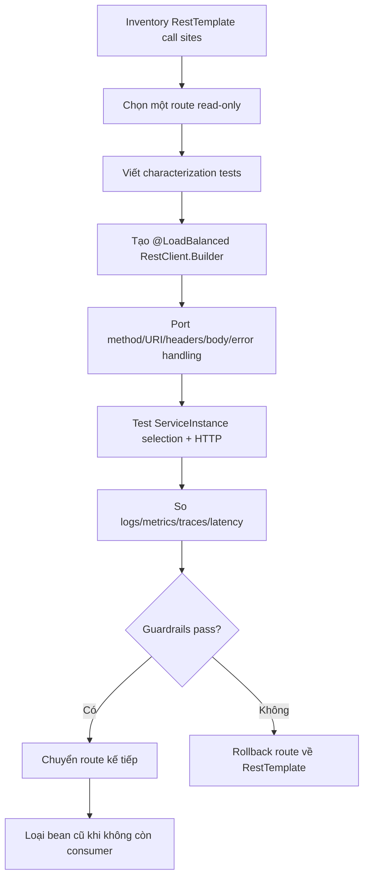

# Thay RestTemplate bằng RestClient theo từng đường gọi

`RestTemplate` đã được sử dụng rộng rãi trong các ứng dụng Spring để gọi HTTP đồng bộ. Khi nâng cấp ứng dụng lên Spring Framework 6.1 trở lên, `RestClient` cung cấp một API đồng bộ mới với cách viết fluent, cấu hình builder rõ ràng và tích hợp với các cơ chế quan sát của Spring. Việc chuyển đổi không nên được thực hiện bằng cách thay tên class trên toàn repository: mỗi đường gọi có thể có URI, header, timeout, error handler, converter, interceptor, retry và chính sách cân bằng tải khác nhau.

Trong module `SPRING_CLOUD_SERVICE_COMMUNICATION_LOAD_BALANCING`, điểm cần giữ nguyên là **caller vẫn gọi downstream bằng service ID và Spring Cloud LoadBalancer vẫn chọn `ServiceInstance`**. Ví dụ, `order-service` gọi `http://inventory-service` qua `@LoadBalanced RestTemplate`. Khi chuyển một đường gọi sang `RestClient`, caller phải dùng `@LoadBalanced RestClient.Builder` để URI logic tiếp tục được phân giải qua LoadBalancer. Nếu vô tình tạo `RestClient.create()` hoặc builder không có qualifier LoadBalancer rồi gọi cùng URI, client có thể tìm DNS tên `inventory-service` và thất bại, hoặc đi theo một đường mạng khác dự kiến.

Bài thuộc chương **Tương thích và nâng cấp**. Ta sẽ lập danh mục các đường gọi cũ, xác định điều kiện phiên bản, chuyển từng method/endpoint, giữ semantics HTTP, cấu hình request factory và observability, rồi kiểm thử selection/transport/error trước khi loại bỏ đường cũ. Các ví dụ tập trung vào `RestClient` đồng bộ; nếu caller thực sự cần streaming/reactive end-to-end, `WebClient` vẫn là lựa chọn phù hợp hơn.

## 1. Mục tiêu và nguyên tắc migration

Sau bài này, bạn cần:

1. Xác định phiên bản Spring Boot, Spring Framework và Spring Cloud release train đang dùng, đồng thời chọn tổ hợp tương thích.
2. Phân biệt một `RestTemplate` thường với một `@LoadBalanced RestTemplate`; bảo toàn hành vi đó khi chuyển sang `RestClient`.
3. Ánh xạ các lời gọi phổ biến như `getForObject`, `getForEntity`, `postForEntity` và `exchange` sang API fluent.
4. Giữ đúng URI encoding, headers, body, status handling, error mapping, timeout, TLS/proxy, connection pool và interceptors.
5. Di chuyển **từng đường gọi** bằng facade/service nhỏ, có kiểm thử và telemetry so sánh.
6. Chứng minh request mới vẫn đi qua đúng service ID, lựa chọn replica đúng chính sách và trả kết quả tương thích.
7. Có thể rollback một route về implementation cũ mà không cần revert toàn bộ đợt nâng cấp.

**Nguyên tắc:** một lần thay đổi chỉ nên làm rõ một phạm vi. Không đồng thời đổi HTTP client, URI contract, retry policy, timeout và thuật toán chọn replica trong cùng một bước nếu không có test tách riêng. Nếu tất cả thay đổi cùng lúc, khi error rate tăng sẽ khó xác định nguyên nhân.

## 2. Kiểm tra điều kiện tương thích trước khi viết code

`RestClient` được giới thiệu trong **Spring Framework 6.1**. Vì vậy ứng dụng dùng nó cần một stack Spring có Framework 6.1 trở lên; các phiên bản Spring Boot 3.2 trở lên là một ví dụ phổ biến đáp ứng điều kiện này. Spring Cloud release train cũng phải tương thích với Spring Boot được chọn.

| Thành phần | Điều cần kiểm tra |
|---|---|
| JDK | Phiên bản JDK được Spring Boot release đang dùng hỗ trợ. |
| Spring Boot | Phiên bản quản lý Spring Framework và auto-configuration. |
| Spring Framework | Phải có API `RestClient` (6.1+). |
| Spring Cloud release train | Phải tương thích với Spring Boot; kiểm tra compatibility matrix của release train đang dùng. |
| Spring Cloud Commons / LoadBalancer | Phải có integration `@LoadBalanced RestClient.Builder` trong phiên bản được chọn. |
| HTTP request factory | Kiểm tra JDK client, Apache HttpComponents, Jetty hoặc factory hiện có và các timeout/pooling/TLS options. |
| Observability | Xác nhận `ObservationRegistry`/Micrometer instrumentation đang được gắn vào builder. |
| Third-party libraries | Kiểm tra thư viện còn yêu cầu `RestTemplate` hoặc extension chỉ hỗ trợ API cũ. |

Không nên chỉ nâng Spring Framework riêng lẻ bên trong một Spring Boot BOM. **Dùng Spring Boot dependency management và Spring Cloud BOM tương thích**, rồi kiểm tra dependency tree để tránh trộn nhiều phiên bản Spring Framework/Spring Cloud Commons.

### Kiểm tra nhanh dependency tree

Trong Maven:

```bash
mvn -q dependency:tree \
  -Dincludes=org.springframework:spring-web,org.springframework.cloud:spring-cloud-commons,org.springframework.cloud:spring-cloud-loadbalancer
```

Trong Gradle:

```bash
./gradlew dependencyInsight \
  --dependency spring-web \
  --configuration runtimeClasspath
```

Các lệnh trên chỉ giúp xác định artifact/version thực tế. Sau đó đối chiếu với compatibility matrix và release notes của **đúng Spring Cloud train** trong dự án. Đừng coi việc Maven/Gradle resolve thành công là bằng chứng rằng mọi integration tương thích ở runtime.

### RestTemplate có bị loại bỏ ngay không?

Không cần giả định `RestTemplate` biến mất khi `RestClient` xuất hiện. Ứng dụng có thể giữ một số call sites cũ trong thời gian migration. Việc thay thế nên dựa trên lợi ích, khả năng tương thích và kết quả test; **không xóa implementation cũ chỉ vì class mới có API fluent hơn**.

## 3. Phân biệt ba kiểu client trước khi thay

Trong codebase có thể có ba loại client cùng lúc:

| Client | Cách khởi tạo | Cách phân giải host | Vai trò |
|---|---|---|---|
| `RestTemplate` thường | `new RestTemplate()` hoặc bean không có `@LoadBalanced`. | DNS/host URL do HTTP stack xử lý. | Gọi host cố định, external API hoặc URL thông thường. |
| `@LoadBalanced RestTemplate` | Bean `RestTemplate` được đánh dấu `@LoadBalanced`. | Spring Cloud LoadBalancer phân giải service ID thành `ServiceInstance`. | Gọi microservice nội bộ theo service ID. |
| `@LoadBalanced RestClient` | `@LoadBalanced RestClient.Builder` rồi build client. | Spring Cloud LoadBalancer tích hợp vào builder/HTTP request pipeline. | Gọi microservice nội bộ theo service ID bằng API mới. |

Ví dụ:

```java
// Plain HTTP client: không tự hiểu service ID của Spring Cloud.
RestTemplate externalTemplate = new RestTemplate();

// Load-balanced client: cần bean được Spring Cloud cấu hình.
@Bean
@LoadBalanced
RestTemplate inventoryTemplate() {
    return new RestTemplate();
}
```

Tương tự, không phải mọi `RestClient` đều load-balanced:

```java
// Plain client.
RestClient plainClient = RestClient.create();

// Builder được Spring Cloud đánh dấu và customize cho LoadBalancer.
@Bean
@LoadBalanced
RestClient.Builder loadBalancedRestClientBuilder() {
    return RestClient.builder();
}
```

Nếu ứng dụng có cả external APIs và internal service IDs, nên đặt **tên bean/qualifier rõ ràng** để không inject nhầm client. Không gắn `@LoadBalanced` cho một builder rồi dùng nó một cách tùy tiện để gọi mọi URL bên ngoài; điều đó làm ranh giới mạng và telemetry khó hiểu.

## 4. Lập danh mục đường gọi RestTemplate hiện tại

Trước khi sửa, ghi lại từng outbound route:

| Trường cần ghi | Ví dụ |
|---|---|
| Caller / bean | `order-service / inventoryRestTemplate` |
| Downstream service ID | `inventory-service` |
| Method + route template | `GET /api/items/{id}` |
| API cũ | `getForObject` hoặc `exchange` |
| Request/response contract | DTO, headers, content type, status. |
| Timeout | Connect/read hoặc timeout ở HTTP engine. |
| Retry | Không retry, retry ở LB, wrapper hay transport. |
| Interceptors/error handler | Auth, tracing, logging, custom status mapping. |
| Connection factory | JDK/Apache/Jetty/khác, pooling và TLS. |
| Metrics/SLO | Calls, error rate, p95/p99, attempts. |
| Test coverage | Unit, HTTP integration, LoadBalancer selection. |

Tìm kiếm trong repository bằng `rg` hoặc IDE:

```bash
rg -n "RestTemplate|@LoadBalanced|getForObject|getForEntity|postForEntity|exchange\\(" .
```

Phân loại kết quả theo **bean và call site**, không thay mọi chuỗi `RestTemplate` trong một lần. Có thể một ứng dụng có một `RestTemplate` thường để gọi payment provider và một `@LoadBalanced RestTemplate` để gọi inventory; hai đường gọi cần migration plan khác nhau.

### Ví dụ danh mục

| Route | Client cũ | LoadBalanced? | Độ rủi ro | Thứ tự đề xuất |
|---|---|---:|---|---:|
| `GET inventory item` | `getForObject` | Có | Thấp, body JSON đơn giản | 1 |
| `POST reserve stock` | `postForEntity` | Có | Cao hơn, có side effect/retry | 3 |
| `GET payment provider` | `exchange` | Không | TLS/auth riêng, ngoài scope LB | Tách kế hoạch |
| `GET catalog page` | `exchange` | Có | Pagination/large body | 2 |

Chọn một route read-only, contract đơn giản để làm pilot. Khi semantics đã được chứng minh, áp dụng cùng pattern cho các route còn lại.

## 5. Mapping API: từ RestTemplate sang RestClient

`RestClient` dùng builder fluent và tách bước chọn method, URI, headers/body, status handling và decode:

| RestTemplate | RestClient |
|---|---|
| `getForObject(url, Type.class)` | `get().uri(url).retrieve().body(Type.class)` |
| `getForEntity(url, Type.class)` | `get().uri(url).retrieve().toEntity(Type.class)` |
| `postForObject(url, body, Type.class)` | `post().uri(url).body(body).retrieve().body(Type.class)` |
| `postForEntity(url, body, Type.class)` | `post().uri(url).body(body).retrieve().toEntity(Type.class)` |
| `exchange(url, method, HttpEntity, Type.class)` | `method(method).uri(url).headers(...).body(...).retrieve()/exchange(...)` |
| `delete(url)` | `delete().uri(url).retrieve()` hoặc `exchange(...)` nếu cần inspect response. |
| `execute(...)` | `exchange(...)` hoặc custom request factory/client tùy nhu cầu thấp tầng. |

Đây là mapping về **ý định API**, không phải phép chuyển tự động bảo đảm giống nhau 100%. Đặc biệt cần kiểm tra body null, URI variables/encoding, headers, status handling và response resource lifecycle.

### 5.1. GET trả DTO

Trước:

```java
InventoryReply reply = restTemplate.getForObject(
    "http://inventory-service/api/items/{id}",
    InventoryReply.class,
    itemId);
```

Sau:

```java
InventoryReply reply = inventoryRestClient.get()
    .uri("/api/items/{id}", itemId)
    .retrieve()
    .body(InventoryReply.class);
```

`inventoryRestClient` phải được build từ `@LoadBalanced RestClient.Builder` có base URL `http://inventory-service`. Cách này giữ service ID trong cấu hình client, còn method chỉ truyền path và biến URI.

### 5.2. GET cần status và headers

Trước:

```java
ResponseEntity<InventoryReply> response =
    restTemplate.getForEntity(
        "http://inventory-service/api/items/{id}",
        InventoryReply.class,
        itemId);
```

Sau:

```java
ResponseEntity<InventoryReply> response =
    inventoryRestClient.get()
        .uri("/api/items/{id}", itemId)
        .retrieve()
        .toEntity(InventoryReply.class);

HttpStatusCode status = response.getStatusCode();
HttpHeaders headers = response.getHeaders();
InventoryReply body = response.getBody();
```

`toEntity` hữu ích khi business logic cần status, response headers hoặc body. Nếu chỉ cần DTO, `body(...)` thể hiện ý định rõ hơn và tránh giữ các metadata không cần thiết.

### 5.3. POST có JSON body

Trước:

```java
HttpEntity<ReserveRequest> entity =
    new HttpEntity<>(request, headers);

ResponseEntity<ReserveReply> response =
    restTemplate.postForEntity(
        "http://inventory-service/api/reservations",
        entity,
        ReserveReply.class);
```

Sau:

```java
ResponseEntity<ReserveReply> response =
    inventoryRestClient.post()
        .uri("/api/reservations")
        .contentType(MediaType.APPLICATION_JSON)
        .headers(outbound -> outbound.addAll(headers))
        .body(request)
        .retrieve()
        .toEntity(ReserveReply.class);
```

Đảm bảo header cần thiết vẫn được truyền: correlation ID, idempotency key, authorization token theo cơ chế an toàn, tenant context đã xác thực. **Không copy toàn bộ inbound headers một cách mù quáng** sang downstream; chỉ forward những header được contract cho phép.

Với thao tác ghi, không bật retry chỉ vì đổi client. Nếu caller timeout sau khi server đã commit reservation, retry có thể tạo đặt chỗ trùng. Giữ idempotency key và kiểm tra chính sách retry riêng.

### 5.4. PUT/PATCH/DELETE

Ví dụ PUT:

```java
ResponseEntity<Void> response =
    inventoryRestClient.put()
        .uri("/api/items/{id}", itemId)
        .contentType(MediaType.APPLICATION_JSON)
        .body(updateRequest)
        .retrieve()
        .toBodilessEntity();
```

Ví dụ DELETE:

```java
inventoryRestClient.delete()
    .uri("/api/reservations/{id}", reservationId)
    .retrieve()
    .toBodilessEntity();
```

Nếu API trả status `204` hoặc headers quan trọng, `toBodilessEntity()` giữ thông tin response mà không cố decode body. Nếu API có body trong DELETE (hiếm và phụ thuộc contract), dùng method/body API tương ứng và kiểm thử server thực tế.

## 6. Mapping exchange: giữ nguyên request method, headers và body

`RestTemplate.exchange` thường được dùng khi caller cần method động, header riêng và generic response:

Trước:

```java
HttpEntity<SearchRequest> entity =
    new HttpEntity<>(searchRequest, headers);

ResponseEntity<List<ItemDto>> response =
    restTemplate.exchange(
        "http://inventory-service/api/search",
        HttpMethod.POST,
        entity,
        new ParameterizedTypeReference<List<ItemDto>>() {});
```

Sau:

```java
ResponseEntity<List<ItemDto>> response =
    inventoryRestClient.method(HttpMethod.POST)
        .uri("/api/search")
        .headers(outbound -> outbound.addAll(headers))
        .contentType(MediaType.APPLICATION_JSON)
        .body(searchRequest)
        .retrieve()
        .toEntity(new ParameterizedTypeReference<List<ItemDto>>() {});
```

Với generic response, dùng `ParameterizedTypeReference` để giữ type information khi decode. Không đổi sang `List.class` vì type erasure có thể khiến phần tử thành `LinkedHashMap` thay vì `ItemDto`.

Nếu method động có thể không có body:

```java
RestClient.RequestBodySpec request =
    inventoryRestClient.method(method)
        .uri("/api/items");

ResponseEntity<String> response = request
    .headers(h -> h.addAll(headers))
    .retrieve()
    .toEntity(String.class);
```

Đối với request có body tùy chọn, tách nhánh rõ ràng hoặc dùng abstraction phù hợp để tránh gửi nhầm body rỗng/null. Hãy so sánh raw HTTP request của implementation cũ và mới trong integration test khi contract có behavior đặc biệt.

## 7. Error handling: ResponseErrorHandler và onStatus/exchange

Đây là khác biệt migration quan trọng.

`RestTemplate` thường dùng `ResponseErrorHandler` để phân loại status lỗi. `RestClient.retrieve()` mặc định chuyển các status 4xx/5xx thành exception tương ứng; có thể đăng ký handler ngay trên request bằng `onStatus`:

```java
InventoryReply reply = inventoryRestClient.get()
    .uri("/api/items/{id}", itemId)
    .retrieve()
    .onStatus(
        status -> status.value() == 404,
        (request, response) -> {
            throw new ItemNotFoundException(itemId);
        })
    .onStatus(
        HttpStatusCode::is5xxServerError,
        (request, response) -> {
            throw new InventoryUnavailableException(
                response.getStatusCode().value());
        })
    .body(InventoryReply.class);
```

`ItemNotFoundException` và `InventoryUnavailableException` là exception do ứng dụng định nghĩa. Không ghi raw body/headers chứa dữ liệu nhạy cảm vào message.

Nếu muốn dùng default status handling, cần hiểu `retrieve()` đã có behavior mặc định. Nếu muốn tự xử lý mọi status/body, dùng `exchange(...)`:

```java
InventoryResult result = inventoryRestClient.get()
    .uri("/api/items/{id}", itemId)
    .exchange((request, response) -> {
        HttpStatusCode status = response.getStatusCode();

        if (status.is2xxSuccessful()) {
            InventoryReply body = objectMapper.readValue(
                response.getBody(), InventoryReply.class);
            return new InventoryResult.Success(body);
        }

        if (status.value() == 404) {
            return new InventoryResult.NotFound();
        }

        return new InventoryResult.Failure(status.value());
    });
```

`InventoryResult` là sealed interface/kiểu kết quả do ứng dụng định nghĩa; đoạn code cần import `ObjectMapper` và các DTO tương ứng. **`exchange` không áp dụng status handlers mặc định giống `retrieve`**; caller chịu trách nhiệm kiểm tra status và xử lý response. Không bỏ qua status rồi cố decode error body thành DTO success.

### Đừng ánh xạ mọi lỗi thành “LoadBalancer không tìm thấy instance”

Phân biệt:

| Lỗi | Có HTTP response upstream? | Ý nghĩa |
|---|---:|---|
| No eligible `ServiceInstance` | Không | Discovery/filter/selection không có đích. |
| Connection refused/reset | Thường không | Đã có địa chỉ được chọn nhưng transport không kết nối/duy trì được. |
| HTTP 503 từ inventory | Có | Upstream thực sự trả status 503. |
| HTTP 404 | Có | Có thể là kết quả nghiệp vụ bình thường tùy contract. |
| Decode/codec error sau HTTP 200 | Có headers/status | Response có nhưng caller không đọc/parse được. |
| Timeout | Có thể không có response đầy đủ | Không chứng minh server chưa xử lý request. |

Trong migration, giữ nguyên error contract của facade phía trên. Nếu trước đây caller phân biệt 404 với 503, không gom chúng thành một exception generic chỉ vì code RestClient mới ngắn hơn.

## 8. Cấu hình @LoadBalanced RestClient.Builder

Một cấu hình theo service ID:

```java
import org.springframework.cloud.client.loadbalancer.LoadBalanced;
import org.springframework.context.annotation.Bean;
import org.springframework.context.annotation.Configuration;
import org.springframework.web.client.RestClient;

@Configuration
class InventoryRestClientConfiguration {

    @Bean
    @LoadBalanced
    RestClient.Builder loadBalancedRestClientBuilder() {
        return RestClient.builder();
    }

    @Bean("inventoryRestClient")
    RestClient inventoryRestClient(
            @LoadBalanced RestClient.Builder builder) {
        return builder.clone()
            .baseUrl("http://inventory-service")
            .build();
    }
}
```

Caller:

```java
@Service
class InventoryGateway {

    private final RestClient inventoryRestClient;

    InventoryGateway(
            @Qualifier("inventoryRestClient")
            RestClient inventoryRestClient) {
        this.inventoryRestClient = inventoryRestClient;
    }

    InventoryReply find(String itemId) {
        return inventoryRestClient.get()
            .uri("/api/items/{id}", itemId)
            .retrieve()
            .body(InventoryReply.class);
    }
}
```

Các điểm cần kiểm tra:

- Có dependency `spring-cloud-starter-loadbalancer` đúng phiên bản.
- Builder được đánh dấu `@LoadBalanced` và được inject đúng qualifier.
- `baseUrl` chứa service ID logic; không hard-code replica IP/port.
- Không có bean `RestClient` plain bị inject nhầm.
- Custom LoadBalancer configuration (nếu có) vẫn áp dụng đúng service ID.
- Discovery trả danh sách `ServiceInstance` hợp lệ và metadata/health phù hợp.

### Nhiều builder/client trong cùng ứng dụng

Nếu có cả plain external client và load-balanced internal client, đặt tên bean:

```java
@Bean("plainRestClientBuilder")
RestClient.Builder plainRestClientBuilder() {
    return RestClient.builder();
}

@Bean("loadBalancedRestClientBuilder")
@LoadBalanced
RestClient.Builder loadBalancedRestClientBuilder() {
    return RestClient.builder();
}
```

Inject bằng `@Qualifier` để tránh ambiguity. Với mỗi client đã build, có thể cấu hình base URL riêng và policy phù hợp. Không gọi `builder.baseUrl(...)` nhiều lần trên một builder singleton dùng chung cho các service khác nhau; hãy clone builder trước khi tạo client chuyên biệt.

## 9. Request factory: giữ timeout, pooling, TLS và proxy

Một migration có thể pass unit test nhưng fail production vì `RestTemplate` cũ dùng Apache HttpClient connection pool còn `RestClient` mới rơi về JDK/default request factory với timeout/pooling khác.

Các cấu hình cần inventory:

| Thuộc tính cũ | Câu hỏi khi chuyển |
|---|---|
| Connect timeout | Builder/request factory mới có cùng ngưỡng? |
| Read/response timeout | Có đo cùng ranh giới và cùng semantics? |
| Connection pool | Max total, max per route, idle eviction và connection TTL? |
| TLS | Trust store, hostname verification, mTLS client certificate? |
| Proxy | Proxy host, bypass list, authentication? |
| Redirect | Có theo redirect không; có giữ method/body/header không? |
| Compression | Content-Encoding/decompression có thay đổi không? |
| Connection reuse | HTTP/1.1 keep-alive hay HTTP/2; pool key theo route? |
| Buffering/streaming | Body có bị giữ toàn bộ trong memory hay stream? |

Ví dụ một request factory đơn giản cho lab:

```java
import java.time.Duration;
import org.springframework.context.annotation.Bean;
import org.springframework.http.client.JdkClientHttpRequestFactory;
import org.springframework.web.client.RestClient;

@Bean
@LoadBalanced
RestClient.Builder loadBalancedRestClientBuilder() {
    JdkClientHttpRequestFactory factory =
        new JdkClientHttpRequestFactory();
    factory.setReadTimeout(Duration.ofSeconds(2));

    return RestClient.builder()
        .requestFactory(factory);
}
```

Ví dụ này minh họa một cấu hình timeout ở JDK request factory cho phiên bản Spring hỗ trợ API tương ứng; connect timeout thường được cấu hình trên `java.net.http.HttpClient` được gắn với factory. Nếu cần cấu hình pooling/TLS nâng cao, dùng HTTP engine phù hợp và tạo `ClientHttpRequestFactory` tương ứng. **Đừng copy timeout 2 giây vào production mà không đo deadline nghiệp vụ và latency distribution.**

Nếu ứng dụng cũ dùng Apache HttpComponents, có thể tiếp tục dùng một Apache-based request factory tương thích với Spring Framework mới. Không phải migration sang RestClient bắt buộc đổi HTTP engine. Thực tế, giữ nguyên engine trong bước đầu giúp giảm số biến thay đổi và giữ behavior pool/TLS gần với baseline.

### Connect timeout, response timeout và deadline không giống nhau

- **Connect timeout:** thời gian cho thiết lập kết nối tới địa chỉ instance đã chọn.
- **Response/read timeout:** thời gian chờ dữ liệu/response theo semantics của request factory.
- **Logical deadline:** tổng thời gian business call cho phép, có thể bao gồm chọn instance, pool wait, connect, request/response, decode, retry và backoff.

Nếu có retry ba attempts, connect/read timeout mỗi attempt là 2 giây **không có nghĩa** logical call chỉ mất 2 giây. Cần đặt deadline tổng và retry budget riêng.

## 10. Interceptors và headers

`ClientHttpRequestInterceptor` có thể dùng với cả RestTemplate và RestClient builder. Đây là cơ hội để giữ auth/tracing/correlation behavior, nhưng phải kiểm tra thứ tự và scope.

Ví dụ:

```java
import org.springframework.http.client.ClientHttpRequestInterceptor;
import org.springframework.web.client.RestClient;

ClientHttpRequestInterceptor correlationInterceptor =
    (request, body, execution) -> {
        // Chỉ thêm correlation ID đã được kiểm tra/propagate.
        request.getHeaders().set(
            "X-Correlation-ID", correlationIdProvider.current());
        return execution.execute(request, body);
    };

RestClient client = builder.clone()
    .requestInterceptor(correlationInterceptor)
    .baseUrl("http://inventory-service")
    .build();
```

`correlationIdProvider` là abstraction do ứng dụng cung cấp. Với reactive context, không đọc MDC/ThreadLocal tùy tiện; nhưng `RestClient` là blocking, vẫn phải bảo đảm context được thiết lập và dọn đúng vòng đời request/thread.

Trước khi chuyển, ghi lại:

- Interceptor order: auth, tracing, logging, signing, idempotency.
- Header nào được phép forward từ inbound request.
- Có interceptor nào đọc URI/host trước hay sau khi LoadBalancer rewrite không.
- Có interceptor nào tiêu thụ/đọc request body để log rồi làm stream không thể đọc lại không.
- Có interceptor nào retry hoặc sửa status/error ngoài dự kiến không.

Không log `Authorization`, cookie, API keys, body nhạy cảm hoặc signed URL. Nếu interceptor cần biết instance thực sự được chọn, không giả định request URI tại mọi vị trí luôn là host/port đã resolve; instrument lifecycle/observation của LoadBalancer.

## 11. Message converters, JSON và generic types

`RestTemplate` và `RestClient` đều dựa vào cơ chế message converters của Spring, nhưng ứng dụng có thể custom danh sách converter hoặc thứ tự. Khi migration:

- Kiểm tra `MappingJackson2HttpMessageConverter`/Jackson modules, naming strategy, date/time modules và custom serializers.
- Kiểm tra `StringHttpMessageConverter`, byte array, form, multipart và resource converter.
- Kiểm tra converter order nếu nhiều converter cùng hỗ trợ media type.
- Kiểm tra charset, content type, accept header và error body.
- Kiểm tra generic response với `ParameterizedTypeReference`.
- Kiểm tra null body, empty body, `204 No Content` và body có thể lớn/stream.

Ví dụ custom converter:

```java
RestClient client = builder.clone()
    .messageConverters(converters -> {
        // Thêm hoặc cấu hình converter cần thiết.
        // Giữ đúng thứ tự và converter hiện có theo contract.
    })
    .build();
```

Đừng copy một converter custom vào builder mà không kiểm tra auto-configured converters còn lại. Có thể vô tình loại bỏ Jackson converter hoặc thay thứ tự khiến một media type được decode khác trước.

### Kiểm tra URI template và encoding

RestTemplate và RestClient đều hỗ trợ URI templates, nhưng khi chuyển từ URL đầy đủ sang `baseUrl` + relative path, phải kiểm tra:

```java
// Cũ: URL template đầy đủ.
restTemplate.getForObject(
    "http://inventory-service/api/items/{id}?lang={lang}",
    ItemDto.class, itemId, language);

// Mới: baseUrl chứa service ID, path/query được dựng riêng.
inventoryRestClient.get()
    .uri(uriBuilder -> uriBuilder
        .path("/api/items/{id}")
        .queryParam("lang", "{lang}")
        .build(itemId, language))
    .retrieve()
    .body(ItemDto.class);
```

Ví dụ minh họa cách dựng URI; kiểm tra behavior encode các ký tự `/`, `?`, `%`, dấu cách, Unicode và biến null. Không nối chuỗi URI thủ công khi giá trị có thể chứa ký tự cần encode. Với signed URL hoặc query canonicalization, phải giữ đúng thứ tự/encoding mà chữ ký yêu cầu.

## 12. Observability: giữ metrics/tracing qua builder mới

Spring Boot/Micrometer có thể instrument HTTP client khi builder sử dụng `ObservationRegistry` phù hợp. Khi tự tạo `RestClient.builder()`, cần xác minh observation registry và customizers có được áp dụng.

Ví dụ:

```java
@Bean
@LoadBalanced
RestClient.Builder loadBalancedRestClientBuilder(
        ObservationRegistry observationRegistry) {
    return RestClient.builder()
        .observationRegistry(observationRegistry);
}
```

Trong ứng dụng thực, builder do auto-configuration/customizer cung cấp có thể đã được gắn observation registry. Nếu tạo builder thủ công, đừng bỏ mất các customizers quan sát, tracing hoặc load-balancing integration. Cách cấu hình cụ thể tùy phiên bản Boot/Cloud.

### So sánh trước và sau migration

Đo theo cùng operation/service ID:

| Tín hiệu | Điều cần giữ/so sánh |
|---|---|
| Logical calls | Số thao tác business; không được mất/nhân đôi do wrapper. |
| HTTP attempts | Số lần thực sự gửi; phân biệt retry ở nhiều tầng. |
| Service ID | Vẫn là `inventory-service`. |
| Selected instance | Phân bố replica theo policy trước/sau. |
| HTTP status | 2xx/4xx/5xx theo cùng contract. |
| Exception class/category | No-instance, connect, timeout, decode, status error. |
| Latency | p50/p95/p99 theo cùng workload và cửa sổ. |
| Connection pool | Active/idle/pending, acquire timeout, reuse. |
| Traces | Client/server spans và propagation vẫn nối được. |

Không chỉ so tổng error count nếu lưu lượng hai giai đoạn khác nhau. Dùng rate/ratio, cùng route template, cùng cohort và cùng khoảng thời gian. Instance ID có thể hữu ích trong log/trace, nhưng tránh dùng làm metric label có cardinality cao.

## 13. Từng bước migrate một đường gọi

Một quy trình ít rủi ro:



### Bước 1 — Chụp baseline

Trước khi sửa:

- Ghi bean và service ID.
- Ghi request method/path, headers, body, expected response và error mapping.
- Ghi timeout/request factory/retry.
- Chạy test và lưu logs/metrics/traces hiện tại.
- Ghi số logical calls và attempts dưới traffic test kiểm soát.

### Bước 2 — Viết characterization tests

Test cần khóa behavior hiện tại:

- URI và headers thực sự gửi.
- JSON/body serialize đúng.
- 404/429/503 được ánh xạ đúng.
- Empty body/204 xử lý đúng.
- No-instance khác connection refused và upstream 503.
- Request đi qua đúng service ID và có thể tới nhiều replica.

Không chỉ mock `RestTemplate` hoặc `RestClient`; để chứng minh LoadBalancer, dùng nhiều HTTP stub servers/MockWebServer/WireMock với supplier có nhiều `ServiceInstance`.

### Bước 3 — Tạo RestClient song song

Giữ bean cũ và tạo bean mới có qualifier riêng:

```java
@Bean("inventoryRestTemplate")
@LoadBalanced
RestTemplate inventoryRestTemplate() {
    return new RestTemplate();
}

@Bean
@LoadBalanced
RestClient.Builder loadBalancedRestClientBuilder() {
    return RestClient.builder();
}

@Bean("inventoryRestClient")
RestClient inventoryRestClient(
        @LoadBalanced RestClient.Builder builder) {
    return builder.clone()
        .baseUrl("http://inventory-service")
        .build();
}
```

Đoạn này chỉ dùng khi dependency/version hỗ trợ cả hai integration. Nếu không, nâng dependency theo BOM tương thích trước; không viết reflection/custom adapter tự chế để che việc thiếu API.

### Bước 4 — Tạo facade theo nghiệp vụ

Giữ business code không phụ thuộc trực tiếp implementation:

```java
public interface InventoryReader {
    InventoryReply findById(String itemId);
}

@Service
class RestClientInventoryReader implements InventoryReader {

    private final RestClient client;

    RestClientInventoryReader(
            @Qualifier("inventoryRestClient") RestClient client) {
        this.client = client;
    }

    @Override
    public InventoryReply findById(String itemId) {
        return client.get()
            .uri("/api/items/{id}", itemId)
            .retrieve()
            .body(InventoryReply.class);
    }
}
```

Facade giúp chuyển implementation, thêm telemetry và rollback mà không sửa nhiều business callers. Trong thời gian rollout, có thể có adapter cũ implement cùng interface để chuyển lại khi cần; tránh giữ hai bean cùng active mà không có qualifier/selection rõ ràng.

### Bước 5 — Chạy test theo tầng

1. Unit test mapping method/DTO/error.
2. HTTP integration test với một server để kiểm tra converter/headers.
3. Multi-replica integration test để kiểm tra service ID/LoadBalancer selection.
4. Failure tests: 404, 503, connection reset, timeout, empty response.
5. Contract/consumer test với upstream thực hoặc stub có schema được kiểm soát.
6. So metrics/trace/latency dưới cùng workload.

### Bước 6 — Chuyển traffic nội bộ hoặc theo feature flag

Chuyển một route hoặc một nhóm caller nhỏ. Giữ nguyên service ID, request contract và policy trong giai đoạn đầu. Nếu cần flag chọn RestTemplate/RestClient, flag phải ở lớp facade và có metrics theo implementation để biết request đang đi đường nào.

### Bước 7 — Xóa implementation cũ sau khi xác minh

Chỉ bỏ bean/interceptor/config của RestTemplate khi:

- Không còn consumer nào.
- Error/latency/selection ổn định qua thời gian quan sát.
- Metrics/traces đã so sánh và không mất instrumentation.
- Test suite xác nhận route mới.
- Có kế hoạch rollback ở release tiếp theo nếu phát hiện vấn đề muộn.

## 14. Test LoadBalancer sau khi chuyển

Một integration test có ý nghĩa cần xác minh **đúng client mới** và **đúng đường đi service ID**:

```text
order-service
  RestClient baseUrl = http://inventory-service
       |
       v
  @LoadBalanced RestClient.Builder
       |
       v
  ServiceInstanceListSupplier
       |
       +--> inventory-a localhost:18081
       +--> inventory-b localhost:18082
       +--> inventory-c localhost:18083
```

Kịch bản:

| Test | Thiết lập | Assertion |
|---|---|---|
| Multi-instance | Ba stub server với ID riêng. | Cả ba có thể nhận request theo thuật toán/cấu hình. |
| No instance | Supplier trả danh sách rỗng. | Không có HTTP request tới stub; phân loại lỗi selection. |
| Upstream 503 | Một stub trả 503. | Caller nhận status/exception đúng contract. |
| Connection refused | Instance còn trong list nhưng server tắt. | Lỗi transport, không gọi là upstream 503. |
| URI/header | Ghi request ở stub. | Path, query, content type, correlation/idempotency headers đúng. |
| Timeout | Stub delay lớn hơn client timeout. | Exception và duration đúng ngưỡng dự kiến. |
| Custom routing | Metadata zone/release. | Client mới vẫn áp dụng đúng supplier/policy. |

**Không dùng `MockRestServiceServer` một mình để khẳng định chọn được giữa nhiều replica** nếu test không đi qua đường LoadBalancer thực. Dùng MockWebServer/WireMock nhiều cổng hoặc test môi trường có discovery provider để kiểm tra selection và HTTP transport cùng nhau.

### Kiểm tra request đã tới replica nào

Server stub trả marker riêng, ví dụ:

```json
{"instanceId":"inventory-b","stock":17}
```

Đối chiếu:

- Response marker từ server (chỉ là dấu hiệu lab).
- Request journal/RecordedRequest của stub.
- Log/Observation tại bước LoadBalancer selection nếu cần biết instance trước HTTP.

Không coi một interceptor HTTP bất kỳ luôn thấy URI đã rewrite thành host/port. Để ghi `selectedInstanceId` chính xác, dùng lifecycle/Observation hooks của Spring Cloud LoadBalancer theo version đang chạy.

## 15. Giữ retry, timeout và connection pool như thế nào?

Migration client không phải lúc thích hợp để âm thầm thay resilience policy. Ghi lại nơi retry hiện tại được thực thi:

| Retry owner | Cần kiểm tra |
|---|---|
| Business wrapper | Có gọi lại facade nhiều lần? Logical call counter nằm ở đâu? |
| Spring Cloud LoadBalancer | Có retry theo service instance/request? Có chọn lại hay giữ instance? |
| Spring Retry/Resilience4j | Retry predicate, backoff, max attempts, circuit state. |
| HTTP transport/proxy | Có retry thấp tầng không; có thể lặp body không? |
| OpenFeign (nếu route khác) | Retryer và behavior theo version/config. |

**Không bật thêm retry mặc định khi đổi sang RestClient.** Một thao tác GET có thể retry nếu hợp đồng cho phép; thao tác POST ghi dữ liệu cần idempotency key/dedup. Timeout per attempt phải nằm trong deadline tổng; nếu không, ba attempts mỗi attempt 2 giây cộng backoff có thể làm logical call vượt SLA.

### Connection pooling

RestClient dùng request factory/HTTP engine được cấu hình. Nếu RestTemplate cũ dùng Apache pool mà client mới dùng factory khác, cần so:

- Max total connections và max per route.
- Connection request/pool acquire timeout.
- Keep-alive, idle eviction, TTL.
- TLS handshake/reuse, mTLS và trust store.
- HTTP/1.1 hay HTTP/2 và multiplexing.
- Pending acquires, active/idle sockets, connection resets.

Giữ nguyên HTTP engine trong lần migration đầu có thể giảm rủi ro. Chỉ đổi engine khi có yêu cầu riêng và có benchmark/test xác minh.

## 16. Observability: không mất bằng chứng khi đổi client

Một dashboard migration tối thiểu:

| Tín hiệu | Phân nhóm |
|---|---|
| Logical call count | `targetService`, `operation`, `implementation` (legacy/new), `outcome`. |
| HTTP client attempts | Status class, route template, client name nếu instrumentation hỗ trợ. |
| LoadBalancer selection | Service ID, release/zone policy, selected instance trong logs/traces. |
| Latency | p50/p95/p99 cho logical call và HTTP client. |
| Errors | No-instance, connect, timeout, upstream 4xx/5xx, decode. |
| Pool | Active/idle/pending, acquire timeout. |
| Trace | Caller server span → outbound client span → upstream server span. |

Tên metrics và tags thực tế phụ thuộc Spring Boot/Micrometer/Spring Cloud version. Không hard-code giả định rằng mọi phiên bản đều xuất cùng tên. Tránh label theo `traceId`, user ID, raw URL hoặc ephemeral instance IP; dùng log/trace để tìm chi tiết của request cụ thể.

Nếu builder mới không còn `ObservationRegistry`/customizers, metrics/tracing có thể biến mất dù HTTP call vẫn thành công. Test cần xác nhận **cả behavior và telemetry**, không chỉ response JSON.

## 17. Các lỗi migration thường gặp

| Lỗi | Hậu quả | Cách sửa |
|---|---|---|
| Tạo `RestClient.create()` rồi gọi `http://inventory-service`. | Không có LB integration, có thể lỗi DNS. | Dùng `@LoadBalanced RestClient.Builder`. |
| Dùng URL `localhost:8081` trong client mới. | Bỏ qua chọn instance theo service ID. | Base URL là `http://inventory-service`. |
| Inject nhầm plain builder do nhiều bean. | Request không qua LoadBalancer. | Dùng bean name/`@Qualifier` và test integration. |
| Chuyển `exchange` sang `retrieve` mà không map status. | Error contract thay đổi. | So status cũ/mới, dùng `onStatus` hoặc `exchange`. |
| Dùng `List.class` thay generic type. | DTO elements thành map/không decode đúng. | Dùng `ParameterizedTypeReference`. |
| Mất Apache pool/TLS/proxy config. | Latency, TLS errors, socket pressure. | Giữ factory tương thích và test config. |
| Tự tạo builder không có observation. | Metrics/tracing bị thiếu. | Gắn registry/customizers đúng cách. |
| Interceptor đọc body để log. | Body stream không còn dùng được hoặc tốn RAM. | Log metadata an toàn, không buffer body tùy tiện. |
| Forward mọi inbound header. | Rò token/cookie hoặc header không tin cậy. | Allowlist header, tạo routing context ở trust boundary. |
| Bật retry cùng lúc đổi client. | Attempts tăng, side effects trùng. | Giữ retry policy, thay đổi riêng và kiểm tra idempotency. |
| Xóa bean cũ ngay sau khi code compile. | Route khác vẫn inject bean cũ và startup fail. | Tìm hết consumers, chuyển từng route rồi mới xóa. |
| Chỉ mock HTTP client. | Không phát hiện LoadBalancer không được tích hợp. | Test nhiều server và service ID thật. |

## 18. Kế hoạch rollout và rollback theo từng route

Một bảng migration có thể theo dõi:

| Trạng thái | Ý nghĩa | Điều kiện |
|---|---|---|
| `DISCOVERED` | Đã tìm thấy call site. | Biết bean, service ID, contract. |
| `CHARACTERIZED` | Có test khóa behavior cũ. | Headers, URI, status, timeout, retry. |
| `IMPLEMENTED` | Có RestClient adapter. | Code mới compile và review. |
| `INTEGRATION_VERIFIED` | Test nhiều replica/fault pass. | Service ID, selection, transport/error đúng. |
| `OBSERVABILITY_VERIFIED` | Metrics/traces/logs giữ đủ. | Có so sánh baseline. |
| `ROLLED_OUT` | Route đang chạy implementation mới. | Guardrails pass theo thời gian. |
| `LEGACY_REMOVED` | Đã xóa RestTemplate bean không còn dùng. | Không còn consumer; rollback path được lưu. |

### Khi phải rollback

1. Chuyển facade/feature flag của **route bị ảnh hưởng** về adapter RestTemplate cũ.
2. Giữ nguyên service ID và request contract để không đổi thêm topology.
3. Xác nhận các caller đã áp dụng implementation cũ và metrics theo implementation phản ánh điều đó.
4. Kiểm tra retry/connection pool/trace state không còn bị cấu hình từ builder mới tác động ngoài ý muốn.
5. Thu log/trace/error samples và chỉ thử migration lại sau khi nguyên nhân được khắc phục.

Không xóa artifact/config cũ trước khi hoàn tất giai đoạn quan sát và rollback window. Nếu đã xóa bean hoặc dependency, rollback có thể cần một release mới thay vì chỉ bật feature flag.

## 19. Checklist trước khi merge migration

- [ ] Đã xác minh Spring Boot, Framework, Cloud release train và JDK tương thích.
- [ ] Đã phân biệt plain RestTemplate và `@LoadBalanced RestTemplate` hiện có.
- [ ] Có danh mục route, service ID, method, URI, headers, body, status, retry, timeout và request factory.
- [ ] Client mới được tạo từ `@LoadBalanced RestClient.Builder` cho các downstream nội bộ.
- [ ] Base URL giữ service ID logic, không hard-code replica IP/port.
- [ ] Bean builder/client có qualifier rõ khi tồn tại nhiều loại HTTP client.
- [ ] API mapping giữ generic type, URI encoding, converter và empty body semantics.
- [ ] Status/error mapping giữ contract cũ; `retrieve`/`exchange` được dùng có chủ đích.
- [ ] Request factory giữ timeout, pooling, TLS, proxy và connection reuse cần thiết.
- [ ] Interceptors/header propagation giữ tracing/auth/idempotency nhưng không forward dữ liệu nhạy cảm tùy tiện.
- [ ] Multi-replica test xác nhận request mới thực sự đi qua LoadBalancer.
- [ ] No-instance, connection reset, upstream 503, timeout và decode error được phân biệt.
- [ ] Retry policy không bị bật thêm hoặc thay đổi ngoài ý muốn; write operations có idempotency.
- [ ] Metrics/logs/traces vẫn có service ID, operation, outcome và duration; selection quan sát ở đúng lifecycle.
- [ ] So sánh latency/error/attempts/connection pool dưới cùng workload.
- [ ] Có rollback path theo từng route và chỉ xóa bean cũ sau khi không còn consumer.

## 20. Mẫu báo cáo cho một đường gọi đã migrate

```text
Route: order-service -> inventory-service
Operation: GET /api/items/{id}
Legacy client: @LoadBalanced RestTemplate
New client: @LoadBalanced RestClient
Spring Boot / Framework / Cloud: ghi version thực tế

Compatibility:
  BOM compatible: PASS / FAIL
  RequestFactory / timeout / pool: ...
  Message converters / URI encoding: ...

Contract:
  Method / URI / headers / body: PASS / FAIL
  Status mapping / generic response: PASS / FAIL

LoadBalancer:
  Service ID preserved: PASS / FAIL
  Multiple ServiceInstances reached: PASS / FAIL
  No-instance / transport / upstream status separated: PASS / FAIL

Observability:
  Logs: ...
  Metrics: ...
  Traces: ...

Performance:
  Legacy p95/p99: ...
  RestClient p95/p99: ...
  HTTP attempts / logical call: ...
  Pool metrics: ...

Decision: PROMOTE / HOLD / ROLLBACK
Evidence: test run, redacted logs, metrics window, trace IDs
```

Không điền số giả rồi trình bày như kết quả đã chạy. Đây là mẫu để nhóm migration ghi bằng chứng thật cho từng route.

**Ghi nhớ:** thay `RestTemplate` bằng `RestClient` là một migration về **API và cấu hình HTTP client**, còn Spring Cloud LoadBalancer vẫn cần được tích hợp rõ ràng để chọn `ServiceInstance` theo service ID. Giữ nguyên contract, request factory, status handling, retry, timeout và observability; chuyển từng đường gọi qua một facade có test; chỉ loại implementation cũ khi đã xác minh selection, HTTP behavior và telemetry. Làm theo từng route giúp nâng cấp có thể quan sát, rollback có phạm vi và không biến một thay đổi API thành sự cố định tuyến toàn hệ thống.
