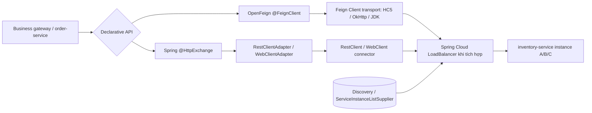
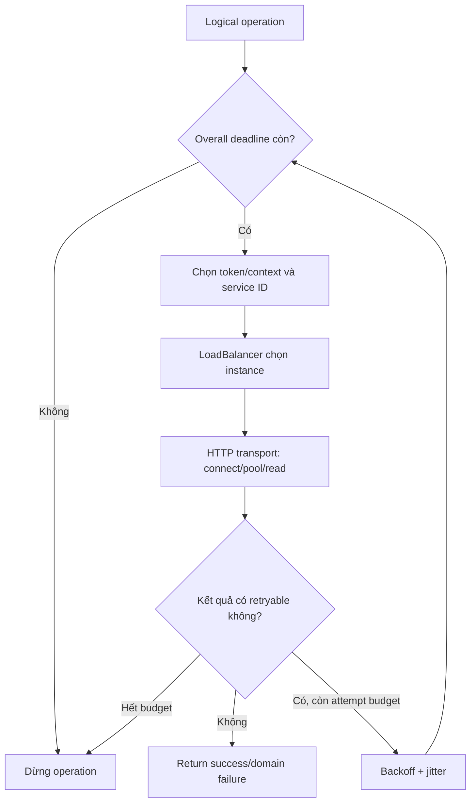
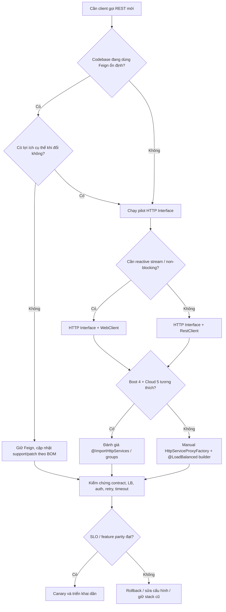

# Đánh giá OpenFeign và HTTP Service Interface cho nhu cầu mới

Khi xây microservice với Spring Cloud LoadBalancer, `order-service` thường gọi `inventory-service` thông qua service ID `inventory-service` thay vì gắn cứng một địa chỉ IP. Đội phát triển có thể đã sử dụng `@FeignClient` từ nhiều năm trước, nhưng khi xây chức năng mới hoặc nâng cấp Spring Boot, một câu hỏi xuất hiện: **tiếp tục dùng Spring Cloud OpenFeign hay chuyển sang Spring HTTP Service Interface với `@HttpExchange`?**

Đây không chỉ là lựa chọn cú pháp khai báo HTTP endpoint. Mỗi phương án tác động đến **Spring Framework/Spring Boot/Spring Cloud compatibility**, client-side LoadBalancer, đồng bộ so với reactive, cấu hình timeout/retry, OAuth2, circuit breaker, connection pool, observability, kiểm thử và cách duy trì API client trong nhiều năm.

Bài thuộc chương **Tương thích và nâng cấp** của module Spring Cloud LoadBalancer. Ta sẽ so sánh hai hướng, tạo một interface có thể chạy với `@LoadBalanced RestClient` hoặc `@LoadBalanced WebClient`, đánh giá HTTP Service Client groups của thế hệ Spring Boot/Spring Cloud mới, và thiết kế kế hoạch di trú từng bước **không làm thay đổi hợp đồng giao tiếp với dịch vụ đích**.

> **Kết luận định hướng:** Với code OpenFeign đang ổn định, không cần di trú chỉ để thay annotation. Với client mới, đặc biệt khi cần reactive/WebClient hoặc muốn theo định hướng Spring Framework, **HTTP Service Interface là lựa chọn đáng ưu tiên đánh giá**. Quyết định cuối dựa trên khả năng đáp ứng contract, phiên bản framework, thư viện resilience, các customizations hiện có và chi phí kiểm thử/di trú.

## 1. Tại sao phải đánh giá lại OpenFeign?

Theo tài liệu chính thức Spring Cloud OpenFeign, dự án được xem là **feature-complete** từ thời kỳ Spring Cloud 2022.0.0. Điều này **không đồng nghĩa OpenFeign đã bị xóa hoặc mọi ứng dụng Feign phải dừng ngay**: dự án tiếp tục có các bản sửa lỗi/cập nhật phù hợp, nhưng không còn là hướng được kỳ vọng bổ sung nhiều tính năng lớn. Spring Cloud đề xuất xem xét **Spring HTTP Service Clients** cho phát triển mới.

Một nguyên nhân kỹ thuật quan trọng là Spring Cloud OpenFeign không cung cấp mô hình **reactive client** tương đương WebClient. Ngược lại, HTTP Service Interface là lớp khai báo contract của Spring Framework, có thể đặt lên **RestClient (blocking)** hoặc **WebClient (reactive)** qua adapter và proxy factory thích hợp.

### Hai câu hỏi khác nhau

- **“Ứng dụng cũ có cần nâng cấp Feign sang HTTP Interface ngay không?”** Không nhất thiết; cần đánh giá support policy và mức độ phụ thuộc vào fallback/decoder/interceptors trước.
- **“Chức năng mới có nên tạo thêm một `@FeignClient`?”** Cần so sánh HTTP Service Interface trước khi quyết định, nhất là khi yêu cầu streaming, reactive composition hoặc nhóm client được cấu hình tập trung.

Không đánh đồng “feature-complete” với “không còn bản vá bảo mật”. Xác nhận trạng thái hỗ trợ của **release train thực tế đang triển khai**, không suy chỉ từ một câu trong blog.

## 2. Phân biệt ba tầng: contract, HTTP engine và LoadBalancer



Sơ đồ minh họa quan hệ giữa các tầng; một số interceptor/adapter của LoadBalancer thực tế nằm **trong** HTTP client stack, không nhất thiết là một bước duy nhất sau mọi engine.

| Tầng | OpenFeign | HTTP Service Interface |
|---|---|---|
| **Khai báo contract** | Interface với `@FeignClient`, `@GetMapping`/`@PostMapping`, DTO. | Interface với `@HttpExchange`, `@GetExchange`/`@PostExchange`, DTO. |
| **Tạo client implementation** | Auto-configuration/Feign proxy và Feign builder/capabilities. | `HttpServiceProxyFactory` + `RestClientAdapter` hoặc `WebClientAdapter`; ở Boot 4 có thể dùng service client group auto-configuration. |
| **HTTP transport** | Delegate như Apache HC5, OkHttp hoặc Feign client mặc định. | Request factory của RestClient hoặc connector của WebClient, có thể chọn JDK/Apache HC5/Reactor Netty theo stack. |
| **Load balancing** | Spring Cloud OpenFeign integration/wrapper nếu có và không bypass bằng URL tĩnh. | `@LoadBalanced` HTTP builder hoặc group auto-configuration của Spring Cloud 5+ theo điều kiện. |
| **Discovery/health/caching** | Spring Cloud LoadBalancer nếu được dùng. | Cùng Spring Cloud LoadBalancer khi được tích hợp. |
| **Authentication và resilience** | Feign-specific properties/interceptors/circuit-breaker integration khi cấu hình. | Gắn ở RestClient/WebClient/filter/service wrapper; không tự kế thừa cấu hình Feign. |

**Điểm cốt lõi:** `@HttpExchange` chỉ mô tả HTTP contract. Nó **không tự làm service discovery, round robin, retry, OAuth2 hoặc circuit breaker**. Tương tự, `@FeignClient` không bảo đảm mọi lời gọi dùng LoadBalancer nếu client bị cấu hình URL cố định hoặc custom transport thay thế wrapper.

## 3. Bảng so sánh nhanh để ra quyết định

| Tiêu chí | Spring Cloud OpenFeign | HTTP Service Interface + RestClient | HTTP Service Interface + WebClient |
|---|---|---|---|
| Cách dùng nghiệp vụ | Gọi method Java đồng bộ. | Gọi method Java đồng bộ. | Gọi method trả `Mono`/`Flux`; có thể hỗ trợ synchronous return tùy adapter nhưng không nên vô tình block event loop. |
| Declarative interface | `@FeignClient`. | `@HttpExchange`, `@GetExchange`. | Cùng annotations HTTP Interface. |
| Phù hợp nhất | Bảo trì codebase Feign hiện có; cần hệ sinh thái Feign-specific đã đầu tư. | Dịch vụ mới theo phong cách blocking/MVC và muốn dùng Spring Framework HTTP APIs. | Dịch vụ reactive, fan-out bất đồng bộ, streaming/SSE hoặc concurrency cao có kiểm soát. |
| Spring Cloud LoadBalancer | Tích hợp trong Spring Cloud OpenFeign khi dependency/config thích hợp. | `@LoadBalanced RestClient.Builder` hoặc Boot 4 + Cloud 5 client groups. | `@LoadBalanced WebClient.Builder` hoặc Boot 4 + Cloud 5 client groups. |
| HTTP pool | Phụ thuộc HC5/OkHttp/transport thật. | Phụ thuộc `ClientHttpRequestFactory`/transport thật. | Phụ thuộc connector, thường Reactor Netty. |
| Retry | Feign `Retryer` + LoadBalancer/business retry tùy cấu hình. | LoadBalancer/business retry và HTTP engine; không có Feign `Retryer` tương đương tự động. | Reactor retry/operator + LoadBalancer/business retry; cần overall deadline. |
| Error handling | `FeignException`, `ErrorDecoder`. | `RestClientResponseException`, status handlers, domain translator. | `WebClientResponseException`, `onStatus`/`exchangeToMono`, reactive error mapping. |
| Circuit breaker/fallback | Spring Cloud OpenFeign integration với CircuitBreaker nếu đã bật. | Bọc method/client call bằng resilience layer theo kiến trúc. | Bọc Publisher bằng reactive resilience operator; bảo toàn cancellation/context. |
| OAuth2 | Feign OAuth2 interceptor tích hợp ở release train hỗ trợ hoặc custom `RequestInterceptor`. | Spring Security OAuth2 Client interceptor/authorized-client manager theo stack. | Spring Security OAuth2 exchange filter/reactive manager hoặc servlet integration đúng loại. |
| Migration effort | Không đổi nếu giữ nguyên. | Cần chuyển annotations, bean wiring, error mapping và tests. | Có thể phải thay đổi cả return type, threading và consumer code. |

Không kết luận “WebClient luôn nhanh hơn Feign” chỉ từ bảng. Benchmark phụ thuộc HTTP protocol, connector, TLS, connection reuse, request cost, event-loop blocking và backend capacity.

## 4. Compatibility: phải chọn cặp Boot, Framework và Cloud tương thích

Không ghép tùy tiện `spring-cloud-starter-openfeign` của release train mới với Spring Boot cũ, hoặc copy API HTTP Service Clients từ tài liệu mới vào dự án chưa có class tương ứng.

| Nhóm công nghệ | Mốc khả năng quan trọng | Ý nghĩa khi đánh giá |
|---|---|---|
| Spring Framework **6.0+** | Có HTTP Interface/`@HttpExchange` trong Spring Framework 6.x. | Có thể khai báo HTTP contract theo Spring Framework thay vì Feign annotation. |
| Spring Framework **6.1+** | Có `RestClient` và `RestClientAdapter` để tạo HTTP interface client blocking. | Nền tảng thuận tiện cho ứng dụng Spring Boot 3.2+. |
| Spring Boot **3.2+** | Thường đi cùng Spring Framework 6.1+ ở dòng 3.2. | Có thể cấu hình `@LoadBalanced RestClient.Builder` thủ công qua Spring Cloud tương thích. |
| Spring Cloud **2023.0+** | Các dòng Cloud tương thích với Boot 3.2/3.3 hỗ trợ LoadBalancer + RestClient theo release cụ thể. | Dùng route thủ công, không sao chép giả định auto group của Cloud 5. |
| Spring Boot **4.x** | HTTP Service Clients có thể được tổ chức thành **named groups** qua `@ImportHttpServices` và `spring.http.serviceclient.*`. | Có thêm hướng tự động quản lý nhóm clients, base URL, timeout, SSL settings. |
| Spring Cloud Commons/LoadBalancer **5.0+** | Có tích hợp auto-configuration HTTP Service Client groups với LoadBalancer theo điều kiện về base URL/scheme. | Có thể dựa vào group service ID hoặc scheme `lb://`; phải hiểu khi nào nó **không** bật. |

**Đây là các mốc năng lực, không phải bảng cho phép ghép mọi phiên bản.** Trước khi nâng cấp phải dùng **compatibility matrix Spring Cloud ↔ Spring Boot** và BOM do release train hiện tại công bố, kiểm tra Java version, Spring Security, Reactor, Feign và HTTP transport tương ứng.

### Một quy tắc thực hành

- **Đang ở Boot 3.x/Cloud 4.x:** ưu tiên ví dụ `@LoadBalanced RestClient.Builder` / `@LoadBalanced WebClient.Builder` và tự xây `HttpServiceProxyFactory`.
- **Đang ở Boot 4.x/Cloud 5.x tương thích:** có thể đánh giá HTTP Service Client groups và LoadBalancer auto integration, **không tự giả định group auto-configuration của thế hệ mới hoạt động trong Boot 3.x**.
- **Code Feign đang chạy:** giữ BOM và Spring Cloud OpenFeign tương thích; không nâng riêng version Feign/OpenFeign mà bỏ qua release train.

Ví dụ dependency Maven của một **project Boot 3.2+/Cloud tương thích**, chỉ minh họa tên artifacts (version đi từ BOM, không ép con số):

```xml
<dependencies>
    <dependency>
        <groupId>org.springframework.boot</groupId>
        <artifactId>spring-boot-starter-web</artifactId>
    </dependency>
    <dependency>
        <groupId>org.springframework.cloud</groupId>
        <artifactId>spring-cloud-starter-loadbalancer</artifactId>
    </dependency>
    <dependency>
        <groupId>org.springframework.boot</groupId>
        <artifactId>spring-boot-starter-test</artifactId>
        <scope>test</scope>
    </dependency>
</dependencies>
```

Thay `spring-boot-starter-web` bằng `spring-boot-starter-webflux` hoặc dùng đúng stack của ứng dụng nếu muốn dùng WebClient reactive. Với project Feign cần thêm `org.springframework.cloud:spring-cloud-starter-openfeign`. Không áp dụng danh sách này thành một POM độc lập hoàn chỉnh nếu chưa có parent/BOM/plugin phù hợp.

## 5. Định nghĩa một hợp đồng API để so sánh công bằng

Giả sử `inventory-service` cung cấp:

```http
GET /api/products/P-1001 HTTP/1.1
Accept: application/json
X-Correlation-Id: req-42
```

Response:

```json
{
  "id": "P-1001",
  "availableQuantity": 7
}
```

DTO Java:

```java
public record ProductView(String id, int availableQuantity) {}
```

Một contract có thể còn quy định query parameters, pagination, `404`/`409`/`503`, Bearer token, timeout/deadline và idempotency. Việc di trú thành công phải giữ được **HTTP request và business semantics**, chứ không chỉ làm code compile.

### OpenFeign đang dùng

```java
import org.springframework.cloud.openfeign.FeignClient;
import org.springframework.web.bind.annotation.GetMapping;
import org.springframework.web.bind.annotation.PathVariable;
import org.springframework.web.bind.annotation.RequestHeader;

@FeignClient(name = "inventory-service")
public interface InventoryFeignClient {

    @GetMapping("/api/products/{id}")
    ProductView find(
            @PathVariable("id") String id,
            @RequestHeader("X-Correlation-Id") String correlationId);
}
```

Ứng dụng cần `@EnableFeignClients` hoặc cơ chế đăng ký Feign clients tương ứng. Với `name="inventory-service"` và không có `url` cố định, Spring Cloud OpenFeign có thể chọn `ServiceInstance` theo service ID khi LoadBalancer được cấu hình đúng.

Nếu thêm `url="https://inventory.example.internal"` hoặc URL override qua properties, Feign có thể bỏ qua discovery/selection như kỳ vọng của bài lab. Do đó luôn xác minh **effective target URL**, delegate `Client` và LoadBalancer wrapper.

### Spring HTTP Service Interface khai báo cùng contract

```java
import org.springframework.web.bind.annotation.PathVariable;
import org.springframework.web.bind.annotation.RequestHeader;
import org.springframework.web.service.annotation.GetExchange;
import org.springframework.web.service.annotation.HttpExchange;

@HttpExchange("/api/products")
public interface InventoryHttpApi {

    @GetExchange("/{id}")
    ProductView find(
            @PathVariable("id") String id,
            @RequestHeader("X-Correlation-Id") String correlationId);
}
```

Interface này **chưa phải một Spring bean tự động** trong mọi version. Ta cần tạo một HTTP client thật và proxy (hoặc sử dụng HTTP Service Client group auto-configuration nếu framework hỗ trợ).

Các annotation `@HttpExchange`/`@GetExchange` mô tả method/path/header; chúng không chọn HTTP engine, không cấu hình connection pool và không tạo OAuth2 access token.

## 6. Lựa chọn A: HTTP Service Interface chạy trên RestClient và LoadBalancer

Đối với codebase đồng bộ (Spring MVC, scheduled job, worker dùng blocking I/O), `RestClient` là một lựa chọn gần với mô hình sử dụng OpenFeign: method Java trả DTO trực tiếp và lời gọi chặn caller thread tới khi HTTP operation hoàn tất.

Ví dụ dành cho **Spring Framework 6.1+ cùng Spring Cloud hỗ trợ `@LoadBalanced RestClient.Builder`**:

```java
import org.springframework.cloud.client.loadbalancer.LoadBalanced;
import org.springframework.context.annotation.Bean;
import org.springframework.context.annotation.Configuration;
import org.springframework.web.client.RestClient;
import org.springframework.web.client.support.RestClientAdapter;
import org.springframework.web.service.invoker.HttpServiceProxyFactory;

@Configuration(proxyBeanMethods = false)
class InventoryRestHttpClientConfig {

    @Bean
    @LoadBalanced
    RestClient.Builder loadBalancedRestClientBuilder() {
        return RestClient.builder();
    }

    @Bean
    InventoryHttpApi inventoryHttpApi(
            @LoadBalanced RestClient.Builder builder) {

        RestClient client = builder.clone()
                .baseUrl("http://inventory-service")
                .build();

        RestClientAdapter adapter = RestClientAdapter.create(client);
        HttpServiceProxyFactory proxyFactory =
                HttpServiceProxyFactory.builderFor(adapter).build();

        return proxyFactory.createClient(InventoryHttpApi.class);
    }
}
```

Ví dụ dùng `RestClient.builder()` để trình bày cơ chế dễ hiểu. Trong ứng dụng thật, nên kiểm tra `RestClientBuilderConfigurer`/các customizer của Spring Boot, request factory, SSL bundles, observation, converters và timeout để builder không mất cấu hình chung. Nếu có nhiều `RestClient.Builder` beans, đánh dấu/tiêm `@LoadBalanced` hoặc qualifier rõ ràng; không mặc định mọi builder đều có LoadBalancer.

### Vì sao URL vẫn là `http://inventory-service`?

`inventory-service` là **service ID logic**, không phải một hostname DNS bắt buộc có thật. LoadBalancer interception sẽ chọn `ServiceInstance` từ discovery (ví dụ `inventory-1:8081` hoặc `inventory-2:8082`), rồi HTTP request factory mở kết nối đến remote.

```text
InventoryHttpApi.find(...)
    -> HttpServiceProxyFactory / RestClientAdapter
    -> RestClient with @LoadBalanced infrastructure
    -> service ID inventory-service
    -> ServiceInstanceListSupplier + selector
    -> inventory-1 hoặc inventory-2
    -> HTTP request / response
```

Nếu dùng `RestClient.create("http://inventory-service")` tự phát ở một nơi khác mà **không** qua builder được đánh dấu `@LoadBalanced`, đừng giả định URL này được rewrite. Hệ quả có thể là DNS lookup thất bại hoặc request đi tới một routing layer khác.

### Test nhanh về wiring

Với hai instances đã đăng ký trong `SimpleDiscoveryClient`, gọi `InventoryHttpApi.find(...)` nhiều lần và kiểm tra hai backend thật nhận HTTP request. Nếu chỉ tạo mock của interface, ta chỉ kiểm tra Java abstraction chứ **không chứng minh** LoadBalancer đã chọn instance.

### Synchronous contract cho adapter blocking

Khai báo `ProductView find(...)` hoặc `ResponseEntity<ProductView> find(...)` là phù hợp với RestClient. Không sao chép nguyên `Mono<ProductView>` vào một interface được dựng trên `RestClientAdapter` rồi kỳ vọng nó tự trở thành non-blocking. Kiểu trả về phải tương thích adapter và framework version.

## 7. Lựa chọn B: HTTP Service Interface reactive trên WebClient

Khi muốn fan-out nhiều backend, streaming, SSE hoặc reactive composition trong Spring WebFlux, hãy khai báo interface có kiểu trả về reactive:

```java
import org.springframework.web.bind.annotation.PathVariable;
import org.springframework.web.bind.annotation.RequestHeader;
import org.springframework.web.service.annotation.GetExchange;
import org.springframework.web.service.annotation.HttpExchange;
import reactor.core.publisher.Mono;

@HttpExchange("/api/products")
public interface InventoryReactiveHttpApi {

    @GetExchange("/{id}")
    Mono<ProductView> find(
            @PathVariable("id") String id,
            @RequestHeader("X-Correlation-Id") String correlationId);
}
```

Proxy được tạo trên `WebClientAdapter`:

```java
import org.springframework.cloud.client.loadbalancer.LoadBalanced;
import org.springframework.context.annotation.Bean;
import org.springframework.context.annotation.Configuration;
import org.springframework.web.reactive.function.client.WebClient;
import org.springframework.web.reactive.function.client.support.WebClientAdapter;
import org.springframework.web.service.invoker.HttpServiceProxyFactory;

@Configuration(proxyBeanMethods = false)
class InventoryReactiveHttpClientConfig {

    @Bean
    @LoadBalanced
    WebClient.Builder loadBalancedWebClientBuilder() {
        return WebClient.builder();
    }

    @Bean
    InventoryReactiveHttpApi inventoryReactiveHttpApi(
            @LoadBalanced WebClient.Builder builder) {

        WebClient client = builder.clone()
                .baseUrl("http://inventory-service")
                .build();

        return HttpServiceProxyFactory
                .builderFor(WebClientAdapter.create(client))
                .build()
                .createClient(InventoryReactiveHttpApi.class);
    }
}
```

Với WebClient, `Mono<ProductView>` là publisher: method Java được gọi chưa chắc request đã được gửi; quá trình HTTP diễn ra khi publisher được subscribe. Spring Cloud LoadBalancer reactive filter có thể chọn instance trong quá trình subscription, còn HTTP connector như Reactor Netty chịu trách nhiệm connection pool và socket.

### Không biến reactive thành blocking bằng thói quen cũ

Sai trong một handler WebFlux:

```java
// Không đặt block() trên Reactor Netty event loop.
ProductView product = inventoryReactiveHttpApi
        .find(id, correlationId)
        .block();
```

Đúng hướng reactive:

```java
Mono<ProductView> result = inventoryReactiveHttpApi
        .find(id, correlationId)
        .timeout(java.time.Duration.ofSeconds(2));
```

`timeout` ở đây giới hạn publisher trong phạm vi operator, **không thay thế** timeout TCP connect, acquisition timeout hoặc transport response timeout. Khi có retry, đặt overall deadline bên ngoài chuỗi attempts nếu mục tiêu là giới hạn tổng thời gian.

### Khi nào không nên chuyển sang WebClient?

Nếu toàn bộ ứng dụng còn blocking MVC/JPA và không có nhu cầu reactive rõ ràng, việc chuyển một Feign client sang `Mono` có thể gây chi phí lớn: thay return type qua service layers, thay exception handling, xử lý Reactor Context/security context và dễ vô tình gọi `block()` sai chỗ.

HTTP Service Interface + `RestClient` có thể là bước di trú hợp lý hơn, **không cần nâng cả application architecture lên reactive** chỉ vì interface mới hỗ trợ WebClient.

### Cẩn trọng các customizers

`WebClient.builder()` tự tạo trong ví dụ có thể bỏ qua `WebClientCustomizer` của Boot (observation, codec, proxy/TLS, timeouts). Khi triển khai thật, dùng builder đã được Boot cấu hình hoặc áp lại các customizers phù hợp; trước khi so hiệu năng Feign và HTTP Interface phải xác minh **HTTP connector thực**.

## 8. Trường hợp mới: HTTP Service Client groups trong Spring Boot 4.x

Với Spring Boot 4.x, HTTP Service Clients có mô hình **named groups** để quản lý nhiều interfaces dùng chung endpoint, headers, timeout và SSL settings. Có thể import interface qua annotation `@ImportHttpServices` thay vì tự tạo `HttpServiceProxyFactory` từng bean.

Ví dụ **chỉ dành cho phiên bản Boot có `org.springframework.web.service.registry.ImportHttpServices`**:

```java
import org.springframework.boot.SpringApplication;
import org.springframework.boot.autoconfigure.SpringBootApplication;
import org.springframework.web.service.registry.ImportHttpServices;

@SpringBootApplication
@ImportHttpServices(
        group = "inventory-service",
        types = InventoryHttpApi.class)
public class OrderApplication {
    public static void main(String[] args) {
        SpringApplication.run(OrderApplication.class, args);
    }
}
```

Group tên `inventory-service` có thể quản lý API client riêng, không cần URL cố định trong `@HttpExchange`. Trong **Spring Cloud Commons/LoadBalancer 5.0+** (khi tích hợp group auto-configuration có hiệu lực), một group **không khai báo `base-url`** có thể được LoadBalancer cấu hình mặc định thành `http://inventory-service` theo group name, và gắn interceptor/filter tương ứng.

### Điểm dễ nhầm: `http://` không luôn đồng nghĩa `lb://` trong group auto-configuration

Theo tích hợp Spring Cloud LoadBalancer HTTP Service Client groups từ **Commons 5.0.0**, cần phân biệt:

| Cấu hình group trên Boot 4/Cloud 5 tương thích | Hành vi LoadBalancer auto group theo tài liệu |
|---|---|
| **Không đặt `spring.http.serviceclient.inventory-service.base-url`** | Có thể tự suy service ID từ group name và bật LoadBalancer. |
| `base-url: lb://inventory-service` | Có thể bật group LoadBalancer auto integration theo scheme `lb`. |
| `base-url: http://inventory-service` | **Không tự bật group LoadBalancer integration theo quy tắc này**, vì URL có scheme khác `lb` và không phải null. |
| `base-url: https://api.example.internal` | Đi trực tiếp tới URL cố định trừ khi có client customization độc lập. |

**Cực kỳ quan trọng:** Quy tắc group auto-configuration ở trên **khác** với cách cấu hình `@LoadBalanced RestClient.Builder`/`WebClient.Builder` thủ công. Với builder đã có interceptor/filter LoadBalancer, `http://inventory-service` vẫn là URL logic hợp lệ. Nhưng đối với **group auto-configuration** của Cloud 5, đặt literal `http://inventory-service` làm `base-url` có thể **ngăn tự gắn LoadBalancer**.

Một ví dụ cấu hình group rõ ràng:

```yaml
spring:
  http:
    serviceclient:
      inventory-service:
        base-url: lb://inventory-service
        connect-timeout: 1s
        read-timeout: 2s
```

Ví dụ này giả định **Boot 4.x/Cloud 5.x tương thích** và auto group integration đang hoạt động. Không copy `spring.http.serviceclient.*` vào project Boot 3.x rồi kỳ vọng cùng cơ chế.

### Không nhầm group name với service ID

Nếu group tên `inventory-api` nhưng service ID thật là `inventory-service`, cấu hình auto suy từ group name có thể chọn sai service. Hãy đặt `base-url: lb://inventory-service` hoặc chọn cách mapping tương đương được phiên bản hỗ trợ.

Khi có nhiều HTTP interfaces cùng gọi một downstream, có thể đưa chúng vào cùng group để chia cấu hình endpoint/policy, nhưng **không** gộp các API có audience OAuth2, TLS policy hoặc timeout rất khác nhau chỉ vì cùng tên dịch vụ.

### Cần xác minh gì trước khi bật group auto?

1. Boot có `@ImportHttpServices`, HTTP Service Client registry và các properties `spring.http.serviceclient.*` không?
2. Spring Cloud Commons/LoadBalancer đang ở dòng **5.0+**, có auto group configurer tương ứng không?
3. Đã khai báo `spring-cloud-starter-loadbalancer`, discovery và service ID hợp lệ chưa?
4. Group cuối cùng dùng RestClient hay WebClient, blocking hay reactive, và return types tương thích không?
5. `base-url` có để trống / dùng scheme `lb` theo ý định không?
6. Một integration test có chứng minh request thật đến nhiều ServiceInstance không?

Không suy từ tên annotation rằng group tự mang circuit breaker, OAuth2, retry hay native image hints của Feign. Các cơ chế đó phải được kiểm tra/tích hợp độc lập.

## 9. So sánh hai cách cấu hình LoadBalancer cho HTTP Service Interface

| Yếu tố | Builder thủ công `@LoadBalanced` | Boot 4 + Cloud 5 HTTP Service groups |
|---|---|---|
| Nơi tạo client | Bean do ứng dụng khai báo với `RestClientAdapter`/`WebClientAdapter`. | `@ImportHttpServices` và registry/group auto-configuration. |
| Nơi gắn LB | `@LoadBalanced RestClient.Builder` hoặc `@LoadBalanced WebClient.Builder`. | Cloud HTTP Service group configurer theo base URL/group/scheme. |
| Cách viết service URL | `http://inventory-service` với builder LB. | Không đặt group `base-url` nếu group = service ID, hoặc dùng `lb://inventory-service`. |
| Khả năng tùy biến | Tường minh, dễ kiểm soát từng bean. | Cấu hình tập trung theo group; extension points tùy Boot/Cloud. |
| Khả năng dùng với Boot 3.x | Có với cặp Framework/Cloud phù hợp. | Không giả định có; cơ chế group mới thuộc thế hệ Boot 4/Cloud 5. |
| Rủi ro chính | Inject sai builder, mất Boot customizers, thiếu LB starter. | Đặt `http://serviceId` vào group base-url nhưng vô tình bypass auto LB. |

**Không cần trộn cả hai cách trong cùng client chỉ để “chắc chắn có LoadBalancer”.** Bật hai tầng LB filter/interceptor có thể gây rewrite URI nhiều lần hoặc lỗi khó chẩn đoán. Chọn một đường wiring có chủ đích, kiểm chứng actual HTTP destination và bean chain.

## 10. Feature parity: các tiện ích của Feign không tự chuyển sang HTTP Interface

Khi di trú một Feign client có nhiều customizations, rủi ro lớn không phải thiếu `@GetExchange` mà là **mất chính sách vận hành đã tích lũy**.

| Tính năng trong Feign cũ | Điểm cấu hình thường gặp | Khi chuyển sang HTTP Service Interface cần làm gì? |
|---|---|---|
| `@FeignClient(name=...)` | Service ID, context ID, URL/target. | Ánh xạ rõ group/base URL và LB integration; test nhiều instances. |
| Connect/read timeout | `spring.cloud.openfeign.client.config.<name>.connectTimeout` / `readTimeout` hoặc Feign options. | Chọn request factory/connector và properties tương ứng; đo nghĩa của mỗi timeout. |
| Connection pool | Apache HC5/OkHttp delegate và pool settings. | Chọn `RestClient` request factory hoặc `WebClient` connector; chuyển max total/per-route/idle policy tương ứng. |
| `RequestInterceptor` | Header, correlation ID, OAuth2 bearer token, tenant context. | Dùng RestClient request interceptor/WebClient filter/group customization đúng stack và đúng đích. |
| `ErrorDecoder` | Phân loại 4xx/5xx thành domain exceptions. | Dùng status handler hoặc gateway mapping; so business errors không so tên exception mặc định. |
| Feign `Retryer` | Retry IOExceptions/RetryableException theo policy. | Quyết định business retry/LoadBalancer retry/Reactor retry; có deadline tổng và idempotency. |
| Circuit breaker/fallback | Spring Cloud OpenFeign circuit breaker integration và fallback/fallbackFactory. | Bọc gateway/service operation qua resilience layer, ánh xạ fallback và record đúng outcome. |
| Micrometer capability | Feign metric/observation capability và HTTP client metrics. | Kết nối observation của RestClient/WebClient/LoadBalancer và metric pool tương ứng. |
| `QueryMapEncoder`/custom encoder | Cách encode query/body/multipart. | Test `@RequestParam`, `@RequestPart`, message converters/codecs và media type. |
| Request compression/logging | Feign/transport props. | Cấu hình HTTP engine tương ứng, không suy từ Feign props còn hiệu lực. |
| OAuth2 client-credentials | `OAuth2AccessTokenInterceptor` nếu tích hợp. | Spring Security OAuth2 Client manager/filter, không tự mang token qua `@HttpExchange`. |
| Service-specific policies | Feign child context/configuration theo `contextId`. | Dùng per-client builder/bean hoặc HTTP Service Client group với quyền/TLS/timeout riêng. |
| Native/AOT hints | Feign/Spring Cloud auto-config theo phiên bản. | Kiểm tra HTTP proxy generation, service IDs, adapter bean registration và native build thực tế. |

**Quy tắc di trú:** Mỗi dòng trên cần được ghi vào một **feature inventory** với trạng thái `Có / Không dùng / Cần thay thế / Đã kiểm thử`. Chỉ chuyển annotation mà không ghi inventory dễ tạo sự cố khó thấy ở lỗi hiếm: token hết hạn, client timeout, traffic dồn một instance hoặc fallback sai.

### Ví dụ cấu hình Feign không được sao chép nguyên sang RestClient

```yaml
spring:
  cloud:
    openfeign:
      client:
        config:
          inventory-service:
            connectTimeout: 1500
            readTimeout: 3000
```

Đây là **cấu hình Feign**, không phải cấu hình chung cho mọi Spring HTTP client. Sau khi chuyển sang `RestClientAdapter`, hai property đó **không tự cấu hình RestClient**, dù vẫn nằm trong `application.yml`. Có thể vô tình để Feign starter trong classpath và tưởng timeout còn được áp dụng khi thực chất không còn Feign client nào sử dụng.

## 11. So sánh behavior của HTTP request: annotation giống nhưng kết quả có thể khác

Một di trú không được đánh giá chỉ bằng “trả ra cùng DTO trên đường thành công”.

### Path variable, query parameter và encoding

Ví dụ Feign:

```java
@GetMapping("/api/products/{id}")
ProductView find(@PathVariable("id") String id);
```

Ví dụ HTTP Interface:

```java
@GetExchange("/api/products/{id}")
ProductView find(@PathVariable("id") String id);
```

Với `id` có dấu cách, dấu `/`, ký tự Unicode hoặc `?`, các clients/URI builders có thể khác về URL encoding theo cấu hình. Vì vậy test phải assert **actual request path/query bytes hoặc URI đã encode** tại mock HTTP server. Không tự kết luận Feign và HTTP Interface encode giống nhau trong mọi edge case.

### Header và body

Di trú cũng cần xác nhận:

- `Accept` và `Content-Type` khi gửi JSON, multipart hoặc form-urlencoded.
- Header `Authorization`, `X-Correlation-Id` và tenant/tracing context.
- Quy tắc bỏ qua giá trị null/optional, query list và enum serialization.
- Hành vi redirect, cookie handling, compression và max in-memory body.
- Cách decoder xử lý unknown JSON fields, missing field và error body.

Không đặt auth token hay cookie nhạy cảm vào query string chỉ để dễ viết interface.

### HTTP response và exception

| Tình huống | Feign mặc định thường gặp | RestClient HTTP Interface thường gặp | WebClient HTTP Interface thường gặp |
|---|---|---|---|
| `200` với JSON | Trả DTO qua Feign decoder. | Trả DTO qua Spring message converters. | Trả `Mono<DTO>` rồi emit DTO qua codec. |
| `404` hoặc `400` | `FeignException` hoặc error decoder tùy biến. | `RestClientResponseException` / subtype nếu dùng status handling mặc định. | `WebClientResponseException` khi publisher phát lỗi qua status handling mặc định. |
| `503` | `FeignException` hoặc retry/error policy. | Exception/status handler tùy client cấu hình. | Publisher error/status mapping tùy WebClient config. |
| TCP connect fail | Feign transport exception, có thể bị wrapper/retry. | `ResourceAccessException` hoặc wrapper I/O tùy factory. | `WebClientRequestException` với cause I/O/Netty tùy connector. |
| No ServiceInstance | Lỗi/responses từ LB wrapper theo implementation. | Lỗi từ LB request factory/interceptor. | Reactive LB filter có thể tạo response/error tương ứng. |

Các ô chỉ mô tả **hành vi thường gặp**, không phải lời hứa exception class chính xác trong mọi version. Custom decoder, status handler, retry và gateway exception translation có thể làm khác đi. Test hợp đồng nên kiểm tra **HTTP status và domain outcome** trước, rồi kiểm tra native exception riêng trong những test transport/resilience.

### Mô hình domain adapter khuyên dùng

```java
public sealed interface ProductLookupResult {
    record Found(ProductView product) implements ProductLookupResult {}
    record NotFound(String productId) implements ProductLookupResult {}
    record TemporarilyUnavailable(String reason)
            implements ProductLookupResult {}
}
```

Một lớp gateway ngoài HTTP client có thể quy đổi `200` → `Found`, `404` → `NotFound`, `503`/lỗi mạng → `TemporarilyUnavailable` theo hợp đồng nghiệp vụ. **Đây là lớp do ứng dụng xây**, không phải hành vi mặc định của Feign hay HTTP Interface.

Khi thay client, giữ public gateway interface và domain result để phần còn lại của ứng dụng không phụ thuộc vào tên Java exception của thư viện HTTP.

## 12. Retry và timeout là điểm dễ thay đổi nghĩa nhất

**Feign retry không giống HTTP Interface retry.** Tài liệu Spring Cloud OpenFeign ghi nhận trong những release train hiện đại có bean `Retryer.NEVER_RETRY` mặc định, khác retry mặc định của core Feign. Tầng Spring Cloud LoadBalancer hoặc transport vẫn có thể có chính sách thử lại riêng nếu cấu hình.

Với HTTP Service Interface:

- `@HttpExchange` không tự định nghĩa retry.
- `RestClient` dùng HTTP request factory/transport và các wrapper retry tùy ứng dụng; không kế thừa `Retryer` của Feign.
- `WebClient` có thể dùng Reactor `retryWhen` hoặc resilience operator; không tự xem mọi `503` là có thể retry.
- Spring Cloud LoadBalancer có các cơ chế retry ở tầng chọn instance tùy classpath, property và release train.
- Gateway hoặc service-level retry có thể nằm ngoài mọi lớp trên.



### Một ví dụ bounded retry với WebClient HTTP Interface

```java
import java.time.Duration;
import org.springframework.web.reactive.function.client.WebClientResponseException;
import reactor.core.publisher.Mono;
import reactor.util.retry.Retry;

Mono<ProductView> readProduct(String id, String correlationId) {
    return inventoryReactiveHttpApi.find(id, correlationId)
            .retryWhen(Retry.backoff(1, Duration.ofMillis(100))
                    .filter(error ->
                            error instanceof WebClientResponseException response
                            && response.getStatusCode().value() == 503))
            .timeout(Duration.ofSeconds(2));
}
```

Đoạn này chỉ retry **thêm một lượt** khi nhận `503` từ WebClient theo điều kiện, và đặt deadline tổng **ngoài** retry/backoff. Nó không chủ ý retry `400`/`401`/`403`, lỗi TLS hoặc mọi timeout. Để chạy, method cần nằm trong một service có `inventoryReactiveHttpApi` được inject; đây là fragment minh họa, không phải một class độc lập.

Khi backend làm việc ghi, timeout không chứng minh server chưa commit. Không retry mù quáng `POST`/`PATCH` nếu không có idempotency key/deduplication và hợp đồng nghiệp vụ cho phép.

### Các loại timeout phải được đối chiếu

| Giới hạn | Feign (điển hình) | HTTP Service trên RestClient/WebClient |
|---|---|---|
| Chờ connection từ pool | Theo transport (HC5/OkHttp). | Theo request factory/connector (HC5/Reactor Netty/...); không phải property `@HttpExchange`. |
| TCP connect | Feign client config hoặc transport. | RestClient request factory / WebClient connector. |
| Response/read | Feign `readTimeout` hoặc transport. | RestClient request factory / WebClient response timeout. |
| Overall operation | Business wrapper/deadline nếu có. | Service wrapper/`Mono.timeout`/resilience policy nếu có. |
| Retries/backoff | Feign/LoadBalancer/business policy. | LoadBalancer/Reactor/business policy; phải định nghĩa lại. |

Khi đổi client, **không chỉ giữ cùng con số 1500 ms** rồi kết luận timing tương đương: mỗi HTTP engine có semantics của pool acquisition, connect, first-byte/read inactivity và total deadline khác nhau.

## 13. Circuit breaker, fallback và bulkhead khi rời OpenFeign

Nếu trước đây ứng dụng dùng `spring.cloud.openfeign.circuitbreaker.enabled=true` với circuit breaker integration và Feign `fallback`/`fallbackFactory`, thay Feign interface bằng `@HttpExchange` **không có nghĩa HTTP Service Proxy sẽ tự áp cùng circuit breaker**.

Ví dụ kiến trúc:

```text
OrderService
  -> InventoryGateway (quản lý contract nghiệp vụ)
      -> CircuitBreaker / OverallTimeout / Bulkhead / Retry
          -> InventoryHttpApi (@HttpExchange)
              -> RestClient + LoadBalancer + HTTP transport
```

Ưu điểm của việc đặt resilience tại gateway là:

1. Có thể chuyển từ Feign sang HTTP Interface mà không đổi business method signatures.
2. Circuit breaker có thể đếm **logical operations** sau retry thay vì vô tình đếm mọi attempt.
3. Bulkhead chia concurrency theo downstream/operation, không gộp mọi HTTP client vào một quota.
4. Fallback được xem như **business policy**, không chỉ một Feign fallback bean.

### Fallback không phải luôn trả một DTO giả

Nếu inventory tạm thời không khả dụng, fallback có thể lấy dữ liệu cache với TTL và đánh dấu `stale`. Nhưng nếu API cần tồn kho chính xác để xác nhận đặt hàng, trả một con số giả “còn 99 sản phẩm” sẽ gây lỗi nghiệp vụ. Khi di trú, viết test cho **đúng meaning của fallback** chứ không chỉ assert phương thức có trả response.

### Không tự động retry lỗi local rejection

`CallNotPermittedException` (breaker OPEN) hoặc `BulkheadFullException` (caller saturated) thường không nên bị retry tức thì như lỗi HTTP transient, vì điều đó có thể làm tăng tải lên hệ thống đang phục hồi. Thứ tự breaker/retry/bulkhead cần được thiết kế và kiểm chứng lại khi client stack thay đổi.

## 14. OAuth2 và bảo mật: token gắn vào HTTP client, không gắn vào annotation

Một Feign client cũ có thể dùng `RequestInterceptor` hoặc Spring Cloud OpenFeign OAuth2 support để gắn bearer token. Khi chuyển sang HTTP Interface, trách nhiệm này chuyển về lớp `RestClient` interceptor, `WebClient` exchange filter hoặc HTTP Service Client group customizer phù hợp.

| Nhu cầu | Feign | HTTP Interface |
|---|---|---|
| Service-to-service `client_credentials` | Feign OAuth2 integration hoặc custom `RequestInterceptor`. | `OAuth2AuthorizedClientManager` với RestClient; reactive manager/filter với WebClient. |
| Token relay theo user | Custom interceptor lấy verified security context. | Request interceptor/filter lấy token đúng request context và đúng audience. |
| Token exchange/delegation | Thiết kế riêng với Authorization Server. | Vẫn cần thiết kế riêng; `@HttpExchange` không tự làm. |
| TLS/mTLS | Feign transport/HC5/OkHttp/SSL config. | RestClient request factory hoặc WebClient connector/SSL bundles/group config. |
| Endpoint-specific scope | Client registration và resource-server authorization. | Vẫn theo issuer, audience, scope; không tự thay khi chuyển annotations. |

**Không gắn bearer token vào singleton client rồi cho phép gọi bất kỳ URL nào**, và không mặc định chuyển user token sang một API khác audience. Mỗi Resource Server phải kiểm tra signature/issuer/audience/scope/permission của chính nó.

### Đặc biệt với reactive code

Trong WebFlux, user security context thường được giữ trong **Reactor Context**, không phải thread-local `SecurityContextHolder` giống servlet. Chuyển một `RequestInterceptor` của Feign sang WebClient filter bằng cách sao chép nguyên lệnh đọc thread-local có thể dẫn tới mất token hoặc lộ token sai request. Kiểm thử hai người dùng đồng thời và scheduled tasks riêng.

### Cách phát hiện lỗi migration

Nếu trước migration Feign gửi `Authorization: Bearer ...` nhưng sau migration HTTP Interface trả `401`, hãy kiểm tra:

1. RestClient/WebClient thật có gắn OAuth2 interceptor/filter không?
2. Client registration/token manager có đúng service audience/scope không?
3. Có redirect/proxy hoặc HTTP client group bị đổi base URL không?
4. Bearer token có bị ghi đè bởi một filter khác không?
5. Resource Server thực đã báo thiếu token, invalid token hay forbidden do permission?

Không sửa bằng cách tắt security ở `inventory-service`.

## 15. Observability: so business operation với HTTP attempt, không chỉ đổi meter

Đổi HTTP client có thể làm thay đổi metric names, trace span boundaries, cách ghi status/exception, HTTP pool metrics và cardinality của tags. Nếu trước đây dashboard dựa trên Feign Micrometer capability, sau khi di trú client có thể vẫn gửi HTTP bình thường nhưng **dashboard trống**, khiến vận hành tưởng rằng không có request.

### Những lớp cần đo song song

| Tầng | Chỉ số cần giữ khi di trú | Vì sao cần? |
|---|---|---|
| Business operation | Logical requests, thành công/thất bại, p50/p95/p99. | Dùng để so SLO trước/sau, độc lập thư viện client. |
| Spring Cloud LoadBalancer | Service ID, selected instance, no-instance/dispatch count, retry-on-next-instance. | Xác nhận vẫn cân bằng tải như hợp đồng. |
| HTTP transport | Actual HTTP attempts, HTTP status/exception, connect/read/response timeout. | Phân biệt failure do client/transport/proxy/backend. |
| Connection pool | Active/idle/pending, pool acquire latency, connection churn. | So sánh không nghẽn trước khi gửi HTTP. |
| Resilience layer | Circuit breaker state, bulkhead rejection, retry attempts, fallback count. | Kiểm tra không vô tình thay đổi policy. |
| Downstream | Request count theo instance, p95/p99, errors, DB pool/CPU/GC. | Xác nhận không chuyển bottleneck khi thay engine. |

Một log correlation **minh họa**:

```text
traceId=ord-7182
operation=inventory-read
clientImplementation=http-service-restclient
serviceId=inventory-service
selectedInstance=inventory-2
attempt=1
httpStatus=200
logicalDurationMs=143
```

Những field này không tự xuất hiện đầy đủ chỉ nhờ `@HttpExchange`. Cần observation/metrics integration phù hợp, và hạn chế labels có cardinality lớn như user ID, raw product ID, full URL có query, bearer token.

### Đặc biệt chú ý span nằm ở đâu

Trong migration Feign → RestClient → WebClient, một metric `http.client.requests` có thể ghi thời gian từ khi HTTP engine gửi request, nhưng business operation có thể còn gồm:

- Chờ thread/scheduler hoặc bulkhead.
- OAuth2 token acquisition.
- Discovery/supplier/cache lookup.
- Connection pool acquisition.
- Retry backoff và nhiều attempts.
- Decode body và transform kết quả.

Không lấy p99 client transport riêng lẻ để tuyên bố p99 nghiệp vụ đã cải thiện nếu retry/queue nằm ngoài span. Với distributed tracing, so critical path theo cùng correlation ID.

## 16. Connection pool và HTTP engine: không benchmark annotation

`@FeignClient` và `@HttpExchange` đều là lớp API phía trên transport. Từ góc nhìn performance, khác biệt quan trọng thường là **Feign đang dùng HC5/OkHttp**, còn HTTP Interface đang dùng **RestClient JDK/HC5** hoặc **WebClient Reactor Netty**.

| Engine | Tham số cần kiểm tra | Sai lầm thường gặp |
|---|---|---|
| Feign + Apache HC5 | Connection manager max total, max per route, TTL/idle, pending-acquire timeout. | Chỉ xem Feign read timeout, bỏ qua chờ pool. |
| Feign + OkHttp | ConnectionPool idle/reuse, connect/read/call timeout, dispatcher behavior. | Áp nguyên property per-route của HC5 vào OkHttp. |
| RestClient + HC5/JDK | `ClientHttpRequestFactory` cuối cùng, pool/max route nếu có, connect/read timeout, TLS. | Tưởng `RestClient` mặc định giữ cùng engine với Feign cũ. |
| WebClient + Reactor Netty | `ConnectionProvider.maxConnections`, pending acquire, response/connect timeout, event-loop lag. | Coi async là vô hạn concurrency hoặc nghĩ pool áp một hạn mức duy nhất theo service ID. |

### Per-remote route không nhất thiết trùng service ID

Nếu `inventory-service` có hai instances ở `localhost:8081` và `localhost:8082`, HTTP engine có thể giữ **hai remote pools**, mỗi pool có giới hạn riêng. Khi dùng proxy/mesh, HTTP transport có thể chỉ thấy một remote là proxy, còn LoadBalancer chọn instance logic ở tầng khác.

Vì vậy, benchmark cần ghi:

1. Service ID logic và **selected `ServiceInstance`**.
2. Actual remote HTTP destination/proxy.
3. Protocol HTTP/1.1 hay HTTP/2, connection reuse và multiplexing.
4. Pool active/pending theo route.
5. Số logical requests so với HTTP attempts do retry.

Nếu HTTP/2 multiplexing đang bật, một TCP connection có thể phục vụ nhiều streams; so raw connection count mà không xem stream concurrency sẽ cho kết luận sai.

### Nguyên tắc benchmark công bằng

Không đo “Feign với pool 100, timeout 5 giây, retry 2 lần” rồi so với “WebClient pool 8, timeout 800 ms, không retry” để tuyên bố annotation mới nhanh hơn. Giữ cùng HTTP contract, backend instances, TLS/proxy, request body, timeout/deadline, retry budget, workload và measurement window. Nếu không thể giữ transport hoàn toàn tương đương, ghi rõ phần khác biệt.

## 17. Discovery, health, zone và load-balancing strategy phải được giữ

Khi chuyển Feign sang HTTP Interface, vẫn cần xác định:

- Service ID dùng để truy cập nguồn `ServiceInstance` có đúng như trước không?
- `ServiceInstanceListSupplier` có giữ cache/health/zone/hint/custom filtering như trước không?
- Thuật toán thực tế là `RoundRobinLoadBalancer`, `RandomLoadBalancer` hay custom selector?
- Có sticky session/tenant routing hoặc yêu cầu instance metadata nào không?
- Khi một instance mất readiness, request có được drain/retry theo policy thích hợp không?
- Khi discovery rỗng, gateway tạo domain error gì và fallback nào được áp dụng?

### Ba kiểu hỏng dễ xuất hiện trong migration

**Lỗi A — Bỏ qua LoadBalancer:** HTTP interface được cấu hình `RestClient.create("http://inventory-service")` không có interception; request cố DNS resolve `inventory-service` hoặc đi qua DNS/service networking khác.

**Lỗi B — Đổi service ID:** Feign `name="inventory-service"` được thay bằng group tên `inventory-api` mà không cấu hình mapping `lb://inventory-service`. Hệ thống chọn sai discovery key.

**Lỗi C — Auto group không bật LB:** Spring Boot 4 + Cloud 5 HTTP Service group được đặt `base-url: http://inventory-service`, nên không thỏa điều kiện auto LB group integration của Cloud 5. Developer tưởng URI logic là đủ, nhưng thực ra đã bỏ qua LoadBalancer.

### Thử nghiệm tối thiểu phải có

Dùng hai backend thật hoặc HTTP servers giả lập ở hai ports, thêm `SimpleDiscoveryClient` để cung cấp hai URIs, rồi gọi interface nhiều lần qua service ID. Kiểm tra **hai backend đều nhận HTTP request thật** (khi thuật toán/trạng thái kiểm thử phù hợp), thay vì chỉ assert proxy interface tồn tại.

Khi chạy Kubernetes, phân biệt discovery trả **pod IPs** với discovery trả **một Kubernetes Service ClusterIP**: trong trường hợp sau, Java có thể chỉ thấy một instance logic và kube-proxy/mesh tiếp tục cân bằng bên dưới. Không dùng thành công của `curl http://inventory-service` để chứng minh Spring Cloud LoadBalancer Java đã tham gia.

## 18. Các đặc điểm của HTTP Interface cần xem trước khi chốt API

Spring HTTP Interface hỗ trợ `@HttpExchange` ở type/method level, cùng các annotations như `@GetExchange`, `@PostExchange`, `@PutExchange`, `@PatchExchange` và `@DeleteExchange` theo Spring Framework version.

### Ví dụ GET có query/header

```java
import org.springframework.web.bind.annotation.PathVariable;
import org.springframework.web.bind.annotation.RequestHeader;
import org.springframework.web.bind.annotation.RequestParam;
import org.springframework.web.service.annotation.GetExchange;
import org.springframework.web.service.annotation.HttpExchange;

@HttpExchange("/api/products")
public interface InventorySearchApi {

    @GetExchange("/{id}")
    ProductView getProduct(
            @PathVariable("id") String id,
            @RequestParam("includeAvailability") boolean includeAvailability,
            @RequestHeader("X-Correlation-Id") String correlationId);
}
```

### Ví dụ POST có body và yêu cầu idempotency

```java
import org.springframework.web.bind.annotation.RequestBody;
import org.springframework.web.bind.annotation.RequestHeader;
import org.springframework.web.service.annotation.PostExchange;
import org.springframework.web.service.annotation.HttpExchange;

@HttpExchange("/api/reservations")
public interface ReservationHttpApi {

    @PostExchange
    ReservationView reserve(
            @RequestBody ReservationRequest request,
            @RequestHeader("Idempotency-Key") String idempotencyKey);
}
```

`ReservationRequest` và `ReservationView` là DTO do ứng dụng định nghĩa. Đoạn code chỉ minh họa **contract method**, không tự thực thi idempotency: backend cần lưu/deduplicate theo key và chính sách nghiệp vụ. Không retry `POST` chỉ vì chuyển từ Feign sang interface mới.

### Return types và streaming

- Với `RestClientAdapter`: phù hợp `ProductView`, `ResponseEntity<ProductView>`, `void` và các kiểu synchronous được adapter hỗ trợ.
- Với `WebClientAdapter`: hỗ trợ `Mono<T>`, `Flux<T>` và reactive variants thích hợp, cùng streaming response nếu HTTP API contract có.
- Không viết một interface chứa return type `Flux<T>` rồi cố tạo proxy bằng request factory blocking mà chưa xác minh nó được hỗ trợ.
- Với stream lớn, kiểm tra backpressure, max in-memory size, cancellation và timeout inactivity; không giả định annotation tự giải quyết tài nguyên.

### Interface client không phải API documentation đầy đủ

`@HttpExchange` mô tả cách phát HTTP, nhưng không mặc nhiên quản lý **OpenAPI schema version**, backward compatibility, error codes, authorization policies hoặc provider contract verification. Khi nhiều teams phát triển độc lập, nên có contract artifact/versioned specs và test provider/consumer, không copy interface Java vào mọi service rồi xem đó là nguồn sự thật duy nhất.

## 19. AOT/native image và khởi tạo bean

Di trú sang HTTP Service Interface có thể phù hợp mục tiêu Spring AOT/native image, nhưng **không nên tuyên bố Native hoạt động chỉ vì đã bỏ Feign**. Cần kiểm tra:

- Proxy interface được tạo bằng `HttpServiceProxyFactory` hoặc HTTP Service Client registry có được AOT xử lý phù hợp không?
- DTO serialization/deserialization, reflection hints, SSL/HTTP transport có hoạt động trong native build không?
- Các service IDs dùng bởi Spring Cloud LoadBalancer có được khai báo/tải trước theo yêu cầu phiên bản không?
- Custom converters, encoders, OAuth2/security providers, dynamic bean registration và factory reflection có hints đầy đủ không?
- Health/zone/cache supplier trong native binary có kết quả như JVM không?

Theo tài liệu Spring Cloud Commons, LoadBalancer có các yêu cầu riêng về khai báo service IDs cho AOT/native image ở những dòng đã hỗ trợ; cần tham khảo tài liệu release train đang dùng. Không dùng một test JVM xanh để suy native build tự xanh.

### Khởi tạo client quá sớm

Spring Cloud OpenFeign có lưu ý về lỗi khi dùng Feign clients trong giai đoạn khởi tạo beans quá sớm. Khi di trú, không chuyển vấn đề bằng cách gọi HTTP từ constructor/static initializer của HTTP Interface proxy. Hãy dùng lifecycle phù hợp, tránh tạo network calls trong bean definition nếu application context/discovery/credentials chưa sẵn sàng.

## 20. Ma trận lựa chọn theo tình huống thực tế

| Tình huống | Lựa chọn thường hợp lý | Vì sao |
|---|---|---|
| Hệ thống Boot 3.x có 30 Feign clients ổn định, SLA đạt | **Giữ Feign trước**, ưu tiên kiểm thử và nâng patch tương thích. | Đổi hàng loạt tạo rủi ro mà chưa có lợi ích rõ. |
| Service mới dùng Spring MVC, số API clients nhỏ | **HTTP Interface + RestClient**. | API declarative thuộc Spring Framework, vận hành blocking rõ ràng. |
| WebFlux service cần reactive fan-out, SSE hoặc streaming | **HTTP Interface + WebClient**. | Hỗ trợ reactive return types và composition. |
| Đang nâng lên Boot 4.x/Cloud 5.x tương thích và muốn quản lý nhiều HTTP clients theo group | **Đánh giá `@ImportHttpServices` + client groups**. | Quản lý chung endpoint/timeout/SSL và có LB auto integration theo điều kiện. |
| Feign có custom `ErrorDecoder`/fallback/Auth interceptor phức tạp | **Pilot từng client**, không đổi cả hệ thống cùng lúc. | Cần tái hiện semantics và feature parity. |
| HTTP Interface chưa tương thích với yêu cầu AOT/transport/custom codec cụ thể của dự án | **Giữ stack đang chứng minh hoạt động**, kiểm thử hướng thay thế. | Tính đúng và support quan trọng hơn hình thức annotation. |
| Khối lượng code cần giữ API đồng bộ, không muốn thay business layer | **HTTP Interface + RestClient** nếu quyết định migrate. | Không buộc domain layer chuyển sang `Mono`. |
| Chỉ muốn đổi load-balancing algorithm, không có nhu cầu thay HTTP client | **Giữ Feign, chỉnh LB supplier/algorithm đúng tầng**. | Không phải mọi nhu cầu LB đều yêu cầu đổi client declaration. |

**Một câu hỏi chốt:** “Thư viện mới giải quyết **điểm đau cụ thể nào**?” Nếu câu trả lời chỉ là “vì docs mới khuyến nghị”, hãy bắt đầu bằng pilot đo được và kế hoạch bảo trì, không bằng refactor hàng loạt.

## 21. Kế hoạch di trú Feign → HTTP Service Interface không gián đoạn

Nên thực hiện như một **thay đổi cơ sở hạ tầng có contract test**, không phải sửa đồng loạt tất cả interfaces theo cú pháp.

### Giai đoạn 0 — Inventory và kiểm tra tương thích

1. Liệt kê các `@FeignClient` theo service ID, environment/URL override, Feign context ID và dependency train.
2. Ghi `ErrorDecoder`, encoder/decoder, `RequestInterceptor`, circuit breaker/fallback, retry, OAuth2 và metrics hiện có.
3. Xác định client nào đang dùng HC5, OkHttp, custom proxy, SSL/mTLS hoặc request compression.
4. Phân loại call đồng bộ, streaming, idempotent GET và các operations ghi có side effects.
5. Xác minh phiên bản Boot/Framework/Cloud cho phép `RestClientAdapter` hoặc HTTP Service Client groups.

Một mẫu inventory:

| Client | HTTP routes | Auth | Retry/fallback | Transport | Ưu tiên di trú |
|---|---|---|---|---|---|
| `inventory-service` | GET product lookup | client credentials | GET retry 1 lần, cached fallback | HC5 | Pilot trước vì read-only. |
| `payment-service` | POST charge | service + user context | Không retry mù quáng | HC5 mTLS | Hoãn tới khi có idempotency/contract tests. |
| `shipping-service` | GET status | user delegation | Một số lỗi 503 retry | OkHttp | Thử sau inventory. |

Dữ liệu là **ví dụ minh họa**. Không copy các quyền hoặc retry settings này thành chính sách production khi chưa xác nhận hợp đồng dịch vụ thật.

### Giai đoạn 1 — Tách business gateway khỏi thư viện client

Thay vì business service gọi Feign trực tiếp ở nhiều nơi:

```text
OrderService -> InventoryFeignClient -> HTTP
```

đặt một gateway interface ổn định:

```java
public interface InventoryGateway {
    ProductLookupResult lookup(String id, String correlationId);
}
```

Triển khai ban đầu:

```java
import org.springframework.stereotype.Service;

@Service("feignInventoryGateway")
class FeignInventoryGateway implements InventoryGateway {
    private final InventoryFeignClient feign;

    FeignInventoryGateway(InventoryFeignClient feign) {
        this.feign = feign;
    }

    @Override
    public ProductLookupResult lookup(String id, String correlationId) {
        ProductView product = feign.find(id, correlationId);
        return new ProductLookupResult.Found(product);
        // Trong production cần map 404, 5xx và network errors
        // theo chính sách domain đã thống nhất.
    }
}
```

Triển khai thay thế:

```java
import org.springframework.stereotype.Service;

@Service("httpInventoryGateway")
class HttpInventoryGateway implements InventoryGateway {
    private final InventoryHttpApi http;

    HttpInventoryGateway(InventoryHttpApi http) {
        this.http = http;
    }

    @Override
    public ProductLookupResult lookup(String id, String correlationId) {
        ProductView product = http.find(id, correlationId);
        return new ProductLookupResult.Found(product);
        // Áp cùng domain error mapping như Feign implementation.
    }
}
```

Các đoạn trên là **skeleton** để minh họa kiến trúc. Phần xử lý errors/fallback phải được bổ sung trước khi đưa vào production; chỉ nhánh thành công thì chưa đạt feature parity.

### Giai đoạn 2 — Contract tests dùng cùng dữ liệu

Dùng cùng fixture HTTP method/path/query/header/body/status cho hai gateway implementations. Không chỉ kiểm tra `200` mà còn:

- `400`/`404` và error body.
- `401`/`403` với credential không hợp lệ hoặc thiếu scope.
- `429`/`503`, `Retry-After` và retry classifier.
- Timeout trước khi backend trả response; TCP disconnect.
- No-instance, one-instance-down, hai instances khỏe và stale discovery/health filtering.
- Serialized DTO fields, enum, pagination, multiline/streaming nếu có.

Nếu DTO/exception đã map sang `ProductLookupResult`, các test gateway nên kiểm tra **domain outcome giống nhau** bất kể client Feign hay HTTP Interface.

### Giai đoạn 3 — Pilot một endpoint ít rủi ro

Chọn một `GET` read-only được gọi thường xuyên, có quan sát tốt và dễ rollback. Chạy một lượng nhỏ requests theo gateway mới, so:

| Metric / tín hiệu | Feign cũ | HTTP Interface mới | Điều kiện chấp nhận |
|---|---|---|---|
| Contract success/failure semantics | Baseline | Đo | Không thay đổi không chủ ý. |
| p50/p95/p99 logical latency | Baseline | Đo | Đáp ứng SLO. |
| HTTP attempts per operation | Baseline | Đo | Retry budget đúng thiết kế. |
| Error/timeout rate | Baseline | Đo | Không xấu đi vượt ngưỡng. |
| Selected instance distribution | Baseline | Đo | Tôn trọng discovery/routing policy. |
| OAuth2, TLS/mTLS, header propagation | Baseline | Test | Không mất bảo vệ. |
| CPU, GC, connection pools | Baseline | Đo | Không tạo regression tài nguyên. |
| Trace/metrics coverage | Baseline | Đo | Dashboard và alerts còn hoạt động. |

Không điền số liệu chưa được đo. Dùng dữ liệu thực trên cùng workload và ghi client/connector version, instance count, TLS/proxy.

### Giai đoạn 4 — Canary và rollback

- Có công tắc chọn gateway mới/cũ ở một phạm vi rõ (deployment/configuration/traffic segment).
- Nếu làm **shadow request**, chỉ shadow GET/idempotent và tuân thủ quyền truy cập/dữ liệu; không nhân đôi POST thanh toán/đặt hàng.
- So business results và status/latency của cùng tập requests theo correlation ID, bảo vệ PII/token.
- Giám sát SLO và error budget; khi vượt ngưỡng, rollback gateway mới nhanh mà không cần chuyển lại schema.
- Không xóa Feign dependencies/configuration trước khi kết thúc thời gian quan sát và xác nhận không còn consumer dùng client cũ.

### Giai đoạn 5 — Dọn dẹp có kiểm chứng

Sau khi di trú:

1. Bỏ unused Feign interface/client-specific bean nếu không còn người dùng.
2. Xóa Feign-only properties/interceptors/retry/fallback config **đã xác minh không còn dùng**, tránh xóa config đang phục vụ client khác.
3. Bỏ `spring-cloud-starter-openfeign` **chỉ khi** không còn Feign clients trong module.
4. Giữ lại các tests chung về contract và resilience, cập nhật runbooks, dashboards và alerts.
5. Ghi ADR ngắn: vì sao chọn HTTP Interface, vì sao RestClient/WebClient, cách LB hoạt động và phương án rollback.

## 22. Bài lab kiểm chứng migration với hai ServiceInstance thật

**Mục tiêu:** Chứng minh một HTTP Interface có thể gọi hai backend qua Spring Cloud LoadBalancer, không chỉ tạo Java proxy thành công.

### Cấu trúc

```text
ProductContractTest
  -> InventoryHttpApi (proxy RestClient)
    -> @LoadBalanced RestClient.Builder
      -> inventory-service (SimpleDiscoveryClient)
         -> MockWebServer A (port động)
         -> MockWebServer B (port động)
```

Dependencies test: `spring-boot-starter-test`, `spring-cloud-starter-loadbalancer`, và một HTTP mock server như `com.squareup.okhttp3:mockwebserver` với version tương thích dự án. Trong test này không cần khởi động thật `inventory-service`, nhưng **phải gửi HTTP thực qua loopback** để kiểm chứng LoadBalancer/connector.

### Đăng ký hai instance bằng port động

Phần trích từ một lớp JUnit/Spring Boot integration test:

```java
import java.io.IOException;
import okhttp3.mockwebserver.MockWebServer;
import org.junit.jupiter.api.AfterAll;
import org.springframework.test.context.DynamicPropertyRegistry;
import org.springframework.test.context.DynamicPropertySource;

static final MockWebServer inventoryA = start();
static final MockWebServer inventoryB = start();

private static MockWebServer start() {
    MockWebServer server = new MockWebServer();
    try {
        server.start();
    } catch (IOException ex) {
        throw new ExceptionInInitializerError(ex);
    }
    return server;
}

@DynamicPropertySource
static void serviceInstances(DynamicPropertyRegistry registry) {
    registry.add(
            "spring.cloud.discovery.client.simple.instances.inventory-service[0].uri",
            () -> inventoryA.url("/").toString());
    registry.add(
            "spring.cloud.discovery.client.simple.instances.inventory-service[1].uri",
            () -> inventoryB.url("/").toString());
}

@AfterAll
static void shutdownServers() throws IOException {
    inventoryA.shutdown();
    inventoryB.shutdown();
}
```

**Đây là snippet bên trong test class**, không phải code Java có thể đặt ở top level. Khởi tạo static bảo đảm servers start trước khi Spring bind dynamic properties. Không chạy test classes dùng chung FIFO response queue song song nếu không có cách cô lập.

### Assert cả response lẫn request thực

```java
import java.util.concurrent.TimeUnit;
import okhttp3.mockwebserver.MockResponse;
import okhttp3.mockwebserver.RecordedRequest;
import org.junit.jupiter.api.Test;
import org.springframework.beans.factory.annotation.Autowired;

import static org.junit.jupiter.api.Assertions.*;

@Autowired
InventoryHttpApi client;

@Test
void httpInterfaceUsesRealLoadBalancer() throws Exception {
    String json = "{\"id\":\"P-1001\",\"availableQuantity\":7}";
    for (int i = 0; i < 12; i++) {
        inventoryA.enqueue(new MockResponse().setResponseCode(200)
                .addHeader("Content-Type", "application/json")
                .setBody(json));
        inventoryB.enqueue(new MockResponse().setResponseCode(200)
                .addHeader("Content-Type", "application/json")
                .setBody(json));
    }

    for (int i = 0; i < 12; i++) {
        ProductView result = client.find("P-1001", "migration-test-" + i);
        assertEquals("P-1001", result.id());
    }

    assertTrue(inventoryA.getRequestCount() > 0);
    assertTrue(inventoryB.getRequestCount() > 0);

    RecordedRequest a = inventoryA.takeRequest(3, TimeUnit.SECONDS);
    RecordedRequest b = inventoryB.takeRequest(3, TimeUnit.SECONDS);
    assertNotNull(a);
    assertNotNull(b);
    assertEquals("/api/products/P-1001", a.getPath());
    assertEquals("/api/products/P-1001", b.getPath());
}
```

Snippet giả định `InventoryHttpApi` được tạo từ `InventoryRestHttpClientConfig`, `@SpringBootTest` load đúng class cấu hình và không có retry/sticky/zone filter làm thay đổi kết quả. Không cần assert chính xác A-B-A-B ở thời điểm responses hoàn tất; assert cần thiết là **hai backend thật được sử dụng khi candidates/algorithm cho phép**.

### Test cho HTTP Service Client group mới

Khi dùng Boot 4/Cloud 5, thay proxy bean manual bằng `@ImportHttpServices(group="inventory-service", types=...)` và test ở trên. Chạy ba biến thể **trong test contexts độc lập**:

1. **Không đặt group base URL** → xác minh group auto LB tìm đúng hai instances.
2. **`base-url: lb://inventory-service`** → xác minh auto LB vẫn chọn instances.
3. **`base-url: http://inventory-service`** → xác minh hành vi **không có auto group LB theo quy tắc Cloud 5**; test này có thể thất bại DNS hoặc đi qua DNS khác tùy môi trường, nên không ép một exception chung.

Đặc biệt case (3) là **negative test có chủ đích**, giúp phát hiện nhầm lẫn giữa URL logic và group auto-configuration. Không để hệ thống tự chọn DNS route thành công rồi kết luận Java LoadBalancer đã tham gia.

### Reactive variant

Với `InventoryReactiveHttpApi`, dùng `StepVerifier`:

```java
StepVerifier.create(client.find("P-1001", "reactive-test"))
        .assertNext(product ->
                assertEquals("P-1001", product.id()))
        .expectComplete()
        .verify(java.time.Duration.ofSeconds(3));
```

Ở đây `client` là proxy của **reactive interface** trong test context reactive, không phải bean `InventoryHttpApi` synchronous của snippet trước. Không dùng `Thread.sleep` để chờ publisher, không đặt `block()` trên event-loop. Test nên giới hạn thời gian và mock backend có response tương ứng.

## 23. Bộ test phải bao phủ những điểm khác biệt nguy hiểm

Khi di trú một client, test `200 OK` là cần nhưng chưa đủ.

| Nhóm test | Ca kiểm thử | Điều cần bảo đảm |
|---|---|---|
| HTTP contract | GET/POST, path variable chứa ký tự đặc biệt, query list, headers, JSON/body/media type. | Không thay đổi request semantics. |
| Error translation | `400`, `404`, `409`, `429`, `503`, error body. | Domain outcome giống nhau, hoặc thay đổi có chủ đích đã được phê duyệt. |
| LoadBalancer | 1 instance, 2 instances, no-instance, một instance unreachable. | Service ID đúng, không bypass LB, selected instance và actual destination phù hợp. |
| Retry | Retryable `503` vs không retry `400/401/403`, số attempts, backoff, deadline. | Không tự nhân tải hoặc retry POST không an toàn. |
| Timeout | Connection pool acquisition, TCP connect, response read, overall deadline. | Exception được phân loại đúng tầng, timeout không đổi nghĩa không chủ ý. |
| Circuit breaker | Closed/Open/Half-open, minimum calls, fallback. | Breaker đếm logical operations/attempts đúng theo policy. |
| OAuth2/TLS | Token hợp lệ, sai issuer/audience/scope, expired; TLS/mTLS failure. | Không bỏ kiểm tra bảo mật hoặc gửi token sai destination. |
| Observability | Trace propagation, HTTP client metrics, LB selection metrics, pool gauges. | Dashboard/alerts và correlation vẫn hoạt động. |
| Reactive-specific | Lazy subscribe, cancel, backpressure, scheduler/context propagation. | Không block event loop, không làm rò user security context. |
| Provider compatibility | Contract consumer và implementation inventory thật. | Mock fixture không “đúng” trong khi API thực đã khác. |

### Kiểm tra lỗi no-instance

Nếu `ServiceInstanceListSupplier` trả danh sách rỗng, client-side LoadBalancer **chưa có remote endpoint** để gửi HTTP. Khi đó lỗi/response phụ thuộc blocking/reactive integration và error handling đã cấu hình; không bắt mọi loại client phải ném cùng class exception.

Test phải assert **không có inbound request ở backend giả lập** và gateway chuyển lỗi theo domain contract, khác hoàn toàn test backend đã được chọn nhưng từ chối TCP connection.

### Kiểm tra instance bị ngắt

Một instance có URI hợp lệ trong discovery nhưng process đã dừng có thể tạo `Connection refused` hoặc I/O failure. Không mặc định đây là connect timeout: một port không có listener có thể trả refused tức thì. Nếu muốn test connect timeout thật, dùng fault proxy/network simulation trong môi trường lab có quyền kiểm soát, không dùng IP Internet tùy ý.

### Kiểm tra TLS/Auth riêng

Nếu chuyển Feign + HC5 sang WebClient + Reactor Netty, truststore, TLS session reuse, proxy và mTLS config có thể khác. Kiểm thử hostname verification và certificate chain thực; **không tắt TLS verification** chỉ để test qua. Với OAuth2, không log access token hoặc client secret, không ghi token vào metric labels.

## 24. Các lỗi thường gặp khi nâng cấp

| Triệu chứng sau di trú | Nguyên nhân có thể | Cách xác minh hoặc sửa |
|---|---|---|
| `UnknownHostException: inventory-service` | HTTP Interface được tạo từ builder **không có LoadBalancer**, hoặc Boot 4 client group đặt `http://inventory-service` làm explicit base URL khiến auto integration không bật. | Kiểm tra bean/filter/interceptor/group scheme, thử `lb://` theo điều kiện Cloud 5, đo requests tới mock instances. |
| RestClient chạy nhưng không chia tải | Dùng URL cố định, inject sai builder, hoặc supplier chỉ có một instance. | Xác minh `@LoadBalanced`, service ID, final `ServiceInstance` list và selected instance. |
| Feign cũ có retries, HTTP Interface mới không | Feign retry/LoadBalancer/business policy chưa được thay thế. | So actual HTTP attempts, xác định layer retry mong muốn và đặt attempt/deadline budget. |
| HTTP Interface retry quá nhiều | Reactor `retryWhen` + LoadBalancer retry + HTTP engine cùng hoạt động. | Đếm attempts tại backend, bỏ retry trùng và thêm deadline tổng. |
| p99 tăng dù code ngắn hơn | Transport/pool/timeouts/TLS hoặc thread scheduling khác. | So HC5/OkHttp/JDK/Reactor Netty, pool pending, cold/warm connections, server p99. |
| `401` sau khi bỏ Feign | `RequestInterceptor` OAuth2 không được chuyển sang HTTP client filter. | Xem authorized-client manager, request header sau redact, audience/issuer/scope. |
| `403` dù đã có bearer token | Token có quyền/audience không phù hợp, service token thay user token hoặc ngược lại. | Kiểm tra authorization policy, không auto-fallback sang token quyền cao. |
| Metrics HTTP client biến mất | Feign Micrometer capability bị thay, builder mới thiếu Boot observation customizer. | Xem meters thực, ObservationRegistry, HTTP connector/ClientHttpRequestFactory. |
| Circuit breaker không OPEN hoặc OPEN quá nhanh | Thay đổi thứ tự CB vs retry; breaker giờ đếm operations hay attempts khác. | So recorded calls vs actual HTTP requests, reset test state. |
| `@ImportHttpServices` không tồn tại | Project vẫn dùng Boot/Framework version trước cơ chế groups. | Kiểm tra BOM/managed Framework; dùng manual `HttpServiceProxyFactory` nếu phù hợp. |
| Duplicate beans cho cùng interface | Vừa tự khai báo proxy bean vừa bật group auto-registration. | Chọn một cơ chế đăng ký interface, dùng qualifier nếu có nhiều clients khác nhau. |
| Reactive method trả lỗi khi gọi `block()` | Blocking trên Netty event loop hoặc publisher thiếu context. | Dùng `Mono` composition, StepVerifier và Reactor Context. |
| DTO mới deserialize khác | Message converter/Jackson/codec config không giống Feign decoder cũ. | Test JSON enums/unknown fields/null/date/time; kiểm tra ObjectMapper thực. |
| Feign bị bỏ nhưng `spring.cloud.openfeign.*` vẫn còn | Properties cũ không cấu hình RestClient/WebClient. | Kiểm tra effective HTTP client, loại bỏ Feign-only config khi hết sử dụng. |
| Client Boot 4 group gọi sai service | Group name khác actual service ID, hoặc auto suy URL không đúng. | Đặt mapping `lb://actual-service-id` và test discovery. |
| Health/zone preference biến mất | Đường gọi mới không qua cùng LB context hoặc custom filters. | Kiểm tra service ID, supplier chain, child context và route policy. |
| Native image thất bại dù JVM test xanh | Proxy/DTO/AOT/LoadBalancer IDs/HTTP transport hints không đủ. | Chạy native smoke tests và kiểm tra release train hỗ trợ. |

**Không sửa lỗi route bằng cách đặt URL `localhost:8081` trực tiếp trong production** nếu mục tiêu ban đầu là load balancing qua `inventory-service`; đó chỉ che lỗi và làm mất phân phối nhiều bản sao.

## 25. Quy trình ra quyết định cho client mới



Điều kiện “Boot 4 + Cloud 5 tương thích” không chỉ là major version: phải xác minh **release train/BOM cụ thể** và sự hiện diện của HTTP Service group auto integration.

### Câu hỏi kiến trúc cần trả lời bằng văn bản

1. Vì sao lựa chọn này phù hợp với app blocking hay reactive?
2. Cơ chế **thực sự** tạo proxy là manual `HttpServiceProxyFactory` hay HTTP Service Client groups?
3. URL logic nào được dùng và làm sao kiểm chứng không bypass LoadBalancer?
4. Client credentials, user token relay và mTLS được triển khai ở tầng nào?
5. Retry/backoff/deadline/circuit breaker/bulkhead áp theo logical operation hay attempt?
6. Pool/HTTP engine nào được chọn, phù hợp với request cost/concurrency nào?
7. Domain errors/fallback được duy trì như thế nào?
8. SLO/alerts/native support/rollback được xác minh bằng test nào?

Nếu chưa trả lời được, chưa nên xóa Feign client đang hoạt động.

## 26. Bài tập tự thực hành

### Bài tập A — Cùng GET qua hai HTTP clients

Tạo hai Spring Boot test contexts: một context có `InventoryFeignClient`, một context có `InventoryHttpApi` dựa trên RestClient. Dùng cùng `MockWebServer` fixture `GET /api/products/P-1001` → `200` và `404`. Assert method, path, header, DTO và domain error mapping thống nhất.

### Bài tập B — Sai group URL có chủ ý

Nếu sử dụng Boot 4/Cloud 5 được hỗ trợ, thử group `inventory-service` ở ba trạng thái: không khai báo `base-url`, `lb://inventory-service` và `http://inventory-service`. Đọc bean/filter chain rồi quan sát backend HTTP requests để giải thích trường hợp nào LoadBalancer auto group tham gia.

### Bài tập C — Hai instances và một instance chậm

Đăng ký hai `ServiceInstance` trên port động, để instance B chậm 1 giây. So **selected instance count**, **actual inbound requests**, **successful responses** và p99. Sau đó thử một policy retry được phép cho GET và đếm HTTP attempts thật. Đừng suy thuật toán chọn sai chỉ từ successful response count.

### Bài tập D — Feign fallback sang gateway fallback

Lấy một Feign fallback cũ, đưa policy vào `InventoryGateway` dùng được với cả Feign lẫn HTTP Interface. Kiểm tra `503`/timeout/`404` riêng: lỗi nào dùng cache, lỗi nào trả `NotFound`, lỗi nào phải fail closed. Không biến lỗi authorization thành cached success quyền cao.

### Bài tập E — OAuth2 context

Trong lab có Resource Server test, so client-credentials flow với token relay của user đã xác thực. Gửi requests của user A/B đồng thời qua WebClient HTTP Interface; xác minh không bị lẫn token qua singleton client. Không ghi access token thật trong test logs.

### Bài tập F — So sánh SLO theo connector

Giữ một HTTP contract và cùng backend/traffic; dùng RestClient+HC5 hoặc JDK và WebClient+Reactor Netty với concurrency/timeouts có chủ đích. Đo p50/p95/p99, throughput thành công, active/pending pool, CPU, retries và error rate. Viết kết luận có giới hạn theo environment, không tuyên bố một thư viện nhanh hơn trong mọi tình huống.

## 27. Checklist trước khi chấp nhận phương án nâng cấp

- [ ] Xác định phiên bản Spring Boot/Framework/Spring Cloud, Java và BOM tương thích.
- [ ] Nắm rõ Spring Cloud OpenFeign là **feature-complete** nhưng vẫn có những bản sửa lỗi/hỗ trợ theo release train.
- [ ] Viết rõ nhu cầu mới nào khiến HTTP Service Interface hữu ích hơn Feign.
- [ ] Chọn blocking RestClient hay reactive WebClient theo kiến trúc, không chuyển `Mono` vào ứng dụng blocking chỉ vì xu hướng.
- [ ] Mọi method của interface dùng `@HttpExchange`/`@GetExchange` đúng method/path/query/body/header contract.
- [ ] Không suy `@HttpExchange` tự tạo bean trong mọi version; xác minh manual proxy hoặc group auto-registration.
- [ ] Với Boot 3.x, xác minh `HttpServiceProxyFactory`, `RestClientAdapter`/`WebClientAdapter`, `@LoadBalanced` builder được cấu hình.
- [ ] Với Boot 4/Cloud 5, xác minh `@ImportHttpServices` và cách group base URL **null hoặc `lb://`** kích hoạt auto LB.
- [ ] Không dùng explicit `http://serviceId` trong group auto-configuration rồi mặc định cho rằng đã bật LB.
- [ ] Kiểm tra service ID cuối, discovery/supplier/health/cache/zone/metadata routing và selected instance.
- [ ] Đã kiểm thử HTTP thật tới tối thiểu hai backend instances, không chỉ mock interface Java.
- [ ] Đối chiếu Feign interceptors, encoders, ErrorDecoder, Retryer, fallback/circuit breaker và per-client properties.
- [ ] Áp dụng auth header/OAuth2/token relay đúng context/audience; kiểm tra TLS/mTLS và không tắt certificate validation.
- [ ] Cấu hình timeout acquisition/connect/read/overall ở transport mới, không tưởng Feign properties vẫn hoạt động.
- [ ] Có retry policy được kiểm chứng: idempotency, số attempts, backoff, overall deadline và bảo vệ backend khỏi retry storm.
- [ ] Domain error mapping giữ cùng semantics cho `404`/`409`/`429`/`503`, TCP errors và no-instance.
- [ ] Không đánh đồng connection pool, ServiceInstance cache và selection algorithm.
- [ ] Observation/metrics/traces/correlation ID vẫn có, kiểm soát cardinality và không log token.
- [ ] Kiểm thử JVM, AOT/native nếu nằm trong mục tiêu triển khai; service IDs đủ rõ với LoadBalancer.
- [ ] Có pilot, canary, rollback, SLO/feature parity checklist và thời điểm gỡ Feign dependencies rõ ràng.
- [ ] Chỉ kết thúc migration khi provider/consumer contract tests, resilience, security và telemetry đều đạt.

## 28. Tài liệu tham khảo chính thức

Để kiểm tra API và trạng thái hỗ trợ theo **release train hiện tại**, tham khảo tài liệu chính thức của hệ sinh thái Spring:

1. [Spring Cloud OpenFeign — Reference](https://docs.spring.io/spring-cloud-openfeign/reference/index.html): trạng thái feature-complete, Feign configuration, timeout, fallback và OAuth2 integration.
2. [Spring Cloud OpenFeign — Features](https://docs.spring.io/spring-cloud-openfeign/reference/spring-cloud-openfeign.html): các tính năng, `Retryer.NEVER_RETRY` mặc định trong Spring Cloud, giới hạn reactive support.
3. [Spring Framework — REST Clients / HTTP Service Clients](https://docs.spring.io/spring-framework/reference/integration/rest-clients.html): `@HttpExchange`, `@GetExchange`, `HttpServiceProxyFactory`, `RestClientAdapter`, `WebClientAdapter`, parameters và return types.
4. [Spring Cloud Commons — Common Abstractions](https://docs.spring.io/spring-cloud-commons/reference/spring-cloud-commons/common-abstractions.html): `@LoadBalanced RestClient.Builder`/`WebClient.Builder`, discovery và retry.
5. [Spring Cloud Commons — LoadBalancer](https://docs.spring.io/spring-cloud-commons/reference/spring-cloud-commons/loadbalancer.html): suppliers, caching, health checks, instance selection và HTTP Service Client group auto integration từ 5.0.0.
6. [Spring Boot — Calling REST Services](https://docs.spring.io/spring-boot/reference/io/rest-client.html): HTTP Service Client groups, `@ImportHttpServices` và `spring.http.serviceclient.*` đối với phiên bản Boot tương ứng.

**Lưu ý khi đọc docs:** Các URL `/reference/` thường trỏ tới version hiện hành và có thể thay đổi. Khi triển khai thực tế, hãy chọn **version-specific documentation khớp BOM** của dự án để xác minh API, package names và property keys, đặc biệt trước khi nâng major version.

## 29. Tổng kết

**OpenFeign** vẫn có giá trị trong những hệ thống đã đầu tư vào `@FeignClient`, `ErrorDecoder`, interceptors, Feign-specific configuration và khả năng tích hợp LoadBalancer/CircuitBreaker. Tuy nhiên, trạng thái feature-complete và thiếu hướng reactive tương đương WebClient khiến nó không mặc nhiên là lựa chọn tốt nhất cho **mọi client mới**.

**Spring HTTP Service Interface** tách HTTP contract khỏi transport: `@HttpExchange` có thể chạy trên `RestClient` để giữ mô hình đồng bộ hoặc trên `WebClient` để phục vụ reactive use cases. Với Spring Cloud LoadBalancer, nó vẫn có thể gọi `http://inventory-service` như một service ID, **nhưng chỉ khi LoadBalancer đã được gắn đúng vào builder hoặc nhóm HTTP Service Client**. Đặc biệt, Boot 4 + Cloud 5 bổ sung group integration theo quy tắc base URL **null/`lb://`**, khác với builder `@LoadBalanced` thủ công của những dòng trước.

**Cách đánh giá có trách nhiệm:** kiểm kê tính năng Feign → xác định blocking/reactive và compatibility → cấu hình LB/auth/timeout/retry/resilience tương đương → chạy contract test với nhiều `ServiceInstance` → so SLO và metrics → pilot/canary/rollback. Mục tiêu của nâng cấp không phải đổi annotation cho đẹp, mà là **giữ đúng hợp đồng, cải thiện khả năng bảo trì và làm giao tiếp liên dịch vụ ổn định hơn**.
