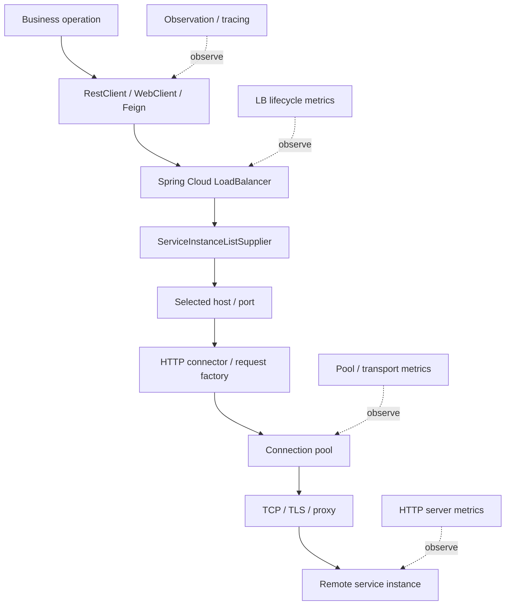
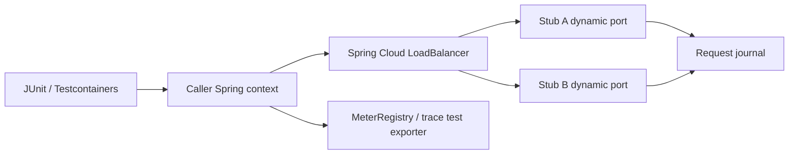

# Kiểm tra thay đổi HTTP transport và connection pool sau nâng cấp

Nâng cấp Spring Boot, Spring Framework, Spring Cloud hoặc một thư viện HTTP client có thể làm thay đổi cách ứng dụng mở socket, tái sử dụng kết nối, chọn proxy, thực hiện TLS, áp dụng timeout và đóng response body. Ứng dụng vẫn có thể khởi động thành công và endpoint vẫn trả HTTP 200, nhưng dưới tải xuất hiện **pool pending tăng, connection reset, p99 tăng, socket idle bị tái sử dụng sai thời điểm hoặc retry tạo nhiều request hơn trước**.

Với Spring Cloud LoadBalancer, việc kiểm tra phải phân biệt hai lớp: **LoadBalancer chọn ServiceInstance nào** và **HTTP transport sử dụng connection nào để tới instance đó**. Nâng cấp transport không đồng nghĩa thuật toán chọn instance thay đổi; ngược lại, thay dependency hoặc auto-configuration có thể làm integration giữa hai lớp biến mất hoặc được cấu hình khác.

Bài thuộc chương **Tương thích và nâng cấp** của module **Spring Cloud Service Communication Load Balancing**. Mục tiêu là xây dựng quy trình kiểm tra có thể lặp lại để so sánh HTTP transport và connection pool **trước/sau nâng cấp**, áp dụng cho RestClient, WebClient, RestTemplate và Spring Cloud OpenFeign. Nội dung tập trung vào nhận diện transport thực tế, dependency/BOM, pool lifecycle, timeout, TLS/proxy, HTTP/2, retry, observability, integration tests và canary rollout.

## 1. Mục tiêu và nguyên tắc kiểm tra

Sau bài học, bạn cần trả lời được:

1. Client đang chạy transport nào: Reactor Netty, Apache HttpClient 5, JDK HttpClient, Jetty, OkHttp hay request factory khác?
2. Transport được chọn do dependency nào, auto-configuration nào hay do code tự cấu hình?
3. Pool giới hạn số connection, pending acquire, idle time và lifetime ra sao?
4. Connect timeout, pool-acquire timeout, response/read timeout và total deadline có còn cùng semantics sau nâng cấp không?
5. HTTP keep-alive, stale connection validation, eviction và graceful close có thay đổi không?
6. TLS, truststore, hostname verification, proxy, redirect, compression và HTTP/2 có hoạt động giống trước không?
7. Spring Cloud LoadBalancer còn được tích hợp đúng với RestClient, WebClient và OpenFeign không?
8. Retry có làm tăng số HTTP attempts hoặc thay đổi request body replay semantics không?
9. Metrics/tracing có phản ánh đúng pool, HTTP exchange, instance được chọn và lỗi không?
10. Bộ test nào phải pass trước khi triển khai canary hoặc phát hành rộng?

**Nguyên tắc:** so sánh cùng workload, topology, server behavior và giới hạn tài nguyên. Không kết luận một transport tốt hơn chỉ vì một request đơn lẻ nhanh hơn vài mili giây.

## 2. Tách các lớp cần kiểm tra

Một HTTP request qua Spring Cloud LoadBalancer có nhiều lớp:



| Lớp | Trách nhiệm | Ví dụ thay đổi sau nâng cấp |
|---|---|---|
| Business client | Tạo request, decode response, mapping lỗi | Converter/codec hoặc default error handling thay đổi |
| Spring Cloud LoadBalancer | Chọn ServiceInstance, retry, hints, lifecycle | Supplier chain, retry integration, context/config đổi |
| HTTP transport | Gửi HTTP, xử lý protocol và socket | Reactor Netty/Apache/JDK/Jetty được chọn khác |
| Connection pool | Reuse, giới hạn, acquire, idle/lifetime, eviction | Pool default, max connections hoặc pending queue đổi |
| TLS/proxy | Handshake, certificate, proxy route | TLS provider/protocol, truststore, proxy authentication |
| Remote service | Xử lý request, status, keep-alive và shutdown | Server version hoặc idle timeout khác |
| Observability | Metrics, traces, logs | Meter name/tag, instrumentation hoặc exporter đổi |

Một sự cố có thể có nguyên nhân ở nhiều lớp. HTTP client timeout có thể xảy ra vì pool hết connection, TCP connect tới Pod mới mất quá lâu, TLS handshake bị chậm, server chưa gửi response headers, body bị ngắt giữa chừng hoặc total deadline của business operation đã hết.

Không sửa timeout duy nhất khi chưa biết request đang chờ ở giai đoạn nào.

## 3. Lập bản đồ phiên bản và dependency trước khi nâng cấp

Spring Boot, Spring Framework và Spring Cloud được phát hành theo các release train có quan hệ tương thích. Không nên tự chọn một phiên bản spring-cloud-commons, spring-webflux, reactor-netty hoặc httpclient5 riêng lẻ rồi ghép vào ứng dụng mà không kiểm tra BOM.

### 3.1. Dependency management cần được khóa theo release train

Với Maven, Spring Boot parent/BOM và Spring Cloud BOM nên quản lý phiên bản phù hợp:

```xml
<dependencyManagement>
    <dependencies>
        <dependency>
            <groupId>org.springframework.cloud</groupId>
            <artifactId>spring-cloud-dependencies</artifactId>
            <version>SPRING_CLOUD_VERSION_FROM_COMPATIBILITY_MATRIX</version>
            <type>pom</type>
            <scope>import</scope>
        </dependency>
    </dependencies>
</dependencyManagement>
```

Đây là đoạn trích minh họa; placeholder phiên bản phải được thay bằng **release train tương thích chính thức** với phiên bản Spring Boot đang dùng. Nếu Boot parent đã quản lý các dependency Spring Framework/Reactor, tránh override phiên bản con trừ khi có lý do tương thích được xác minh.

### 3.2. Những dependency cần ghi nhận trước/sau

| Nhóm | Artifact/nhóm cần kiểm tra | Vì sao quan trọng |
|---|---|---|
| Spring Boot | spring-boot, actuator, web, webflux, autoconfigure | Quyết định builder/configuration và observation |
| Spring Cloud | spring-cloud-commons, spring-cloud-loadbalancer, OpenFeign | Tích hợp chọn instance, retry và supplier |
| Spring Framework | spring-web, spring-webflux, spring-core | RestClient, WebClient, codecs và request factories |
| Reactor | reactor-core, reactor-netty-http, reactor-netty-core | Reactive transport, event loops và pool |
| Netty | netty-* | TCP, TLS, native transport và memory allocator |
| Apache | httpclient5, httpcore5 | Blocking client và pooling connection manager |
| Feign | feign-core, feign-micrometer, Spring Cloud OpenFeign | Feign transport/capability/retry |
| TLS/crypto | JSSE provider, Netty tcnative/BoringSSL nếu dùng | TLS handshake, cipher, ALPN |
| Metrics | Micrometer core/registry/tracing bridge | Pool/HTTP metrics và trace propagation |

Không chỉ xem phiên bản trực tiếp khai báo trong pom.xml/build.gradle; cần xem **resolved dependency graph** vì transport có thể được đưa vào qua starter khác.

### 3.3. Lưu lại dependency tree

Maven:

```bash
mvn dependency:tree -Dverbose > dependency-tree-before.txt
mvn help:effective-pom > effective-pom-before.xml
```

Gradle:

```bash
./gradlew dependencies --configuration runtimeClasspath
./gradlew dependencyInsight --dependency reactor-netty-http --configuration runtimeClasspath
./gradlew dependencyInsight --dependency httpclient5 --configuration runtimeClasspath
```

Sau nâng cấp, chạy lại với hậu tố after rồi so sánh:
- Phiên bản đã đổi.
- Artifact mới xuất hiện hoặc biến mất.
- Hai phiên bản cùng tồn tại do dependency conflict.
- Transport client bị thay bởi implementation khác.
- spring-cloud-loadbalancer hoặc integration client không còn trong runtime classpath.

Không dùng dependency tree để kết luận transport nào đang hoạt động trong runtime nếu ứng dụng có conditional auto-configuration hoặc tự tạo bean. Phải kiểm tra **bean/connector thực tế** và log khởi động.

## 4. Nhận diện HTTP transport thực tế

Tên API không xác định transport. RestClient là abstraction đồng bộ; WebClient là abstraction reactive; OpenFeign là declarative client. Transport bên dưới có thể khác giữa hai phiên bản dù code gọi không đổi.

### 4.1. Các lựa chọn thường gặp

| Client abstraction | Transport thường có thể dùng | Pool/connection owner |
|---|---|---|
| WebClient | Reactor Netty, Jetty reactive client, JDK connector hoặc connector khác | Phụ thuộc ClientHttpConnector |
| RestClient | JDK-based request factory, Apache HttpClient 5, Jetty hoặc request factory khác | Phụ thuộc ClientHttpRequestFactory |
| RestTemplate | JDK, Apache HttpClient hoặc request factory cấu hình | Phụ thuộc ClientHttpRequestFactory |
| OpenFeign | Apache HttpClient 5, OkHttp hoặc Feign client implementation | Phụ thuộc Feign Client |
| HTTP Interface | RestClientAdapter hoặc WebClientAdapter | Kế thừa transport của client nền |

**Không mặc định** một phiên bản Spring Boot luôn chọn một transport cụ thể chỉ vì dependency đang có trong classpath. Auto-configuration và thứ tự ưu tiên có thể thay đổi theo release; ứng dụng cũng có thể override bean.

### 4.2. Những mốc API dễ gây lỗi khi nâng cấp

| Thay đổi | Ảnh hưởng | Cách kiểm tra |
|---|---|---|
| Spring Framework 6.1 giới thiệu `RestClient` | Ứng dụng trên Framework cũ hơn không có API này; migration cần chọn thời điểm Boot/Framework hỗ trợ | Xác nhận Framework resolved version và compile target |
| Apache HttpClient 4 chuyển sang 5 | Package/API thay đổi, ví dụ `org.apache.http.*` sang `org.apache.hc.*`; cấu hình pool, timeout và TLS không thể copy nguyên xi | Kiểm tra import, dependency tree, request factory và pool manager |
| Reactor Netty được quản lý bởi BOM mới | Default pool, timeout hoặc metrics API có thể thay đổi giữa phiên bản | So sánh resolved Reactor/Netty versions và effective pool config |
| JDK baseline thay đổi | TLS defaults, cipher availability, DNS và socket behavior có thể khác | Chạy test trên đúng JDK production |
| Spring Cloud release train thay đổi | LoadBalancer filters, retry integration, property metadata và OpenFeign wiring có thể đổi | Dùng compatibility matrix và integration test service ID |

Không coi bảng này là danh sách đầy đủ mọi breaking changes. Đọc migration guide của đúng phiên bản nguồn/đích và xác minh các dependency thực tế trong runtime.

### 4.3. Kiểm tra runtime bean

Trong môi trường test hoặc diagnostics, kiểm tra bean được tạo:

```java
@Component
class HttpClientRuntimeInventory implements ApplicationRunner {

    private static final Logger log =
            LoggerFactory.getLogger(HttpClientRuntimeInventory.class);

    private final ApplicationContext context;

    HttpClientRuntimeInventory(ApplicationContext context) {
        this.context = context;
    }

    @Override
    public void run(ApplicationArguments args) {
        context.getBeansOfType(WebClient.class)
                .forEach((name, client) ->
                        log.info("WebClient bean: {}", name));

        context.getBeansOfType(RestClient.class)
                .forEach((name, client) ->
                        log.info("RestClient bean: {}", name));

        context.getBeansOfType(ClientHttpConnector.class)
                .forEach((name, connector) ->
                        log.info("WebClient connector {}: {}",
                                name, connector.getClass().getName()));

        context.getBeansOfType(ClientHttpRequestFactory.class)
                .forEach((name, factory) ->
                        log.info("Request factory {}: {}",
                                name, factory.getClass().getName()));
    }
}
```

Các import cần thiết gồm `org.slf4j.Logger`, `org.slf4j.LoggerFactory` và các kiểu Spring được dùng trong ví dụ. Đây là mẫu kiểm tra một số bean Spring; Feign Client có thể được tạo trong named child context và không nhất thiết xuất hiện như bean singleton trong root context. Không log toàn bộ object toString() nếu nó có thể chứa URL credentials hoặc cấu hình nhạy cảm.

### 4.4. Bật diagnostics có giới hạn

Có thể dùng Actuator conditions, beans, configprops trong môi trường dev/test để xem auto-configuration và property binding. Những endpoint này có thể tiết lộ topology hoặc cấu hình; **không expose không kiểm soát trong production**.

Khi kiểm tra:
1. Xác nhận classpath có transport nào.
2. Xem condition report/auto-configuration outcome.
3. Xem bean connector/request factory được inject vào client.
4. Xác nhận @LoadBalanced filter/interceptor có mặt trên client gọi service ID.
5. Thực hiện request test và xác minh instance nhận request.

## 5. LoadBalancer integration có thể thay đổi khi nâng cấp

Một ứng dụng có thể vẫn khởi tạo WebClient hoặc RestClient thành công nhưng không còn resolve service ID nếu builder không đi qua LoadBalancer.

### 5.1. RestClient

```java
@Configuration(proxyBeanMethods = false)
class InventoryClientConfiguration {

    @Bean
    @LoadBalanced
    RestClient.Builder loadBalancedRestClientBuilder() {
        return RestClient.builder();
    }

    @Bean
    RestClient inventoryClient(
            @LoadBalanced RestClient.Builder builder) {
        return builder
                .baseUrl("http://inventory-service")
                .build();
    }
}
```

Đây là cấu hình wiring khái niệm; production nên giữ các customizers/converters/observation do Spring Boot cung cấp, ví dụ dùng builder configurer tương ứng release. Sau nâng cấp, test phải chứng minh inventory-service được resolve thành endpoint stub, không bị coi là DNS hostname trực tiếp.

### 5.2. WebClient

```java
@Configuration(proxyBeanMethods = false)
class ReactiveInventoryClientConfiguration {

    @Bean
    @LoadBalanced
    WebClient.Builder loadBalancedWebClientBuilder() {
        return WebClient.builder();
    }

    @Bean
    WebClient inventoryWebClient(
            @LoadBalanced WebClient.Builder builder) {
        return builder
                .baseUrl("http://inventory-service")
                .build();
    }
}
```

Nếu thêm custom ClientHttpConnector, phải xác nhận nó vẫn được gắn vào builder @LoadBalanced. Một builder direct tới URL thật có thể tạo request thành công trong môi trường DNS nhưng **không chạy qua Spring Cloud LoadBalancer**.

### 5.3. OpenFeign

```java
@FeignClient(name = "inventory-service")
interface InventoryFeignClient {

    @GetMapping("/api/items/{id}")
    ItemReply getItem(@PathVariable("id") long id);
}
```

Xác minh:
- Spring Cloud OpenFeign và LoadBalancer starter còn ở runtime classpath.
- Feign client thực tế dùng FeignBlockingLoadBalancerClient khi cần service ID routing.
- HTTP transport dưới Feign là implementation nào.
- connectTimeout, readTimeout, retryer và Micrometer capability được bind đúng.
- Named client context không vô tình nhận cấu hình từ client khác.

Không kết luận @FeignClient(name=...) bảo đảm LoadBalancer đang hoạt động nếu auto-configuration/dependency đã bị thay đổi.

## 6. Connection pool: so sánh cấu hình và semantics

Pool là một phần của transport. Khi nâng cấp, các default có thể đổi về số connections, pending queue, idle/lifetime, eviction và validation.

| Khái niệm | Ý nghĩa | Hậu quả nếu thay đổi |
|---|---|---|
| Max connections | Số TCP connections tối đa trong pool hoặc route | Quá thấp gây chờ; quá cao làm tăng sockets và tải backend |
| Pending acquire | Số yêu cầu chờ connection rảnh | Queue lớn làm tăng latency và memory |
| Pending acquire timeout | Thời gian tối đa chờ lấy connection | Có thể báo lỗi trước khi request được gửi |
| Max idle time | Tuổi tối đa của connection khi idle | Quá dài dễ tái dùng socket đã bị peer/proxy đóng |
| Max lifetime | Tuổi tối đa connection kể cả khi được tái sử dụng | Giúp xoay socket, nhưng quá thấp tăng handshake |
| Background eviction | Chu kỳ dọn connections hết hạn/idle | Không cần đợi request tiếp theo mới dọn |
| Validate after inactivity | Kiểm tra connection sau khoảng idle | Có thể giảm stale reuse, tùy transport |
| Per-route limit | Giới hạn connections theo route/destination | Một service có thể bị nghẽn dù global pool còn dư |

**Không so sánh chỉ con số maxConnections.** Mỗi transport có thể định nghĩa pool key khác nhau: theo host/port, route, proxy hoặc connection provider. HTTP/2 multiplex nhiều streams trên một connection nên connection count không tương đương request concurrency.

### 6.1. Reactor Netty ConnectionProvider

Ví dụ cấu hình WebClient dùng Reactor Netty:

```java
ConnectionProvider provider = ConnectionProvider.builder("inventory-pool")
        .maxConnections(100)
        .pendingAcquireMaxCount(200)
        .pendingAcquireTimeout(Duration.ofSeconds(2))
        .maxIdleTime(Duration.ofSeconds(20))
        .maxLifeTime(Duration.ofMinutes(5))
        .evictInBackground(Duration.ofSeconds(30))
        .metrics(true)
        .build();

HttpClient httpClient = HttpClient.create(provider)
        .option(ChannelOption.CONNECT_TIMEOUT_MILLIS, 1000)
        .responseTimeout(Duration.ofSeconds(3));

WebClient.Builder builder = WebClient.builder()
        .clientConnector(new ReactorClientHttpConnector(httpClient));
```

Các giá trị là **ví dụ test**, không phải khuyến nghị production. Khi dùng trong Spring Cloud LoadBalancer, hãy gắn connector vào bean @LoadBalanced WebClient.Builder thực tế và xác minh filter LB vẫn có hiệu lực.

Lưu ý:
- metrics(true) trên ConnectionProvider bật pool metrics khi có Micrometer hỗ trợ; không mặc định bật mọi HTTP client metrics.
- responseTimeout là timeout ở semantics Reactor Netty; không phải tổng deadline cho toàn bộ chuỗi retries.
- pendingAcquireTimeout khác responseTimeout.
- Cần dispose provider do ứng dụng tự sở hữu khi context đóng; tránh tạo một pool mới cho từng request.

### 6.2. Apache HttpClient 5

Apache HttpClient 5 thường dùng PoolingHttpClientConnectionManager, nơi cấu hình có các giới hạn tổng/per-route, connection request timeout, connect timeout, response timeout và eviction idle/expired. API cụ thể phụ thuộc phiên bản 5.x; kiểm tra migration guide và Javadoc đúng phiên bản được BOM giải quyết.

Các khái niệm cần so sánh:

| Apache pool statistic | Ý nghĩa |
|---|---|
| leased | Connections đang được caller sử dụng |
| available | Connections idle có thể cấp |
| pending | Requests đang chờ cấp connection |
| max | Giới hạn pool |
| Per-route stats | Cùng số liệu theo route/destination |

Không giả định tất cả số liệu này tự động được xuất thành Micrometer meters; có thể cần instrumentation bổ sung.

### 6.3. OpenFeign pool

Feign có thể dùng Apache HttpClient 5 hoặc OkHttp khi dependency/cấu hình tương ứng hiện diện. Pool của chúng có lifecycle/configuration riêng với pool của WebClient. Nếu cùng một service ID được gọi qua Feign và WebClient, chúng có thể tạo **hai connection pools riêng**.

Sau nâng cấp, kiểm tra:
- Feign Client implementation.
- Apache/OkHttp pool limits.
- Feign timeout options.
- Retryer và LoadBalancer retry có bị chồng không.
- Pool lifecycle khi named client context bị đóng hoặc refresh.

## 7. Timeout: phải so sánh theo từng giai đoạn

| Timeout | Giai đoạn | Câu hỏi cần kiểm tra |
|---|---|---|
| Pool acquire | Chờ connection rảnh | Có pending queue và lỗi pool saturation không? |
| DNS resolution | Resolve hostname | Resolver/caching behavior có đổi không? |
| TCP connect | Thiết lập socket mới | Kết nối mới có hoàn tất trong ngân sách không? |
| TLS handshake | Thương lượng TLS | Cert/cipher/ALPN có khiến handshake chậm/lỗi không? |
| Response/read | Chờ headers/body theo semantics transport | Server chậm hay body stream bị ngắt? |
| Idle timeout | Khoảng không có dữ liệu trên connection/stream | Proxy/server có đóng socket không? |
| Total deadline | Logical operation và retries | Tổng thời gian có vượt SLO không? |

### 7.1. Ma trận trước/sau nâng cấp

| Thành phần | Before | After | Kiểm tra |
|---|---:|---:|---|
| Pool acquire timeout | Ghi giá trị thực | Ghi giá trị thực | Pool saturation test |
| Connect timeout | Ghi giá trị thực | Ghi giá trị thực | New connection tới delayed/blackhole target |
| TLS handshake | Ghi giá trị thực | Ghi giá trị thực | Certificate/protocol handshake |
| Response timeout | Ghi giá trị thực | Ghi giá trị thực | Delayed headers và delayed body |
| Total deadline | Ghi giá trị thực | Ghi giá trị thực | Retry + backoff end-to-end |
| Max idle | Ghi giá trị thực | Ghi giá trị thực | Idle stale connection test |
| Max lifetime | Ghi giá trị thực | Ghi giá trị thực | Connection rotation |
| Max pending | Ghi giá trị thực | Ghi giá trị thực | Burst concurrency/pool exhaustion |

Không để ô Before/After trống rồi tuyên bố tương thích. Những giá trị không còn cấu hình rõ sau nâng cấp cần được **đo hoặc đọc effective runtime configuration**.

### 7.2. Phân biệt response timeout với total deadline

Một server có thể gửi một chunk mỗi 100 ms trong 10 giây. Nếu response timeout chỉ giới hạn khoảng chờ dữ liệu giữa các chunks, stream vẫn có thể sống 10 giây. Total deadline 2 giây vẫn phải dừng logical operation sau 2 giây.

Khi so sánh, cần test:
- Headers chậm hơn response timeout.
- Body không gửi chunk trong khoảng dài hơn idle/read timeout.
- Body gửi đều nhưng tổng thời gian dài hơn total deadline.
- Retry/backoff làm tổng thời gian vượt deadline.
- Cancellation giải phóng pool/buffer sau timeout.

## 8. Keep-alive, stale sockets và eviction

Nâng cấp transport có thể thay đổi cách client xử lý connection đã idle, connection bị server/proxy đóng và việc tái sử dụng sau inactivity.

Một stale connection có thể xuất hiện khi:
1. Client đưa socket vào pool sau response.
2. Proxy/NAT/server đóng socket khi idle.
3. Client chưa nhận biết socket đã đóng.
4. Request kế tiếp mượn socket cũ.
5. Transport phát hiện EOF/reset khi ghi hoặc đọc.

### 8.1. Test idle connection reuse

Một test tích hợp nên:
1. Gửi request đầu qua một HTTP client/pool cụ thể.
2. Xác nhận request hoàn tất và connection có thể được reuse.
3. Để socket idle vượt server/proxy idle timeout hoặc chủ động đóng socket ở stub/proxy.
4. Gửi request thứ hai qua **cùng client/pool**.
5. Đo xem client mở connection mới, báo lỗi hay retry.
6. Gửi request thứ ba để xác nhận pool phục hồi.

Không assert bắt buộc phải có một Connection reset ở mọi OS. Server có thể gửi FIN sạch; race timing quyết định client phát hiện socket đóng lúc nào. Test nên xác minh **request tiếp theo phục hồi và pool không giữ lỗi vĩnh viễn**.

### 8.2. HTTP keep-alive và pool lifetime là hai khái niệm khác

- HTTP keep-alive cho phép connection được giữ lại để tái sử dụng.
- Pool idle eviction quyết định khi nào client bỏ một connection rảnh.
- Max lifetime giới hạn tuổi connection theo policy của client.
- Server/proxy idle timeout có thể ngắn hơn client max idle.
- TCP keepalive probes ở tầng OS không thay thế HTTP pool eviction.

Đặt client max idle **nhỏ hơn** idle timeout thấp nhất của các hop là chiến lược thường dùng, nhưng cần biết proxy/server thực tế. Đặt quá thấp sẽ tăng TCP/TLS handshakes và latency.

## 9. TLS, proxy và protocol negotiation

Một nâng cấp transport có thể làm thay đổi TLS provider, cipher suites, hostname verification, truststore, SNI, ALPN và proxy routing.

| Hạng mục | Regression cần test |
|---|---|
| Truststore/CA | Certificate chain được tin cậy như trước |
| Hostname verification | Không vô tình tắt kiểm tra hostname |
| SNI | Server virtual host trả certificate đúng |
| TLS protocol/cipher | Protocol/cipher được hỗ trợ ở cả client và server |
| Mutual TLS | Client certificate/key alias đúng |
| Proxy | HTTP CONNECT, proxy auth, no-proxy exclusions |
| Redirect | 301/302/307/308 và method/body preservation |
| Compression | Accept-Encoding, gzip/br và decode đúng |
| HTTP/2 | ALPN, multiplexing, GOAWAY và stream reset |
| DNS | Resolver, caching và refresh semantics |

**Không tắt certificate validation để làm test xanh.** Dùng test CA/certificate hợp lệ cho môi trường test. Nếu transport mới dùng TLS provider khác, kiểm tra cả native library và fallback JDK behavior.

### 9.1. HTTP/2 làm thay đổi cách diễn giải pool

HTTP/1.1 thường có quan hệ gần một request đang xử lý trên một connection nếu không pipelining; HTTP/2 multiplex nhiều streams trên một TCP connection. Vì vậy:
- active connections=10 không có nghĩa chỉ có 10 requests.
- Một TCP reset có thể ảnh hưởng nhiều streams.
- GOAWAY có thể cho phép streams đã được xử lý hoàn tất, nhưng streams chưa được chấp nhận cần xử lý lại theo semantics.
- Retry body/operation vẫn phải tuân thủ idempotency.

Sau nâng cấp, xác nhận protocol thực sự được negotiated (HTTP/1.1 hay HTTP/2), không chỉ dựa trên cấu hình client.

## 10. Retry và response body replay sau nâng cấp

Thay transport có thể đổi exception types và khả năng replay request body. Đây là một trong các rủi ro dễ bỏ sót nhất.

| Request/body | Rủi ro khi retry |
|---|---|
| GET không body | Thường replay được, nhưng response/data consistency vẫn phụ thuộc backend |
| POST JSON đã buffer | Có thể replay về mặt bytes; nghiệp vụ vẫn có thể không idempotent |
| Multipart từ file | Có thể phải mở lại file stream; file có thể bị thay đổi hoặc đóng |
| InputStream one-shot | Không thể mặc định replay |
| WebClient Flux<DataBuffer> | Publisher có thể hot/one-shot hoặc buffers đã release |
| Streaming upload | Retry sau khi server nhận một phần có thể tạo partial/duplicate data |

### 10.1. Retry policy phải được kiểm tra lại

Spring Cloud LoadBalancer có cấu hình same-instance/next-instance retry; Feign, Reactor retryWhen, gateway và service mesh có thể tạo retry ở tầng khác. Sau nâng cấp:
- Xác minh status codes được retry.
- Xác minh exception mapping.
- Đếm logical operations, attempts và server received requests.
- Xác minh retry context/previous instance được truyền.
- Đặt tổng deadline và retry budget.
- Chỉ retry POST khi server-side idempotency đã được kiểm chứng.

Không giả định cùng YAML sẽ điều khiển mọi client giống nhau; blocking RestTemplate, RestClient, reactive WebClient và Feign có integration khác nhau tùy release train.

## 11. Dependency/BOM upgrade checklist

Trước khi sửa cấu hình:
- Ghi lại Boot, Cloud release train, Framework, Reactor, Netty và transport versions.
- Lưu resolved dependency tree.
- Kiểm tra dependency convergence và duplicate classes.
- Ghi lại bean connector/request factory/client thực tế.
- Ghi lại effective properties và nguồn override (YAML, env vars, config server, command line).
- Xác định transport nào đang được chọn tự động và transport nào được cấu hình tường minh.
- Xác định có pool riêng cho Feign/WebClient/RestClient không.
- Ghi lại TLS/proxy/HTTP protocol.
- Chụp baseline metrics và latency trước nâng cấp.

### 11.1. Đừng nâng cấp quá nhiều biến cùng lúc

Nếu cùng lúc đổi Spring Boot major version, Spring Cloud release train, Reactor Netty, Apache HttpClient, TLS provider và service mesh sidecar, khi latency tăng hoặc retry sai rất khó biết thay đổi nào gây ra. Nếu có thể, tách migration thành các bước có kiểm chứng và lưu dependency lock/BOM mỗi bước.

### 11.2. Kiểm tra config properties đã đổi hoặc không còn được bind

Một property cũ có thể đổi namespace, đổi kiểu dữ liệu/đơn vị, bị deprecate/removed, không còn được auto-configuration tiêu thụ, chỉ có tác dụng với một transport hoặc bị override bởi env/config server.

Dùng metadata/configuration properties và startup diagnostics của phiên bản đích. Đừng giả định property không báo lỗi nghĩa là đã bind đúng. Kiểm tra **effective runtime config** và quan sát behavior thực tế.

## 12. Regression test architecture: hai instance và một caller

Tạo hai HTTP stub instances cùng service ID inventory-service, caller dùng @LoadBalanced WebClient.Builder hoặc RestClient.Builder.



Mục tiêu là chứng minh:
- Client đi qua LoadBalancer.
- Request có thể tới A hoặc B.
- Pool có reuse/eviction theo cấu hình.
- Khi một instance bị rút, caller chọn instance khác theo policy.
- Số attempts đúng retry budget.
- Timeout/exception được phân loại.
- Metrics/traces vẫn xuất hiện đúng.

### 12.1. Fixture WireMock với dynamic ports

```java
class InventoryTransportTestSupport {

    static final WireMockServer A =
            new WireMockServer(wireMockConfig().dynamicPort());
    static final WireMockServer B =
            new WireMockServer(wireMockConfig().dynamicPort());

    static {
        A.start();
        B.start();
    }

    @DynamicPropertySource
    static void registerInstances(DynamicPropertyRegistry registry) {
        registry.add(
            "spring.cloud.discovery.client.simple.instances.inventory-service[0].uri",
            A::baseUrl);
        registry.add(
            "spring.cloud.discovery.client.simple.instances.inventory-service[1].uri",
            B::baseUrl);
    }

    static void reset() {
        A.resetAll();
        B.resetAll();
    }
}
```

Đây là fixture minh họa; trong suite thực tế, lifecycle của static servers phải được quản lý bởi JUnit extension hoặc test class sở hữu và luôn dừng server sau khi suite kết thúc. Không để nhiều test classes chạy song song trên cùng static fixture và cùng reset journal.

Nếu project có Eureka/Consul hoặc discovery khác, xác nhận SimpleDiscoveryClient thực sự được chọn trong test. Hai stub endpoints phải có instance identity khác nhau và cùng service ID.

### 12.2. Test routing trước khi test pool

Bước đầu, stub A và B trả body có tên instance:

```java
A.stubFor(get(urlEqualTo("/api/items/42"))
        .willReturn(okJson("{\"instance\":\"A\"}")));

B.stubFor(get(urlEqualTo("/api/items/42"))
        .willReturn(okJson("{\"instance\":\"B\"}")));
```

Gửi nhiều requests qua cùng client và kiểm tra:
- Body instance thuộc A hoặc B.
- Request journal của A/B tăng.
- URL gọi là service ID, không phải host/port direct.
- Retry tắt ở baseline.
- Health probes hoặc test setup khác không dùng cùng path làm nhiễu journal.

Không assert round-robin bắt buộc bắt đầu ở A; test routing chỉ cần chứng minh đúng endpoint candidates và client integration.

## 13. Test matrix cho HTTP transport

| Test | Setup | Kết quả cần xác minh |
|---|---|---|
| Happy path | A/B trả 200 | Body đúng, routing đúng |
| Connection reuse | Gửi nhiều request liên tiếp | Pool reuse được, không mở connection mới không cần thiết |
| Pool saturation | Giới hạn connections thấp, burst concurrency | Pending acquire/timeout đúng, không queue vô hạn |
| Connect timeout | New connection tới endpoint không phản hồi ở TCP phase | Connect timeout được phân biệt với read timeout |
| Slow headers | Stub delay trước headers | Response timeout/total deadline đúng |
| Slow body | Headers nhanh, chunks chậm | Idle/read timeout khác total deadline |
| Stale idle socket | Server/proxy đóng socket sau idle | Client phục hồi/evict theo policy |
| Connection reset | Reset/EOF trước hoặc giữa response | Transport error, pool không kẹt |
| HTTP 503 | Response status hợp lệ | Status mapping và retry policy |
| No instance | Supplier trả empty list | Không có backend request |
| TLS invalid cert | Test CA/certificate không hợp lệ | Handshake fail đúng, không bypass verification |
| TLS valid cert | Test CA hợp lệ | Handshake thành công, hostname verify |
| Proxy | HTTP CONNECT hoặc proxy route | Proxy routing/auth đúng |
| HTTP/2 | Server hỗ trợ ALPN | Protocol được negotiate đúng, streams phục hồi |
| Cancellation | Hủy reactive body giữa chừng | DataBuffer/connection cleanup |
| Graceful server close | Server đóng listener/pool | In-flight requests có behavior xác định |
| Retry | Một instance lỗi, một instance khỏe | Attempts/instance đúng policy |
| Metrics | Pool/HTTP instrumentation bật | Meter tồn tại, cardinality có kiểm soát |

## 14. Kiểm tra connection reuse

Với HTTP/1.1, WireMock hoặc stub server có thể ghi connection identity (nếu test harness expose được remote port/connection metadata) hoặc đếm số lần TCP accept. Nếu không có thông tin socket, chỉ dựa vào request journal **không chứng minh connection đã được reuse**: journal đếm HTTP requests, không đếm TCP connections.

Một test transport phù hợp cần:
1. Dùng cùng client instance và cùng pool.
2. Gửi nhiều request tới cùng backend/route.
3. Quan sát pool active/idle và server accepted connections.
4. Xác nhận nhiều requests có thể dùng cùng connection khi keep-alive được bật.
5. Để connection idle rồi đóng ở server/proxy.
6. Gửi request tiếp theo và kiểm tra pool/transport xử lý stale connection.

### 14.1. Đừng dùng một stub mới cho từng request

Nếu mỗi request test tạo một WebClient/RestClient mới, bạn đang test nhiều pools khác nhau. Kết quả không nói được pool của ứng dụng reuse hay cleanup đúng. Hãy inject **cùng singleton client bean** mà application sử dụng.

### 14.2. Server keep-alive cũng là một biến

Nếu test server đóng connection sau mỗi response, client không thể reuse. Nếu test server có idle timeout dài hơn client, test có thể không bao giờ gặp stale connection. Ghi rõ:
- Server HTTP version.
- Connection headers nếu HTTP/1.1.
- Server keep-alive timeout.
- Proxy/NAT idle timeout nếu có.
- Client maxIdleTime/maxLifeTime.
- Connection count và request count.

## 15. Kiểm tra pool saturation và pending acquire

Đặt pool max connections thấp (ví dụ 2) và server delay 1 giây, gửi concurrency 10. Mục tiêu là thấy requests vượt pool phải chờ hoặc bị từ chối theo giới hạn, chứ không tạo 10 sockets vô hạn.

Với Reactor Netty, cấu hình test minh họa:

```java
ConnectionProvider provider = ConnectionProvider.builder("small-test-pool")
        .maxConnections(2)
        .pendingAcquireMaxCount(4)
        .pendingAcquireTimeout(Duration.ofMillis(300))
        .metrics(true)
        .build();
```

Kết quả cần đo:
- Tối đa bao nhiêu connections active.
- Pending acquire cao nhất.
- Số requests timeout khi queue đầy hoặc chờ quá lâu.
- Pool có trở về baseline sau khi requests kết thúc.
- Request tiếp theo có hoạt động bình thường không.

**Không chỉ assert có exception.** Pool saturation test cần chứng minh giới hạn được áp dụng và tài nguyên được giải phóng. Nếu transport có HTTP/2 multiplexing, concurrency streams có thể lớn hơn connection count; test phải tính protocol.

## 16. Test timeout đúng tầng

### 16.1. Connect timeout

WireMock fixedDelay chỉ làm chậm HTTP response sau khi TCP connection đã được thiết lập. Nó **không** mô phỏng TCP connect timeout. Muốn test connect timeout:
- Dùng proxy/network fault injection để DROP SYN hoặc trì hoãn TCP handshake.
- Đảm bảo transport cần tạo connection mới, không reuse pool.
- Tách DNS và pool acquire khỏi connect phase.
- Dùng môi trường OS/container được kiểm soát; IP không route có thể trả Network unreachable ngay, không nhất thiết chờ timeout.

### 16.2. Pool acquire timeout

Giữ hai connections đang được dùng bởi response chậm, sau đó gửi request thứ ba khi max pool=2. Xác minh lỗi xảy ra khi chờ pool chứ chưa phải server read timeout. Đặt pending queue giới hạn để tránh memory tăng không kiểm soát.

### 16.3. Response timeout và total deadline

Cho stub gửi headers chậm hơn response timeout; sau đó thử body gửi từng chunk đều nhưng tổng thời gian vượt deadline. Với reactive pipeline, operator timeout đặt sau retry có thể giới hạn toàn chuỗi; transport responseTimeout có semantics riêng. Đo và phân loại hai lỗi.

## 17. Test retry và LoadBalancer sau nâng cấp

Cấu hình retry cần được kiểm chứng trong context release train đích:

```yaml
spring:
  cloud:
    loadbalancer:
      retry:
        enabled: true
        max-retries-on-same-service-instance: 0
        max-retries-on-next-service-instance: 1
        retry-on-all-operations: false
        retry-on-all-exceptions: false
        retryable-status-codes:
          - 503
```

Test:
1. A trả 503, B trả 200; cố định hoặc quan sát initial selection.
2. Đếm requests ở cả A/B.
3. Xác minh next-instance retry thực sự có retry-aware supplier/context phù hợp.
4. Đổi B thành 503 và kiểm tra attempt budget.
5. Đổi status thành 404 và xác nhận không retry nếu policy chỉ cho 503.
6. Tắt retry và xác nhận một logical GET chỉ tạo một attempt.
7. Chạy lại cùng test với transport trước và sau upgrade.

Nếu retry integration thay đổi, cần biết lỗi nằm ở Spring Cloud LoadBalancer retry filter/interceptor, HTTP transport exception mapping, application-level Reactor retry, Feign Retryer hay gateway/service mesh.

Không dùng một response cuối 200 làm bằng chứng retry đúng; cần attempt count và selected instance evidence.

## 18. Test response body, cancellation và resource cleanup

Một số transport/framework version thay đổi cách response body được consume/release. Test cần bao gồm:
- WebClient bodyToMono với body nhỏ.
- Flux<DataBuffer> streaming tới file với body lớn.
- Cancellation trước khi body hoàn tất.
- HTTP status lỗi có body lớn.
- Decode error/malformed JSON.
- Retry sau khi body đã được consume một phần.
- Connection pool trở về baseline sau completion/error/cancel.

Với pooled DataBuffer, tuân thủ ownership/release contract của overload DataBufferUtils sử dụng. Không tự release buffer đang được downstream đọc; không giữ buffers trong collection vô hạn. Nếu transport đổi allocator/pooling behavior, theo dõi direct memory và leak detection trong test/staging.

## 19. Metrics và tracing trước/sau

Cần so sánh ít nhất bốn nhóm:

| Nhóm | Metrics ví dụ | Ý nghĩa |
|---|---|---|
| HTTP client | http.client.requests count, duration, status/outcome | Thời gian exchange và lỗi |
| LoadBalancer | loadbalancer.requests.active/success/failed/discard | Chọn instance và lifecycle |
| Reactor Netty pool | active/idle/pending/total connections, pending acquire time | Pool pressure |
| Backend | server requests, p95/p99, 5xx, active requests | Tác động tới service đích |

**loadbalancer.requests.success không đồng nghĩa HTTP 2xx.** Nó có thể phản ánh response đã được chuyển xuống client; một HTTP 503 vẫn có thể được tính ở nhánh response lifecycle. Dùng status/outcome từ HTTP client và server để tính error rate.

### 19.1. So sánh cardinality và naming

Sau nâng cấp, meter name hoặc tag keys có thể thay đổi do Micrometer/Spring version. Ghi lại:
- Meter names.
- Tag keys và giá trị có cardinality thấp.
- Histogram/SLO buckets.
- Timer count và total/max.
- Exported Prometheus names.
- Trace propagation và sampling.

Không gắn raw URL có ID, trace ID, Pod UID hoặc token thành metric tags. Một thay đổi naming có thể làm dashboard/alert cũ mất dữ liệu dù ứng dụng vẫn tạo metrics với tên mới.

### 19.2. Pool metrics không tự xuất hiện chỉ vì bật HTTP observation

Với Reactor Netty, ConnectionProvider.metrics(true) liên quan pool metrics; HTTP client response metrics có thể cần instrumentation riêng theo transport/version. Với Apache HttpClient 5, pool stats có thể cần binder/custom instrumentation. Không suy từ http.client.requests rằng mọi thông tin pending/idle/leased đều đã có.

## 20. Before/after benchmark protocol

Không so sánh hai phiên bản bằng một lần gọi thủ công. Tạo một protocol lặp lại:

1. Dùng cùng machine/container limits, JDK, CPU quota, memory, TLS và network path.
2. Cùng hai backend instances và cùng response mix.
3. Warm up ứng dụng, connection pool và JIT trước khi đo.
4. Chạy concurrency và request rate cố định.
5. Đo đủ lâu để thấy pool/GC/connection churn.
6. Chạy lặp lại nhiều lần và lưu phân phối, không chỉ average.
7. Ghi error rate, timeout types, retry attempts và pool pending.
8. Đo p50/p95/p99, throughput, CPU, heap/direct memory và số sockets.
9. Thử cả HTTP/1.1 và HTTP/2 nếu production sử dụng.
10. So sánh cùng một transport trước/sau; nếu transport đổi, ghi rõ đây là migration kép.

### 20.1. Bảng kết quả

| Chỉ số | Before | After | Chênh lệch | Ngưỡng chấp nhận |
|---|---:|---:|---:|---:|
| Throughput req/s | Đo | Đo | Tính | SLO/load target |
| p50 latency | Đo | Đo | Tính | Theo workload |
| p95 latency | Đo | Đo | Tính | Theo SLO |
| p99 latency | Đo | Đo | Tính | Theo SLO |
| HTTP 5xx rate | Đo | Đo | Tính | Error budget |
| Transport timeout rate | Đo | Đo | Tính | Không tăng ngoài ngưỡng |
| Retry attempts/logical request | Đo | Đo | Tính | Retry budget |
| Pool pending max | Đo | Đo | Tính | Không tăng không kiểm soát |
| Active/idle connections | Đo | Đo | Tính | Phù hợp pool limit |
| Direct memory | Đo | Đo | Tính | Không leak/tăng bất thường |
| CPU per request | Đo | Đo | Tính | Capacity budget |
| TLS handshake rate | Đo | Đo | Tính | Không churn ngoài dự kiến |

Không điền số liệu minh họa thành kết quả thật. Xác định ngưỡng chấp nhận **trước khi chạy**; nếu đặt ngưỡng sau khi nhìn kết quả, rất dễ hợp thức hóa regression.

## 21. Canary và rollback

Sau khi integration/regression tests pass:
1. Deploy transport/version mới cho một phần nhỏ traffic hoặc một nhóm instances.
2. Theo dõi client pool, timeout, reset, TLS errors, HTTP status và p99.
3. So sánh cùng service ID và cùng backend capacity với phiên bản cũ.
4. Tăng tỷ lệ khi metrics ổn định qua một khoảng quan sát đủ dài.
5. Rollback khi error budget/latency/pool pressure vượt ngưỡng đã định.

Canary cần bảo đảm old/new client có thể tương tác với cùng backend API. Nếu nâng cấp làm thay đổi wire protocol, TLS cipher hoặc HTTP/2 negotiation, kiểm tra khả năng tương thích giữa hai phía trước khi tăng traffic.

Rollback code không tự rollback database schema, certificate/truststore, proxy config, service discovery metadata, API version/cursor format hoặc idempotency record format. Các thay đổi này cần kế hoạch tương thích và rollback riêng.

## 22. Bảng chẩn đoán regression sau nâng cấp

| Triệu chứng | Nguyên nhân cần kiểm tra | Hướng xử lý |
|---|---|---|
| App chạy nhưng service ID không resolve | Mất @LoadBalanced builder/filter hoặc LoadBalancer dependency | Kiểm tra bean và request đi tới stub instance |
| WebClient chậm, pending tăng | Pool max thấp, pending acquire timeout/queue đổi | Xem pool metrics và concurrency |
| Nhiều connection mới hơn trước | Keep-alive/idle eviction/max lifetime đổi hoặc client mới được tạo liên tục | Kiểm tra pool lifecycle và singleton client |
| Connection reset sau idle | Peer/proxy idle timeout ngắn hơn client max idle | Căn chỉnh idle eviction và kiểm thử stale socket |
| TLS handshake lỗi sau upgrade | Truststore, SNI, TLS provider/cipher/ALPN đổi | Kiểm tra handshake với test certificate |
| HTTP/2 bị downgrade | ALPN/proxy/server/client negotiation | Xác minh protocol thực tế ở cả hai hop |
| HTTP 503 tăng nhưng LB success vẫn cao | LB success là response lifecycle, không phải HTTP 2xx | Dùng HTTP client/server status |
| Retry count tăng gấp đôi | Retry ở nhiều tầng hoặc exception classification đổi | Tắt từng layer, đếm backend attempts |
| Upload retry tạo file trùng | Body replay/idempotency thay đổi | Upload ID, checksum, server-side dedup |
| Metrics biến mất | Observation/registry/customizer không còn gắn vào builder | Kiểm tra builder configurer và meter registry |
| Pool active không về 0 sau cancel | Response body chưa consume/release hoặc transport bug/config | Test cancellation, inspect DataBuffer/connection lifecycle |
| Direct memory tăng | Pooled buffers/leak hoặc concurrency tăng | Heap/direct memory profiling và leak detection |
| Feign khác hành vi WebClient | Named context/transport/retryer riêng | Kiểm tra Feign Client bean và options |
| p99 tăng dù average ổn | Tail latency do pool pending, TLS churn hoặc retry | Xem histogram/p99 và attempts, không chỉ average |

## 23. Quy trình nâng cấp đề xuất

### Giai đoạn A — Baseline

- Chụp dependency tree, effective config và runtime transport.
- Lưu pool limits/timeouts, TLS/proxy/protocol.
- Chạy regression test và benchmark hiện tại.
- Lưu metrics/traces, request journals và error classifications.

### Giai đoạn B — Nâng cấp dependencies

- Chọn Spring Boot/Spring Cloud versions theo compatibility matrix.
- Dùng BOM, không override dependency con tùy tiện.
- Kiểm tra dependency convergence.
- Build và kiểm tra bean/transport thực tế.
- Rà soát property namespace, units và defaults.

### Giai đoạn C — Functional regression

- LoadBalancer routing tới đúng service ID.
- Connection reuse, pool saturation và stale idle connection.
- Connect/response/total timeout.
- TLS/proxy/redirect/compression/HTTP2.
- Retry same/next, request body replay và idempotency.
- Cancellation, error body và cleanup.
- Observation/metrics/tracing.

### Giai đoạn D — Performance và deployment

- Chạy benchmark cùng topology/workload.
- So sánh p95/p99, pool pressure, retry amplification và memory.
- Canary với rollback threshold định trước.
- Chỉ phát hành rộng khi regression được giải thích và ngưỡng SLO đạt.

## 24. Checklist nghiệm thu

- [ ] Có compatibility matrix Spring Boot/Spring Cloud release train.
- [ ] Có dependency tree before/after và không có version conflict ngoài chủ đích.
- [ ] Xác định transport/request factory/connector thực tế ở runtime.
- [ ] Xác nhận Spring Cloud LoadBalancer integration còn hoạt động với client service ID.
- [ ] Ghi rõ pool owner, max connections, per-route, pending acquire và eviction.
- [ ] So sánh connect, pool acquire, response/read và total deadline riêng biệt.
- [ ] Có test keep-alive reuse và stale idle socket.
- [ ] Có test pool saturation và cleanup sau error/cancel.
- [ ] TLS trust, hostname verification, SNI, proxy và ALPN đã được kiểm tra.
- [ ] HTTP/1.1/HTTP/2 protocol được xác minh theo thực tế.
- [ ] Retry attempts và retryable exceptions/status codes được đo.
- [ ] Request body streaming chỉ retry khi replay/idempotency đã an toàn.
- [ ] Metrics HTTP, LB, transport pool và backend không bị nhầm lẫn.
- [ ] Dashboard/alert được cập nhật nếu meter name/tag/histogram thay đổi.
- [ ] Có before/after benchmark cùng workload và ngưỡng acceptance.
- [ ] Canary/rollback bao gồm cả dependency, config, certificate và schema liên quan.
- [ ] Không dùng số liệu minh họa như kết quả đo thật.

**Kết luận:** nâng cấp HTTP stack là một thay đổi ở **transport và vòng đời kết nối**, có thể tác động tới latency, resource usage, lỗi socket và retry ngay cả khi API Java không đổi. Hãy bắt đầu bằng việc nhận diện transport thực tế, khóa dependency theo BOM tương thích, đo pool/timeouts trước và sau, rồi chạy cùng một regression suite cho LoadBalancer, keep-alive, stale connection, TLS, retries, body streaming và cancellation. Chỉ khi **đường chọn ServiceInstance, HTTP exchange, pool lifecycle và business outcome** đều được chứng minh tương thích mới nên phát hành rộng.

## Tài liệu tham khảo

- [Spring Boot — HTTP Clients](https://docs.spring.io/spring-boot/reference/io/rest-client.html): auto-configuration và builder cho REST clients.
- [Spring Framework — REST Clients](https://docs.spring.io/spring-framework/reference/integration/rest-clients.html): RestClient, RestTemplate, request factories và HTTP interfaces.
- [Spring Framework — WebClient](https://docs.spring.io/spring-framework/reference/web/webflux-webclient.html): connector, exchange và reactive client lifecycle.
- [Spring Cloud Commons — Spring Cloud LoadBalancer](https://docs.spring.io/spring-cloud-commons/reference/spring-cloud-commons/loadbalancer.html): chọn ServiceInstance, cache, retry, health supplier và metrics.
- [Spring Cloud Commons — Configuration Properties](https://docs.spring.io/spring-cloud-commons/reference/configprops.html): LoadBalancer configuration properties.
- [Spring Cloud OpenFeign — Reference](https://docs.spring.io/spring-cloud-openfeign/reference/): Feign client configuration, transport và retry.
- [Reactor Netty — HTTP Client](https://projectreactor.io/docs/netty/release/reference/http-client.html): connection pool, timeout, HTTP metrics và TLS.
- [Apache HttpClient 5 — Migration Guide](https://hc.apache.org/httpcomponents-client-5.5.x/migration-guide/index.html): thay đổi API/behavior giữa các thế hệ HttpClient.
- [Micrometer — Observation](https://docs.micrometer.io/micrometer/reference/observation.html): Observation registry, handlers, metrics và tracing.
