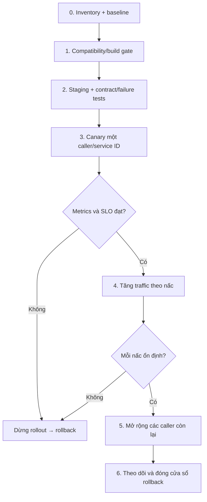
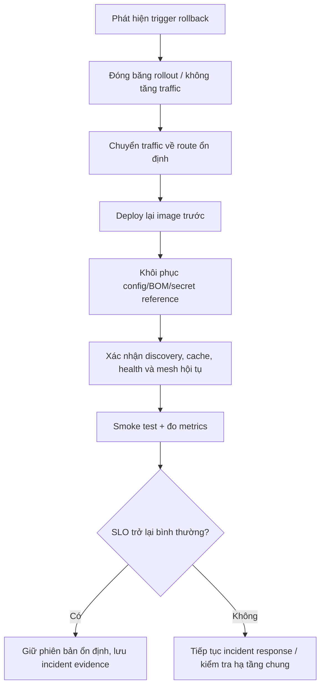

# Kế hoạch chuyển đổi từng phần và tiêu chí quay lại cấu hình trước

## 1. Mục tiêu

Nâng cấp Spring Boot, Spring Cloud hoặc thay đổi chính sách Spring Cloud LoadBalancer có thể ảnh hưởng đến discovery, danh sách `ServiceInstance`, thuật toán chọn đích, cache, health check, retry, timeout, HTTP client và metrics. Nếu thay tất cả cùng lúc, khi lỗi xuất hiện sẽ rất khó biết thay đổi nào gây ra sự cố.

Bài thuộc chương **Tương thích và nâng cấp** của module `SPRING_CLOUD_SERVICE_COMMUNICATION_LOAD_BALANCING`. Module tập trung vào cân bằng tải phía client theo service ID, discovery, health check, định tuyến, tích hợp `RestClient`/`WebClient`/OpenFeign, timeout/retry và quan sát lỗi. Mục tiêu là lập kế hoạch nâng cấp **theo từng service ID**, có baseline, canary, điều kiện dừng, cách rollback và bằng chứng xác nhận hệ thống đã ổn định.

Sau bài này, bạn có thể:

1. Lập ma trận tương thích giữa Java, Spring Boot, Spring Cloud release train và các starter liên quan.
2. Ghi lại cấu hình và hành vi hiện tại trước khi nâng cấp.
3. Triển khai một thay đổi cho một nhóm caller hoặc một service ID trước, sau đó tăng dần traffic.
4. Đặt ngưỡng dừng dựa trên error rate, latency, no-instance, retry, saturation và SLO.
5. Quay về image, dependency, route và cấu hình trước mà không làm hỏng dữ liệu hoặc các consumer còn lại.
6. Xác nhận rollback thực sự có hiệu lực sau khi discovery, cache, gateway và mesh hội tụ.

**Nguyên tắc:** Nâng cấp theo từng bước có thể quan sát và đảo ngược. Mỗi giai đoạn chỉ nên thay đổi một nhóm yếu tố có liên quan; không đồng thời đổi BOM, discovery provider, thuật toán chọn đích, retry và timeout nếu chưa có lý do và bằng chứng kiểm thử riêng.

## 2. Phạm vi nâng cấp: dependency và hành vi

Một lần nâng cấp có thể gồm nhiều loại thay đổi:

| Loại thay đổi | Ví dụ | Rủi ro chính |
| --- | --- | --- |
| Runtime/framework | Java, Spring Boot, Spring Framework | Bytecode, API, auto-configuration, Actuator |
| Spring Cloud release train | Spring Cloud BOM, Spring Cloud Commons | API, property, default behavior và compatibility |
| Client integration | OpenFeign, WebClient, RestClient | Interceptor, transport, observation, timeout |
| Discovery | Eureka, Consul, Kubernetes discovery | Instance metadata, refresh, health status |
| LoadBalancer policy | Round Robin, Random, custom supplier/algorithm | Phân phối traffic, failover, sticky/zone behavior |
| Resilience | Retry, timeout, circuit breaker | Số attempts, deadline, tải nhân lên |
| Observability | Micrometer, tracing, Prometheus | Tên meter, tags, cardinality, dashboard |
| Deployment/platform | Container image, Kubernetes, gateway, mesh | Readiness, endpoint propagation, routing |

Không coi một lần build thành công là bằng chứng tương thích đầy đủ. Ứng dụng có thể compile được nhưng khi chạy lại dùng default supplier khác, không còn tìm thấy instance, hoặc có retry khiến số request downstream tăng.

### 2.1. Ma trận tương thích

Ghi phiên bản **thực tế** của từng thành phần trước khi nâng cấp:

| Thành phần | Hiện tại | Mục tiêu | Bằng chứng cần có |
| --- | --- | --- | --- |
| JDK | Version hiện tại | Phiên bản được release train hỗ trợ | Build toolchain, container runtime |
| Spring Boot | Version hiện tại | Version được Spring Cloud train hỗ trợ | Compatibility matrix chính thức |
| Spring Cloud release train | BOM hiện tại | BOM tương thích với Boot mục tiêu | Release notes và compatibility table |
| Spring Cloud Commons/LoadBalancer | Version được BOM quản lý | Version đi cùng release train | Dependency tree |
| Spring Cloud OpenFeign/Gateway | Version hiện tại | Version thuộc cùng train | Starter và API tương thích |
| Discovery provider | Eureka/Consul/Kubernetes/... | Giữ nguyên hoặc có kế hoạch đổi riêng | Client/server protocol, metadata |
| HTTP transport | JDK/Apache HC5/Reactor Netty/... | Version tương thích | TLS, connection pool, timeout behavior |
| Micrometer/tracing | Version hiện tại | Version theo Boot BOM | Meter names, observation, exporter |
| Kubernetes/mesh | Version đang chạy | Phiên bản controller/data plane mục tiêu | API support, CRD, policy |

**Không tự ghép phiên bản Spring Boot và Spring Cloud theo số lớn nhất.** Spring Cloud phát hành release train có ma trận tương thích riêng. Chọn một train hỗ trợ đúng dòng Spring Boot mục tiêu, để BOM quản lý các module Spring Cloud cùng một bộ phiên bản. Nếu đang ở dòng đã hết hỗ trợ, kế hoạch có thể cần qua một hoặc nhiều mốc trung gian theo hướng dẫn chính thức.

### 2.2. Dùng BOM làm nguồn quản lý phiên bản

Ví dụ cấu trúc Maven:

```xml
<properties>
    <java.version>17</java.version>
    <spring-boot.version>BOOT_VERSION_COMPATIBLE_WITH_TARGET_TRAIN</spring-boot.version>
    <spring-cloud.version>COMPATIBLE_SPRING_CLOUD_TRAIN</spring-cloud.version>
</properties>

<dependencyManagement>
    <dependencies>
        <dependency>
            <groupId>org.springframework.boot</groupId>
            <artifactId>spring-boot-dependencies</artifactId>
            <version>${spring-boot.version}</version>
            <type>pom</type>
            <scope>import</scope>
        </dependency>
        <dependency>
            <groupId>org.springframework.cloud</groupId>
            <artifactId>spring-cloud-dependencies</artifactId>
            <version>${spring-cloud.version}</version>
            <type>pom</type>
            <scope>import</scope>
        </dependency>
    </dependencies>
</dependencyManagement>
```

Hai chuỗi `BOOT_VERSION_COMPATIBLE_WITH_TARGET_TRAIN` và `COMPATIBLE_SPRING_CLOUD_TRAIN` là **placeholder**, phải thay bằng version đã xác nhận trong compatibility matrix của dự án; không phải version Maven hợp lệ để copy chạy nguyên trạng.

Không khai báo version riêng cho từng starter Spring Cloud nếu BOM đã quản lý:

```xml
<dependency>
    <groupId>org.springframework.cloud</groupId>
    <artifactId>spring-cloud-starter-loadbalancer</artifactId>
</dependency>
<dependency>
    <groupId>org.springframework.cloud</groupId>
    <artifactId>spring-cloud-starter-openfeign</artifactId>
</dependency>
```

Trộn `spring-cloud-starter-loadbalancer` từ train A với `spring-cloud-starter-openfeign` từ train B có thể tạo dependency graph compile được nhưng không nằm trong tổ hợp đã được Spring Cloud kiểm thử. Hãy giữ một release train nhất quán.

## 3. Ghi baseline trước khi nâng cấp

Trước khi thay đổi, thu thập dữ liệu của **phiên bản đang chạy** trong một khoảng thời gian đại diện cho traffic bình thường và peak. Baseline là cơ sở phân biệt hồi quy do nâng cấp với biến động sẵn có.

### 3.1. Inventory theo service ID

| Nội dung cần ghi | Ví dụ | Vì sao quan trọng |
| --- | --- | --- |
| Service ID đích | `stock-service`, `payment-service` | Xác định đơn vị rollout và rollback |
| Caller | `order-service`, `checkout-service` | Biết service nào cần nâng cấp trước |
| HTTP client | RestClient, WebClient, OpenFeign | Mỗi tích hợp có lifecycle/timeout khác nhau |
| Discovery | Eureka, Consul, Kubernetes, static | Xác định nguồn instance và độ trễ cập nhật |
| Supplier chain | Discovery → cache → zone → health | Phát hiện thay đổi thứ tự hoặc filter |
| LoadBalancer policy | Round Robin, Random, custom | Baseline phân phối và failover |
| Timeout | connect/read/response timeout | Độ trễ và số lần request có thể chờ |
| Retry | Feign, LoadBalancer, gateway, mesh | Tổng số attempts có thể nhân lên |
| Sticky/zone/metadata | Cookie, hint, zone, weight | Hành vi lựa chọn đích theo ngữ cảnh |
| Metrics/tracing | Meter names, tags, trace propagation | Dashboard và cảnh báo sau nâng cấp |
| Gateway/mesh | Route, mTLS, retry, canary | Các tầng có thể chọn đích độc lập |

Lưu cấu hình đã render từ Helm/Kustomize hoặc cấu hình deployment thực tế, không chỉ lưu template trong repository. Ghi cả feature flags, environment variables và cấu hình runtime có thể ghi đè YAML.

### 3.2. Baseline số liệu

Với mỗi service ID quan trọng, đo:

- Logical calls/giây và HTTP attempts/giây.
- Tỉ lệ thành công cuối cùng và tỉ lệ HTTP 4xx/5xx.
- p50/p95/p99 latency của logical call và HTTP attempt nếu có.
- Số lần `No instances available`, lỗi discovery, lỗi kết nối, connect/read timeout.
- Retry accepted/attempts ở từng tầng; không gộp tất cả thành một con số không rõ nguồn.
- Phân phối request theo instance/zone và thời gian failover khi một instance mất.
- CPU, memory, thread/connection pool, event-loop saturation và queueing.
- Tình trạng cache/supplier, số instance khả dụng, readiness và health-check probe.

Meter `loadbalancer.requests.success` không phải HTTP 2xx counter: một response 503 có thể vẫn là response được chuyển về client. Vì vậy cần metric outcome của HTTP/logical call riêng.

### 3.3. Lưu snapshot có thể khôi phục

Trước khi deploy, giữ lại:

1. Image tag/digest hiện tại và manifest đã deploy.
2. Dependency lock/version hoặc output dependency tree.
3. ConfigMap/Secret reference và cấu hình route/discovery/mesh hiện tại.
4. Phiên bản Helm chart/Kustomize overlay và thông số rollout.
5. Dashboard, alert thresholds và baseline report.
6. Lệnh/đường dẫn quay lại release trước đã được thử ở staging.

Không ghi giá trị Secret vào tài liệu hoặc log; chỉ lưu reference/version và quy trình khôi phục an toàn.

## 4. Chuyển đổi theo từng giai đoạn



### Giai đoạn 0 — Inventory và baseline

Chọn một service ID có traffic vừa phải, owner rõ ràng và có test tốt, ví dụ `stock-service`. Xác định tất cả caller, policy hiện tại, source instance và tầng retry. Đặt dashboard/alert trước khi thay đổi.

**Điều kiện qua bước:** Có baseline đủ đại diện, biết cách nhận ra no-instance, biết instance nào đang nhận request và có thể khôi phục image/config trước.

### Giai đoạn 1 — Nâng cấp dependency trong branch/build riêng

Chuyển Java/Boot/Cloud BOM theo ma trận tương thích. Chưa đổi thuật toán LoadBalancer hay discovery trong cùng commit nếu không bắt buộc. Sau khi compile:

```bash
# Xem dependency graph và phát hiện nhiều version không mong muốn.
./mvnw dependency:tree -Dincludes=org.springframework.boot,org.springframework.cloud

# Build và chạy toàn bộ kiểm thử của ứng dụng.
./mvnw clean verify
```

Kiểm tra:

- Không có hai version khác train của Spring Cloud Commons/LoadBalancer/OpenFeign/Gateway ngoài dự kiến.
- Auto-configuration được nạp như mong đợi; child context theo service ID tạo đúng bean.
- Các API tùy biến supplier/load balancer compile và test với dependency mục tiêu.
- Properties còn được bind; property đổi tên/di chuyển đã được xử lý theo release notes.
- Meter names, observation, trace propagation và HTTP transport vẫn hoạt động.

**Điều kiện qua bước:** Build, unit/integration tests và compatibility checks pass; không có warning/deprecation chưa được đánh giá hoặc dependency conflict chưa có quyết định.

### Giai đoạn 2 — Staging và kiểm thử lỗi

Chạy cùng cấu hình discovery và network càng gần production càng tốt. Kiểm thử:

1. Chọn instance bình thường và phân phối traffic.
2. Instance list rỗng, discovery gián đoạn, cache stale và instance mất readiness.
3. Timeout, connection refused, HTTP 503 và retry theo từng tầng.
4. Sticky session/zone/hint/custom supplier nếu đang sử dụng.
5. Rollout/rollback image, config và route.
6. Metrics, trace, log và cảnh báo có dữ liệu đúng.

Thực hiện smoke test bằng **service ID thực**; test URL cố định không chứng minh discovery/LoadBalancer hoạt động.

### Giai đoạn 3 — Canary một caller hoặc service ID

Chỉ nâng cấp một nhóm caller trước. Có thể triển khai image mới cho một phần replica `order-service` hoặc dùng route/canary service ID riêng, ví dụ:

```text
order-service-v1 -> stock-service-v1 (cấu hình cũ)
order-service-v2 -> stock-service-v2 (cấu hình mới)
```

Tên trên là sơ đồ minh họa; việc tạo service ID riêng cần registry/service/route thực sự quảng bá các instance tương ứng. Không chỉ đổi chuỗi trong Java client mà không có instance được đăng ký dưới ID đó.

Nếu dùng Gateway/mesh để chia traffic, cấu hình canary phải có **một nơi chịu trách nhiệm chia tỷ lệ**. Không đồng thời chia 5% ở gateway, thêm 5% trong custom LoadBalancer và thêm 10% ở mesh mà không có mô hình traffic tổng thể.

Bắt đầu bằng một tỷ lệ nhỏ (ví dụ 1–5% tùy năng lực quan sát và mức độ rủi ro). Giữ thời gian quan sát đủ dài để đi qua peak, refresh discovery, cache TTL và các chu kỳ health check liên quan.

### Giai đoạn 4 — Tăng traffic theo nấc

Một lộ trình tham khảo:

| Nấc | Traffic phiên bản mới | Điều kiện trước khi tăng |
| --- | ---: | --- |
| Canary | 1–5% | Smoke test pass, metrics đầy đủ |
| Nấc 2 | 10–20% | Error rate/latency/no-instance nằm trong ngưỡng |
| Nấc 3 | 25–50% | Không có retry amplification hoặc instance lệch tải bất thường |
| Nấc 4 | 75% | Đã quan sát ít nhất một chu kỳ tải đại diện |
| Hoàn tất | 100% | SLO đạt, rollback window vẫn còn và có người chịu trách nhiệm |

Không cần tăng theo đúng các tỷ lệ này cho mọi hệ thống. Dịch vụ thanh toán hoặc hệ thống có traffic nhỏ nhưng hậu quả lỗi cao có thể cần bước nhỏ hơn và thời gian quan sát dài hơn.

### Giai đoạn 5 — Mở rộng caller và đóng cửa sổ rollback

Chỉ nâng cấp caller tiếp theo sau khi canary ổn định. Theo dõi các consumer khác vẫn gọi service bằng cấu hình cũ; bảo đảm service provider mới tiếp tục tương thích với họ.

Sau khi tất cả caller đã chuyển, giữ image/config cũ và khả năng quay lại trong một khoảng thời gian theo chính sách release. Chỉ xóa cấu hình cũ, service alias, metrics cũ và code compatibility sau khi:

- Không còn traffic đến phiên bản cũ.
- Các phiên sticky/session cũ đã hết hoặc có cách chuyển hợp lệ.
- Không còn consumer chưa nâng cấp.
- Database/event/API contract đã qua giai đoạn tương thích ngược.
- Rollback window được owner xác nhận đóng.

## 5. Thiết kế rollout riêng cho Spring Cloud LoadBalancer

Không nên bật một policy mới toàn cục rồi chờ xem tất cả service ra sao. Ưu tiên thay đổi theo **service ID** và cấu hình child context tương ứng.

### 5.1. Ví dụ timeout theo Feign client

```yaml
spring:
  cloud:
    openfeign:
      client:
        config:
          stock-service:
            connectTimeout: 300
            readTimeout: 1000
```

Các giá trị là mili giây và chỉ là ví dụ. Hãy đo baseline rồi đặt ngân sách theo SLO. Timeout ở một attempt không đồng nghĩa deadline tổng của logical call.

### 5.2. Cấu hình LoadBalancer cần được đánh giá riêng

```yaml
spring:
  cloud:
    loadbalancer:
      cache:
        enabled: true
        ttl: 20s
      retry:
        enabled: false
      stats:
        micrometer:
          enabled: true
```

Đây là cấu hình minh họa theo property phổ biến; kiểm tra **đúng version** trước khi áp dụng và xem có thuộc tính per-client tương ứng hay chỉ là global. Nếu một thuộc tính là global, việc thay đổi nó có thể ảnh hưởng tất cả service ID dù bạn chỉ định rollout một caller.

Khi muốn thay supplier/algorithm cho một service:

```java
@LoadBalancerClient(
    name = "stock-service",
    configuration = StockLoadBalancerConfiguration.class
)
class StockLoadBalancerRegistration {
}
```

Đặt lớp child configuration ngoài phạm vi component scan toàn cục hoặc cấu hình theo hướng dẫn của Spring Cloud để tránh bean dành cho `stock-service` rò sang parent context. Trước khi rollout, test rằng `payment-service` và các service không đổi vẫn dùng supplier/algorithm cũ.

### 5.3. Một thay đổi tại một thời điểm

| Lần thay đổi | Có thể thay | Nên giữ ổn định trong cùng đợt |
| --- | --- | --- |
| A | Boot/Cloud BOM | Discovery provider, retry, policy |
| B | Supplier/cache/health chain | Timeout, gateway route |
| C | Thuật toán Round Robin/Random/custom | Discovery schema và HTTP transport |
| D | Timeout/retry budget | Algorithm và service naming |
| E | Discovery provider | Caller contract và routing policy nếu có thể |
| F | Metrics/tracing exporter | Business routing để dễ so sánh |

Đây không phải quy tắc cứng. Nếu release train buộc phải đổi API supplier và code custom cùng lúc, ghi rõ dependency đó, test độc lập và giữ rollout phạm vi nhỏ hơn.

## 6. Tiêu chí dừng rollout và rollback

Rollback không nên được quyết định bằng cảm giác “log có vẻ nhiều hơn”. Hãy định nghĩa ngưỡng từ baseline và SLO **trước khi bắt đầu canary**.

### 6.1. Ngưỡng tham khảo

Các con số dưới đây là **ví dụ khởi điểm**, không phải ngưỡng chuẩn cho mọi dịch vụ. Owner phải thay bằng SLO/error budget và baseline thực tế:

| Chỉ số | Điều kiện dừng tham khảo | Ý nghĩa |
| --- | --- | --- |
| Final error rate | Cao hơn baseline ít nhất 0,5 điểm phần trăm **và** lớn hơn 2 lần baseline trong 5 phút | Hồi quy lỗi ở caller |
| HTTP 5xx | Vượt SLO hoặc tăng liên tục ở canary | Downstream/gateway/proxy có thể lỗi |
| p95 latency | Tăng hơn 20% so với baseline trong 10 phút hoặc vi phạm SLO | Timeout/cache/connection pool/route thay đổi |
| No-instance/discard | Có spike vượt baseline hoặc bất kỳ đợt no-instance kéo dài | Discovery, supplier hoặc health filter |
| Retry attempts | Tăng hơn 2 lần baseline hoặc vượt budget đã đặt | Retry amplification, downstream bị quá tải |
| Instance distribution | Một instance nhận tải lệch ngoài biên dự kiến kéo dài | Policy/metadata/zone/cache sai |
| Resource saturation | CPU, memory, connection pool, event loop vượt ngưỡng vận hành | Phiên bản mới có thể gây nghẽn |
| Readiness/restart | Canary restart hoặc mất readiness vượt ngưỡng | Runtime/config/dependency lỗi |
| Observability | Mất metrics/traces quan trọng hoặc label/cardinality bất thường | Không còn đủ dữ liệu để đánh giá an toàn |

Nếu baseline error rate bằng 0, công thức “2 lần baseline” không hữu ích. Dùng **số lỗi tuyệt đối**, ngưỡng phần trăm tối thiểu, khoảng thời gian và SLO của dịch vụ. Với traffic thấp, một vài request lỗi có thể làm tỷ lệ phần trăm nhảy mạnh; hãy xem cả count và rate.

### 6.2. Ma trận quyết định

| Tình trạng | Hành động |
| --- | --- |
| Một metric vượt ngưỡng trong một cửa sổ ngắn nhưng không tái diễn | Tạm dừng tăng traffic, điều tra và quan sát thêm |
| Hai tín hiệu độc lập cùng vi phạm (ví dụ p95 + 5xx) | Dừng canary, đánh giá rollback ngay |
| No-instance liên tục hoặc phần lớn request không tới được backend | Rollback/route về phiên bản ổn định ngay theo runbook |
| Canary gây sự cố ảnh hưởng cả phiên bản cũ | Rollback và khôi phục hạ tầng/config dùng chung |
| Metrics/traces mất nên không thể xác minh | Không tăng traffic; khôi phục quan sát trước |
| Hành vi mới đúng nhưng baseline cũ có lỗi đã biết | Chỉ tiếp tục nếu owner chấp thuận và SLO vẫn đạt |

**Không đợi hết cửa sổ 10 phút** nếu có sự cố nghiêm trọng như mất khả năng thanh toán, sai dữ liệu, lộ dữ liệu hoặc toàn bộ request không thể đến backend. Ngưỡng định lượng hỗ trợ quyết định, không thay thế quy trình xử lý sự cố.

## 7. Quy trình rollback

Rollback phải được chuẩn bị và diễn tập trước khi canary. Một quy trình tổng quát:



### 7.1. Thứ tự hành động

1. **Dừng rollout:** khóa pipeline/automation tăng traffic; không tạo thêm replica mới của bản lỗi.
2. **Chuyển traffic:** đặt canary weight về 0 hoặc route về service ID/Deployment ổn định. Xác minh route đã được gateway/mesh/controller chấp nhận.
3. **Khôi phục image:** deploy lại digest cũ hoặc rollback release theo cơ chế platform.
4. **Khôi phục config:** quay lại supplier chain, timeout/retry, discovery settings, feature flag và property snapshot cũ.
5. **Kiểm tra registry và instance list:** xác nhận service ID cũ có instance khỏe; chờ cache/refresh phù hợp; không giả định rollback deployment làm cache của caller tự xóa ngay.
6. **Smoke test:** gọi qua đúng service ID từ caller đại diện, xác nhận body/instance, HTTP status, latency và no-instance.
7. **Theo dõi SLO:** chỉ kết thúc rollback khi metrics và trace xác nhận hệ thống trở lại ổn định trong cửa sổ quan sát.
8. **Lưu bằng chứng:** image digest, config version, thời điểm, metrics, trace IDs và nguyên nhân trigger để sửa kế hoạch.

### 7.2. Lệnh Kubernetes minh họa

```bash
# Xem lịch sử rollout và revision.
kubectl rollout history deployment/stock-service -n default

# Quan sát rollout đang chạy.
kubectl rollout status deployment/stock-service -n default

# Rollback Deployment về revision trước.
kubectl rollout undo deployment/stock-service -n default

# Xác minh Pod, Service và EndpointSlice sau rollback.
kubectl get pods -n default -l app=stock-service -o wide
kubectl get service stock-service -n default
kubectl get endpointslices -n default \
  -l kubernetes.io/service-name=stock-service
```

Các lệnh trên chỉ minh họa. Nếu phát hành bằng Helm, Argo CD, Flux hoặc pipeline nội bộ, rollback bằng **công cụ sở hữu release** để tránh drift giữa trạng thái khai báo và trạng thái cluster. Không chạy đồng thời `kubectl rollout undo` và một GitOps reconciliation đang liên tục áp cấu hình phiên bản mới.

### 7.3. Rollback config và dependency

Một image cũ phải đi cùng cấu hình mà nó hiểu. Khi rollback:

- Khôi phục **image digest**, không chỉ tag có thể bị ghi đè.
- Khôi phục ConfigMap/property snapshot tương thích với image đó.
- Khôi phục gateway route/mesh policy và service ID alias nếu chúng đã đổi.
- Xem lại feature flags và secret references; không in giá trị secret vào log.
- Nếu đã thay schema database hoặc event contract, phải bảo đảm code cũ vẫn tương thích trước khi chuyển traffic.

Rollback ứng dụng không đồng nghĩa rollback database. Ưu tiên **expand–migrate–contract**: mở rộng schema tương thích cũ/mới, deploy code mới, migrate dữ liệu, rồi chỉ loại bỏ field cũ sau khi rollback window đóng. Tránh migration phá hủy ngay trong cùng đợt nâng cấp LoadBalancer.

## 8. Tương thích ngược giữa consumer và provider

Trong rollout từng phần, có thể tồn tại đồng thời:

```text
order-service v1 ----\
                      -> stock-service v1 + v2
order-service v2 ----/
```

Vì vậy provider phải duy trì contract đủ lâu cho cả consumer cũ và mới:

- Không đổi đột ngột URL/path, HTTP method, response schema hoặc semantics status code.
- Thêm field response theo hướng consumer cũ có thể bỏ qua; tránh xóa/đổi nghĩa field đang dùng.
- Không đổi format metadata/instance ID mà custom supplier hoặc sticky session phụ thuộc nếu chưa có bước chuyển đổi.
- Nếu thay service ID, giữ alias/route cũ trong giai đoạn chuyển tiếp và xác nhận không còn caller dùng ID cũ.
- Không yêu cầu mọi consumer nâng cấp cùng thời điểm chỉ để hiểu một response mới.

### 8.1. Chuyển metadata discovery an toàn

Giả sử thuật toán mới dùng metadata `zone` và `traffic-weight`. Có thể rollout:

1. **Giai đoạn tương thích:** provider cũ và mới đều công bố metadata; consumer cũ bỏ qua metadata chưa biết.
2. **Canary consumer:** bật policy mới cho một service ID; xác minh dữ liệu thiếu metadata có fallback an toàn.
3. **Mở rộng provider:** đảm bảo tất cả instance đã công bố metadata đúng trước khi phụ thuộc bắt buộc.
4. **Enforce:** chỉ khi không còn instance/consumer cũ mới chuyển từ fallback sang yêu cầu metadata bắt buộc.
5. **Rollback:** policy cũ phải hiểu metadata mới hoặc bỏ qua được; nếu không, giữ một service alias/registry view tương thích.

Không giả định metadata trong registry được cập nhật nguyên tử cho toàn bộ instance. Hãy test trường hợp một phần instance mới có metadata, phần còn lại chưa có.

## 9. Kiểm thử trước và sau mỗi nấc rollout

| Nhóm kiểm thử | Trước canary | Trong canary | Sau khi hoàn tất |
| --- | --- | --- | --- |
| Build/BOM/dependency tree | Bắt buộc | Không đổi dependency | Lưu artifact |
| Unit/contract tests | Bắt buộc | Chạy smoke subset | Regression |
| Child context/supplier | Bắt buộc | Kiểm tra service ID canary | Kiểm tra service chưa đổi |
| Discovery/no-instance | Bắt buộc | Quan sát instance list | Failover test |
| Timeout/retry | Bắt buộc | Đếm attempts và deadline | Load/fault test |
| Cache/health/zone/sticky | Nếu đang dùng | Quan sát stale instance và failover | Kiểm tra rollout restart |
| Gateway/mesh | Bắt buộc nếu có | Canary route/policy | Xác nhận route cuối |
| Metrics/tracing | Bắt buộc | So sánh baseline/canary | Dashboard/alert ổn định |
| Rollback | Diễn tập ở staging | Runbook sẵn sàng | Diễn tập lại nếu thay đổi lớn |

Một smoke test hữu ích phải gọi **từ đúng caller** qua đường đi production-like. Test supplier bằng danh sách tĩnh không chứng minh registry/mesh/network trong môi trường triển khai hoạt động đúng.

### 9.1. Kịch bản lỗi tối thiểu

1. Một instance khỏe, một instance không khỏe.
2. Tất cả instance không khỏe hoặc discovery trả danh sách rỗng.
3. Discovery tạm gián đoạn trong lúc cache còn dữ liệu.
4. Cache chứa instance đã bị xóa khỏi registry.
5. Caller timeout khi backend vẫn xử lý request.
6. HTTP 503 với/không có retry policy.
7. Sticky cookie trỏ vào instance đã mất.
8. Zone/hint không có instance phù hợp.
9. Mesh/gateway retry cùng lúc với caller retry.
10. Rollback về version cũ trong khi provider/metadata đã nâng cấp một phần.

## 10. Ví dụ runbook cho một service ID

Giả sử owner nâng cấp caller `order-service` để thay supplier chain của `stock-service`. Dùng runbook sau:

| Thông tin | Giá trị cần ghi trước rollout |
| --- | --- |
| Service ID đích | `stock-service` |
| Caller/version mới | `order-service:v2` |
| Caller/version cũ | `order-service:v1` |
| Discovery source | Tên provider và registry namespace |
| Policy mới | Ví dụ zone preference + health supplier |
| Policy cũ | Round Robin + cache |
| Timeout/retry | Giá trị connect/read, attempts và tầng thực thi |
| Canary routing | Gateway/mesh/traffic split hoặc nhóm caller |
| Dashboard | Logical outcome, latency, retry, no-instance, instance traffic |
| Rollback target | Image digest, config version và route cũ |
| Owner/approver | Nhóm chịu trách nhiệm quyết định tiếp tục/dừng |
| Rollback window | Thời gian giữ khả năng quay lại |

### 10.1. Trình tự vận hành

```text
T-1 ngày:
  - Xác nhận compatibility matrix, build, test, baseline.
  - Diễn tập rollback ở staging.
  - Xác nhận người trực và ngưỡng SLO.

T0:
  - Deploy canary caller v2 ở tỷ lệ nhỏ.
  - Gọi stock-service bằng service ID thật.
  - Kiểm tra instance được chọn và metrics.

T0 + cửa sổ quan sát:
  - Nếu tất cả tiêu chí đạt: tăng một nấc.
  - Nếu vi phạm trigger: dừng tăng traffic và rollback.

Sau 100%:
  - Theo dõi peak, failover, discovery refresh.
  - Giữ release cũ trong rollback window.
  - Chỉ đóng cửa sổ khi owner xác nhận.
```

## 11. Các sai lầm thường gặp

| Sai lầm | Hậu quả | Cách tránh |
| --- | --- | --- |
| Chỉ kiểm tra compile | Runtime auto-config hoặc property có thể khác | Test context và smoke test |
| Nâng cấp toàn bộ caller cùng lúc | Blast radius lớn, khó xác định nguyên nhân | Canary theo service ID/nhóm caller |
| Đổi BOM, discovery, retry và thuật toán cùng lúc | Không phân lập được lỗi | Tách giai đoạn, ghi dependency |
| Dùng tag image thay cho digest | Rollback có thể kéo nhầm image | Pin digest/release artifact |
| Chỉ rollback image | Config/route/metadata mới vẫn còn | Khôi phục cả config và routing |
| Coi cache TTL là đồng bộ tức thời | Caller vẫn thấy instance cũ | Đo thời gian refresh và failover |
| Không tính retry nhiều tầng | Downstream bị nhân tải | Chỉ định retry owner, giới hạn attempts |
| Đổi schema phá hủy trước khi đóng rollback window | Code cũ không chạy lại được | Expand–migrate–contract |
| Không kiểm tra service ID chưa nâng cấp | Config child có thể rò sang client khác | Test context isolation |
| Xóa metrics cũ ngay khi deploy | Mất baseline so sánh | Duy trì dashboard/labels tương thích trong chuyển tiếp |
| Canary quá ngắn | Bỏ lỡ cache refresh, peak, health cycle | Chọn cửa sổ dựa vào chu kỳ vận hành |

## 12. Checklist nghiệm thu

### Trước khi nâng cấp

- [ ] Java, Spring Boot và Spring Cloud BOM nằm trong ma trận tương thích chính thức.
- [ ] Dependency tree không có version Spring Cloud bị trộn ngoài dự kiến.
- [ ] Đã inventory caller, service ID, discovery, supplier, algorithm, cache, health, retry và timeout.
- [ ] Đã ghi baseline SLO/metrics và lưu image/config/route hiện tại.
- [ ] Có smoke, failure, contract và rollback test.
- [ ] Có owner, cửa sổ quan sát và người có quyền dừng rollout.

### Trong rollout

- [ ] Chỉ canary một nhóm caller/service ID ở mỗi nấc.
- [ ] Có metrics đủ phân biệt logical call, HTTP attempt và LoadBalancer outcome.
- [ ] Không có spike no-instance, 5xx, timeout hoặc retry amplification ngoài ngưỡng.
- [ ] Đã xác minh instance distribution, health, cache và discovery refresh.
- [ ] Không tăng traffic khi telemetry bị thiếu.
- [ ] Có thể chuyển traffic về release ổn định nhanh chóng.

### Khi rollback

- [ ] Đã dừng rollout và chuyển traffic về phiên bản ổn định.
- [ ] Đã khôi phục image digest, cấu hình và route tương thích.
- [ ] Discovery, cache, health supplier và mesh đã hội tụ.
- [ ] Smoke test qua service ID thật pass.
- [ ] Error rate, latency và no-instance trở lại trong ngưỡng.
- [ ] Đã ghi incident evidence và quyết định về rollback window.

### Khi đóng nâng cấp

- [ ] Không còn traffic/caller phụ thuộc phiên bản cũ.
- [ ] Provider, consumer, metadata và schema tương thích.
- [ ] Dashboard/alerts cập nhật và được kiểm tra.
- [ ] Đã diễn tập rollback hoặc có bằng chứng runbook mới nhất.
- [ ] Owner xác nhận đóng rollback window và cho phép dọn cấu hình cũ.

## 13. Câu hỏi tự đánh giá

1. Vì sao một tổ hợp Spring Boot và Spring Cloud compile thành công vẫn có thể không nằm trong ma trận tương thích?
2. Nếu nâng cấp LoadBalancer và đổi discovery provider trong cùng một đợt, bạn sẽ phân biệt lỗi do dependency với lỗi do instance registration như thế nào?
3. Tại sao nên canary theo service ID hoặc nhóm caller thay vì bật policy mới toàn cục?
4. Một meter LoadBalancer báo success nhưng HTTP status là 503; rollback decision cần dựa trên số liệu nào?
5. Nếu retry tăng gấp ba nhưng final error rate không đổi, điều đó có thể nói gì về tải downstream và latency?
6. Khi rollback image cũ nhưng ConfigMap mới vẫn còn, lỗi tương thích nào có thể xảy ra?
7. Vì sao cache TTL và discovery propagation delay phải được đưa vào thời gian quan sát canary?
8. Làm thế nào bảo đảm schema database mới không chặn việc chạy lại phiên bản ứng dụng cũ?
9. Khi canary route do mesh điều khiển và caller cũng có custom weighted LoadBalancer, ai chịu trách nhiệm phân phối traffic?
10. Điều kiện nào buộc phải rollback ngay dù cửa sổ metric định lượng chưa kết thúc?

## 14. Tài liệu tham khảo

- [Spring Cloud – Supported Versions](https://spring.io/projects/spring-cloud#overview): ma trận tương thích Spring Boot và Spring Cloud release train.
- [Spring Cloud Release Notes](https://github.com/spring-cloud/spring-cloud-release/wiki): thay đổi, nâng cấp và hướng dẫn theo release train.
- [Spring Cloud Commons – LoadBalancer](https://docs.spring.io/spring-cloud-commons/reference/spring-cloud-commons/loadbalancer.html): supplier, cache, health check, retry, configuration và metrics.
- [Spring Cloud OpenFeign](https://docs.spring.io/spring-cloud-openfeign/reference/): cấu hình client, timeout, Retryer và Micrometer support.
- [Spring Boot – Actuator](https://docs.spring.io/spring-boot/reference/actuator/): health, metrics và observability.
- [Kubernetes – Deployments](https://kubernetes.io/docs/concepts/workloads/controllers/deployment/): rolling update, rollout status, revision và rollback.
- [Kubernetes – Probes](https://kubernetes.io/docs/concepts/configuration/liveness-readiness-startup-probes/): readiness, liveness và startup probe.

**Điểm cần giữ lại:** Một nâng cấp an toàn không chỉ là đổi version và deploy. Cần có **ma trận tương thích, baseline, rollout theo service ID, ngưỡng dừng đo được và đường rollback đã diễn tập**. Khi quay lại, phải khôi phục đồng bộ image, config, route và dữ liệu tương thích, sau đó xác nhận discovery/cache/mesh đã hội tụ trước khi coi sự cố kết thúc.
