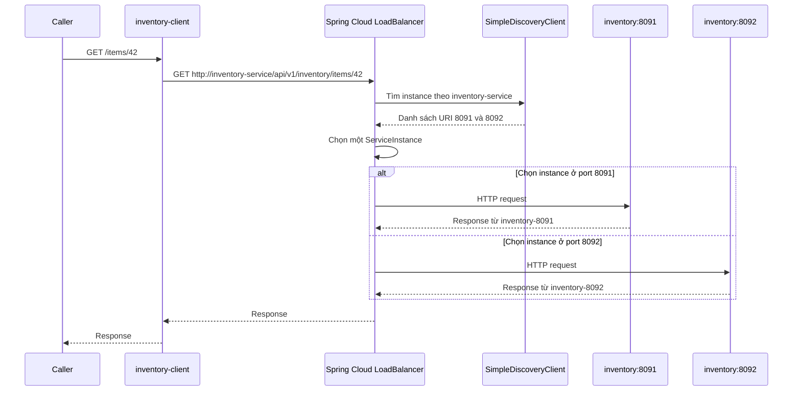

# Khai báo danh sách bản sao tĩnh cho môi trường học tập

Khi học Spring Cloud LoadBalancer, ta cần nhiều instance của cùng một dịch vụ để quan sát cách client chọn đích cho từng request. Trong môi trường học tập, có thể khai báo sẵn địa chỉ của các instance ngay trong cấu hình ứng dụng gọi dịch vụ. Spring Cloud cung cấp `SimpleDiscoveryClient` để đọc danh sách này mà không cần triển khai Eureka, Consul hoặc một service registry riêng.

Cách làm này phù hợp với bài thực hành chạy vài tiến trình trên máy cá nhân: khởi động hai bản sao của `inventory-service` ở hai cổng khác nhau, khai báo cả hai địa chỉ trong ứng dụng client, rồi gọi bằng service ID `inventory-service`. Spring Cloud LoadBalancer nhận danh sách instance từ discovery client và chọn một instance cho request.

## 1. Danh sách instance tĩnh dùng để làm gì?

Một dịch vụ logic có thể chạy thành nhiều bản sao. Ví dụ:

| Service ID | Instance | Địa chỉ |
|---|---|---|
| `inventory-service` | `inventory-1` | `http://localhost:8091` |
| `inventory-service` | `inventory-2` | `http://localhost:8092` |

**Service ID** là tên logic mà ứng dụng client sử dụng. **Instance** là một tiến trình cụ thể có thể nhận request. Mỗi instance có địa chỉ host và port riêng, nhưng cùng phục vụ một dịch vụ logic.

Trong bài này, ứng dụng client khai báo hai URI cho service ID `inventory-service`. Khi client gửi request tới `http://inventory-service`, tích hợp Spring Cloud LoadBalancer tra cứu danh sách instance theo service ID, chọn một instance rồi chuyển request tới URI tương ứng.

Danh sách tĩnh có ba đặc điểm cần nhớ:

- Các địa chỉ được khai báo bằng cấu hình, thường nằm trong file YAML của profile học tập.
- Danh sách không tự cập nhật khi một tiến trình được khởi động, dừng hoặc chuyển cổng.
- Không cần một máy chủ registry độc lập; discovery client đọc các instance đã khai báo trong chính ứng dụng client.

`SimpleDiscoveryClient` chỉ cung cấp danh sách instance. Spring Cloud LoadBalancer mới là thành phần chọn instance để định tuyến request. Việc có hai URI trong cấu hình không tự tạo ra cân bằng tải nếu HTTP client không được tích hợp với LoadBalancer.

## 2. Chuẩn bị dependency

Ứng dụng gọi dịch vụ cần dependency `spring-cloud-starter-loadbalancer`. Starter này cung cấp Spring Cloud LoadBalancer và các thành phần discovery cần thiết cho ví dụ.

Với Maven, khai báo Spring Cloud BOM trong `dependencyManagement` để quản lý phiên bản các thư viện Spring Cloud đồng bộ với phiên bản Spring Boot của dự án:

```xml
<properties>
    <java.version>17</java.version>
    <spring-cloud.version>YOUR_COMPATIBLE_SPRING_CLOUD_VERSION</spring-cloud.version>
</properties>

<dependencyManagement>
    <dependencies>
        <dependency>
            <groupId>org.springframework.cloud</groupId>
            <artifactId>spring-cloud-dependencies</artifactId>
            <version>${spring-cloud.version}</version>
            <type>pom</type>
            <scope>import</scope>
        </dependency>
    </dependencies>
</dependencyManagement>

<dependencies>
    <dependency>
        <groupId>org.springframework.boot</groupId>
        <artifactId>spring-boot-starter-web</artifactId>
    </dependency>

    <dependency>
        <groupId>org.springframework.cloud</groupId>
        <artifactId>spring-cloud-starter-loadbalancer</artifactId>
    </dependency>
</dependencies>
```

Thay `YOUR_COMPATIBLE_SPRING_CLOUD_VERSION` bằng release train tương thích với phiên bản Spring Boot đang dùng, theo bảng tương thích của Spring Cloud. Không chọn phiên bản Spring Cloud tùy ý hoặc ghim thêm phiên bản riêng cho từng dependency khi đã dùng BOM.

Ví dụ dùng `RestClient` yêu cầu Spring Framework 6.1 trở lên, thường tương ứng với Spring Boot 3.2 trở lên. Nếu dự án đang dùng nền tảng cũ hơn, hãy dùng kiểu HTTP client được phiên bản Spring Cloud đó hỗ trợ, chẳng hạn `RestTemplate` hoặc `WebClient`, và giữ nguyên nguyên tắc cấu hình service ID.

Trong bài thực hành này, không cần thêm starter Eureka hoặc Consul. Mục tiêu là để `SimpleDiscoveryClient` cung cấp danh sách instance từ cấu hình tĩnh.

## 3. Khai báo các bản sao trong YAML

Đặt danh sách instance trong file cấu hình của ứng dụng client. Có thể dùng profile riêng như `application-lab.yml` để cấu hình học tập không lẫn với cấu hình môi trường khác.

```yaml
server:
  port: 8080

spring:
  application:
    name: inventory-client
  cloud:
    discovery:
      client:
        simple:
          instances:
            inventory-service:
              - uri: http://localhost:8091
              - uri: http://localhost:8092
```

Phần cấu hình quan trọng là:

```yaml
spring.cloud.discovery.client.simple.instances
```

Đây là map trong đó:

- Key `inventory-service` là service ID.
- Giá trị là danh sách các instance thuộc service ID đó.
- Mỗi phần tử `uri` mô tả địa chỉ có thể gọi của một instance, gồm scheme, host và port.

Tên `inventory-service` phải khớp với service ID trong URL mà client gọi. Nếu cấu hình key là `inventory-service` nhưng client gọi `http://stock-service`, LoadBalancer sẽ tra cứu một service ID khác và không tìm thấy danh sách đã khai báo.

Có thể khai báo nhiều service ID trong cùng một file:

```yaml
spring:
  cloud:
    discovery:
      client:
        simple:
          instances:
            inventory-service:
              - uri: http://localhost:8091
              - uri: http://localhost:8092
            pricing-service:
              - uri: http://localhost:8093
              - uri: http://localhost:8094
```

Mỗi service ID có danh sách instance riêng. Không đưa các bản sao của hai dịch vụ khác nhau vào chung một danh sách, vì LoadBalancer chọn instance theo service ID được yêu cầu.

Kích hoạt profile `lab` khi chạy ứng dụng client:

```bash
java -jar inventory-client.jar --spring.profiles.active=lab
```

Nếu chạy từ IDE, chọn active profile `lab` trong cấu hình chạy. Cũng có thể đặt `spring.profiles.active: lab` ở cấu hình mặc định của ứng dụng trong một bài lab riêng, nhưng truyền profile lúc chạy giúp chủ động chọn cấu hình cho từng lần thực hành.

## 4. Khởi chạy hai instance của dịch vụ đích

Hai URI trong danh sách phải trỏ tới hai tiến trình thực sự đang lắng nghe. Ta có thể dùng cùng một ứng dụng provider và khởi động hai lần với hai giá trị `server.port` khác nhau.

Ví dụ provider trả về tên instance dựa trên port:

```java
import java.util.Map;

import org.springframework.beans.factory.annotation.Value;
import org.springframework.web.bind.annotation.GetMapping;
import org.springframework.web.bind.annotation.PathVariable;
import org.springframework.web.bind.annotation.RequestMapping;
import org.springframework.web.bind.annotation.RestController;

@RestController
@RequestMapping("/api/v1/inventory")
class InventoryController {

    @Value("${server.port}")
    private int port;

    @GetMapping("/items/{id}")
    Map<String, Object> getItem(@PathVariable String id) {
        return Map.of(
                "itemId", id,
                "servedBy", "inventory-" + port,
                "port", port
        );
    }
}
```

Build provider thành một file JAR, sau đó mở hai tiến trình:

```bash
java -jar inventory-service.jar --server.port=8091
java -jar inventory-service.jar --server.port=8092
```

Cả hai tiến trình cùng chạy mã nguồn và endpoint, nhưng mỗi tiến trình lắng nghe ở một port riêng. Provider không cần đăng ký với một registry trong bài lab này, vì ứng dụng client đã có địa chỉ của hai instance trong `application-lab.yml`.

Trước khi kiểm tra LoadBalancer, hãy xác nhận từng instance có thể truy cập trực tiếp:

```bash
curl http://localhost:8091/api/v1/inventory/items/42
curl http://localhost:8092/api/v1/inventory/items/42
```

Kết quả cần cho thấy port hoặc `servedBy` khác nhau. Nếu một lệnh chưa truy cập được, hãy xử lý việc khởi động provider trước khi kiểm tra định tuyến phía client.

## 5. Tích hợp RestClient với Spring Cloud LoadBalancer

Trong ứng dụng client, đăng ký `RestClient.Builder` với annotation `@LoadBalanced`:

```java
import org.springframework.cloud.client.loadbalancer.LoadBalanced;
import org.springframework.context.annotation.Bean;
import org.springframework.context.annotation.Configuration;
import org.springframework.web.client.RestClient;

@Configuration
class HttpClientConfiguration {

    @Bean
    @LoadBalanced
    RestClient.Builder loadBalancedRestClientBuilder() {
        return RestClient.builder();
    }
}
```

Annotation `@LoadBalanced` đánh dấu builder để Spring Cloud bổ sung cơ chế phân giải service ID và chọn instance khi gửi request. Sau đó tạo client với service ID trong base URL:

```java
import org.springframework.stereotype.Service;
import org.springframework.web.client.RestClient;

@Service
class InventoryGateway {

    private final RestClient restClient;

    InventoryGateway(RestClient.Builder loadBalancedRestClientBuilder) {
        this.restClient = loadBalancedRestClientBuilder
                .baseUrl("http://inventory-service")
                .build();
    }

    String getItem(String itemId) {
        return restClient.get()
                .uri("/api/v1/inventory/items/{id}", itemId)
                .retrieve()
                .body(String.class);
    }
}
```

Ở đây, `inventory-service` là service ID. Ứng dụng client không cần biết request kế tiếp sẽ tới port `8091` hay `8092`; LoadBalancer lấy danh sách tương ứng từ discovery client rồi chọn một `ServiceInstance`.

Có thể đưa gateway ra endpoint để kiểm tra từ bên ngoài:

```java
import org.springframework.web.bind.annotation.GetMapping;
import org.springframework.web.bind.annotation.PathVariable;
import org.springframework.web.bind.annotation.RestController;

@RestController
class InventoryProxyController {

    private final InventoryGateway inventoryGateway;

    InventoryProxyController(InventoryGateway inventoryGateway) {
        this.inventoryGateway = inventoryGateway;
    }

    @GetMapping("/items/{id}")
    String getItem(@PathVariable String id) {
        return inventoryGateway.getItem(id);
    }
}
```

Chạy client ở port `8080`, sau đó gửi nhiều request tới cùng endpoint:

```bash
curl http://localhost:8080/items/42
curl http://localhost:8080/items/42
curl http://localhost:8080/items/42
curl http://localhost:8080/items/42
```

Với cấu hình mặc định của Spring Cloud LoadBalancer, thuật toán chọn instance thường là round robin. Khi các request được gửi tuần tự và không có cấu hình chọn instance khác, trường `servedBy` trong response sẽ luân phiên giữa hai port. Thứ tự bắt đầu có thể khác nhau; không nên dùng thứ tự của một vài request làm cam kết về phân phối tải trong môi trường production.

## 6. Kiểm tra cấu hình và hiểu luồng xử lý

Khi gọi `GET /items/42` vào client, luồng xử lý có thể tóm tắt như sau:



Có thể kiểm tra theo từng lớp:

1. **Provider:** hai port `8091` và `8092` đều trả lời được khi gọi trực tiếp.
2. **Cấu hình:** profile `lab` đang hoạt động và danh sách nằm dưới đúng prefix `spring.cloud.discovery.client.simple.instances`.
3. **Service ID:** key `inventory-service` khớp với hostname trong `http://inventory-service`.
4. **HTTP client:** builder được inject vào gateway là bean có `@LoadBalanced`.
5. **Định tuyến:** response từ client cho biết instance nào đã xử lý request.

Nếu client dùng một `RestClient` builder thông thường không có `@LoadBalanced`, hostname `inventory-service` sẽ được xử lý như hostname DNS bình thường. Máy phát triển thường không có bản ghi DNS cho tên này, vì vậy request có thể lỗi `UnknownHostException`. Chỉ khai báo danh sách tĩnh không tự động làm cho mọi HTTP client trong ứng dụng biết cách dùng danh sách đó.

## 7. Giới hạn của danh sách tĩnh và lưu ý khi chạy trong container

Danh sách tĩnh rất thuận tiện để học và thử nghiệm, nhưng cần hiểu giới hạn của nó:

- **Không tự đăng ký hoặc hủy đăng ký:** khi thêm, xóa hoặc đổi port một instance, phải cập nhật cấu hình và khởi động lại hoặc nạp lại ứng dụng client theo cách triển khai tương ứng.
- **Không tự xác nhận tiến trình còn sống:** một URI vẫn nằm trong danh sách dù provider đã dừng. Nếu LoadBalancer chọn instance đó, request có thể gặp `Connection refused` hoặc timeout. Muốn lọc instance theo health cần cấu hình supplier kiểm tra health riêng; danh sách tĩnh tự nó không làm việc này.
- **Không đại diện cho production discovery:** hệ thống thực tế thường lấy instance từ Kubernetes, Eureka, Consul hoặc nền tảng discovery khác để cập nhật trạng thái theo môi trường.
- **Không đảm bảo chia tải tuyệt đối:** thuật toán mặc định có thể chọn luân phiên, nhưng retry, request đồng thời, cấu hình supplier và chiến lược chọn instance có thể làm phân phối quan sát được khác đi.

Đặc biệt, `localhost` có ý nghĩa theo góc nhìn của tiến trình đang gọi. Nếu client và provider chạy trực tiếp trên cùng máy, hai URI `localhost:8091` và `localhost:8092` phù hợp. Nếu client chạy trong Docker container, `localhost` trỏ về chính container client, không phải máy host hay container provider. Khi đó hãy dùng hostname có thể truy cập từ network của container, ví dụ tên service trong Docker Compose hoặc `host.docker.internal` trên Docker Desktop khi provider chạy trên host.

Không nên ghi địa chỉ `localhost` vào cấu hình dùng chung cho nhiều môi trường. Tách cấu hình bằng profile giúp mỗi môi trường cung cấp URI phù hợp với mạng của nó.

## 8. Xử lý lỗi thường gặp

| Hiện tượng | Nguyên nhân thường gặp | Cách kiểm tra |
|---|---|---|
| Không tìm thấy instance cho `inventory-service` | Sai service ID, profile chưa kích hoạt hoặc YAML sai cấp | Kiểm tra key dưới `simple.instances`, URL trong gateway và active profile. |
| `UnknownHostException: inventory-service` | Request đi qua HTTP client không có tích hợp LoadBalancer | Xác nhận gateway dùng bean `RestClient.Builder` có `@LoadBalanced`. |
| `Connection refused` | Provider chưa chạy, port sai hoặc URI không truy cập được từ client | Gọi trực tiếp từng URI từ môi trường chạy client. |
| Chỉ thấy một instance xử lý request | Một URI không hoạt động, danh sách chỉ có một phần tử hoặc có cấu hình chọn instance khác | Kiểm tra cả hai provider và toàn bộ danh sách YAML. |
| Chạy được trên máy nhưng lỗi trong Docker | `localhost` trỏ tới container client | Thay bằng hostname hoặc địa chỉ có thể truy cập trong mạng container. |
| Một số request thất bại sau khi dừng provider | Danh sách tĩnh vẫn chứa URI của instance đã dừng | Khởi động lại provider hoặc cập nhật cấu hình; nếu cần tự loại instance lỗi, cấu hình health check riêng. |

Khi chẩn đoán, hãy xác định lỗi thuộc bước tìm instance, phân giải hostname hay mở kết nối. `No instances available` thường chỉ ra danh sách discovery không có instance phù hợp; `UnknownHostException` cho thấy hostname đang được phân giải như tên DNS; `Connection refused` thường có nghĩa client đã tới được host nhưng không có tiến trình nhận kết nối ở port đó.

## 9. Checklist hoàn thành bài thực hành

- [ ] Ứng dụng client có dependency `spring-cloud-starter-loadbalancer` và Spring Cloud BOM tương thích.
- [ ] Profile `lab` khai báo `inventory-service` với hai URI khác port.
- [ ] Hai tiến trình provider đang lắng nghe ở port `8091` và `8092`.
- [ ] Có thể gọi trực tiếp endpoint của từng provider.
- [ ] `RestClient.Builder` được đánh dấu `@LoadBalanced`.
- [ ] Gateway gọi `http://inventory-service` thay vì gắn cứng port của một instance.
- [ ] Response từ các request qua client cho biết instance được chọn.

Khi hoàn thành bài thực hành, ta đã có một nguồn discovery đơn giản để quan sát cơ chế chọn `ServiceInstance` của Spring Cloud LoadBalancer. Cấu hình tĩnh là nền tảng thuận tiện để hiểu service ID, danh sách instance và định tuyến phía client trước khi chuyển sang discovery động, health check, retry và chính sách lựa chọn instance trong các môi trường triển khai thực tế.
