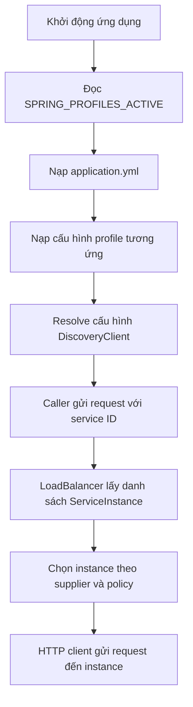

# Tổ chức cấu hình theo profile và môi trường chạy

Một ứng dụng Spring Cloud thường chạy ở nhiều môi trường: máy cá nhân, môi trường phát triển, kiểm thử tích hợp, staging và production. Mỗi môi trường có thể dùng địa chỉ dịch vụ, registry, cổng, thông tin xác thực và chính sách vận hành khác nhau. Nếu các giá trị này nằm rải rác trong mã nguồn hoặc bị thay đổi thủ công trước mỗi lần chạy, việc triển khai dễ sai và khó tái hiện.

Spring Boot cung cấp cơ chế externalized configuration và profile để tách cấu hình khỏi mã nguồn, chọn đúng tập cấu hình khi khởi động. Với Spring Cloud LoadBalancer, cách tổ chức này giúp cùng một service ID như `inventory-service` được phân giải đến các instance phù hợp với môi trường đang chạy, đồng thời cho phép điều chỉnh health check, timeout và retry theo nhu cầu triển khai.

## 1. Vì sao cần tách cấu hình theo môi trường?

Giả sử `order-service` gọi `inventory-service` bằng URI logic:

```java
webClient.get()
    .uri("http://inventory-service/api/items/{id}", itemId)
    .retrieve()
    .bodyToMono(Item.class);
```

Ứng dụng không nên thay đoạn mã này thành URL khác mỗi khi chuyển môi trường. `inventory-service` là service ID ổn định trong hợp đồng giao tiếp; cơ chế discovery và LoadBalancer chịu trách nhiệm tìm instance tương ứng tại runtime.

| Môi trường | Nguồn instance có thể dùng | Cấu hình thường khác nhau |
|---|---|---|
| `local` | Các URI chạy trên máy cá nhân hoặc Docker Compose | Cổng local, log chi tiết, dữ liệu thử nghiệm |
| `dev` | Registry hoặc địa chỉ dịch vụ trong mạng phát triển | Endpoint dev, credential dev, giới hạn tài nguyên thấp |
| `test` | Stub, mock server, Testcontainers hoặc registry kiểm thử | Dữ liệu cô lập, thời gian chờ phù hợp với test |
| `staging` | Registry hoặc nền tảng gần giống production | Endpoint staging, cấu hình quan sát và kiểm thử trước phát hành |
| `prod` | Service discovery do nền tảng vận hành cung cấp | Secret production, giới hạn tải, timeout và chính sách phục hồi đã kiểm chứng |

Mục tiêu là giữ nguyên mã nguồn và thay đổi cấu hình thông qua profile, biến môi trường hoặc hệ thống quản lý cấu hình. Profile chỉ là cơ chế chọn cấu hình; nó không tự tạo môi trường, registry hay instance dịch vụ.

## 2. Spring Boot profile hoạt động như thế nào?

Profile là tên một nhóm cấu hình có thể được kích hoạt khi ứng dụng khởi động. Spring Boot tự tìm các file cấu hình có hậu tố profile, chẳng hạn:

```text
src/main/resources/
  application.yml
  application-local.yml
  application-dev.yml
  application-test.yml
  application-staging.yml
  application-prod.yml
```

`application.yml` chứa cấu hình dùng chung. Khi profile `dev` được kích hoạt, Spring Boot nạp thêm `application-dev.yml`; các giá trị trong cấu hình profile có độ ưu tiên cao hơn giá trị tương ứng trong file cơ sở.

Ví dụ cấu hình cơ sở:

```yaml
spring:
  application:
    name: order-service
  profiles:
    default: local

server:
  port: ${SERVER_PORT:8080}

management:
  endpoints:
    web:
      exposure:
        include: health,info
```

Trong ví dụ này, `order-service` là tên ứng dụng dùng chung. Nếu không có profile nào được kích hoạt từ bên ngoài, `local` được dùng làm profile mặc định. Cổng có thể lấy từ biến môi trường `SERVER_PORT`; nếu biến chưa được đặt thì dùng `8080`.

Giá trị mặc định `local` thuận tiện cho máy phát triển. Pipeline hoặc deployment production phải đặt profile một cách tường minh, chẳng hạn `SPRING_PROFILES_ACTIVE=prod`, để không vô tình chạy cấu hình local khi thiếu biến môi trường.

Profile `local` có thể cấu hình các instance tĩnh để phát triển trên máy cá nhân:

```yaml
# application-local.yml
spring:
  cloud:
    discovery:
      client:
        simple:
          instances:
            inventory-service:
              - uri: http://localhost:8081
              - uri: http://localhost:8082
```

Đây là ví dụ dùng `SimpleDiscoveryClient`: danh sách URI được khai báo trong cấu hình. `SimpleDiscoveryClient` thường được dùng khi ứng dụng không có implementation `DiscoveryClient` khác cung cấp danh sách instance. Khi ứng dụng dùng Eureka, Consul hoặc một discovery client khác, cần cấu hình implementation đó; không mặc định rằng danh sách tĩnh trên vẫn là nguồn instance đang hoạt động. Cách khai báo tĩnh phù hợp cho local hoặc một bài thực hành nhỏ; nó không tự theo dõi trạng thái của một cụm dịch vụ production.

Ở môi trường dùng registry, `order-service` và `inventory-service` đăng ký hoặc được phát hiện thông qua implementation của DiscoveryClient mà hệ thống đã chọn. Khi đó cấu hình profile cần cung cấp thông tin kết nối registry và credential tương ứng. Không cần sửa service ID trong mã gọi.

## 3. Kích hoạt profile khi chạy ứng dụng

Có thể kích hoạt profile bằng tham số dòng lệnh:

```bash
java -jar order-service.jar --spring.profiles.active=dev
```

Hoặc bằng biến môi trường:

```bash
SPRING_PROFILES_ACTIVE=staging java -jar order-service.jar
```

Trên PowerShell:

```powershell
$env:SPRING_PROFILES_ACTIVE = "local"
./mvnw spring-boot:run
```

Với container hoặc nền tảng triển khai, nên truyền profile qua environment variable hoặc cấu hình deployment. Ví dụ trong manifest/container environment có thể đặt `SPRING_PROFILES_ACTIVE=prod`. Giá trị này được quyết định tại thời điểm khởi động; thay đổi biến môi trường của một tiến trình đang chạy không tự kích hoạt lại profile.

Một số điểm cần nhớ:

- `spring.profiles.active` xác định profile được kích hoạt. Có thể kích hoạt nhiều profile, phân cách bằng dấu phẩy, nhưng cần kiểm soát thứ tự ghi đè.
- `spring.profiles.default` chỉ định profile mặc định khi không có profile nào được kích hoạt.
- `spring.profiles.include` bổ sung profile khác; `spring.profiles.group` gom nhiều profile thành một tên dễ dùng.
- `spring.profiles.active`, `spring.profiles.default`, `spring.profiles.include` và `spring.profiles.group` phải được khai báo trong tài liệu cấu hình không phụ thuộc profile, chẳng hạn `application.yml`, hoặc truyền từ môi trường/dòng lệnh. Không đặt chúng trong `application-prod.yml` rồi kỳ vọng file đó tự kích hoạt chính nó.

Có thể định nghĩa profile group để bật một nhóm cấu hình liên quan:

```yaml
# application.yml
spring:
  profiles:
    group:
      staging-stack:
        - staging
        - metrics
      production:
        - prod
        - metrics
```

Khi kích hoạt `staging-stack`, Spring Boot cũng kích hoạt `staging` và `metrics`; khi kích hoạt `production`, ứng dụng nhận thêm `prod` và `metrics`. Cách này hữu ích khi một môi trường cần kết hợp cấu hình nghiệp vụ với cấu hình quan sát. Đặt tên group rõ ràng và tránh để nhiều profile cùng ghi đè một thuộc tính theo cách khó dự đoán.

## 4. Tổ chức file cấu hình và phạm vi của từng loại giá trị

Một cấu trúc dễ duy trì thường chia thành ba lớp:

1. **Cấu hình chung** trong `application.yml`: tên ứng dụng, cấu hình mặc định an toàn, định dạng log, endpoint quản lý được phép công khai và các giá trị giống nhau ở mọi môi trường.
2. **Cấu hình theo profile** trong `application-{profile}.yml`: lựa chọn discovery client, endpoint của registry, danh sách instance dùng cho local/test, hoặc những khác biệt có chủ đích giữa các môi trường.
3. **Giá trị triển khai** từ biến môi trường, secret store hoặc hệ thống cấu hình: mật khẩu, token, certificate, địa chỉ registry và các giá trị thay đổi theo từng lần triển khai.

Ví dụ, `application-dev.yml` có thể chứa cấu hình riêng cho môi trường phát triển:

```yaml
spring:
  cloud:
    loadbalancer:
      # Chỉ là ví dụ về một thuộc tính vận hành có thể thay đổi theo môi trường.
      # Hãy chọn giá trị theo deadline và đặc tính của API thực tế.
      retry:
        enabled: true

logging:
  level:
    org.springframework.cloud.loadbalancer: DEBUG
```

Đoạn trên minh họa cách đặt cấu hình LoadBalancer và log level theo profile. Tên thuộc tính cụ thể, hành vi retry và giá trị mặc định cần được đối chiếu với phiên bản Spring Cloud đang dùng và loại HTTP client được tích hợp. Bật retry không có nghĩa mọi request đều an toàn để gửi lại.

Ở production, có thể giữ cấu hình không chứa secret trong file và lấy giá trị thay đổi theo lần triển khai từ môi trường:

```yaml
spring:
  cloud:
    loadbalancer:
      retry:
        enabled: ${LOADBALANCER_RETRY_ENABLED:false}

inventory:
  connect-timeout: ${INVENTORY_CONNECT_TIMEOUT:2s}
  read-timeout: ${INVENTORY_READ_TIMEOUT:3s}
```

`LOADBALANCER_RETRY_ENABLED` là biến môi trường ánh xạ vào thuộc tính retry của Spring Cloud LoadBalancer. Phần `inventory.*` là namespace do ứng dụng tự định nghĩa để bind vào cấu hình HTTP client; Spring Cloud LoadBalancer không tự hiểu các khóa này. Các thuộc tính kết nối discovery client phải được khai báo theo implementation thực tế như Eureka, Consul hoặc Kubernetes. Ví dụ cố ý không chứa địa chỉ registry hay credential production cụ thể.

Không đưa password, access token, private key hoặc credential registry vào Git. Dùng secret manager của nền tảng, Kubernetes Secret, biến môi trường được bảo vệ hoặc cơ chế cấp phát secret phù hợp. Profile `prod` cũng không phải lớp bảo vệ bí mật: file `application-prod.yml` vẫn có thể bị đọc nếu được đóng gói trong artifact.

## 5. Quy tắc ghi đè và nạp cấu hình

Khi cùng một thuộc tính xuất hiện ở nhiều nguồn, Spring Boot áp dụng thứ tự ưu tiên của property source. Trong trường hợp thông thường, tham số dòng lệnh có ưu tiên cao hơn system property, biến môi trường và cấu hình file. Cấu hình file bên ngoài artifact có thể ghi đè file được đóng gói trong JAR; cấu hình theo profile ghi đè giá trị cơ sở tương ứng.

Ví dụ:

```yaml
# application.yml
server:
  port: 8080
```

```yaml
# application-prod.yml
server:
  port: 8085
```

```bash
java -jar order-service.jar --server.port=8090
```

Khi chạy với profile `prod` và tham số dòng lệnh ở trên, cổng hiệu lực là `8090`. Điều này hữu ích để ghi đè có chủ đích trong môi trường triển khai, nhưng cũng có thể khiến cấu hình thực tế khác với giá trị mà người đọc file YAML tưởng rằng ứng dụng đang dùng.

Các lưu ý quan trọng khi ghi đè:

- Đừng định nghĩa cùng một khóa ở quá nhiều nơi nếu không có lý do. Hãy biết nguồn nào là nguồn có thẩm quyền cho mỗi giá trị.
- Với YAML nhiều tài liệu, có thể dùng `spring.config.activate.on-profile` để áp dụng một phần cấu hình khi profile khớp.
- Các danh sách trong cấu hình thường được thay thế bởi danh sách có độ ưu tiên cao hơn, thay vì tự động nối phần tử. Vì vậy, danh sách `simple.instances` trong profile cần chứa đầy đủ các instance mà môi trường đó mong muốn.
- `spring.config.location` thay đổi vị trí tìm kiếm cấu hình mặc định; `spring.config.additional-location` bổ sung vị trí. Khi sử dụng, cần kiểm tra kỹ file cơ sở và file profile còn được nạp như mong muốn.
- Có thể dùng placeholder như `${SERVER_PORT:8080}` để nhận giá trị từ nguồn ngoài và có giá trị dự phòng. Không đặt giá trị dự phòng nhạy cảm trong file.

Một cách viết YAML nhiều tài liệu:

```yaml
spring:
  application:
    name: order-service

---
spring:
  config:
    activate:
      on-profile: local
  cloud:
    discovery:
      client:
        simple:
          instances:
            inventory-service:
              - uri: http://localhost:8081

---
spring:
  config:
    activate:
      on-profile: dev
  cloud:
    discovery:
      client:
        simple:
          instances:
            inventory-service:
              - uri: http://inventory-1.dev.internal:8080
              - uri: http://inventory-2.dev.internal:8080
```

Trong cấu hình trên, mỗi tài liệu sau dấu `---` chỉ được áp dụng khi profile tương ứng được kích hoạt. Với dự án lớn, tách thành `application-local.yml` và `application-dev.yml` thường dễ tìm kiếm, review và phân quyền chỉnh sửa hơn; YAML nhiều tài liệu phù hợp khi các phần cấu hình ngắn và có liên hệ chặt chẽ.

## 6. Áp dụng profile cho Spring Cloud LoadBalancer

LoadBalancer nhận một service ID và chọn `ServiceInstance` từ nguồn danh sách instance mà ứng dụng cung cấp. Profile có thể làm thay đổi nguồn dữ liệu hoặc các tham số vận hành, nhưng không thay đổi hợp đồng service ID trong mã gọi.

Để request dùng service ID được định tuyến qua LoadBalancer, ứng dụng còn phải có dependency tích hợp phù hợp và dùng HTTP client được cấu hình cho load balancing, ví dụ `WebClient.Builder` hoặc `RestClient.Builder` có `@LoadBalanced`. Chỉ khai báo profile hay `spring.cloud.discovery.client.simple.instances` không tự biến một HTTP client thông thường thành client có khả năng phân giải service ID.

Luồng tổng quát:



Ví dụ ở local, `SimpleDiscoveryClient` có thể cung cấp hai URI trong `application-local.yml`. Trong production, danh sách instance thường đến từ registry hoặc nền tảng điều phối container. `order-service` vẫn gọi `http://inventory-service`; LoadBalancer làm việc với danh sách instance tương ứng của môi trường đang chạy.

Một số quyết định cấu hình nên được xem xét theo môi trường:

| Thành phần | Local/test | Staging/production |
|---|---|---|
| Discovery | Danh sách tĩnh, stub hoặc registry kiểm thử | Registry/nền tảng discovery thực tế |
| Instance | URI local hoặc container | Instance đang được nền tảng đăng ký và quản lý |
| Health check | Endpoint test đơn giản, tần suất vừa đủ | Endpoint health phù hợp, chu kỳ không tạo tải phụ đáng kể |
| Retry | Hữu ích khi thử nghiệm lỗi; số lần nhỏ | Chỉ bật theo hợp đồng API, idempotency và ngân sách thời gian |
| Timeout | Phù hợp tốc độ máy cá nhân và test | Theo latency mục tiêu, deadline và SLA của dịch vụ |
| Logging | Có thể bật DEBUG khi điều tra | Giữ mức log vận hành phù hợp, tránh log dữ liệu nhạy cảm |

Health check chỉ có hiệu lực khi ứng dụng đã cấu hình cơ chế `ServiceInstanceListSupplier`/health-check tương ứng. Chỉ đặt một thuộc tính interval trong YAML không tự bảo đảm health check được bật. Tương tự, retry của LoadBalancer phụ thuộc phiên bản, integration và loại client; phải kiểm tra luồng retry thực tế để tránh retry lặp ở nhiều tầng.

Nếu cần cấu hình khác nhau cho từng service ID, hãy dùng các thuộc tính theo client mà phiên bản Spring Cloud đang hỗ trợ hoặc cấu hình LoadBalancer client riêng bằng `@LoadBalancerClient`. Đặt cấu hình riêng của client ở package không bị component scan của ứng dụng chính quét nhầm, theo hướng dẫn của phiên bản đang sử dụng. Không giả định mọi thuộc tính global đều có thể ghi đè theo service ID; kiểm tra tên khóa và phạm vi hỗ trợ trong tài liệu tương ứng.

## 7. Dùng `@Profile` cho bean và cấu hình Java

File YAML phù hợp để thay đổi giá trị. `@Profile` phù hợp khi cần đăng ký một bean khác nhau theo môi trường, chẳng hạn dùng adapter giả lập ở local hoặc test:

```java
@Configuration
@Profile("local")
class LocalClientConfiguration {

    @Bean
    InventoryGateway inventoryGateway() {
        return new LocalInventoryGateway();
    }
}

@Configuration
@Profile("prod")
class ProductionClientConfiguration {

    @Bean
    InventoryGateway inventoryGateway(InventoryHttpClient client) {
        return new HttpInventoryGateway(client);
    }
}
```

`InventoryGateway`, `LocalInventoryGateway`, `InventoryHttpClient` và `HttpInventoryGateway` là kiểu minh họa do ứng dụng định nghĩa. Đảm bảo chỉ có một bean phù hợp được đăng ký cho mỗi môi trường; nếu hai cấu hình cùng tạo bean cùng tên hoặc cùng kiểu mà không có quy tắc phân giải, ứng dụng có thể lỗi khi khởi động.

Không nên dùng `@Profile` cho mọi giá trị nhỏ như port hoặc URL. Các giá trị đó thường phù hợp hơn với `application-{profile}.yml` và placeholder. Dùng profile cho khác biệt về thành phần hoặc hành vi có chủ đích; dùng property cho dữ liệu cấu hình.

Trong kiểm thử Spring, `@ActiveProfiles("test")` có thể chọn cấu hình test:

```java
@SpringBootTest
@ActiveProfiles("test")
class InventoryClientIntegrationTest {
    // Test với cấu hình và dependency dành riêng cho môi trường test.
}
```

Không để test vô tình dùng profile `local` hoặc `prod`. Test nên có dependency và dữ liệu cô lập để kết quả lặp lại được.

## 8. Kiểm tra cấu hình hiệu lực và xử lý lỗi thường gặp

Khi ứng dụng chạy sai môi trường hoặc gọi nhầm instance, cần xác định profile và property source thực tế trước khi sửa code.

Một quy trình kiểm tra:

1. Kiểm tra biến môi trường `SPRING_PROFILES_ACTIVE` trong tiến trình/container đang chạy.
2. Xem log khởi động để xác nhận các profile active.
3. Xác nhận đúng file `application-{profile}.yml` nằm trong classpath hoặc vị trí external config được nạp.
4. Kiểm tra biến môi trường, tham số dòng lệnh và cấu hình ngoài artifact có ghi đè giá trị file hay không.
5. Kiểm tra danh sách instance mà DiscoveryClient cung cấp cho service ID cần gọi.
6. Kiểm tra LoadBalancer chọn instance nào và request thực tế có đến đúng host/port hay không.
7. Kiểm tra health check, timeout và retry ở từng tầng; đối chiếu log với trace/correlation ID.

Các lỗi phổ biến:

| Hiện tượng | Nguyên nhân có thể | Cách kiểm tra |
|---|---|---|
| Local gọi nhầm dịch vụ dev | `SPRING_PROFILES_ACTIVE` còn đặt là `dev` hoặc profile group kích hoạt thêm cấu hình | Xác nhận active profiles và property source |
| Không tìm thấy `inventory-service` | Discovery client chưa có instance, service ID sai hoặc registry chưa đăng ký dịch vụ | Kiểm tra discovery client và danh sách `ServiceInstance` |
| Dùng nhầm danh sách instance | File profile không được nạp hoặc danh sách bị ghi đè từ nguồn ưu tiên cao hơn | Kiểm tra file đóng gói, external config và environment variables |
| Một instance local không truy cập được | URI/port không đúng hoặc tiến trình đích chưa chạy | Gọi trực tiếp URI và kiểm tra log dịch vụ đích |
| Retry làm tăng số request | Retry được bật ở nhiều tầng hoặc request không idempotent | Kiểm tra số lần thử tại HTTP client, LoadBalancer và tầng nghiệp vụ |
| Health check không loại instance lỗi | Chưa cấu hình supplier health-check hoặc endpoint/port không phù hợp | Kiểm tra chain `ServiceInstanceListSupplier` và endpoint health |
| Production thiếu credential | Secret chưa được mount/cấp cho tiến trình hoặc tên biến không khớp | Kiểm tra secret reference và biến môi trường mà không in giá trị bí mật ra log |

Nếu ứng dụng bật Actuator, có thể dùng endpoint health và thông tin cấu hình đã được cho phép để kiểm tra trạng thái. Không mở endpoint hiển thị toàn bộ environment/configuration cho truy cập công khai; một số endpoint có thể tiết lộ URL nội bộ hoặc dữ liệu nhạy cảm.

## 9. Checklist trước khi triển khai

- [ ] `spring.application.name` ổn định và thống nhất với service ID mà các dịch vụ khác sử dụng.
- [ ] Profile được chọn từ deployment/environment, có giá trị mặc định phù hợp cho local.
- [ ] Cấu hình chung nằm trong `application.yml`; phần khác biệt nằm trong file profile hoặc nguồn external config phù hợp.
- [ ] Local/test dùng instance giả lập hoặc endpoint cô lập; production dùng discovery/registry của nền tảng.
- [ ] Không commit secret, token, private key hoặc credential vào repository.
- [ ] Timeout, retry và health check phù hợp với API, deadline và khả năng của phiên bản Spring Cloud đang chạy.
- [ ] Không retry tự động request không idempotent nếu chưa có cơ chế chống xử lý trùng.
- [ ] Đã kiểm tra property precedence, danh sách instance sau khi ghi đè và profile active trong môi trường đích.
- [ ] Log/Actuator hỗ trợ chẩn đoán nhưng không làm lộ thông tin nhạy cảm.

Tách cấu hình theo profile giúp một artifact có thể chạy ở nhiều môi trường với cùng service ID và cùng mã gọi. Khi kết hợp đúng externalized configuration, discovery và Spring Cloud LoadBalancer, mỗi môi trường có thể cung cấp danh sách instance cùng chính sách vận hành phù hợp mà không cần sửa mã nguồn mỗi lần triển khai.
