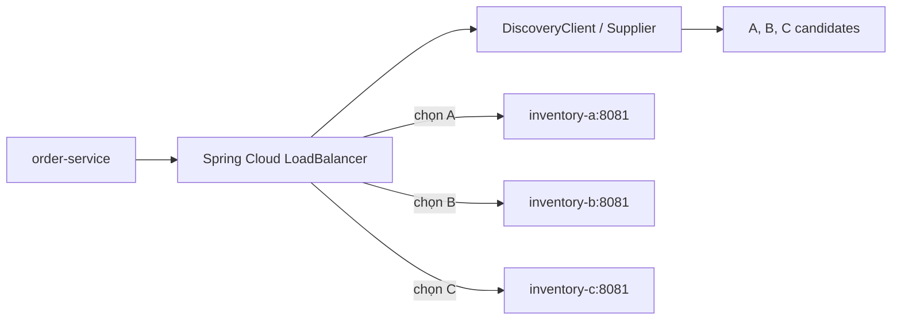
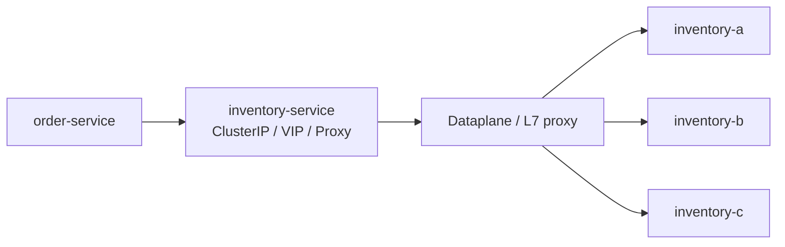
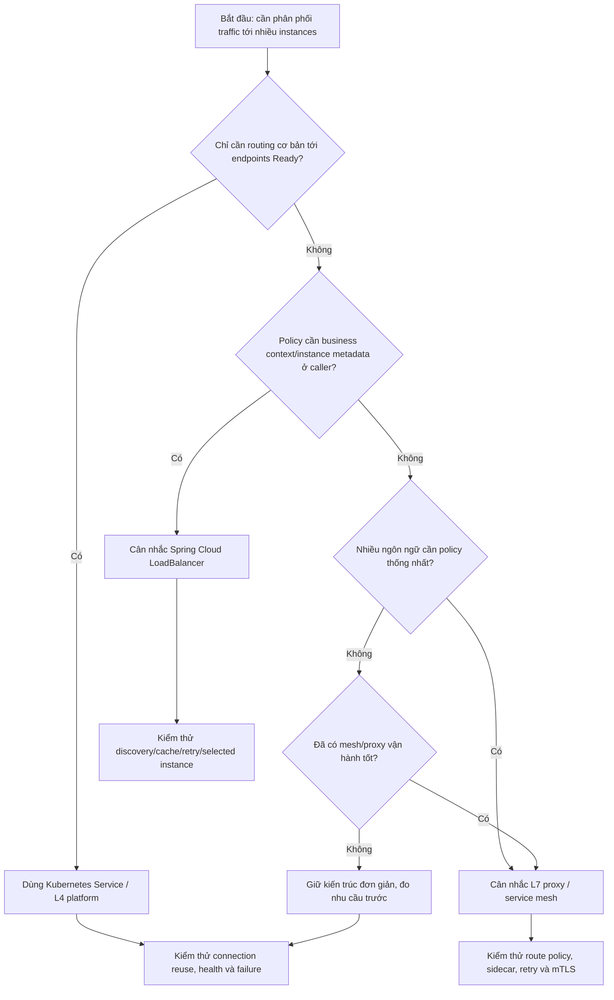

# Chọn cân bằng tải phía máy khách hay dựa vào hạ tầng

Khi một service có nhiều bản sao, hệ thống phải quyết định request sẽ đi tới bản sao nào. Có hai hướng phổ biến:

- **Cân bằng tải phía máy khách (client-side load balancing):** ứng dụng gọi service ID, tự lấy danh sách `ServiceInstance`, áp dụng policy rồi kết nối trực tiếp tới instance được chọn. Trong Spring, `Spring Cloud LoadBalancer` cung cấp cơ chế này cho RestClient, WebClient, OpenFeign và các tích hợp tương ứng.
- **Cân bằng tải dựa vào hạ tầng (infrastructure-side load balancing):** ứng dụng gọi một địa chỉ ổn định như Kubernetes Service, virtual IP, load balancer hoặc proxy/service mesh. Hạ tầng chọn backend và chuyển tiếp request.

Không có mô hình nào luôn tốt hơn. Client-side cho ứng dụng quyền kiểm soát việc chọn instance và sử dụng metadata theo ngữ cảnh; infrastructure-side tập trung routing, health, bảo mật và policy để nhiều ngôn ngữ cùng dùng. Quyết định đúng phụ thuộc vào nơi cần đặt policy, topology mạng, cách quản lý discovery, yêu cầu quan sát và năng lực vận hành.

Bài thuộc chương **Lựa chọn thiết kế** của module `SPRING_CLOUD_SERVICE_COMMUNICATION_LOAD_BALANCING`. Mục tiêu là phân biệt đúng hai mô hình, hiểu sự khác nhau giữa cân bằng theo TCP connection và theo HTTP request, đánh giá trade-off về health/retry/timeout/observability/security, rồi chọn kiến trúc cho một hệ thống Spring Cloud triển khai trên Docker hoặc Kubernetes.

> **Điểm cần nhớ:** Kubernetes Service, DNS round robin, cloud load balancer và service mesh không có cùng semantics. Đặc biệt, một L4 virtual IP thường phân phối theo flow/connection; nó không nhất thiết chọn backend mới cho từng HTTP request trên một connection được tái sử dụng.

## 1. Hai mô hình giải quyết cùng một bài toán ở hai vị trí khác nhau

Giả sử `order-service` gọi `inventory-service` với ba bản sao:

| Instance | Zone | Trạng thái |
|---|---|---|
| `inventory-a` | `zone-a` | Healthy |
| `inventory-b` | `zone-a` | Healthy |
| `inventory-c` | `zone-b` | Healthy |

Cả hai mô hình đều cần biết backend nào đang phục vụ được. Khác biệt chính là **ai chọn backend**.

### 1.1. Client-side: ứng dụng chọn instance



Request thường dùng service ID logic:

```text
GET http://inventory-service/api/v1/items/SKU-001
```

Spring Cloud LoadBalancer lấy candidates từ `ServiceInstanceListSupplier`, áp dụng policy và tạo đích vật lý cho HTTP client. Ứng dụng có thể áp dụng zone preference, hint, metadata hoặc policy riêng nếu supplier/algorithm được cấu hình.

### 1.2. Infrastructure-side: ứng dụng gọi một địa chỉ ổn định



Ứng dụng gọi một endpoint ổn định, ví dụ:

```text
http://inventory-service.default.svc.cluster.local
```

Kubernetes Service, cloud load balancer hoặc service mesh tìm backend và chuyển traffic. Ứng dụng không cần tự lấy danh sách Pod/instance để chọn đích cho mỗi request.

### 1.3. So sánh nhanh

| Câu hỏi | Client-side | Infrastructure-side |
|---|---|---|
| Ai chọn backend? | Thư viện trong ứng dụng | Dataplane, VIP, proxy hoặc mesh |
| Client biết từng instance? | Có, qua supplier/discovery | Thường không; chỉ biết endpoint ổn định |
| Policy dựa metadata nghiệp vụ? | Linh hoạt ở ứng dụng | Phải biểu diễn trong proxy/mesh policy hoặc gateway |
| Nhiều ngôn ngữ cùng dùng? | Mỗi client cần tích hợp tương ứng | Dùng chung hạ tầng |
| Thay đổi endpoint? | Registry/cache/supplier cập nhật | Hạ tầng cập nhật endpoints/backend |
| Quan sát lựa chọn instance? | Có thể instrument ngay trong client | Quan sát ở proxy/dataplane và ứng dụng |
| Phụ thuộc runtime? | Spring Cloud hoặc client library tương ứng | Cluster/network/proxy control plane |
| Failure khi không có backend? | LB client không chọn được instance | VIP/proxy không có upstream endpoint |

## 2. “Dựa vào hạ tầng” không phải một cơ chế duy nhất

Cần phân biệt các lớp sau trước khi so sánh.

| Cơ chế | Chọn backend ở đâu? | Thường phân phối theo |
|---|---|---|
| DNS round robin | DNS trả nhiều địa chỉ | DNS answer/cache; hiệu quả phụ thuộc client/connection reuse |
| Kubernetes ClusterIP | Node dataplane (iptables/IPVS/eBPF tùy cluster) | Thường theo network flow/connection |
| Cloud L4 load balancer | Hạ tầng mạng/cloud | TCP/UDP flow hoặc connection |
| L7 reverse proxy / API gateway | Proxy hiểu HTTP/gRPC | Có thể theo request, route, header, cookie |
| Service mesh sidecar | Envoy/sidecar hoặc dataplane tương đương | Theo connection hoặc request tùy protocol/policy |
| External ingress | Ingress controller/cloud gateway | Request/connection tùy loại ingress và protocol |

**Không nên gọi tất cả là “round robin từng request”.** Với Kubernetes ClusterIP, dataplane thường chọn endpoint khi một flow/connection mới được thiết lập. Nếu HTTP client giữ một keep-alive connection lâu dài, nhiều request có thể tiếp tục đi tới cùng Pod. Với HTTP/2, nhiều streams có thể dùng chung một TCP connection; không thể mặc định mỗi stream được phân phối tới Pod khác.

Một L7 proxy có thể chọn upstream cho từng HTTP request, nhưng kết quả thực tế vẫn phụ thuộc connection pooling, protocol, locality và cấu hình retry.

## 3. Kubernetes Service: ổn định địa chỉ, không đồng nghĩa client-side LB

Một Kubernetes Service loại `ClusterIP` tạo một endpoint ổn định trong cluster:

```yaml
apiVersion: v1
kind: Service
metadata:
  name: inventory-service
spec:
  type: ClusterIP
  selector:
    app: inventory
  ports:
    - name: http
      port: 80
      targetPort: 8081
```

Deployment có nhiều Pod:

```yaml
apiVersion: apps/v1
kind: Deployment
metadata:
  name: inventory
spec:
  replicas: 3
  selector:
    matchLabels:
      app: inventory
  template:
    metadata:
      labels:
        app: inventory
    spec:
      containers:
        - name: inventory
          image: example/inventory-service:dev
          ports:
            - name: http
              containerPort: 8081
```

Caller trong cùng namespace gọi:

```text
http://inventory-service:80/api/v1/items/SKU-001
```

Kubernetes Service chọn endpoint theo dataplane và cấu hình cluster. Ứng dụng không cần khai báo `@LoadBalanced` chỉ để gọi Service DNS này.

### 3.1. Readiness ảnh hưởng endpoint như thế nào?

Kubernetes thường sử dụng readiness probe để quyết định Pod có sẵn sàng nhận traffic qua Service hay không. Pod chưa Ready thường không được đưa vào tập endpoints phục vụ bình thường, tùy trạng thái EndpointSlice và cấu hình liên quan.

Ví dụ:

```yaml
apiVersion: apps/v1
kind: Deployment
metadata:
  name: inventory
spec:
  replicas: 3
  selector:
    matchLabels:
      app: inventory
  template:
    metadata:
      labels:
        app: inventory
    spec:
      containers:
        - name: inventory
          image: example/inventory-service:dev
          ports:
            - containerPort: 8081
          readinessProbe:
            httpGet:
              path: /actuator/health/readiness
              port: 8081
            periodSeconds: 5
            timeoutSeconds: 2
```

Readiness của Kubernetes khác với health supplier của Spring Cloud LoadBalancer:

- Kubernetes readiness tác động đến endpoints mà Service dataplane công bố.
- `HealthCheckServiceInstanceListSupplier` có thể kiểm tra từng instance ở phía client theo cơ chế và chu kỳ riêng.
- Consul/Eureka có health/lease semantics của registry.
- Một ứng dụng có thể dùng nhiều nguồn health, nhưng phải xác định rõ nguồn nào có quyền loại instance khỏi routing.

### 3.2. Khi nào Kubernetes Service đủ dùng?

Kubernetes Service thường là lựa chọn hợp lý nếu:

- Các caller nằm trong cùng cluster/network.
- Policy cần là routing cơ bản tới Pod Ready.
- Không cần ứng dụng biết zone/metadata cụ thể của từng Pod.
- Không cần chọn instance theo user/request hint ở client.
- Muốn ngôn ngữ và framework khác nhau cùng gọi một DNS endpoint.
- Đội nền tảng đã vận hành CNI/dataplane, readiness và observability phù hợp.

Nếu cần L7 policy nâng cao, gateway hoặc service mesh có thể là lớp phù hợp hơn một ClusterIP đơn thuần.

## 4. Spring Cloud LoadBalancer: ứng dụng kiểm soát selection

Trong client-side model, một client Spring dùng service ID logic. Ví dụ RestClient:

```java
@Configuration(proxyBeanMethods = false)
class InventoryClientConfiguration {

    @Bean
    @LoadBalanced
    RestClient.Builder loadBalancedRestClientBuilder() {
        return RestClient.builder();
    }

    @Bean
    RestClient inventoryClient(
            @Qualifier("loadBalancedRestClientBuilder")
            RestClient.Builder builder) {

        return builder.clone()
                .baseUrl("http://inventory-service")
                .build();
    }
}
```

Request:

```java
StockView getStock(RestClient inventoryClient, String sku) {
    return inventoryClient.get()
            .uri("/api/v1/items/{sku}", sku)
            .retrieve()
            .body(StockView.class);
}
```

Spring Cloud LoadBalancer sử dụng hostname logic `inventory-service` để tìm instances. Nó không yêu cầu ứng dụng biết Pod IP hay host port trước khi gọi.

### 4.1. Các thành phần của client-side path

| Thành phần | Vai trò |
|---|---|
| `DiscoveryClient` | Lấy registrations từ Eureka/Consul/Kubernetes hoặc nguồn khác |
| `ServiceInstanceListSupplier` | Cung cấp danh sách candidates, có thể cache/filter |
| `ReactorLoadBalancer` | Chọn một `ServiceInstance` |
| `LoadBalancerLifecycle` | Hook theo vòng đời request để quan sát/thực hiện logic phù hợp |
| HTTP client adapter | Chuyển request dùng service ID thành request tới host/port được chọn |
| Retry integration | Có thể thử lại theo policy và candidate list nếu được cấu hình |

Với WebClient, tương tự:

```java
@Bean
@LoadBalanced
WebClient.Builder loadBalancedWebClientBuilder() {
    return WebClient.builder();
}
```

Với OpenFeign, dùng service name và không cấu hình URL direct nếu muốn Feign dùng Spring Cloud LoadBalancer:

```java
@FeignClient(name = "inventory-service")
interface InventoryFeignClient {
    @GetMapping("/api/v1/items/{sku}")
    StockView find(@PathVariable String sku);
}
```

Cần có Spring Cloud LoadBalancer integration và discovery source thích hợp. `@FeignClient(name=..., url=...)` cố định target và làm Feign đi theo direct URL.

### 4.2. Ứng dụng biết được điều gì?

Client-side selection có thể cung cấp cho ứng dụng:

- Service ID và candidate list.
- Metadata của instance như zone, version, weight hoặc custom tags.
- Instance được chọn cho một attempt.
- Lý do không có candidate sau filter.
- Thông tin để quyết định hint/zone preference hoặc policy theo request context.

Đổi lại, mỗi runtime client cần có thư viện, cấu hình, cache, retry và observability đúng. Nếu một hệ thống có Java, Go, Node.js và Python, không thể giả định các client đều tự có cùng policy chỉ vì Java service đã dùng Spring Cloud LoadBalancer.

## 5. So sánh nơi đặt policy

### 5.1. Client-side policy

Ví dụ inventory ưu tiên instance cùng zone:

```text
Caller zone = zone-a
Candidates:
  inventory-a -> zone-a
  inventory-b -> zone-a
  inventory-c -> zone-b

Supplier:
  discovery -> zone preference -> candidate list

LoadBalancer:
  chọn A hoặc B
```

Policy nằm trong ứng dụng hoặc thư viện client. Điều này thuận lợi khi quyết định dựa vào context của caller hoặc metadata nghiệp vụ mà hạ tầng không có.

### 5.2. Infrastructure-side policy

Ví dụ service mesh áp locality-aware routing:

```text
order-service
    |
    v
local sidecar
    |
    +-- route policy / locality / outlier detection
    |
    +-- inventory-a (zone-a)
    +-- inventory-b (zone-a)
    +-- inventory-c (zone-b)
```

Policy được khai báo ở control plane/mesh config và thực thi tại proxy. Nhiều ngôn ngữ có thể dùng chung, nhưng đội nền tảng phải quản lý cấu hình, phiên bản proxy và khả năng debug.

### 5.3. Bảng trade-off về policy

| Tiêu chí | Client-side | Infrastructure-side |
|---|---|---|
| Policy theo request metadata nghiệp vụ | Linh hoạt trong app | Cần truyền header/metadata và cấu hình proxy |
| Policy thống nhất nhiều ngôn ngữ | Khó đồng bộ thư viện | Dễ tập trung hơn |
| Thay policy không deploy app | Thường cần cập nhật config/app tùy cơ chế | Có thể cập nhật control plane |
| Hiểu business context | Gần ứng dụng | Proxy thường không nên chứa logic nghiệp vụ phức tạp |
| Routing theo zone | Supplier/custom policy | Mesh/locality policy hoặc topology-aware dataplane |
| Weighted routing/canary | Custom supplier/algorithm | L7 proxy/mesh thường có policy tập trung |
| Sticky session | Có thể triển khai theo context | Có thể dùng cookie/header/hash ở proxy |
| Debug selected endpoint | Có thể log tại caller | Cần access log/metrics proxy và tracing |

## 6. Hiệu năng: cân bằng theo connection hay theo request?

Đây là một trong những yếu tố ảnh hưởng lớn nhất đến lựa chọn.

### 6.1. L4 thường chọn backend theo flow/connection

Một L4 load balancer thường không parse HTTP request. Nó xử lý TCP/UDP flow, nên lựa chọn backend thường gắn với connection. Nếu một HTTP client dùng keep-alive:

```text
Client
  TCP connection #1 -> inventory-a
      HTTP request 1
      HTTP request 2
      HTTP request 3
```

các request trên connection đó có thể cùng tới A.

Khi connection khác được tạo:

```text
Client
  TCP connection #1 -> inventory-a
  TCP connection #2 -> inventory-b
```

L4 có thể chọn B cho connection mới. Nhưng tỷ lệ request tới A/B có thể lệch nếu connection lifetime hoặc request volume mỗi connection khác nhau.

### 6.2. L7 proxy có thể chọn theo HTTP request

Một proxy hiểu HTTP có thể đọc route/header và chọn upstream theo request:

```text
One downstream connection:
  request 1 -> upstream A
  request 2 -> upstream B
  request 3 -> upstream A
```

Điều này hỗ trợ policy per-request, canary, header routing, retry và circuit breaking ở proxy. Tuy nhiên, HTTP/2 multiplexing và upstream connection pooling vẫn cần được hiểu đúng: proxy có thể chọn endpoint theo stream/request rồi dùng connection pool riêng để gửi upstream.

### 6.3. Client-side cũng chịu ảnh hưởng connection pool

Spring Cloud LoadBalancer chọn instance ở tầng HTTP client request, nhưng HTTP transport có connection pool riêng. Tùy connector, một request có thể chọn instance B nhưng pool/connection lifecycle, retry hoặc URI handling cần được quan sát cẩn thận. Không suy luận phân phối chỉ từ số lượng TCP connections.

Cần phân biệt:

- Logical business requests.
- LoadBalancer selections.
- HTTP attempts.
- TCP connections.
- HTTP/2 streams.
- Responses/final outcomes.

Một dashboard chỉ đếm connection không chứng minh được số request đã phân phối đồng đều.

## 7. Discovery và cập nhật danh sách instance

### 7.1. Client-side discovery

Một ứng dụng dùng Consul/Eureka/Kubernetes DiscoveryClient có thể nhận danh sách instance và có cache riêng:

```text
Registry update
    -> Discovery client fetch/watch/cache
    -> ServiceInstanceListSupplier
    -> LoadBalancer selection
    -> HTTP client connection
```

Có thể tồn tại nhiều khoảng trễ:

- Registry nhận registration/deregistration.
- Discovery client cập nhật cache.
- LoadBalancer supplier refresh/cache hết hạn.
- Health filter cập nhật trạng thái.
- HTTP client pool phát hiện connection cũ không còn hợp lệ.

Client-side model cần quản lý **freshness và convergence** ở các tầng này.

### 7.2. Infrastructure-side discovery

Trong Kubernetes, EndpointSlice và Service dataplane là nguồn cập nhật endpoints. Với service mesh, control plane phân phối cluster/endpoints tới proxy. Ứng dụng thường không cần tự poll registry, nhưng nền tảng vẫn có propagation delay và cache.

**Infrastructure-side không xóa bỏ discovery; nó chuyển discovery ownership từ ứng dụng sang hạ tầng.**

### 7.3. Ai chịu trách nhiệm khi instance biến mất?

| Sự kiện | Client-side | Infrastructure-side |
|---|---|---|
| Instance deregister | Registry/client cache phải cập nhật | EndpointSlice/control plane/proxy cập nhật |
| Pod chưa Ready | Supplier/registry health cần loại | Readiness ảnh hưởng Service endpoints |
| TCP reset | Client/transport phát hiện | Proxy/dataplane phát hiện theo flow/request |
| Outlier instance | Có thể custom health/filter | Mesh/proxy thường có outlier detection |
| Cache stale | App/client config | Control plane/proxy/dataplane config |
| Caller dùng sai service ID | Client selection lỗi | DNS/route name hoặc proxy cluster config lỗi |

## 8. Health check: readiness, registry health và active health không giống nhau

Không nên gộp mọi trạng thái “healthy” thành một boolean duy nhất.

| Loại health | Ai kiểm tra? | Ý nghĩa |
|---|---|---|
| Kubernetes readiness probe | Kubelet | Pod có nên nhận traffic qua Service? |
| Kubernetes liveness probe | Kubelet | Container có cần restart? |
| Consul/Eureka health | Registry/agent/client | Instance có được xem là eligible trong registry? |
| Spring Cloud health supplier | Client-side supplier | Instance có qua client health check không? |
| Proxy active health check | Envoy/LB | Upstream có phản hồi probe theo policy không? |
| Outlier detection | Proxy/dataplane | Instance có tỷ lệ lỗi/latency bất thường để tạm loại không? |
| Business readiness | Ứng dụng | Dependency/nghiệp vụ đã sẵn sàng phục vụ chưa? |

Liveness không nên kiểm tra mọi dependency theo cách khiến cả fleet restart dây chuyền khi một dependency tạm mất. Readiness nên phản ánh khả năng phục vụ request theo hợp đồng của service.

### 8.1. Hai tầng health cùng lọc có thể gây bất ngờ

Nếu Kubernetes readiness đã loại Pod khỏi Service endpoints, đồng thời Spring Cloud client cũng gọi health endpoint riêng, có thể có hai chu kỳ và hai cache khác nhau. Điều đó không nhất thiết sai, nhưng phải xác định:

- Nguồn nào là authoritative?
- Probe có gọi cùng một endpoint không?
- Có thể một tầng còn healthy trong khi tầng kia đã loại không?
- Tần suất probe có tạo tải đáng kể không?
- Khi toàn bộ instances unhealthy, fallback behavior là gì?

Đừng bật mọi health check chỉ vì framework hỗ trợ; hãy đặt chúng theo mục tiêu phục hồi rõ ràng.

## 9. Retry và timeout: tránh nhân đôi chính sách

Client-side LoadBalancer có thể phối hợp retry với supplier để chọn instance khác. Infrastructure-side proxy/mesh cũng có thể retry upstream. Nếu cả hai cùng retry, số lần gọi có thể tăng nhanh.

Giả sử:

- Ứng dụng thử tối đa 3 attempts.
- Proxy thử tối đa 2 upstream attempts cho mỗi attempt của ứng dụng.

Worst-case số upstream attempts có thể tiến gần:

```text
3 application attempts × 2 proxy attempts = 6 upstream attempts
```

Con số thật còn phụ thuộc nơi đặt retry, lỗi retryable, connection reuse, retry budget và deadline; phép nhân chỉ minh họa nguy cơ amplification.

### 9.1. Quy tắc thiết kế

1. Chọn một tầng chính sở hữu retry/failover cho mỗi loại lỗi.
2. Nếu proxy sở hữu retry, client không nên tự retry cùng lỗi với budget lớn mà không có lý do.
3. Đặt deadline tổng ở caller và phân bổ connect/read/response budgets nhỏ hơn deadline tổng.
4. Retry chỉ lỗi có thể phục hồi và request có tính idempotent hoặc có idempotency key.
5. Không retry vô hạn khi không có instance; điều đó chỉ tạo thêm tải và log.
6. Có retry budget/backoff/jitter và giới hạn concurrency.
7. Ghi attempts riêng với logical requests để nhìn thấy amplification.
8. Xác định proxy có retry 5xx, reset, timeout hoặc gRPC status nào; không suy từ cấu hình tên “retry enabled”.

### 9.2. Timeout phải có thứ bậc

Ví dụ minh họa:

```text
Caller deadline:             3.0 s
  Application operation:     2.8 s
    Client pool acquire:      0.2 s
    Connect/TLS:              0.5 s
    Response budget:          1.8 s
  Cleanup/serialization:      0.2 s
```

Nếu proxy nằm giữa, phải phân bổ ngân sách cho downstream và upstream timeout. Không đặt timeout proxy dài hơn deadline caller rồi mong caller nhận được response đúng hạn.

## 10. Observability: đặt dữ liệu ở nơi ra quyết định

### 10.1. Client-side metrics và traces

Spring Cloud LoadBalancer có thể ghi các meter lifecycle khi Micrometer integration được bật:

- `loadbalancer.requests.active`.
- `loadbalancer.requests.success`.
- `loadbalancer.requests.failed`.
- `loadbalancer.requests.discard`.

HTTP client observation có thể cung cấp status/latency. Trace có thể nối caller với downstream nếu propagation/exporter được cấu hình. Client có thể log selected instance, zone và selection reason bằng instrumentation phù hợp.

Lưu ý: LB `success` nghĩa là lifecycle kết thúc với response được chuyển tiếp, không đồng nghĩa HTTP 2xx.

### 10.2. Infrastructure metrics

Hạ tầng thường quan sát:

- Requests/connections vào proxy.
- Upstream cluster/endpoint.
- Retry attempts và retry overflow.
- Outlier ejections.
- Connection pool active/pending.
- Upstream connect/response latency.
- HTTP status/gRPC status.
- Sidecar CPU/memory và control-plane sync.
- Endpoint count và health state.

Tên metric phụ thuộc Envoy, ingress, cloud provider, CNI và dashboard. Không giả định metric của một service mesh tồn tại trên Kubernetes ClusterIP thuần.

### 10.3. Trace propagation qua proxy

Proxy/mesh có thể tạo span hoặc chuyển tiếp context, nhưng phải cấu hình header propagation phù hợp (W3C Trace Context, B3 hoặc format tổ chức dùng). Nếu proxy không propagate headers hoặc tracing sampling khác nhau, trace có thể bị đứt dù request routing đúng.

### 10.4. Ai trả lời câu hỏi nào?

| Câu hỏi vận hành | Client-side telemetry | Infrastructure telemetry |
|---|---|---|
| Ứng dụng yêu cầu service ID nào? | Rõ | Có thể chỉ thấy route/cluster |
| Supplier còn bao nhiêu candidates? | Có thể đo trực tiếp | Proxy thường chỉ thấy upstream endpoints |
| Client chọn instance nào? | Rõ nếu instrument | Proxy log upstream host |
| Request bị loại do no-instance? | LB discard | Có thể chỉ thấy không có upstream |
| Pod bị ejected vì outlier? | Không nhất thiết biết | Proxy có số liệu |
| Pool/sidecar bị nghẽn? | HTTP client pool metrics | Proxy downstream/upstream pool metrics |
| Business operation cuối cùng thành công? | Caller biết | Hạ tầng không luôn biết nghiệp vụ |

Observability tốt thường cần cả góc nhìn ứng dụng và hạ tầng, dù chỉ một nơi sở hữu quyết định routing.

## 11. Bảo mật và TLS

### 11.1. Client-side TLS

Nếu client kết nối trực tiếp tới Pod/instance, HTTP client phải xác minh certificate cho hostname/SAN mà registry cung cấp. Điều này đòi hỏi:

- Advertised host phù hợp với certificate identity.
- Truststore có CA chain cần thiết.
- SNI/hostname verification đúng.
- Certificate rotation được quản lý.
- Mỗi service client giữ cấu hình TLS nhất quán.

Nếu registry trả IP nhưng certificate chỉ có DNS SAN, TLS có thể fail dù TCP kết nối thành công.

### 11.2. Infrastructure-side TLS và mTLS

Gateway/service mesh có thể tập trung TLS termination hoặc mTLS giữa sidecars. Ưu điểm là policy identity/certificate có thể thống nhất cho nhiều ngôn ngữ. Tuy nhiên, phải xác định rõ:

- TLS kết thúc ở ingress, sidecar hay ứng dụng?
- Có mã hóa lại từ proxy tới backend không?
- App có còn cần HTTPS nội bộ không?
- Identity giữa workloads được xác thực bằng cơ chế nào?
- Tracing/health probe có dùng đúng trust và authorization không?

Không giả định “có service mesh là mọi traffic tự được mã hóa end-to-end”. Cần xem chính sách thực tế của data plane và điểm termination.

## 12. Hiệu năng, tài nguyên và độ phức tạp vận hành

| Yếu tố | Client-side | Infrastructure-side |
|---|---|---|
| Hops mạng | Có thể kết nối trực tiếp instance | VIP/dataplane; L7 sidecar thêm hop xử lý |
| CPU ứng dụng | Selection, cache, observation trong process | Ít logic selection trong app |
| CPU/memory hạ tầng | Registry/control plane và client state | Dataplane/proxy/sidecar cần tài nguyên |
| Connection pooling | Mỗi app client quản lý pool tới instances | Proxy có pool downstream/upstream; app pool tới VIP/proxy |
| Thay đổi policy | Có thể cần deploy/config từng client | Có thể centralize ở control plane |
| Debug | Phân tán theo từng app | Cần kỹ năng proxy/mesh/network |
| Ngôn ngữ mới | Phải tích hợp LB library | Có thể dùng chung proxy/Service |
| Phụ thuộc nền tảng | Discovery/client framework | Kubernetes/network/mesh/cloud platform |
| Failure domain | Registry/client config | Dataplane/control plane/proxy config |

Không thể kết luận client-side luôn nhanh hơn vì bỏ proxy, hoặc infrastructure-side luôn chậm hơn vì thêm hop. L4 dataplane có overhead khác L7 sidecar; client-side có chi phí discovery/cache/selection và pool per instance. Phải đo latency, CPU, connection count và failure recovery dưới tải thật.

## 13. Chọn client-side khi nào?

Client-side Spring Cloud LoadBalancer phù hợp khi:

- Ứng dụng cần biết service ID và từng instance để quyết định routing.
- Policy dựa zone, metadata, hint, version hoặc context của caller.
- Muốn client tự chọn instance và có thể failover sang candidate khác.
- Hệ thống chạy trên nhiều môi trường không có một service mesh chung.
- Team Java đã chuẩn hóa Spring Cloud client libraries và có khả năng vận hành chúng.
- Cần kiểm soát selection ở application boundary, ví dụ một dependency có policy đặc biệt.
- Muốn tích hợp lifecycle/metrics vào Micrometer ở đúng caller.

Cần chấp nhận rằng mỗi client phải quản lý discovery source, cache freshness, health filtering, timeout/retry và instrumentation. Những service viết bằng ngôn ngữ khác phải có policy tương đương nếu muốn hành vi thống nhất.

## 14. Chọn infrastructure-side khi nào?

Infrastructure-side phù hợp khi:

- Nhiều ngôn ngữ/framework cùng gọi cùng một dependency.
- Team nền tảng muốn policy routing, mTLS, retry budget và telemetry tập trung.
- Kubernetes Service/Ingress đáp ứng đủ nhu cầu routing.
- Cần canary/header routing, outlier detection hoặc locality policy tại L7 proxy.
- Muốn giảm coupling của ứng dụng với registry cụ thể.
- Muốn thay đổi routing mà không release từng service caller.
- Có đội ngũ vận hành dataplane, mesh, ingress và control plane đủ năng lực.

Cần chấp nhận một lớp hạ tầng có thể trở thành failure domain mới; proxy config sai có thể ảnh hưởng nhiều services. Sidecar/mesh cũng tiêu tốn tài nguyên và cần quy trình nâng cấp/observability riêng.

## 15. Bảng quyết định theo yêu cầu

| Yêu cầu | Hướng ưu tiên | Lý do |
|---|---|---|
| Chỉ cần route tới Pod Ready trong một Kubernetes cluster | Kubernetes Service | Đơn giản, platform-native |
| Java app cần zone/hint theo request | Client-side hoặc L7 mesh có metadata policy | Policy cần thông tin routing cụ thể |
| Java, Go, Node cùng dùng policy thống nhất | Infrastructure-side | Một policy chung cho nhiều runtime |
| Canary theo header/cookie | L7 proxy/mesh/gateway | Tầng HTTP hiểu request metadata |
| Chọn instance theo metadata nghiệp vụ chỉ app biết | Client-side | App có context đầy đủ hơn proxy |
| mTLS và identity tập trung giữa workloads | Service mesh | Policy bảo mật thống nhất |
| External traffic, TLS termination, WAF | Ingress/API gateway/cloud LB | Phù hợp edge boundary |
| Không muốn vận hành mesh | Kubernetes Service hoặc client-side | Tránh thêm control/data plane |
| Nhiều registry/môi trường khác nhau, cần policy client nhất quán | Client-side abstraction | App giữ selection logic |
| Cần quan sát per-caller selection | Client-side instrumentation | Gần nơi chọn instance |
| Cần outlier ejection tập trung | L7 proxy/mesh | Proxy quan sát nhiều traffic tới upstream |
| Chỉ cần TCP distribution | L4 load balancer | Ít phức tạp hơn L7 |

### 15.1. Cây quyết định rút gọn



Cây quyết định là hướng dẫn ban đầu, không thay thế đo đạc. Nếu hệ thống đã có mesh, thêm client-side selection cho cùng một traffic path cần lý do cụ thể và test chứng minh lợi ích.

## 16. Mô hình hybrid: dùng đúng tầng cho đúng nhiệm vụ

Hai mô hình có thể cùng tồn tại, nhưng phải phân chia trách nhiệm.

### 16.1. Edge gateway + Kubernetes Service nội bộ

```text
External client
    -> Cloud Load Balancer / Ingress
    -> order-service
    -> http://inventory-service (Kubernetes ClusterIP)
    -> inventory Pods
```

Đây là một cấu hình phổ biến: edge dùng hạ tầng; service-to-service dùng Kubernetes Service. Ứng dụng không cần Spring Cloud LoadBalancer cho traffic inventory nếu không cần client-side policy.

### 16.2. Service mesh cho traffic nội bộ, client-side cho dependency đặc biệt

Có thể dùng mesh cho routing/mTLS mặc định, còn một dependency đặc biệt cần application-aware selection. Tuy nhiên phải xác định client-side request có đi qua sidecar không, sidecar có tiếp tục load balance lần nữa không và policy nào là authoritative.

### 16.3. Client-side selection phía trước proxy

Một mô hình:

```text
order-service
  -> Spring Cloud LoadBalancer selects inventory-b
  -> sidecar intercepts connection
  -> mesh proxy routes to upstream endpoint
```

Nếu sidecar không được cấu hình passthrough đúng, request chọn B có thể bị proxy chuyển tiếp tới A/C. Khi đó ứng dụng và proxy đều ra quyết định, nhưng một quyết định có thể ghi đè quyết định kia. Hệ quả là metrics của app nói “selected B” trong khi proxy access log nói “upstream A”.

Chỉ dùng mô hình này khi có yêu cầu rõ ràng, ví dụ app chọn endpoint theo metadata mà mesh không biết, còn mesh vẫn phải thực thi mTLS/telemetry. Hãy cấu hình proxy để giữ đích hoặc chuyển tiếp theo semantics đã thống nhất.

## 17. Anti-pattern: double load balancing và retry amplification

### 17.1. Hai tầng cùng chọn backend không rõ ownership

Ví dụ app dùng `RandomLoadBalancer` chọn Pod IP, nhưng request tiếp tục được gửi tới một Kubernetes Service VIP hoặc proxy cluster khác. Kết quả là selection của app không còn quyết định backend cuối.

Dấu hiệu:

- App log selected instance B.
- Proxy log upstream host A.
- Connection pool tới VIP không phản ánh per-Pod selection.
- Traffic distribution lệch so với policy client.
- Incident khó điều tra vì mỗi tầng ghi một đích khác nhau.

**Khắc phục:** quyết định tầng nào chọn backend cuối cùng. Nếu app chọn Pod cụ thể, target transport phải route tới Pod đó (và mesh phải giữ đích theo policy). Nếu proxy chọn backend, app nên gọi endpoint ổn định thay vì tự chọn Pod.

### 17.2. Retry nhân đôi qua nhiều tầng

Nếu client retry 3 lần, mesh retry 2 lần mỗi attempt và gateway retry thêm 2 lần, một logical operation có thể sinh nhiều upstream attempts. Dưới tải, retry storm làm dependency quá tải hơn.

Quy tắc:

- Một tầng chính chịu trách nhiệm retry cho mỗi đường gọi.
- Tầng khác đặt retry budget bằng 0 hoặc giới hạn rất nhỏ nếu không có lý do.
- Deadline tổng phải truyền xuyên qua proxy.
- Chỉ retry thao tác an toàn/idempotent.
- Theo dõi attempts/logical request, không chỉ final success rate.

### 17.3. Hai health systems loại instance không đồng bộ

Nếu Spring supplier loại B vì custom health check nhưng mesh vẫn coi B healthy, client-side list và proxy endpoint set không giống nhau. Ngược lại, Kubernetes readiness loại B nhưng app cache cũ vẫn chọn B.

Cần một source of truth rõ ràng hoặc một quy trình hội tụ được đo. Nếu có nhiều health layers, ghi rõ tầng nào có quyền loại endpoint và cách recovery.

## 18. Ví dụ cấu hình hai lựa chọn trong Spring Boot

### 18.1. Lựa chọn A — Spring Cloud LoadBalancer

Maven cần Spring Web và Spring Cloud LoadBalancer, cùng discovery implementation phù hợp (Consul/Eureka/Kubernetes hoặc supplier khác). RestClient:

```java
@Configuration(proxyBeanMethods = false)
class ClientSideConfiguration {

    @Bean
    @LoadBalanced
    RestClient.Builder inventoryLoadBalancedBuilder() {
        return RestClient.builder();
    }

    @Bean
    RestClient inventoryClient(
            @Qualifier("inventoryLoadBalancedBuilder")
            RestClient.Builder builder) {

        return builder.clone()
                .baseUrl("http://inventory-service")
                .build();
    }
}
```

Trong mô hình này, `inventory-service` là service ID; DiscoveryClient/supplier trả host/port từng instance. Nếu dùng Feign:

```java
@FeignClient(name = "inventory-service")
interface InventoryClient {
    @GetMapping("/api/v1/items/{sku}")
    StockView find(@PathVariable String sku);
}
```

Không đặt `url` direct nếu mục tiêu là Spring Cloud LoadBalancer chọn instances.

### 18.2. Lựa chọn B — Kubernetes Service / infrastructure endpoint

Nếu Kubernetes Service hoặc proxy đã chịu trách nhiệm chọn backend, dùng một client bình thường gọi DNS ổn định:

```java
@Configuration(proxyBeanMethods = false)
class InfrastructureRoutedConfiguration {

    @Bean
    RestClient inventoryViaPlatform(RestClient.Builder builder) {
        return builder
                .baseUrl(
                    "http://inventory-service.default.svc.cluster.local")
                .build();
    }
}
```

Builder ở đây **không gắn `@LoadBalanced`**. DNS/Service dataplane/proxy sẽ định tuyến theo nền tảng. Nếu dự án có nhiều RestClient builders, dùng `@Qualifier` để không inject nhầm một builder đã được đánh dấu LB.

Đây là cấu hình khái niệm: tên namespace/domain phải khớp cluster; một số môi trường dùng short service DNS name. Nếu hạ tầng là service mesh, ứng dụng có thể dùng service DNS/virtual host mà sidecar intercept.

### 18.3. Lựa chọn C — direct gateway URL

Nếu team muốn một API gateway chịu trách nhiệm route:

```java
RestClient inventoryGateway(RestClient.Builder builder) {
    return builder
            .baseUrl("https://inventory-gateway.internal")
            .build();
}
```

Đây là direct endpoint của gateway; gateway/proxy chịu trách nhiệm upstream selection. Không cấu hình nó như service ID trong một builder load-balanced nếu không chủ ý muốn Spring tra cứu gateway name trong registry.

## 19. Kiểm thử để xác nhận tầng nào đang cân bằng tải

Một quyết định kiến trúc cần được chứng minh bằng test, không chỉ bằng tên dependency.

| Test | Client-side | Infrastructure-side |
|---|---|---|
| Nhiều instances healthy | Supplier trả đủ candidates; LB chọn theo policy | Registry/proxy/service có đủ endpoints |
| Một instance unhealthy | Client supplier loại instance theo health policy | Readiness/outlier detection loại endpoint |
| Deregister/recreate | Kiểm tra cache/convergence client | Kiểm tra EndpointSlice/control-plane/proxy update |
| Keep-alive/HTTP2 | Đếm logical requests và selected instances | Kiểm tra backend distribution theo connection/stream |
| No instance | LB discard/no-instance behavior | VIP/proxy no healthy upstream |
| Retry | Kiểm tra retry-aware supplier và attempt count | Kiểm tra proxy retry budget/overflow |
| Trace | Client selection + HTTP spans | Proxy spans/access logs và header propagation |
| TLS | Trust/SAN tới instance vật lý | TLS termination/re-encryption/mTLS policy |
| Scale | Discovery refresh và cache | Endpoint propagation, proxy cluster update |

### 19.1. Hai server marker cho client-side test

Dùng hai HTTP stubs A/B, mỗi stub trả marker riêng:

```text
inventory-a -> body "inventory-a"
inventory-b -> body "inventory-b"
```

Cấu hình `SimpleDiscoveryClient` hoặc test supplier để cung cấp hai URI dưới cùng service ID `inventory-service`. Gọi bằng `@LoadBalanced RestClient`:

```java
String response = client.get()
        .uri("http://inventory-service/whoami")
        .retrieve()
        .body(String.class);
```

Assert mọi response thuộc tập A/B và, với policy deterministic/round robin trong môi trường test kiểm soát, xác nhận cả hai được gọi. Không yêu cầu random policy tạo phân phối 50/50 trong một số request nhỏ.

### 19.2. Infrastructure test phải kiểm tra dataplane thật

Đối với Kubernetes Service:

1. Tạo namespace test.
2. Deploy hai backend Pod có marker riêng.
3. Tạo Service selector trỏ tới hai Pod.
4. Chờ cả hai Pod Ready và EndpointSlice có hai endpoints.
5. Từ Pod caller, gửi request qua Service DNS/VIP.
6. Ghi marker và số request mỗi backend nhận.
7. Chuyển một Pod NotReady hoặc xóa Pod.
8. Chờ EndpointSlice/dataplane hội tụ rồi kiểm tra request mới.
9. Tạo nhiều requests trên cùng keep-alive connection và nhiều connections để đánh giá phân phối thực tế.
10. Xóa namespace/resources sau test.

Một test dùng mock `Service` hoặc mock DNS không chứng minh dataplane Kubernetes đã route traffic.

### 19.3. Kiểm thử connection reuse

Khi muốn biết LB có cân bằng theo request hay connection:

- Gửi nhiều HTTP/1.1 requests trên một keep-alive connection.
- Gửi nhiều connections song song.
- Nếu dùng HTTP/2, gửi nhiều streams trên một connection.
- Ghi backend marker/server counters.
- So kết quả với loại dataplane (L4, L7 proxy, Spring client LB).
- Đừng dùng chỉ một vòng lặp tạo client mới mỗi lần; điều đó tạo connection churn và không phản ánh pool production.

## 20. Quy trình lựa chọn cho một hệ thống Spring Cloud

Thực hiện theo thứ tự:

1. **Mô tả traffic:** synchronous HTTP/gRPC, streaming, request volume, connection reuse, HTTP/2.
2. **Xác định topology:** cùng Kubernetes cluster, multi-cluster, VM, hybrid cloud, service mesh hay registry độc lập.
3. **Liệt kê policy cần thiết:** round robin, zone, hint, canary, sticky, weighted, outlier.
4. **Xác định owner:** app team, platform team hay gateway team sở hữu selection cuối.
5. **Xác định health source:** readiness, Consul/Eureka, client health supplier hay proxy health.
6. **Đặt retry/timeout:** một retry owner, deadline tổng, idempotency và retry budget.
7. **Thiết kế observability:** selected instance, upstream host, HTTP attempts, final outcome, traces và pool metrics.
8. **Đánh giá security:** TLS termination, mTLS, identity, certificate SAN/trust.
9. **Kiểm thử failure:** no instance, Pod NotReady, TCP reset, stale cache, proxy unavailable.
10. **Đo hiệu năng:** p50/p95/p99, CPU, memory, sidecar overhead, connection count và throughput.
11. **Triển khai canary:** giới hạn traffic và có rollback.
12. **Tài liệu hóa:** policy owner, config owner, SLO, runbook và trách nhiệm on-call.

## 21. Các ví dụ quyết định

### Tình huống A — Một cụm Kubernetes, nhiều service Java, routing cơ bản

**Chọn Kubernetes Service** trước. Nếu tất cả caller chỉ cần gọi Pod Ready và không cần metadata/hint riêng, thêm Spring Cloud LoadBalancer có thể tạo một lớp discovery/cache/policy mà hệ thống chưa cần.

### Tình huống B — Caller phải ưu tiên inventory cùng zone theo metadata của request

**Cân nhắc client-side** nếu ứng dụng biết zone/hint và cần dùng nó để lọc candidates. Nếu nhiều ngôn ngữ cần cùng policy, đánh giá khả năng biểu diễn tương đương trong service mesh L7 trước khi triển khai từng thư viện riêng.

### Tình huống C — Java, Go và Node.js cần mTLS, canary và outlier detection đồng nhất

**Cân nhắc service mesh/L7 infrastructure.** Chính sách tập trung và không phụ thuộc framework caller. Cần đo tài nguyên sidecar, control-plane complexity và failure domain trước khi áp dụng toàn cluster.

### Tình huống D — Nhiều registry/môi trường, không có một mesh chung

**Client-side có thể phù hợp** để Java applications dùng cùng abstraction Spring Cloud, miễn là discovery integrations, cache, health và policy được vận hành thống nhất.

### Tình huống E — Đã có service mesh nhưng một client tự chọn Pod IP

Chỉ giữ client-side selection nếu có lý do cụ thể và mesh được cấu hình không ghi đè đích đã chọn (hoặc hai tầng có routing contract rõ). Nếu không, để mesh chọn backend và caller dùng service endpoint ổn định.

## 22. Những sai lầm phổ biến khi chọn mô hình

| Sai lầm | Hậu quả | Cách tránh |
|---|---|---|
| Nghĩ Kubernetes ClusterIP chọn Pod cho từng HTTP request | Hiểu sai tác động keep-alive/HTTP2 | Xác định L4 flow semantics và test connection reuse |
| Dùng Spring LB và mesh cùng chọn backend mà không phân vai | Selected instance trong app khác upstream proxy | Chỉ định một tầng owner hoặc contract rõ |
| Bật retry ở app, mesh và gateway | Retry amplification, quá tải downstream | Một retry owner, budget và deadline |
| Chỉ kiểm tra liveness, bỏ readiness | Pod chưa sẵn sàng vẫn có thể nhận traffic | Thiết kế readiness theo khả năng phục vụ |
| Cho rằng mesh tự động mã hóa end-to-end | Có thể TLS chỉ kết thúc tại một hop | Kiểm tra termination và re-encryption |
| Dùng client-side nhưng không quản lý cache | Chọn instance cũ sau scale/deregister | Đo convergence và TTL |
| Dùng infra LB nhưng thiếu proxy metrics | Không biết upstream nào lỗi | Bật access logs, cluster/endpoint metrics |
| So số TCP connections để kết luận request distribution | Sai khi pool/HTTP2 reuse | Đếm requests/streams và backend markers |
| Đưa business routing logic phức tạp vào proxy | Policy khó hiểu, khó test | Đặt logic nghiệp vụ ở app hoặc thiết kế metadata đơn giản |
| Dùng direct Pod IP mà không quản lý TLS/DNS | Cert mismatch và endpoint stale | Dùng discovery/mesh/service abstraction phù hợp |
| Coi no-instance và no-healthy-upstream giống nhau | Runbook sai tầng | Tách LB discard khỏi proxy upstream health |
| Thêm mesh chỉ để có round robin | Tăng operational complexity không cần thiết | Đánh giá yêu cầu trước và đo lợi ích |

## 23. Checklist nghiệm thu quyết định kiến trúc

- [ ] Đã xác định chính xác tầng thực hiện lựa chọn backend cuối cùng.
- [ ] Đã phân biệt service ID với DNS/VIP/instance host.
- [ ] Đã biết cơ chế là L4 connection-based hay L7 request-aware.
- [ ] Đã kiểm tra ảnh hưởng của keep-alive, connection pooling và HTTP/2.
- [ ] Đã xác định nguồn discovery và owner cập nhật endpoints.
- [ ] Readiness/health semantics phù hợp với routing.
- [ ] Cache/convergence được đo sau scale, restart và deregistration.
- [ ] Retry có một owner chính, budget và idempotency rõ.
- [ ] Timeout tổng truyền được qua các tầng.
- [ ] Observability có metrics ở caller và hạ tầng.
- [ ] Trace context được propagate qua proxy/mesh.
- [ ] TLS/mTLS, trust, SAN và termination points đã rõ.
- [ ] Các ngôn ngữ/framework có behavior nhất quán nếu policy tập trung.
- [ ] Không có double load balancing ngoài chủ ý.
- [ ] Có test hai instances, unhealthy instance, no-instance và recreate.
- [ ] Có test connection reuse/HTTP2 nếu traffic dùng các protocol này.
- [ ] Có dashboard và runbook xác định upstream/selected instance.
- [ ] Đã đo latency, throughput, CPU, memory và failure recovery.
- [ ] Có canary/rollback và owner vận hành cụ thể.

## 24. Tổng kết

**Client-side và infrastructure-side load balancing khác nhau chủ yếu ở nơi đặt quyết định chọn backend và nơi sở hữu policy.** Spring Cloud LoadBalancer giúp ứng dụng chọn từng `ServiceInstance` từ discovery, dùng metadata và policy gần business caller. Kubernetes Service, L4/L7 proxy, gateway và service mesh tập trung routing ở hạ tầng, giúp nhiều ngôn ngữ dùng chung endpoint và policy.

Nếu chỉ cần routing cơ bản tới Pod Ready trong một Kubernetes cluster, Kubernetes Service thường là lựa chọn đơn giản. Nếu ứng dụng cần selection dựa trên metadata/hint hoặc phải tự kiểm soát từng instance, Spring Cloud LoadBalancer có thể phù hợp. Nếu cần policy thống nhất nhiều runtime, mTLS, canary và outlier detection, service mesh/L7 infrastructure đáng cân nhắc.

Đừng quyết định chỉ theo tên “round robin” hoặc số lượng connection. Hãy phân biệt L4 connection selection với L7 request selection, kiểm tra keep-alive/HTTP2, health và discovery convergence, chỉ định một tầng sở hữu retry, quan sát cả caller lẫn proxy và tránh hai tầng cùng chọn backend không rõ trách nhiệm. Một kiến trúc hybrid có thể hiệu quả, nhưng chỉ khi mỗi tầng có nhiệm vụ rõ ràng và test chứng minh đường đi thực tế.

### Tài liệu tham khảo

- [Spring Cloud Commons — Spring Cloud LoadBalancer](https://docs.spring.io/spring-cloud-commons/reference/spring-cloud-commons/loadbalancer.html) — discovery, supplier chain, selection, cache, retry và statistics.
- [Spring Cloud Commons — Common Abstractions](https://docs.spring.io/spring-cloud-commons/reference/spring-cloud-commons/common-abstractions.html) — `@LoadBalanced` RestClient/WebClient/RestTemplate và service ID.
- [Kubernetes — Service](https://kubernetes.io/docs/concepts/services-networking/service/) — ClusterIP, Service DNS, virtual IP và routing tới endpoints.
- [Kubernetes — EndpointSlices](https://kubernetes.io/docs/concepts/services-networking/endpoint-slices/) — danh sách endpoints và trạng thái readiness/serving/terminating.
- [Kubernetes — Probes](https://kubernetes.io/docs/concepts/configuration/liveness-readiness-startup-probes/) — startup, liveness và readiness probes.
- [Envoy — Load Balancing](https://www.envoyproxy.io/docs/envoy/latest/intro/arch_overview/upstream/load_balancing/load_balancing) — upstream pools, locality và load balancing policy.
- [Envoy — Retries](https://www.envoyproxy.io/docs/envoy/latest/intro/arch_overview/http/http_routing#retry-semantics) — retry policy ở L7 proxy.
- [Istio — Traffic Management](https://istio.io/latest/docs/concepts/traffic-management/) — service mesh routing, gateways, traffic shifting và policy.

