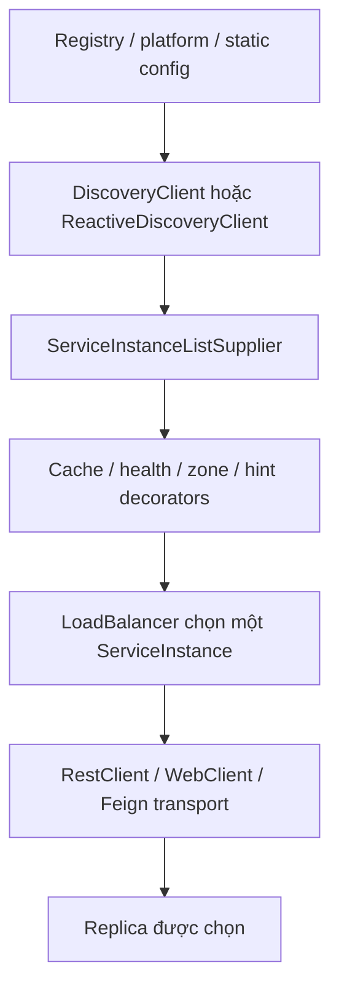

# Chọn nguồn bản sao, cache và chiến lược sức khỏe

Một client gọi `http://catalog-service/api/products/P42` qua Spring Cloud LoadBalancer cần trả lời ba câu hỏi độc lập: **lấy danh sách bản sao từ đâu, danh sách đó mới đến mức nào, và khi nào một bản sao được coi là đủ khỏe để nhận request?** Nếu chỉ chọn thuật toán round robin mà không thiết kế ba phần này, client vẫn có thể gọi một địa chỉ cũ, gửi traffic tới instance đang khởi động hoặc bỏ lỡ bản sao mới vừa được scale out.

Bài học thuộc chương **Lựa chọn thiết kế** của module `SPRING_CLOUD_SERVICE_COMMUNICATION_LOAD_BALANCING`. Mục tiêu là chọn nguồn `ServiceInstance` phù hợp với môi trường, quyết định có cache hay không và cache bao lâu, chọn cách đánh giá health/readiness, sau đó kết hợp các chính sách theo service ID. Những quyết định này tác động trực tiếp đến độ trễ, độ mới của danh sách, khả năng chịu lỗi và tải phát sinh lên registry cũng như các service.

## 1. Tách ba quyết định thiết kế

Không nên gom discovery, cache và health thành một khái niệm “danh sách instance khỏe”. Chúng có trách nhiệm khác nhau:

| Quyết định | Câu hỏi | Thành phần thường liên quan |
|---|---|---|
| **Nguồn bản sao** | Ai là nguồn sự thật về host, port, service ID và metadata? | Eureka/Consul, Kubernetes, SimpleDiscoveryClient, custom supplier |
| **Độ mới dữ liệu** | Consumer chấp nhận danh sách cũ tối đa bao lâu? | Discovery cache, CachingServiceInstanceListSupplier, TTL/refetch |
| **Chiến lược sức khỏe** | Dựa trên tín hiệu nào để đưa instance vào/ra tập ứng viên? | Registry status, readiness, health-check supplier, policy filter |

Spring Cloud LoadBalancer thường lấy danh sách từ `ServiceInstanceListSupplier` rồi để `ReactorServiceInstanceLoadBalancer` hoặc `BlockingLoadBalancerClient` chọn một phần tử tùy kiểu client. **Supplier cung cấp ứng viên; thuật toán chọn quyết định chọn ai trong số ứng viên đó.** Cache và health là các lớp có thể bao quanh nguồn dữ liệu, không phải thuật toán chọn cuối cùng.

Ví dụ, round robin không thể tự biết một port vừa đóng nếu supplier vẫn trả instance đó. Ngược lại, một health filter có thể loại một số instance nhưng không quyết định phân phối traffic theo round robin hay random.

## 2. Chọn nguồn bản sao theo môi trường

Nguồn discovery nên phù hợp với nền tảng triển khai, khả năng cập nhật endpoint và nhu cầu metadata.

| Nguồn | Khi phù hợp | Ưu điểm | Rủi ro/cần kiểm tra |
|---|---|---|---|
| **Eureka/Consul hoặc registry tương tự** | Nhiều service, nhiều replica, cần đăng ký/deregister và metadata | Có service registry tập trung, health/lease và cập nhật instance | Heartbeat/lease có độ trễ; client có thể cache; phải kiểm tra địa chỉ công bố |
| **Kubernetes discovery/EndpointSlice** | Workload chạy trong Kubernetes và muốn nhìn pod endpoints | Gắn với lifecycle và readiness của Pod/Service | Phải quyết định chọn Pod endpoint trực tiếp hay đi qua ClusterIP/Service VIP; tránh double load balancing |
| **SimpleDiscoveryClient** | Local development, demo, integration test nhỏ | Cấu hình tĩnh, ít thành phần phụ thuộc | Không tự phát hiện instance chết hoặc cập nhật IP/port |
| **ReactiveDiscoveryClient** | Ứng dụng reactive và registry có API reactive thực sự | Có thể lấy danh sách bằng publisher, không chặn event loop nếu implementation đúng | Chữ ký Flux không bảo đảm phần bên trong không blocking |
| **Custom ServiceInstanceListSupplier** | Có nguồn đặc thù, metadata/policy riêng hoặc cần snapshot chuyên biệt | Chủ động định nghĩa ứng viên và dữ liệu | Phải tự chịu trách nhiệm freshness, concurrency, error, cancellation và observability |

### Nguồn discovery không đồng nghĩa nguồn health

Một registry có thể báo instance đang đăng ký, nhưng trạng thái đó có thể dựa trên heartbeat hoặc lease. Một endpoint health có thể kiểm tra readiness sâu hơn, nhưng lại tốn request và có độ trễ probe. Hai tín hiệu bổ sung cho nhau, không nhất thiết thay thế nhau.

### Ví dụ SimpleDiscoveryClient cho local

```yaml
spring:
  cloud:
    discovery:
      client:
        simple:
          instances:
            catalog-service:
              - uri: http://localhost:8081
              - uri: http://localhost:8082
```

Consumer chỉ có thể dùng hai địa chỉ trên nếu cùng môi trường mạng với các process đang lắng nghe. Khi chạy Docker hoặc Kubernetes, localhost trong container/pod consumer trỏ về chính container/pod đó; cần dùng hostname/IP và port truy cập được từ consumer.

Simple discovery thích hợp cho test chọn instance, nhưng **không phải registry động**: dừng process ở 8082 không tự xóa entry khỏi cấu hình. Nếu muốn test health filtering, phải thêm supplier/probe phù hợp hoặc thay đổi snapshot bằng một cơ chế test.

## 3. DiscoveryClient và ServiceInstanceListSupplier có vai trò gì?

Một đường gọi điển hình:



- `DiscoveryClient` hoặc `ReactiveDiscoveryClient` là abstraction lấy instance từ nguồn discovery.
- `ServiceInstanceListSupplier` cung cấp danh sách cho một service ID, có thể phát dữ liệu theo reactive publisher.
- Các supplier decorator có thể cache, lọc health, ưu tiên zone, sticky session hoặc áp hint.
- `ReactorServiceInstanceLoadBalancer` chọn một `ServiceInstance` từ danh sách đã cung cấp.
- HTTP transport mới mở/reuse connection và gửi request.

Đây là ranh giới quan trọng khi thiết kế: **không gọi registry, health endpoint hoặc database đồng bộ trong thuật toán chọn cho từng request**. Hãy để supplier/cache/health mechanism quản lý dữ liệu ứng viên, và để bước chọn thực hiện công việc nhẹ trên snapshot.

## 4. Chọn cache hay không?

Cache giúp giảm số lần truy cập registry và chi phí lấy danh sách, nhưng làm dữ liệu tại consumer có thể cũ hơn. Câu hỏi không phải “cache có tốt không?” mà là **độ trễ cập nhật tối đa nào chấp nhận được và chi phí để đạt độ mới đó là bao nhiêu?**

| Tình huống | Thiết kế cache thường hợp lý | Lý do |
|---|---|---|
| Registry bị hỏi quá thường xuyên, danh sách thay đổi không liên tục | Cache ở supplier với TTL hữu hạn | Giảm registry load và giảm latency lookup |
| Registry có push/watch cập nhật nhanh, danh sách luôn được duy trì tại client | Có thể giảm hoặc không cần thêm cache LB | Tránh chồng nhiều lớp cache và stale window |
| Endpoint thay đổi rất thường xuyên, yêu cầu failover nhanh | TTL ngắn hoặc cơ chế event-driven refresh | Giảm thời gian giữ địa chỉ cũ |
| Static list trong test | Không cần cache riêng | Nguồn đã nằm trong cấu hình |
| Nhiều service ID với kích thước danh sách khác nhau | Cache có capacity và quan sát theo service | Tránh tăng bộ nhớ không giới hạn |
| Supplier tạo danh sách đắt nhưng ổn định | Cache có TTL và invalidation rõ | Tránh tính lại hoặc truy vấn nguồn cho mỗi request |

Một cache hợp lý phải có **TTL, giới hạn capacity, quy tắc refresh và chính sách khi nguồn lỗi**. Cache vô thời hạn có thể giữ endpoint đã bị xóa; TTL quá ngắn có thể biến registry thành bottleneck. Không nên thêm cache nếu discovery client hoặc platform đã cung cấp cache/event updates mà không hiểu rõ các lớp đó đang chồng lên nhau thế nào.

## 5. Cache của Spring Cloud LoadBalancer

Spring Cloud LoadBalancer có thể dùng `CachingServiceInstanceListSupplier` để cache danh sách do supplier delegate trả về. Cấu hình cụ thể phụ thuộc phiên bản/release train và chuỗi supplier được tạo.

Ví dụ cấu hình minh họa:

```yaml
spring:
  cloud:
    loadbalancer:
      cache:
        enabled: true
        ttl: 25s
        capacity: 256
```

Các giá trị `25s` và `256` chỉ là **giá trị thử nghiệm**, không phải mặc định hay khuyến nghị chung. Hãy chọn dựa trên tốc độ thay đổi replica, thời gian deregistration/lease, số service ID và ngân sách failover. Kiểm tra property metadata của phiên bản đang dùng trước khi áp dụng.

### TTL là một trade-off

- TTL dài hơn: ít lần truy vấn supplier/registry, nhưng consumer có thể tiếp tục chọn địa chỉ cũ lâu hơn.
- TTL ngắn hơn: danh sách được làm mới thường xuyên hơn, nhưng có thể tăng registry traffic và CPU.
- TTL bằng 0 hoặc tắt cache: phù hợp khi nguồn đã cache/push tốt hoặc freshness quan trọng, nhưng chỉ nên làm sau khi đánh giá chi phí lookup.
- Cache capacity: giới hạn số entry được giữ; cần xem số service ID, cách tạo key và hoạt động eviction.

**Cache không phải health check.** Một danh sách được cache nhanh vẫn có thể chứa instance đã chết. Cũng không nên giả định xóa cache là cách duy nhất để phục hồi: có thể cần refresh source, cập nhật readiness/deregister, hoặc xử lý kết nối cũ trong HTTP pool.

## 6. Chọn chiến lược sức khỏe: registration, readiness hay probe?

Tín hiệu sức khỏe cần phản ánh đúng câu hỏi: instance có nên nhận **loại traffic mà caller chuẩn bị gửi** hay không?

| Tín hiệu | Điều nó nói | Giới hạn |
|---|---|---|
| Registry registration/heartbeat | Instance còn đăng ký và cập nhật lease | Có thể còn record sau crash; heartbeat không luôn kiểm tra business readiness |
| Process/liveness | Process còn sống hoặc có thể tự hồi phục | Process sống nhưng dependency chưa sẵn sàng |
| Readiness | Instance sẵn sàng nhận traffic theo điều kiện được định nghĩa | Có thể không bao gồm mọi downstream hoặc endpoint |
| Active health probe từ supplier | Probe HTTP tới từng instance thành công/thất bại | Tốn network; chu kỳ probe tạo detection delay; probe nông có thể bỏ sót lỗi |
| Passive signal từ request thật | Request thực tế gặp connect/response failures | Chỉ phát hiện sau khi người dùng đã có thể bị ảnh hưởng; cần tránh loại instance do lỗi nghiệp vụ đơn lẻ |

Không dùng liveness endpoint thay cho readiness nếu process có thể sống nhưng chưa sẵn sàng phục vụ. Trong Kubernetes, readiness probe có thể quyết định Pod có được đưa vào Service endpoints hay không; nếu LoadBalancer đọc EndpointSlice, tín hiệu readiness có thể đã được phản ánh tại nguồn. Nếu lại thêm health probe ở consumer, cần xác định **nó bổ sung điều gì** để tránh kiểm tra trùng lặp.

### Health không phải một boolean vĩnh viễn

Một instance có thể khỏe ở thời điểm probe nhưng chết ngay sau đó; một lần probe thất bại cũng có thể do packet loss ngắn. Cần chính sách cho số lần thất bại liên tiếp, thời gian phục hồi, probe interval và behavior khi tất cả instance bị đánh giá unhealthy. Không đặt một ngưỡng quá nhạy khiến instance liên tục bị thêm/xóa khỏi tập ứng viên.


## 15. Chọn chính sách theo đặc tính nghiệp vụ

Không có một cấu hình cache/health phù hợp cho mọi service. Cùng một trạng thái “mọi probe đều fail” có thể cần cách xử lý khác nhau tùy hậu quả của request.

### Catalog: ưu tiên availability và độ mới vừa phải

- Dùng registry hoặc platform discovery đáng tin cậy.
- Cache TTL hữu hạn để giảm lookup, nhưng giới hạn stale window theo yêu cầu dữ liệu.
- Health probe chỉ khi registry/readiness chưa cung cấp tín hiệu đủ nhanh.
- Nếu mọi instance tạm thời không sẵn sàng, có thể cân nhắc stale read-only fallback ngắn hạn nếu nghiệp vụ chấp nhận dữ liệu cũ.
- Đo cache age, số instance, connect failure và latency.

### Inventory: ưu tiên tính đúng và readiness

- Nguồn instance cần phản ánh trạng thái sẵn sàng cho thao tác ghi.
- Không dựa vào liveness hoặc probe quá nông.
- Cache/stale fallback thận trọng hơn vì có thể định tuyến tới instance không còn khả năng ghi.
- Retry thao tác reserve chỉ với idempotency key và trạng thái xử lý rõ.
- Khi không có instance khỏe, fail fast hoặc circuit breaker theo hợp đồng nghiệp vụ.

### Notification: ưu tiên khả năng tiếp nhận và hàng đợi

- Health có thể kiểm tra listener và khả năng ghi vào queue.
- Một replica có thể trả HTTP 200 nhưng queue downstream đã đầy; readiness nên phản ánh capacity cần thiết.
- Cache TTL có thể dài hơn nếu replica thay đổi ít, nhưng phải có deregistration/drain.
- Giới hạn retry để tránh nhân message hoặc gửi trùng.

Đây là ví dụ thiết kế, không phải cấu hình bắt buộc. Mỗi service cần định nghĩa readiness và stale tolerance theo tác dụng nghiệp vụ.

## 16. Bài thực hành: so sánh cache và health trên hai bản sao

**Mục tiêu:** quan sát cách nguồn bản sao, TTL và probe làm thay đổi danh sách được chọn khi một replica dừng, khởi động lại hoặc trả readiness fail.

### Chuẩn bị hai replica

Chạy hai bản sao `catalog-service` tại `localhost:8081` và `localhost:8082`. Mỗi bản có:

- `GET /whoami`: trả instance ID.
- `GET /actuator/health/readiness`: trả trạng thái readiness.
- Một công tắc cấu hình test để B có thể trả readiness DOWN mà process vẫn chạy.

Trong consumer, dùng static discovery:

```yaml
spring:
  cloud:
    discovery:
      client:
        simple:
          instances:
            catalog-service:
              - uri: http://localhost:8081
              - uri: http://localhost:8082
```

Bật cache với TTL ngắn trong môi trường lab; cấu hình health check theo API của release train đang dùng và đảm bảo endpoint readiness thực sự có sẵn. Không để endpoint health công khai nếu nó chứa thông tin nhạy cảm.

### Các ca kiểm thử

| Ca | Thay đổi | Điều cần quan sát |
|---|---|---|
| A — Baseline | A/B khỏe | Danh sách có hai instance, cả hai có thể được chọn |
| B — Dừng B | Giữ static discovery, tắt process B | Entry B vẫn còn; connect failure nếu được chọn và chưa health-filter |
| C — Readiness DOWN | B còn listener nhưng trả readiness DOWN | Probe phát hiện theo interval; danh sách ứng viên thay đổi theo policy |
| D — Cache dài | Tăng TTL đáng kể | Thời gian giữ snapshot cũ có thể dài hơn |
| E — Cache ngắn | Giảm TTL | Registry/supplier refresh thường xuyên hơn, cần đo lookup load |
| F — All unhealthy | A/B đều DOWN | Xác minh fail-open/fail-closed theo implementation |
| G — B hồi phục | B readiness UP trở lại | Đo thời gian instance quay lại tập ứng viên |
| H — Registry/source lỗi | Supplier phát error hoặc không phản hồi | Phân biệt error/timeout với danh sách rỗng |

### Ghi kết quả

| Thời điểm | Source instance count | Candidate count | Chosen instance | Cache age | Probe outcome | Request result |
|---|---:|---:|---|---:|---|---|
| Baseline | 2 | 2 | A/B | Đo thực tế | UP/UP | 200 |
| B stopped | 2 | Theo policy | A hoặc B | Đo thực tế | UP/fail | 200 hoặc connect error |
| B readiness DOWN | 2 | Theo health filter | A nếu B bị loại | Đo thực tế | UP/DOWN | 200 nếu A khỏe |
| All unhealthy | 2 | Theo fallback policy | Không có hoặc delegate | Đo thực tế | DOWN/DOWN | No-instance hoặc fallback |
| B recovered | 2 | Theo chu kỳ refresh | A/B | Đo thực tế | UP/UP | 200 |

Các ô “theo policy” cần được điền bằng kết quả runtime; **không điền trước** một kết quả giả định. Thứ tự decorator, probe interval, cache TTL và fail-open behavior quyết định kết quả thực tế.

## 17. Kiểm thử cần có trước production

Ngoài happy path, cần test các trạng thái dữ liệu và thời gian:

1. Supplier trả hai instance hợp lệ, thuật toán chọn hoạt động.
2. Danh sách rỗng: LoadBalancer trả kết quả no-instance phù hợp.
3. Supplier phát error: lỗi không bị biến thành empty list một cách vô tình.
4. Supplier chậm hoặc không phát: selection deadline hoạt động.
5. Một instance bị deregister: cache/supplier loại nó trong thời gian chấp nhận.
6. Một instance có port sai: health/connectivity phát hiện đúng tầng.
7. Health endpoint DOWN: instance được xử lý theo fail-open/fail-closed đã chọn.
8. Tất cả instance DOWN: không tạo vòng retry vô hạn hoặc probe amplification.
9. Instance hồi phục: được đưa lại vào danh sách theo thời gian refresh dự kiến.
10. Metadata zone/weight thiếu hoặc sai: fallback rõ ràng.
11. Nhiều request đồng thời: snapshot immutable và supplier thread-safe.
12. Registry lỗi trong khi cache còn dữ liệu: stale fallback đúng max-staleness.
13. Rolling deployment: instance mới được thêm và instance cũ được drain/deregister.
14. Nhiều consumer cùng probe: tổng health traffic nằm trong capacity đã dự toán.

Có thể dùng `StepVerifier` để kiểm thử supplier reactive, test fixture/mocked discovery client cho danh sách, và hai process/container thật cho integration test về TCP/health. Một unit test supplier **không** chứng minh DNS, TLS, network policy hoặc listener production hoạt động đúng.

## 18. Metrics và logs để đánh giá lựa chọn

Các chỉ số nên được thiết kế quanh ba câu hỏi nguồn–freshness–health:

| Tín hiệu | Dùng để đánh giá |
|---|---|
| Instance count từ discovery | Registry có cung cấp đủ bản sao không? |
| Candidate count sau supplier chain | Health/zone/hint filter loại bao nhiêu instance? |
| Snapshot/cache age | Consumer đang chọn từ dữ liệu cũ bao lâu? |
| Refresh duration/error | Nguồn registry có chậm hoặc lỗi không? |
| Health probe success/failure/latency | Instance nào đang bị loại và vì sao? |
| No-instance outcome | Không có ứng viên hay supplier gặp lỗi? |
| Selected instance theo trace/log | Traffic phân phối tới replica/zone nào? |
| Connect/TLS failure rate | Instance được chọn có thực sự kết nối được không? |
| Request p95/p99 và error rate | Policy cải thiện SLO hay làm tăng tail latency? |
| Health traffic rate | Probe có tạo tải phụ đáng kể không? |

Không gắn raw IP, instance ID thay đổi liên tục, request ID hoặc trace ID vào mọi metric label nếu cardinality không được kiểm soát. Dùng trace/log để điều tra instance cụ thể; metrics nên dùng service ID, zone đã giới hạn, outcome và stage.

## 19. Anti-pattern thường gặp

| Anti-pattern | Hệ quả | Cách thay thế |
|---|---|---|
| Registry có instance nên coi như khỏe | Chọn endpoint đã chết/sai port | Kết hợp readiness/health và kiểm tra connectivity |
| Cache không TTL | Dùng snapshot cũ vô thời hạn | TTL, refresh và max-staleness |
| TTL cực ngắn cho mọi service | Registry traffic tăng, lookup bottleneck | Chọn TTL theo tốc độ thay đổi và SLO |
| Probe health ở mỗi lần chọn | Nhân request phụ theo traffic | Probe định kỳ hoặc dùng readiness từ platform |
| Probe liveness thay readiness | Instance chưa phục vụ vẫn nhận traffic | Endpoint readiness phù hợp |
| Tất cả health fail thì âm thầm fallback list gốc | Định tuyến đến instance đã bị đánh giá unhealthy mà không biết | Quy định fail-open/fail-closed và metric |
| Cache kết quả đã lọc theo request context dùng chung | Rò zone/hint/tenant policy giữa requests | Đặt decorator đúng thứ tự, cache raw data khi phù hợp |
| Nhiều lớp cache không hiểu TTL | Stale window cộng dồn | Vẽ rõ cache layers và tổng freshness budget |
| Chỉ dùng static discovery cho production động | Instance chết vẫn ở danh sách | Registry/platform discovery |
| Gộp supplier error thành empty list | Mất nguyên nhân registry timeout/lỗi code | Phân loại empty/error/timeout |
| Thêm health check nhưng không dự toán fan-out | Tăng tải vào mọi replica | Tính consumers × instances × probe rate |
| Đưa URL/host tùy ý vào supplier từ user input | Rủi ro SSRF và lộ credential | Chỉ dùng nguồn service identity được kiểm soát |
| Dùng zone preference mà không fallback | Zone local lỗi làm service mất khả năng phục vụ | Test policy fallback liên zone |

## 20. Checklist quyết định trước khi phát hành

1. Nguồn sự thật của instance là registry, Kubernetes endpoints, static list hay supplier tùy biến?
2. Client đang chọn từng Pod/replica hay gọi một virtual IP/Service đã được platform load balance?
3. Discovery implementation có reactive thực sự không, hay có blocking I/O cần cô lập?
4. Registry heartbeat/lease/deregister và readiness có độ trễ bao lâu?
5. Có cần cache ở LoadBalancer khi discovery client đã cache hoặc push updates không?
6. TTL, capacity và refresh policy có nằm trong freshness budget của service không?
7. Cache có thể giữ danh sách cũ sau restart/scale-down trong bao lâu?
8. Health signal dùng readiness hay liveness? Endpoint có đúng khả năng nhận traffic không?
9. Active health probe có cần thiết, interval/timeout/failure threshold và tổng fan-out là bao nhiêu?
10. Khi mọi instance unhealthy hoặc health source lỗi, hệ thống fail-open, fail-closed hay stale fallback?
11. Thứ tự supplier/cache/health/zone decorator có được xác minh theo release train và request context không?
12. Chính sách zone/sticky/weight có test cho missing metadata, zone outage và fallback không?
13. No-instance, supplier error, timeout, connect failure và HTTP 503 có được quan sát riêng không?
14. Có metric về candidate count, cache age, probe outcome, selected instance và health traffic không?
15. Đã kiểm thử dừng/restart replica, cache stale, registry lỗi, all unhealthy và rolling deployment trong staging chưa?
16. Có tài liệu hóa lý do chọn TTL/health interval dựa trên SLO và tải registry không?

**Kết luận:** Thiết kế tốt cho Spring Cloud LoadBalancer bắt đầu từ việc chọn **nguồn bản sao đáng tin cậy**, quyết định **độ mới của snapshot** và định nghĩa **tín hiệu sức khỏe phù hợp với traffic**. Discovery cung cấp thông tin, cache cân bằng freshness với chi phí lookup, health/readiness kiểm soát tập ứng viên, còn LoadBalancer mới chọn instance cuối cùng. Khi phân tách các trách nhiệm này, kiểm thử rõ fail-open/fail-closed và quan sát cache age/probe/selection, hệ thống có thể scale và phục hồi mà không vô tình gửi request tới replica cũ hoặc làm registry quá tải.


## 7. Active health check trong ServiceInstanceListSupplier

Spring Cloud LoadBalancer có supplier liên quan health check, thường được biết tới với tên `HealthCheckServiceInstanceListSupplier`. Supplier này có thể định kỳ kiểm tra instance và phát danh sách phù hợp với kết quả probe; API và cách cấu hình cần đối chiếu phiên bản Spring Cloud.

Ví dụ properties minh họa:

```yaml
spring:
  cloud:
    loadbalancer:
      health-check:
        initial-delay: 2s
        interval: 20s
        path:
          default: /actuator/health/readiness
          catalog-service: /actuator/health/readiness
```

Các giá trị path và interval ở đây là ví dụ. Endpoint `/actuator/health/readiness` phải thực sự được bật, có thể truy cập từ consumer/health checker và trả trạng thái đúng khi instance sẵn sàng. Nếu readiness group chưa được cấu hình, endpoint này có thể không tồn tại hoặc có ngữ nghĩa khác dự kiến.

**Không probe endpoint có side effect** như reserve stock, tạo order hoặc thanh toán. Probe cần nhẹ, an toàn, có timeout và chỉ xác minh các điều kiện cần để nhận traffic. Cũng cần bảo vệ endpoint health khỏi bị expose công khai nếu nó tiết lộ thông tin hạ tầng.

### Chọn interval theo detection budget

Nếu probe chạy mỗi 20 giây, một lỗi vừa xuất hiện có thể tồn tại cho tới lần probe tiếp theo và quá trình cập nhật kết quả. Thời gian phát hiện thực tế còn phụ thuộc timeout, số lần thất bại cần thiết và cách supplier publish snapshot.

Interval ngắn hơn giúp phát hiện nhanh nhưng tăng request health. Với N instance và interval I giây, số probe trung bình xấp xỉ `N/I` request mỗi giây cho một service ID nếu mỗi instance được probe một lần mỗi chu kỳ. Đây chỉ là ước lượng; retry, concurrency, nhiều consumer và nhiều service ID có thể làm tổng lớn hơn đáng kể.

## 8. Cache và health supplier phải được kết hợp có chủ đích

Chuỗi supplier thường là tập hợp decorator. Một ví dụ minh họa trong các phiên bản có builder API tương ứng:

```java
package com.example.cataloglbconfig;

import org.springframework.cloud.loadbalancer.core.ServiceInstanceListSupplier;
import org.springframework.context.ConfigurableApplicationContext;
import org.springframework.context.annotation.Bean;
import org.springframework.context.annotation.Configuration;

@Configuration(proxyBeanMethods = false)
public class CatalogSupplierConfiguration {

    @Bean
    ServiceInstanceListSupplier catalogServiceInstanceListSupplier(
            ConfigurableApplicationContext context) {

        return ServiceInstanceListSupplier.builder()
                .withDiscoveryClient()
                .withCaching()
                .withHealthChecks()
                .build(context);
    }
}
```

Đây là ví dụ về **ý tưởng ghép supplier**, không phải đoạn code dùng nguyên xi cho mọi Spring Cloud release train. Một số phiên bản có lựa chọn builder riêng cho blocking/reactive discovery; có phiên bản cần cấu hình health-check WebClient hoặc health path riêng. Hãy dùng builder/API đúng với dependency thực tế và kiểm tra thứ tự decorator được tài liệu phiên bản khuyến nghị.

Những câu hỏi phải trả lời khi xếp thứ tự:

- Cache đang giữ danh sách raw từ discovery hay danh sách đã qua zone/hint/health filtering?
- Health probe có được chạy trên snapshot đã cache hay mỗi lần refresh lại lấy danh sách mới?
- Kết quả lọc có phụ thuộc request context, zone, hint hoặc tenant không? Nếu có, cache chung kết quả đã lọc có thể làm rò policy giữa requests.
- Khi cache chứa instance đã bị deregister, health supplier có phát hiện và loại nó trong detection budget không?
- Khi tất cả instance không khỏe, supplier trả danh sách rỗng hay fallback về delegate list?

**Không mặc định thứ tự cache/health luôn giống nhau giữa các phiên bản và mọi chain.** Thứ tự sai có thể làm probe không bao giờ nhìn thấy instance mới hoặc cache một danh sách lọc theo context không phù hợp.

## 9. Cấu hình supplier riêng cho một service ID

Nếu chỉ `catalog-service` cần cache và health policy riêng, cấu hình named client thay vì áp dụng cho mọi service.

```java
package com.example.cataloglbconfig;

import org.springframework.cloud.loadbalancer.core.ServiceInstanceListSupplier;
import org.springframework.context.ConfigurableApplicationContext;
import org.springframework.context.annotation.Bean;
import org.springframework.context.annotation.Configuration;

@Configuration(proxyBeanMethods = false)
public class CatalogLoadBalancerConfiguration {

    @Bean
    ServiceInstanceListSupplier catalogSupplier(
            ConfigurableApplicationContext context) {

        return ServiceInstanceListSupplier.builder()
                .withDiscoveryClient()
                .withCaching()
                .withHealthChecks()
                .build(context);
    }
}
```

Đăng ký cấu hình tại consumer:

```java
package com.example.orders;

import com.example.cataloglbconfig.CatalogLoadBalancerConfiguration;
import org.springframework.boot.SpringApplication;
import org.springframework.boot.autoconfigure.SpringBootApplication;
import org.springframework.cloud.loadbalancer.annotation.LoadBalancerClient;

@SpringBootApplication
@LoadBalancerClient(
        name = "catalog-service",
        configuration = CatalogLoadBalancerConfiguration.class)
public class OrderApplication {

    public static void main(String[] args) {
        SpringApplication.run(OrderApplication.class, args);
    }
}
```

Đặt `CatalogLoadBalancerConfiguration` **ngoài package component scan chính** nếu nó chỉ dành cho child context của `catalog-service`. Nếu cấu hình bị quét vào parent context, bean supplier có thể tác động các service khác ngoài ý muốn. Các class builder và method có thể thay đổi theo release train; hãy kiểm tra API đang dùng, đặc biệt nếu registry chỉ cung cấp blocking `DiscoveryClient`.

Nếu mọi service đều cần cùng chính sách, có thể cân nhắc default LoadBalancer configuration, nhưng cần kiểm tra tác động đến service có yêu cầu khác: cache TTL, health endpoint, zone và khả năng scale. Không áp dụng một path readiness duy nhất cho mọi service nếu chúng có hợp đồng readiness khác nhau.

## 10. Chọn zone và metadata sau khi đã có danh sách

Zone preference là một policy về **vị trí** của instance. Nó không phải health check và không bảo đảm instance trong zone local khỏe hơn instance remote.

Ví dụ metadata:

```text
catalog-a:
  zone = ap-southeast-1a
  weight = 100

catalog-b:
  zone = ap-southeast-1b
  weight = 100

catalog-c:
  zone = ap-southeast-1c
  weight = 100
```

Một thiết kế có thể ưu tiên zone gần caller để giảm latency và chi phí cross-zone, rồi fallback sang zone khác nếu không còn instance hợp lệ. Cần quy định:

- Caller xác định zone của mình từ đâu?
- Metadata zone do registry hay platform cấp, có được validate không?
- Nếu local zone không có instance thì fallback remote hay fail closed?
- Cache có vô tình giữ danh sách đã lọc theo zone của caller khác không?
- Một zone mất kết nối nhưng health probe từ consumer khác vẫn thành công thì policy xử lý ra sao?

`ZonePreferenceServiceInstanceListSupplier` hoặc các cơ chế tương ứng có thể hỗ trợ ưu tiên zone trong các release train phù hợp. Hãy kiểm tra tên/API và behavior fallback trước khi dùng. Không thay thế policy cũ bằng một class có tên gần giống mà không có test.

## 11. Sticky session, hint và weighted instance: chỉ thêm khi có nhu cầu

Một số hệ thống có yêu cầu phân phối ngoài round robin:

| Chính sách | Nguồn dữ liệu cần có | Lợi ích | Chi phí/rủi ro |
|---|---|---|---|
| Sticky session | Cookie, request hint hoặc affinity key | Một client có thể tiếp tục tới cùng instance | Instance chết phải fallback; stateful session làm giảm khả năng phân phối đều |
| Hint-based selection | Header/hint được kiểm soát | Caller chọn nhóm instance theo nhu cầu hợp lệ | Không để input người dùng chọn host tùy ý |
| Weighted selection | Weight metadata/capacity | Replica lớn nhận tỷ lệ traffic cao hơn | Weight cũ hoặc sai có thể làm quá tải |
| Zone preference | Zone caller và zone instance | Giảm latency/cross-zone traffic | Có thể dồn tải vào zone local |
| Same-instance preference | Instance trước đó và request context | Giảm cache misses hoặc tăng locality | Cần fallback và tránh giữ instance không khỏe |

Các tính năng này không nên được ghép vào chỉ vì “có thể”. Bắt đầu với nguồn instance chính xác, cache phù hợp và health/readiness đáng tin. Chỉ thêm sticky/weight/zone khi có yêu cầu định lượng và có metric chứng minh hiệu quả.

## 12. Khi nào không nên bật active health check ở LoadBalancer?

Health check chủ động tạo traffic phụ tới từng replica. Nếu platform đã có readiness và registry chỉ quảng bá endpoint Ready, probe ở mỗi consumer có thể trùng lặp và nhân tải.

| Điều kiện môi trường | Quyết định thường hợp lý |
|---|---|
| Kubernetes Service đã lọc Pod theo readiness, client gọi ClusterIP | Thường không cần thêm probe từng Pod tại LoadBalancer |
| Consumer nhận trực tiếp Pod endpoints và registry status chậm | Có thể cần health filtering ở client, nếu đo được lợi ích |
| Service có hàng nghìn replica và nhiều consumer | Cẩn thận probe amplification; ưu tiên health từ control plane/push |
| Endpoint readiness đắt hoặc gọi nhiều dependency | Không probe dày; dùng tín hiệu platform phù hợp |
| Chỉ có danh sách static trong lab | Health probe có thể hữu ích để mô phỏng phát hiện instance chết |
| API health không thể truy cập từ caller do security boundary | Dùng registry/readiness hoặc cơ chế health nội bộ phù hợp |

Giả sử 100 consumer đều probe 500 replicas mỗi 10 giây, lượng health traffic có thể lên tới 5.000 probes/giây nếu mỗi consumer kiểm tra tất cả bản sao. Con số này minh họa **fan-out**, không phải mặc định mọi implementation sẽ probe theo cách đó. Trước khi bật, hãy tính tổng số consumer × số instance × tần suất và concurrency.

## 13. Xử lý tình huống tất cả instance không khỏe

Khi health filter loại hết ứng viên, cần một quyết định rõ ràng:

- **Fail closed:** trả danh sách rỗng/no-instance để caller fail fast hoặc fallback.
- **Fail open:** trả lại danh sách delegate ban đầu để vẫn có cơ hội gọi một instance, chấp nhận rủi ro endpoint không khỏe.
- **Stale fallback:** dùng snapshot trước đó trong một khoảng max-staleness khi registry/health source tạm lỗi.
- **Circuit breaker/fallback nghiệp vụ:** từ chối có kiểm soát hoặc trả dữ liệu fallback đã được thiết kế.

Không có lựa chọn nào đúng cho mọi service. Ví dụ, API đọc catalog có thể chấp nhận stale fallback ngắn nếu dữ liệu không nhạy; API reserve inventory hoặc payment có thể cần fail closed để tránh tác dụng phụ sai.

| Tình huống | Read-only catalog | Reserve inventory/payment |
|---|---|---|
| Tất cả probe fail | Có thể dùng stale snapshot ngắn theo policy | Thường fail closed hoặc circuit breaker |
| Registry tạm lỗi nhưng cache còn mới | Có thể tiếp tục dùng cache trong giới hạn | Cân nhắc chặt hơn theo yêu cầu consistency |
| Một replica probe fail | Loại replica, thử replica khác nếu còn budget | Chỉ retry nếu idempotency và trạng thái rõ |
| Health endpoint timeout | Không coi tự động là business failure | Không tự động thực hiện thao tác ghi |
| Không có instance | Trả lỗi dependency rõ ràng | Trả lỗi rõ, không tạo giao dịch dở dang |

Nếu supplier fallback về danh sách gốc, hãy ghi nhận trạng thái fallback và tuổi dữ liệu. Không âm thầm coi instance bị đánh giá unhealthy là healthy.

## 14. Không nhầm lỗi supplier với danh sách rỗng

Ba kết quả cần phân biệt:

| Kết quả supplier | Ý nghĩa | Hành vi quan sát |
|---|---|---|
| Phát `List.of()` | Có snapshot nhưng không có ứng viên | LoadBalancer có thể trả EmptyResponse |
| `Flux.empty()` | Supplier hoàn tất mà không phát snapshot | Tùy adapter/LoadBalancer, thường không có instance để chọn |
| `Flux.error(cause)` | Registry/supplier gặp lỗi | Lỗi cần giữ nguyên nguyên nhân và phân loại |
| Publisher không phát trước deadline | Nguồn chậm/treo | Timeout/cancellation |
| Có instance nhưng transport lỗi | Đã chọn được đích | Connect/TLS/response error sau selection |

Không viết `onErrorResume(error -> Mono.just(List.of()))` cho mọi lỗi nếu chưa có chủ đích. Cách đó biến registry timeout, lỗi parsing metadata và lỗi lập trình thành “không có instance”, làm dashboard sai và khiến retry policy không phân biệt được nguyên nhân.

Ở ranh giới API public, có thể ánh xạ nhiều lỗi thành `503 DEPENDENCY_UNAVAILABLE`, nhưng logs/traces nội bộ cần giữ `failureStage=discovery|supplier|selection|connect|tls|response`.


