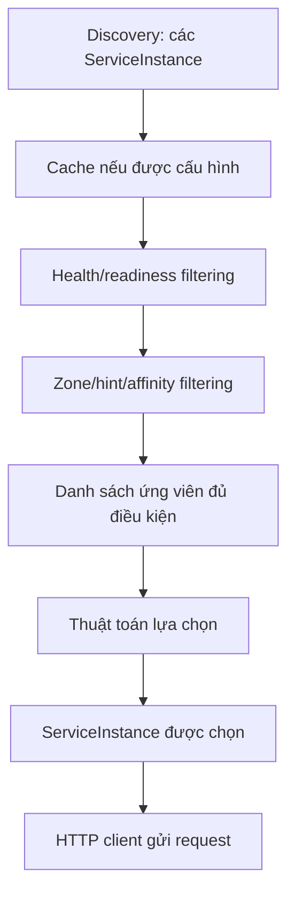

# Chọn thuật toán theo mức đồng đều và đặc điểm yêu cầu

Khi một service có nhiều bản sao, thuật toán cân bằng tải quyết định **request tiếp theo được gửi tới instance nào** trong tập ứng viên đủ điều kiện. Round Robin thường là điểm khởi đầu vì dễ hiểu và phân phối lượt chọn khá đều khi các instance có năng lực tương đương. Nhưng “đều số request” không phải lúc nào cũng đồng nghĩa “đều tải”, “độ trễ thấp” hay “tận dụng công suất tốt”.

Ví dụ `order-service` gọi `inventory-service` có ba replica. Nếu mỗi request chỉ đọc một SKU nhỏ, Round Robin có thể phù hợp. Nhưng nếu một số request chạy truy vấn tổng hợp nặng, replica có cấu hình CPU khác nhau hoặc một zone có độ trễ mạng cao hơn, chia đều số lượt chọn có thể tạo ra tải không đồng đều. Khi đó cần xem xét trọng số, locality, mức đồng thời, latency hoặc affinity.

Bài này thuộc chương **Lựa chọn thiết kế** của module `SPRING_CLOUD_SERVICE_COMMUNICATION_LOAD_BALANCING`. Mục tiêu là lựa chọn thuật toán dựa trên **mức đồng đều mong muốn và đặc điểm thực tế của request**, đồng thời hiểu vai trò của `ServiceInstanceListSupplier`, discovery, health check, zone, retry và HTTP client như RestClient, WebClient, OpenFeign.

> **Nguyên tắc lựa chọn:** trước tiên lọc ra những instance đủ điều kiện; sau đó mới chọn thuật toán phù hợp với workload. Thuật toán không thể bù cho discovery sai, replica không khỏe, capacity thiếu hoặc retry không được kiểm soát.

## 1. “Đồng đều” có nhiều nghĩa khác nhau

Khi nói một thuật toán phân phối đều, cần hỏi **đều theo đại lượng nào**:

| Khía cạnh | Câu hỏi | Ví dụ metric |
| --- | --- | --- |
| Số lượt chọn | Mỗi instance được chọn bao nhiêu lần? | Selection count theo instance |
| Số HTTP attempt tới server | Mỗi replica thực sự nhận bao nhiêu attempt? | Server request count |
| Số request đang xử lý | Mỗi instance có bao nhiêu request in-flight? | Active requests/concurrency |
| Chi phí xử lý | CPU time, DB query hoặc byte xử lý có phân bố đều không? | CPU, execution time, bytes |
| Độ trễ người gọi | Người dùng nhận response nhanh và ổn định không? | p50/p95/p99 |
| Công suất sử dụng | Replica có quá tải trong khi replica khác rảnh không? | Utilization, queue, saturation |
| Locality | Request có ưu tiên vùng gần caller không? | Same-zone ratio, network latency |
| Affinity | Một nhóm request có cần quay lại cùng instance không? | Session/hash distribution |

Một thuật toán có thể đạt tỷ lệ selection gần 1/3 cho mỗi replica nhưng CPU vẫn lệch 80%/10%/10%, vì request tới replica thứ nhất nặng hơn. Ngược lại, weighted routing có thể cố ý gửi 50% request tới replica mạnh và 25% tới mỗi replica yếu hơn; số lượt chọn không đều nhưng công suất có thể được khai thác tốt hơn.

Do đó, không nên đặt mục tiêu “mỗi instance phải có cùng số request” nếu đặc điểm xử lý của request hoặc capacity khác nhau.

## 2. Bắt đầu bằng tập ứng viên đủ điều kiện

Spring Cloud LoadBalancer không chọn từ mọi địa chỉ mà ứng dụng biết. Danh sách đưa tới thuật toán thường được xây qua `ServiceInstanceListSupplier`, có thể kết hợp discovery, cache, health check, zone preference, hint hoặc retry context.



Ví dụ discovery trả `[A, B, C, D]` nhưng health supplier loại B và zone policy chỉ ưu tiên A/C. Thuật toán lựa chọn chỉ thấy `[A, C]`. Không thể kết luận Round Robin phân phối lệch khi thực tế đầu vào của nó chỉ có hai instance.

Cần tách hai câu hỏi:

1. **Instance nào được phép nhận request?** Đây là vấn đề discovery, readiness, health, zone, hint và policy.
2. **Trong các instance được phép, nên chọn instance nào?** Đây mới là vấn đề thuật toán.

Nếu danh sách đầu vào sai hoặc cũ, thay Round Robin bằng Random hay Weighted không giải quyết được nguyên nhân.

## 3. Các yếu tố quyết định thuật toán

Trước khi chọn thuật toán, hãy mô tả workload theo những thuộc tính sau:

- **Năng lực replica:** cùng cấu hình CPU/RAM, cùng giới hạn connection và cùng loại phần cứng hay không?
- **Chi phí request:** thời gian xử lý và số tài nguyên cho mỗi request có gần nhau không?
- **Mức đồng thời:** request ngắn và request dài có trộn trong cùng pool không?
- **Arrival pattern:** tải đều, burst ngắn hay có đỉnh theo giờ?
- **Locality:** caller và replica ở cùng zone/region hay có chi phí mạng khác nhau?
- **Affinity:** session, cache cục bộ hoặc dữ liệu phân vùng có cần quay lại cùng instance không?
- **Khả năng quan sát:** có biết số request đang xử lý, latency và saturation theo instance không?
- **Thời gian hội tụ:** metric/weight/health có cập nhật đủ nhanh và đáng tin cậy không?
- **Failure mode:** khi một instance chậm hoặc chết, thuật toán có tránh tiếp tục dồn request vào nó không?

Nếu không có dữ liệu per-instance đủ tin cậy, thuật toán phụ thuộc tải như least-connections hoặc latency-aware có thể đưa ra quyết định dựa trên tín hiệu thiếu hoặc trễ. Một chính sách đơn giản nhưng ổn định đôi khi tốt hơn thuật toán phức tạp mà không có telemetry phù hợp.

## 4. Round Robin: lựa chọn mặc định dễ dự đoán

Round Robin lần lượt đi qua danh sách instance:

```text
Candidates: [A, B, C]

Selection sequence:
A -> B -> C -> A -> B -> C -> ...
```

Với một bộ chọn, danh sách ổn định và không có request bị loại trước khi tới server, số lượt chọn giữa các instance thường chênh lệch tối đa khoảng một lượt trong một chuỗi đủ dài.

**Ưu điểm:** dễ hiểu, dễ vận hành, không cần biết CPU/latency/concurrency, phù hợp khi replica tương đương và request có chi phí gần nhau.

**Giới hạn:** không biết request tiếp theo nặng hay nhẹ; không biết instance A đang có nhiều request dài hơn B; không tự ưu tiên cùng zone; không tự phát hiện replica chậm nếu supplier vẫn giữ nó; nhiều caller có bộ đếm riêng; danh sách thay đổi làm thứ tự và phân phối thay đổi.

Trong Spring Cloud LoadBalancer, `RoundRobinLoadBalancer` là thuật toán mặc định phổ biến. Nó nhận danh sách từ supplier rồi chọn một instance theo cơ chế vòng. Cần kiểm tra version và cấu hình cụ thể, đặc biệt nếu đã thay bean hoặc cấu hình per-client.

**Nên chọn Round Robin khi** các instance có capacity tương đương, request có chi phí tương tự và mục tiêu là phân phối lượt chọn đơn giản, dễ dự đoán.

## 5. Random: lựa chọn ngẫu nhiên và sai số thống kê

Random chọn một instance ngẫu nhiên trong danh sách:

```text
Candidates: [A, B, C]

Possible sequence:
B -> A -> C -> C -> A -> B -> ...
```

Trong một khoảng ngắn, số lượt chọn có thể lệch khá rõ. Khi số lượng request lớn và lựa chọn độc lập, tỷ lệ trung bình có xu hướng tiến gần phân phối xác suất.

Nếu có `n` request và `m` instance ngang nhau, mỗi instance có xác suất `1/m`. Số lượt chọn kỳ vọng:

\[
E[X] = \frac{n}{m}
\]

Độ lệch chuẩn:

\[
\sigma = \sqrt{n\frac{1}{m}\left(1-\frac{1}{m}\right)}
\]

Ví dụ 900 request và 3 instance: mỗi instance kỳ vọng 300 lượt, nhưng không có cam kết chính xác mỗi bên đúng 300. Sai số tương đối giảm khi n lớn.

Random phù hợp khi muốn lựa chọn đơn giản và chấp nhận lệch ngắn hạn. Nó không phù hợp nếu cần phân phối chính xác trong cửa sổ ngắn, request có chi phí khác nhau hoặc cần affinity. Không mặc định mọi phiên bản Spring Cloud LoadBalancer đều expose cùng cách cấu hình Random; hãy xác minh implementation và cách đăng ký bean của version đang chạy.

## 6. Weighted Round Robin: phân phối theo capacity

Khi replica có năng lực khác nhau, có thể gán trọng số:

| Instance | Capacity tương đối | Weight |
| --- | ---: | ---: |
| A | 2 đơn vị | 2 |
| B | 1 đơn vị | 1 |
| C | 1 đơn vị | 1 |

Mục tiêu phân phối lượt chọn gần tỷ lệ `2:1:1`:

```text
A: 50%
B: 25%
C: 25%
```

Nếu có 1.000 request có chi phí gần nhau, số lượt chọn kỳ vọng là A khoảng 500, B khoảng 250, C khoảng 250. Cách phân phối này **không đồng đều về số lượt**, nhưng có thể phù hợp hơn với capacity.

Weight có thể dựa trên CPU/RAM được cấp, benchmark capacity, giới hạn concurrency đã kiểm chứng, tier phần cứng hoặc chính sách canary. Không nên dùng CPU tức thời làm weight mà không làm mượt, vì weight dao động có thể khiến traffic chuyển qua lại liên tục. Cần giới hạn min/max, smoothing, hysteresis và cooldown.

Weight không phải lời hứa về công suất. Nếu request A tiêu thụ CPU gấp mười request B, weight theo số core có thể vẫn phân phối sai. Weight cần phản ánh **capacity cho loại workload đang cân bằng**, không chỉ cấu hình phần cứng trên giấy.

Weighted routing có thể triển khai qua custom load balancer, supplier metadata hoặc proxy/mesh có hỗ trợ. Không giả định `RoundRobinLoadBalancer` mặc định tự đọc metadata tên `weight` nếu chưa có implementation thực hiện việc đó.

## 7. Least Connections: ưu tiên instance có ít request đồng thời

Least Connections chọn instance có số kết nối hoặc request đang hoạt động thấp nhất.

| Instance | Active requests | Lựa chọn kế tiếp |
| --- | ---: | --- |
| A | 18 | |
| B | 5 | **B** |
| C | 11 | |

Cách này có thể hữu ích khi request có thời gian xử lý khác nhau: một instance đang giữ nhiều request dài có thể nhận ít request mới hơn.

Tuy nhiên, phải xác định chính xác “connection” hay “request” đang được đếm:

- HTTP/1.1 có thể giữ một connection cho nhiều request tuần tự.
- HTTP/2 có thể multiplex nhiều stream trên một connection.
- Connection tới proxy không nhất thiết tương ứng một request tới Pod.
- Một request có thể chờ queue mà chưa chiếm connection.
- Client-side counter chỉ nhìn thấy request do chính caller tạo, không biết tải từ caller khác.

**Least Connections ở một caller không nhìn thấy toàn bộ in-flight của các caller khác.** Nếu có 20 replica order-service, mỗi process có số đếm riêng, thuật toán cục bộ có thể chọn cùng một instance mà không biết các caller khác cũng đang dồn tới đó.

Nếu cần dùng, phải có tín hiệu concurrency phù hợp với phạm vi quyết định và có cơ chế chống stale data. Với Spring Cloud LoadBalancer, least-connections thường là custom selection strategy hoặc được triển khai ở proxy/mesh có telemetry tương ứng; không nên xem là mặc định.

## 8. Least Response Time và latency-aware routing

Một thuật toán latency-aware có thể ưu tiên instance có response time gần đây thấp hơn:

| Instance | EWMA latency giả định | Tình trạng |
| --- | ---: | --- |
| A | 35 ms | Nhanh |
| B | 42 ms | Nhanh |
| C | 260 ms | Chậm |

Có thể giảm xác suất chọn C hoặc tạm loại C nếu vượt ngưỡng. Nhưng latency quan sát được chịu ảnh hưởng của loại request, network/zone, connection pool, TLS handshake, queue, CPU, GC, dependency, retry và sample size.

Nếu request nặng tình cờ đi tới C còn request nhẹ đi tới A, thuật toán có thể kết luận sai rằng C chậm hơn do năng lực. Nên đo theo endpoint/request class hoặc dùng tín hiệu server-side phù hợp.

Nếu một instance tăng latency, thuật toán giảm traffic; các instance còn lại nhận thêm tải và latency của chúng cũng tăng. Sau đó lựa chọn có thể chuyển qua lại, tạo dao động. Cần smoothing, giới hạn tốc độ đổi weight và cooldown.

Latency-aware routing hữu ích khi có telemetry đáng tin cậy và workload đủ ổn định. Nó không thay health check, circuit breaker hoặc capacity planning.

## 9. Power of Two Choices: giảm tải lệch với ít thông tin

Một kỹ thuật trung gian là chọn ngẫu nhiên hai instance rồi so sánh một chỉ số như active requests; gửi tới instance có tải thấp hơn.

```text
Candidates: [A, B, C, D, E]

Randomly sample: B and D
Active requests: B=12, D=4
Choose: D
```

Ý tưởng này giảm xác suất chọn một instance đang quá tải mà không cần sắp xếp hoặc đọc toàn bộ danh sách. Nhưng kết quả vẫn phụ thuộc chất lượng số đếm và phạm vi quan sát.

Nếu chỉ caller hiện tại biết active requests của chính nó, hai instance có thể đều có số đếm thấp cục bộ trong khi đang bận vì traffic từ caller khác. Thuật toán chỉ có ý nghĩa khi tín hiệu tải phản ánh đúng phạm vi cần cân bằng.

Đây thường là lựa chọn custom hoặc được cung cấp bởi proxy/load balancer khác; không mặc định có sẵn trong cấu hình cơ bản của Spring Cloud LoadBalancer.

## 10. Consistent Hashing: affinity theo key

Một số workload cần cùng một key thường quay về cùng replica, ví dụ cache cục bộ hoặc dữ liệu partitioned. Consistent hashing ánh xạ key sang một vị trí trên vòng hash và chọn instance tương ứng.

```text
hash(customer-101) -> replica A
hash(customer-202) -> replica C
hash(customer-303) -> replica A
```

Khi một replica thêm/bớt, consistent hashing có thể giới hạn số key phải chuyển so với modulo hash đơn giản. Virtual nodes có thể giúp phân phối key đều hơn.

**Ưu điểm:** giữ affinity theo key tương đối ổn định; thêm/bớt instance không nhất thiết làm toàn bộ key remap.

**Rủi ro:** key phân bố lệch hoặc tenant lớn có thể tạo hot spot; instance chết khiến key phải remap và cache miss tăng; hash không bảo đảm capacity nếu workload theo key khác nhau; retry của cùng key có thể quay lại cùng instance.

Không dùng consistent hashing chỉ vì muốn “ổn định hơn Round Robin”. Trước tiên xác định state/cache nào thực sự gắn với instance và liệu có thể đưa state ra ngoài để giảm nhu cầu sticky.

## 11. Sticky Session: khi affinity quan trọng hơn phân phối đều

Sticky session cố gắng giữ request của cùng session/client trên cùng instance. Nó có thể được triển khai bằng cookie, session ID, header hoặc policy của proxy.

| Lợi ích | Rủi ro |
| --- | --- |
| Tận dụng cache/session local | Một instance có thể nhận nhiều session nóng |
| Giảm chi phí tải session từ kho chung | Replica chết làm session phải khôi phục |
| Giảm dữ liệu phải đồng bộ liên tục | Khó cân bằng tải khi session có thời gian sống khác nhau |
| Có thể cải thiện locality | Retry/failover có thể phá affinity |

Sticky session và Round Robin không nhất thiết mâu thuẫn: lần đầu có thể chọn theo thuật toán, các lần sau ưu tiên instance đã gắn với session. Nhưng khi instance lỗi, hệ thống phải có fallback rõ ràng.

Không dùng IP client làm affinity key nếu nhiều người dùng đi qua NAT/proxy chung hoặc địa chỉ thay đổi. Với ứng dụng Spring, cần xác định lớp nào sở hữu session affinity: supplier/hint của client, gateway, Kubernetes session affinity hay mesh. Nhiều cơ chế sticky cùng lúc có thể tạo hành vi khó dự đoán.

## 12. Zone-aware routing: cân bằng trong phạm vi locality

Nếu các replica nằm ở nhiều zone, có thể ưu tiên instance cùng zone với caller để giảm network latency và chi phí liên vùng.

| Instance | Zone | Khoảng cách mạng giả định |
| --- | --- | --- |
| A | zone-a | Gần |
| B | zone-a | Gần |
| C | zone-b | Xa hơn |
| D | zone-b | Xa hơn |

Một zone preference supplier có thể ưu tiên `[A, B]`. Khi A/B không khả dụng, policy có thể fallback sang C/D nếu được cấu hình.

**Zone filtering là bước tạo tập ứng viên**, còn Round Robin/Random/Weighted là bước chọn trong tập đó. Một thuật toán selection đồng đều không tự biết locality nếu supplier đưa tất cả zone vào cùng danh sách và không có metadata/policy phù hợp.

Nếu ưu tiên cùng zone quá mạnh, zone-a có thể thiếu capacity trong khi zone-b còn rảnh. Cần quyết định rõ soft preference hay hard boundary:

- **Soft preference:** ưu tiên local, nhưng có thể failover sang zone khác.
- **Hard boundary:** chỉ cho phép zone được chỉ định; chấp nhận từ chối khi zone đó không có instance.
- **Weighted locality:** chia phần lớn traffic local và một tỷ lệ có kiểm soát sang vùng khác.

Đánh giá same-zone ratio, latency liên vùng và utilization theo zone; không chỉ nhìn số lượt chọn toàn service.

## 13. Request không đồng nhất: chia workload thành lớp

Một thuật toán duy nhất có thể không phù hợp mọi endpoint:

| Request class | Đặc điểm | Chính sách có thể phù hợp |
| --- | --- | --- |
| GET đọc SKU nhỏ | Ngắn, chi phí gần nhau | Round Robin |
| Truy vấn báo cáo lớn | Dài, giữ tài nguyên lâu | Concurrency-aware/bulkhead hoặc pool riêng |
| Request tới replica có cache local | Có key locality | Consistent hashing/affinity nếu lợi ích được đo |
| Request tới replica khác capacity | Năng lực không đồng đều | Weighted routing |
| Request liên vùng | Network latency khác nhau | Zone preference với fallback |
| Ghi reservation | Side effect, retry cần an toàn | Idempotency + retry policy; thuật toán chọn chỉ là một phần |

Nếu endpoint nhẹ và endpoint nặng dùng chung danh sách, Round Robin có thể phân phối đều lượt nhưng vẫn để một số replica xử lý nhiều request nặng hơn. Cân nhắc tách pool/service ID hoặc phân loại workload nếu ranh giới nghiệp vụ và vận hành cho phép.

Không thêm routing hint dựa trên dữ liệu người dùng chưa được kiểm tra hoặc có thể bị giả mạo. Hint chỉ nên là tín hiệu định tuyến đã được xác thực và có fallback rõ.

## 14. So sánh nhanh các thuật toán

| Thuật toán | Mục tiêu | Cần telemetry tải? | Điểm yếu chính |
| --- | --- | --- | --- |
| Round Robin | Chia lượt chọn gần đều | Không | Không biết chi phí request |
| Random | Chọn ngẫu nhiên, phân phối trung bình | Không | Lệch ngắn hạn |
| Weighted Round Robin/Weighted Random | Chia theo capacity/trọng số | Cần weight đáng tin cậy | Weight sai hoặc cập nhật dao động |
| Least Connections | Ưu tiên instance ít kết nối/request đồng thời | Có | Phạm vi đếm có thể không đầy đủ |
| Least Response Time | Ưu tiên latency thấp | Có | Feedback loop, sample bias |
| Power of Two Choices | Giảm xác suất chọn instance đang bận | Có một tín hiệu tải | Tín hiệu cục bộ/stale |
| Consistent Hashing | Affinity theo key | Không bắt buộc | Hot key, remap khi instance thay đổi |
| Sticky Session | Giữ session trên instance | Cần identity/affinity | Hot spot và failover |
| Zone Preference | Ưu tiên locality | Cần zone metadata | Có thể dồn tải trong zone |

Không có thuật toán thắng trong mọi chỉ số. Cần chọn theo mục tiêu ưu tiên và chấp nhận trade-off đã được ghi nhận.

## 15. Ví dụ định lượng: đều request nhưng không đều chi phí

Giả sử có ba instance A/B/C và 300 request:

- 240 request nhẹ, mỗi request tốn 10 ms CPU.
- 60 request nặng, mỗi request tốn 200 ms CPU.

Tổng CPU time:

```text
Light work = 240 × 10 ms = 2.400 ms
Heavy work =  60 × 200 ms = 12.000 ms
Total      = 14.400 ms
```

Nếu Round Robin chia 100 request mỗi replica nhưng request nặng vô tình tập trung nhiều vào A:

| Instance | Request | Request nặng | CPU time |
| --- | ---: | ---: | ---: |
| A | 100 | 35 | 7.000 ms |
| B | 100 | 15 | 3.500 ms |
| C | 100 | 10 | 2.500 ms |

Số request bằng nhau nhưng chi phí lệch gần 3 lần. Đây là ví dụ phân phối workload giả định, không phải bảo đảm Round Robin sẽ tạo đúng lệch này.

Nếu request class có thể được phân loại đáng tin cậy, một policy có thể phân phối hoặc giới hạn concurrency theo class. Tuy nhiên, nếu heavy request chỉ biết nặng sau khi xử lý, cần đo active work/CPU/queue hoặc tách workload bằng kiến trúc phù hợp. Chỉ thêm weight cho replica chưa giải quyết được khác biệt giữa các request.

## 16. Ví dụ weighted routing theo capacity

Giả sử benchmark cho thấy ba replica có capacity tương đối:

```text
A: 600 request/s
B: 300 request/s
C: 300 request/s

Tổng: 1.200 request/s
Tỷ trọng capacity: A=50%, B=25%, C=25%
```

Ở offered load 900 request/s, mục tiêu lý thuyết theo tỷ trọng là:

| Instance | Tỷ trọng | Lượt chọn kỳ vọng |
| --- | ---: | ---: |
| A | 50% | 450 RPS |
| B | 25% | 225 RPS |
| C | 25% | 225 RPS |

Đây chỉ là điểm khởi đầu. Nếu B/C có workload nặng hơn hoặc ở zone xa hơn, capacity đo được trong benchmark có thể không áp dụng trực tiếp. Phải kiểm tra p95/p99, error rate, CPU, queue và database pool sau khi đưa weight vào.

Một hệ thống có thể triển khai weight tại proxy/mesh hoặc custom load balancer. Nếu custom implementation dùng metadata, cần xác định ai tạo/cập nhật weight, giá trị thiếu/sai được xử lý thế nào, có giới hạn min/max không, weight thay đổi có được cache không, caller có nhận cùng phiên bản weight không và instance mới có weight ban đầu ra sao.

Không coi metadata weight là tính năng tự động của supplier mặc định.

## 17. Chọn thuật toán trong Spring Cloud LoadBalancer

Spring Cloud LoadBalancer tách hai phần chính:

1. `ServiceInstanceListSupplier` cung cấp danh sách ứng viên và có thể áp dụng cache/health/zone/hint.
2. `ReactorServiceInstanceLoadBalancer` chọn một instance từ danh sách đó cho request.

`RoundRobinLoadBalancer` là lựa chọn mặc định phổ biến. Khi cần thuật toán khác, có thể cung cấp implementation riêng theo service ID qua cấu hình `@LoadBalancerClient` hoặc cơ chế tương ứng của version.

```text
HTTP client
  -> LoadBalancerClientFactory theo service ID
  -> ReactorServiceInstanceLoadBalancer
  -> ServiceInstanceListSupplier
  -> danh sách ứng viên
  -> thuật toán choose(...)
  -> ServiceInstance
```

**Không nên thay supplier chỉ để thay thuật toán selection** nếu supplier hiện tại đã cung cấp đúng danh sách. Ngược lại, không nên thay thuật toán khi vấn đề thật là supplier đang lọc sai, cache stale hoặc discovery không trả replica.

### 17.1. Cấu hình riêng theo service ID

Một cấu hình per-client có thể khai báo bằng `@LoadBalancerClient`:

```java
import org.springframework.cloud.loadbalancer.annotation.LoadBalancerClient;
import org.springframework.context.annotation.Configuration;

@Configuration
@LoadBalancerClient(
        name = "inventory-service",
        configuration = InventoryLoadBalancerConfiguration.class)
class InventoryClientLoadBalancerRegistration {
}
```

Lớp `InventoryLoadBalancerConfiguration` là nơi khai báo bean selection strategy tùy chỉnh theo extension point của phiên bản Spring Cloud đang dùng. Không để cấu hình per-client bị component scan như cấu hình toàn cục ngoài ý định, vì có thể áp dụng nhầm cho service ID khác.

### 17.2. Khi nào cần custom ReactorServiceInstanceLoadBalancer?

Chỉ triển khai custom load balancer khi:

- Có yêu cầu định tuyến rõ mà thuật toán hiện tại không đáp ứng.
- Có dữ liệu đầu vào đáng tin cậy để đưa ra quyết định.
- Có fallback khi metadata thiếu, telemetry stale hoặc danh sách rỗng.
- Có test concurrency, thay đổi danh sách và lỗi.
- Có metric để chứng minh cải thiện.

Không nên viết custom algorithm chỉ để “có thuật toán thông minh hơn”. Code tùy chỉnh làm tăng chi phí bảo trì, phụ thuộc API theo version và nguy cơ khác hành vi giữa các client.

## 18. Thuật toán không thay thế health check và retry policy

| Câu hỏi | Thành phần xử lý phù hợp |
| --- | --- |
| Replica có đủ điều kiện nhận traffic không? | Discovery/readiness/health supplier |
| Replica nào nên nhận request tiếp theo? | Selection algorithm |
| Nếu attempt trước lỗi, có thử lại không? | Retry policy |
| Retry nên chọn instance nào? | LoadBalancer + retry-aware context/supplier |
| Request được phép chờ bao lâu? | Timeout/deadline |
| Không đủ capacity thì làm gì? | Admission control/bulkhead/load shedding |
| Request ghi có bị thực hiện hai lần không? | Idempotency ở server/domain |

Round Robin không tự loại instance chết. Weighted routing không tự đảm bảo retry an toàn. Least Connections không thay circuit breaker. Retry-aware supplier không lưu idempotency record.

Một thiết kế tốt đặt mỗi quyết định ở đúng lớp và quan sát được mối liên hệ giữa chúng.

## 19. Retry làm thay đổi phân phối như thế nào?

Giả sử Round Robin phân phối lượt đầu đều cho A/B/C. Nếu A có tỷ lệ lỗi cao, các request retry có thể chuyển sang B/C. Khi chỉ đếm business request, phân phối có thể gần đều; khi đếm HTTP attempts, B/C nhận thêm tải.

```text
Initial attempts:
  A=300, B=300, C=300

Retry after failures on A:
  A=300, B=360, C=340

Business requests: 900
HTTP attempts:     1.000
```

Các số là ví dụ giả định. Để hiểu thuật toán, cần phân biệt selection count của lần đầu, selection count của retry, HTTP attempts thực sự được gửi, server receive count và business request hoàn tất.

Nếu retry-aware supplier tránh instance vừa chọn, retry có thể chuyển sang replica khác khi còn ứng viên. Nhưng nó không biết replica khác có còn capacity hay không; cần đo saturation và retry amplification.

Khi downstream quá tải toàn cục, tăng tỷ lệ retry sang các instance còn sống có thể làm tình trạng xấu hơn. Thuật toán selection không tạo thêm công suất.

## 20. Đánh giá thuật toán bằng chỉ số phù hợp

Một benchmark không nên chỉ báo cáo tỷ lệ request theo instance. Nên kết hợp:

| Nhóm | Chỉ số |
| --- | --- |
| Phân phối | Selection count và server receive theo instance/zone |
| Công bằng | Độ lệch so với tỷ trọng mục tiêu, max/min ratio hoặc coefficient of variation |
| Hiệu năng | Throughput hữu ích, p50/p95/p99 |
| Độ tin cậy | Error rate, timeout, connection reset |
| Tài nguyên | CPU, memory/GC, in-flight, queue, pool saturation |
| Retry | Attempts/business request, retry success rate, backoff |
| Locality | Same-zone ratio và cross-zone latency |
| Ổn định | Thời gian hội tụ khi add/remove instance, độ dao động weight |

Ví dụ coefficient of variation cho số lượt chọn:

\[
CV = \frac{\text{standard deviation of selections}}{\text{mean selections}}
\]

CV thấp cho thấy số lượt chọn gần nhau, nhưng **không chứng minh chi phí xử lý hoặc latency gần nhau**. Với weighted policy, cần so với tỷ trọng mục tiêu thay vì so tất cả instance bằng nhau.

Gini có thể mô tả mức tập trung của phân phối số request hoặc chi phí. Tuy nhiên, kết quả phụ thuộc dữ liệu đưa vào: Gini của selection count không tương đương Gini của CPU time. Nếu muốn đánh giá capacity fairness, nên đo đơn vị công việc hoặc tài nguyên phù hợp.

## 21. Thiết kế load test có thể so sánh

Để so Round Robin với weighted hoặc latency-aware:

1. Dùng cùng số replica, version, cấu hình resource và topology.
2. Dùng cùng tập request hoặc tỷ lệ request class.
3. Warm-up JVM/cache/connection pool trước cửa sổ đo.
4. Kiểm soát offered load và mô hình arrival rate.
5. Chạy đủ lâu để có mẫu p95/p99 có ý nghĩa.
6. Thu selection count và server receive count riêng.
7. Đo CPU, queue, DB pool và latency theo từng instance.
8. Thử một replica chậm, một replica chết và một replica mới khởi động.
9. Thử thay đổi capacity/weight trong lúc tải đang chạy.
10. Lặp lại phép đo và so sánh nhiều cửa sổ, không chọn lần tốt nhất.

### 21.1. Ma trận test gợi ý

| Kịch bản | Câu hỏi |
| --- | --- |
| Ba replica ngang nhau, GET nhẹ | Round Robin có chia selection gần đều? |
| Capacity A gấp đôi B/C | Weighted có cải thiện useful throughput mà không làm p99 xấu? |
| Request nặng/nhẹ trộn | Selection đều có tạo CPU/queue đều không? |
| A phản hồi chậm | Latency-aware có giảm tail latency hay tạo dao động? |
| A bị dừng | Supplier hội tụ nhanh không; retry có dồn tải? |
| B mới được thêm | Traffic có tăng hợp lý sau readiness/warm-up? |
| Caller ở nhiều zone | Locality có giảm latency mà không làm zone local quá tải? |
| Một key rất nóng | Hash/sticky có tạo hot spot không? |
| Nhiều caller đồng thời | Counter/telemetry cục bộ có dẫn tới lựa chọn lệch toàn cụm? |
| Retry ở nhiều tầng | Attempt amplification và server receive có nằm trong giới hạn? |

Nếu load generator dùng mô hình closed-loop, khi server chậm nó có thể tự giảm tốc độ gửi request, che mất điểm bão hòa. Ghi rõ offered RPS và completed RPS để tránh nhầm.

## 22. Ma trận quyết định nhanh

| Đặc điểm workload | Điểm bắt đầu nên cân nhắc | Điều kiện cần |
| --- | --- | --- |
| Replica đồng nhất, request nhẹ và tương tự | Round Robin | Supplier trả danh sách đúng, ổn định |
| Cần lựa chọn đơn giản, phân phối trung bình | Random | Chấp nhận lệch ngắn hạn |
| Replica khác capacity rõ ràng | Weighted | Weight được benchmark và cập nhật có kiểm soát |
| Request dài/ngắn khác nhau, có concurrency telemetry | Least Connections/Power of Two Choices | Số active requests có phạm vi đáng tin |
| Một số replica chậm rõ rệt và có latency metrics | Latency-aware | Smoothing, hysteresis, fallback |
| Cache/session gắn với key | Consistent Hashing/Sticky | Có chiến lược hot key và failover |
| Nhiều zone với network cost khác nhau | Zone preference + selection bên trong zone | Metadata zone chính xác và fallback |
| Workload ghi có side effect | Thuật toán phù hợp capacity + idempotency | Retry an toàn, key ổn định, dedup atomic |

Đây là **điểm khởi đầu để thử nghiệm**, không phải bảng cấu hình bắt buộc. Một hệ thống có thể kết hợp locality filtering với weighted selection, hoặc affinity với health failover; cần xác định thứ tự policy và kiểm thử trường hợp xung đột.

## 23. Các anti-pattern khi chọn thuật toán

1. **Chọn thuật toán phức tạp vì nghe có vẻ tối ưu.** Không có telemetry thì thuật toán load-aware không có dữ liệu đúng.
2. **Đánh giá công bằng chỉ bằng số lượt chọn.** Request có chi phí khác nhau.
3. **Dùng weight theo CPU tức thời không smoothing.** Traffic có thể dao động và làm hệ thống mất ổn định.
4. **Đếm connection thay cho request trong HTTP/2.** Một connection có thể mang nhiều stream.
5. **Dùng sticky session để che state không được thiết kế đúng.** Instance chết có thể làm mất session.
6. **Dùng consistent hashing cho key phân bố lệch.** Hot key có thể làm một replica quá tải.
7. **Cho zone preference thành hard filter mà không có fallback.** Một zone lỗi có thể làm service không còn ứng viên.
8. **Dùng latency của request không cùng loại.** Thuật toán học sai từ sample bias.
9. **Bỏ qua nhiều caller process.** Metric cục bộ không đại diện tải toàn cụm.
10. **Coi Round Robin là load-aware.** Nó không biết CPU hoặc queue.
11. **Dùng thuật toán selection để sửa discovery stale.** Danh sách đầu vào sai vẫn dẫn tới lựa chọn sai.
12. **Tăng retry để bù thuật toán.** Retry có thể khuếch đại tải.
13. **Không đo server receive và useful throughput.** Selection count không chứng minh kết quả.
14. **Thay thuật toán và retry cùng lúc trong benchmark.** Không xác định được yếu tố tạo ra khác biệt.
15. **Không có fallback khi telemetry hoặc metadata thiếu.** Custom algorithm có thể làm request fail dù còn instance hợp lệ.

## 24. Quy trình chọn và triển khai có kiểm soát

1. **Định nghĩa mục tiêu:** công bằng theo lượt, capacity, latency, locality hay affinity?
2. **Phân loại request:** endpoint, chi phí, read/write, độ dài và yêu cầu session.
3. **Xác minh tập ứng viên:** discovery, health, zone, cache và retry context.
4. **Thiết lập baseline:** đo Round Robin/default trên workload đại diện.
5. **Đưa ra giả thuyết:** ví dụ weighted sẽ giảm saturation của replica yếu.
6. **Chọn thay đổi nhỏ:** chỉ thay selection strategy hoặc weight trong một client/service ID.
7. **Kiểm thử lỗi:** instance chậm/chết, metadata thiếu, weight sai, zone không có ứng viên.
8. **Canary:** áp dụng một phần traffic và so SLO.
9. **Quan sát:** selection, attempt, server receive, p95/p99, CPU, pool và retry.
10. **Rollback:** quay lại policy đã biết nếu error rate, tail latency hoặc saturation xấu đi.
11. **Ghi lại quyết định:** lý do chọn, trade-off, dữ liệu benchmark và giới hạn áp dụng.

Không triển khai thuật toán mới toàn bộ module chỉ vì một endpoint có workload đặc biệt. Cấu hình per-service hoặc tách workload thường giúp giới hạn blast radius.

## 25. Câu hỏi tự kiểm tra

1. Vì sao Round Robin có thể chia lượt chọn đều nhưng CPU giữa các replica vẫn lệch?
2. Sự khác nhau giữa selection count và server receive count là gì?
3. Random có bảo đảm số lượt chọn bằng nhau trong một cửa sổ ngắn không?
4. Khi nào weighted routing hợp lý hơn Round Robin?
5. Vì sao weight theo CPU tức thời có thể tạo dao động?
6. Least Connections cần loại telemetry nào, và vì sao số đếm tại một caller có thể không đủ?
7. Power of Two Choices chọn instance ra sao?
8. Consistent hashing có lợi gì khi cache gắn với key, và rủi ro hot key là gì?
9. Sticky session xung đột với failover như thế nào?
10. Zone preference là bước lọc ứng viên hay thuật toán chọn cuối cùng?
11. Vì sao latency-aware routing cần smoothing và phân loại request?
12. Khi discovery trả danh sách rỗng, thay thuật toán selection có giải quyết được không?
13. `RetryAwareServiceInstanceListSupplier` ảnh hưởng lựa chọn retry thế nào, và nó không bảo vệ điều gì?
14. Nên dùng metric nào để đánh giá thuật toán ngoài số lượt chọn?
15. Khi thay đổi thuật toán, vì sao phải giữ workload và topology giống nhau trong benchmark?

**Kết luận:** Round Robin là điểm khởi đầu tốt khi các replica tương đương và request có chi phí gần nhau. Khi capacity, thời gian xử lý, locality hoặc affinity khác biệt, cần cân nhắc weighted, concurrency-aware, latency-aware, hashing hay zone preference theo mục tiêu cụ thể. Trong Spring Cloud LoadBalancer, thuật toán chỉ lựa chọn từ danh sách do supplier cung cấp; discovery, health, cache và retry context quyết định danh sách đó. Hãy đánh giá bằng useful throughput, p95/p99, tài nguyên và kết quả server thực nhận, rồi triển khai theo từng service ID với test và rollback rõ ràng.
